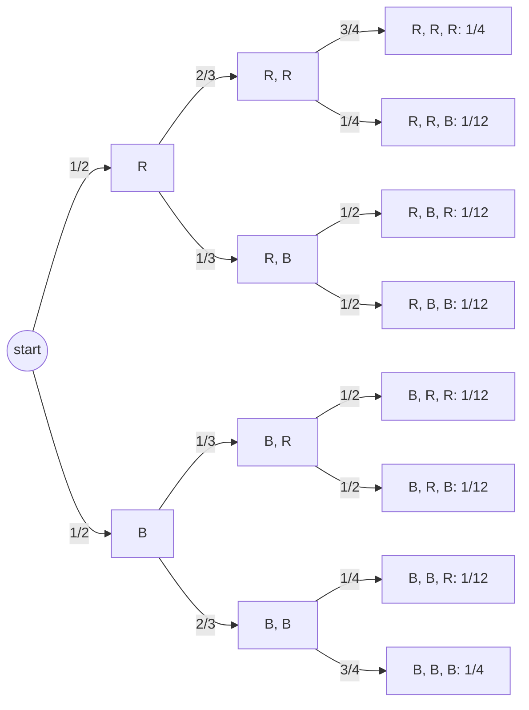

# The Ionescu-Tulcea theorem: give the law of the next step given the whole past, and the infinite process exists on any measurable spaces

[Syllabus](../../../SYLLABUS.md) → [Measure and integration](../README.md) → [Product Measures and Fubini](../README.md#s06) → The Ionescu-Tulcea theorem

---

## General Overview

An urn holds one red ball and one black ball. Draw a ball at random, note its colour, and put it back with one extra ball of the same colour. Repeat forever. This is **Pólya's urn**, a 1923 model of contagion: each case of a disease makes the next case more likely.

The urn gives a rule for each next draw from the whole past. After the draws red, red the urn holds 3 red balls of 4, so the next draw is red with chance 3/4. The chance that the first three draws are all red is 1/2 × 2/3 × 3/4 = 1/4. Any finite question is answered this way, one step at a time.

The questions that matter are about the endless sequence. Does the share of red balls settle down? To what? Such a question needs one probability on all infinite sequences of draws at once. Kolmogorov's theorem, on [Infinitely many coin tosses](07-infinite-sequences-and-kolmogorov-extension.md), builds one from the laws of the first n terms, but it needs real-valued terms (or terms in a space built like the reals), and on general spaces it can fail. The Ionescu-Tulcea theorem asks for more input, the next-step rules themselves, and in exchange it works on any spaces at all.

**Give the first step a probability and give each later step a probability that depends measurably on the whole past; then there is exactly one probability on the infinite sequences of steps whose laws for the first n steps are the step-by-step products, on any measurable spaces, with no topology (no notion of nearness between values).**

**What kind of fact this is:** a theorem, proved on this card in Why it works, with the key step in full in a folded proof. A probability kernel and its composition are definitions.

### The picture: the urn's first three draws

Each branch carries the kernel's chance of the next colour, given the path so far. A leaf's chance is the product along its path.



The tree for three draws, with every chance computed by the checks. The theorem says the tree, grown forever, is one probability on infinite paths.

---

## The formula

Notation first, in words. Step n takes a value in a **state space** $`E_n`$ with a sigma-algebra $`\mathcal{E}_n`$, the sets of values allowed a chance. For the urn, $`E_n = \{R, B\}`$ (red or black) with all four of its subsets. Nothing more is assumed: no distance, no order, no notion of a closed set.

A **history** of length n is a list $`x = (x_1, \dots, x_n)`$ of the first n values. The histories form the product $`H_n = E_1 \times \dots \times E_n`$ with the product sigma-algebra ([Product sigma-algebras](01-product-sigma-algebras.md)).

A **probability kernel** $`\kappa_n`$ from $`H_n`$ to $`E_{n+1}`$ is a rule with two properties:

- For each history $`x`$, the map $`G \mapsto \kappa_n(x, G)`$ is a probability on $`E_{n+1}`$: the law of the next step after that history.
- For each set $`G`$ of next values, the map $`x \mapsto \kappa_n(x, G)`$ is measurable: the chance of G depends on the past in a way that can be integrated.

The urn's kernel: with $`r_n(x)`$ the number of reds in the history $`x`$, the urn holds $`1 + r_n(x)`$ red balls among $`n + 2`$.

```math
\kappa_n(x, \{R\}) = \frac{1 + r_n(x)}{n + 2}, \qquad \kappa_n(x, \{B\}) = \frac{1 + n - r_n(x)}{n + 2}
```

**Composition.** Start from a probability $`P_1`$ on $`E_1`$, the law of the first step. Given the law $`P_n`$ of the first n steps, define the law of the first n + 1 steps by

```math
P_{n+1}(C) = \int_{H_n} \kappa_n(x, C_x)\, P_n(dx), \qquad C_x = \{\, y \in E_{n+1} : (x, y) \in C \,\}
```

**Read it aloud:** to find the chance of a set C of longer histories, take each short history x, ask the kernel for the chance that the next step keeps you in C, and average over the short histories.

Here $`C_x`$ is the section of C at x, as on [Product measure](02-product-measure.md), and $`P_n(dx)`$ marks the integral against $`P_n`$ over the histories x. Write $`P_{n+1} = P_n \otimes \kappa_n`$. For a box, a set $`A \times G`$ with $`A`$ a set of histories and $`G`$ a set of next values, the formula reads $`P_{n+1}(A \times G) = \int_A \kappa_n(x, G)\, P_n(dx)`$. For the urn, $`P_3(\{(R,R,R)\}) = P_2(\{(R,R)\}) \times \kappa_2((R,R), \{R\}) = 1/3 \times 3/4 = 1/4`$.

**The theorem.** Let $`\Omega = E_1 \times E_2 \times \cdots`$ be the infinite sequences $`\omega = (\omega_1, \omega_2, \dots)`$, with the product sigma-algebra, generated by the **cylinder sets**: sets that constrain the first n steps for some n and leave the rest free. Then there is exactly one probability $`P`$ on $`\Omega`$ with

```math
P\{\omega : (\omega_1, \dots, \omega_n) \in A\} = P_n(A) \quad \text{for every } n \text{ and every measurable } A \subseteq H_n
```

**Read it aloud:** the step-by-step laws are the pieces of one law on whole infinite paths, and only one.

| Symbol | Plain meaning | In our example | Push it up and the answer… |
| --- | --- | --- | --- |
| $`E_n`$, $`\mathcal{E}_n`$, $`n`$ | the values step n can take, and the sets of them allowed a chance; the step number | {R, B} with all subsets; draw n | a later step has a longer past to depend on |
| $`H_n`$, $`x`$, $`y`$ | histories of length n; one history; one next value | x = (R, R), y = R | — |
| $`\kappa_n`$ | the kernel: the law of step n + 1 for each history | after (R, R): R with 3/4 | — |
| $`r_n(x)`$ | number of reds in the history x | 2 for (R, R) | more reds, red more likely next |
| $`P_1`$, $`P_n`$ | the law of the first step; the law of the first n steps | R with 1/2; P_3 gives (R, R, R) 1/4 | — |
| $`A`$, $`G`$, $`C`$, $`C_x`$ | a set of histories; a set of next values; a set of longer histories; its section at x | A = {(R, R)}, G = {R} | a bigger set has a bigger chance |
| $`\Omega`$, $`\omega`$, $`\omega_n`$, $`P`$ | all infinite paths; one path; its n-th step; the law of the whole path | all endless sequences of draws | — |
| $`\nu`$ | a fixed law that ignores the past | a fair coin, 1/2 each | — |
| $`p`$, $`k`$, $`k!`$, $`\binom{n}{k}`$ | a share of red, from 0 to 1; a number of reds; k factorial; the number of ways to place k reds among n draws | p^3 integrates to 1/4; 3 histories with 2 reds in 3 | — |
| $`h_k`$, $`h^m_k`$, $`D`$, $`D_m`$, $`n_m`$, $`\varepsilon`$, $`m`$ | in the proof: the chance of a cylinder set D given the first k steps, and that of $`D_m`$; shrinking cylinder sets; how many steps $`D_m`$ constrains; a floor on their chances; their index | for "R, R, R": h_1(R) = 1/2, h_0 = 1/4 | — |
| $`g_m`$, $`g`$ | in the proof: the chances one step later, and their limit | — | — |
| $`\mathbf{1}_A`$, $`f`$ | the indicator of A, 1 on A and 0 off it; a function, at least 0, integrated | — | — |

### When it holds

- **Each kernel gives total chance 1.** A sticky-coin "kernel" that repeats with 0.8 and switches with 0.3 has weights adding to 1.1. Then the law of two tosses says heads, heads with 0.40, while the law of three tosses, summed over the third, says 0.44. No single P has both as pieces.
- **The chance depends measurably on the past.** The composition integrates $`x \mapsto \kappa_n(x, G)`$. A rule that gave chance 1 on a non-measurable set of histories, such as the set of [Translation invariance and the Vitali set](../02-Length%20Done%20Properly/04-translation-invariance-and-the-vitali-set.md), has no integral, so $`P_{n+1}`$ is not defined.
- **The kernels are given, not only the finite laws.** Kolmogorov's theorem starts from the laws $`P_n`$ alone. Recovering kernels from them means building conditional laws, which needs spaces like the reals. Where kernels are given, as for an urn, a Markov chain or a simulation, no topology is needed.
- **The steps are counted 1, 2, 3, …** The proof builds a path one step at a time, so it covers sequences. A process in continuous time, such as Brownian motion, needs Kolmogorov's theorem and more.

---

## Why it works

### Step 0: build the missing point one step at a time

Every extension proof has one hard part. Cylinder sets that shrink, each with chance at least some fixed $`\varepsilon > 0`$, must share a point. Kolmogorov's proof finds that point by compactness: points in closed, bounded sets of reals have convergent subsequences. A general space has nothing like that.

Kernels give a different road. They say, for each history, how likely the future is to stay inside a set. So pick the first step where that conditional chance stays at least $`\varepsilon`$ for every set in the shrinking family. Then pick the second step the same way, and so on. The path built this way lies in every set. An average of at least $`\varepsilon`$ always has a value of at least $`\varepsilon`$ somewhere, and that is all the proof uses.

### Step 1: composing a kernel gives a probability

Three things must hold for $`P_{n+1} = P_n \otimes \kappa_n`$ to be a probability.

1. **The integral makes sense.** For a box $`A \times G`$, the integrand is $`\mathbf{1}_A(x)\, \kappa_n(x, G)`$: the indicator of A, 1 on A and 0 off it, times a measurable function. The good sets C, those whose integrand is measurable, form a Dynkin system (a family holding the whole space and closed under complements and countable disjoint unions). Boxes are a pi-system, a family closed under overlap, so the good sets are all of the product sigma-algebra ([Pi-systems and Dynkin's theorem](../01-Sets%20You%20Can%20Measure/06-pi-systems-and-uniqueness.md)).
2. **It adds over countably many pieces.** Disjoint sets $`C^1, C^2, \dots`$ have disjoint sections, each $`\kappa_n(x, \cdot)`$ adds over them, and the sum passes through the integral by [The monotone convergence theorem](../04-The%20Lebesgue%20Integral/03-monotone-convergence-theorem.md).
3. **Its total is 1.** Every section of the whole space is all of $`E_{n+1}`$, so the integrand is 1.

The same argument gives an iterated integral for functions, as on [Tonelli and Fubini](03-tonelli-and-fubini.md): $`\int f\, dP_{n+1} = \int \big( \int f(x, y)\, \kappa_n(x, dy) \big) P_n(dx)`$ for every measurable $`f \ge 0`$, where $`\kappa_n(x, dy)`$ marks the integral over the next value y against the kernel's law after history x.

When the kernel ignores the past, $`\kappa_n(x, G) = \nu(G)`$, the formula is $`P_n(A)\,\nu(G)`$ on boxes: the product measure. So [Product measure](02-product-measure.md) is the special case with no memory.

### Step 2: the laws fit together for free

Take the box $`A \times E_{n+1}`$: a condition on the first n steps and none on the next. Its sections are all of $`E_{n+1}`$ over A, so

```math
P_{n+1}(A \times E_{n+1}) = \int_A \kappa_n(x, E_{n+1})\, P_n(dx) = \int_A 1\, P_n(dx) = P_n(A)
```

This is Kolmogorov's consistency condition, and here it costs nothing. The urn: $`P_3(R,R,R) + P_3(R,R,B) = 1/4 + 1/12 = 1/3 = P_2(R,R)`$. The code checks every history up to 10 draws.

### Step 3: one value for every cylinder set

A cylinder set with base A over n steps has base $`A \times E_{n+1}`$ over n + 1 steps. Step 2 gives both the same chance, so setting $`P`$ equal to $`P_n`$ of the base is unambiguous. Cylinder sets form an algebra (closed under complements and finite unions), and $`P`$ adds over finitely many disjoint ones, since they can be written over a common n.

### Step 4: shrinking cylinder sets with chance at least ε share a point

Countable additivity on the algebra is exactly this: cylinder sets $`D_1 \supseteq D_2 \supseteq \cdots`$ with every $`P(D_m) \ge \varepsilon > 0`$ have a common point. (The algebra argument is on [Infinitely many coin tosses](07-infinite-sequences-and-kolmogorov-extension.md), item 3 of its folded proof.)

For a cylinder set D and a history of length k, let $`h_k(x_1, \dots, x_k)`$ be the chance of D given those first k steps. It is computed backwards. Once k reaches the steps D constrains, $`h_k`$ is 1 inside the base and 0 outside. Before that, one kernel step at a time:

```math
h_k(x_1, \dots, x_k) = \int_{E_{k+1}} h_{k+1}(x_1, \dots, x_k, y)\, \kappa_k((x_1, \dots, x_k), dy), \qquad h_0 = P(D)
```

**Read it aloud:** the chance of D given the past is the average, over the next step, of the chance given one more step.

For D = "the first three draws are red": $`h_1(R) = 2/3 \times 3/4 = 1/2`$ and $`h_1(B) = 0`$, so $`h_0 = 1/2 \times 1/2 + 1/2 \times 0 = 1/4`$.

Now build the point. Every $`h_0 = P(D_m)`$ is at least $`\varepsilon`$. So some first step $`\omega_1`$ keeps the chance of every $`D_m`$ at least $`\varepsilon`$; then some $`\omega_2`$ does the same after $`\omega_1`$; and so on. Once k passes the steps that $`D_m`$ constrains, $`h_k`$ is an indicator at least $`\varepsilon`$, so it equals 1: the path is in $`D_m`$.

<details>
<summary>Detailed proof: the path built step by step lies in every set</summary>

**Setting.** $`D_1 \supseteq D_2 \supseteq \cdots`$ are cylinder sets, $`D_m`$ constrains the first $`n_m`$ steps, and $`P(D_m) \ge \varepsilon > 0`$ for every m. Write $`h^m_k`$ for the function $`h_k`$ of $`D_m`$.

**1. The functions are measurable, lie between 0 and 1, and $`h^m_0 = P(D_m)`$.** For $`k \ge n_m`$, $`h^m_k`$ is the indicator of the base of $`D_m`$. Going backwards, each integral of a measurable function against a kernel is measurable in the past (Step 1). Applying Step 1's iterated integral $`n_m`$ times gives $`h^m_0 = P_{n_m}(\text{base}) = P(D_m)`$.

**2. They decrease in m.** Take the $`n_m`$ rising, which loses nothing. For $`k \ge n_{m+1}`$ both functions are indicators, and $`D_{m+1} \subseteq D_m`$ gives $`h^{m+1}_k \le h^m_k`$. Integrating against a kernel keeps the order, so it holds for every k.

**3. The choice of the next step.** Suppose $`\omega_1, \dots, \omega_k`$ are chosen with $`h^m_k(\omega_1, \dots, \omega_k) \ge \varepsilon`$ for every m; for k = 0 this is the hypothesis. Let $`g_m(y) = h^m_{k+1}(\omega_1, \dots, \omega_k, y)`$. These decrease in m to a limit $`g`$. Apply monotone convergence to the rising functions $`1 - g_m`$ against the probability $`\kappa_k((\omega_1, \dots, \omega_k), \cdot)`$:

$`\displaystyle \int g\, d\kappa_k = \lim_{m \to \infty} \int g_m\, d\kappa_k = \lim_{m \to \infty} h^m_k(\omega_1, \dots, \omega_k) \ge \varepsilon`$

If $`g(y) < \varepsilon`$ for every y, then $`\varepsilon - g`$ is strictly positive everywhere, its integral against a probability is strictly positive, and $`\int g\, d\kappa_k < \varepsilon`$. So some y has $`g(y) \ge \varepsilon`$. Since $`g_m \ge g`$, this y has $`h^m_{k+1}(\omega_1, \dots, \omega_k, y) \ge \varepsilon`$ for every m. Set $`\omega_{k+1} = y`$.

**4. The path lies in every $`D_m`$.** This gives a whole path $`\omega`$. For each m, $`h^m_{n_m}(\omega_1, \dots, \omega_{n_m}) \ge \varepsilon > 0`$, and that function is an indicator, so it equals 1: the first $`n_m`$ steps of $`\omega`$ lie in the base, and $`\omega \in D_m`$.

No step used a distance, a closed set or a convergent subsequence. The construction only picks one y at each stage, countably many times.

</details>

### Step 5: extend, and only one way

Step 4 makes $`P`$ a premeasure on the algebra of cylinder sets: it adds over countably many disjoint pieces. [Caratheodory's extension theorem](../02-Length%20Done%20Properly/05-caratheodory-extension-theorem.md) extends it to the product sigma-algebra. Cylinder sets are a pi-system generating that sigma-algebra, so two probabilities that agree on them agree everywhere ([Pi-systems and Dynkin's theorem](../01-Sets%20You%20Can%20Measure/06-pi-systems-and-uniqueness.md)). That proves the theorem.

### Step 6: what the urn's infinite law says

For one history with k reds in n draws, the kernel chances multiply to a simple product. The red numerators run 1, 2, …, k and the black numerators 1, 2, …, n − k; the denominators run 2, 3, …, n + 1:

```math
P_n(x) = \frac{k!\,(n-k)!}{(n+1)!}
```

Here $`k!`$, "k factorial", is $`1 \times 2 \times \dots \times k`$. The order of the colours does not matter: (R, R, B), (R, B, R) and (B, R, R) each have chance 1/12. There are $`\binom{n}{k} = n!/(k!\,(n-k)!)`$ such histories, so the number of reds in n draws is k with chance $`1/(n+1)`$, for every k from 0 to n. In 10 draws, each count from 0 to 10 has chance 1/11.

The same chances come from a different story. Pick a share p of red uniformly between 0 and 1, then draw independently with chance p of red. A history with k reds then has chance $`\int_0^1 p^k (1-p)^{n-k}\, dp`$, and repeated integration by parts gives $`k!\,(n-k)!/(n+1)!`$. For three reds, $`\int_0^1 p^3\, dp = 1/4`$. The code checks all 510 histories of 1 to 8 draws against this integral.

So the long-run share of red does not settle at 1/2. It settles at a random value, spread evenly between 0 and 1. That limit is a statement about infinite paths, and only the law $`P`$ of this theorem gives it a meaning; proving it takes martingale convergence.

### Step 7: Markov chains and independent sequences are special cases

A **Markov** kernel looks only at the last step: $`\kappa_n(x, \cdot)`$ depends on $`x_n`$ alone. The sticky coin of [Infinitely many coin tosses](07-infinite-sequences-and-kolmogorov-extension.md) is fair on toss 1, and each later toss repeats the one before with chance 0.8. So $`P(H, H, H) = 0.5 \times 0.8 \times 0.8 = 0.32`$, and the theorem gives its law on whole paths. A kernel that ignores the past gives an independent sequence. The urn is neither: its next draw depends on the whole count of reds so far.

**What the code shows, and what only the proof shows.** The code composes kernels exactly up to 10 draws, compares 510 histories with the mixture integral, and builds 200,000 urns and sticky coins from uniform numbers. That one law exists on all infinite paths, on any spaces, only the proof covers.

---

## Worked numbers, by hand

| Step | Arithmetic | Value |
| --- | --- | --- |
| kernel at the start | 1 red of 2 balls | 1/2 |
| kernel after R | 2 red of 3 balls | 2/3 |
| kernel after R, R | 3 red of 4 balls | 3/4 |
| three reds | 1/2 × 2/3 × 3/4 | **1/4** |
| red, red, black | 1/2 × 2/3 × 1/4 | 1/12 |
| consistency | P(R,R,R) + P(R,R,B) = 1/4 + 1/12 | 1/3 = P(R, R) |
| black, red, red | 1/2 × 1/3 × 2/4 | 1/12 |
| reds in 3 draws | 0: 1/4; 1: 3 × 1/12; 2: 3 × 1/12; 3: 1/4 | 1/4 each |
| mixture road | integral of p^3 from 0 to 1 | 0.250000 |
| sticky coin, three heads | 0.5 × 0.8 × 0.8 | **0.32** |

Three reds have chance 1/4, twice what three independent fair draws would give: early reds make later reds more likely.

### What breaks if you drop a piece

| Mistake | Comes out at | What went wrong |
| --- | --- | --- |
| Treat the draws as independent halves | P(R, R, R) = 0.125, not 0.25 | the kernel's dependence on the past is thrown away |
| Kernel weights add to 1.1 (repeat 0.8, switch 0.3) | P_2(H, H) = 0.40, but P_3 summed over toss 3 gives 0.44; P_3 totals 1.21 | the next-step law is not a probability, so the laws stop fitting together |
| Expect the share of red to settle at 1/2 | at most 25 reds in 100 draws: 0.257426 for the urn, 2.82 × 10^-7 for a fair coin | the urn's limit share is random, spread evenly over 0 to 1 |

The code prints all three.

---

## Code, from first principles, and it actually runs

Three roads. Road 1 composes the kernels exactly, in fractions, up to 10 draws: it prints the tree, checks that every law sums out to the one before, and counts the reds. It also composes the kernel on the count of reds over 100 draws: at most 25 reds has chance exactly 26/101 = 0.257426. Road 2 integrates $`p^k (1-p)^{n-k}`$ by Simpson's rule, a weighted sum of 1,001 values, and sets it against road 1 on all 510 histories of 1 to 8 draws. Road 3 builds each draw from one uniform number, as on [Infinitely many coin tosses](07-infinite-sequences-and-kolmogorov-extension.md): draw n + 1 is red when U < (1 + reds)/(n + 2). Such quantile maps build the sequence when each step is a number; the theorem needs no such map, which is why it holds on any spaces. The uniforms come from SplitMix64, a small random-number generator written out in both languages, seed 20261123. Asserts on simulated numbers allow four standard errors (the typical size of a simulation's chance error).

### Python

```python
# The Ionescu-Tulcea theorem -- the check behind the card.  Standard library only.
# Roads: (1) compose the urn's kernels step by step, in exact fractions;
# (2) the same chances as an integral over a uniform share p, by Simpson's rule;
# (3) build the draws from uniform numbers (SplitMix64, seed 20261123) and count.
from fractions import Fraction as Fr
from itertools import product
def urn(past, colour):                       # kernel: chance the next draw is `colour`
    red = Fr(1 + sum(past), len(past) + 2)   # 1 = red, 0 = black
    return red if colour == 1 else 1 - red
def sticky(past, colour, stay=Fr(4, 5), switch=Fr(1, 5)):
    if not past:
        return Fr(1, 2)
    return stay if colour == past[-1] else switch
def compose(law, kernel):                    # P_{n+1}(x, y) = P_n(x) * kernel(x, y)
    return {x + (y,): p * kernel(x, y) for x, p in law.items() for y in (0, 1)}
def laws(kernel, n):                         # P_1, ..., P_n
    out, law = [], {(): Fr(1)}
    for _ in range(n):
        law = compose(law, kernel)
        out.append(law)
    return out
def word(x): return "".join("R" if c else "B" for c in x)
# ---- road 1: kernels composed, exact ----
P = laws(urn, 10)
print("urn kernel after R:   P(R) = %s, P(B) = %s" % (urn((1,), 1), urn((1,), 0)))
print("urn kernel after R,R: P(R) = %s, P(B) = %s" % (urn((1, 1), 1), urn((1, 1), 0)))
rrr = P[2][(1, 1, 1)]
print("P(R, R, R) = 1/2 x 2/3 x 3/4 =", rrr, "=", f"{float(rrr):.6f}")
assert rrr == Fr(1, 2) * Fr(2, 3) * Fr(3, 4)
pasts = [()] + [x for n in (1, 2) for x in sorted(P[n - 1], reverse=True)]
print("tree, P(next R) after each past:", ", ".join(f"{word(x) or 'start'} {urn(x, 1)}" for x in pasts))
print("tree, three draws:", ", ".join(f"{word(x)} {p}" for x, p in sorted(P[2].items(), reverse=True)))
print(f"consistency at R,R: P(RRR) + P(RRB) = {rrr} + {P[2][(1, 1, 0)]} = {rrr + P[2][(1, 1, 0)]} = P(RR)")
for n in range(1, 10):                       # consistency: sum out the last draw
    for x, p in P[n - 1].items():
        assert P[n][x + (0,)] + P[n][x + (1,)] == p
    assert sum(P[n].values()) == 1
print("urn laws consistent for n = 1 to 10: yes; total of every law = 1")
for n in (3, 10):
    counts = [sum(p for x, p in P[n - 1].items() if sum(x) == k) for k in range(n + 1)]
    assert all(c == Fr(1, n + 1) for c in counts)
    print(f"number of reds in {n} draws: each of 0..{n} has chance {counts[0]}")
print("order does not matter: P(RRB) = %s, P(RBR) = %s, P(BRR) = %s"
      % (P[2][(1, 1, 0)], P[2][(1, 0, 1)], P[2][(0, 1, 1)]))
h1 = {1: urn((1,), 1) * urn((1, 1), 1), 0: Fr(0)}   # chance of R,R,R given the first draw
h0 = sum(urn((), c) * h1[c] for c in (1, 0))
print(f"proof's h for event RRR: h1(R) = {h1[1]}, h1(B) = 0, h0 = 1/2 x {h1[1]} = {h0}")
assert h0 == rrr
S = laws(sticky, 10)
for n in range(1, 10):
    for x, p in S[n - 1].items():
        assert S[n][x + (0,)] + S[n][x + (1,)] == p
hhh = S[2][(1, 1, 1)]
print("sticky coin: P(H, H, H) = 0.5 x 0.8 x 0.8 =", f"{float(hhh):.2f}" + "; consistent to n = 10: yes")
assert hhh == Fr(8, 25)
# ---- road 2: a uniform share p, then independent draws with chance p ----
def pw(q, k):                                # q to the power k, by repeated multiplying
    out = 1.0
    for _ in range(k):
        out *= q
    return out
def simpson(f, m=1000):
    h = 1.0 / m
    s = f(0.0) + f(1.0) + sum((4 if i % 2 else 2) * f(i * h) for i in range(1, m))
    return s * h / 3
worst = 0.0
for n in range(1, 9):
    for x in product((0, 1), repeat=n):
        k = sum(x)
        v = simpson(lambda q: pw(q, k) * pw(1 - q, n - k))
        worst = max(worst, abs(v - float(P[n - 1][x])))
assert worst < 1e-9
print(f"all 510 patterns of 1 to 8 draws: kernel product = integral of p^k (1-p)^(n-k); largest gap {worst:.0e}")
print(f"integral of p^3 over 0..1 = {simpson(lambda q: pw(q, 3)):.6f}")
# ---- what breaks ----
indep = Fr(1, 2) ** 3
print(f"draws treated as independent halves: P(RRR) = {float(indep):.6f}, not {float(rrr):.6f}")
B = laws(lambda x, y: sticky(x, y, Fr(4, 5), Fr(3, 10)), 3)
print(f"kernel weights 0.8 + 0.3 = 1.1: P_2(HH) = {float(B[1][(1, 1)]):.2f},"
      f" P_3 summed over toss 3 = {float(B[2][(1, 1, 1)] + B[2][(1, 1, 0)]):.2f}, total of P_3 = {float(sum(B[2].values())):.2f}")
assert B[2][(1, 1, 1)] + B[2][(1, 1, 0)] != B[1][(1, 1)]
mk = laws(lambda x, y: urn(x[-1:], y), 3)[2][(1, 1, 1)]   # "Markov" misreading: the kernel sees the last draw only
print(f"kernel that sees only the last draw: P(RRR) = 1/2 x 2/3 x 2/3 = {float(mk):.6f}, not {float(rrr):.6f}")
assert mk != rrr
from math import comb
cnt = {0: Fr(1)}                             # the kernel composed on the count of reds, 100 draws
for n in range(100):
    nxt = dict.fromkeys(range(n + 2), Fr(0))
    for r, p in cnt.items():
        for y in (0, 1):
            nxt[r + y] += p * urn((1,) * r + (0,) * (n - r), y)
    cnt = nxt
urn25 = sum(cnt[r] for r in range(26))
assert urn25 == Fr(26, 101)                  # Step 6: each count from 0 to 100 has chance 1/101
coin25 = Fr(sum(comb(100, k) for k in range(26)), 2 ** 100)
print(f"at most 25 reds in 100 draws: urn {urn25} = {float(urn25):.6f}, the kernel composed 100 times; fair coin {float(coin25) * 1e7:.2f} x 10^-7")
assert coin25 < Fr(1, 10 ** 6)
# ---- road 3: the draws built from uniform numbers ----
M = (1 << 64) - 1
state = 20261123
def uniform():
    global state
    state = (state + 0x9E3779B97F4A7C15) & M
    z = state
    z = ((z ^ (z >> 30)) * 0xBF58476D1CE4E5B9) & M
    z = ((z ^ (z >> 27)) * 0x94D049BB133111EB) & M
    return ((z ^ (z >> 31)) >> 11) / 2.0 ** 53
def urn_run(n):                              # draw n+1 is red when U < (1 + reds) / (n + 2)
    reds = 0
    for i in range(n):
        if uniform() < (1 + reds) / (i + 2):
            reds += 1
    return reds
runs = 200000
hits = sum(urn_run(3) == 3 for _ in range(runs))
est, se = hits / runs, (0.25 * 0.75 / runs) ** 0.5
print(f"simulated urn, {runs} runs: P(RRR) = {est:.6f}; exact 0.250000; standard error {se:.6f}")
assert abs(est - 0.25) < 4 * se
long_runs = 20000
low = sum(urn_run(100) <= 25 for _ in range(long_runs))
est2 = low / long_runs
se2 = (float(urn25) * (1 - float(urn25)) / long_runs) ** 0.5
print(f"simulated urn, {long_runs} runs of 100 draws: P(at most 25 reds) = {est2:.6f};"
      f" exact {float(urn25):.6f}; standard error {se2:.6f}")
assert abs(est2 - float(urn25)) < 4 * se2
hh = 0
for _ in range(runs):
    t1 = uniform() < 0.5
    t2 = t1 if uniform() < 0.8 else not t1
    t3 = t2 if uniform() < 0.8 else not t2
    hh += t1 and t2 and t3
est3, se3 = hh / runs, (0.32 * 0.68 / runs) ** 0.5
print(f"simulated sticky coin, {runs} runs: P(HHH) = {est3:.6f}; exact 0.320000; standard error {se3:.6f}")
assert abs(est3 - 0.32) < 4 * se3
print("ALL CHECKS PASS")
```

**Ran 2026-11-23 on macOS, Python 3.14.10, standard library only. All checks passed. Output, pasted from the run:**

```
urn kernel after R:   P(R) = 2/3, P(B) = 1/3
urn kernel after R,R: P(R) = 3/4, P(B) = 1/4
P(R, R, R) = 1/2 x 2/3 x 3/4 = 1/4 = 0.250000
tree, P(next R) after each past: start 1/2, R 2/3, B 1/3, RR 3/4, RB 1/2, BR 1/2, BB 1/4
tree, three draws: RRR 1/4, RRB 1/12, RBR 1/12, RBB 1/12, BRR 1/12, BRB 1/12, BBR 1/12, BBB 1/4
consistency at R,R: P(RRR) + P(RRB) = 1/4 + 1/12 = 1/3 = P(RR)
urn laws consistent for n = 1 to 10: yes; total of every law = 1
number of reds in 3 draws: each of 0..3 has chance 1/4
number of reds in 10 draws: each of 0..10 has chance 1/11
order does not matter: P(RRB) = 1/12, P(RBR) = 1/12, P(BRR) = 1/12
proof's h for event RRR: h1(R) = 1/2, h1(B) = 0, h0 = 1/2 x 1/2 = 1/4
sticky coin: P(H, H, H) = 0.5 x 0.8 x 0.8 = 0.32; consistent to n = 10: yes
all 510 patterns of 1 to 8 draws: kernel product = integral of p^k (1-p)^(n-k); largest gap 2e-12
integral of p^3 over 0..1 = 0.250000
draws treated as independent halves: P(RRR) = 0.125000, not 0.250000
kernel weights 0.8 + 0.3 = 1.1: P_2(HH) = 0.40, P_3 summed over toss 3 = 0.44, total of P_3 = 1.21
kernel that sees only the last draw: P(RRR) = 1/2 x 2/3 x 2/3 = 0.222222, not 0.250000
at most 25 reds in 100 draws: urn 26/101 = 0.257426, the kernel composed 100 times; fair coin 2.82 x 10^-7
simulated urn, 200000 runs: P(RRR) = 0.250605; exact 0.250000; standard error 0.000968
simulated urn, 20000 runs of 100 draws: P(at most 25 reds) = 0.257700; exact 0.257426; standard error 0.003092
simulated sticky coin, 200000 runs: P(HHH) = 0.321625; exact 0.320000; standard error 0.001043
ALL CHECKS PASS
```

### Rust

```rust
// The Ionescu-Tulcea theorem -- the check behind the card.  std only, no crates.
// Roads: (1) compose the urn's kernels step by step, in exact fractions;
// (2) the same chances as an integral over a uniform share p, by Simpson's rule;
// (3) build the draws from uniform numbers (SplitMix64, seed 20261123) and count.
// A pattern of n draws is a number whose bits, first draw highest, are 1 = red, 0 = black.
use std::fmt;

#[derive(Clone, Copy, PartialEq, Debug)]
struct Q { n: i128, d: i128 }
fn gcd(a: i128, b: i128) -> i128 { if b == 0 { a.abs() } else { gcd(b, a % b) } }
fn q(n: i128, d: i128) -> Q { let g = gcd(n, d).max(1); Q { n: n / g, d: d / g } }
impl Q {
    fn mul(self, o: Q) -> Q { q(self.n * o.n, self.d * o.d) }
    fn add(self, o: Q) -> Q { q(self.n * o.d + o.n * self.d, self.d * o.d) }
    fn f(self) -> f64 { self.n as f64 / self.d as f64 }
}
impl fmt::Display for Q {
    fn fmt(&self, w: &mut fmt::Formatter) -> fmt::Result {
        if self.d == 1 { write!(w, "{}", self.n) } else { write!(w, "{}/{}", self.n, self.d) }
    }
}
fn bits(v: usize, n: usize) -> Vec<u8> { (0..n).rev().map(|i| ((v >> i) & 1) as u8).collect() }
fn urn(past: &[u8], colour: u8) -> Q {
    let s: i128 = past.iter().map(|&c| c as i128).sum();
    let red = q(1 + s, past.len() as i128 + 2);
    if colour == 1 { red } else { q(red.d - red.n, red.d) }
}
fn sticky(past: &[u8], colour: u8, stay: Q, switch: Q) -> Q {
    if past.is_empty() { return q(1, 2); }
    if colour == past[past.len() - 1] { stay } else { switch }
}
// P_{n+1}(x, y) = P_n(x) * kernel(x, y); laws[n-1] is P_n, indexed by pattern
fn laws(kernel: &dyn Fn(&[u8], u8) -> Q, n: usize) -> Vec<Vec<Q>> {
    let mut out: Vec<Vec<Q>> = Vec::new();
    let mut law = vec![q(1, 1)];
    for m in 0..n {
        let mut next = vec![q(0, 1); law.len() * 2];
        for (v, &p) in law.iter().enumerate() {
            for y in 0..2u8 { next[2 * v + y as usize] = p.mul(kernel(&bits(v, m), y)); }
        }
        out.push(next.clone());
        law = next;
    }
    out
}
fn word(v: usize, n: usize) -> String { bits(v, n).iter().map(|&c| if c == 1 { 'R' } else { 'B' }).collect() }
fn pw(x: f64, k: usize) -> f64 { let mut o = 1.0; for _ in 0..k { o *= x; } o }
fn simpson(f: &dyn Fn(f64) -> f64, m: usize) -> f64 {
    let h = 1.0 / m as f64;
    let mut t = 0.0;
    for i in 1..m { t += (if i % 2 == 1 { 4.0 } else { 2.0 }) * f(i as f64 * h); }
    (f(0.0) + f(1.0) + t) * h / 3.0
}
fn consistent(l: &Vec<Vec<Q>>) -> bool {
    (1..l.len()).all(|n| (0..l[n - 1].len()).all(|v| l[n][2 * v].add(l[n][2 * v + 1]) == l[n - 1][v]))
}
struct Rng { s: u64 }
impl Rng {
    fn uniform(&mut self) -> f64 {
        self.s = self.s.wrapping_add(0x9E3779B97F4A7C15);
        let mut z = self.s;
        z = (z ^ (z >> 30)).wrapping_mul(0xBF58476D1CE4E5B9);
        z = (z ^ (z >> 27)).wrapping_mul(0x94D049BB133111EB);
        ((z ^ (z >> 31)) >> 11) as f64 / 9007199254740992.0
    }
    fn urn_run(&mut self, n: usize) -> usize {
        let mut reds = 0;
        for i in 0..n { if self.uniform() < (1 + reds) as f64 / (i + 2) as f64 { reds += 1; } }
        reds
    }
}
fn main() {
    // ---- road 1: kernels composed, exact ----
    let p = laws(&urn, 10);
    println!("urn kernel after R:   P(R) = {}, P(B) = {}", urn(&[1], 1), urn(&[1], 0));
    println!("urn kernel after R,R: P(R) = {}, P(B) = {}", urn(&[1, 1], 1), urn(&[1, 1], 0));
    let rrr = p[2][7];
    println!("P(R, R, R) = 1/2 x 2/3 x 3/4 = {} = {:.6}", rrr, rrr.f());
    assert!(rrr == q(1, 2).mul(q(2, 3)).mul(q(3, 4)));
    let mut pasts = vec!["start".to_string() + " " + &urn(&[], 1).to_string()];
    for n in 1..3usize {
        for v in (0..1usize << n).rev() { pasts.push(format!("{} {}", word(v, n), urn(&bits(v, n), 1))); }
    }
    println!("tree, P(next R) after each past: {}", pasts.join(", "));
    let tree: Vec<String> = (0..8).rev().map(|v| format!("{} {}", word(v, 3), p[2][v])).collect();
    println!("tree, three draws: {}", tree.join(", "));
    println!("consistency at R,R: P(RRR) + P(RRB) = {} + {} = {} = P(RR)", rrr, p[2][6], rrr.add(p[2][6]));
    assert!(consistent(&p));
    for law in &p { assert!(law.iter().fold(q(0, 1), |a, &b| a.add(b)) == q(1, 1)); }
    println!("urn laws consistent for n = 1 to 10: yes; total of every law = 1");
    for &n in &[3usize, 10] {
        let counts: Vec<Q> = (0..=n).map(|k| (0..1usize << n).filter(|v| v.count_ones() as usize == k)
            .fold(q(0, 1), |a, v| a.add(p[n - 1][v]))).collect();
        assert!(counts.iter().all(|&c| c == q(1, n as i128 + 1)));
        println!("number of reds in {} draws: each of 0..{} has chance {}", n, n, counts[0]);
    }
    println!("order does not matter: P(RRB) = {}, P(RBR) = {}, P(BRR) = {}", p[2][6], p[2][5], p[2][3]);
    let h1r = urn(&[1], 1).mul(urn(&[1, 1], 1));
    let h0 = urn(&[], 1).mul(h1r).add(urn(&[], 0).mul(q(0, 1)));
    println!("proof's h for event RRR: h1(R) = {}, h1(B) = 0, h0 = 1/2 x {} = {}", h1r, h1r, h0);
    assert!(h0 == rrr);
    let s = laws(&|x: &[u8], y: u8| sticky(x, y, q(4, 5), q(1, 5)), 10);
    assert!(consistent(&s));
    let hhh = s[2][7];
    println!("sticky coin: P(H, H, H) = 0.5 x 0.8 x 0.8 = {:.2}; consistent to n = 10: yes", hhh.f());
    assert!(hhh == q(8, 25));
    // ---- road 2: a uniform share p, then independent draws with chance p ----
    let mut worst: f64 = 0.0;
    for n in 1..9usize {
        for v in 0..1usize << n {
            let k = v.count_ones() as usize;
            let val = simpson(&|x: f64| pw(x, k) * pw(1.0 - x, n - k), 1000);
            worst = worst.max((val - p[n - 1][v].f()).abs());
        }
    }
    assert!(worst < 1e-9);
    println!("all 510 patterns of 1 to 8 draws: kernel product = integral of p^k (1-p)^(n-k); largest gap {:.0e}", worst);
    println!("integral of p^3 over 0..1 = {:.6}", simpson(&|x: f64| pw(x, 3), 1000));
    // ---- what breaks ----
    let indep = q(1, 8);
    println!("draws treated as independent halves: P(RRR) = {:.6}, not {:.6}", indep.f(), rrr.f());
    let b = laws(&|x: &[u8], y: u8| sticky(x, y, q(4, 5), q(3, 10)), 3);
    let total = b[2].iter().fold(q(0, 1), |a, &c| a.add(c));
    println!("kernel weights 0.8 + 0.3 = 1.1: P_2(HH) = {:.2}, P_3 summed over toss 3 = {:.2}, total of P_3 = {:.2}",
        b[1][3].f(), b[2][7].add(b[2][6]).f(), total.f());
    assert!(b[2][7].add(b[2][6]) != b[1][3]);
    let mk = laws(&|x: &[u8], y: u8| urn(&x[x.len().saturating_sub(1)..], y), 3)[2][7];   // "Markov" misreading: last draw only
    println!("kernel that sees only the last draw: P(RRR) = 1/2 x 2/3 x 2/3 = {:.6}, not {:.6}", mk.f(), rrr.f());
    assert!(mk != rrr);
    let mut cnt = vec![q(1, 1)];                       // the kernel composed on the count of reds, 100 draws
    for n in 0..100usize {
        let mut nxt = vec![q(0, 1); n + 2];
        for (r, &pr) in cnt.iter().enumerate() {
            let past: Vec<u8> = (0..n).map(|i| (i < r) as u8).collect();
            for y in 0..2u8 { nxt[r + y as usize] = nxt[r + y as usize].add(pr.mul(urn(&past, y))); }
        }
        cnt = nxt;
    }
    let urn25 = cnt[..26].iter().fold(q(0, 1), |a, &b| a.add(b));
    assert!(urn25 == q(26, 101));                      // Step 6: each count from 0 to 100 has chance 1/101
    let (mut c, mut num) = (1i128, 0i128);
    for k in 0..26i128 { num += c; c = c * (100 - k) / (k + 1); }
    println!("at most 25 reds in 100 draws: urn {} = {:.6}, the kernel composed 100 times; fair coin {:.2} x 10^-7", urn25, urn25.f(), num as f64 / (1i128 << 100) as f64 * 1e7);
    assert!(num * 1_000_000 < (1i128 << 100));
    // ---- road 3: the draws built from uniform numbers ----
    let mut r = Rng { s: 20261123 };
    let runs = 200000usize;
    let hits = (0..runs).filter(|_| r.urn_run(3) == 3).count();
    let (est, se) = (hits as f64 / runs as f64, (0.25f64 * 0.75 / runs as f64).sqrt());
    println!("simulated urn, {} runs: P(RRR) = {:.6}; exact 0.250000; standard error {:.6}", runs, est, se);
    assert!((est - 0.25).abs() < 4.0 * se);
    let long_runs = 20000usize;
    let low = (0..long_runs).filter(|_| r.urn_run(100) <= 25).count();
    let est2 = low as f64 / long_runs as f64;
    let se2 = (urn25.f() * (1.0 - urn25.f()) / long_runs as f64).sqrt();
    println!("simulated urn, {} runs of 100 draws: P(at most 25 reds) = {:.6}; exact {:.6}; standard error {:.6}",
        long_runs, est2, urn25.f(), se2);
    assert!((est2 - urn25.f()).abs() < 4.0 * se2);
    let mut hh = 0usize;
    for _ in 0..runs {
        let t1 = r.uniform() < 0.5;
        let t2 = if r.uniform() < 0.8 { t1 } else { !t1 };
        let t3 = if r.uniform() < 0.8 { t2 } else { !t2 };
        if t1 && t2 && t3 { hh += 1; }
    }
    let (est3, se3) = (hh as f64 / runs as f64, (0.32f64 * 0.68 / runs as f64).sqrt());
    println!("simulated sticky coin, {} runs: P(HHH) = {:.6}; exact 0.320000; standard error {:.6}", runs, est3, se3);
    assert!((est3 - 0.32).abs() < 4.0 * se3);
    println!("ALL CHECKS PASS");
}
```

**Ran 2026-11-23 on macOS, rustc 1.98.1, no crates. All checks passed. Output, pasted from the run:**

```
urn kernel after R:   P(R) = 2/3, P(B) = 1/3
urn kernel after R,R: P(R) = 3/4, P(B) = 1/4
P(R, R, R) = 1/2 x 2/3 x 3/4 = 1/4 = 0.250000
tree, P(next R) after each past: start 1/2, R 2/3, B 1/3, RR 3/4, RB 1/2, BR 1/2, BB 1/4
tree, three draws: RRR 1/4, RRB 1/12, RBR 1/12, RBB 1/12, BRR 1/12, BRB 1/12, BBR 1/12, BBB 1/4
consistency at R,R: P(RRR) + P(RRB) = 1/4 + 1/12 = 1/3 = P(RR)
urn laws consistent for n = 1 to 10: yes; total of every law = 1
number of reds in 3 draws: each of 0..3 has chance 1/4
number of reds in 10 draws: each of 0..10 has chance 1/11
order does not matter: P(RRB) = 1/12, P(RBR) = 1/12, P(BRR) = 1/12
proof's h for event RRR: h1(R) = 1/2, h1(B) = 0, h0 = 1/2 x 1/2 = 1/4
sticky coin: P(H, H, H) = 0.5 x 0.8 x 0.8 = 0.32; consistent to n = 10: yes
all 510 patterns of 1 to 8 draws: kernel product = integral of p^k (1-p)^(n-k); largest gap 2e-12
integral of p^3 over 0..1 = 0.250000
draws treated as independent halves: P(RRR) = 0.125000, not 0.250000
kernel weights 0.8 + 0.3 = 1.1: P_2(HH) = 0.40, P_3 summed over toss 3 = 0.44, total of P_3 = 1.21
kernel that sees only the last draw: P(RRR) = 1/2 x 2/3 x 2/3 = 0.222222, not 0.250000
at most 25 reds in 100 draws: urn 26/101 = 0.257426, the kernel composed 100 times; fair coin 2.82 x 10^-7
simulated urn, 200000 runs: P(RRR) = 0.250605; exact 0.250000; standard error 0.000968
simulated urn, 20000 runs of 100 draws: P(at most 25 reds) = 0.257700; exact 0.257426; standard error 0.003092
simulated sticky coin, 200000 runs: P(HHH) = 0.321625; exact 0.320000; standard error 0.001043
ALL CHECKS PASS
```

### Lean

Lean proves the theorem in full, for any first-step law, any probability kernels and any measurable state spaces.

- Take a probability $`P_1`$ and probability kernels $`\kappa_n`$ on any state spaces. Then exactly one probability $`P`$ on $`\Omega`$ has every $`P_n`$ as the law of its first n steps.
- Take a measurable set $`C`$ of longer histories. Then $`P_{n+1}(C) = \int \kappa_n(x, C_x)\, P_n(dx)`$, the composition formula.
- Suppose every kernel gives total chance 1, and $`A`$ is a measurable set of histories of length n. Then $`P_{n+1}(A \times E_{n+1}) = P_n(A)`$: the laws fit together.
- The urn's hand numbers hold exactly as fractions. Three reds have chance 1/4, and each count of reds in 10 draws has chance 1/11.
- The sticky coin gives three heads 0.32. At most 25 reds in 100 draws has chance 26/101.
- The mistakes' numbers hold too. Independent halves give three reds 1/8, and weights adding to 1.1 give 0.44, not 0.40.
- The kernel that sees only the last draw gives three reds 2/9, not 1/4.

Composing the urn's kernels draw by draw, the mixture integrals and the simulations are left to the Python and Rust checks.

```lean
-- The Ionescu-Tulcea theorem: a law for the first step and a probability kernel for each next step given the whole past build, on any measurable spaces, exactly one probability on infinite sequences whose laws for the first n steps are the step-by-step compositions.
import Mathlib.Probability.Kernel.IonescuTulcea.Traj
import Mathlib.Probability.Kernel.Composition.MeasureCompProd
import Mathlib.Probability.Kernel.Composition.Lemmas
import Mathlib.Data.Nat.Factorial.Basic
import Mathlib.Data.Nat.Choose.Basic
import Mathlib.Tactic.NormNum

open MeasureTheory ProbabilityTheory Finset Preorder
open scoped ENNReal

namespace IonescuTulceaCard

/-! Steps are counted from 0 in Lean: the card's `E_1, E_2, …` are `X 0, X 1, …`, its
history `H_n` of the first n steps is `Π i : Iic (n - 1), X i`, its first-step law `P_1` is
`μ₀`, and its kernel `κ_n` from `H_n` to `E_{n+1}` is `κ (n - 1)`. Each `X n` carries any
sigma-algebra at all: no topology is assumed. -/

variable {X : ℕ → Type*} [∀ n, MeasurableSpace (X n)]

/-- Append a next value `y` to a history `x` of the steps `0, …, n`: the longer history
`(x, y)` of the steps `0, …, n + 1`. -/
noncomputable def extendHist (n : ℕ) (x : Π i : Iic n, X i) (y : X (n + 1)) :
    Π i : Iic (n + 1), X i :=
  IicProdIoc n (n + 1) (x, MeasurableEquiv.piSingleton n y)

/-- The card's step-by-step laws: the law of the first step is `μ₀`, and the law of one
more step is `P_{n+1} = P_n ⊗ κ_n`, the history `x` drawn from `P_n` and the next value
`y` from `κ_n(x, ·)`, glued into the longer history `(x, y)`. -/
noncomputable def stepLaw (μ₀ : Measure (X 0))
    (κ : (n : ℕ) → Kernel (Π i : Iic n, X i) (X (n + 1))) :
    (n : ℕ) → Measure (Π i : Iic n, X i)
  | 0 => μ₀.map (MeasurableEquiv.piUnique (fun i : Iic 0 => X i)).symm
  | n + 1 => (stepLaw μ₀ κ n ⊗ₘ κ n).map (fun p => extendHist n p.1 p.2)

theorem measurable_extendHist (n : ℕ) :
    Measurable (fun p : (Π i : Iic n, X i) × X (n + 1) => extendHist n p.1 p.2) :=
  measurable_IicProdIoc.comp
    (measurable_fst.prodMk ((MeasurableEquiv.piSingleton n).measurable.comp measurable_snd))

theorem stepLaw_eq_comp (μ₀ : Measure (X 0)) [IsProbabilityMeasure μ₀]
    (κ : (n : ℕ) → Kernel (Π i : Iic n, X i) (X (n + 1))) [∀ n, IsMarkovKernel (κ n)]
    (n : ℕ) :
    stepLaw μ₀ κ n = Kernel.partialTraj κ 0 n ∘ₘ
      (μ₀.map (MeasurableEquiv.piUnique (fun i : Iic 0 => X i)).symm) := by
  induction n with
  | zero => rw [Kernel.partialTraj_self, Measure.id_comp]; rfl
  | succ n ih =>
    have hsf : SFinite (stepLaw μ₀ κ n) := by rw [ih]; infer_instance
    rw [Kernel.partialTraj_succ_eq_comp (Nat.zero_le n), ← Measure.comp_assoc, ← ih,
      Kernel.partialTraj_succ_self, ← Measure.map_comp _ _ measurable_IicProdIoc,
      ← Measure.compProd_eq_comp_prod, Measure.compProd_map (MeasurableEquiv.measurable _),
      Measure.map_map measurable_IicProdIoc (by fun_prop)]
    rfl

theorem stepLaw_eq_map (μ₀ : Measure (X 0)) [IsProbabilityMeasure μ₀]
    (κ : (n : ℕ) → Kernel (Π i : Iic n, X i) (X (n + 1))) [∀ n, IsMarkovKernel (κ n)]
    (n : ℕ) :
    stepLaw μ₀ κ n = (Kernel.trajMeasure μ₀ κ).map (frestrictLe n) := by
  rw [stepLaw_eq_comp, Kernel.trajMeasure, Measure.map_comp _ _ (measurable_frestrictLe n),
    Kernel.traj_map_frestrictLe]

theorem isProbabilityMeasure_stepLaw (μ₀ : Measure (X 0)) [IsProbabilityMeasure μ₀]
    (κ : (n : ℕ) → Kernel (Π i : Iic n, X i) (X (n + 1))) [∀ n, IsMarkovKernel (κ n)]
    (n : ℕ) : IsProbabilityMeasure (stepLaw μ₀ κ n) := by
  rw [stepLaw_eq_map]
  infer_instance

/-- **The Ionescu-Tulcea theorem.** Give the first step a probability `μ₀`, and give each
later step a probability kernel `κ n`: for each history of the steps so far a probability
on the next value, depending measurably on that history. Then, on any measurable spaces,
there is exactly one probability `P` on the infinite sequences `ω = (ω₀, ω₁, …)`, with the
product sigma-algebra, such that for every `n` and every measurable set `A` of histories
of the steps `0, …, n`, the chance that `(ω₀, …, ω_n)` lies in `A` is the step-by-step
law `P_n(A)`. -/
theorem ionescu_tulcea_exists_unique (μ₀ : Measure (X 0)) [IsProbabilityMeasure μ₀]
    (κ : (n : ℕ) → Kernel (Π i : Iic n, X i) (X (n + 1))) [∀ n, IsMarkovKernel (κ n)] :
    ∃! P : Measure (Π n, X n), IsProbabilityMeasure P ∧
      ∀ (n : ℕ) (A : Set (Π i : Iic n, X i)), MeasurableSet A →
        P (frestrictLe n ⁻¹' A) = stepLaw μ₀ κ n A := by
  set P₀ := Kernel.trajMeasure μ₀ κ with hP₀
  refine ⟨P₀, ⟨inferInstance, fun n A hA => ?_⟩, ?_⟩
  · rw [stepLaw_eq_map, Measure.map_apply (measurable_frestrictLe n) hA]
  rintro Q ⟨hQ, hQA⟩
  have hproj : IsProjectiveMeasureFamily
      (inducedFamily (fun n => P₀.map (frestrictLe (π := X) n))) := by
    refine isProjectiveMeasureFamily_inducedFamily _ (fun a b hab => ?_)
    rw [Measure.map_map (measurable_frestrictLe₂ hab) (measurable_frestrictLe b),
      frestrictLe₂_comp_frestrictLe]
  have h1 : IsProjectiveLimit P₀ (inducedFamily (fun n => P₀.map (frestrictLe (π := X) n))) := by
    rw [isProjectiveLimit_nat_iff hproj]
    intro n
    rw [inducedFamily_Iic]
  have h2 : IsProjectiveLimit Q (inducedFamily (fun n => P₀.map (frestrictLe (π := X) n))) := by
    rw [isProjectiveLimit_nat_iff hproj]
    intro n
    rw [inducedFamily_Iic]
    ext A hA
    rw [Measure.map_apply (measurable_frestrictLe n) hA, hQA n A hA, stepLaw_eq_map]
  exact h2.unique h1

/-- **The composition formula.** The law of one more step gives a measurable set `C` of
longer histories the chance `P_{n+1}(C) = ∫ κ_n(x, C_x) P_n(dx)`, where the section
`C_x` is the set of next values `y` with `(x, y) ∈ C`. -/
theorem stepLaw_succ_apply (μ₀ : Measure (X 0)) [IsProbabilityMeasure μ₀]
    (κ : (n : ℕ) → Kernel (Π i : Iic n, X i) (X (n + 1))) [∀ n, IsMarkovKernel (κ n)]
    (n : ℕ) {C : Set (Π i : Iic (n + 1), X i)} (hC : MeasurableSet C) :
    stepLaw μ₀ κ (n + 1) C =
      ∫⁻ x, κ n x {y | extendHist n x y ∈ C} ∂(stepLaw μ₀ κ n) := by
  have := isProbabilityMeasure_stepLaw μ₀ κ n
  rw [stepLaw, Measure.map_apply (measurable_extendHist n) hC,
    Measure.compProd_apply (measurable_extendHist n hC)]
  rfl

/-- **The laws fit together for free** (Kolmogorov's consistency condition). When every
kernel gives total chance 1, a condition `A` on the steps `0, …, n` and none on step
`n + 1` has the same chance under `P_{n+1}` as `A` under `P_n`. -/
theorem stepLaw_consistent (μ₀ : Measure (X 0)) [IsProbabilityMeasure μ₀]
    (κ : (n : ℕ) → Kernel (Π i : Iic n, X i) (X (n + 1))) [∀ n, IsMarkovKernel (κ n)]
    (n : ℕ) {A : Set (Π i : Iic n, X i)} (hA : MeasurableSet A) :
    stepLaw μ₀ κ (n + 1) (frestrictLe₂ (Nat.le_succ n) ⁻¹' A) = stepLaw μ₀ κ n A := by
  rw [stepLaw_eq_map, stepLaw_eq_map,
    Measure.map_apply (measurable_frestrictLe _) (measurable_frestrictLe₂ _ hA),
    Measure.map_apply (measurable_frestrictLe _) hA, ← Set.preimage_comp,
    frestrictLe₂_comp_frestrictLe]

end IonescuTulceaCard

open IonescuTulceaCard

/-! The card's worked numbers, in exact fractions. -/

-- Polya's urn: P(R, R, R) = 1/2 × 2/3 × 3/4 = 1/4.
example : (1 / 2 : ℚ) * (2 / 3) * (3 / 4) = 1 / 4 := by norm_num
-- P(R, R, B) = 1/2 × 2/3 × 1/4 = 1/12, and P(B, R, R) = 1/2 × 1/3 × 2/4 = 1/12.
example : (1 / 2 : ℚ) * (2 / 3) * (1 / 4) = 1 / 12 := by norm_num
example : (1 / 2 : ℚ) * (1 / 3) * (2 / 4) = 1 / 12 := by norm_num
-- P(R, B, R) = 1/2 × 1/3 × 2/4 = 1/12 as well: the order does not matter.
example : (1 / 2 : ℚ) * (1 / 3) * (1 / 2) = 1 / 12 := by norm_num
-- Consistency at R, R: P(RRR) + P(RRB) = 1/4 + 1/12 = 1/3 = P(R, R) = 1/2 × 2/3.
example : (1 / 4 : ℚ) + 1 / 12 = 1 / 3 ∧ (1 / 2 : ℚ) * (2 / 3) = 1 / 3 := by norm_num
-- The eight histories of three draws add to 1: 1/4 + 6 × 1/12 + 1/4.
example : (1 / 4 : ℚ) + 6 * (1 / 12) + 1 / 4 = 1 := by norm_num
-- The proof's h for "R, R, R": h₁(R) = 2/3 × 3/4 = 1/2, h₀ = 1/2 × 1/2 + 1/2 × 0 = 1/4.
example : (2 / 3 : ℚ) * (3 / 4) = 1 / 2 ∧ (1 / 2 : ℚ) * (1 / 2) + 1 / 2 * 0 = 1 / 4 := by
  norm_num
-- A history with k reds in n draws has chance k! (n - k)! / (n + 1)!; three reds: 3! 0! / 4! = 1/4.
example : ((Nat.factorial 3 * Nat.factorial 0 : ℕ) : ℚ) / (Nat.factorial 4 : ℕ) = 1 / 4 := by
  norm_num [Nat.factorial]
-- Reds in 3 draws: each count k = 0..3 has chance C(3, k) k! (3 - k)! / 4! = 1/4.
example : ∀ k ∈ List.range 4,
    Nat.choose 3 k * Nat.factorial k * Nat.factorial (3 - k) * 4 = Nat.factorial 4 := by
  decide
-- Reds in 10 draws: each count k = 0..10 has chance C(10, k) k! (10 - k)! / 11! = 1/11.
example : ∀ k ∈ List.range 11,
    Nat.choose 10 k * Nat.factorial k * Nat.factorial (10 - k) * 11 = Nat.factorial 11 := by
  decide
-- At most 25 reds in 100 draws: 26 counts, each with chance 1/101, give 26/101.
example : (26 : ℚ) * (1 / 101) = 26 / 101 := by norm_num
-- Draws wrongly treated as independent halves: P(R, R, R) = 1/8, not 1/4.
example : (1 / 2 : ℚ) ^ 3 = 1 / 8 ∧ (1 / 8 : ℚ) ≠ 1 / 4 := by norm_num
-- The sticky coin: P(H, H, H) = 1/2 × 4/5 × 4/5 = 8/25 (the card's 0.32).
example : (1 / 2 : ℚ) * (4 / 5) * (4 / 5) = 8 / 25 := by norm_num
-- Weights 4/5 + 3/10 = 11/10: P_2(H, H) = 2/5 but P_3 summed over toss 3 gives 11/25.
example : (1 / 2 : ℚ) * (4 / 5) = 2 / 5 ∧ (2 / 5 : ℚ) * (4 / 5 + 3 / 10) = 11 / 25 ∧
    (11 / 25 : ℚ) ≠ 2 / 5 := by norm_num
-- The kernel that sees only the last draw: P(RRR) = 1/2 × 2/3 × 2/3 = 2/9, not 1/4.
example : (1 / 2 : ℚ) * (2 / 3) * (2 / 3) = 2 / 9 ∧ (2 / 9 : ℚ) ≠ 1 / 4 := by norm_num

#print axioms measurable_extendHist
#print axioms stepLaw_eq_comp
#print axioms stepLaw_eq_map
#print axioms isProbabilityMeasure_stepLaw
#print axioms ionescu_tulcea_exists_unique
#print axioms stepLaw_succ_apply
#print axioms stepLaw_consistent
```

**Checked 2026-11-23 on macOS, Lean 4.36.0-rc2, Mathlib v4.36.0-rc2. Every proof is complete and uses only Lean's standard axioms. Output, pasted from the run:**

```
'IonescuTulceaCard.measurable_extendHist' depends on axioms: [propext, Classical.choice, Quot.sound]
'IonescuTulceaCard.stepLaw_eq_comp' depends on axioms: [propext, Classical.choice, Quot.sound]
'IonescuTulceaCard.stepLaw_eq_map' depends on axioms: [propext, Classical.choice, Quot.sound]
'IonescuTulceaCard.isProbabilityMeasure_stepLaw' depends on axioms: [propext, Classical.choice, Quot.sound]
'IonescuTulceaCard.ionescu_tulcea_exists_unique' depends on axioms: [propext, Classical.choice, Quot.sound]
'IonescuTulceaCard.stepLaw_succ_apply' depends on axioms: [propext, Classical.choice, Quot.sound]
'IonescuTulceaCard.stepLaw_consistent' depends on axioms: [propext, Classical.choice, Quot.sound]
```

> [!TIP]
> **Try changing**
> Guess first, then run the Python. The asserts are pinned to the card's numbers.
> - **Start with two red balls and one black.** In `urn`, change `Fr(1 + sum(past), len(past) + 2)` to `Fr(2 + sum(past), len(past) + 3)`. Guess P(R, R, R) first. The run prints 2/5, from 2/3 × 3/4 × 4/5, and the next assert stops it. Comment out that assert to see the laws still fit together: "urn laws consistent ... yes" prints, since any urn rule is a kernel, and then the assert on equal chances for each count of reds stops the run.
> - **Make the urn forget.** Have `urn` return `Fr(1, 2)` for red and black. Three reds drop to 1/8, which the run prints, and the assert on 1/4 stops it. The draws are now independent fair coins.
> - **Make the coin stickier.** Change the defaults of `sticky` to `Fr(9, 10)` and `Fr(1, 10)`. Consistency still holds; P(H, H, H) becomes 0.5 × 0.9 × 0.9, and the assert on 0.32 fails.
> - **Break the kernel.** Change `Fr(1, 5)` in `sticky` to `Fr(3, 10)`. The weights add to 1.1 and the consistency assert stops the run.

---

## The usual mistake

> [!warning]
> **Thinking consistent finite laws are always enough.** That is Kolmogorov's theorem, and it uses real coordinates: on general spaces a consistent family can have no law on infinite paths. The Ionescu-Tulcea theorem needs no topology because its input is stronger. Each kernel says how to continue from every history, and the proof builds the missing point from those rules.
>
> - **Dropping the dependence.** Multiplying unconditional halves gives three reds 0.125, not 0.25.
> - **A kernel that is not a probability.** Weights 0.8 and 0.3 give heads, heads 0.40 from two tosses and 0.44 from three.
> - **Expecting the share to settle at 1/2.** At most 25 reds in 100 draws has chance 0.257426 for the urn and 2.82 × 10^-7 for a fair coin.
> - **Reading "Markov" into every process.** The urn's next draw depends on the whole count of reds, not only the last draw. A kernel that sees only the last draw, red after red with 2/3 as after the first draw, gives three reds 1/2 × 2/3 × 2/3 = 0.222222, not 0.25. The theorem allows the whole past.

---

## Where you meet it in real life

- **Clinical trials.** The randomized play-the-winner rule assigns each new patient by drawing from an urn, and adds balls for a treatment that succeeded, and for the other treatment after a failure. Each assignment depends on the whole history of results, so the trial is a sequence built from kernels.
- **Reinforcement learning.** In a Markov decision process, a policy picks an action from the history and the environment picks the next state from the history and the action. The two kernels per step define, by this theorem, one law on infinite trajectories, and the long-run discounted reward is an integral against it.
- **Markov chain Monte Carlo.** Samplers move through spaces of parameters, model structures or family trees, with a kernel for each move. These spaces need not look like the reals, and the theorem still gives the chain a law on whole paths ([MCMC](../../11-Stochastic%20processes%20and%20calculus/03-Markov%20Chains/07-markov-chain-monte-carlo.md)).
- **Contagion and lock-in.** Eggenberger and Pólya built the urn for epidemics, where each case raises the chance of the next. The same reinforcement models a product whose market share grows with its sales.

> **Say it back**
> A probability kernel gives the law of the next step for every history, measurably in that history. Composing kernels step by step gives the laws of the first n steps, and they fit together automatically. Shrinking cylinder sets with chance at least ε share a point, built one step at a time from the kernels, so the laws extend to one probability on infinite paths, and only one. No topology is used, so the state spaces can be anything. Pólya's urn gives three reds 1/2 × 2/3 × 3/4 = 1/4, and the sticky coin is the Markov case with 0.32.

---

## What this builds on

- [Infinitely many coin tosses](07-infinite-sequences-and-kolmogorov-extension.md): Kolmogorov's theorem, the sticky coin, the algebra argument for countable additivity, and draws built from uniform numbers.
- [Caratheodory's extension theorem](../02-Length%20Done%20Properly/05-caratheodory-extension-theorem.md): turns the premeasure on cylinder sets into a measure on the product sigma-algebra.
- [Tonelli and Fubini](03-tonelli-and-fubini.md): iterated integrals, which composition with a kernel generalises.
- [Product measure](02-product-measure.md): sections and the slicing formula, which is composition with a kernel that ignores the past.

## Where this goes next

- [Conditioning on a random variable](../09-Conditional%20Expectation/05-conditioning-on-a-random-variable.md): runs the other way, recovering a kernel from a joint law, which works on the reals.
- [Markov chains](../../11-Stochastic%20processes%20and%20calculus/03-Markov%20Chains/01-markov-chains.md): the special case whose kernel looks only at the last step, built on this card's law.
- [Martingale convergence](../../11-Stochastic%20processes%20and%20calculus/02-Martingales/04-martingale-convergence.md): proves that the urn's share of red settles, on the law this card builds.

This card builds the law of the whole urn sequence; why the share of red converges at all, along almost every path, is the question [Martingale convergence](../../11-Stochastic%20processes%20and%20calculus/02-Martingales/04-martingale-convergence.md) answers.

---

## Sources

Verified 2026-11-23: every link below resolves to the publisher's page.

- Eggenberger, F., and G. Pólya. "Über die Statistik verketteter Vorgänge." *Zeitschrift für Angewandte Mathematik und Mechanik* 3 (1923), 279–289. [doi:10.1002/zamm.19230030407](https://doi.org/10.1002/zamm.19230030407). The paper that introduces the urn as a model of contagion.
- Klenke, Achim. *Probability Theory: A Comprehensive Course*, 3rd ed. Springer, 2020. [doi:10.1007/978-3-030-56402-5](https://doi.org/10.1007/978-3-030-56402-5). Chapter 14, "Probability Measures on Product Spaces", defines kernels and their composition and proves the Ionescu-Tulcea theorem.
- Shiryaev, A. N. *Probability*, 2nd ed. Springer, Graduate Texts in Mathematics 95, 1996. [doi:10.1007/978-1-4757-2539-1](https://doi.org/10.1007/978-1-4757-2539-1). Chapter II, Section 9, constructs processes from given distributions and proves Ionescu Tulcea's theorem next to Kolmogorov's.
- Wei, L. J., and S. Durham. "The Randomized Play-the-Winner Rule in Medical Trials." *Journal of the American Statistical Association* 73 (1978), 840–843. [doi:10.1080/01621459.1978.10480109](https://doi.org/10.1080/01621459.1978.10480109). The urn design for assigning patients in a trial.
