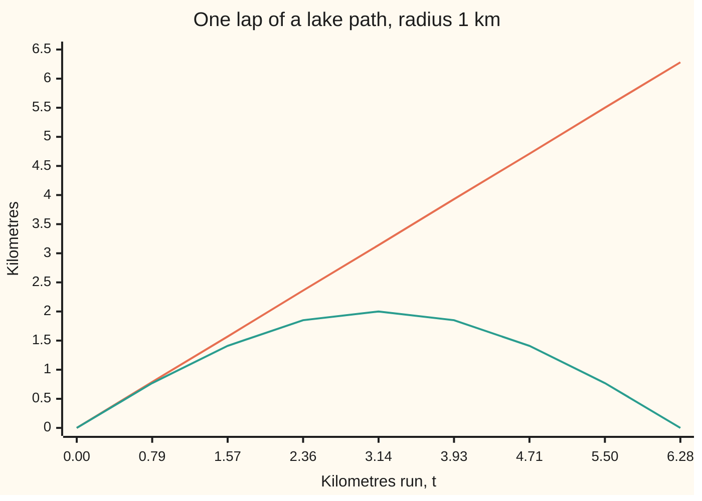

# Complex measures: sizes that are complex numbers, their total variation, and the polar form d nu = h d|nu| with |h| = 1

[Syllabus](../../../SYLLABUS.md) → [Measure and integration](../README.md) → [Densities and Changing Measure](../README.md#s08) → Complex measures

---

## General Overview

A runner circles a lake on a round path of radius 1 km. The runner starts at the south end, heading east, and goes anticlockwise. A watch logs two things: the kilometres run, and where the runner is compared with the start.

"Where the runner is compared with the start" is a displacement: an arrow with a length and a direction. An arrow in the plane is a complex number, east part plus i times north part. So over any set of stretches of the run, the net displacement is a complex number. Displacements over separate stretches add. That makes displacement a measure whose sizes are complex numbers: a **complex measure**.

After one full lap the displacement is 0: the runner is back at the start, yet has run 6.2832 km. After half a lap the runner is 2 km due north, straight across the lake, after 3.1416 km. The kilometres run are the **total variation** of the displacement: what you get by cutting the run into pieces, measuring each piece's displacement without its direction, and adding, as finely as you like.

Displacement is heading times distance. At each moment the heading is a complex number of size 1, and the displacement measure is that heading spread over the kilometres run. Write $`\nu`$ (nu) for the displacement measure, $`\lvert\nu\rvert`$ for the kilometres run and $`h`$ for the heading. This is the **polar form**: $`d\nu = h\, d\lvert\nu\rvert`$ with $`\lvert h\rvert = 1`$.

**A complex measure gives sets complex sizes that add over disjoint pieces; its total variation adds the sizes without their directions, is the smallest ordinary measure that never falls below them, and is always finite; and the complex measure is that total variation turned, point by point, by a direction of size 1.**

**What kind of fact this is:** "complex measure", "total variation" and the integral against a complex measure are definitions; that the total variation is the smallest dominating measure, that it is a finite measure, the polar form and the integral bound are theorems, all proved on this card in Why it works.

### The picture: kilometres run against distance from the start



Orange: the kilometres run, $`\lvert\nu\rvert([0, t])`$, which only grows. Green: the distance from the start, $`\lvert\nu([0, t])\rvert`$, which peaks at 2 km halfway and falls back to 0. The gap between the lines is direction cancelling direction.

---

## The formula

Notation first. $`\Omega`$ is the whole space and $`\mathcal{F}`$ a sigma-algebra on it (the sets allowed a size), as on [Signed measures](02-signed-measures-and-hahn-jordan.md). Here $`\Omega = [0, 2\pi]`$, the kilometres of one lap, and $`\mathcal{F}`$ is its Borel sets. A point $`x`$ of $`\Omega`$ is the distance run so far, in km; $`\lambda`$ is length.

A complex number $`z = a + bi`$ has size $`\lvert z\rvert = \sqrt{a^2 + b^2}`$, its distance from 0 ([Conjugate and modulus](../../07-Complex%20analysis/01-Complex%20Numbers%20and%20the%20Plane/02-conjugate-and-modulus.md)). The number $`e^{ix} = \cos x + i \sin x`$ has size 1 and points at angle $`x`$ ([Euler's formula](../../07-Complex%20analysis/01-Complex%20Numbers%20and%20the%20Plane/04-eulers-formula.md)).

A **complex measure** $`\nu`$ (nu) on $`(\Omega, \mathcal{F})`$ gives each set in $`\mathcal{F}`$ a complex number, with two rules:

- the empty set has size 0;
- it is **countably additive**: for disjoint sets $`E_1, E_2, \dots`$ in $`\mathcal{F}`$, $`\nu(E_1 \cup E_2 \cup \cdots) = \nu(E_1) + \nu(E_2) + \cdots`$, and the series converges absolutely.

Every value is a complex number, so no value is infinite. The real parts form a finite signed measure $`\nu_r`$, and the imaginary parts another, $`\nu_i`$: $`\nu = \nu_r + i\,\nu_i`$.

The runner's measure, the net displacement over the stretches $`E`$:

```math
\nu(E) = \int_E e^{ix}\, dx, \qquad \nu([0, \pi]) = 2i, \qquad \nu([0, 2\pi]) = 0 .
```

**Read it aloud:** the displacement over a set of stretches is the heading added up over those stretches; half a lap gives 2 km north, a full lap gives nothing.

**Total variation**, written $`\lvert\nu\rvert`$:

```math
\lvert\nu\rvert(E) = \sup \Big\{ \sum_{k=1}^{n} \lvert \nu(E_k) \rvert \;:\; E_1, \dots, E_n \text{ cut } E \text{ into disjoint sets in } \mathcal{F} \Big\}.
```

**Read it aloud:** cut the set into pieces, add the sizes of their displacements, and take the least number that no cut can beat (the supremum, $`\sup`$). For the runner it is the kilometres run: $`\lvert\nu\rvert([0, 2\pi]) = 2\pi = 6.2832`$.

**Polar form.** There is a measurable function $`h`$ with

```math
\nu(E) = \int_E h \, d\lvert\nu\rvert \quad \text{for every } E \in \mathcal{F}, \qquad \lvert h \rvert = 1 \ \text{ almost everywhere for } \lvert\nu\rvert .
```

**Read it aloud:** the complex measure is its total variation, turned at each point by a direction of size 1. For the runner, $`h(x) = e^{ix}`$, the heading.

**Integrating against a complex measure.** For $`f`$ with $`\int \lvert f\rvert\, d\lvert\nu\rvert`$ finite, put $`\int f\, d\nu = \int f h\, d\lvert\nu\rvert`$. Then

```math
\Big\lvert \int f \, d\nu \Big\rvert \le \int \lvert f \rvert \, d\lvert\nu\rvert .
```

**Read it aloud:** the size of an integral against a complex measure is at most the integral of the function's size against the total variation. For $`f(x) = \cos x`$ on the lap: $`\pi = 3.1416`$ against 4.

| Symbol | Plain meaning | In our example | Push it up and the answer… |
| --- | --- | --- | --- |
| $`\Omega`$, $`\mathcal{F}`$ | the whole space; the sets allowed a size | one lap, $`[0, 2\pi]`$ km; its Borel sets | a longer run: $`\lvert\nu\rvert`$ grows, $`\nu`$ circles |
| $`x`$, $`t`$, $`\lambda`$ | km run so far; the end of a stretch $`[0, t]`$; length | $`t = \pi = 3.1416`$ is half a lap | — |
| $`i`$, $`e^{ix}`$, $`z = a + bi`$, $`w`$, $`\lvert z\rvert`$, $`\mathrm{Re}`$, $`\bar z`$ | the square root of −1; the unit arrow at angle $`x`$; complex numbers; size; real part; conjugate $`a - bi`$ | $`e^{i \cdot 1} = 0.5403 + 0.8415i`$, size 1 | — |
| $`\nu`$ | a complex measure | net displacement, east + i north | — |
| $`E`$, $`E_k`$, $`n`$ | sets in $`\mathcal{F}`$; the pieces of a cut; how many pieces | six 60° stretches, each displacement of size 1 | more pieces: the sum can only grow |
| $`\nu_r`$, $`\nu_i`$ | real and imaginary parts, two finite signed measures | $`\cos x\, dx`$ and $`\sin x\, dx`$, total variations 4 and 4 | — |
| $`\lvert\nu\rvert`$ | total variation: the best sum of sizes over cuts | km run: 6.2832 for the lap | — |
| $`\mu`$ | any ordinary measure with $`\lvert\nu(E)\rvert \le \mu(E)`$ for all $`E`$ | length; also $`\lvert\nu_r\rvert + \lvert\nu_i\rvert`$, total 8 | — |
| $`h`$ | the polar part: direction at each point, size 1 | $`e^{ix}`$, the heading | — |
| $`g`$ | a density of $`\nu`$ against length: $`d\nu = g\, d\lambda`$ | $`e^{ix}`$ | — |
| $`f`$ | a function integrated against $`\nu`$ | $`\cos x`$: integral 3.1416, bound 4 | larger $`\lvert f\rvert`$: larger bound |
| $`\alpha`$, $`r`$, $`A_r`$, $`\theta`$, $`\delta`$, $`\varepsilon`$, $`B`$, $`F`$, $`k_0`$, $`I`$, $`N`$, $`t_j`$, $`j`$, $`m`$, $`X`$, $`P`$ | inside the proofs and examples: a unit number, a radius below 1 and the set where $`\lvert h\rvert < r`$, an angle, small numbers, a set, the function $`fh`$, a density, a short stretch, counts and targets, an index, a whole number, a random variable and its law | stretch $`I`$ 0.001 km long | — |

### When it holds

- **Finite values.** $`e^{ix}\, dx`$ on the whole line is not a complex measure. Over $`[0, 2\pi k]`$ its total variation is $`2\pi k`$: 6.2832, 62.8319, 628.3185 for $`k = 1, 10, 100`$. The displacement $`\nu([0, t])`$ circles for ever and never settles, so the whole line gets no size.
- **Absolute convergence.** The pieces of a disjoint union can be listed in any order, and the union stays the same. Without absolute convergence, rearranging the pieces could change the sum, so $`\nu`$ of the union would have no single value.
- **Polar part unique only almost everywhere.** Changing $`h`$ on a set of $`\lvert\nu\rvert`$-size 0 changes no integral, so $`\nu`$ does not fix $`h`$ at any single point: $`h(\pi) = 1`$ in place of $`-1`$ gives the same $`\nu`$.
- **Integrable $`f`$.** The integral needs $`\int \lvert f\rvert\, d\lvert\nu\rvert`$ finite. On the lap, $`f(x) = x`$ has $`\int x\, dx = 19.7392`$, fine. $`f(x) = 1/x`$ for $`x > 0`$ is not: $`\int \lvert f\rvert\, dx`$ is infinite, and the real part of $`\int_\varepsilon^{2\pi} e^{ix}/x\, dx`$ grows like $`\ln(1/\varepsilon)`$ as $`\varepsilon`$ shrinks to 0, so $`\int f\, d\nu`$ has no value.

---

## Why it works

### Step 0: measure a path by cutting it into chords

A curved path is longer than any chain of straight chords across it. Its length is the least number that no chain of chords exceeds. Total variation does the same for any complex measure: cut, add the sizes, take the supremum.

On [Signed measures](02-signed-measures-and-hahn-jordan.md) the best cut was the split into a gaining part and a losing part. A complex size can point in any direction round the circle, not just two. So there is no two-part split. In its place, the polar part $`h`$ records the direction at each point.

### Step 1: the cuts approach the kilometres run

Cut the lap into $`n`$ equal stretches. Each stretch's displacement is a chord of the circle, so the sum is the perimeter of an inscribed polygon, $`2n \sin(\pi/n)`$.

| Cut into $`n`$ stretches | Sum of chord sizes |
| --- | --- |
| 1 | 0.000000 |
| 2 | 4.000000 |
| 4 | 5.656854 |
| 6 | 6.000000 |
| 12 | 6.211657 |
| 96 | 6.282064 |
| 1000 | 6.283175 |

The sums climb towards $`2\pi = 6.2832`$ and never pass it. Among all 203 ways to group the six 60° stretches into blocks, the best is 6.0000, from the finest cut only: merging pieces lets directions cancel, so it never helps.

### Step 2: the total variation sits above the measure, and is the smallest measure that does

$`\lvert\nu\rvert`$ **dominates** $`\nu`$: $`\lvert\nu(E)\rvert \le \lvert\nu\rvert(E)`$, because $`E`$ uncut is one of the cuts.

Now take any ordinary measure $`\mu`$ with $`\lvert\nu(E)\rvert \le \mu(E)`$ for every $`E`$. For any cut, $`\sum_k \lvert\nu(E_k)\rvert \le \sum_k \mu(E_k) = \mu(E)`$. So the supremum is at most $`\mu(E)`$: $`\lvert\nu\rvert \le \mu`$.

On the lap, length dominates $`\nu`$: $`\lvert \int_E e^{ix} dx \rvert \le \int_E 1\, dx`$ (Step 8's turning argument, run against length). The check confirms it on all 4095 non-empty unions of twelve 30° stretches, largest ratio 0.988616. A slightly smaller measure fails: $`0.99 \times`$ length would need $`\lvert\nu([0, 0.1])\rvert = 0.099958 \le 0.099000`$, which is false. So $`\lvert\nu\rvert \le`$ length, and Step 7 shows they are equal.

### Step 3: the total variation is a measure

$`\lvert\nu\rvert`$ of the empty set is 0. Countable additivity has two halves.

- **At least the sum.** Cut each piece $`E_j`$ of a disjoint union well; the cuts together cut the union. So $`\lvert\nu\rvert(E) \ge \sum_j \lvert\nu\rvert(E_j)`$.
- **At most the sum.** Take any cut $`F_1, \dots, F_n`$ of $`E`$. Each $`F_k`$ splits along the $`E_j`$, and $`\lvert\nu(F_k)\rvert \le \sum_j \lvert\nu(F_k \cap E_j)\rvert`$ by countable additivity and the triangle inequality. Add over $`k`$ and swap the sums: each $`E_j`$ is cut by the $`F_k \cap E_j`$, giving at most $`\lvert\nu\rvert(E_j)`$.

<details>
<summary>Detailed proof: countable additivity of the total variation</summary>

Let $`E = \bigcup_j E_j`$, disjoint, all in $`\mathcal{F}`$.

**At least the sum.** Fix $`N`$ and numbers $`t_j < \lvert\nu\rvert(E_j)`$ for $`j \le N`$. Choose a cut of each $`E_j`$ whose sum exceeds $`t_j`$. Together with $`E \setminus (E_1 \cup \cdots \cup E_N)`$ as one more piece, these cut $`E`$, so $`\lvert\nu\rvert(E) \ge \sum_{j \le N} t_j`$. Let each $`t_j`$ rise to $`\lvert\nu\rvert(E_j)`$, then let $`N \to \infty`$.

**At most the sum.** Let $`F_1, \dots, F_n`$ cut $`E`$. Then $`F_k = \bigcup_j (F_k \cap E_j)`$, disjoint, so

$`\displaystyle \sum_{k=1}^{n} \lvert \nu(F_k) \rvert = \sum_{k=1}^{n} \Big\lvert \sum_j \nu(F_k \cap E_j) \Big\rvert \le \sum_j \sum_{k=1}^{n} \lvert \nu(F_k \cap E_j) \rvert \le \sum_j \lvert\nu\rvert(E_j),`$

since for each $`j`$ the sets $`F_k \cap E_j`$ cut $`E_j`$. The swap of sums is allowed because every term is at least 0. Take the supremum over cuts of $`E`$.

</details>

### Step 4: the total variation is finite, by the real and imaginary parts

For any complex number, $`\lvert a + bi \rvert \le \lvert a\rvert + \lvert b\rvert`$. So for any cut,

```math
\sum_k \lvert \nu(E_k) \rvert \le \sum_k \lvert \nu_r(E_k) \rvert + \sum_k \lvert \nu_i(E_k) \rvert \le \lvert\nu_r\rvert(E) + \lvert\nu_i\rvert(E).
```

**Read it aloud:** the total variation is at most the real part's total variation plus the imaginary part's.

$`\nu_r`$ and $`\nu_i`$ are finite signed measures, and [Signed measures](02-signed-measures-and-hahn-jordan.md) shows that each has a finite total variation, its gains plus its losses. So $`\lvert\nu\rvert(\Omega)`$ is finite. In the other direction, $`\lvert a\rvert \le \lvert a + bi\rvert`$ gives $`\lvert\nu_r\rvert \le \lvert\nu\rvert`$, and likewise for $`\nu_i`$.

On the lap, $`\nu_r = \cos x\, dx`$ has total variation $`\int_0^{2\pi} \lvert\cos x\rvert\, dx = 4`$, and $`\nu_i`$ also 4:

```math
4 \le \lvert\nu\rvert([0, 2\pi]) = 6.2832 \le 4 + 4 = 8 .
```

### Step 5: the polar part exists, by Radon-Nikodym

$`\nu`$ gives size 0 to every set of $`\lvert\nu\rvert`$-size 0, since $`\lvert\nu(E)\rvert \le \lvert\nu\rvert(E)`$. In the word of [Absolutely continuous and singular measures](01-absolutely-continuous-and-singular-measures.md), $`\nu \ll \lvert\nu\rvert`$.

Apply [The Radon-Nikodym theorem](03-radon-nikodym-theorem.md) to each real piece. The Jordan parts of $`\nu_r`$ (its gains and its losses) are at most $`\lvert\nu_r\rvert \le \lvert\nu\rvert`$, so each is a finite measure absolutely continuous with respect to the finite measure $`\lvert\nu\rvert`$. Each gets a density; the same holds for $`\nu_i`$. Combine the four densities, gains minus losses, real plus $`i`$ times imaginary, into one complex function $`h`$ with $`\nu(E) = \int_E h\, d\lvert\nu\rvert`$. By [The Radon-Nikodym derivative](04-radon-nikodym-derivative.md), $`h = d\nu / d\lvert\nu\rvert`$, unique almost everywhere.

### Step 6: the polar part has size 1

The average of $`h`$ over a set $`E`$ of positive size is $`\nu(E) / \lvert\nu\rvert(E)`$, which has size at most 1 (Step 2). So $`h`$ cannot sit outside the unit circle on a set of positive size.

$`h`$ cannot sit inside it either. On a set where $`\lvert h\rvert \le r < 1`$, every cut collects at most $`r`$ times the set's total variation, so the total variation is at most $`r`$ times itself: it must be 0.

On the lap, averaging over a stretch 0.001 km long centred at $`x`$ gives $`h`$ to four places. At $`x = 1`$: $`0.5403 + 0.8415i`$, size 1.000000, equal to $`e^{i \cdot 1}`$.

<details>
<summary>Detailed proof: |h| = 1 almost everywhere</summary>

**Not inside.** Fix $`r < 1`$ and let $`A_r = \{\lvert h\rvert < r\}`$. For any cut $`E_1, \dots, E_n`$ of $`A_r`$,

$`\displaystyle \sum_k \lvert \nu(E_k) \rvert = \sum_k \Big\lvert \int_{E_k} h \, d\lvert\nu\rvert \Big\rvert \le \sum_k r\, \lvert\nu\rvert(E_k) = r\, \lvert\nu\rvert(A_r).`$

The first inequality is Step 8's turning argument, run on each $`E_k`$ against $`\lvert\nu\rvert`$. So $`\lvert\nu\rvert(A_r) \le r\,\lvert\nu\rvert(A_r)`$, and since it is finite, $`\lvert\nu\rvert(A_r) = 0`$. The union over $`r = 1 - 1/j`$, $`j = 1, 2, \dots`$, is $`\{\lvert h\rvert < 1\}`$, so that set has $`\lvert\nu\rvert`$-size 0.

**Not outside.** Fix $`\varepsilon > 0`$ and an angle $`\theta`$. Choose $`\delta > 0`$ so small that $`(1 + \varepsilon)\cos\delta > 1`$. Let $`B`$ be the set where $`\lvert h\rvert \ge 1 + \varepsilon`$ and the angle of $`h`$ is within $`\delta`$ of $`\theta`$. There, the real part of $`e^{-i\theta} h`$ is at least $`(1 + \varepsilon)\cos\delta`$. So

$`\displaystyle \lvert \nu(B) \rvert \ge \mathrm{Re}\big(e^{-i\theta} \nu(B)\big) = \int_B \mathrm{Re}\big(e^{-i\theta} h\big)\, d\lvert\nu\rvert \ge (1 + \varepsilon)\cos\delta \; \lvert\nu\rvert(B).`$

Since $`\lvert\nu(B)\rvert \le \lvert\nu\rvert(B)`$, this forces $`\lvert\nu\rvert(B) = 0`$. Finitely many angles $`\theta`$ cover the circle, and $`\varepsilon = 1/j`$ for $`j = 1, 2, \dots`$ covers $`\{\lvert h\rvert > 1\}`$ by countably many such sets $`B`$, each of size 0.

</details>

### Step 7: with a density, the total variation is the integral of its size

Suppose $`d\nu = g\, d\lambda`$ for an integrable complex $`g`$. Then $`d\lvert\nu\rvert = \lvert g\rvert\, d\lambda`$, and $`h = g / \lvert g\rvert`$ where $`g \ne 0`$.

- The measure $`\lvert g\rvert\, d\lambda`$ dominates $`\nu`$: $`\lvert \int_E g\, d\lambda \rvert \le \int_E \lvert g\rvert\, d\lambda`$, by the turning argument of Step 8 run against length. So $`\lvert\nu\rvert \le \lvert g\rvert\, d\lambda`$ by Step 2.
- Then $`\lvert\nu\rvert`$ has a density $`k_0 \le \lvert g\rvert`$ against length. Both $`h k_0`$ and $`g`$ are densities of $`\nu`$ against length, so they agree almost everywhere. Taking sizes, $`k_0 = \lvert g\rvert`$.

For the runner, $`g = e^{ix}`$ has size 1, so $`\lvert\nu\rvert`$ is length and $`h = e^{ix}`$. This proves the overview's claims: the lap has total variation 6.2832 km, the polar part is the heading.

### Step 8: the integral bound

Let $`F = f h`$, a complex function, and $`\mu = \lvert\nu\rvert`$, an ordinary measure. Choose a complex number $`\alpha`$ of size 1 that turns $`\int F\, d\mu`$ onto the positive real axis. Then

```math
\Big\lvert \int F \, d\mu \Big\rvert = \int \mathrm{Re}(\alpha F) \, d\mu \le \int \lvert F \rvert \, d\mu = \int \lvert f \rvert \, d\lvert\nu\rvert ,
```

using $`\mathrm{Re}\, w \le \lvert w\rvert`$ (the real part of a complex number $`w`$ is at most its size) and $`\lvert h\rvert = 1`$.

**Read it aloud:** turn the integral to point along the real axis; its real part is at most the integral of the size.

Equality needs $`\alpha f h \ge 0`$ almost everywhere: $`f`$ must undo the turn $`h`$, $`f = \lvert f\rvert\, \bar\alpha\, \bar h`$, where the bar is the conjugate (the mirror image across the real axis). On the lap, $`f = e^{-ix}`$ does that, and both sides are 6.2832. For $`f = \cos x`$ the integral is $`\pi = 3.1416`$ against a bound of 4. For $`f = x`$ it is $`-6.2832i`$, size 6.2832, against a bound of $`2\pi^2 = 19.7392`$.

---

## Worked numbers, by hand

| Step | Arithmetic | Value |
| --- | --- | --- |
| antiderivative of $`e^{ix}`$ | $`e^{ix} / i`$ | — |
| half-lap displacement $`\nu([0, \pi])`$ | $`(e^{i\pi} - 1)/i = -2/i`$ | $`2i`$: 2 km north |
| its size $`\lvert\nu([0, \pi])\rvert`$ | $`\lvert 2i\rvert`$ | 2.0000 km |
| half-lap total variation | length of $`[0, \pi]`$ | 3.1416 km |
| lap displacement $`\nu([0, 2\pi])`$ | $`(e^{2\pi i} - 1)/i = (1 - 1)/i`$ | 0 |
| hexagon cut of the lap | 6 chords of $`2 \sin(\pi/6) = 1`$ | 6.0000 |
| real and imaginary parts | $`\int \lvert\cos x\rvert`$ and $`\int \lvert\sin x\rvert`$ over the lap | 4.0000 each |
| bounds of Step 4 | $`4 \le \lvert\nu\rvert \le 4 + 4`$ | $`4 \le 6.2832 \le 8`$ |
| heading at $`x = 1`$ | $`\cos 1 + i \sin 1`$ | $`0.5403 + 0.8415i`$ |
| $`\int \cos x\, d\nu`$ | $`\int (\cos^2 x + i \cos x \sin x)\, dx = \pi + 0i`$ | 3.1416, against bound 4.0000 |
| lap total variation $`\lvert\nu\rvert([0, 2\pi])`$ | $`\int_0^{2\pi} \lvert e^{ix}\rvert\, dx`$ | **6.2832 km** |

The lap ends 0 km from the start, but the watch has logged 6.2832 km: the total variation counts every step, the measure only where they lead.

### What breaks if you drop a piece

| Mistake | Comes out at | What went wrong |
| --- | --- | --- |
| Read $`\lvert\nu(\Omega)\rvert`$ as the total variation | 0.0000 in place of 6.2832 | directions cancel over the lap |
| Add the parts' total variations, $`\lvert\nu_r\rvert + \lvert\nu_i\rvert`$ | 8.0000 | east-west and north-south counted separately: a diagonal step is counted as its two legs |
| Combine the parts as $`\sqrt{4^2 + 4^2}`$ | 5.6569 | sizes of whole-lap totals, not of pieces |
| Stop at one cut, the hexagon | 6.0000 | a cut is a lower bound; the supremum is 6.2832 |
| Take $`e^{ix}\, dx`$ on the whole line | $`\lvert\nu\rvert`$ = 6.2832, 62.8319, 628.3185 and growing | a complex measure must be finite |

---

## Code, from first principles, and it actually runs

Both programs work the runner's lap by three roads. Road 1 is the closed form from the antiderivative $`e^{ix}/i`$. Road 2 is midpoint sums, for $`\nu`$, for $`\lvert\nu\rvert`$, for the real and imaginary parts and for the integrals. Road 3 is the definition of total variation as a supremum: cuts into equal stretches, all 203 groupings of six stretches, and the domination test on all 4095 non-empty unions of twelve stretches. The polar part is estimated as $`\nu(I) / \lvert\nu\rvert(I)`$ on short stretches $`I`$. The code checks one example; the proofs cover every complex measure.

### Python

```python
# Complex measures and total variation -- the check behind the card.
# Standard library only; complex numbers are Python's built-in type.
# The runner: x is km run on a circular path of radius 1 km, so the heading
# at x is e^(ix).  nu(E) = integral over E of e^(ix) dx is the net
# displacement (east + i north) over the stretches E; |nu|(E) is the km run.
# Road 1: closed forms from the antiderivative e^(ix) / i.
# Road 2: midpoint sums for nu, |nu|, the real and imaginary parts, integrals.
# Road 3: total variation as a supremum: cut into n equal stretches and add
#         |nu(piece)| (inscribed polygons); all 203 cuts of six stretches;
#         |nu(E)| <= length(E) on all 4095 non-empty unions of twelve stretches.
# Polar form: h = nu(I) / |nu|(I) on short stretches I, against e^(ix).
# The code checks this example; the proofs cover every complex measure.
import math

TAU = 2 * math.pi
snap = lambda x: 0.0 if abs(x) < 5e-10 else x
r4 = lambda x: f"{snap(x):.4f}"
r6 = lambda x: f"{snap(x):.6f}"
def c4(z):
    re, im = snap(z.real), snap(z.imag)
    return f"{re:.4f} {'-' if im < 0 else '+'} {abs(im):.4f}i"
expi = lambda x: complex(math.cos(x), math.sin(x))
nu = lambda a, b: (expi(b) - expi(a)) / 1j                # road 1
def midpoint(g, a, b, n=200000):                         # road 2
    h = (b - a) / n
    return h * sum(g(a + (k + 0.5) * h) for k in range(n))

# the lap and the half lap
lap, lap_m = nu(0, TAU), midpoint(expi, 0, TAU)
run_m = midpoint(lambda x: abs(expi(x)), 0, TAU)
half, half_m = nu(0, math.pi), midpoint(expi, 0, math.pi)
assert abs(lap) < 1e-12 and abs(lap_m) < 1e-9 and abs(run_m - TAU) < 1e-9
assert abs(half - 2j) < 1e-12 and abs(half_m - 2j) < 1e-9
print(f"lap, nu([0, 2 pi]) closed form: {c4(lap)} | midpoint: {c4(lap_m)}")
print(f"lap, |nu|([0, 2 pi]) = km run: {r4(TAU)} | midpoint of |e^(ix)|: {r4(run_m)}")
print(f"half lap, nu([0, pi]) closed form: {c4(half)} | midpoint: {c4(half_m)}")
print(f"half lap, |nu([0, pi])| = {r4(abs(half))} km apart | |nu|([0, pi]) = {r4(math.pi)} km run")

# road 3: the supremum over cuts, approached by inscribed polygons
def cut(a, b, n):
    return sum(abs(nu(a + k * (b - a) / n, a + (k + 1) * (b - a) / n)) for k in range(n))
for n in (1, 2, 4, 6, 12, 96, 1000):
    s, poly = cut(0, TAU, n), 2 * n * math.sin(math.pi / n)
    assert abs(s - poly) < 1e-9 and s <= TAU + 1e-12
    print(f"cut lap into n = {n} stretches: sum |nu(piece)| = {r6(s)}")
for n in (1, 2, 1000):
    print(f"cut half lap into n = {n}: {r6(cut(0, math.pi, n))}")
assert abs(cut(0, math.pi, 1000) - math.pi) < 1e-5
assert TAU - cut(0, TAU, 1000) < 2e-5

def partitions(items):                         # every way to cut a list into blocks
    if not items:
        yield []
        return
    first, rest = items[0], items[1:]
    for part in partitions(rest):
        for k in range(len(part)):
            yield part[:k] + [[first] + part[k]] + part[k + 1:]
        yield [[first]] + part
six = [nu(k * TAU / 6, (k + 1) * TAU / 6) for k in range(6)]
parts = list(partitions(list(range(6))))
sums = [sum(abs(sum(six[i] for i in blk)) for blk in pt) for pt in parts]
best = max(sums)
assert len(parts) == 203 and abs(best - 6) < 1e-12 and sums.count(best) == 1
print(f"all {len(parts)} cuts of six 60-degree stretches: best {r4(best)}, from the finest cut only")

# real and imaginary parts: two signed measures, cos x dx and sin x dx
tv_r = midpoint(lambda x: abs(math.cos(x)), 0, TAU)
tv_i = midpoint(lambda x: abs(math.sin(x)), 0, TAU)
assert abs(tv_r - 4) < 1e-8 and abs(tv_i - 4) < 1e-8
assert max(tv_r, tv_i) <= TAU <= tv_r + tv_i
print(f"parts, |nu_r|([0, 2 pi]) = integral |cos x|: {r4(tv_r)} | |nu_i| = integral |sin x|: {r4(tv_i)}")
print(f"parts, max {r4(max(tv_r, tv_i))} <= |nu| {r4(TAU)} <= sum {r4(tv_r + tv_i)}"
      f" | square root of the sum of squares {r4(math.hypot(tv_r, tv_i))}")

# domination: length dominates nu on every union of twelve 30-degree stretches
twelve = [nu(k * TAU / 12, (k + 1) * TAU / 12) for k in range(12)]
ratios = []
for m in range(1, 4096):
    z = sum(twelve[k] for k in range(12) if m >> k & 1)
    ratios.append(abs(z) / (bin(m).count("1") * TAU / 12))
assert max(ratios) <= 1 and abs(max(ratios) - 2 * math.sin(math.pi / 12) / (math.pi / 6)) < 1e-12
print(f"dominate, |nu(E)| <= length(E) on all 4095 non-empty unions of twelve stretches; largest ratio {r6(max(ratios))}")
short = abs(nu(0, 0.1))
assert short > 0.99 * 0.1
print(f"dominate, 0.99 x length fails on [0, 0.1]: |nu| = {r6(short)} > {r6(0.99 * 0.1)}")

# polar form: h = nu(I) / |nu|(I) on I = [x - 0.0005, x + 0.0005]
for x in (0.0, 1.0, math.pi / 2, math.pi):
    h = nu(x - 0.0005, x + 0.0005) / 0.001
    assert abs(h - expi(x)) < 1e-7 and abs(abs(h) - 1) < 1e-7
    print(f"polar, x = {r4(x)}: h = {c4(h)}, |h| = {r6(abs(h))}, e^(ix) = {c4(expi(x))}")

# integrals against nu: integral f dnu = integral f(x) e^(ix) dx
for name, f, closed, bound in (("e^(-ix)", lambda x: expi(-x), TAU, TAU),
                               ("cos x", math.cos, math.pi, 4.0),
                               ("x", lambda x: x, -TAU * 1j, TAU * math.pi)):
    val = midpoint(lambda x: f(x) * expi(x), 0, TAU)
    rhs = midpoint(lambda x: abs(f(x)), 0, TAU)
    assert abs(val - closed) < 1e-8 and abs(rhs - bound) < 1e-8 and abs(val) <= rhs + 1e-9
    print(f"integral, f = {name}: integral f dnu = {c4(val)}, size {r4(abs(val))} <= integral |f| d|nu| = {r4(rhs)}")

# what breaks
print(f"breaks, |nu([0, 2 pi])| read as |nu|: {r4(abs(lap))}")
print(f"breaks, |nu_r| + |nu_i| read as |nu|: {r4(tv_r + tv_i)}")
print(f"breaks, the hexagon cut read as |nu|: {r4(cut(0, TAU, 6))}")
grow = [midpoint(lambda x: abs(expi(x)), 0, TAU * k, 20000) for k in (1, 10, 100)]
assert abs(grow[2] - 100 * TAU) < 1e-6
print("breaks, whole line: |nu|([0, 2 pi k]) for k = 1, 10, 100:", " ".join(r4(g) for g in grow))
print("breaks, whole line: nu([0, t]) for t = 1, 2, 3:", " ; ".join(c4(nu(0, t)) for t in (1, 2, 3)))

# try changing
tq = nu(0, 1.5 * math.pi)
print(f"try, three-quarter lap: nu([0, 3 pi/2]) = {c4(tq)}, size {r4(abs(tq))} | |nu| = {r4(1.5 * math.pi)}")
print(f"try, cut lap into n = 3 stretches: {r6(cut(0, TAU, 3))}")
vs = midpoint(lambda x: math.sin(x) * expi(x), 0, TAU)
assert abs(vs - math.pi * 1j) < 1e-8
print(f"try, f = sin x: integral f dnu = {c4(vs)}, size {r4(abs(vs))} <= {r4(tv_i)}")
print(f"try, 0.9999 x length: on [0, 0.1] {abs(nu(0, 0.1)):.8f} vs {0.9999 * 0.1:.8f};"
      f" on [0, 0.01] {abs(nu(0, 0.01)):.8f} vs {0.9999 * 0.01:.8f}")

# chart: distance apart against km run along the lap
ts = [k * math.pi / 4 for k in range(9)]
print("chart, km run t:", " ".join(f"{t:.2f}" for t in ts))
print("chart, |nu([0, t])| km apart:", " ".join(f"{abs(nu(0, t)):.2f}" for t in ts))
print("ALL CHECKS PASS")
```

**Ran 2026-11-23 on macOS, Python 3.14.10, standard library only. All checks passed. Output, pasted from the run:**

```
lap, nu([0, 2 pi]) closed form: 0.0000 + 0.0000i | midpoint: 0.0000 + 0.0000i
lap, |nu|([0, 2 pi]) = km run: 6.2832 | midpoint of |e^(ix)|: 6.2832
half lap, nu([0, pi]) closed form: 0.0000 + 2.0000i | midpoint: 0.0000 + 2.0000i
half lap, |nu([0, pi])| = 2.0000 km apart | |nu|([0, pi]) = 3.1416 km run
cut lap into n = 1 stretches: sum |nu(piece)| = 0.000000
cut lap into n = 2 stretches: sum |nu(piece)| = 4.000000
cut lap into n = 4 stretches: sum |nu(piece)| = 5.656854
cut lap into n = 6 stretches: sum |nu(piece)| = 6.000000
cut lap into n = 12 stretches: sum |nu(piece)| = 6.211657
cut lap into n = 96 stretches: sum |nu(piece)| = 6.282064
cut lap into n = 1000 stretches: sum |nu(piece)| = 6.283175
cut half lap into n = 1: 2.000000
cut half lap into n = 2: 2.828427
cut half lap into n = 1000: 3.141591
all 203 cuts of six 60-degree stretches: best 6.0000, from the finest cut only
parts, |nu_r|([0, 2 pi]) = integral |cos x|: 4.0000 | |nu_i| = integral |sin x|: 4.0000
parts, max 4.0000 <= |nu| 6.2832 <= sum 8.0000 | square root of the sum of squares 5.6569
dominate, |nu(E)| <= length(E) on all 4095 non-empty unions of twelve stretches; largest ratio 0.988616
dominate, 0.99 x length fails on [0, 0.1]: |nu| = 0.099958 > 0.099000
polar, x = 0.0000: h = 1.0000 + 0.0000i, |h| = 1.000000, e^(ix) = 1.0000 + 0.0000i
polar, x = 1.0000: h = 0.5403 + 0.8415i, |h| = 1.000000, e^(ix) = 0.5403 + 0.8415i
polar, x = 1.5708: h = 0.0000 + 1.0000i, |h| = 1.000000, e^(ix) = 0.0000 + 1.0000i
polar, x = 3.1416: h = -1.0000 + 0.0000i, |h| = 1.000000, e^(ix) = -1.0000 + 0.0000i
integral, f = e^(-ix): integral f dnu = 6.2832 + 0.0000i, size 6.2832 <= integral |f| d|nu| = 6.2832
integral, f = cos x: integral f dnu = 3.1416 + 0.0000i, size 3.1416 <= integral |f| d|nu| = 4.0000
integral, f = x: integral f dnu = 0.0000 - 6.2832i, size 6.2832 <= integral |f| d|nu| = 19.7392
breaks, |nu([0, 2 pi])| read as |nu|: 0.0000
breaks, |nu_r| + |nu_i| read as |nu|: 8.0000
breaks, the hexagon cut read as |nu|: 6.0000
breaks, whole line: |nu|([0, 2 pi k]) for k = 1, 10, 100: 6.2832 62.8319 628.3185
breaks, whole line: nu([0, t]) for t = 1, 2, 3: 0.8415 + 0.4597i ; 0.9093 + 1.4161i ; 0.1411 + 1.9900i
try, three-quarter lap: nu([0, 3 pi/2]) = -1.0000 + 1.0000i, size 1.4142 | |nu| = 4.7124
try, cut lap into n = 3 stretches: 5.196152
try, f = sin x: integral f dnu = 0.0000 + 3.1416i, size 3.1416 <= 4.0000
try, 0.9999 x length: on [0, 0.1] 0.09995834 vs 0.09999000; on [0, 0.01] 0.00999996 vs 0.00999900
chart, km run t: 0.00 0.79 1.57 2.36 3.14 3.93 4.71 5.50 6.28
chart, |nu([0, t])| km apart: 0.00 0.77 1.41 1.85 2.00 1.85 1.41 0.77 0.00
ALL CHECKS PASS
```

### Rust

Same numbers, same labels, built with `rustc --edition 2021 -O`.

```rust
// Complex measures and total variation -- the same check as the Python, in
// Rust, no crates.  Complex numbers are a small struct written here.
// The runner: x is km run on a circular path of radius 1 km, so the heading
// at x is e^(ix).  nu(E) = integral over E of e^(ix) dx is the net
// displacement (east + i north) over the stretches E; |nu|(E) is the km run.
// Road 1: closed forms from the antiderivative e^(ix) / i.
// Road 2: midpoint sums for nu, |nu|, the real and imaginary parts, integrals.
// Road 3: total variation as a supremum: cut into n equal stretches and add
//         |nu(piece)| (inscribed polygons); all 203 cuts of six stretches;
//         |nu(E)| <= length(E) on all 4095 non-empty unions of twelve stretches.
// Polar form: h = nu(I) / |nu|(I) on short stretches I, against e^(ix).
// The code checks this example; the proofs cover every complex measure.
use std::f64::consts::PI;

#[derive(Clone, Copy)]
struct C { re: f64, im: f64 }
impl C {
    fn add(self, o: C) -> C { C { re: self.re + o.re, im: self.im + o.im } }
    fn sub(self, o: C) -> C { C { re: self.re - o.re, im: self.im - o.im } }
    fn mul(self, o: C) -> C { C { re: self.re * o.re - self.im * o.im, im: self.re * o.im + self.im * o.re } }
    fn scale(self, s: f64) -> C { C { re: self.re * s, im: self.im * s } }
    fn abs(self) -> f64 { self.re.hypot(self.im) }
}
const TAU: f64 = 2.0 * PI;
const ZERO: C = C { re: 0.0, im: 0.0 };
fn snap(x: f64) -> f64 { if x.abs() < 5e-10 { 0.0 } else { x } }
fn r4(x: f64) -> String { format!("{:.4}", snap(x)) }
fn r6(x: f64) -> String { format!("{:.6}", snap(x)) }
fn c4(z: C) -> String {
    let (re, im) = (snap(z.re), snap(z.im));
    format!("{:.4} {} {:.4}i", re, if im < 0.0 { "-" } else { "+" }, im.abs())
}
fn expi(x: f64) -> C { C { re: x.cos(), im: x.sin() } }
fn nu(a: f64, b: f64) -> C { let d = expi(b).sub(expi(a)); C { re: d.im, im: -d.re } } // divide by i: road 1
fn midpoint(g: &dyn Fn(f64) -> C, a: f64, b: f64, n: usize) -> C { // road 2
    let h = (b - a) / n as f64;
    let mut s = ZERO;
    for k in 0..n { s = s.add(g(a + (k as f64 + 0.5) * h)); }
    s.scale(h)
}
fn real(x: f64) -> C { C { re: x, im: 0.0 } }
fn cut(a: f64, b: f64, n: usize) -> f64 {
    let w = (b - a) / n as f64;
    (0..n).map(|k| nu(a + k as f64 * w, a + (k + 1) as f64 * w).abs()).sum()
}
// every way to cut six items into blocks: block labels in restricted-growth form
fn partitions(labels: &mut Vec<usize>, top: usize, out: &mut Vec<Vec<usize>>) {
    if labels.len() == 6 { out.push(labels.clone()); return; }
    for b in 0..=top {
        labels.push(b);
        partitions(labels, if b == top { top + 1 } else { top }, out);
        labels.pop();
    }
}

fn main() {
    // the lap and the half lap
    let (lap, lap_m) = (nu(0.0, TAU), midpoint(&expi, 0.0, TAU, 200000));
    let run_m = midpoint(&|x| real(expi(x).abs()), 0.0, TAU, 200000).re;
    let (half, half_m) = (nu(0.0, PI), midpoint(&expi, 0.0, PI, 200000));
    let two_i = C { re: 0.0, im: 2.0 };
    assert!(lap.abs() < 1e-12 && lap_m.abs() < 1e-9 && (run_m - TAU).abs() < 1e-9);
    assert!(half.sub(two_i).abs() < 1e-12 && half_m.sub(two_i).abs() < 1e-9);
    println!("lap, nu([0, 2 pi]) closed form: {} | midpoint: {}", c4(lap), c4(lap_m));
    println!("lap, |nu|([0, 2 pi]) = km run: {} | midpoint of |e^(ix)|: {}", r4(TAU), r4(run_m));
    println!("half lap, nu([0, pi]) closed form: {} | midpoint: {}", c4(half), c4(half_m));
    println!("half lap, |nu([0, pi])| = {} km apart | |nu|([0, pi]) = {} km run", r4(half.abs()), r4(PI));

    // road 3: the supremum over cuts, approached by inscribed polygons
    for n in [1usize, 2, 4, 6, 12, 96, 1000] {
        let (s, poly) = (cut(0.0, TAU, n), 2.0 * n as f64 * (PI / n as f64).sin());
        assert!((s - poly).abs() < 1e-9 && s <= TAU + 1e-12);
        println!("cut lap into n = {} stretches: sum |nu(piece)| = {}", n, r6(s));
    }
    for n in [1usize, 2, 1000] { println!("cut half lap into n = {}: {}", n, r6(cut(0.0, PI, n))); }
    assert!((cut(0.0, PI, 1000) - PI).abs() < 1e-5);
    assert!(TAU - cut(0.0, TAU, 1000) < 2e-5);

    let six: Vec<C> = (0..6).map(|k| nu(k as f64 * TAU / 6.0, (k + 1) as f64 * TAU / 6.0)).collect();
    let mut parts = Vec::new();
    partitions(&mut Vec::new(), 0, &mut parts);
    let sums: Vec<f64> = parts.iter().map(|pt| {
        let nb = pt.iter().max().unwrap() + 1;
        (0..nb).map(|b| (0..6).filter(|&i| pt[i] == b).fold(ZERO, |z, i| z.add(six[i])).abs()).sum()
    }).collect();
    let best = sums.iter().cloned().fold(f64::MIN, f64::max);
    assert!(parts.len() == 203 && (best - 6.0).abs() < 1e-12 && sums.iter().filter(|&&s| s == best).count() == 1);
    println!("all {} cuts of six 60-degree stretches: best {}, from the finest cut only", parts.len(), r4(best));

    // real and imaginary parts: two signed measures, cos x dx and sin x dx
    let tv_r = midpoint(&|x| real(x.cos().abs()), 0.0, TAU, 200000).re;
    let tv_i = midpoint(&|x| real(x.sin().abs()), 0.0, TAU, 200000).re;
    assert!((tv_r - 4.0).abs() < 1e-8 && (tv_i - 4.0).abs() < 1e-8);
    assert!(tv_r.max(tv_i) <= TAU && TAU <= tv_r + tv_i);
    println!("parts, |nu_r|([0, 2 pi]) = integral |cos x|: {} | |nu_i| = integral |sin x|: {}", r4(tv_r), r4(tv_i));
    println!("parts, max {} <= |nu| {} <= sum {} | square root of the sum of squares {}",
             r4(tv_r.max(tv_i)), r4(TAU), r4(tv_r + tv_i), r4(tv_r.hypot(tv_i)));

    // domination: length dominates nu on every union of twelve 30-degree stretches
    let twelve: Vec<C> = (0..12).map(|k| nu(k as f64 * TAU / 12.0, (k + 1) as f64 * TAU / 12.0)).collect();
    let mut top = 0.0f64;
    for m in 1usize..4096 {
        let z = (0..12).filter(|k| m >> k & 1 == 1).fold(ZERO, |z, k| z.add(twelve[k]));
        top = top.max(z.abs() / (m.count_ones() as f64 * TAU / 12.0));
    }
    assert!(top <= 1.0 && (top - 2.0 * (PI / 12.0).sin() / (PI / 6.0)).abs() < 1e-12);
    println!("dominate, |nu(E)| <= length(E) on all 4095 non-empty unions of twelve stretches; largest ratio {}", r6(top));
    let short = nu(0.0, 0.1).abs();
    assert!(short > 0.99 * 0.1);
    println!("dominate, 0.99 x length fails on [0, 0.1]: |nu| = {} > {}", r6(short), r6(0.99 * 0.1));

    // polar form: h = nu(I) / |nu|(I) on I = [x - 0.0005, x + 0.0005]
    for x in [0.0, 1.0, PI / 2.0, PI] {
        let h = nu(x - 0.0005, x + 0.0005).scale(1.0 / 0.001);
        assert!(h.sub(expi(x)).abs() < 1e-7 && (h.abs() - 1.0).abs() < 1e-7);
        println!("polar, x = {}: h = {}, |h| = {}, e^(ix) = {}", r4(x), c4(h), r6(h.abs()), c4(expi(x)));
    }

    // integrals against nu: integral f dnu = integral f(x) e^(ix) dx
    let fs: [(&str, Box<dyn Fn(f64) -> C>, C, f64); 3] = [
        ("e^(-ix)", Box::new(|x: f64| expi(-x)), real(TAU), TAU),
        ("cos x", Box::new(|x: f64| real(x.cos())), real(PI), 4.0),
        ("x", Box::new(|x: f64| real(x)), C { re: 0.0, im: -TAU }, TAU * PI),
    ];
    for (name, f, closed, bound) in fs.iter() {
        let val = midpoint(&|x| f(x).mul(expi(x)), 0.0, TAU, 200000);
        let rhs = midpoint(&|x| real(f(x).abs()), 0.0, TAU, 200000).re;
        assert!(val.sub(*closed).abs() < 1e-8 && (rhs - bound).abs() < 1e-8 && val.abs() <= rhs + 1e-9);
        println!("integral, f = {}: integral f dnu = {}, size {} <= integral |f| d|nu| = {}", name, c4(val), r4(val.abs()), r4(rhs));
    }

    // what breaks
    println!("breaks, |nu([0, 2 pi])| read as |nu|: {}", r4(lap.abs()));
    println!("breaks, |nu_r| + |nu_i| read as |nu|: {}", r4(tv_r + tv_i));
    println!("breaks, the hexagon cut read as |nu|: {}", r4(cut(0.0, TAU, 6)));
    let grow: Vec<f64> = [1.0, 10.0, 100.0].iter().map(|&k| midpoint(&|x| real(expi(x).abs()), 0.0, TAU * k, 20000).re).collect();
    assert!((grow[2] - 100.0 * TAU).abs() < 1e-6);
    println!("breaks, whole line: |nu|([0, 2 pi k]) for k = 1, 10, 100: {}", grow.iter().map(|&g| r4(g)).collect::<Vec<_>>().join(" "));
    println!("breaks, whole line: nu([0, t]) for t = 1, 2, 3: {}", [1.0, 2.0, 3.0].iter().map(|&t| c4(nu(0.0, t))).collect::<Vec<_>>().join(" ; "));

    // try changing
    let tq = nu(0.0, 1.5 * PI);
    println!("try, three-quarter lap: nu([0, 3 pi/2]) = {}, size {} | |nu| = {}", c4(tq), r4(tq.abs()), r4(1.5 * PI));
    println!("try, cut lap into n = 3 stretches: {}", r6(cut(0.0, TAU, 3)));
    let vs = midpoint(&|x| real(x.sin()).mul(expi(x)), 0.0, TAU, 200000);
    assert!(vs.sub(C { re: 0.0, im: PI }).abs() < 1e-8);
    println!("try, f = sin x: integral f dnu = {}, size {} <= {}", c4(vs), r4(vs.abs()), r4(tv_i));
    println!("try, 0.9999 x length: on [0, 0.1] {:.8} vs {:.8}; on [0, 0.01] {:.8} vs {:.8}",
             nu(0.0, 0.1).abs(), 0.9999 * 0.1, nu(0.0, 0.01).abs(), 0.9999 * 0.01);

    // chart: distance apart against km run along the lap
    let ts: Vec<f64> = (0..9).map(|k| k as f64 * PI / 4.0).collect();
    println!("chart, km run t: {}", ts.iter().map(|t| format!("{:.2}", t)).collect::<Vec<_>>().join(" "));
    println!("chart, |nu([0, t])| km apart: {}", ts.iter().map(|&t| format!("{:.2}", nu(0.0, t).abs())).collect::<Vec<_>>().join(" "));
    println!("ALL CHECKS PASS");
}
```

**Ran 2026-11-23 on macOS, rustc 1.98.1, no crates. All checks passed. Output, pasted from the run:**

```
lap, nu([0, 2 pi]) closed form: 0.0000 + 0.0000i | midpoint: 0.0000 + 0.0000i
lap, |nu|([0, 2 pi]) = km run: 6.2832 | midpoint of |e^(ix)|: 6.2832
half lap, nu([0, pi]) closed form: 0.0000 + 2.0000i | midpoint: 0.0000 + 2.0000i
half lap, |nu([0, pi])| = 2.0000 km apart | |nu|([0, pi]) = 3.1416 km run
cut lap into n = 1 stretches: sum |nu(piece)| = 0.000000
cut lap into n = 2 stretches: sum |nu(piece)| = 4.000000
cut lap into n = 4 stretches: sum |nu(piece)| = 5.656854
cut lap into n = 6 stretches: sum |nu(piece)| = 6.000000
cut lap into n = 12 stretches: sum |nu(piece)| = 6.211657
cut lap into n = 96 stretches: sum |nu(piece)| = 6.282064
cut lap into n = 1000 stretches: sum |nu(piece)| = 6.283175
cut half lap into n = 1: 2.000000
cut half lap into n = 2: 2.828427
cut half lap into n = 1000: 3.141591
all 203 cuts of six 60-degree stretches: best 6.0000, from the finest cut only
parts, |nu_r|([0, 2 pi]) = integral |cos x|: 4.0000 | |nu_i| = integral |sin x|: 4.0000
parts, max 4.0000 <= |nu| 6.2832 <= sum 8.0000 | square root of the sum of squares 5.6569
dominate, |nu(E)| <= length(E) on all 4095 non-empty unions of twelve stretches; largest ratio 0.988616
dominate, 0.99 x length fails on [0, 0.1]: |nu| = 0.099958 > 0.099000
polar, x = 0.0000: h = 1.0000 + 0.0000i, |h| = 1.000000, e^(ix) = 1.0000 + 0.0000i
polar, x = 1.0000: h = 0.5403 + 0.8415i, |h| = 1.000000, e^(ix) = 0.5403 + 0.8415i
polar, x = 1.5708: h = 0.0000 + 1.0000i, |h| = 1.000000, e^(ix) = 0.0000 + 1.0000i
polar, x = 3.1416: h = -1.0000 + 0.0000i, |h| = 1.000000, e^(ix) = -1.0000 + 0.0000i
integral, f = e^(-ix): integral f dnu = 6.2832 + 0.0000i, size 6.2832 <= integral |f| d|nu| = 6.2832
integral, f = cos x: integral f dnu = 3.1416 + 0.0000i, size 3.1416 <= integral |f| d|nu| = 4.0000
integral, f = x: integral f dnu = 0.0000 - 6.2832i, size 6.2832 <= integral |f| d|nu| = 19.7392
breaks, |nu([0, 2 pi])| read as |nu|: 0.0000
breaks, |nu_r| + |nu_i| read as |nu|: 8.0000
breaks, the hexagon cut read as |nu|: 6.0000
breaks, whole line: |nu|([0, 2 pi k]) for k = 1, 10, 100: 6.2832 62.8319 628.3185
breaks, whole line: nu([0, t]) for t = 1, 2, 3: 0.8415 + 0.4597i ; 0.9093 + 1.4161i ; 0.1411 + 1.9900i
try, three-quarter lap: nu([0, 3 pi/2]) = -1.0000 + 1.0000i, size 1.4142 | |nu| = 4.7124
try, cut lap into n = 3 stretches: 5.196152
try, f = sin x: integral f dnu = 0.0000 + 3.1416i, size 3.1416 <= 4.0000
try, 0.9999 x length: on [0, 0.1] 0.09995834 vs 0.09999000; on [0, 0.01] 0.00999996 vs 0.00999900
chart, km run t: 0.00 0.79 1.57 2.36 3.14 3.93 4.71 5.50 6.28
chart, |nu([0, t])| km apart: 0.00 0.77 1.41 1.85 2.00 1.85 1.41 0.77 0.00
ALL CHECKS PASS
```

The two outputs match line for line.

### Lean

Lean proves the card's four theorems for every complex measure, and checks the worked arithmetic exactly.

- Take any complex measure $`\nu`$. Then $`\lvert\nu\rvert`$ is a finite measure.
- Take any set $`E`$. Then $`\lvert\nu(E)\rvert \le \lvert\nu\rvert(E)`$.
- Take an ordinary measure $`\mu`$ with $`\lvert\nu(E)\rvert \le \mu(E)`$ for every $`E`$ in $`\mathcal{F}`$. Then $`\lvert\nu\rvert \le \mu`$.
- Take any complex measure $`\nu`$. Then a measurable polar part $`h`$ exists, with $`\lvert h\rvert = 1`$ almost everywhere for $`\lvert\nu\rvert`$. It gives $`\nu(E) = \int_E h\, d\lvert\nu\rvert`$ for every $`E`$ in $`\mathcal{F}`$.
- Suppose $`\int \lvert f\rvert\, d\lvert\nu\rvert`$ is finite. Then $`\lvert \int f\, d\nu \rvert \le \int \lvert f\rvert\, d\lvert\nu\rvert`$.
- The worked numbers hold exactly: the half lap $`2i`$, the full lap 0, the hexagon cut 6, 203 groupings and 4095 unions.

The lap's cut sums, domination test, polar estimates and integrals are left to the Python and Rust checks.

```lean
-- Complex measures: the total variation of a complex measure is the least measure above it, it is finite, the measure is a size-1 direction times it, and integrals obey the size bound.
import Mathlib.MeasureTheory.Measure.Complex
import Mathlib.MeasureTheory.VectorMeasure.Variation.Basic
import Mathlib.MeasureTheory.VectorMeasure.Integral
import Mathlib.MeasureTheory.Integral.Bochner.Basic
import Mathlib.Combinatorics.Enumerative.Bell
import Mathlib.Analysis.SpecialFunctions.Trigonometric.Basic
import Mathlib.MeasureTheory.VectorMeasure.Variation.SignedMeasure
import Mathlib.MeasureTheory.VectorMeasure.Decomposition.RadonNikodym
import Mathlib.MeasureTheory.VectorMeasure.WithDensityVec

open MeasureTheory Complex
open scoped ENNReal

variable {α : Type*} [MeasurableSpace α]

/-- The total variation of a complex measure is a finite measure. -/
theorem complexMeasure_variation_isFinite (ν : ComplexMeasure α) :
    IsFiniteMeasure ν.variation := by
  have hle : ν.variation ≤ (ComplexMeasure.re ν).variation + (ComplexMeasure.im ν).variation := by
    apply VectorMeasure.variation_le_of_forall_enorm_le
    intro E hE
    rw [Measure.add_apply]
    refine le_trans ?_ (add_le_add (VectorMeasure.enorm_measure_le_variation _ E)
      (VectorMeasure.enorm_measure_le_variation _ E))
    simp only [ComplexMeasure.re_apply, ComplexMeasure.im_apply]
    rw [← ofReal_norm, ← ofReal_norm, ← ofReal_norm,
      ← ENNReal.ofReal_add (norm_nonneg _) (norm_nonneg _)]
    exact ENNReal.ofReal_le_ofReal (Complex.norm_le_abs_re_add_abs_im _)
  have h1 : IsFiniteMeasure (ComplexMeasure.re ν).variation := by
    rw [← SignedMeasure.totalVariation_eq_variation]; infer_instance
  have h2 : IsFiniteMeasure (ComplexMeasure.im ν).variation := by
    rw [← SignedMeasure.totalVariation_eq_variation]; infer_instance
  exact isFiniteMeasure_of_le _ hle

/-- A complex measure is the measure with density its Radon-Nikodym derivative with respect to
its total variation. -/
theorem complexMeasure_withDensityᵥ_rnDeriv_variation (ν : ComplexMeasure α) :
    ν.variation.withDensityᵥ (ν.rnDeriv ν.variation) = ν := by
  have := complexMeasure_variation_isFinite ν
  have hac : ∀ s : SignedMeasure α, (∀ E, MeasurableSet E → ‖s E‖ ≤ ‖ν E‖) →
      s ≪ᵥ ν.variation.toENNRealVectorMeasure := by
    intro s hs
    refine VectorMeasure.AbsolutelyContinuous.mk fun E hE h0 => ?_
    rw [Measure.toENNRealVectorMeasure_apply_measurable hE] at h0
    have h1 : ‖ν E‖ₑ = 0 := le_antisymm (h0 ▸ VectorMeasure.enorm_measure_le_variation ν E) bot_le
    have h2 : ‖s E‖ = 0 := le_antisymm ((hs E hE).trans (by simpa using h1)) (norm_nonneg _)
    simpa using h2
  have hre := SignedMeasure.withDensityᵥ_rnDeriv_eq (ComplexMeasure.re ν) ν.variation
    (hac _ fun E _ => by rw [Real.norm_eq_abs]; exact Complex.abs_re_le_norm (ν E))
  have him := SignedMeasure.withDensityᵥ_rnDeriv_eq (ComplexMeasure.im ν) ν.variation
    (hac _ fun E _ => by rw [Real.norm_eq_abs]; exact Complex.abs_im_le_norm (ν E))
  ext i hi : 1
  rw [withDensityᵥ_apply (ν.integrable_rnDeriv _) hi]
  apply Complex.ext
  · rw [← RCLike.re_eq_complex_re, ← integral_re (ν.integrable_rnDeriv _).integrableOn,
      RCLike.re_eq_complex_re]
    have := congrArg (fun m : SignedMeasure α => m i) hre
    rw [withDensityᵥ_apply (SignedMeasure.integrable_rnDeriv _ _) hi] at this
    exact this
  · rw [← RCLike.im_eq_complex_im, ← integral_im (ν.integrable_rnDeriv _).integrableOn,
      RCLike.im_eq_complex_im]
    have := congrArg (fun m : SignedMeasure α => m i) him
    rw [withDensityᵥ_apply (SignedMeasure.integrable_rnDeriv _ _) hi] at this
    exact this

/-- Polar form. For every complex measure `ν`, its total variation `|ν|` is a finite measure,
and there is a measurable function `h` with `|h| = 1` almost everywhere for `|ν|` such that
`ν(E) = ∫_E h d|ν|` for every measurable set `E`. -/
theorem complex_measure_polar_form (ν : ComplexMeasure α) :
    IsFiniteMeasure ν.variation ∧
      ∃ h : α → ℂ, Measurable h ∧ (∀ᵐ x ∂ν.variation, ‖h x‖ = 1) ∧
        ∀ E, MeasurableSet E → ν E = ∫ x in E, h x ∂ν.variation := by
  have := complexMeasure_variation_isFinite ν
  refine ⟨inferInstance, ν.rnDeriv ν.variation, ?_, ?_, ?_⟩
  · exact Complex.equivRealProdCLM.symm.continuous.measurable.comp
      ((SignedMeasure.measurable_rnDeriv _ _).prodMk (SignedMeasure.measurable_rnDeriv _ _))
  · have hint := ν.integrable_rnDeriv ν.variation
    have key := Measure.variation_withDensityᵥ hint
    rw [complexMeasure_withDensityᵥ_rnDeriv_variation] at key
    have key2 : ν.variation.withDensity (fun x => ‖ν.rnDeriv ν.variation x‖ₑ)
        = ν.variation.withDensity 1 := by rw [withDensity_one, ← key]
    replace key2 := (withDensity_eq_iff_of_sigmaFinite (g := 1) hint.aestronglyMeasurable.enorm
      measurable_one.aemeasurable).1 key2
    filter_upwards [key2] with x hx
    have : ‖ν.rnDeriv ν.variation x‖ₑ = 1 := by simpa using hx
    rwa [← ofReal_norm, ENNReal.ofReal_eq_one] at this
  · intro E hE
    conv_lhs => rw [← complexMeasure_withDensityᵥ_rnDeriv_variation ν]
    exact withDensityᵥ_apply (ν.integrable_rnDeriv _) hE

/-- The total variation dominates the complex measure, `|ν(E)| ≤ |ν|(E)` for every set `E`,
and it is the smallest such measure: any ordinary measure `μ` with `|ν(E)| ≤ μ(E)` for every
measurable `E` satisfies `|ν| ≤ μ`. -/
theorem variation_least_dominating_measure (ν : ComplexMeasure α) :
    (∀ E, ‖ν E‖ₑ ≤ ν.variation E) ∧
      ∀ μ : Measure α, (∀ E, MeasurableSet E → ‖ν E‖ₑ ≤ μ E) → ν.variation ≤ μ := by
  exact ⟨VectorMeasure.enorm_measure_le_variation ν,
    fun μ hμ => VectorMeasure.variation_le_of_forall_enorm_le hμ⟩

/-- The integral bound. If `∫ |f| d|ν|` is finite, then the integral of `f` against the complex
measure `ν` has size at most `∫ |f| d|ν|`. -/
theorem norm_integral_complex_measure_le (ν : ComplexMeasure α) (f : α → ℂ)
    (hf : Integrable f ν.variation) :
    ‖∫ᵛ x, f x ∂[ContinuousLinearMap.mul ℝ ℂ; ν]‖ ≤ ∫ x, ‖f x‖ ∂ν.variation := by
  have := VectorMeasure.norm_integral_le_integral_norm (B := ContinuousLinearMap.mul ℝ ℂ)
    (μ := ν) (f := f)
  refine this.trans ?_
  calc ‖ContinuousLinearMap.mul ℝ ℂ‖ * ∫ x, ‖f x‖ ∂ν.variation
      ≤ 1 * ∫ x, ‖f x‖ ∂ν.variation := by
        exact mul_le_mul_of_nonneg_right (ContinuousLinearMap.opNorm_mul_le ℝ ℂ)
          (integral_nonneg fun _ => norm_nonneg _)
    _ = _ := one_mul _

-- The half-lap displacement: (e^(iπ) − 1)/i = 2i.
example : (exp (Real.pi * I) - 1) / I = 2 * I := by
  rw [exp_pi_mul_I, div_eq_iff I_ne_zero]; ring_nf; norm_num

-- The full-lap displacement: (e^(2πi) − 1)/i = 0.
example : (exp (2 * Real.pi * I) - 1) / I = 0 := by
  norm_num [exp_two_pi_mul_I]

-- The hexagon cut: six chords of size 2 sin(π/6) = 1 add to 6.
example : 6 * (2 * Real.sin (Real.pi / 6)) = 6 := by
  norm_num [Real.sin_pi_div_six]

-- There are 203 ways to group six stretches into blocks (the Bell number of 6).
example : Nat.bell 6 = 203 := by
  decide +kernel

-- Twelve stretches have 2^12 − 1 = 4095 non-empty unions.
example : 2 ^ 12 - 1 = 4095 := by
  norm_num

#print axioms complex_measure_polar_form
#print axioms variation_least_dominating_measure
#print axioms norm_integral_complex_measure_le
#print axioms complexMeasure_variation_isFinite
#print axioms complexMeasure_withDensityᵥ_rnDeriv_variation
```

**Checked 2026-11-23 on macOS, Lean 4.36.0-rc2, Mathlib v4.36.0-rc2. Every proof is complete and uses only Lean's standard axioms. Output, pasted from the run:**

```
'complex_measure_polar_form' depends on axioms: [propext, Classical.choice, Quot.sound]
'variation_least_dominating_measure' depends on axioms: [propext, Classical.choice, Quot.sound]
'norm_integral_complex_measure_le' depends on axioms: [propext, Classical.choice, Quot.sound]
'complexMeasure_variation_isFinite' depends on axioms: [propext, Classical.choice, Quot.sound]
'complexMeasure_withDensityᵥ_rnDeriv_variation' depends on axioms: [propext, Classical.choice, Quot.sound]
```

> [!TIP]
> **Try changing**
> - Guess first: run three quarters of the lap, $`[0, 3\pi/2]`$. Where does the runner end, and how far has the runner gone? The line `tq = nu(0, 1.5 * math.pi)` runs it; for another end point, change 1.5 there and in the print below it. Answer: $`-1 + i`$, size 1.4142 km from the start, after 4.7124 km.
> - Guess first: cut the lap into 3 stretches instead of 6. Add 3 to the list of cuts. Answer: an inscribed triangle, 5.196152, further below 6.2832 than the hexagon.
> - Guess first: integrate $`f = \sin x`$ in place of $`\cos x`$. Answer: $`3.1416i`$, size 3.1416, against a bound of 4.0000: the same size, turned a quarter turn.
> - Guess first: does $`0.9999 \times`$ length dominate $`\nu`$? The `try, 0.9999 x length` print tests it; changing 0.99 to 0.9999 in the `short` assert makes that assert fail, because $`[0, 0.1]`$ is too long a stretch to show the failure. Answer: on $`[0, 0.1]`$ it holds, 0.09995834 against 0.09999000; on $`[0, 0.01]`$ it fails, 0.00999996 against 0.00999900. Every factor below 1 fails on a short enough stretch.

---

## The usual mistake

> [!warning]
> **Reading the total variation of a set as the size of its measure.** $`\lvert\nu\rvert(E)`$ is not $`\lvert\nu(E)\rvert`$. Over the lap, $`\lvert\nu(\Omega)\rvert = 0`$ while $`\lvert\nu\rvert(\Omega) = 6.2832`$. The size of the measure lets directions cancel; the total variation adds sizes piece by piece first.
>
> - **Adding the real and imaginary total variations.** $`\lvert\nu_r\rvert + \lvert\nu_i\rvert`$ gives 8.0000, an upper bound, not 6.2832.
> - **Taking one fine cut as the answer.** Six stretches give 6.0000; only the supremum over all cuts gives 6.2832.
> - **Writing the integral bound with $`\nu`$ in place of $`\lvert\nu\rvert`$.** For $`f = e^{-ix}`$, $`\lvert\int f\, d\nu\rvert = 6.2832`$, but $`\int \lvert f\rvert\, d\nu = \nu(\Omega) = 0`$.
> - **Using one direction for the whole space.** $`\nu(\Omega) / \lvert\nu\rvert(\Omega) = 0`$ for the lap, not a direction at all; $`h`$ changes from point to point.

---

## Where you meet it in real life

- **GPS distance.** A watch that logs one position fix every so often adds the straight chords between them: a cut, so it undercounts on a curve. Six fixes per lap of this path would log 6.0000 km of the 6.2832 run.
- **Fourier coefficients.** The coefficient $`\int_0^{2\pi} f(x) e^{-imx}\, dx`$, for a whole number $`m`$, integrates $`f`$ against the complex measure $`e^{-imx}\, dx`$, whose total variation is length. The bound gives every coefficient a size at most $`\int \lvert f\rvert\, dx`$.
- **Characteristic functions.** For a random variable $`X`$ with law $`P`$, $`E[e^{itX}]`$ is the total of the complex measure $`e^{itx}\, dP(x)`$, whose total variation is 1. So its size is never above 1.
- **Splitting a measure.** A complex measure splits into a part with a density and a part with none, by applying [Lebesgue decomposition](05-lebesgue-decomposition.md) to its real and imaginary parts.

> **Say it back**
> A complex measure gives each set a complex size and adds sizes over disjoint pieces, with no infinite values. Its total variation is the best sum of piece sizes over all cuts, like the length of a path measured by finer and finer chords. It is the smallest ordinary measure above the complex measure, it is a measure, and it is finite because it is at most the real part's plus the imaginary part's. By Radon-Nikodym, the complex measure is its total variation turned at each point by a direction $`h`$ of size 1. For the runner, the lap's displacement is 0, its total variation is 6.2832 km, and $`h`$ is the heading.

---

## What this builds on

- [Signed measures](02-signed-measures-and-hahn-jordan.md): total variation for real sizes, and its finiteness, which this card applies to the real and imaginary parts.
- [The Radon-Nikodym theorem](03-radon-nikodym-theorem.md): the density that becomes the polar part $`h`$.
- [The Radon-Nikodym derivative](04-radon-nikodym-derivative.md): the notation $`d\nu / d\lvert\nu\rvert`$ and uniqueness almost everywhere, used in Steps 5 and 7.
- [Absolutely continuous and singular measures](01-absolutely-continuous-and-singular-measures.md): the relation $`\nu \ll \lvert\nu\rvert`$ that lets Radon-Nikodym apply.
- [Complex numbers](../../07-Complex%20analysis/01-Complex%20Numbers%20and%20the%20Plane/01-complex-numbers.md): $`a + bi`$ as an arrow, east plus $`i`$ north.
- [Conjugate and modulus](../../07-Complex%20analysis/01-Complex%20Numbers%20and%20the%20Plane/02-conjugate-and-modulus.md): the size $`\lvert z\rvert`$, the conjugate and the triangle inequality.
- [Euler's formula](../../07-Complex%20analysis/01-Complex%20Numbers%20and%20the%20Plane/04-eulers-formula.md): $`e^{ix}`$ as the unit arrow at angle $`x`$.

## Where this goes next

- [Radon measures and the Riesz representation theorem](../11-Derivatives%20Meet%20the%20Lebesgue%20Integral/06-radon-measures-and-riesz-representation.md): every bounded linear rule on continuous functions that fade at infinity is an integral against a finite signed measure, with the rule's size equal to its total variation; a rule on complex functions splits into real and imaginary parts and gives a complex measure.
- Fourier-Stieltjes transforms (planned, harmonic analysis wing): the transform $`\int e^{-itx}\, d\nu(x)`$ of a complex measure, bounded by $`\lvert\nu\rvert(\Omega)`$ through this card's integral bound.

The question this card leaves open: which linear rules on functions come from integrating against a complex measure, and is the total variation always their size?

---

## Sources

Verified 2026-11-23: every link below resolves to the publisher's page.

- Folland, Gerald B. *Real Analysis: Modern Techniques and Their Applications*, 2nd ed. Wiley, 1999. [Publisher page](https://www.wiley.com/en-us/Real+Analysis%3A+Modern+Techniques+and+Their+Applications%2C+2nd+Edition-p-9780471317166). Section 3.3 defines complex measures through their real and imaginary parts, defines the total variation and writes the complex measure as a density of size 1 against it.
- Axler, Sheldon. "Real and Complex Measures", chapter 9 of *Measure, Integration & Real Analysis*. Springer Graduate Texts in Mathematics, 2020, open access. [doi:10.1007/978-3-030-33143-6_9](https://doi.org/10.1007/978-3-030-33143-6_9). Total variation as a supremum over cuts, and the proof that it is a finite measure.
- Cohn, Donald L. "Signed and Complex Measures", chapter 4 of *Measure Theory*, 2nd ed. Birkhäuser, 2013. [doi:10.1007/978-1-4614-6956-8_4](https://doi.org/10.1007/978-1-4614-6956-8_4). Complex measures alongside signed ones, and the Radon-Nikodym theorem extended to them.
