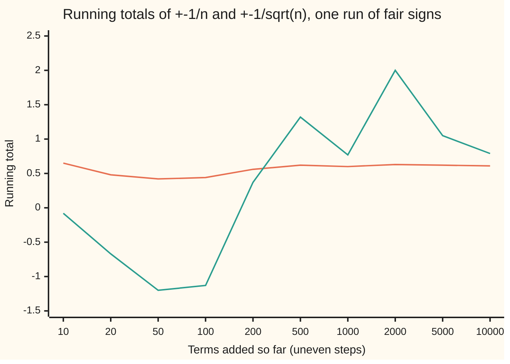

# Kolmogorov's three-series theorem: exactly when a sum of independent random terms converges

[Syllabus](../../../SYLLABUS.md) → [Measure and integration](../README.md) → [The Limit Theorems, Proved](../README.md#s10) → Kolmogorov's three-series theorem

---

## General Overview

The harmonic series 1 + 1/2 + 1/3 + … grows without limit: its sum passes 14.39 by the millionth term. Now flip a fair coin for every term. Heads, add 1/n; tails, subtract it. In one simulated run of 10,000 flips the running total reads 0.65 after 10 terms, 0.44 after 100, 0.60 after 1,000 and 0.61 after 10,000. It settles.

Feed the same coin flips into the terms 1/√n, which shrink more slowly. That total reads −1.20 after 50 terms, 2.00 after 2,000 and 0.79 after 10,000. It never settles.

The difference is in the variances (a term's average squared distance from its mean). A term ±1/n has variance 1/n², and those add up to π²/6 = 1.6449. A term ±1/√n has variance 1/n, and those add up to infinity. Andrey Kolmogorov proved in 1928 that this kind of test decides every sum of independent random terms, once each term is cut off at a fixed size. The test is three ordinary series of numbers.

**A sum of independent random terms converges with probability one exactly when, after each term is cut off at a fixed level, three series of numbers converge: the chances of being cut, the means of the cut terms, and their variances; if any of the three diverges, the sum diverges with probability one.**

**What kind of fact this is:** a theorem, proved on this card in Why it works in both directions, together with Kolmogorov's maximal inequality, the tool that drives it.

### The picture: one run, the same coin flips in both series



Orange: the random harmonic series, the sum of ±1/n, which flattens out near 0.61. Green: the sum of ±1/√n with the same signs, which keeps swinging. Seed 20261123; the code prints every point.

---

## The formula

Notation first, in words. The terms $`X_1, X_2, \dots`$ are independent random numbers. The partial sum is $`S_n = X_1 + \dots + X_n`$, the running total after n terms. One outcome of the whole experiment, here one infinite list of coin flips, is written $`\omega`$. "The series converges almost surely" means: the set of outcomes on which $`S_n(\omega)`$ has a finite limit has probability one.

In the example, $`\varepsilon_n`$ is the n-th fair sign, +1 or −1 with chance 1/2 each. Series A has terms $`X_n = \varepsilon_n / n`$; series B has $`X_n = \varepsilon_n/\sqrt{n}`$.

**Kolmogorov's maximal inequality.** Let the terms be independent with mean 0 and finite variances $`\sigma_k^2 = \mathrm{Var}(X_k)`$. For every level $`\lambda > 0`$,

```math
P\Big(\max_{k \le n} |S_k| \ge \lambda\Big) \le \frac{\mathrm{Var}(S_n)}{\lambda^2} = \frac{\sigma_1^2 + \dots + \sigma_n^2}{\lambda^2}.
```

**Read it aloud:** the chance that the running total reaches size λ at any time up to n is no more than the variance at time n over λ squared, the same bound Chebyshev gives for time n alone.

**The three-series theorem.** Let the terms be independent and fix a cut-off level $`A > 0`$. Cut each term off: $`Y_n = X_n \mathbf{1}_{\{|X_n| \le A\}}`$, which is $`X_n`$ when its size is at most A and 0 otherwise. Then $`\sum X_n`$ converges almost surely if and only if all three converge:

```math
\text{(i)}\ \sum_{n} P(|X_n| > A) < \infty, \qquad \text{(ii)}\ \sum_n E[Y_n]\ \text{converges}, \qquad \text{(iii)}\ \sum_n \mathrm{Var}(Y_n) < \infty.
```

If any one of them fails, $`\sum X_n`$ diverges almost surely.

**Read it aloud:** the terms are rarely cut, the cut terms' means add to a finite number, and the cut terms' variances add to a finite number; that is the whole condition, in both directions.

For series A with A = 1, no term is ever cut and every mean is 0, so (i) and (ii) are zero. Series (iii) is the sum of $`1/n^2`$, which is 1.6449: A converges. For series B, (iii) is the sum of 1/n, which diverges: B diverges.

| Symbol | Plain meaning | In our example | Push it up and the answer… |
| --- | --- | --- | --- |
| $`X_n`$, $`S_n`$ | the n-th random term; the running total after n terms | ±1/n; run 1 has $`S_{10000}`$ = 0.6132 | — |
| $`\varepsilon_n`$ | the n-th fair sign, +1 or −1 | from the top bit of a generator | — |
| $`\sigma_n^2`$, $`s_n^2`$ | the variance of the n-th term; $`s_n^2 = \mathrm{Var}(S_n)`$, in the fold | 1/n² for A, 1/n for B | slower decay, and the sum can diverge |
| $`\lambda`$ | the level in the maximal inequality | 2 | a smaller bound, by the square |
| $`\delta`$ | the tolerance for later swings of the total | 0.05 | a smaller bound, by the square |
| $`A`$, $`Y_n`$ | the cut-off level; the term cut off at it | 1; $`Y_n = X_n`$ for A and B | the verdict never changes |
| $`\mathbf{1}_{\{\dots\}}`$ | indicator: 1 when the condition holds, 0 otherwise | — | — |
| $`B_k`$, $`G_k`$ | the event that the total first reaches size λ at time k; in the fold, the event that it stays within λ up to time k | k = 2 at the earliest for λ = 1.5 | — |
| $`c`$ | a bound on the size of every term, in the converse inequality | 1 for series B | a weaker converse bound |
| $`Y_n'`$, $`Z_n`$ | an independent copy of $`Y_n`$; the difference $`Y_n - Y_n'`$ | Step 4 only | — |
| $`n`$, $`k`$, $`m`$, $`j`$, $`\omega`$ | term counts and one outcome | m = 1,000 in Step 2 | — |
| $`x_n`$, $`r_n`$; $`a_n`$, $`\xi_n`$, $`\psi_j`$ | numbers in Kronecker's lemma, their tail sums; step sizes, noise and weights in the real-life uses | $`a_n`$ = 1/n | — |

### When it holds

- **Independent terms.** Make every sign copy the first. The variances still add to 1.6449, yet the total is $`\pm(1 + 1/2 + \dots + 1/n)`$, which passes 14.3927 by n = 1,000,000 and diverges.
- **Mean 0 for the variance test alone.** Give +1/n a chance 3/4 (series D). The variances add to 1.2337, but the means 1/(2n) add to infinity, and the total drifts upward.
- **Cut off before taking variances.** Let term n be $`n^2`$ with chance $`1/n^2`$ and 0 otherwise (series C). Its variances $`n^2 - 1`$ add to infinity, yet only finitely many terms are nonzero, so the sum converges. Cut at A = 1 and all three series are finite.
- **Any cut-off level.** The verdict is the same for every A > 0, because the theorem's two sides do not mention A.

---

## Why it works

### Step 0: a total converges when its later swings shrink

A list of numbers converges exactly when its later values stay close to each other: for every tolerance, there is a time after which no two values differ by more than it. This is the Cauchy test. So the proof must control the largest swing of $`S_k`$ over a whole stretch of times, not its value at one time.

Chebyshev's inequality controls one time: $`P(|S_n| \ge \lambda) \le \mathrm{Var}(S_n)/\lambda^2`$ ([Markov and Chebyshev](../04-The%20Lebesgue%20Integral/07-markov-and-chebyshev.md)). Kolmogorov's surprise is that the same bound holds for the maximum over all times up to n. Independence pays for it.

### Step 1: Kolmogorov's maximal inequality

Let $`B_k`$ be the event that $`|S_k| \ge \lambda`$ for the first time at time k. These events do not overlap, and their union is the event that the maximum reaches λ.

Fix k. Split the final total as $`S_n = S_k + (S_n - S_k)`$. The later piece $`S_n - S_k`$ is built from terms k + 1 to n. It is independent of $`S_k`$ and of $`B_k`$, which depend only on terms 1 to k ([Independence as a product](../06-Product%20Measures%20and%20Fubini/04-independence-as-a-product-measure.md)). Its mean is 0. So the cross term vanishes when the square is expanded:

```math
E\big[S_n^2 \mathbf{1}_{B_k}\big] = E\big[S_k^2 \mathbf{1}_{B_k}\big] + E\big[(S_n - S_k)^2\big]\,P(B_k) \ge \lambda^2 P(B_k).
```

The inequality holds because $`S_k^2 \ge \lambda^2`$ on $`B_k`$. Add over k = 1 to n:

```math
\mathrm{Var}(S_n) = E[S_n^2] \ge E\Big[S_n^2 \mathbf{1}_{\{\max_{k\le n}|S_k| \ge \lambda\}}\Big] \ge \lambda^2\, P\Big(\max_{k \le n}|S_k| \ge \lambda\Big).
```

In words: a total that has once reached size λ keeps, on average, at least λ² of squared size at the end, because what comes later has mean 0 and cannot pull it back on average.

The code checks this on series A with n = 16, over all 65,536 sign patterns, in exact integer arithmetic. At λ = 2:

| Quantity | Value |
| --- | --- |
| $`P(\lvert S_{16}\rvert \ge 2)`$, the end alone | 0.102722 |
| $`P(\max_{k \le 16}\lvert S_k\rvert \ge 2)`$, the whole path | 0.173706 |
| bound $`\mathrm{Var}(S_{16})/4`$ = 1.584347/4 | 0.396087 |
| $`E[S_{16}^2]`$ on the crossing set, against 4 × 0.173706 | 0.771090 ≥ 0.694824 |

The path crosses 2 far more often than the end sits beyond 2, and both stay under the bound.

### Step 2: summable variances make the series converge

**The convergence theorem.** If the terms are independent with mean 0 and $`\sum_n \sigma_n^2 < \infty`$, then $`\sum_n X_n`$ converges almost surely.

Apply Step 1 to the terms after time m, that is to $`S_k - S_m`$ for k from m + 1 to n. Then let n grow; the events grow, so their chances converge to the chance of the union:

```math
P\Big(\sup_{k > m} |S_k - S_m| \ge \delta\Big) \le \frac{1}{\delta^2} \sum_{j > m} \sigma_j^2.
```

The right side is the tail of a convergent series, so it tends to 0 as m grows. Any two totals after time m differ by at most twice the largest swing from $`S_m`$. So the chance that the totals after m spread by $`2\delta`$ or more tends to 0. The spread after m can only shrink as m grows, so its limit is 0 almost surely, for every δ along δ = 1/2, 1/3, …. That is the Cauchy test, passed on a set of probability one.

For series A from m = 1,000, the variances from term 1,001 to term 10,000 add to 0.0008995. With δ = 0.05 the bound is 0.0008995/0.0025 = 0.3598. In 1,000 simulated runs, a share 0.191 swung by 0.05 or more from $`S_{1000}`$ somewhere up to term 10,000. The bound holds, with room to spare.

The simulated spread (root mean square of $`S_n`$ over the 1,000 runs) shows the two series apart:

| n | A simulated | A, $`\sqrt{\sum_{k \le n} 1/k^2}`$ | B simulated | B, $`\sqrt{\sum_{k\le n} 1/k}`$ |
| ---: | ---: | ---: | ---: | ---: |
| 100 | 1.3154 | 1.2787 | 2.2687 | 2.2776 |
| 1,000 | 1.3189 | 1.2822 | 2.7543 | 2.7360 |
| 10,000 | 1.3183 | 1.2825 | 3.1517 | 3.1285 |

Series A's spread stops at $`\sqrt{\pi^2/6}`$ = 1.2825, the spread of its limit. Series B's keeps growing, like the square root of ln n.

### Step 3: the three series suffice

Suppose (i), (ii) and (iii) hold.

1. By (iii) and Step 2, applied to the centred cut terms $`Y_n - E[Y_n]`$, the series $`\sum (Y_n - E[Y_n])`$ converges almost surely.
2. Add the convergent number series (ii): $`\sum Y_n`$ converges almost surely.
3. By (i) and the first Borel-Cantelli lemma, $`X_n \ne Y_n`$ for only finitely many n, almost surely ([The Borel-Cantelli lemmas](01-borel-cantelli-lemmas.md)). Changing finitely many terms does not change whether a series converges. So $`\sum X_n`$ converges almost surely.

### Step 4: the three series are necessary

Suppose $`\sum X_n`$ converges almost surely.

**Series (i).** The terms of a convergent series tend to 0, so $`|X_n| > A`$ happens only finitely often. These events are independent. By the second Borel-Cantelli lemma, if their chances added to infinity, they would happen infinitely often. So (i) holds, and as in Step 3, $`\sum Y_n`$ converges almost surely too.

**Series (iii).** Take an independent copy $`Y_n'`$ of each cut term and set $`Z_n = Y_n - Y_n'`$. Each $`Z_n`$ has mean 0, size at most 2A and variance $`2\,\mathrm{Var}(Y_n)`$. The sum $`\sum Z_n`$ converges almost surely, because $`\sum Y_n`$ and its copy $`\sum Y_n'`$ both do. A second inequality of Kolmogorov's, for independent mean-0 terms of size at most c, runs the other way:

```math
P\Big(\max_{k \le n} |S_k| \le \lambda\Big) \le \frac{(\lambda + c)^2}{\mathrm{Var}(S_n)}.
```

If the variances of the $`Y_n`$ added to infinity, the right side would tend to 0 for every λ. The partial sums of the $`Z_n`$ would then be unbounded almost surely, and could not converge. So (iii) holds.

**Series (ii).** By (iii) and Step 2, $`\sum (Y_n - E[Y_n])`$ converges almost surely. Subtract it from $`\sum Y_n`$: the number series $`\sum E[Y_n]`$ converges.

The converse inequality settles series B directly, with c = 1 and λ = 1.5. At n = 10,000 the bound is 6.25/9.7876 = 0.6386, and a share 0.004 of the 1,000 runs stayed within 1.5. At n = 1,000,000 the bound is 6.25/14.3927 = 0.4342. It falls only like 1/ln n, but it falls to 0, so the total of series B leaves every band almost surely.

<details>
<summary>Detailed proof of the converse maximal inequality</summary>

**Setting.** $`X_1, \dots, X_n`$ independent, mean 0, $`|X_k| \le c`$, $`s_n^2 = \mathrm{Var}(S_n)`$. Let $`G_k = \{\max_{j \le k} |S_j| \le \lambda\}`$, with $`G_0`$ the whole space. The events shrink: $`G_0 \supseteq G_1 \supseteq \dots \supseteq G_n`$.

**One step.** $`G_{k-1}`$ depends only on terms 1 to k − 1, so $`X_k`$ is independent of $`S_{k-1}\mathbf{1}_{G_{k-1}}`$ and has mean 0. Expanding the square,

$`\displaystyle E[S_k^2 \mathbf{1}_{G_{k-1}}] = E[S_{k-1}^2 \mathbf{1}_{G_{k-1}}] + \sigma_k^2 P(G_{k-1}) \ge E[S_{k-1}^2 \mathbf{1}_{G_{k-1}}] + \sigma_k^2 P(G_n).`$

On $`G_{k-1} \setminus G_k`$ the total was within λ at time k − 1 and moved by at most c, so $`S_k^2 \le (\lambda + c)^2`$ there. Hence

$`\displaystyle E[S_k^2 \mathbf{1}_{G_k}] \ge E[S_{k-1}^2 \mathbf{1}_{G_{k-1}}] + \sigma_k^2 P(G_n) - (\lambda + c)^2 P(G_{k-1} \setminus G_k).`$

**Add over k = 1 to n.** The differences $`P(G_{k-1} \setminus G_k)`$ add to $`1 - P(G_n)`$, and $`S_n^2 \le \lambda^2`$ on $`G_n`$:

$`\displaystyle \lambda^2 P(G_n) \ge E[S_n^2 \mathbf{1}_{G_n}] \ge s_n^2 P(G_n) - (\lambda + c)^2 (1 - P(G_n)).`$

Rearranged, $`s_n^2 P(G_n) \le \lambda^2 P(G_n) + (\lambda+c)^2(1 - P(G_n)) \le (\lambda + c)^2`$. So $`P(G_n) \le (\lambda + c)^2 / s_n^2`$.

**Use in Step 4.** Suppose $`\sum_n \mathrm{Var}(Y_n) = \infty`$. For the $`Z_n`$, with c = 2A, $`P(\max_{k \le n}|Z_1 + \dots + Z_k| \le \lambda) \le (\lambda + 2A)^2 / (2\sum_{j \le n} \mathrm{Var}(Y_j)) \to 0`$. The events shrink in n, so $`P(\sup_k |Z_1 + \dots + Z_k| \le \lambda) = 0`$ for each λ = 1, 2, 3, …. A countable union of null sets is null, so the partial sums are unbounded almost surely. A convergent series has bounded partial sums: contradiction.

**A second road to (iii).** Durrett uses the central limit theorem instead. If $`\sum \mathrm{Var}(Y_n) = \infty`$, the centred cut sums divided by their standard deviation tend to the normal law, by Lindeberg's condition for bounded terms. But $`\sum Y_n`$ converges, so after division by that growing standard deviation the random part shrinks to 0, and only a sequence of plain numbers is left. Plain numbers cannot spread out into a normal law.

</details>

### Step 5: why the answer is always 0 or 1

Whether $`\sum X_n`$ converges does not depend on any finite set of terms. So it is a tail event, and by Kolmogorov's zero-one law its probability is 0 or 1 ([Kolmogorov's zero-one law](02-kolmogorov-zero-one-law.md)). The zero-one law says the answer is extreme. The three-series theorem says which extreme.

### Step 6: Kolmogorov's own proof of the strong law

[The strong law of large numbers](04-strong-law-of-large-numbers.md) proves the strong law with a fourth moment, and outlines Etemadi's proof for a finite mean. Kolmogorov's original route uses this card's tools.

Roll a fair die forever. Let $`X_n`$ be the n-th face minus 3.5, with variance 35/12. The terms $`X_n/n`$ are independent with mean 0, and their variances add to

```math
\sum_n \frac{35/12}{n^2} = \frac{35}{12} \cdot \frac{\pi^2}{6} = 4.797724.
```

By Step 2, $`\sum X_n / n`$ converges almost surely. Kronecker's lemma, below, turns that into $`(X_1 + \dots + X_n)/n \to 0`$: the running average of the die tends to 3.5. This works for any law with a finite variance. By cutting off roll n at size n and applying Step 2 to the cut rolls, Kolmogorov extended it to any law with a finite mean.

<details>
<summary>Kronecker's lemma, proved</summary>

**Claim.** If $`x_1, x_2, \dots`$ are numbers and $`\sum_n x_n/n`$ converges, then $`(x_1 + \dots + x_n)/n \to 0`$.

**Proof.** Let $`r_n = \sum_{k > n} x_k / k`$, the tail of the series, so $`r_n \to 0`$, and $`x_k = k(r_{k-1} - r_k)`$. Summation by parts gives

$`\displaystyle \sum_{k=1}^{n} x_k = \sum_{k=1}^{n} k(r_{k-1} - r_k) = \sum_{j=0}^{n-1} r_j - n r_n.`$

Divide by n. The average of $`r_0, \dots, r_{n-1}`$ tends to 0, because the $`r_j`$ do. And $`r_n \to 0`$. So the average of the $`x_k`$ tends to 0.

</details>

---

## Worked numbers, by hand

Series A, the sum of ±1/n with fair independent signs, and series B, the sum of ±1/√n.

| Step | Arithmetic | Value |
| --- | --- | --- |
| variance of ±1/n | (1/n)² × 1/2 + (−1/n)² × 1/2 | 1/n² |
| $`\mathrm{Var}(S_{16})`$ | 1 + 1/4 + 1/9 + … + 1/256 | 1.584347 |
| maximal bound, λ = 2 | 1.584347 / 4 | 0.396087 |
| exact chance, all 65,536 patterns | count of paths that reach size 2 | 0.173706 |
| all variances of A | 1 + 1/4 + 1/9 + … = π²/6 | 1.644934 |
| variances from term 1,001 to 10,000 | 1.644834 − 1.643935 | 0.0008995 |
| swing bound after term 1,000, δ = 0.05 | 0.0008995 / 0.0025 | 0.3598 |
| all variances of B, to n = 1,000,000 | 1 + 1/2 + 1/3 + … | 14.3927, and growing |
| three series of A, cut-off 1 | 0, 0, 1.6449 | **all finite: A converges almost surely** |

The random harmonic series has a limit on almost every run, and that limit has spread √1.644934 = 1.2825; series B has no limit on almost every run.

### What breaks if you drop a piece

| Mistake | Comes out at | What went wrong |
| --- | --- | --- |
| Independence dropped: every sign copies the first | the total is ±14.3927 by n = 1,000,000, and growing, though the variances still add to 1.6449 | Step 1 needs later terms independent of earlier ones |
| Means ignored: series D, +1/n with chance 3/4 | variances add to 1.2337, yet the mean of $`S_{10000}`$ over 1,000 runs is 4.9045, against a sum of means 4.8938 that grows without limit | the drift 1/(2n) adds like half of ln n |
| No cut-off: series C, $`n^2`$ with chance $`1/n^2`$ | the variances $`n^2 - 1`$ add to infinity, yet the chance of no nonzero term from 2 to 10,000 is 0.500050, and the sum converges | rare huge terms inflate the variance without stopping convergence |
| Chebyshev at the end in place of the maximum | $`P(\lvert S_{16}\rvert \ge 2)`$ = 0.102722, but the path reaches 2 with chance 0.173706 | one time is not the whole path |

The code prints all four.

---

## Code, from first principles, and it actually runs

The code checks finite stages; that the totals converge or diverge forever rests on the proof. It takes four roads. It counts all $`2^{16}`$ sign patterns of series A in exact integers and compares the chances with Kolmogorov's bound. It brackets the partial sums of $`1/n^2`$ and $`1/n`$ by the integral test, against π²/6 and the logarithm. It simulates 1,000 runs of 10,000 terms with a SplitMix64 generator written out in each language, seed 20261123; one draw gives the sign of A and B (its top bit, the variable `e`) and the sign of D (its top two bits). And it checks series C's chance of no jump by a direct product against the telescoped closed form (N + 1)/(2N).

### Python

```python
# Kolmogorov's three-series theorem -- the check behind the card.  Standard library only.
# Fair signs e_n = +1 or -1.  Series A: sum e_n/n, variances 1/n^2.  Series B: sum e_n/sqrt(n),
# variances 1/n.  Roads: all 2^16 sign patterns counted exactly, against Kolmogorov's maximal
# inequality; partial sums bracketed by the integral test, against pi^2/6; 1000 simulated
# runs (SplitMix64, seed 20261123) against the spreads and both inequalities; the three
# series for four examples, with a telescoping product against a direct product.
from fractions import Fraction as Q
from math import sqrt, pi, log

print("sum of 1/n^2 to N, integral-test bracket for pi^2/6; sum of 1/n to N, bracket [ln(N+1), 1 + ln N]")
v2, h1, brk, n = 0.0, 0.0, [], 0
for N in (16, 100, 1000, 10000, 1000000):
    while n < N:
        n += 1
        v2 += 1.0 / (n * n)
        h1 += 1.0 / n
    brk.append((v2 + 1 / (N + 1), v2 + 1 / N, log(N + 1), h1, 1 + log(N)))
    print(f"N={N:7d}: sum 1/n^2 {v2:.6f}, pi^2/6 in [{v2 + 1 / (N + 1):.6f}, {v2 + 1 / N:.6f}];"
          f" sum 1/n {h1:.4f}")
Z2 = pi * pi / 6
print(f"pi^2/6 = {Z2:.6f}; sd of the limit of series A = sqrt(pi^2/6) = {sqrt(Z2):.4f}")

K, L = 16, 720720                                       # L = lcm(1..16): sums become integers
step = [L // k for k in range(1, K + 1)]
LAM = (Q(3, 2), Q(2), Q(5, 2), Q(3))
hit_max, hit_end, s2sum, s2hit = [0] * 4, [0] * 4, 0, 0
for mask in range(1 << K):
    s = mx = 0
    for k in range(K):
        s += step[k] if mask >> k & 1 else -step[k]
        mx = max(mx, abs(s))
    s2sum += s * s
    for i, lam in enumerate(LAM):
        hit_max[i] += mx >= lam * L
        hit_end[i] += abs(s) >= lam * L
    if mx >= 2 * L:
        s2hit += s * s
V16 = sum(Q(1, k * k) for k in range(1, K + 1))
print(f"series A, n = 16, all 65536 sign patterns: Var(S_16) = {float(V16):.6f}, counted "
      f"{float(Q(s2sum, L * L << K)):.6f}")
print("lambda, P(|S_16| >= lambda), P(max_k<=16 |S_k| >= lambda), bound Var(S_16)/lambda^2")
for i, lam in enumerate(LAM):
    print(f"{float(lam):.1f}: {hit_end[i] / 65536:.6f} {hit_max[i] / 65536:.6f} {float(V16 / lam ** 2):.6f}")
print(f"lambda = 2: E[S_16^2 on the crossing set] = {s2hit / L / L / 65536:.6f} >= "
      f"4 P(crossing) = {4 * hit_max[1] / 65536:.6f}")

M64 = (1 << 64) - 1
state = 20261123
def draw():
    global state
    state = (state + 0x9E3779B97F4A7C15) & M64
    z = state
    z = ((z ^ (z >> 30)) * 0xBF58476D1CE4E5B9) & M64
    z = ((z ^ (z >> 27)) * 0x94D049BB133111EB) & M64
    return z ^ (z >> 31)

RUNS, N = 1000, 10000
CHART = (10, 20, 50, 100, 200, 500, 1000, 2000, 5000, 10000)
SPREAD = (100, 1000, 10000)
a = [0.0] + [1.0 / k for k in range(1, N + 1)]
b = [0.0] + [1.0 / sqrt(k) for k in range(1, N + 1)]
sq = {m: [0.0, 0.0] for m in SPREAD}
osc_hits, stay_hits, d_sum, d_sq = 0, 0, 0.0, 0.0
for r in range(RUNS):
    sa = sb = sd = 0.0
    sa1000, osc, bmax, pa, pb = 0.0, 0.0, 0.0, [], []
    for k in range(1, N + 1):
        z = draw()
        e = 1.0 if z >> 63 else -1.0                 # fair sign from the top bit
        sa += e * a[k]
        sb += e * b[k]
        sd += (-1.0 if z >> 62 == 0 else 1.0) * a[k]  # + with chance 3/4: series D
        bmax = max(bmax, abs(sb))
        if k == 1000:
            sa1000 = sa
        elif k > 1000:
            osc = max(osc, abs(sa - sa1000))
        if k in sq:
            sq[k][0] += sa * sa
            sq[k][1] += sb * sb
        if r == 0 and k in CHART:
            pa.append(sa)
            pb.append(sb)
    osc_hits += osc >= 0.05
    stay_hits += bmax <= 1.5
    d_sum += sd
    d_sq += sd * sd
    if r == 0:
        print("run 1, same signs: n, series A, series B")
        for m, x, y in zip(CHART, pa, pb):
            print(f"{m:5d}: {x:8.4f} {y:8.4f}")
        print("figure A:", ", ".join(f"{x:.2f}" for x in pa))
        print("figure B:", ", ".join(f"{y:.2f}" for y in pb))
print(f"{RUNS} runs: n, spread of S_n for A (simulated, sqrt sum 1/k^2), for B (simulated, sqrt sum 1/k)")
va = vb = 0.0
spread = []
for k in range(1, N + 1):
    va += 1.0 / (k * k)
    vb += 1.0 / k
    if k == 1000:
        va1000 = va
    if k in sq:
        ra, rb = sqrt(sq[k][0] / RUNS), sqrt(sq[k][1] / RUNS)
        spread.append((ra, sqrt(va), rb, sqrt(vb)))
        print(f"{k:5d}: A {ra:.4f} {sqrt(va):.4f}   B {rb:.4f} {sqrt(vb):.4f}")
tail = va - va1000
print(f"A: share of runs with max over 1000<k<=10000 of |S_k - S_1000| >= 0.05: {osc_hits / RUNS:.3f};"
      f" bound {tail:.7f}/0.05^2 = {tail / 0.0025:.4f}")
print(f"B: share of runs with max over k<=10000 of |S_k| <= 1.5: {stay_hits / RUNS:.3f};"
      f" converse bound (1.5+1)^2/{vb:.4f} = {6.25 / vb:.4f}")
print(f"B: the same converse bound at n = 1000000: 6.25/{h1:.4f} = {6.25 / h1:.4f}")
print("three series, truncation level 1: sum P(|X_n|>1), sum E[Y_n], sum Var(Y_n) -> verdict")
print(f"A  +-1/n          : 0, 0, {Z2:.4f} -> converges")
print(f"B  +-1/sqrt(n)    : 0, 0, infinite ({h1:.4f} by n = 1000000) -> diverges")
print(f"C  n^2 w.p. 1/n^2 : {Z2 - 1:.4f}, 1, 0 -> converges (sum Var(X_n) = sum (n^2 - 1) is infinite)")
print(f"D  +1/n w.p. 3/4  : 0, infinite ({h1 / 2:.4f} by n = 1000000), {0.75 * Z2:.4f} -> diverges")
prod = 1.0
for k in range(2, N + 1):
    prod *= 1.0 - 1.0 / (k * k)
print(f"C: P(no jump for 2<=n<={N}) = product {prod:.6f}, telescoped (N+1)/(2N) = {(N + 1) / (2 * N):.6f}")
dm, dsd = d_sum / RUNS, sqrt(d_sq / RUNS - (d_sum / RUNS) ** 2)
print(f"D: {RUNS} runs, mean of S_10000 {dm:.4f} (sum of means {vb / 2:.4f}), sd {dsd:.4f}"
      f" (sqrt of sum 3/(4k^2) {sqrt(0.75 * va):.4f})")
print(f"Kolmogorov's strong law, fair die: sum Var((X_n - 3.5)/n) = (35/12)(pi^2/6) = {35 / 12 * Z2:.6f}")

assert all(lo <= Z2 <= hi and l1 <= h <= u1 for lo, hi, l1, h, u1 in brk)  # series vs closed forms
assert s2sum == sum(t * t for t in step) << K                    # Var(S_16): count vs formula
assert all(hit_end[i] <= hit_max[i] <= V16 / lam ** 2 * 65536 for i, lam in enumerate(LAM))
assert s2hit >= 4 * L * L * hit_max[1]                           # the proof's key step, counted
assert all(abs(ra / ta - 1) < 0.1 and abs(rb / tb - 1) < 0.1 for ra, ta, rb, tb in spread)
assert osc_hits / RUNS <= tail / 0.0025 and stay_hits / RUNS <= 6.25 / vb  # both inequalities
assert abs(prod - (N + 1) / (2 * N)) < 1e-9                      # product vs telescoping
assert abs(dm - vb / 2) < 4 * sqrt(0.75 * va / RUNS)              # simulation vs sum of means
print("ALL CHECKS PASS")
```

**Ran 2026-11-23 on macOS, Python 3.14.10, standard library only. All checks passed. Output, pasted from the run:**

```
sum of 1/n^2 to N, integral-test bracket for pi^2/6; sum of 1/n to N, bracket [ln(N+1), 1 + ln N]
N=     16: sum 1/n^2 1.584347, pi^2/6 in [1.643170, 1.646847]; sum 1/n 3.3807
N=    100: sum 1/n^2 1.634984, pi^2/6 in [1.644885, 1.644984]; sum 1/n 5.1874
N=   1000: sum 1/n^2 1.643935, pi^2/6 in [1.644934, 1.644935]; sum 1/n 7.4855
N=  10000: sum 1/n^2 1.644834, pi^2/6 in [1.644934, 1.644934]; sum 1/n 9.7876
N=1000000: sum 1/n^2 1.644933, pi^2/6 in [1.644934, 1.644934]; sum 1/n 14.3927
pi^2/6 = 1.644934; sd of the limit of series A = sqrt(pi^2/6) = 1.2825
series A, n = 16, all 65536 sign patterns: Var(S_16) = 1.584347, counted 1.584347
lambda, P(|S_16| >= lambda), P(max_k<=16 |S_k| >= lambda), bound Var(S_16)/lambda^2
1.5: 0.270844 0.533051 0.704154
2.0: 0.102722 0.173706 0.396087
2.5: 0.020844 0.033051 0.253495
3.0: 0.001129 0.001801 0.176039
lambda = 2: E[S_16^2 on the crossing set] = 0.771090 >= 4 P(crossing) = 0.694824
run 1, same signs: n, series A, series B
   10:   0.6544  -0.0832
   20:   0.4839  -0.6677
   50:   0.4208  -1.2006
  100:   0.4365  -1.1329
  200:   0.5632   0.3676
  500:   0.6206   1.3182
 1000:   0.5964   0.7708
 2000:   0.6302   2.0030
 5000:   0.6155   1.0534
10000:   0.6132   0.7883
figure A: 0.65, 0.48, 0.42, 0.44, 0.56, 0.62, 0.60, 0.63, 0.62, 0.61
figure B: -0.08, -0.67, -1.20, -1.13, 0.37, 1.32, 0.77, 2.00, 1.05, 0.79
1000 runs: n, spread of S_n for A (simulated, sqrt sum 1/k^2), for B (simulated, sqrt sum 1/k)
  100: A 1.3154 1.2787   B 2.2687 2.2776
 1000: A 1.3189 1.2822   B 2.7543 2.7360
10000: A 1.3183 1.2825   B 3.1517 3.1285
A: share of runs with max over 1000<k<=10000 of |S_k - S_1000| >= 0.05: 0.191; bound 0.0008995/0.05^2 = 0.3598
B: share of runs with max over k<=10000 of |S_k| <= 1.5: 0.004; converse bound (1.5+1)^2/9.7876 = 0.6386
B: the same converse bound at n = 1000000: 6.25/14.3927 = 0.4342
three series, truncation level 1: sum P(|X_n|>1), sum E[Y_n], sum Var(Y_n) -> verdict
A  +-1/n          : 0, 0, 1.6449 -> converges
B  +-1/sqrt(n)    : 0, 0, infinite (14.3927 by n = 1000000) -> diverges
C  n^2 w.p. 1/n^2 : 0.6449, 1, 0 -> converges (sum Var(X_n) = sum (n^2 - 1) is infinite)
D  +1/n w.p. 3/4  : 0, infinite (7.1964 by n = 1000000), 1.2337 -> diverges
C: P(no jump for 2<=n<=10000) = product 0.500050, telescoped (N+1)/(2N) = 0.500050
D: 1000 runs, mean of S_10000 4.9045 (sum of means 4.8938), sd 1.1301 (sqrt of sum 3/(4k^2) 1.1107)
Kolmogorov's strong law, fair die: sum Var((X_n - 3.5)/n) = (35/12)(pi^2/6) = 4.797724
ALL CHECKS PASS
```

### Rust

```rust
// Kolmogorov's three-series theorem -- the check behind the card.  Rust std only.
// Fair signs e_n = +1 or -1.  Series A: sum e_n/n, variances 1/n^2.  Series B: sum e_n/sqrt(n),
// variances 1/n.  Roads: all 2^16 sign patterns counted exactly, against Kolmogorov's maximal
// inequality; partial sums bracketed by the integral test, against pi^2/6; 1000 simulated
// runs (SplitMix64, seed 20261123) against the spreads and both inequalities; the three
// series for four examples, with a telescoping product against a direct product.
struct SplitMix(u64);
impl SplitMix {
    fn draw(&mut self) -> u64 {
        self.0 = self.0.wrapping_add(0x9E3779B97F4A7C15);
        let mut z = self.0;
        z = (z ^ (z >> 30)).wrapping_mul(0xBF58476D1CE4E5B9);
        z = (z ^ (z >> 27)).wrapping_mul(0x94D049BB133111EB);
        z ^ (z >> 31)
    }
}

fn main() {
    println!("sum of 1/n^2 to N, integral-test bracket for pi^2/6; sum of 1/n to N, bracket [ln(N+1), 1 + ln N]");
    let (mut v2, mut h1, mut n) = (0.0f64, 0.0f64, 0u64);
    let mut brk: Vec<(f64, f64, f64, f64, f64)> = Vec::new();
    for &big in [16u64, 100, 1000, 10000, 1000000].iter() {
        while n < big {
            n += 1;
            v2 += 1.0 / (n * n) as f64;
            h1 += 1.0 / n as f64;
        }
        let nf = big as f64;
        brk.push((v2 + 1.0 / (nf + 1.0), v2 + 1.0 / nf, (nf + 1.0).ln(), h1, 1.0 + nf.ln()));
        println!("N={:7}: sum 1/n^2 {:.6}, pi^2/6 in [{:.6}, {:.6}]; sum 1/n {:.4}",
            big, v2, v2 + 1.0 / (nf + 1.0), v2 + 1.0 / nf, h1);
    }
    let z2 = std::f64::consts::PI * std::f64::consts::PI / 6.0;
    println!("pi^2/6 = {:.6}; sd of the limit of series A = sqrt(pi^2/6) = {:.4}", z2, z2.sqrt());

    const K: usize = 16;
    const L: i64 = 720720; // lcm(1..16): sums become integers
    let step: Vec<i64> = (1..=K as i64).map(|k| L / k).collect();
    let lam: [(i64, i64); 4] = [(3, 2), (2, 1), (5, 2), (3, 1)]; // lambda = p/q
    let (mut hit_max, mut hit_end) = ([0i64; 4], [0i64; 4]);
    let (mut s2sum, mut s2hit) = (0i128, 0i128);
    for mask in 0u32..(1 << K) {
        let (mut s, mut mx) = (0i64, 0i64);
        for k in 0..K {
            s += if mask >> k & 1 == 1 { step[k] } else { -step[k] };
            mx = mx.max(s.abs());
        }
        s2sum += (s as i128) * (s as i128);
        for (i, &(p, q)) in lam.iter().enumerate() {
            if mx * q >= p * L { hit_max[i] += 1; }
            if s.abs() * q >= p * L { hit_end[i] += 1; }
        }
        if mx >= 2 * L { s2hit += (s as i128) * (s as i128); }
    }
    let vnum: i128 = step.iter().map(|&t| (t as i128) * (t as i128)).sum(); // V16 = vnum / L^2
    let l2 = (L as i128) * (L as i128);
    println!("series A, n = 16, all 65536 sign patterns: Var(S_16) = {:.6}, counted {:.6}",
        vnum as f64 / l2 as f64, s2sum as f64 / (l2 << K) as f64);
    println!("lambda, P(|S_16| >= lambda), P(max_k<=16 |S_k| >= lambda), bound Var(S_16)/lambda^2");
    let mut ineq_ok = true;
    for (i, &(p, q)) in lam.iter().enumerate() {
        let (bn, bd) = (vnum * (q * q) as i128, l2 * (p * p) as i128); // bound = bn / bd
        ineq_ok &= hit_end[i] <= hit_max[i] && (hit_max[i] as i128) * bd <= bn * 65536;
        println!("{:.1}: {:.6} {:.6} {:.6}", p as f64 / q as f64, hit_end[i] as f64 / 65536.0,
            hit_max[i] as f64 / 65536.0, bn as f64 / bd as f64);
    }
    println!("lambda = 2: E[S_16^2 on the crossing set] = {:.6} >= 4 P(crossing) = {:.6}",
        s2hit as f64 / L as f64 / L as f64 / 65536.0, 4.0 * hit_max[1] as f64 / 65536.0);

    const RUNS: usize = 1000;
    const N: usize = 10000;
    let chart = [10usize, 20, 50, 100, 200, 500, 1000, 2000, 5000, 10000];
    let spread_at = [100usize, 1000, 10000];
    let a: Vec<f64> = (0..=N).map(|k| if k == 0 { 0.0 } else { 1.0 / k as f64 }).collect();
    let b: Vec<f64> = (0..=N).map(|k| if k == 0 { 0.0 } else { 1.0 / (k as f64).sqrt() }).collect();
    let mut sq = [[0.0f64; 2]; 3];
    let (mut osc_hits, mut stay_hits, mut d_sum, mut d_sq) = (0usize, 0usize, 0.0f64, 0.0f64);
    let mut rng = SplitMix(20261123);
    for r in 0..RUNS {
        let (mut sa, mut sb, mut sd) = (0.0f64, 0.0f64, 0.0f64);
        let (mut sa1000, mut osc, mut bmax) = (0.0f64, 0.0f64, 0.0f64);
        let (mut pa, mut pb) = (Vec::new(), Vec::new());
        for k in 1..=N {
            let z = rng.draw();
            let e = if z >> 63 == 1 { 1.0 } else { -1.0 }; // fair sign from the top bit
            sa += e * a[k];
            sb += e * b[k];
            sd += (if z >> 62 == 0 { -1.0 } else { 1.0 }) * a[k]; // + with chance 3/4: series D
            bmax = bmax.max(sb.abs());
            if k == 1000 { sa1000 = sa; } else if k > 1000 { osc = osc.max((sa - sa1000).abs()); }
            if let Some(i) = spread_at.iter().position(|&m| m == k) {
                sq[i][0] += sa * sa;
                sq[i][1] += sb * sb;
            }
            if r == 0 && chart.contains(&k) { pa.push(sa); pb.push(sb); }
        }
        if osc >= 0.05 { osc_hits += 1; }
        if bmax <= 1.5 { stay_hits += 1; }
        d_sum += sd;
        d_sq += sd * sd;
        if r == 0 {
            println!("run 1, same signs: n, series A, series B");
            for i in 0..chart.len() { println!("{:5}: {:8.4} {:8.4}", chart[i], pa[i], pb[i]); }
            let fa: Vec<String> = pa.iter().map(|x| format!("{:.2}", x)).collect();
            let fb: Vec<String> = pb.iter().map(|y| format!("{:.2}", y)).collect();
            println!("figure A: {}", fa.join(", "));
            println!("figure B: {}", fb.join(", "));
        }
    }
    println!("{} runs: n, spread of S_n for A (simulated, sqrt sum 1/k^2), for B (simulated, sqrt sum 1/k)", RUNS);
    let (mut va, mut vb, mut va1000) = (0.0f64, 0.0f64, 0.0f64);
    let mut spread_ok = true;
    for k in 1..=N {
        va += 1.0 / (k * k) as f64;
        vb += 1.0 / k as f64;
        if k == 1000 { va1000 = va; }
        if let Some(i) = spread_at.iter().position(|&m| m == k) {
            let (ra, rb) = ((sq[i][0] / RUNS as f64).sqrt(), (sq[i][1] / RUNS as f64).sqrt());
            spread_ok &= (ra / va.sqrt() - 1.0).abs() < 0.1 && (rb / vb.sqrt() - 1.0).abs() < 0.1;
            println!("{:5}: A {:.4} {:.4}   B {:.4} {:.4}", k, ra, va.sqrt(), rb, vb.sqrt());
        }
    }
    let tail = va - va1000;
    println!("A: share of runs with max over 1000<k<=10000 of |S_k - S_1000| >= 0.05: {:.3}; bound {:.7}/0.05^2 = {:.4}",
        osc_hits as f64 / RUNS as f64, tail, tail / 0.0025);
    println!("B: share of runs with max over k<=10000 of |S_k| <= 1.5: {:.3}; converse bound (1.5+1)^2/{:.4} = {:.4}",
        stay_hits as f64 / RUNS as f64, vb, 6.25 / vb);
    println!("B: the same converse bound at n = 1000000: 6.25/{:.4} = {:.4}", h1, 6.25 / h1);

    println!("three series, truncation level 1: sum P(|X_n|>1), sum E[Y_n], sum Var(Y_n) -> verdict");
    println!("A  +-1/n          : 0, 0, {:.4} -> converges", z2);
    println!("B  +-1/sqrt(n)    : 0, 0, infinite ({:.4} by n = 1000000) -> diverges", h1);
    println!("C  n^2 w.p. 1/n^2 : {:.4}, 1, 0 -> converges (sum Var(X_n) = sum (n^2 - 1) is infinite)", z2 - 1.0);
    println!("D  +1/n w.p. 3/4  : 0, infinite ({:.4} by n = 1000000), {:.4} -> diverges", h1 / 2.0, 0.75 * z2);
    let mut prod = 1.0f64;
    for k in 2..=N { prod *= 1.0 - 1.0 / (k * k) as f64; }
    let tele = (N + 1) as f64 / (2 * N) as f64;
    println!("C: P(no jump for 2<=n<={}) = product {:.6}, telescoped (N+1)/(2N) = {:.6}", N, prod, tele);
    let dm = d_sum / RUNS as f64;
    let dsd = (d_sq / RUNS as f64 - dm * dm).sqrt();
    println!("D: {} runs, mean of S_10000 {:.4} (sum of means {:.4}), sd {:.4} (sqrt of sum 3/(4k^2) {:.4})",
        RUNS, dm, vb / 2.0, dsd, (0.75 * va).sqrt());
    println!("Kolmogorov's strong law, fair die: sum Var((X_n - 3.5)/n) = (35/12)(pi^2/6) = {:.6}", 35.0 / 12.0 * z2);

    assert!(brk.iter().all(|&(lo, hi, l1, h, u1)| lo <= z2 && z2 <= hi && l1 <= h && h <= u1)); // series vs closed forms
    assert!(s2sum == vnum << K); // Var(S_16): count vs formula
    assert!(ineq_ok); // end <= max <= Kolmogorov's bound, counted exactly
    assert!(s2hit >= 4 * l2 * hit_max[1] as i128); // the proof's key step, counted
    assert!(spread_ok); // simulated spreads vs square roots of variance sums
    assert!(osc_hits as f64 / RUNS as f64 <= tail / 0.0025 && stay_hits as f64 / RUNS as f64 <= 6.25 / vb);
    assert!((prod - tele).abs() < 1e-9); // product vs telescoping
    assert!((dm - vb / 2.0).abs() < 4.0 * (0.75 * va / RUNS as f64).sqrt()); // simulation vs sum of means
    println!("ALL CHECKS PASS");
}
```

**Ran 2026-11-23 on macOS, rustc 1.98.1, no crates. All checks passed. Output, pasted from the run:**

```
sum of 1/n^2 to N, integral-test bracket for pi^2/6; sum of 1/n to N, bracket [ln(N+1), 1 + ln N]
N=     16: sum 1/n^2 1.584347, pi^2/6 in [1.643170, 1.646847]; sum 1/n 3.3807
N=    100: sum 1/n^2 1.634984, pi^2/6 in [1.644885, 1.644984]; sum 1/n 5.1874
N=   1000: sum 1/n^2 1.643935, pi^2/6 in [1.644934, 1.644935]; sum 1/n 7.4855
N=  10000: sum 1/n^2 1.644834, pi^2/6 in [1.644934, 1.644934]; sum 1/n 9.7876
N=1000000: sum 1/n^2 1.644933, pi^2/6 in [1.644934, 1.644934]; sum 1/n 14.3927
pi^2/6 = 1.644934; sd of the limit of series A = sqrt(pi^2/6) = 1.2825
series A, n = 16, all 65536 sign patterns: Var(S_16) = 1.584347, counted 1.584347
lambda, P(|S_16| >= lambda), P(max_k<=16 |S_k| >= lambda), bound Var(S_16)/lambda^2
1.5: 0.270844 0.533051 0.704154
2.0: 0.102722 0.173706 0.396087
2.5: 0.020844 0.033051 0.253495
3.0: 0.001129 0.001801 0.176039
lambda = 2: E[S_16^2 on the crossing set] = 0.771090 >= 4 P(crossing) = 0.694824
run 1, same signs: n, series A, series B
   10:   0.6544  -0.0832
   20:   0.4839  -0.6677
   50:   0.4208  -1.2006
  100:   0.4365  -1.1329
  200:   0.5632   0.3676
  500:   0.6206   1.3182
 1000:   0.5964   0.7708
 2000:   0.6302   2.0030
 5000:   0.6155   1.0534
10000:   0.6132   0.7883
figure A: 0.65, 0.48, 0.42, 0.44, 0.56, 0.62, 0.60, 0.63, 0.62, 0.61
figure B: -0.08, -0.67, -1.20, -1.13, 0.37, 1.32, 0.77, 2.00, 1.05, 0.79
1000 runs: n, spread of S_n for A (simulated, sqrt sum 1/k^2), for B (simulated, sqrt sum 1/k)
  100: A 1.3154 1.2787   B 2.2687 2.2776
 1000: A 1.3189 1.2822   B 2.7543 2.7360
10000: A 1.3183 1.2825   B 3.1517 3.1285
A: share of runs with max over 1000<k<=10000 of |S_k - S_1000| >= 0.05: 0.191; bound 0.0008995/0.05^2 = 0.3598
B: share of runs with max over k<=10000 of |S_k| <= 1.5: 0.004; converse bound (1.5+1)^2/9.7876 = 0.6386
B: the same converse bound at n = 1000000: 6.25/14.3927 = 0.4342
three series, truncation level 1: sum P(|X_n|>1), sum E[Y_n], sum Var(Y_n) -> verdict
A  +-1/n          : 0, 0, 1.6449 -> converges
B  +-1/sqrt(n)    : 0, 0, infinite (14.3927 by n = 1000000) -> diverges
C  n^2 w.p. 1/n^2 : 0.6449, 1, 0 -> converges (sum Var(X_n) = sum (n^2 - 1) is infinite)
D  +1/n w.p. 3/4  : 0, infinite (7.1964 by n = 1000000), 1.2337 -> diverges
C: P(no jump for 2<=n<=10000) = product 0.500050, telescoped (N+1)/(2N) = 0.500050
D: 1000 runs, mean of S_10000 4.9045 (sum of means 4.8938), sd 1.1301 (sqrt of sum 3/(4k^2) 1.1107)
Kolmogorov's strong law, fair die: sum Var((X_n - 3.5)/n) = (35/12)(pi^2/6) = 4.797724
ALL CHECKS PASS
```

The two outputs are identical line for line.

### Lean

Lean proves the maximal inequality, the convergence theorem and the three-series theorem for any independent terms, and checks the card's arithmetic.

- Suppose the terms are independent with mean 0 and finite variances, and take $`\lambda > 0`$. Then $`P(\max_{k \le n} |S_k| \ge \lambda) \le (\sigma_1^2 + \dots + \sigma_n^2)/\lambda^2`$.
- Suppose the terms are independent with mean 0, and their variances add to a finite number. Then $`\sum X_n`$ converges almost surely.
- Take independent terms and any cut-off level $`A > 0`$. Then $`\sum X_n`$ converges almost surely exactly when series (i), (ii) and (iii) all converge.
- Take the same terms, and suppose one of the three series fails. Then $`\sum X_n`$ diverges almost surely.
- Take a fair sign times $`1/n`$. Then its variance is $`1/n^2`$.
- Take series C, $`n^2`$ with chance $`1/n^2`$. Then its mean is 1 and its variance is $`n^2 - 1`$.
- Take series C from term 2 to term 10. Then the chance that every term is 0 is 11/20.
- Take series D, $`+1/n`$ with chance 3/4. Then its mean is $`1/(2n)`$ and its variance is $`3/(4n^2)`$.
- Take the numbers 1 to 16. Then 720720 is the smallest whole number they all divide, the code's L.
- Take $`\delta = 1/20`$, $`c = 1`$ and $`\lambda = 3/2`$. Then $`\delta^2 = 1/400`$ and $`(\lambda + c)^2 = 25/4`$.
- Take $`\lambda = 2`$. Then $`\lambda^2 = 4`$.
- Take one fair roll of a die. Then its face has mean 7/2 and variance 35/12.

The simulated runs, the count over all 65,536 sign patterns and the value $`\pi^2/6`$ are left to the Python and Rust checks.

```lean
-- Kolmogorov's three-series theorem: a sum of independent random terms converges almost surely exactly when, after each term is cut off at a level A > 0, the chances of a cut, the means of the cut terms and their variances form three convergent series, and otherwise it diverges almost surely.
import Mathlib.Probability.Independence.Basic
import Mathlib.Probability.Independence.Integration
import Mathlib.Probability.BorelCantelli
import Mathlib.Probability.Moments.Variance
import Mathlib.Topology.Algebra.InfiniteSum.Real
import Mathlib.Order.Filter.AtTopBot.Basic

open MeasureTheory ProbabilityTheory Filter Topology
open scoped ENNReal

lemma tsr_indep_split {Ω : Type*} [MeasurableSpace Ω] {P : Measure Ω}
    (X : ℕ → Ω → ℝ) (hX : ∀ n, Measurable (X n)) (hind : iIndepFun X P)
    (k : ℕ) {f g : Ω → ℝ}
    (hf : Measurable[⨆ i ∈ {i | i < k}, MeasurableSpace.comap (X i) inferInstance] f)
    (hg : Measurable[⨆ i ∈ {i | k ≤ i}, MeasurableSpace.comap (X i) inferInstance] g) :
    IndepFun f g P := by
  rw [IndepFun_iff_Indep]
  have h := indep_iSup_of_disjoint (m := fun i => MeasurableSpace.comap (X i) inferInstance)
    (fun i => (hX i).comap_le) hind.iIndep (S := {i | i < k}) (T := {i | k ≤ i})
    (Set.disjoint_left.2 fun i h1 h2 => (not_le.2 (show i < k from h1)) (show k ≤ i from h2))
  exact indep_of_indep_of_le_right (indep_of_indep_of_le_left h hf.comap_le) hg.comap_le

lemma tsr_meas_past {Ω : Type*} [MeasurableSpace Ω] (X : ℕ → Ω → ℝ) {k j : ℕ} (hj : j ≤ k) :
    Measurable[⨆ i ∈ {i | i < k}, MeasurableSpace.comap (X i) inferInstance]
      (fun ω => ∑ i ∈ Finset.range j, X i ω) :=
  Finset.measurable_sum _ fun i hi => Measurable.of_comap_le
    (le_iSup₂ (f := fun i (_ : i ∈ {i | i < k}) => MeasurableSpace.comap (X i) inferInstance) i
      (show i < k from lt_of_lt_of_le (Finset.mem_range.1 hi) hj))

lemma tsr_meas_fut {Ω : Type*} [MeasurableSpace Ω] (X : ℕ → Ω → ℝ) {k : ℕ} (s : Finset ℕ)
    (hs : ∀ i ∈ s, k ≤ i) :
    Measurable[⨆ i ∈ {i | k ≤ i}, MeasurableSpace.comap (X i) inferInstance]
      (fun ω => ∑ i ∈ s, X i ω) :=
  Finset.measurable_sum _ fun i hi => Measurable.of_comap_le
    (le_iSup₂ (f := fun i (_ : i ∈ {i | k ≤ i}) => MeasurableSpace.comap (X i) inferInstance) i
      (hs i hi))

lemma tsr_past_le {Ω : Type*} [mΩ : MeasurableSpace Ω] (X : ℕ → Ω → ℝ)
    (hX : ∀ n, Measurable (X n)) (k : ℕ) :
    (⨆ i ∈ {i | i < k}, MeasurableSpace.comap (X i) inferInstance) ≤ mΩ :=
  iSup₂_le fun i _ => (hX i).comap_le

lemma tsr_maximal {Ω : Type*} [MeasurableSpace Ω] {P : Measure Ω}
    [IsProbabilityMeasure P] (X : ℕ → Ω → ℝ) (hX : ∀ n, Measurable (X n))
    (hind : iIndepFun X P) (hL2 : ∀ n, MemLp (X n) 2 P) (hmean : ∀ n, ∫ ω, X n ω ∂P = 0)
    {t : ℝ} (ht : 0 < t) (n : ℕ) :
    P {ω | ∃ k ≤ n, t ≤ |∑ i ∈ Finset.range k, X i ω|} ≤
      ENNReal.ofReal ((∑ i ∈ Finset.range n, Var[X i; P]) / t ^ 2) := by
  classical
  set S : ℕ → Ω → ℝ := fun j ω => ∑ i ∈ Finset.range j, X i ω with hS
  set A : ℕ → Set Ω := fun k => {ω | t ≤ |S k ω| ∧ ∀ j < k, |S j ω| < t} with hA
  have hSL : ∀ j, MemLp (S j) 2 P := fun j => by
    have := memLp_finsetSum' (Finset.range j) (fun i _ => hL2 i)
    convert this using 1; ext ω; simp [S]
  have hSm : ∀ j, Measurable (S j) := fun j => Finset.measurable_sum _ fun i _ => hX i
  have hApast : ∀ k, MeasurableSet[⨆ i ∈ {i | i < k}, MeasurableSpace.comap (X i) inferInstance]
      (A k) := by
    intro k
    have h1 : MeasurableSet[⨆ i ∈ {i | i < k}, MeasurableSpace.comap (X i) inferInstance]
        {ω | t ≤ |S k ω|} :=
      measurableSet_le measurable_const (continuous_abs.measurable.comp (tsr_meas_past X le_rfl))
    have h2 : MeasurableSet[⨆ i ∈ {i | i < k}, MeasurableSpace.comap (X i) inferInstance]
        {ω | ∀ j < k, |S j ω| < t} := by
      simp only [Set.ofPred_forall]
      refine MeasurableSet.iInter fun j => MeasurableSet.iInter fun hj => ?_
      exact measurableSet_lt (continuous_abs.measurable.comp (tsr_meas_past X (le_of_lt hj)))
        measurable_const
    exact h1.inter h2
  have hAm : ∀ k, MeasurableSet (A k) := fun k => tsr_past_le X hX k _ (hApast k)
  have hunion : {ω | ∃ k ≤ n, t ≤ |S k ω|} = ⋃ k ∈ Finset.range (n+1), A k := by
    ext ω
    simp only [Set.mem_ofPred_eq, Set.mem_iUnion, Finset.mem_range, A]
    constructor
    · rintro ⟨k, hk, hkt⟩
      have hex : ∃ k, t ≤ |S k ω| := ⟨k, hkt⟩
      refine ⟨Nat.find hex, by have := Nat.find_min' hex hkt; omega, Nat.find_spec hex,
        fun j hj => lt_of_not_ge (Nat.find_min hex hj)⟩
    · rintro ⟨k, hk, hkt, _⟩
      exact ⟨k, by omega, hkt⟩
  have hdisj : Set.Pairwise (↑(Finset.range (n+1))) (Function.onFun Disjoint A) := by
    intro k _ l _ hkl
    refine Set.disjoint_left.2 fun ω h1 h2 => ?_
    rcases lt_or_gt_of_ne hkl with h | h
    · exact absurd h1.1 (not_le.2 (h2.2 k h))
    · exact absurd h2.1 (not_le.2 (h1.2 l h))
  have hkey : ∀ k ≤ n, t ^ 2 * P.real (A k) ≤ ∫ ω in A k, S n ω ^ 2 ∂P := by
    intro k hk
    set R : Ω → ℝ := fun ω => ∑ i ∈ Finset.Ico k n, X i ω with hR
    have hSR : ∀ ω, S n ω = S k ω + R ω := fun ω => by
      simp only [S, R]; rw [Finset.sum_range_add_sum_Ico _ hk]
    set U : Ω → ℝ := (A k).indicator (S k) with hU
    have hUL : MemLp U 2 P := (hSL k).indicator (hAm k).nullMeasurableSet
    have hRL : MemLp R 2 P := by
      have := memLp_finsetSum' (Finset.Ico k n) (fun i _ => hL2 i)
      convert this using 1; ext ω; simp [R]
    have hind' : IndepFun U R P := tsr_indep_split X hX hind k
      ((tsr_meas_past X le_rfl).indicator (hApast k))
      (tsr_meas_fut X _ fun i hi => (Finset.mem_Ico.1 hi).1)
    have hR0 : ∫ ω, R ω ∂P = 0 := by
      simp only [R]
      rw [integral_finsetSum _ fun i _ => (hL2 i).integrable (by norm_num)]
      exact Finset.sum_eq_zero fun i _ => hmean i
    have hcross : ∫ ω, U ω * R ω ∂P = 0 := by
      rw [hind'.integral_fun_mul_eq_mul_integral hUL.aestronglyMeasurable
        hRL.aestronglyMeasurable, hR0, mul_zero]
    have iUR : Integrable (fun ω => U ω * R ω) P :=
      hind'.integrable_mul (hUL.integrable (by norm_num)) (hRL.integrable (by norm_num))
    have i1 : Integrable (fun ω => U ω ^ 2 + 2 * (U ω * R ω)) P :=
      hUL.integrable_sq.add (iUR.const_mul 2)
    have i2 : Integrable ((A k).indicator fun ω => S n ω ^ 2) P :=
      (hSL n).integrable_sq.indicator (hAm k)
    calc t ^ 2 * P.real (A k) = ∫ ω, (A k).indicator (fun _ => t ^ 2) ω ∂P := by
          rw [integral_indicator (hAm k), setIntegral_const, smul_eq_mul, mul_comm]
      _ ≤ ∫ ω, U ω ^ 2 ∂P := by
          refine integral_mono ((integrable_const _).indicator (hAm k)) hUL.integrable_sq
            fun ω => ?_
          by_cases h : ω ∈ A k
          · simp only [Set.indicator_of_mem h, U]
            have h1 := h.1
            nlinarith [sq_abs (S k ω), abs_nonneg (S k ω)]
          · simp [Set.indicator_of_notMem h, U]
      _ = ∫ ω, (U ω ^ 2 + 2 * (U ω * R ω)) ∂P := by
          rw [integral_add hUL.integrable_sq (iUR.const_mul 2), integral_const_mul, hcross]
          ring
      _ ≤ ∫ ω, (A k).indicator (fun ω => S n ω ^ 2) ω ∂P := by
          refine integral_mono i1 i2 fun ω => ?_
          by_cases h : ω ∈ A k
          · simp only [Set.indicator_of_mem h, U, hSR]
            nlinarith [sq_nonneg (R ω)]
          · simp [Set.indicator_of_notMem h, U]
      _ = ∫ ω in A k, S n ω ^ 2 ∂P := integral_indicator (hAm k)
  have hmeanS : ∫ ω, S n ω ∂P = 0 := by
    simp only [S]
    rw [integral_finsetSum _ fun i _ => (hL2 i).integrable (by norm_num)]
    exact Finset.sum_eq_zero fun i _ => hmean i
  have hE : P.real {ω | ∃ k ≤ n, t ≤ |S k ω|} * t ^ 2 ≤ ∑ i ∈ Finset.range n, Var[X i; P] := by
    rw [hunion, measureReal_biUnion_finset hdisj (fun k _ => hAm k), Finset.sum_mul]
    calc ∑ k ∈ Finset.range (n+1), P.real (A k) * t ^ 2
          ≤ ∑ k ∈ Finset.range (n+1), ∫ ω in A k, S n ω ^ 2 ∂P :=
          Finset.sum_le_sum fun k hk => by
            rw [mul_comm]; exact hkey k (Nat.lt_succ_iff.1 (Finset.mem_range.1 hk))
      _ = ∫ ω in ⋃ k ∈ Finset.range (n+1), A k, S n ω ^ 2 ∂P :=
          (integral_biUnion_finset _ (fun k _ => hAm k) hdisj
            fun k _ => (hSL n).integrable_sq.integrableOn).symm
      _ ≤ ∫ ω, S n ω ^ 2 ∂P := setIntegral_le_integral (hSL n).integrable_sq
            (Eventually.of_forall fun ω => sq_nonneg _)
      _ = Var[S n; P] := (variance_of_integral_eq_zero (hSm n).aemeasurable hmeanS).symm
      _ = ∑ i ∈ Finset.range n, Var[X i; P] := by
          rw [show S n = ∑ i ∈ Finset.range n, X i from by ext ω; simp [S]]
          exact IndepFun.variance_sum (fun i _ => hL2 i) (fun i _ j _ hij => hind.indepFun hij)
  show P {ω | ∃ k ≤ n, t ≤ |S k ω|} ≤ _
  rw [← ofReal_measureReal]
  refine ENNReal.ofReal_le_ofReal ?_
  rw [le_div_iff₀ (by positivity)]
  exact hE

lemma tsr_conv {Ω : Type*} [MeasurableSpace Ω] {P : Measure Ω}
    [IsProbabilityMeasure P] (X : ℕ → Ω → ℝ) (hX : ∀ n, Measurable (X n))
    (hind : iIndepFun X P) (hmean : ∀ n, ∫ ω, X n ω ∂P = 0)
    (hvar : (∑' n, eVar[X n; P]) ≠ ∞) :
    ∀ᵐ ω ∂P, ∃ s : ℝ, Tendsto (fun N => ∑ n ∈ Finset.range N, X n ω) atTop (𝓝 s) := by
  have hL2 : ∀ n, MemLp (X n) 2 P := fun n =>
    (evariance_lt_top_iff_memLp (hX n).aestronglyMeasurable).1
      (lt_of_le_of_lt (le_tsum (fun n => eVar[X n; P]) n) hvar.lt_top)
  have htail : ∀ (ε : ℝ), 0 < ε → ∀ m : ℕ,
      P {ω | ∃ k, ε ≤ |∑ i ∈ Finset.range k, X (i + m) ω|} ≤
        (∑' i, eVar[X (i + m); P]) / ENNReal.ofReal (ε ^ 2) := by
    intro ε hε m
    have hindm : iIndepFun (fun i => X (i + m)) P :=
      hind.precomp (g := fun i => i + m) (add_left_injective m)
    have hU : {ω | ∃ k, ε ≤ |∑ i ∈ Finset.range k, X (i + m) ω|} =
        ⋃ N, {ω | ∃ k ≤ N, ε ≤ |∑ i ∈ Finset.range k, X (i + m) ω|} := by
      ext ω
      simp only [Set.mem_ofPred_eq, Set.mem_iUnion]
      constructor
      · rintro ⟨k, hk⟩; exact ⟨k, k, le_rfl, hk⟩
      · rintro ⟨N, k, _, hk⟩; exact ⟨k, hk⟩
    have hmono : Monotone fun N => {ω | ∃ k ≤ N, ε ≤ |∑ i ∈ Finset.range k, X (i + m) ω|} := by
      intro a b hab ω ⟨k, hk, h⟩
      exact ⟨k, hk.trans hab, h⟩
    rw [hU, hmono.measure_iUnion]
    refine iSup_le fun N => ?_
    refine (tsr_maximal (fun i => X (i + m)) (fun i => hX (i + m)) hindm (fun i => hL2 (i + m))
      (fun i => hmean (i + m)) hε N).trans ?_
    rw [ENNReal.ofReal_div_of_pos (by positivity)]
    gcongr
    rw [ENNReal.ofReal_sum_of_nonneg fun i _ => variance_nonneg _ _]
    refine le_trans (le_of_eq ?_) (sum_le_tsum (Finset.range N))
    exact Finset.sum_congr rfl fun i _ => (hL2 (i + m)).ofReal_variance_eq
  have hnull : ∀ j : ℕ, P {ω | ∀ m, ∃ k,
      1 / ((j : ℝ) + 1) ≤ |∑ i ∈ Finset.range k, X (i + m) ω|} = 0 := by
    intro j
    have hε : (0 : ℝ) < 1 / ((j : ℝ) + 1) := by positivity
    have hlim : Tendsto (fun m => (∑' i, eVar[X (i + m); P]) / ENNReal.ofReal ((1 / ((j : ℝ) + 1)) ^ 2))
        atTop (𝓝 0) := by
      have := ENNReal.Tendsto.div_const (ENNReal.tendsto_sum_nat_add (fun n => eVar[X n; P]) hvar)
        (b := ENNReal.ofReal ((1 / ((j : ℝ) + 1)) ^ 2)) (Or.inr (by
          rw [ne_eq, ENNReal.ofReal_eq_zero, not_le]; positivity))
      simpa using this
    refine le_antisymm (ge_of_tendsto' hlim fun m => ?_) (zero_le)
    refine (measure_mono fun ω hω => ?_).trans (htail _ hε m)
    exact hω m
  have hae : ∀ᵐ ω ∂P, ∀ j : ℕ, ω ∉ {ω | ∀ m, ∃ k,
      1 / ((j : ℝ) + 1) ≤ |∑ i ∈ Finset.range k, X (i + m) ω|} :=
    ae_all_iff.2 fun j => measure_eq_zero_iff_ae_notMem.1 (hnull j)
  filter_upwards [hae] with ω hω
  refine cauchySeq_tendsto_of_complete (Metric.cauchySeq_iff'.2 fun ε hε => ?_)
  obtain ⟨j, hj⟩ := exists_nat_one_div_lt hε
  have h := hω j
  simp only [not_forall, not_exists, not_le] at h
  obtain ⟨m, hm⟩ := h
  refine ⟨m, fun n hn => ?_⟩
  rw [Real.dist_eq, ← Finset.sum_range_add_sum_Ico _ hn, add_sub_cancel_left,
    Finset.sum_Ico_eq_sum_range]
  have := hm (n - m)
  simp only [add_comm _ m] at this
  exact this.trans hj

lemma tsr_int {Ω : Type*} [MeasurableSpace Ω] {P : Measure Ω} [IsFiniteMeasure P] {f : Ω → ℝ}
    (hf : MemLp f 2 P) : Integrable f P := hf.integrable one_le_two

lemma tsr_converse {Ω : Type*} [MeasurableSpace Ω] {P : Measure Ω} [IsProbabilityMeasure P]
    (Y : ℕ → Ω → ℝ) (hY : ∀ n, Measurable (Y n)) (hind : iIndepFun Y P)
    {A : ℝ} (hA : 0 ≤ A) (hb : ∀ n ω, |Y n ω| ≤ A) {ε : ℝ} (hε : 0 ≤ ε) (n : ℕ) :
    P.real {ω | ∀ j ≤ n, |∑ i ∈ Finset.range j, Y i ω| ≤ ε} *
      ∑ j ∈ Finset.range n, Var[Y j; P] ≤ 2 * (2 * A + 2 * ε) ^ 2 := by
  classical
  set S : ℕ → Ω → ℝ := fun j ω => ∑ i ∈ Finset.range j, Y i ω with hS
  set M : ℕ → Set Ω := fun k => {ω | ∀ j ≤ k, |S j ω| ≤ ε} with hM
  set B : ℝ := 2 * A + 2 * ε with hB
  have hB0 : 0 ≤ B := by positivity
  have hYL : ∀ i, MemLp (Y i) 2 P := fun i =>
    memLp_of_bounded (a := -A) (b := A) (Eventually.of_forall fun ω => abs_le.1 (hb i ω))
      (hY i).aestronglyMeasurable 2
  have hSL : ∀ j, MemLp (S j) 2 P := fun j => by
    have := memLp_finsetSum' (Finset.range j) (fun i _ => hYL i)
    convert this using 1; ext ω; simp [S]
  have hMpast : ∀ k, MeasurableSet[⨆ i ∈ {i | i < k}, MeasurableSpace.comap (Y i) inferInstance]
      (M k) := by
    intro k
    simp only [M, Set.ofPred_forall]
    refine MeasurableSet.iInter fun j => MeasurableSet.iInter fun hj => ?_
    exact measurableSet_le (continuous_abs.measurable.comp (tsr_meas_past Y hj)) measurable_const
  have hMm : ∀ k, MeasurableSet (M k) := fun k => tsr_past_le Y hY k _ (hMpast k)
  have hMsub : ∀ k, M (k+1) ⊆ M k := fun k ω h j hj => h j (by omega)
  set m : ℕ → ℝ := fun k => P.real (M k) with hm
  set a : ℕ → ℝ := fun k => (∫ ω in M k, S k ω ∂P) / m k with ha
  set Q : ℕ → ℝ := fun k => ∫ ω in M k, (S k ω - a k) ^ 2 ∂P with hQ
  have hm0 : ∀ k, 0 ≤ m k := fun k => measureReal_nonneg
  have hint_le : ∀ k, |∫ ω in M k, S k ω ∂P| ≤ ε * m k := by
    intro k
    have := norm_setIntegral_le_of_norm_le_const (μ := P) (s := M k) (f := S k) (C := ε)
      (measure_lt_top _ _) (fun ω hω => by simpa [Real.norm_eq_abs] using hω k le_rfl)
    simpa [Real.norm_eq_abs] using this
  have hF0 : ∀ k, m k * a k = ∫ ω in M k, S k ω ∂P := by
    intro k
    by_cases h0 : m k = 0
    · have h := hint_le k
      rw [h0, mul_zero] at h
      rw [h0, zero_mul]; exact (abs_nonpos_iff.1 h).symm
    · simp only [a]; field_simp
  have hF1 : ∀ k, ∫ ω in M k, (S k ω - a k) ∂P = 0 := by
    intro k
    rw [integral_sub (tsr_int (hSL k)).integrableOn (integrable_const _).integrableOn,
      setIntegral_const, smul_eq_mul, hF0, sub_self]
  have hF2 : ∀ k, |a k| ≤ ε := by
    intro k
    simp only [a]
    rw [abs_div, abs_of_nonneg (hm0 k)]
    exact div_le_of_le_mul₀ (hm0 k) hε (hint_le k)
  have hstep : ∀ k, Q k + m k * Var[Y k; P] ≤ Q (k+1) + 2 * B ^ 2 * (m k - m (k+1)) := by
    intro k
    set μk : ℝ := ∫ ω, Y k ω ∂P with hμk
    set b : ℝ := a k + μk with hb'
    set c : ℝ := a (k+1) - b with hc
    set g : Ω → ℝ := fun ω => S (k+1) ω - b with hg
    have hSsucc : ∀ ω, S (k+1) ω = S k ω + Y k ω := fun ω => Finset.sum_range_succ _ _
    have hμ : |μk| ≤ A := by
      have := norm_integral_le_of_norm_le_const (μ := P) (f := Y k) (C := A)
        (Eventually.of_forall fun ω => by simpa [Real.norm_eq_abs] using hb k ω)
      simpa [Real.norm_eq_abs] using this
    have hgL : MemLp g 2 P := (hSL (k+1)).sub (memLp_const b)
    set U : Ω → ℝ := (M k).indicator (fun ω => S k ω - a k) with hU
    set D : Ω → ℝ := fun ω => Y k ω - μk with hD
    set I : Ω → ℝ := (M k).indicator (fun _ => (1:ℝ)) with hI
    have hUm : Measurable[⨆ i ∈ {i | i < k}, MeasurableSpace.comap (Y i) inferInstance] U :=
      ((tsr_meas_past Y le_rfl).sub measurable_const).indicator (hMpast k)
    have hIm : Measurable[⨆ i ∈ {i | i < k}, MeasurableSpace.comap (Y i) inferInstance] I :=
      measurable_const.indicator (hMpast k)
    have hYkf : Measurable[⨆ i ∈ {i | k ≤ i}, MeasurableSpace.comap (Y i) inferInstance] (Y k) :=
      Measurable.of_comap_le (le_iSup₂ (f := fun i (_ : i ∈ {i | k ≤ i}) =>
        MeasurableSpace.comap (Y i) inferInstance) k (show k ≤ k from le_rfl))
    have hDm : Measurable[⨆ i ∈ {i | k ≤ i}, MeasurableSpace.comap (Y i) inferInstance] D :=
      hYkf.sub measurable_const
    have hD2m : Measurable[⨆ i ∈ {i | k ≤ i}, MeasurableSpace.comap (Y i) inferInstance]
        (fun ω => D ω ^ 2) := hDm.pow_const 2
    have hUD : IndepFun U D P := tsr_indep_split Y hY hind k hUm hDm
    have hID : IndepFun I D P := tsr_indep_split Y hY hind k hIm hDm
    have hID2 : IndepFun I (fun ω => D ω ^ 2) P := tsr_indep_split Y hY hind k hIm hD2m
    have hUL : MemLp U 2 P :=
      ((hSL k).sub (memLp_const (a k))).indicator (hMm k).nullMeasurableSet
    have hDL : MemLp D 2 P := (hYL k).sub (memLp_const _)
    have hIL : MemLp I 2 P := (memLp_const (1:ℝ)).indicator (hMm k).nullMeasurableSet
    have hD0 : ∫ ω, D ω ∂P = 0 := by
      simp only [D]
      rw [integral_sub (tsr_int (hYL k)) (integrable_const _), integral_const]
      simp [μk]
    have hU0 : ∫ ω, U ω ∂P = 0 := by rw [integral_indicator (hMm k)]; exact hF1 k
    have hI1 : ∫ ω, I ω ∂P = m k := by
      rw [integral_indicator (hMm k), setIntegral_const, smul_eq_mul, mul_one]
    have hUDi : Integrable (fun ω => U ω * D ω) P :=
      hUD.integrable_mul (tsr_int hUL) (tsr_int hDL)
    have hIDi : Integrable (fun ω => I ω * D ω) P :=
      hID.integrable_mul (tsr_int hIL) (tsr_int hDL)
    have hID2i : Integrable (fun ω => I ω * D ω ^ 2) P :=
      hID2.integrable_mul (tsr_int hIL) hDL.integrable_sq
    have hUD0 : ∫ ω, U ω * D ω ∂P = 0 := by
      rw [hUD.integral_fun_mul_eq_mul_integral hUL.aestronglyMeasurable hDL.aestronglyMeasurable,
        hU0, zero_mul]
    have hID0 : ∫ ω, I ω * D ω ∂P = 0 := by
      rw [hID.integral_fun_mul_eq_mul_integral hIL.aestronglyMeasurable hDL.aestronglyMeasurable,
        hD0, mul_zero]
    have hID2v : ∫ ω, I ω * D ω ^ 2 ∂P = m k * Var[Y k; P] := by
      rw [hID2.integral_fun_mul_eq_mul_integral hIL.aestronglyMeasurable
        hDL.integrable_sq.aestronglyMeasurable, hI1, variance_eq_integral (hY k).aemeasurable]
    have i1 : Integrable ((M k).indicator fun ω => (S k ω - a k) ^ 2) P :=
      ((hSL k).sub (memLp_const (a k))).integrable_sq.indicator (hMm k)
    have hE1 : ∫ ω in M k, g ω ^ 2 ∂P = Q k + m k * Var[Y k; P] := by
      have hpt : (M k).indicator (fun ω => g ω ^ 2) = fun ω =>
          (M k).indicator (fun ω => (S k ω - a k) ^ 2) ω + 2 * (U ω * D ω) + I ω * D ω ^ 2 := by
        funext ω
        by_cases h : ω ∈ M k
        · simp only [Set.indicator_of_mem h, U, I, D, g, b, hSsucc]; ring
        · simp [Set.indicator_of_notMem h, U, I]
      have i12 : Integrable (fun ω => (M k).indicator (fun ω => (S k ω - a k) ^ 2) ω
          + 2 * (U ω * D ω)) P := i1.add (hUDi.const_mul 2)
      rw [← integral_indicator (hMm k), hpt, integral_add i12 hID2i,
        integral_add i1 (hUDi.const_mul 2), integral_const_mul, hUD0, hID2v,
        integral_indicator (hMm k)]
      simp [Q]
    have hE2 : ∫ ω in M k, g ω ∂P = 0 := by
      have hpt : (M k).indicator g = fun ω => U ω + I ω * D ω := by
        funext ω
        by_cases h : ω ∈ M k
        · simp only [Set.indicator_of_mem h, U, I, D, g, b, hSsucc]; ring
        · simp [Set.indicator_of_notMem h, U, I]
      rw [← integral_indicator (hMm k), hpt, integral_add (tsr_int hUL) hIDi, hU0, hID0,
        add_zero]
    have hS'L : MemLp (fun ω => S (k+1) ω - a (k+1)) 2 P := (hSL (k+1)).sub (memLp_const _)
    have hG1 : ∫ ω in M (k+1), g ω ^ 2 ∂P = Q (k+1) + c ^ 2 * m (k+1) := by
      have : ∀ ω, g ω ^ 2 = ((S (k+1) ω - a (k+1)) ^ 2 + 2 * c * (S (k+1) ω - a (k+1))) + c ^ 2 :=
        fun ω => by simp only [g, c]; ring
      simp_rw [this]
      have i12 : IntegrableOn (fun ω => (S (k+1) ω - a (k+1)) ^ 2
          + 2 * c * (S (k+1) ω - a (k+1))) (M (k+1)) P :=
        hS'L.integrable_sq.integrableOn.add ((tsr_int hS'L).integrableOn.const_mul _)
      rw [integral_add i12 (integrable_const _).integrableOn,
        integral_add hS'L.integrable_sq.integrableOn
          ((tsr_int hS'L).integrableOn.const_mul _),
        integral_const_mul, hF1 (k+1), setIntegral_const, smul_eq_mul]
      simp [Q, m]; ring
    have hG2 : ∫ ω in M (k+1), g ω ∂P = c * m (k+1) := by
      have : ∀ ω, g ω = (S (k+1) ω - a (k+1)) + c := fun ω => by simp only [g, c]; ring
      simp_rw [this]
      rw [integral_add (tsr_int hS'L).integrableOn (integrable_const _).integrableOn,
        hF1 (k+1), setIntegral_const, smul_eq_mul]
      simp [m]; ring
    have hsplit1 := setIntegral_sdiff (μ := P) (f := g) (hMm (k+1))
      (tsr_int hgL).integrableOn (hMsub k)
    have hsplit2 := setIntegral_sdiff (μ := P) (f := fun ω => g ω ^ 2) (hMm (k+1))
      hgL.integrable_sq.integrableOn (hMsub k)
    have hΔ : P.real (M k \ M (k+1)) = m k - m (k+1) := measureReal_sdiff (hMsub k) (hMm (k+1))
    have hgb : ∀ ω ∈ M k \ M (k+1), |g ω| ≤ B := by
      intro ω hω
      have h1 := abs_le.1 (hω.1 k le_rfl)
      have h2 := abs_le.1 (hb k ω)
      have h3 := abs_le.1 (hF2 k)
      have h4 := abs_le.1 hμ
      have : g ω = S k ω + Y k ω - a k - μk := by simp only [g, b, hSsucc]; ring
      rw [this, abs_le]; constructor <;> linarith
    have hJ1 : |∫ ω in M k \ M (k+1), g ω ∂P| ≤ B * (m k - m (k+1)) := by
      have := norm_setIntegral_le_of_norm_le_const (μ := P) (s := M k \ M (k+1)) (f := g) (C := B)
        (measure_lt_top _ _) (fun ω hω => by simpa [Real.norm_eq_abs] using hgb ω hω)
      rw [hΔ] at this; simpa [Real.norm_eq_abs] using this
    have hJ2 : ∫ ω in M k \ M (k+1), g ω ^ 2 ∂P ≤ B ^ 2 * (m k - m (k+1)) := by
      have := norm_setIntegral_le_of_norm_le_const (μ := P) (s := M k \ M (k+1))
        (f := fun ω => g ω ^ 2) (C := B ^ 2) (measure_lt_top _ _) (fun ω hω => by
          rw [Real.norm_eq_abs, abs_pow, ← abs_of_nonneg hB0]
          exact pow_le_pow_left₀ (abs_nonneg _) ((hgb ω hω).trans (le_abs_self B)) 2)
      rw [hΔ] at this
      exact (le_abs_self _).trans (by simpa [Real.norm_eq_abs] using this)
    have hcB : |c| ≤ B := by
      have h3 := abs_le.1 (hF2 k)
      have h3' := abs_le.1 (hF2 (k+1))
      have h4 := abs_le.1 hμ
      rw [abs_le]; constructor <;> simp only [c, b] <;> linarith
    have hcm : |c * m (k+1)| ≤ B * (m k - m (k+1)) := by
      have : c * m (k+1) = - ∫ ω in M k \ M (k+1), g ω ∂P := by
        rw [hsplit1, hE2, hG2]; ring
      rw [this, abs_neg]; exact hJ1
    have hc2 : c ^ 2 * m (k+1) ≤ B * (B * (m k - m (k+1))) := by
      have : c ^ 2 * m (k+1) = |c| * |c * m (k+1)| := by
        rw [abs_mul, abs_of_nonneg (hm0 (k+1)), ← mul_assoc, ← sq, sq_abs]
      rw [this]
      exact mul_le_mul hcB hcm (abs_nonneg _) hB0
    have hE : Q k + m k * Var[Y k; P] = Q (k+1) + c ^ 2 * m (k+1) +
        ∫ ω in M k \ M (k+1), g ω ^ 2 ∂P := by
      rw [← hE1, hsplit2, hG1]; ring
    rw [hE]
    nlinarith
  have hind_sum : ∀ N, Q 0 + ∑ j ∈ Finset.range N, m j * Var[Y j; P] ≤
      Q N + 2 * B ^ 2 * (m 0 - m N) := by
    intro N
    induction N with
    | zero => simp
    | succ N ih =>
      rw [Finset.sum_range_succ]
      have := hstep N
      nlinarith
  have hQ0 : 0 ≤ Q 0 := integral_nonneg fun ω => sq_nonneg _
  have hQn : Q n ≤ B ^ 2 * m n := by
    have := norm_setIntegral_le_of_norm_le_const (μ := P) (s := M n)
      (f := fun ω => (S n ω - a n) ^ 2) (C := B ^ 2) (measure_lt_top _ _) (fun ω hω => by
        rw [Real.norm_eq_abs, abs_pow, ← abs_of_nonneg hB0]
        refine pow_le_pow_left₀ (abs_nonneg _) ?_ 2
        rw [abs_of_nonneg hB0]
        have h1 := abs_le.1 (hω n le_rfl)
        have h3 := abs_le.1 (hF2 n)
        rw [abs_le]; constructor <;> linarith)
    exact (le_abs_self _).trans (by simpa [Real.norm_eq_abs] using this)
  have hmono : ∀ j ≤ n, m n ≤ m j := by
    intro j hj
    exact measureReal_mono (fun ω h i hi => h i (hi.trans hj))
  have hlow : m n * ∑ j ∈ Finset.range n, Var[Y j; P] ≤
      ∑ j ∈ Finset.range n, m j * Var[Y j; P] := by
    rw [Finset.mul_sum]
    exact Finset.sum_le_sum fun j hj => mul_le_mul_of_nonneg_right
      (hmono j (Finset.mem_range.1 hj).le) (variance_nonneg _ _)
  have hm1 : m 0 ≤ 1 := measureReal_le_one
  have hmn := hm0 n
  have hsum := hind_sum n
  show m n * _ ≤ _
  nlinarith

lemma tsr_conv_congr (x y : ℕ → ℝ) (h : ∀ᶠ n in atTop, x n = y n)
    (hx : ∃ s : ℝ, Tendsto (fun N => ∑ n ∈ Finset.range N, x n) atTop (𝓝 s)) :
    ∃ s : ℝ, Tendsto (fun N => ∑ n ∈ Finset.range N, y n) atTop (𝓝 s) := by
  obtain ⟨s, hs⟩ := hx
  obtain ⟨N0, hN0⟩ := eventually_atTop.1 h
  refine ⟨s + ∑ n ∈ Finset.range N0, (y n - x n), ?_⟩
  refine (hs.add_const _).congr' (eventually_atTop.2 ⟨N0, fun N hN => ?_⟩)
  show _ = ∑ n ∈ Finset.range N, y n
  rw [← Finset.sum_range_add_sum_Ico _ hN, ← Finset.sum_range_add_sum_Ico (fun n => y n) hN,
    Finset.sum_sub_distrib]
  have : ∑ n ∈ Finset.Ico N0 N, x n = ∑ n ∈ Finset.Ico N0 N, y n :=
    Finset.sum_congr rfl fun n hn => hN0 n (Finset.mem_Ico.1 hn).1
  rw [this]; ring

lemma tsr_term_tendsto (x : ℕ → ℝ) {s : ℝ}
    (h : Tendsto (fun N => ∑ n ∈ Finset.range N, x n) atTop (𝓝 s)) :
    Tendsto x atTop (𝓝 0) := by
  have := (h.comp (tendsto_add_atTop_nat 1)).sub h
  rw [sub_self] at this
  refine this.congr fun n => ?_
  simp [Finset.sum_range_succ]

lemma tsr_main {Ω : Type*} [MeasurableSpace Ω] {P : Measure Ω}
    [IsProbabilityMeasure P] (X : ℕ → Ω → ℝ) (hX : ∀ n, Measurable (X n))
    (hind : iIndepFun X P) {A : ℝ} (hA : 0 < A) :
    ((∀ᵐ ω ∂P, ∃ s : ℝ,
        Tendsto (fun N => ∑ n ∈ Finset.range N, X n ω) atTop (𝓝 s)) ↔
      ((∑' n, P {ω | A < |X n ω|}) ≠ ∞ ∧
        (∃ m : ℝ, Tendsto (fun N => ∑ n ∈ Finset.range N,
          ∫ ω, Set.indicator {ω | |X n ω| ≤ A} (X n) ω ∂P) atTop (𝓝 m)) ∧
        Summable (fun n => Var[Set.indicator {ω | |X n ω| ≤ A} (X n); P]))) ∧
    (¬ ((∑' n, P {ω | A < |X n ω|}) ≠ ∞ ∧
        (∃ m : ℝ, Tendsto (fun N => ∑ n ∈ Finset.range N,
          ∫ ω, Set.indicator {ω | |X n ω| ≤ A} (X n) ω ∂P) atTop (𝓝 m)) ∧
        Summable (fun n => Var[Set.indicator {ω | |X n ω| ≤ A} (X n); P])) →
      ∀ᵐ ω ∂P, ¬ ∃ s : ℝ,
        Tendsto (fun N => ∑ n ∈ Finset.range N, X n ω) atTop (𝓝 s)) := by
  classical
  set Y : ℕ → Ω → ℝ := fun n => Set.indicator {ω | |X n ω| ≤ A} (X n) with hYdef
  have hYm : ∀ n, Measurable (Y n) := fun n =>
    (hX n).indicator (measurableSet_le (continuous_abs.measurable.comp (hX n)) measurable_const)
  have hYb : ∀ n ω, |Y n ω| ≤ A := by
    intro n ω
    by_cases h : |X n ω| ≤ A
    · simp only [Y]; rw [Set.indicator_of_mem (show ω ∈ {ω | |X n ω| ≤ A} from h)]; exact h
    · simp only [Y]; rw [Set.indicator_of_notMem (show ω ∉ {ω | |X n ω| ≤ A} from h)]
      simpa using hA.le
  have hYind : iIndepFun Y P := by
    have e : Y = fun n => (fun x : ℝ => if |x| ≤ A then x else 0) ∘ X n := by
      funext n ω; simp [Y, Set.indicator]
    rw [e]
    exact hind.comp _ fun _ => Measurable.ite
      (measurableSet_le continuous_abs.measurable measurable_const) measurable_id measurable_const
  have hYL : ∀ n, MemLp (Y n) 2 P := fun n =>
    memLp_of_bounded (a := -A) (b := A) (Eventually.of_forall fun ω => abs_le.1 (hYb n ω))
      (hYm n).aestronglyMeasurable 2
  set c : ℕ → ℝ := fun n => ∫ ω, Y n ω ∂P with hc
  -- the centred truncated series converges when the variances are summable
  have hZconv : Summable (fun n => Var[Y n; P]) →
      ∀ᵐ ω ∂P, ∃ s : ℝ, Tendsto (fun N => ∑ n ∈ Finset.range N, (Y n ω - c n)) atTop (𝓝 s) := by
    intro hsum
    have hZind : iIndepFun (fun n => (fun x => x - c n) ∘ Y n) P :=
      hYind.comp _ fun n => measurable_id.sub_const _
    have hZL : ∀ n, MemLp ((fun x => x - c n) ∘ Y n) 2 P := fun n => (hYL n).sub (memLp_const _)
    have h := tsr_conv (fun n => (fun x => x - c n) ∘ Y n)
      (fun n => (hYm n).sub_const _) hZind (fun n => by
        show ∫ ω, (Y n ω - c n) ∂P = 0
        rw [integral_sub (tsr_int (hYL n)) (integrable_const _), integral_const]
        simp [c]) (by
        have : ∀ n, eVar[(fun x => x - c n) ∘ Y n; P] = ENNReal.ofReal (Var[Y n; P]) := fun n => by
          rw [← (hZL n).ofReal_variance_eq]
          congr 1
          exact variance_sub_const (hYm n).aestronglyMeasurable (c n)
        simp_rw [this]
        rw [← ENNReal.ofReal_tsum_of_nonneg (fun n => variance_nonneg _ _) hsum]
        exact ENNReal.ofReal_ne_top)
    simpa using h
  -- the first Borel–Cantelli lemma: eventually no cut
  have hBC1 : (∑' n, P {ω | A < |X n ω|}) ≠ ∞ → ∀ᵐ ω ∂P, ∀ᶠ n in atTop, X n ω = Y n ω := by
    intro h
    filter_upwards [ae_eventually_notMem h] with ω hω
    refine hω.mono fun n hn => ?_
    have : |X n ω| ≤ A := not_lt.1 hn
    simp only [Y]; rw [Set.indicator_of_mem (show ω ∈ {ω | |X n ω| ≤ A} from this)]
  -- sufficiency
  have hsuff : ((∑' n, P {ω | A < |X n ω|}) ≠ ∞ ∧
        (∃ m : ℝ, Tendsto (fun N => ∑ n ∈ Finset.range N, c n) atTop (𝓝 m)) ∧
        Summable (fun n => Var[Y n; P])) →
      ∀ᵐ ω ∂P, ∃ s : ℝ, Tendsto (fun N => ∑ n ∈ Finset.range N, X n ω) atTop (𝓝 s) := by
    rintro ⟨h1, ⟨m, hm⟩, h3⟩
    filter_upwards [hBC1 h1, hZconv h3] with ω hω hZ
    obtain ⟨s, hs⟩ := hZ
    refine tsr_conv_congr (fun n => Y n ω) (fun n => X n ω)
      (hω.mono fun n hn => hn.symm) ⟨s + m, ?_⟩
    refine (hs.add hm).congr fun N => ?_
    rw [← Finset.sum_add_distrib]; simp
  -- divergence
  have hdiv : ¬ ((∑' n, P {ω | A < |X n ω|}) ≠ ∞ ∧
        (∃ m : ℝ, Tendsto (fun N => ∑ n ∈ Finset.range N, c n) atTop (𝓝 m)) ∧
        Summable (fun n => Var[Y n; P])) →
      ∀ᵐ ω ∂P, ¬ ∃ s : ℝ, Tendsto (fun N => ∑ n ∈ Finset.range N, X n ω) atTop (𝓝 s) := by
    intro hC
    by_cases h1 : (∑' n, P {ω | A < |X n ω|}) ≠ ∞
    · by_cases h3 : Summable (fun n => Var[Y n; P])
      · have h2 : ¬ ∃ m : ℝ, Tendsto (fun N => ∑ n ∈ Finset.range N, c n) atTop (𝓝 m) :=
          fun h2 => hC ⟨h1, h2, h3⟩
        filter_upwards [hBC1 h1, hZconv h3] with ω hω hZ hconv
        obtain ⟨s1, hs1⟩ := hZ
        obtain ⟨s2, hs2⟩ := tsr_conv_congr (fun n => X n ω) (fun n => Y n ω) hω hconv
        refine h2 ⟨s2 - s1, (hs2.sub hs1).congr fun N => ?_⟩
        rw [← Finset.sum_sub_distrib]; simp
      · -- the variances diverge: the truncated partial sums are unbounded
        have hVt : Tendsto (fun N => ∑ n ∈ Finset.range N, Var[Y n; P]) atTop atTop :=
          (not_summable_iff_tendsto_nat_atTop_of_nonneg fun n => variance_nonneg _ _).1 h3
        have hnull : ∀ L : ℕ, P {ω | ∀ k, |∑ i ∈ Finset.range k, Y i ω| ≤ L} = 0 := by
          intro L
          set p := P.real {ω | ∀ k, |∑ i ∈ Finset.range k, Y i ω| ≤ L} with hp
          have hbound : ∀ N, p * ∑ n ∈ Finset.range N, Var[Y n; P] ≤
              2 * (2 * A + 2 * (L : ℝ)) ^ 2 := by
            intro N
            refine le_trans ?_ (tsr_converse Y hYm hYind hA.le hYb (Nat.cast_nonneg L) N)
            refine mul_le_mul_of_nonneg_right ?_
              (Finset.sum_nonneg fun n _ => variance_nonneg _ _)
            exact measureReal_mono fun ω h j _ => h j
          have hp0 : p = 0 := by
            by_contra hne
            have hpos : 0 < p := lt_of_le_of_ne measureReal_nonneg (Ne.symm hne)
            obtain ⟨N, hN⟩ := (hVt.eventually_gt_atTop
              (2 * (2 * A + 2 * (L : ℝ)) ^ 2 / p)).exists
            have := hbound N
            rw [div_lt_iff₀ hpos] at hN
            linarith
          exact (measureReal_eq_zero_iff).1 hp0
        have hae : ∀ᵐ ω ∂P, ∀ L : ℕ, ω ∉ {ω | ∀ k, |∑ i ∈ Finset.range k, Y i ω| ≤ L} :=
          ae_all_iff.2 fun L => measure_eq_zero_iff_ae_notMem.1 (hnull L)
        filter_upwards [hBC1 h1, hae] with ω hω hL hconv
        obtain ⟨s2, hs2⟩ := tsr_conv_congr (fun n => X n ω) (fun n => Y n ω) hω hconv
        obtain ⟨K, hK⟩ := hs2.abs.bddAbove_range
        refine hL ⌈K⌉₊ fun k => ?_
        exact (hK ⟨k, rfl⟩).trans (Nat.le_ceil K)
    · -- the second Borel–Cantelli lemma: infinitely many cuts
      push Not at h1
      set s : ℕ → Set Ω := fun n => {ω | A < |X n ω|} with hs
      have hsm : ∀ n, MeasurableSet (s n) := fun n =>
        measurableSet_lt measurable_const (continuous_abs.measurable.comp (hX n))
      have hsind : iIndepSet s P := by
        rw [iIndepSet_iff_meas_biInter hsm]
        intro S
        exact hind.meas_biInter fun i _ =>
          ⟨{x | A < |x|}, measurableSet_lt measurable_const continuous_abs.measurable, rfl⟩
      have hlim := measure_limsup_eq_one hsm hsind h1
      have hae : ∀ᵐ ω ∂P, ω ∈ limsup s atTop :=
        (ae_mem_iff_measure_eq (MeasurableSet.measurableSet_limsup hsm).nullMeasurableSet).2
          (by rw [hlim, measure_univ])
      filter_upwards [hae] with ω hω hconv
      obtain ⟨s0, hs0⟩ := hconv
      have ht := tsr_term_tendsto (fun n => X n ω) hs0
      have hev : ∀ᶠ n in atTop, |X n ω| < A := by
        have := (ht.abs).eventually (gt_mem_nhds (show |(0:ℝ)| < A by simpa using hA))
        exact this
      rw [Filter.mem_limsup_iff_frequently_mem] at hω
      obtain ⟨n, hn1, hn2⟩ := (hω.and_eventually hev).exists
      exact absurd hn1 (not_lt.2 hn2.le)
  refine ⟨⟨fun hconv => ?_, hsuff⟩, hdiv⟩
  by_contra hC
  obtain ⟨ω, h1, h2⟩ := (hconv.and (hdiv hC)).exists
  exact h2 h1

#print axioms tsr_indep_split
#print axioms tsr_meas_past
#print axioms tsr_meas_fut
#print axioms tsr_past_le
#print axioms tsr_maximal
#print axioms tsr_conv
#print axioms tsr_int
#print axioms tsr_converse
#print axioms tsr_conv_congr
#print axioms tsr_term_tendsto
#print axioms tsr_main

/-- **Kolmogorov's three-series theorem.** Let `X 0, X 1, X 2, …` be independent random terms
(the card's `X₁, X₂, …`, shifted by one) and fix a cut-off level `A > 0`. Cut each term off:
`Yₙ = Xₙ` where `|Xₙ| ≤ A` and `Yₙ = 0` elsewhere. Then the partial sums `X 0 + ⋯ + X (n-1)`
have a finite limit for almost every outcome exactly when all three series converge:
(i) the chances `P(|Xₙ| > A)` have a finite sum, (ii) the means `E[Yₙ]` form a convergent
series, and (iii) the variances `Var(Yₙ)` have a finite sum. If any one of the three fails,
the partial sums have no finite limit for almost every outcome. -/
theorem three_series_theorem {Ω : Type*} [MeasurableSpace Ω] {P : Measure Ω}
    [IsProbabilityMeasure P] (X : ℕ → Ω → ℝ) (hX : ∀ n, Measurable (X n))
    (hind : iIndepFun X P) {A : ℝ} (hA : 0 < A) :
    ((∀ᵐ ω ∂P, ∃ s : ℝ,
        Tendsto (fun N => ∑ n ∈ Finset.range N, X n ω) atTop (𝓝 s)) ↔
      ((∑' n, P {ω | A < |X n ω|}) ≠ ∞ ∧
        (∃ m : ℝ, Tendsto (fun N => ∑ n ∈ Finset.range N,
          ∫ ω, Set.indicator {ω | |X n ω| ≤ A} (X n) ω ∂P) atTop (𝓝 m)) ∧
        Summable (fun n => Var[Set.indicator {ω | |X n ω| ≤ A} (X n); P]))) ∧
    (¬ ((∑' n, P {ω | A < |X n ω|}) ≠ ∞ ∧
        (∃ m : ℝ, Tendsto (fun N => ∑ n ∈ Finset.range N,
          ∫ ω, Set.indicator {ω | |X n ω| ≤ A} (X n) ω ∂P) atTop (𝓝 m)) ∧
        Summable (fun n => Var[Set.indicator {ω | |X n ω| ≤ A} (X n); P])) →
      ∀ᵐ ω ∂P, ¬ ∃ s : ℝ,
        Tendsto (fun N => ∑ n ∈ Finset.range N, X n ω) atTop (𝓝 s)) := by
  exact tsr_main X hX hind hA

/-- **Kolmogorov's maximal inequality.** Let the terms `X 0, X 1, …` be independent with mean 0
and finite variances. For every level `t > 0` (the card's `λ`) and every `n`, the chance that the running total
`Sₖ = X 0 + ⋯ + X (k-1)` reaches size `t` at some time `k ≤ n` is at most
`(Var(X 0) + ⋯ + Var(X (n-1))) / t²`, which is `Var(Sₙ) / t²`. -/
theorem kolmogorov_maximal_inequality {Ω : Type*} [MeasurableSpace Ω] {P : Measure Ω}
    [IsProbabilityMeasure P] (X : ℕ → Ω → ℝ) (hX : ∀ n, Measurable (X n))
    (hind : iIndepFun X P) (hL2 : ∀ n, MemLp (X n) 2 P) (hmean : ∀ n, ∫ ω, X n ω ∂P = 0)
    {t : ℝ} (ht : 0 < t) (n : ℕ) :
    P {ω | ∃ k ≤ n, t ≤ |∑ i ∈ Finset.range k, X i ω|} ≤
      ENNReal.ofReal ((∑ i ∈ Finset.range n, Var[X i; P]) / t ^ 2) := by
  exact tsr_maximal X hX hind hL2 hmean ht n

/-- **Summable variances make the series converge.** If the terms `X 0, X 1, …` are independent
with mean 0 and their variances have a finite sum, then the partial sums `X 0 + ⋯ + X (n-1)`
have a finite limit for almost every outcome. -/
theorem summable_variances_converge_ae {Ω : Type*} [MeasurableSpace Ω] {P : Measure Ω}
    [IsProbabilityMeasure P] (X : ℕ → Ω → ℝ) (hX : ∀ n, Measurable (X n))
    (hind : iIndepFun X P) (hmean : ∀ n, ∫ ω, X n ω ∂P = 0)
    (hvar : (∑' n, eVar[X n; P]) ≠ ∞) :
    ∀ᵐ ω ∂P, ∃ s : ℝ, Tendsto (fun N => ∑ n ∈ Finset.range N, X n ω) atTop (𝓝 s) := by
  exact tsr_conv X hX hind hmean hvar

-- The card's exact arithmetic.
-- Series A, a fair sign times 1/n: variance (1/n)² · 1/2 + (-1/n)² · 1/2 = 1/n².
example (n : ℚ) : (1 / n) ^ 2 * (1 / 2) + (-1 / n) ^ 2 * (1 / 2) = 1 / n ^ 2 := by
  ring
-- Series C, n² with chance 1/n²: mean 1 and variance n² - 1.
example (n : ℚ) (hn : n ≠ 0) :
    n ^ 2 * (1 / n ^ 2) = 1 ∧ (n ^ 2) ^ 2 * (1 / n ^ 2) - 1 ^ 2 = n ^ 2 - 1 := by
  constructor <;> field_simp
-- Series C, no jump from term 2 to term N: the product of 1 - 1/k² telescopes to (N+1)/(2N);
-- at N = 10 that is 11/20.
example : ∏ k ∈ Finset.Icc (2 : ℕ) 10, (1 - 1 / (k : ℚ) ^ 2) = 11 / 20 := by
  norm_num [Finset.prod_Icc_succ_top]
-- Series D, +1/n with chance 3/4: mean 1/(2n) and variance 3/(4n²).
example (n : ℚ) (hn : n ≠ 0) :
    (1 / n) * (3 / 4) + (-1 / n) * (1 / 4) = 1 / (2 * n) ∧
      (1 / n) ^ 2 - (1 / (2 * n)) ^ 2 = 3 / (4 * n ^ 2) := by
  constructor <;> field_simp <;> ring
-- The exact count uses L = lcm(1, …, 16) = 720720, so every partial sum of ±1/k is an integer over L.
example : (Finset.Icc 1 16).lcm id = 720720 := by
  decide
-- Bounds: δ = 1/20 gives δ² = 1/400; λ = 3/2, c = 1 gives (λ + c)² = 25/4; λ = 2 gives λ² = 4.
example : ((1 : ℚ) / 20) ^ 2 = 1 / 400 ∧ ((3 : ℚ) / 2 + 1) ^ 2 = 25 / 4 ∧ (2 : ℚ) ^ 2 = 4 := by
  norm_num
-- Kolmogorov's strong law: a fair die's face has mean 7/2 and variance 35/12.
example : (∑ k ∈ Finset.Icc (1 : ℕ) 6, (k : ℚ)) / 6 = 7 / 2 ∧
    (∑ k ∈ Finset.Icc (1 : ℕ) 6, ((k : ℚ) - 7 / 2) ^ 2) / 6 = 35 / 12 := by
  norm_num [Finset.sum_Icc_succ_top]

#print axioms three_series_theorem
#print axioms kolmogorov_maximal_inequality
#print axioms summable_variances_converge_ae
```

**Checked 2026-11-23 on macOS, Lean 4.36.0-rc2, Mathlib v4.36.0-rc2. Every proof is complete and uses only Lean's standard axioms. Output, pasted from the run:**

```
'tsr_indep_split' depends on axioms: [propext, Classical.choice, Quot.sound]
'tsr_meas_past' depends on axioms: [propext, Classical.choice, Quot.sound]
'tsr_meas_fut' depends on axioms: [propext, Classical.choice, Quot.sound]
'tsr_past_le' depends on axioms: [propext, Classical.choice, Quot.sound]
'tsr_maximal' depends on axioms: [propext, Classical.choice, Quot.sound]
'tsr_conv' depends on axioms: [propext, Classical.choice, Quot.sound]
'tsr_int' depends on axioms: [propext, Classical.choice, Quot.sound]
'tsr_converse' depends on axioms: [propext, Classical.choice, Quot.sound]
'tsr_conv_congr' depends on axioms: [propext, Classical.choice, Quot.sound]
'tsr_term_tendsto' depends on axioms: [propext, Classical.choice, Quot.sound]
'tsr_main' depends on axioms: [propext, Classical.choice, Quot.sound]
'three_series_theorem' depends on axioms: [propext, Classical.choice, Quot.sound]
'kolmogorov_maximal_inequality' depends on axioms: [propext, Classical.choice, Quot.sound]
'summable_variances_converge_ae' depends on axioms: [propext, Classical.choice, Quot.sound]
```

> [!TIP]
> **Try changing**
> - **The exponent of series B.** Guess first: terms ±1/n^0.75 in place of ±1/√n? Set `b` to `k ** -0.75`. The variances 1/n^1.5 add up, so the simulated B spreads stop growing. The spread assert then fails, because it still compares with the sum of 1/k.
> - **The seed.** Guess first: does another seed change the verdicts? Run 1 and the simulated shares move. The verdicts and every assert hold, since the asserts allow for sampling error.
> - **The bias of series D.** Guess first: make D's sign fair by using the top bit alone? The mean of $`S_{10000}`$ falls near 0, and the last assert fails: it expects the sum of means 4.8938.
> - **A lower level.** Guess first: change the last entry of `LAM` from `Q(3)` to `Q(1)`? The first term already has size 1, so the path reaches 1 with chance exactly 1. The bound 1.584347 is above 1 and says nothing.

---

## The usual mistake

> [!warning]
> **"The terms shrink to 0 and the signs cancel, so the sum converges."** Shrinking terms are not enough. The terms ±1/√n shrink to 0 with fair signs, yet the total diverges almost surely: their variances add like 1 + 1/2 + 1/3 + …, which passes 14.3927 by n = 1,000,000. The test is on the variances, after the cut-off, not on the terms.
>
> - **Confusing it with absolute convergence.** The sizes 1/n add to 14.3927 by n = 1,000,000 on every run. The signed sum still converges almost surely: random signs give cancellation, not size.
> - **Using the uncut terms.** Series C has mean 1 and variance $`n^2 - 1`$ at every n ≥ 2, so both uncut sums are infinite. Yet the sum converges: only the cut terms count.
> - **Reading "almost surely" as "for every sign pattern".** All plus signs give the harmonic series, which diverges. That pattern has probability 0, and so does the whole set of patterns on which series A fails to converge.
> - **Trusting Chebyshev for the path.** At n = 16, the end is beyond 2 with chance 0.102722, but the path gets there with chance 0.173706. Only the maximal inequality bounds the path.

---

## Where you meet it in real life

- **Learning rates in stochastic approximation.** Methods that update an estimate by small noisy steps, as in the Robbins–Monro algorithm, use step sizes $`a_n`$ with $`\sum a_n = \infty`$ and $`\sum a_n^2 < \infty`$, such as 1/n. The second condition makes the accumulated noise $`\sum a_n \xi_n`$ converge, by Step 2, where $`\xi_n`$ is the noise in step n, taken independent with mean 0 and bounded variance.
- **Time series.** A moving-average model writes today's value as $`\sum_j \psi_j \xi_{t-j}`$, a weighted sum of past independent shocks $`\xi`$. It is well defined almost surely when $`\sum \psi_j^2 < \infty`$, the variance test again.
- **Random Fourier series.** Hans Rademacher showed in 1922 that $`\sum \pm a_n`$ with fair independent signs converges almost surely when $`\sum a_n^2 < \infty`$. With the three-series theorem the converse holds too, and the same test decides a random-sign Fourier series at each fixed point.
- **The strong law.** Kolmogorov's proof of the strong law under a finite variance runs through Step 2 and Kronecker's lemma, as in Step 6.

> **Say it back**
> A sum of independent random terms converges with probability 1 or diverges with probability 1. Cut each term off at a fixed level; the sum converges exactly when three series converge: the chances of a cut, the means of the cut terms and their variances. The engine is Kolmogorov's maximal inequality: the chance that the running total ever reaches λ by time n is at most the variance at n over λ squared. Summable variances therefore make the later swings shrink, and a converse inequality shows that unsummable variances make the total unbounded. The sum of ±1/n converges because 1/n² adds to π²/6 = 1.6449; the sum of ±1/√n diverges because 1/n does not add up.

---

## What this builds on

- [The Borel-Cantelli lemmas](01-borel-cantelli-lemmas.md): the first lemma removes the cut terms in Step 3; the second forces series (i) in Step 4.
- [Kolmogorov's zero-one law](02-kolmogorov-zero-one-law.md): convergence of the sum is a tail event, so its chance is 0 or 1.
- [The strong law of large numbers](04-strong-law-of-large-numbers.md): the fourth-moment proof that Step 6 replaces by Kolmogorov's route.
- [Markov and Chebyshev](../04-The%20Lebesgue%20Integral/07-markov-and-chebyshev.md): the one-time bound that the maximal inequality extends to a whole path.
- [Independence as a product](../06-Product%20Measures%20and%20Fubini/04-independence-as-a-product-measure.md): the expectation of a product of independent pieces is the product of expectations, which kills the cross term in Step 1.
- [The central limit theorem, proved](07-central-limit-theorem.md): Lindeberg's condition, the second road to series (iii).

## Where this goes next

- [The law of the iterated logarithm](09-law-of-the-iterated-logarithm.md): how far a divergent total such as a sum of fair ±1 steps swings, measured exactly; its proof also leans on maximal inequalities.
- [Cramer's theorem](10-cramers-theorem-and-large-deviations.md): how fast the chance of a large average deviation shrinks, at an exponential rate.

The theorem says whether the sum of ±1/n has a limit, not what law that limit has; its spread is 1.2825, and the exact shape of its distribution is a separate question.

---

## Sources

Verified 2026-11-23: every link below resolves to the publisher's page.

- Kolmogoroff, A. "Über die Summen durch den Zufall bestimmter unabhängiger Größen." *Mathematische Annalen* 99 (1928): 309–319. [DOI](https://doi.org/10.1007/BF01459098). The maximal inequality and the three-series theorem.
- Rademacher, H. "Einige Sätze über Reihen von allgemeinen Orthogonalfunktionen." *Mathematische Annalen* 87 (1922): 112–138. [DOI](https://doi.org/10.1007/BF01458040). Almost sure convergence of series with random signs when the squared coefficients add up.
- Durrett, Rick. *Probability: Theory and Examples*, 5th ed. Cambridge University Press, 2019. [doi:10.1017/9781108591034](https://doi.org/10.1017/9781108591034). Section 2.5: the maximal inequality, the convergence theorem, the three series and Kronecker's lemma; the central-limit-theorem proof of necessity in chapter 3.
- Billingsley, Patrick. *Probability and Measure*, Anniversary ed. Wiley, 2012. [Publisher page](https://www.wiley.com/en-us/Probability+and+Measure%2C+Anniversary+Edition-p-9781118122372). Section 22: sums of independent random variables, with Kolmogorov's maximal inequality and the three-series theorem.
