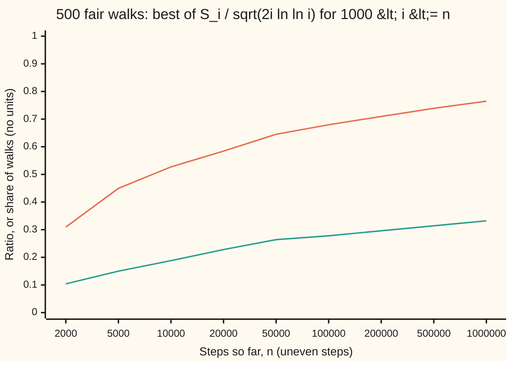

# The law of the iterated logarithm: a fair random walk's highs reach sqrt(2n log log n) again and again, and never beyond

[Syllabus](../../../SYLLABUS.md) → [Measure and integration](../README.md) → [The Limit Theorems, Proved](../README.md#s10) → The law of the iterated logarithm

---

## General Overview

Two web page designs are tested on live visitors. In truth they are equally good, so each visitor's choice is a fair coin: +1 for design A, −1 for design B. The running total after n visitors is a fair random walk. After a million visitors its typical size is the square root of a million: 1,000.

An analyst who looks at the total after every visitor and stops the first time it passes 1.96 typical sizes (1.96 times the square root of the visitors so far) is told "a 2.5% chance of a false alarm": the bell-curve chance beyond 1.96 is 0.0250. That figure holds for one look. With a look at every visitor, the walk passes 1.96 typical sizes at some visitor after the 1,000th, up to the 1,000,000th, in 33.6% of 500 simulated tests. Looked at forever, it passes it with certainty.

How high does the walk climb, watched forever? It beats every fixed number of typical sizes, again and again, yet its highs sit on one curve, the **envelope** $`\sqrt{2n \ln\ln n}`$, where $`\ln`$ is the natural logarithm. At a million visitors the envelope is 2,291.6, which is 2.29 typical sizes. The result that says so is the **law of the iterated logarithm**, LIL for short from here on.

**For a fair ±1 walk, with probability 1 the walk comes within any fraction of the envelope $`\sqrt{2n\ln\ln n}`$ infinitely often, and passes any multiple above 1 of it only finitely often; the same holds for any sum of independent copies with finite variance, after centring and scaling by the standard deviation.**

**What kind of fact this is:** a theorem. The fair ±1 case is proved on this card in Why it works. The finite-variance case (Hartman and Wintner, 1941) is stated and cited, not proved here.

### The picture: the walk's best ratio to the envelope, after step 1,000



Orange: the best ratio of walk to envelope after step 1,000, averaged over 500 simulated walks. A best ratio only rises, and the LIL makes it end at 1 or above; 0.238 of these walks are there already, so the orange line ends above 1. Green: the share of walks that have passed 0.9 times the envelope, which the LIL sends to 1.

---

## The formula

Notation, in words. The steps $`X_1, X_2, \dots`$ are independent, each +1 or −1 with chance 1/2. The walk is their running total, $`S_n = X_1 + \dots + X_n`$. The **envelope** is

```math
h(n) = \sqrt{2n\ln\ln n}, \qquad n \ge 3
```

**Read it aloud:** h of n is the square root of two n times the log of the log of n.

The log is taken twice, "iterated", which gives the law its name. The formula needs $`n \ge 3`$ so that $`\ln\ln n`$ is positive.

**The law for a fair walk** (Khinchin, 1924):

```math
\limsup_{n\to\infty} \frac{S_n}{\sqrt{2n\ln\ln n}} = 1 \quad\text{and}\quad \liminf_{n\to\infty} \frac{S_n}{\sqrt{2n\ln\ln n}} = -1 \qquad \text{with probability } 1
```

**Read it aloud:** with probability one, the walk divided by its envelope has largest limit point 1 and smallest limit point −1.

The **lim sup** of a sequence is its largest limit point: the level it comes back near forever, as its highs settle. In plain terms, for every multiplier $`c`$:

- if $`c > 1`$, the walk is above $`c\,h(n)`$ only finitely often;
- if $`c < 1`$, the walk is above $`c\,h(n)`$ infinitely often.

"Never beyond" in the title means this first bullet: past some step, never above $`1.01\,h(n)`$, or any multiple over 1.

**The general law** (Hartman and Wintner, 1941). Let $`X_1, X_2, \dots`$ be independent copies of one law with mean $`\mu`$ and variance $`\sigma^2`$, finite and positive. Then

```math
\limsup_{n\to\infty} \frac{S_n - n\mu}{\sqrt{2\sigma^2 n\ln\ln n}} = 1 \qquad \text{with probability } 1
```

**Read it aloud:** the centred sum, divided by the standard deviation times the envelope, has largest limit point 1.

For the shelf's die, $`\mu = 3.5`$ and $`\sigma^2 = 35/12`$. After a million rolls the envelope for the total minus 3,500,000 is 3,913.7.

**Where it sits.** The same walk divided by three different scales:

| Divide $`S_n`$ by | What happens, with probability 1 unless noted | The theorem | At $`n = 10^6`$ |
| --- | --- | --- | --- |
| $`n`$ | tends to 0 | [The strong law of large numbers](04-strong-law-of-large-numbers.md) | 1,000,000 |
| $`\sqrt{n}`$ | its law tends to the bell curve; yet its lim sup is $`+\infty`$ | [The central limit theorem, proved](07-central-limit-theorem.md) | 1,000 |
| $`\sqrt{2n\ln\ln n}`$ | lim sup 1, lim inf −1; tends to 0 in probability (at each single time, a ratio near 1 grows ever rarer) | the LIL | 2,291.6 |

```
the scale at n = 10^6, one mark per 100
sqrt(n), the CLT scale        ##########                                             1000.0
h(n), the LIL envelope        #######################                                2291.6
die envelope, sigma h(n)      #######################################                3913.7
sqrt(2 n ln n), one log only  #####################################################  5256.5
```

| Symbol | Plain meaning | In our example | Push it up and the answer… |
| --- | --- | --- | --- |
| $`X_i`$, $`S_n`$ | one ±1 step; the walk after n steps | design A's lead | — |
| $`n`$, $`i`$, $`N`$ | numbers of steps | $`n = 10^6`$ visitors | the envelope grows like $`\sqrt{n}`$ times a slow factor |
| $`\ln`$, $`h(n)`$ | natural logarithm; the envelope $`\sqrt{2n\ln\ln n}`$ | $`\ln\ln 10^6 = 2.6258`$; $`h = 2291.6`$ | — |
| $`\limsup`$, $`\liminf`$ | largest and smallest limit point of a sequence | 1 and −1 | — |
| $`c`$, $`c_1`$, $`c_2`$, $`\beta`$, $`\delta_k`$ | multipliers on the envelope; a power; a vanishing error | $`c = 1.5`$ in the worked bound | c above 1: finitely often; below 1: infinitely often |
| $`M_n`$, $`P`$, $`E`$ | the running maximum, $`\max(S_1, \dots, S_n)`$; the chance of an event; the mean of a random quantity | passes 2,292 by $`10^6`$ with chance 0.021906 | — |
| $`a`$, $`x`$, $`j`$, $`\ell`$, $`y`$ | levels the walk might reach; an end point; a number of heads; $`j/N`$ or its bound | $`a = 2292`$, the even number nearest $`h(10^6)`$ | a smaller chance, like $`e^{-a^2/2n}`$ |
| $`t`$, $`r`$ | the Chernoff parameter, a free exponent in the bound; a power-series counter | best at $`t = a/n`$ | — |
| $`\theta`$, $`m`$, $`n_k`$, $`k`$ | the growth ratio of the checkpoints (m a whole number); the k-th checkpoint, about $`\theta^k`$ | $`\theta = 2`$, $`n_k = 2^k`$, $`n_{20} = 1{,}048{,}576`$ | a larger ratio, sparser checkpoints |
| $`A_k`$, $`B_k`$, $`D_k`$, $`N_k`$ | the proof's events: reaching $`c\,h(n_k)`$; a big block; a block's sum and length | — | — |
| $`I(y)`$, $`H(p)`$, $`\binom{N}{\ell}`$ | the binomial rate $`\tfrac{1+y}{2}\ln(1+y) + \tfrac{1-y}{2}\ln(1-y)`$; the entropy $`\ln 2 - I`$; ways to choose $`\ell`$ heads in N steps | about $`y^2/2`$ for small $`y`$ | a smaller exact chance |
| $`\mu`$, $`\sigma^2`$ | mean and variance of one step | coin 0 and 1; die 3.5 and 35/12 | a wider envelope, by $`\sigma`$ |

### When it holds

- **Independent steps.** The proof multiplies chances over separate blocks of steps. If every step copies the first, $`S_n = \pm n`$ and the ratio to the envelope runs off to infinity.
- **One law, with finite variance.** That is the Hartman–Wintner condition, and it is also necessary: if the variance is infinite, the lim sup of $`|S_n|/\sqrt{n\ln\ln n}`$ is infinite with probability 1 (Strassen, 1966).
- **Centred.** The mean must be subtracted first. A die total without the 3.5n removed grows like n and passes every envelope.
- **Infinitely many steps.** The law speaks about all times together. At the one time $`n = 10^6`$ the walk is above $`h(n)`$ with chance only 0.010982.

---

## Why it works

### Step 0: about ln n fresh tries, each a long shot

The walk forgets its past on a geometric clock. Between step n and step 2n it adds n new steps, as many as it had, so its value at 2n is largely new. Up to step n there are therefore about $`\ln n`$ nearly independent "fresh tries", one per doubling of time, up to a constant.

At each try, how likely is the walk to reach $`c\,h(n)`$? The walk at n is spread like a bell curve of width $`\sqrt{n}`$, and the bell curve's tail beyond $`x`$ widths is about $`e^{-x^2/2}`$. Here $`x = c\sqrt{2\ln\ln n}`$, so the chance is about

```math
e^{-c^2 \ln\ln n} = (\ln n)^{-c^2}
```

**Read it aloud:** the chance of one try reaching c times the envelope is about one over log n, raised to the power c squared.

Along checkpoints $`n_k = \theta^k`$, $`\ln n_k = k\ln\theta`$, so the chances behave like $`k^{-c^2}`$. These add to a finite number exactly when $`c > 1`$. [The Borel-Cantelli lemmas](01-borel-cantelli-lemmas.md) then decide everything: a finite sum means finitely many successes, and an infinite sum of independent chances means infinitely many.

That is the whole idea. The $`\ln\ln n`$ is the log of the number of tries, $`\ln n`$. The 2 and the square root come from the bell curve's $`e^{-x^2/2}`$. The rest of the proof makes "about" exact.

### Step 1: one time, an exponential bound

For $`t > 0`$, Markov's inequality applied to $`e^{tS_n}`$ is the Chernoff bound ([Markov and Chebyshev](../04-The%20Lebesgue%20Integral/07-markov-and-chebyshev.md)). The steps are independent, so the mean of $`e^{tS_n}`$ is a product of n equal factors, each $`\cosh t = (e^t + e^{-t})/2`$. Then

```math
P(S_n \ge a) \;\le\; e^{-ta}(\cosh t)^n \;\le\; e^{-ta + nt^2/2} \;\le\; e^{-a^2/2n}
```

**Read it aloud:** the chance that the walk is at least a at time n is at most e to the minus a squared over two n.

The middle step uses $`\cosh t \le e^{t^2/2}`$: the series of the two sides are $`\sum t^{2r}/(2r)!`$ and $`\sum t^{2r}/(2^r r!)`$, and $`(2r)! \ge 2^r r!`$ term by term. The last step picks the best $`t = a/n`$.

At the envelope, $`a^2/2n = \ln\ln n`$, so the bound is $`1/\ln n`$. At $`n = 10^6`$ and $`a = 2292`$: the bound is 0.072322, the exact binomial chance 0.010982. The bound is loose by a constant factor, but it has the right shape, a power of $`1/\ln n`$.

### Step 2: the whole path up to n, the reflection principle

Borel-Cantelli will be applied at checkpoints, but the walk must be controlled between them too. So the bound is needed for the running maximum $`M_n = \max(S_1, \dots, S_n)`$, not just $`S_n`$.

**Reflection.** Take a path that reaches level a and ends below a. Flip the sign of every step after its first visit to a. The new path ends above a, by the same distance. The flip is one-to-one, and it undoes itself. So for a whole number $`a \ge 1`$

```math
P(M_n \ge a) = P(S_n \ge a) + P(S_n > a) \;\le\; 2P(S_n \ge a) \;\le\; 2e^{-a^2/2n}
```

**Read it aloud:** the chance that the path reaches a by time n is twice the chance of ending there, less a little, and so at most twice the exponential bound.

The checks confirm the formula on every path of 14 steps and on 60 steps. At 60 steps, $`P(M_{60} \ge 20) = 0.009853`$, under $`2e^{-400/120} = 0.071348`$.

At $`n = 10^6`$: the walk reaches 2,292 at some step with chance 0.021906, under $`2/\ln n = 0.144765`$.

**Why not Kolmogorov's maximal inequality?** It bounds the same chance by $`n/a^2`$ ([Kolmogorov's three-series theorem](08-kolmogorov-three-series-theorem.md)). At the envelope that is $`1/(2\ln\ln n) = 0.190419`$. Along checkpoints it falls like $`1/\ln k`$, whose sum is infinite. A variance bound is too weak; only an exponential one is summable.

### Step 3: the upper half, the walk passes c h(n) only finitely often for c > 1

Fix $`c > 1`$ and a ratio $`\theta`$ with $`1 < \theta < c^2`$. Put checkpoints $`n_k = \lceil \theta^k \rceil`$ (rounded up to whole steps). Let $`A_k`$ be the event "the path reaches $`c\,h(n_k)`$ by step $`n_{k+1}`$". By Step 2,

```math
P(A_k) \;\le\; 2\exp\Big(-\frac{c^2\,h(n_k)^2}{2n_{k+1}}\Big) = 2(\ln n_k)^{-c^2 n_k/n_{k+1}} \approx 2(k\ln\theta)^{-c^2/\theta}
```

**Read it aloud:** the chance of the k-th bad event is at most about two times k log theta, raised to the minus c squared over theta.

The power $`c^2/\theta`$ is above 1, so these add to a finite number. By the first Borel-Cantelli lemma, with probability 1 only finitely many $`A_k`$ happen.

Now fill the gaps. If $`n_k \le n \le n_{k+1}`$ and $`S_n > c\,h(n)`$, then $`S_n > c\,h(n_k)`$, because h grows. That is the event $`A_k`$. So past the last $`A_k`$, the walk stays at or below $`c\,h(n)`$. Taking c = 1.1, 1.01, 1.001 and so on, a countable list, gives $`\limsup S_n/h(n) \le 1`$ with probability 1.

**A worked case.** Take $`c = 1.5`$ and $`\theta = 2`$, so $`n_k = 2^k`$ and the power is $`2.25/2 = 1.125`$. The bound on $`P(A_k)`$ is exactly $`2(k\ln 2)^{-1.125}`$: 0.226517 at $`k = 10`$, 0.103859 at $`k = 20`$, 0.047619 at $`k = 40`$. A power above 1 makes the sum finite, so the walk passes $`1.5\,h(n)`$ only finitely often.

### Step 4: one time, a lower bound of the same shape

The lower half needs the reverse of Step 1: the chance of reaching $`c\,h(n)`$ at one time is not much smaller than $`(\ln n)^{-c^2}`$.

Stirling's formula for factorials, with Robbins's error bounds, gives for every binomial chance

```math
P(S_N = j) = \binom{N}{(N+j)/2}2^{-N} \;\ge\; \frac{e^{-N I(j/N)}}{\sqrt{2N}}, \qquad I(y) \le \frac{y^2}{2(1-y^2)}
```

**Read it aloud:** the chance of ending exactly at j is at least e to the minus N times the rate at j over N, divided by the square root of 2N.

Here $`\binom{N}{\ell}`$ counts the ways to choose $`\ell`$ heads among N steps; ending at j takes $`\ell = (N+j)/2`$ heads. $`I`$ is the binomial rate from the symbol table. The checks confirm the first inequality for every N up to 60 and every j.

Add these chances over the $`\sqrt{N}`$ or so values from x to $`x + 2\sqrt{N}`$ (in steps of 2). For $`N \ge 16`$ that gives

```math
P(S_N \ge x) \;\ge\; \tfrac12 \exp\Big(-\frac{(x + 2\sqrt{N})^2}{2N(1 - y^2)}\Big), \qquad y = \frac{x + 2\sqrt{N}}{N}
```

**Read it aloud:** the chance of being at least x is at least one half of e to the minus (x plus two root N) squared over 2N, corrected slightly by y.

At $`x = c\,h(N)`$ the exponent is $`c^2\ln\ln N`$ plus terms of order $`\sqrt{\ln\ln N}`$, which grow more slowly. So for any $`c' > c`$ and large N, $`P(S_N \ge c\,h(N)) \ge (\ln N)^{-c'^2}`$.

It is crude: 0.0000500 at $`N = 10^6`$, $`x = 2292`$, against the exact 0.010982. The proof only needs the power of $`\ln N`$ right.

### Step 5: the lower half, the walk passes c h(n) infinitely often for c < 1

Fix $`c < 1`$. Take a large whole number m and checkpoints $`n_k = m^k`$. The **increment** $`D_k = S_{n_k} - S_{n_{k-1}}`$ is the sum of the steps in block k. Different blocks use different steps, so the increments are independent, and $`D_k`$ has the law of a walk of $`N_k = n_k - n_{k-1}`$ steps.

Pick $`c_1`$ between c and 1. Let $`B_k`$ be "$`D_k \ge c_1 h(N_k)`$". By Step 4, $`P(B_k) \ge (\ln N_k)^{-c_2^2}`$ for some $`c_2 < 1`$, which behaves like $`(k\ln m)^{-c_2^2}`$. The power is below 1, so the sum is infinite. The $`B_k`$ are independent, so by the second Borel-Cantelli lemma infinitely many happen.

On $`B_k`$, the walk at $`n_k`$ is $`D_k`$ plus where it stood at $`n_{k-1}`$. By Step 3 applied to $`-S_n`$, past some k that earlier value is above $`-2h(n_{k-1})`$. Since $`N_k = (1 - 1/m)\,n_k`$ and $`n_{k-1} = n_k/m`$,

```math
\frac{S_{n_k}}{h(n_k)} \;\ge\; c_1\sqrt{1 - \tfrac1m} - \frac{2}{\sqrt{m}} - \delta_k \quad \text{for infinitely many } k
```

**Read it aloud:** at infinitely many checkpoints, the walk over its envelope is at least c one times root of one minus one over m, less two over root m, less a vanishing error.

Here $`\delta_k`$ is a small error from the slow change of $`\ln\ln`$, tending to 0. Choose m so large that the right side exceeds c. Then the walk passes $`c\,h(n)`$ infinitely often. With c = 0.9, 0.99, 0.999 and so on, $`\limsup S_n/h(n) \ge 1`$.

### Step 6: why the answer is a constant, and the other side

The event "the lim sup is at most 0.9" does not depend on any finite number of steps. By [Kolmogorov's zero-one law](02-kolmogorov-zero-one-law.md) its chance is 0 or 1. So the lim sup had to be some fixed number with probability 1; Steps 3 and 5 show the number is 1. The walk $`-S_n`$ is again a fair walk, so the lim inf is −1.

For general steps with finite variance, Step 1 fails: a heavy-tailed step has no finite $`E\,e^{tX}`$. Hartman and Wintner cut each step at a level growing with n and run the coin argument on the cut part. That proof is cited, not given here.

<details>
<summary>Detailed proof: the fair walk, with every step</summary>

Write $`h(n) = \sqrt{2n\ln\ln n}`$ for $`n \ge 3`$; h increases. $`S_n`$ is the fair ±1 walk and $`M_n = \max_{1 \le i \le n} S_i`$.

**Lemmas 1 and 2** are Steps 1 and 2 above: for every level $`a \ge 0`$, $`P(M_n \ge a) \le 2e^{-a^2/2n}`$. For a level that is not whole, apply reflection to the whole number $`\lceil a \rceil \ge a`$.

**Theorem 3 (upper half)** is Step 3, made exact as follows. With $`n_k = \lceil\theta^k\rceil`$, $`n_k/n_{k+1} \to 1/\theta`$ and $`\ln n_k \ge k\ln\theta`$. So for large k, $`P(A_k) \le 2(k\ln\theta)^{-\beta}`$ for any fixed $`\beta`$ strictly between 1 and $`c^2/\theta`$, a summable bound. The same holds for $`-S_n`$.

**Lemma 4 (one-time lower bound).** For $`1 \le \ell \le N - 1`$, Robbins's bounds on factorials give $`\binom{N}{\ell} \ge \sqrt{N/(8\ell(N-\ell))}\, e^{N H(\ell/N)}`$, where $`H(p) = -p\ln p - (1-p)\ln(1-p)`$. With $`j = 2\ell - N`$, $`H(\ell/N) = \ln 2 - I(j/N)`$, and $`\ell(N - \ell) \le N^2/4`$, so

$`\displaystyle P(S_N = j) \ge \frac{e^{-N I(j/N)}}{\sqrt{2N}}.`$

The series $`I(y) = \sum_{r \ge 1} y^{2r}/(2r(2r-1))`$ has every term at most $`y^{2r}/2`$, so $`I(y) \le y^2/(2(1 - y^2))`$ for $`|y| < 1`$. I is even and rises in $`|y|`$. The values j of the right parity in $`[x, x + 2\sqrt{N}]`$ number at least $`\sqrt{N} - 1 \ge \sqrt{N/2}`$ when $`N \ge 16`$, and each has $`|j|/N \le y = (x + 2\sqrt{N})/N`$. Adding, for $`y < 1`$,

$`\displaystyle P(S_N \ge x) \ge \tfrac12\exp\Big(-\frac{(x + 2\sqrt{N})^2}{2N(1 - y^2)}\Big).`$

At $`x = c\,h(N)`$, $`(x + 2\sqrt{N})^2/(2N) = c^2\ln\ln N + 2c\sqrt{2\ln\ln N} + 2`$ and $`y \to 0`$. So for every $`c' > c`$ there is $`N_0`$ with $`P(S_N \ge c\,h(N)) \ge (\ln N)^{-c'^2}`$ for $`N \ge N_0`$.

**Theorem 5 (lower half)** is Step 5, made exact as follows. Fix $`c < c_1 < c_2 < 1`$ and a whole number $`m \ge 2`$ with $`c_1\sqrt{1 - 1/m} - 2/\sqrt{m} > c`$. Lemma 4 with $`c' = c_2`$ gives $`P(B_k) \ge (\ln N_k)^{-c_2^2} \ge (k\ln m)^{-c_2^2}`$ for large k, a sum without limit. Theorem 3 for $`-S_n`$ with $`c = 2`$ gives $`S_{n_{k-1}} \ge -2h(n_{k-1})`$ for large k. On $`B_k`$,

$`\displaystyle \frac{S_{n_k}}{h(n_k)} \ge c_1\frac{h(N_k)}{h(n_k)} - 2\frac{h(n_{k-1})}{h(n_k)} \longrightarrow c_1\sqrt{1 - \tfrac1m} - \frac{2}{\sqrt{m}} > c,`$

since $`\ln\ln N_k`$, $`\ln\ln n_k`$ and $`\ln\ln n_{k-1}`$ have ratios tending to 1.

</details>

---

## Worked numbers, by hand

The fair walk at $`n = 10^6`$ steps.

| Step | Arithmetic | Value |
| --- | --- | --- |
| the CLT scale | $`\sqrt{10^6}`$ | 1,000 |
| ln n | 6 × ln 10 = 6 × 2.302585 | 13.8155 |
| ln ln n | ln 13.8155 | 2.6258 |
| 2n ln ln n | 2 × 1,000,000 × 2.6258 | about 5,251,600 |
| the envelope h(n) | square root of the line above | **2,291.6** |
| in CLT units | 2291.6 / 1000 | 2.2916 typical sizes |
| one-time bound at a = 2292 | $`e^{-2292^2/2{,}000{,}000}`$, near $`1/\ln n`$ | 0.072322 |
| exact chance at that one time | binomial tail | 0.010982 |
| reaching 2,292 at some step up to n | 0.010982 + P(S_n > 2292), by reflection | 0.021906 |
| the maximal bound | 2 / 13.8155 | 0.144765 |

So at a million steps the walk's highs approach 2,291.6, not 1,000. At any one time it is above that level with chance about 1.1%. Over all times it is close to it, infinitely often, with certainty.

### What breaks if you drop a piece

| Mistake | Comes out at | What went wrong |
| --- | --- | --- |
| The CLT scale $`\sqrt{n}`$ taken as the envelope | at or above 1,000 at $`n = 10^6`$ with chance 0.158897; lim sup of $`S_n/\sqrt{n}`$ is $`+\infty`$ | a fixed number of typical sizes is passed infinitely often |
| One log in place of two, $`\sqrt{2n\ln n}`$ | 5,256.5 at $`10^6`$ | far too wide: the walk over this tends to 0 |
| Kolmogorov's maximal inequality in place of the exponential bound | $`n/h^2 = 0.190419`$ at $`10^6`$; 0.190171 at checkpoint $`2^{20}`$ | falls like $`1/\ln k`$ along checkpoints, a sum without limit |
| Borel-Cantelli over every n instead of checkpoints, $`c = 1.5`$ | the bounds $`(\ln n)^{-2.25}`$ add to 3,323.5 by $`10^6`$, at least 2,717.5 | each term is small, but there are n of them; the sum diverges and the lemma says nothing |

---

## Code, from first principles, and it actually runs

The code checks each tool of the proof at finite sizes; the limits rest on the proof. Four roads:

1. Reflection: every path of 14 steps listed, and a (position, maximum) table for 60 steps, in whole-number counts.
2. Exact binomial tails, built from the centre by ratios, against a bell-curve tail by Simpson's rule (an integral by weighted sums), and between the bounds of Steps 1 and 4.
3. The Step 3 terms against their closed form.
4. A SplitMix64 generator, seed 20261123, runs 500 walks of a million steps. R(n) is the best ratio $`S_i/h(i)`$ for $`1000 < i \le n`$. Three shares and means are asserted within four standard errors of exact values. It also counts walks passing $`1.96\sqrt{i}`$ at some such i.

### Python

```python
# Law of the iterated logarithm -- the check behind the card.  Standard library only.
# A fair +-1 walk S_n.  Roads: every path of 14 steps listed, and a table over
# (position, maximum) for 60 steps, against the reflection formula; exact binomial
# tails against the two exponential bounds and a normal tail by Simpson's rule;
# a simulation of 500 walks of 10^6 steps (SplitMix64, seed 20261123).
from math import exp, log, sqrt

def h(n): return sqrt(2 * n * log(log(n)))          # the envelope sqrt(2 n ln ln n)

N = 10 ** 6
print(f"n = {N}: sqrt(n) = {sqrt(N):.1f}, ln n = {log(N):.4f}, ln ln n = {log(log(N)):.4f}")
print(f"envelope h(n) = sqrt(2 n ln ln n) = {h(N):.1f} = {h(N) / sqrt(N):.4f} sqrt(n)")
print(f"die, sigma^2 = 35/12: envelope sigma h(n) = {sqrt(35 / 12) * h(N):.1f}")
print("sqrt(2 ln ln n) at n = 10^3, 10^6, 10^9, 10^100:",
      " ".join(f"{sqrt(2 * log(log(10.0 ** e))):.4f}" for e in (3, 6, 9, 100)))
assert abs(h(N) - 2291.6) < 0.05

# 1. reflection: P(M_n >= a) = P(S_n >= a) + P(S_n > a), M_n = max(S_1..S_n)
def counts(n):                                      # paths ending at each position
    c = {0: 1}
    for _ in range(n):
        d = {}
        for s, k in c.items():
            for t in (s - 1, s + 1): d[t] = d.get(t, 0) + k
        c = d
    return c
def reflect(c, a): return sum(k for s, k in c.items() if s >= a) + sum(k for s, k in c.items() if s > a)
c14, listed = counts(14), [0] * 16
for p in range(2 ** 14):
    s = m = 0
    for i in range(14): s += 1 if p >> i & 1 else -1; m = max(m, s)
    for a in range(1, m + 1): listed[a] += 1
assert all(listed[a] == reflect(c14, a) for a in range(1, 15))
tab = {(0, 0): 1}                                   # (position, max so far, from 0)
for _ in range(60):
    d = {}
    for (s, m), k in tab.items():
        for t in (s - 1, s + 1): d[(t, max(m, t))] = d.get((t, max(m, t)), 0) + k
    tab = d
c60 = counts(60)
for a in range(1, 61):
    assert sum(k for (s, m), k in tab.items() if m >= a) == reflect(c60, a)
    assert reflect(c60, a) / 2 ** 60 <= 2 * exp(-a * a / 120)    # maximal bound
print("reflection: 14 steps, all 16384 paths listed; 60 steps, table over (S, M): equal")
for a in (10, 20, 30):
    print(f"n=60 a={a}: P(M >= a) = {reflect(c60, a) / 2 ** 60:.6f} <= 2 e^(-a^2/2n) = "
          f"{2 * exp(-a * a / 120):.6f}")

# 2. exact binomial tails for large n, by ratios from the centre
def tail(n, a):                                     # P(S_n >= a), a with the parity of n
    lp = sum(log((n / 2 + i) / i) for i in range(1, n // 2 + 1)) - n * log(2)
    k, p, tot = n // 2, exp(lp), 0.0
    while p > 1e-300 and k <= n:
        if 2 * k - n >= a: tot += p
        p *= (n - k) / (k + 1); k += 1
    return tot
def normal_upper(z, m=2000):                        # 1/2 - integral of the density, Simpson
    f = lambda x: exp(-x * x / 2) / sqrt(2 * 3.141592653589793)
    w = z / m; return 0.5 - w / 3 * (f(0) + f(z) + sum((4 if i % 2 else 2) * f(i * w) for i in range(1, m)))
def binom_lower_ok(n):                              # C(n,k)/2^n >= e^(-n I(j/n)) / sqrt(2n)
    p = 1.0 / 2 ** n
    for k in range(1, n):
        p *= (n - k + 1) / k
        y = (2 * k - n) / n
        I = (1 + y) / 2 * log(1 + y) + (1 - y) / 2 * log(1 - y)
        if p < exp(-n * I) / sqrt(2 * n) * (1 - 1e-12): return False
    return True
assert all(binom_lower_ok(n) for n in range(2, 61))
print("binomial lower bound C(n,k)/2^n >= e^(-n I)/sqrt(2n): holds for n = 2..60, every k")
print("one time n, a = the even number nearest h(n): exact, normal, upper e^(-a^2/2n), lower bound")
for n in (10 ** 4, 10 ** 5, 10 ** 6):
    a = 2 * round(h(n) / 2); x = (a + 2 * sqrt(n)) / n
    ex, nm = tail(n, a), normal_upper((a - 1) / sqrt(n))
    lo = 0.5 * exp(-(a + 2 * sqrt(n)) ** 2 / (2 * n * (1 - x * x)))
    assert lo <= ex <= exp(-a * a / (2 * n))
    assert abs(ex - nm) < 0.02 * ex
    print(f"n=10^{len(str(n)) - 1} a={a}: {ex:.6f} {nm:.6f} {exp(-a * a / (2 * n)):.6f} {lo:.7f}")
a = 2292
pS, pM = tail(N, a), tail(N, a) + tail(N, a + 2)
print(f"n=10^6: P(S_n >= 2292) = {pS:.6f}; P(max to n >= 2292) = {pM:.6f} <= 2/ln n = {2 / log(N):.6f}")
p1000 = tail(N, 1000) + tail(N, 1002); print(f"n=10^6: P(max to n >= 1000) = {p1000:.6f}; normal tail beyond 1.96 = {normal_upper(1.96):.4f}")

# 3. Borel-Cantelli along n_k = 2^k with c = 1.5: term 2 exp(-c^2 h(n_k)^2 / (2 n_(k+1)))
for k in (10, 20, 40):
    t = 2 * exp(-2.25 * h(2 ** k) ** 2 / (2 * 2 ** (k + 1)))
    assert abs(t - 2 * (k * log(2)) ** -1.125) < 1e-12
    print(f"k={k}: bound term {t:.6f} = 2 (k ln 2)^(-1.125)")

# 4. the mistakes
sb = sum(log(n) ** -2.25 for n in range(3, N + 1))
assert sb >= (N - 2) * log(N) ** -2.25                # each term is at least the last
print(f"sqrt n: P(S_n >= 1000) at 10^6 = {tail(N, 1000):.6f}; sqrt(2 n ln n) = {sqrt(2 * N * log(N)):.1f}")
print(f"Kolmogorov's maximal bound n/a^2 at a = h(10^6): {N / h(N) ** 2:.6f}; along 2^k, k=20: {2 ** 20 / h(2 ** 20) ** 2:.6f}")
print(f"every n, c = 1.5: sum of bounds (ln n)^(-2.25), n = 3..10^6: {sb:.1f} >= {(N - 2) * log(N) ** -2.25:.1f}")

# 5. simulation: R(n) = max of S_m / h(m) over 1000 < m <= n, 8 steps per byte
net, pre = [0] * 256, [0] * 256
for b in range(256):
    s, best = 0, -9
    for i in range(8): s += 1 if b >> i & 1 else -1; best = max(best, s)
    net[b], pre[b] = s, best
hb = [h(8 * j + 1) if j >= 125 else 0.0 for j in range(N // 8)]
zb = [1.96 * sqrt(8 * j + 1) for j in range(N // 8)]  # 1.96 sqrt(i) at each byte's first step
MASK, state = (1 << 64) - 1, 20261123
def rand64():
    global state
    state = (state + 0x9E3779B97F4A7C15) & MASK
    z = ((state ^ (state >> 30)) * 0xBF58476D1CE4E5B9) & MASK
    z = ((z ^ (z >> 27)) * 0x94D049BB133111EB) & MASK
    return z ^ (z >> 31)
CK, P = (2000, 5000, 10 ** 4, 2 * 10 ** 4, 5 * 10 ** 4, 10 ** 5, 2 * 10 ** 5, 5 * 10 ** 5, N), 500
sumR, hitR, hit9 = [0.0] * len(CK), [0] * len(CK), [0] * len(CK)
end_sq = end_above = max1000 = n196 = 0
for _ in range(P):
    s, mx, r, ci, w, cross = 0, 0, -1e9, 0, 0, False
    for j in range(N // 8):
        if j % 8 == 0: w = rand64()
        b = (w >> (8 * (j % 8))) & 255
        if j >= 125 and (r < 0 or s + pre[b] > r * hb[j] or (not cross and s + pre[b] > zb[j])):
            t = s
            for i in range(8):
                t += 1 if b >> i & 1 else -1
                r = max(r, t / h(8 * j + i + 1)); cross = cross or t > 1.96 * sqrt(8 * j + i + 1)
        mx = max(mx, s + pre[b]); s += net[b]
        if 8 * j + 8 == CK[ci]:
            sumR[ci] += r; hitR[ci] += r >= 1; hit9[ci] += r > 0.9; ci += 1 if ci < len(CK) - 1 else 0
    end_sq += s * s / N; end_above += s >= h(N); max1000 += mx >= 1000; n196 += cross
print(f"simulation, {P} walks of 10^6 steps, SplitMix64 seed 20261123:")
print("n:            " + " ".join(f"{n:>7}" for n in CK))
print("mean R(n):    " + " ".join(f"{v / P:7.4f}" for v in sumR))
print("share R >= 1: " + " ".join(f"{v / P:7.3f}" for v in hitR))
print("share R > 0.9:" + " ".join(f"{v / P:7.3f}" for v in hit9))
print(f"mean S_n^2/n at 10^6 {end_sq / P:.4f} (exact 1); share S_n >= h(n) at 10^6 {end_above / P:.3f}")
print(f"share with max to 10^6 >= 1000: {max1000 / P:.3f} (exact {p1000:.4f})")
print(f"share passing 1.96 sqrt(i) at some 1000 < i <= 10^6: {n196 / P:.3f}")
assert abs(end_sq / P - 1) < 4 * sqrt(2 / P)
assert abs(max1000 / P - p1000) < 4 * sqrt(p1000 * (1 - p1000) / P)
assert abs(end_above / P - pS) < 4 * sqrt(pS * (1 - pS) / P)
assert n196 >= hitR[-1]                       # past i = 1000, h(i) > 1.966 sqrt(i) > 1.96 sqrt(i)
print("ALL CHECKS PASS")
```

**Ran 2026-11-23 on macOS, Python 3.14.10, standard library only. All checks passed. Output, pasted from the run:**

```
n = 1000000: sqrt(n) = 1000.0, ln n = 13.8155, ln ln n = 2.6258
envelope h(n) = sqrt(2 n ln ln n) = 2291.6 = 2.2916 sqrt(n)
die, sigma^2 = 35/12: envelope sigma h(n) = 3913.7
sqrt(2 ln ln n) at n = 10^3, 10^6, 10^9, 10^100: 1.9660 2.2916 2.4622 3.2982
reflection: 14 steps, all 16384 paths listed; 60 steps, table over (S, M): equal
n=60 a=10: P(M >= a) = 0.200031 <= 2 e^(-a^2/2n) = 0.869196
n=60 a=20: P(M >= a) = 0.009853 <= 2 e^(-a^2/2n) = 0.071348
n=60 a=30: P(M >= a) = 0.000088 <= 2 e^(-a^2/2n) = 0.001106
binomial lower bound C(n,k)/2^n >= e^(-n I)/sqrt(2n): holds for n = 2..60, every k
one time n, a = the even number nearest h(n): exact, normal, upper e^(-a^2/2n), lower bound
n=10^4 a=210: 0.018306 0.018309 0.110251 0.0001103
n=10^5 a=700: 0.013537 0.013538 0.086294 0.0000697
n=10^6 a=2292: 0.010982 0.010982 0.072322 0.0000500
n=10^6: P(S_n >= 2292) = 0.010982; P(max to n >= 2292) = 0.021906 <= 2/ln n = 0.144765
n=10^6: P(max to n >= 1000) = 0.317311; normal tail beyond 1.96 = 0.0250
k=10: bound term 0.226517 = 2 (k ln 2)^(-1.125)
k=20: bound term 0.103859 = 2 (k ln 2)^(-1.125)
k=40: bound term 0.047619 = 2 (k ln 2)^(-1.125)
sqrt n: P(S_n >= 1000) at 10^6 = 0.158897; sqrt(2 n ln n) = 5256.5
Kolmogorov's maximal bound n/a^2 at a = h(10^6): 0.190419; along 2^k, k=20: 0.190171
every n, c = 1.5: sum of bounds (ln n)^(-2.25), n = 3..10^6: 3323.5 >= 2717.5
simulation, 500 walks of 10^6 steps, SplitMix64 seed 20261123:
n:               2000    5000   10000   20000   50000  100000  200000  500000 1000000
mean R(n):     0.3094  0.4496  0.5271  0.5843  0.6451  0.6796  0.7095  0.7389  0.7647
share R >= 1:   0.070   0.108   0.128   0.162   0.188   0.200   0.214   0.228   0.238
share R > 0.9:  0.104   0.150   0.188   0.228   0.264   0.278   0.296   0.314   0.332
mean S_n^2/n at 10^6 0.9817 (exact 1); share S_n >= h(n) at 10^6 0.008
share with max to 10^6 >= 1000: 0.314 (exact 0.3173)
share passing 1.96 sqrt(i) at some 1000 < i <= 10^6: 0.336
ALL CHECKS PASS
```

### Rust

```rust
// Law of the iterated logarithm -- the check behind the card.  std only, no crates.
// A fair +-1 walk S_n.  Roads: every path of 14 steps listed, and a table over
// (position, maximum) for 60 steps, against the reflection formula; exact binomial
// tails against the two exponential bounds and a normal tail by Simpson's rule;
// a simulation of 500 walks of 10^6 steps (SplitMix64, seed 20261123).
fn h(n: f64) -> f64 { (2.0 * n * n.ln().ln()).sqrt() } // the envelope sqrt(2 n ln ln n)
fn counts(n: usize) -> Vec<u64> { // paths of n steps ending at each position + n
    let mut c = vec![0u64; 2 * n + 1]; c[n] = 1;
    for _ in 0..n {
        let mut d = vec![0u64; 2 * n + 1];
        for i in 0..2 * n + 1 { if c[i] > 0 { d[i - 1] += c[i]; d[i + 1] += c[i]; } }
        c = d;
    }
    c
}
fn reflect(c: &[u64], n: usize, a: i64) -> u64 { // count for M_n >= a: ending >= a, plus > a
    let mut t = 0;
    for i in 0..c.len() {
        let s = i as i64 - n as i64;
        if s >= a { t += c[i]; } if s > a { t += c[i]; }
    }
    t
}
fn tail(n: u64, a: i64) -> f64 { // P(S_n >= a), a with the parity of n, ratios from the centre
    let nf = n as f64;
    let mut lp = -nf * 2f64.ln();
    for i in 1..=n / 2 { lp += ((nf / 2.0 + i as f64) / i as f64).ln(); }
    let (mut k, mut p, mut tot) = (n / 2, lp.exp(), 0.0);
    while p > 1e-300 && k <= n {
        if 2 * k as i64 - n as i64 >= a { tot += p; }
        p *= (n - k) as f64 / (k + 1) as f64; k += 1;
    }
    tot
}
fn normal_upper(z: f64) -> f64 {
    let m = 2000;
    let f = |x: f64| (-x * x / 2.0).exp() / (2.0 * 3.141592653589793f64).sqrt();
    let w = z / m as f64;
    let mut s = f(0.0) + f(z);
    for i in 1..m { s += if i % 2 == 1 { 4.0 } else { 2.0 } * f(i as f64 * w); } 0.5 - w / 3.0 * s
}
fn binom_lower_ok(n: u64) -> bool {
    let mut p = 1.0 / 2f64.powi(n as i32);
    for k in 1..n {
        p *= (n - k + 1) as f64 / k as f64;
        let y = (2.0 * k as f64 - n as f64) / n as f64;
        let i = (1.0 + y) / 2.0 * (1.0 + y).ln() + (1.0 - y) / 2.0 * (1.0 - y).ln();
        if p < (-(n as f64) * i).exp() / (2.0 * n as f64).sqrt() * (1.0 - 1e-12) { return false; }
    }
    true
}
fn rand64(state: &mut u64) -> u64 {
    *state = state.wrapping_add(0x9E3779B97F4A7C15);
    let z = (*state ^ (*state >> 30)).wrapping_mul(0xBF58476D1CE4E5B9);
    let z = (z ^ (z >> 27)).wrapping_mul(0x94D049BB133111EB); z ^ (z >> 31)
}
fn main() {
    let (n0, nf) = (1_000_000u64, 1e6f64);
    println!("n = {}: sqrt(n) = {:.1}, ln n = {:.4}, ln ln n = {:.4}", n0, nf.sqrt(), nf.ln(), nf.ln().ln());
    println!("envelope h(n) = sqrt(2 n ln ln n) = {:.1} = {:.4} sqrt(n)", h(nf), h(nf) / nf.sqrt());
    println!("die, sigma^2 = 35/12: envelope sigma h(n) = {:.1}", (35.0f64 / 12.0).sqrt() * h(nf));
    let g: Vec<String> = [3, 6, 9, 100].iter().map(|&e| format!("{:.4}", (2.0 * 10f64.powi(e).ln().ln()).sqrt())).collect();
    println!("sqrt(2 ln ln n) at n = 10^3, 10^6, 10^9, 10^100: {}", g.join(" "));
    assert!((h(nf) - 2291.6).abs() < 0.05);
    // 1. reflection
    let (c14, mut listed) = (counts(14), vec![0u64; 16]);
    for p in 0u32..(1 << 14) {
        let (mut s, mut m) = (0i64, 0i64);
        for i in 0..14 { s += if p >> i & 1 == 1 { 1 } else { -1 }; m = m.max(s); }
        for a in 1..=m { listed[a as usize] += 1; }
    }
    for a in 1..15 { assert_eq!(listed[a], reflect(&c14, 14, a as i64)); }
    // tab[s + 60][m]: paths with position s and maximum so far m (from 0)
    let mut tab = vec![vec![0u64; 61]; 121]; tab[60][0] = 1;
    for _ in 0..60 {
        let mut d = vec![vec![0u64; 61]; 121];
        for i in 0..121 { for m in 0..61 {
            let k = tab[i][m];
            if k == 0 { continue; }
            for t in [i - 1, i + 1] { d[t][m.max(if t >= 60 { t - 60 } else { 0 })] += k; }
        } }
        tab = d;
    }
    let (c60, two60) = (counts(60), 2f64.powi(60));
    for a in 1..61usize {
        let mut cnt = 0u64;
        for i in 0..121 { for m in a..61 { cnt += tab[i][m]; } }
        assert_eq!(cnt, reflect(&c60, 60, a as i64));
        assert!(reflect(&c60, 60, a as i64) as f64 / two60 <= 2.0 * (-((a * a) as f64) / 120.0).exp());
    }
    println!("reflection: 14 steps, all 16384 paths listed; 60 steps, table over (S, M): equal");
    for a in [10i64, 20, 30] {
        println!("n=60 a={}: P(M >= a) = {:.6} <= 2 e^(-a^2/2n) = {:.6}", a,
            reflect(&c60, 60, a) as f64 / two60, 2.0 * (-((a * a) as f64) / 120.0).exp());
    }
    // 2. exact binomial tails
    for n in 2..61 { assert!(binom_lower_ok(n)); }
    println!("binomial lower bound C(n,k)/2^n >= e^(-n I)/sqrt(2n): holds for n = 2..60, every k");
    println!("one time n, a = the even number nearest h(n): exact, normal, upper e^(-a^2/2n), lower bound");
    for (e, n) in [(4, 10_000u64), (5, 100_000), (6, 1_000_000)] {
        let x0 = n as f64;
        let a = 2 * (h(x0) / 2.0).round() as i64; let af = a as f64;
        let x = (af + 2.0 * x0.sqrt()) / x0;
        let (ex, nm) = (tail(n, a), normal_upper((af - 1.0) / x0.sqrt()));
        let (lo, up) = (0.5 * (-(af + 2.0 * x0.sqrt()).powi(2) / (2.0 * x0 * (1.0 - x * x))).exp(), (-af * af / (2.0 * x0)).exp());
        assert!(lo <= ex && ex <= up);
        assert!((ex - nm).abs() < 0.02 * ex);
        println!("n=10^{} a={}: {:.6} {:.6} {:.6} {:.7}", e, a, ex, nm, up, lo);
    }
    let (p_s, p_m) = (tail(n0, 2292), tail(n0, 2292) + tail(n0, 2294));
    println!("n=10^6: P(S_n >= 2292) = {:.6}; P(max to n >= 2292) = {:.6} <= 2/ln n = {:.6}", p_s, p_m, 2.0 / nf.ln());
    let p1000 = tail(n0, 1000) + tail(n0, 1002); println!("n=10^6: P(max to n >= 1000) = {:.6}; normal tail beyond 1.96 = {:.4}", p1000, normal_upper(1.96));
    // 3. Borel-Cantelli along n_k = 2^k with c = 1.5
    for k in [10i32, 20, 40] {
        let t = 2.0 * (-2.25 * h(2f64.powi(k)).powi(2) / (2.0 * 2f64.powi(k + 1))).exp();
        assert!((t - 2.0 * (k as f64 * 2f64.ln()).powf(-1.125)).abs() < 1e-12);
        println!("k={}: bound term {:.6} = 2 (k ln 2)^(-1.125)", k, t);
    }
    // 4. the mistakes
    let sb: f64 = (3..=n0).map(|n| (n as f64).ln().powf(-2.25)).sum();
    let sb_lo = (nf - 2.0) * nf.ln().powf(-2.25);
    assert!(sb >= sb_lo); // each term is at least the last
    println!("sqrt n: P(S_n >= 1000) at 10^6 = {:.6}; sqrt(2 n ln n) = {:.1}", tail(n0, 1000), (2.0 * nf * nf.ln()).sqrt());
    println!("Kolmogorov's maximal bound n/a^2 at a = h(10^6): {:.6}; along 2^k, k=20: {:.6}", nf / h(nf).powi(2), 2f64.powi(20) / h(2f64.powi(20)).powi(2));
    println!("every n, c = 1.5: sum of bounds (ln n)^(-2.25), n = 3..10^6: {:.1} >= {:.1}", sb, sb_lo);
    // 5. simulation: R(n) = max of S_m / h(m) over 1000 < m <= n, 8 steps per byte
    let (mut net, mut pre) = ([0i64; 256], [0i64; 256]);
    for b in 0..256usize {
        let (mut s, mut best) = (0i64, -9i64);
        for i in 0..8 { s += if b >> i & 1 == 1 { 1 } else { -1 }; best = best.max(s); }
        net[b] = s; pre[b] = best; }
    let nb = (n0 / 8) as usize;
    let hb: Vec<f64> = (0..nb).map(|j| if j >= 125 { h((8 * j + 1) as f64) } else { 0.0 }).collect();
    let ck: [usize; 9] = [2000, 5000, 10_000, 20_000, 50_000, 100_000, 200_000, 500_000, 1_000_000];
    let (pp, mut state, mut sum_r, mut hit_r, mut hit9) = (500, 20261123u64, [0.0f64; 9], [0u32; 9], [0u32; 9]);
    let (mut end_sq, mut end_above, mut max1000, mut n196) = (0.0f64, 0u32, 0u32, 0u32);
    for _ in 0..pp {
        let (mut s, mut mx, mut r, mut ci, mut w, mut cross) = (0i64, 0i64, -1e9f64, 0usize, 0u64, false);
        for j in 0..nb {
            if j % 8 == 0 { w = rand64(&mut state); }
            let b = ((w >> (8 * (j % 8))) & 255) as usize;
            if j >= 125 && (r < 0.0 || (s + pre[b]) as f64 > r * hb[j] || (!cross && (s + pre[b]) as f64 > 1.96 * ((8 * j + 1) as f64).sqrt())) {
                let mut t = s;
                for i in 0..8 {
                    t += if b >> i & 1 == 1 { 1 } else { -1 };
                    r = r.max(t as f64 / h((8 * j + i + 1) as f64)); cross = cross || t as f64 > 1.96 * ((8 * j + i + 1) as f64).sqrt();
                }
            }
            mx = mx.max(s + pre[b]); s += net[b];
            if 8 * j + 8 == ck[ci] {
                sum_r[ci] += r; hit_r[ci] += (r >= 1.0) as u32; hit9[ci] += (r > 0.9) as u32; if ci < 8 { ci += 1; }
            }
        }
        end_sq += (s * s) as f64 / nf; end_above += (s as f64 >= h(nf)) as u32; max1000 += (mx >= 1000) as u32; n196 += cross as u32;
    }
    let p = pp as f64;
    println!("simulation, {} walks of 10^6 steps, SplitMix64 seed 20261123:", pp);
    println!("n:            {}", ck.iter().map(|n| format!("{:>7}", n)).collect::<Vec<_>>().join(" "));
    println!("mean R(n):    {}", sum_r.iter().map(|v| format!("{:7.4}", v / p)).collect::<Vec<_>>().join(" "));
    println!("share R >= 1: {}", hit_r.iter().map(|&v| format!("{:7.3}", v as f64 / p)).collect::<Vec<_>>().join(" "));
    println!("share R > 0.9:{}", hit9.iter().map(|&v| format!("{:7.3}", v as f64 / p)).collect::<Vec<_>>().join(" "));
    println!("mean S_n^2/n at 10^6 {:.4} (exact 1); share S_n >= h(n) at 10^6 {:.3}", end_sq / p, end_above as f64 / p);
    println!("share with max to 10^6 >= 1000: {:.3} (exact {:.4})", max1000 as f64 / p, p1000);
    println!("share passing 1.96 sqrt(i) at some 1000 < i <= 10^6: {:.3}", n196 as f64 / p);
    assert!((end_sq / p - 1.0).abs() < 4.0 * (2.0 / p).sqrt());
    assert!((max1000 as f64 / p - p1000).abs() < 4.0 * (p1000 * (1.0 - p1000) / p).sqrt());
    assert!((end_above as f64 / p - p_s).abs() < 4.0 * (p_s * (1.0 - p_s) / p).sqrt());
    assert!(n196 >= hit_r[8]); // past i = 1000, h(i) > 1.966 sqrt(i) > 1.96 sqrt(i)
    println!("ALL CHECKS PASS");
}
```

**Ran 2026-11-23 on macOS, rustc 1.98.1, no crates. All checks passed. Output, pasted from the run:**

```
n = 1000000: sqrt(n) = 1000.0, ln n = 13.8155, ln ln n = 2.6258
envelope h(n) = sqrt(2 n ln ln n) = 2291.6 = 2.2916 sqrt(n)
die, sigma^2 = 35/12: envelope sigma h(n) = 3913.7
sqrt(2 ln ln n) at n = 10^3, 10^6, 10^9, 10^100: 1.9660 2.2916 2.4622 3.2982
reflection: 14 steps, all 16384 paths listed; 60 steps, table over (S, M): equal
n=60 a=10: P(M >= a) = 0.200031 <= 2 e^(-a^2/2n) = 0.869196
n=60 a=20: P(M >= a) = 0.009853 <= 2 e^(-a^2/2n) = 0.071348
n=60 a=30: P(M >= a) = 0.000088 <= 2 e^(-a^2/2n) = 0.001106
binomial lower bound C(n,k)/2^n >= e^(-n I)/sqrt(2n): holds for n = 2..60, every k
one time n, a = the even number nearest h(n): exact, normal, upper e^(-a^2/2n), lower bound
n=10^4 a=210: 0.018306 0.018309 0.110251 0.0001103
n=10^5 a=700: 0.013537 0.013538 0.086294 0.0000697
n=10^6 a=2292: 0.010982 0.010982 0.072322 0.0000500
n=10^6: P(S_n >= 2292) = 0.010982; P(max to n >= 2292) = 0.021906 <= 2/ln n = 0.144765
n=10^6: P(max to n >= 1000) = 0.317311; normal tail beyond 1.96 = 0.0250
k=10: bound term 0.226517 = 2 (k ln 2)^(-1.125)
k=20: bound term 0.103859 = 2 (k ln 2)^(-1.125)
k=40: bound term 0.047619 = 2 (k ln 2)^(-1.125)
sqrt n: P(S_n >= 1000) at 10^6 = 0.158897; sqrt(2 n ln n) = 5256.5
Kolmogorov's maximal bound n/a^2 at a = h(10^6): 0.190419; along 2^k, k=20: 0.190171
every n, c = 1.5: sum of bounds (ln n)^(-2.25), n = 3..10^6: 3323.5 >= 2717.5
simulation, 500 walks of 10^6 steps, SplitMix64 seed 20261123:
n:               2000    5000   10000   20000   50000  100000  200000  500000 1000000
mean R(n):     0.3094  0.4496  0.5271  0.5843  0.6451  0.6796  0.7095  0.7389  0.7647
share R >= 1:   0.070   0.108   0.128   0.162   0.188   0.200   0.214   0.228   0.238
share R > 0.9:  0.104   0.150   0.188   0.228   0.264   0.278   0.296   0.314   0.332
mean S_n^2/n at 10^6 0.9817 (exact 1); share S_n >= h(n) at 10^6 0.008
share with max to 10^6 >= 1000: 0.314 (exact 0.3173)
share passing 1.96 sqrt(i) at some 1000 < i <= 10^6: 0.336
ALL CHECKS PASS
```

The two outputs match line for line.

### Lean

Lean proves the law, the running-maximum bound and reflection for the fair ±1 walk, not the finite-variance case.

- Take independent steps, each +1 or −1 with chance 1/2. Then, with probability 1, $`S_n/h(n)`$ has lim sup 1 and lim inf −1.
- Take the same walk, any number of steps n and any level $`a \ge 0`$. Then $`P(M_n \ge a) \le 2e^{-a^2/2n}`$.
- Take the same walk and a whole number $`a \ge 1`$. Then $`P(M_n \ge a) = P(S_n \ge a) + P(S_n > a)`$.
- Take every path of 14 steps, all 16,384 of them. Then reflection holds exactly as a count, at each whole level from 1 to 14.
- Take r from 0 to 12. Then $`(2r)! \ge 2^r r!`$, the term-by-term step behind $`\cosh t \le e^{t^2/2}`$.
- Take $`c = 1.5`$ and $`\theta = 2`$. Then the power $`c^2/\theta`$ is 9/8, which is above 1.
- Take $`n = 10^6`$. Then the CLT scale $`\sqrt{n}`$ is 1,000.
- Take $`\theta = 2`$. Then the checkpoint $`n_{20} = 2^{20}`$ is 1,048,576.
- Take one roll of the shelf's fair die. Then its face has mean 7/2 and variance 35/12.

The decimals, the exact binomial chances, the 60-step table and the simulations are left to the Python and Rust checks.

```lean
-- The law of the iterated logarithm: for a fair ±1 random walk, with probability 1 the walk divided by its envelope √(2n ln ln n) has largest limit point 1 and smallest limit point -1, its running maximum passes a level a ≥ 0 by step n with chance at most 2e^(-a²/2n), and for a whole level a ≥ 1 that chance equals P(S_n ≥ a) + P(S_n > a).
import Mathlib.Probability.Independence.Basic
import Mathlib.Analysis.SpecialFunctions.Pow.Real
import Mathlib.Analysis.SpecialFunctions.Log.Basic
import Mathlib.Data.EReal.Basic
import Mathlib.Order.LiminfLimsup
import Mathlib.Data.Nat.Factorial.Basic
import Mathlib.Tactic.NormNum
import Mathlib

open MeasureTheory ProbabilityTheory Filter

/-! ### Helper lemmas -/
/-- The value `±1` of a step written as a Boolean (`true` is `+1`). -/
def lilSgn (c : Bool) : ℤ := if c then 1 else -1

/-- The walk of a Boolean path `b` of `n` steps after `k` steps. -/
def lilPS {n : ℕ} (b : Fin n → Bool) (k : ℕ) : ℤ :=
  ∑ i ∈ Finset.range k, if h : i < n then lilSgn (b ⟨i, h⟩) else 0

lemma lilPS_zero {n : ℕ} (b : Fin n → Bool) : lilPS b 0 = 0 := by simp [lilPS]

lemma lilPS_cons {n : ℕ} (c : Bool) (b : Fin n → Bool) (k : ℕ) :
    lilPS (Fin.cons c b : Fin (n + 1) → Bool) (k + 1) = lilSgn c + lilPS b k := by
  unfold lilPS
  rw [Finset.sum_range_succ', add_comm]
  have hs : (∑ i ∈ Finset.range k, if h : i + 1 < n + 1 then
      lilSgn ((Fin.cons c b : Fin (n + 1) → Bool) ⟨i + 1, h⟩) else 0) =
      ∑ i ∈ Finset.range k, if h : i < n then lilSgn (b ⟨i, h⟩) else 0 := by
    apply Finset.sum_congr rfl
    intro i _
    by_cases h : i < n
    · have h' : i + 1 < n + 1 := by omega
      simp only [h, h', ↓reduceDIte]
      have : (⟨i + 1, h'⟩ : Fin (n + 1)) = Fin.succ ⟨i, h⟩ := rfl
      rw [this, Fin.cons_succ]
    · have h' : ¬ i + 1 < n + 1 := by omega
      simp only [h, h', ↓reduceDIte]
  rw [hs]
  simp

lemma lil_card_cons {n : ℕ} (p : (Fin (n + 1) → Bool) → Prop) [DecidablePred p] :
    (Finset.univ.filter p).card =
      (Finset.univ.filter (fun b : Fin n → Bool => p (Fin.cons true b))).card +
      (Finset.univ.filter (fun b : Fin n → Bool => p (Fin.cons false b))).card := by
  simp only [Finset.card_filter]
  rw [← (Fin.consEquiv (fun _ => Bool)).sum_comp, Fintype.sum_prod_type, Fintype.sum_bool]
  rfl

lemma lilPS_abs_le {n : ℕ} (b : Fin n → Bool) (k : ℕ) : |lilPS b k| ≤ k := by
  unfold lilPS
  calc |∑ i ∈ Finset.range k, (if h : i < n then lilSgn (b ⟨i, h⟩) else 0)|
      ≤ ∑ i ∈ Finset.range k, |(if h : i < n then lilSgn (b ⟨i, h⟩) else 0)| :=
        Finset.abs_sum_le_sum_abs _ _
    _ ≤ ∑ i ∈ Finset.range k, (1 : ℤ) := by
        apply Finset.sum_le_sum; intro i _
        split_ifs <;> simp [lilSgn]; split_ifs <;> simp
    _ = k := by simp

/-- `h n a`: paths of `n` steps ending at or above `a`. -/
lemma lil_h_succ (n : ℕ) (a : ℤ) :
    (Finset.univ.filter (fun b : Fin (n + 1) → Bool => a ≤ lilPS b (n + 1))).card =
      (Finset.univ.filter (fun b : Fin n → Bool => a - 1 ≤ lilPS b n)).card +
      (Finset.univ.filter (fun b : Fin n → Bool => a + 1 ≤ lilPS b n)).card := by
  rw [lil_card_cons]
  congr 2 <;> ext b <;> simp [lilPS_cons, lilSgn] <;> omega

lemma lil_g_succ (n : ℕ) (a : ℤ) (ha : 1 ≤ a) :
    (Finset.univ.filter (fun b : Fin (n + 1) → Bool => ∃ k ≤ n + 1, a ≤ lilPS b k)).card =
      (Finset.univ.filter (fun b : Fin n → Bool => ∃ k ≤ n, a - 1 ≤ lilPS b k)).card +
      (Finset.univ.filter (fun b : Fin n → Bool => ∃ k ≤ n, a + 1 ≤ lilPS b k)).card := by
  rw [lil_card_cons]
  congr 2 <;> ext b <;> simp only [Finset.mem_filter, Finset.mem_univ, true_and] <;>
    constructor
  · rintro ⟨k, hk, hak⟩
    rcases k with _ | k
    · rw [lilPS_zero] at hak; omega
    · refine ⟨k, by omega, ?_⟩; rw [lilPS_cons] at hak; simp [lilSgn] at hak; omega
  · rintro ⟨k, hk, hak⟩
    refine ⟨k + 1, by omega, ?_⟩; rw [lilPS_cons]; simp [lilSgn]; omega
  · rintro ⟨k, hk, hak⟩
    rcases k with _ | k
    · rw [lilPS_zero] at hak; omega
    · refine ⟨k, by omega, ?_⟩; rw [lilPS_cons] at hak; simp [lilSgn] at hak; omega
  · rintro ⟨k, hk, hak⟩
    refine ⟨k + 1, by omega, ?_⟩; rw [lilPS_cons]; simp [lilSgn]; omega

lemma lil_h_symm (n : ℕ) (a : ℤ) :
    (Finset.univ.filter (fun b : Fin n → Bool => a ≤ lilPS b n)).card +
      (Finset.univ.filter (fun b : Fin n → Bool => 1 - a ≤ lilPS b n)).card = 2 ^ n := by
  induction n generalizing a with
  | zero =>
    by_cases h : a ≤ 0
    · have h2 : ¬ (1 - a ≤ 0) := by omega
      simp [lilPS_zero, h, h2]
    · have h2 : 1 - a ≤ 0 := by omega
      simp [lilPS_zero, h, h2]
  | succ n ih =>
    rw [lil_h_succ, lil_h_succ, pow_succ]
    have e1 := ih (a - 1)
    have e2 := ih (a + 1)
    have r1 : 1 - (a - 1) = 1 - a + 1 := by ring
    have r2 : 1 - (a + 1) = 1 - a - 1 := by ring
    rw [r1] at e1; rw [r2] at e2
    omega

lemma lil_g_zero (n : ℕ) (a : ℤ) (ha : a ≤ 0) :
    (Finset.univ.filter (fun b : Fin n → Bool => ∃ k ≤ n, a ≤ lilPS b k)).card = 2 ^ n := by
  rw [Finset.filter_true_of_mem]
  · simp
  · intro b _; exact ⟨0, by omega, by rw [lilPS_zero]; exact ha⟩

lemma lil_reflection_count (n : ℕ) (a : ℤ) (ha : 1 ≤ a) :
    (Finset.univ.filter (fun b : Fin n → Bool => ∃ k ≤ n, a ≤ lilPS b k)).card =
      (Finset.univ.filter (fun b : Fin n → Bool => a ≤ lilPS b n)).card +
      (Finset.univ.filter (fun b : Fin n → Bool => a + 1 ≤ lilPS b n)).card := by
  induction n generalizing a with
  | zero =>
    have h1 : ¬ a ≤ 0 := by omega
    have h2 : ¬ a + 1 ≤ 0 := by omega
    simp [lilPS_zero, h1, h2]
  | succ n ih =>
    rw [lil_g_succ n a ha, lil_h_succ, lil_h_succ]
    rw [ih (a + 1) (by omega)]
    by_cases ha2 : 2 ≤ a
    · rw [ih (a - 1) (by omega)]
      have : a - 1 + 1 = a := by ring
      rw [this]; ring_nf
    · have ha1 : a = 1 := by omega
      subst ha1
      rw [lil_g_zero n (1 - 1) (by norm_num)]
      have := lil_h_symm n 0
      norm_num at this ⊢
      omega

lemma lil_law {Ω : Type*} [MeasurableSpace Ω] (P : Measure Ω) [IsProbabilityMeasure P]
    (X : ℕ → Ω → ℝ) (hmeas : ∀ i, Measurable (X i)) (hind : iIndepFun X P)
    (hfair : ∀ i, P {ω | X i ω = 1} = 1 / 2) (n : ℕ) (A : Finset (Fin n → Bool)) :
    P {ω | (fun i : Fin n => decide (X i ω = 1)) ∈ A} = A.card / 2 ^ n := by
  classical
  have hv : Measurable (fun ω (i : Fin n) => decide (X i ω = 1)) := by
    apply Measurable.of_eval
    intro i
    apply measurable_to_countable'
    intro c
    cases c
    · have : (fun ω => decide (X i ω = 1)) ⁻¹' {false} = (X i ⁻¹' {1})ᶜ := by
        ext ω; simp
      rw [this]; exact ((hmeas i) (measurableSet_singleton 1)).compl
    · have : (fun ω => decide (X i ω = 1)) ⁻¹' {true} = X i ⁻¹' {1} := by
        ext ω; simp
      rw [this]; exact (hmeas i) (measurableSet_singleton 1)
  have hcyl : ∀ b : Fin n → Bool,
      P {ω | (fun i : Fin n => decide (X i ω = 1)) = b} = (2 ^ n)⁻¹ := by
    intro b
    let sets : ℕ → Set ℝ := fun i =>
      if h : i < n then (if b ⟨i, h⟩ then {1} else {1}ᶜ) else Set.univ
    have hset : {ω | (fun i : Fin n => decide (X i ω = 1)) = b} =
        ⋂ i ∈ Finset.range n, X i ⁻¹' sets i := by
      ext ω
      simp only [Set.mem_iInter, Set.mem_preimage, Finset.mem_range,
        funext_iff]
      constructor
      · intro h i hi
        have := h ⟨i, hi⟩
        simp only [sets, hi, ↓reduceDIte]
        cases hb : b ⟨i, hi⟩ <;> simp_all
      · intro h i
        have := h i i.2
        simp only [sets, i.2, ↓reduceDIte] at this
        cases hb : b i <;> simp_all
    have hmeas_sets : ∀ i, MeasurableSet (sets i) := by
      intro i; simp only [sets]; split_ifs
      · exact measurableSet_singleton 1
      · exact (measurableSet_singleton 1).compl
      · exact MeasurableSet.univ
    rw [hset, hind.measure_inter_preimage_eq_mul (Finset.range n) (fun i _ => hmeas_sets i)]
    have : ∀ i ∈ Finset.range n, P (X i ⁻¹' sets i) = 2⁻¹ := by
      intro i hi
      have hi' : i < n := Finset.mem_range.mp hi
      simp only [sets, hi', ↓reduceDIte]
      split_ifs
      · have := hfair i; simpa [Set.preimage, one_div] using this
      · rw [Set.preimage_compl, measure_compl ((hmeas i) (measurableSet_singleton 1))
          (measure_ne_top _ _), measure_univ]
        have := hfair i
        simp only [Set.preimage, Set.mem_singleton_iff]
        rw [this, one_div, ENNReal.one_sub_inv_two]
    rw [Finset.prod_congr rfl this]
    simp [ENNReal.inv_pow]
  have hU : {ω | (fun i : Fin n => decide (X i ω = 1)) ∈ A} =
      ⋃ b ∈ A, {ω | (fun i : Fin n => decide (X i ω = 1)) = b} := by
    ext ω; simp
  rw [hU, measure_biUnion_finset]
  · simp only [hcyl, Finset.sum_const, nsmul_eq_mul]
    rw [div_eq_mul_inv]
  · intro b _ c _ hbc
    rw [Function.onFun, Set.disjoint_left]
    intro ω h1 h2
    exact hbc ((Set.mem_ofPred_eq.mp h1).symm.trans (Set.mem_ofPred_eq.mp h2))
  · intro b _
    exact hv (measurableSet_singleton b)

lemma lil_ae_sign {Ω : Type*} [MeasurableSpace Ω] (P : Measure Ω) (X : ℕ → Ω → ℝ)
    (hstep : ∀ i, ∀ᵐ ω ∂P, X i ω = 1 ∨ X i ω = -1) :
    ∀ᵐ ω ∂P, ∀ n k, k ≤ n → ∑ i ∈ Finset.range k, X i ω =
      (lilPS (fun i : Fin n => decide (X i ω = 1)) k : ℝ) := by
  filter_upwards [ae_all_iff.mpr hstep] with ω hω
  intro n k hk
  unfold lilPS
  push_cast
  apply Finset.sum_congr rfl
  intro i hi
  have hin : i < n := lt_of_lt_of_le (Finset.mem_range.mp hi) hk
  simp only [hin, ↓reduceDIte, lilSgn]
  rcases hω i with h | h <;> simp [h]

lemma lil_reflection_aux {Ω : Type*} [MeasurableSpace Ω]
    (P : Measure Ω) [IsProbabilityMeasure P] (X : ℕ → Ω → ℝ)
    (hmeas : ∀ i, Measurable (X i)) (hind : iIndepFun X P)
    (hstep : ∀ i, ∀ᵐ ω ∂P, X i ω = 1 ∨ X i ω = -1)
    (hfair : ∀ i, P {ω | X i ω = 1} = 1 / 2) (n a : ℕ) (ha : 1 ≤ a) :
    P {ω | ∃ k ∈ Finset.Icc 1 n, (a : ℝ) ≤ ∑ i ∈ Finset.range k, X i ω} =
      P {ω | (a : ℝ) ≤ ∑ i ∈ Finset.range n, X i ω} +
        P {ω | (a : ℝ) < ∑ i ∈ Finset.range n, X i ω} := by
  classical
  have hs := lil_ae_sign P X hstep
  set v : Ω → Fin n → Bool := fun ω i => decide (X i ω = 1) with hvdef
  have e1 : P {ω | ∃ k ∈ Finset.Icc 1 n, (a : ℝ) ≤ ∑ i ∈ Finset.range k, X i ω} =
      P {ω | v ω ∈ Finset.univ.filter (fun b : Fin n → Bool => ∃ k ≤ n, (a : ℤ) ≤ lilPS b k)} := by
    apply measure_congr
    rw [Filter.eventuallyEqSet_iff]
    filter_upwards [hs] with ω hω
    simp only [Finset.mem_filter, Finset.mem_univ, true_and, Finset.mem_Icc]
    constructor
    · rintro ⟨k, ⟨_, hk⟩, hak⟩
      refine ⟨k, hk, ?_⟩
      rw [hω n k hk] at hak
      exact_mod_cast hak
    · rintro ⟨k, hk, hak⟩
      have hk1 : 1 ≤ k := by
        rcases Nat.eq_zero_or_pos k with h | h
        · subst h; rw [lilPS_zero] at hak; omega
        · exact h
      refine ⟨k, ⟨hk1, hk⟩, ?_⟩
      rw [hω n k hk]
      exact_mod_cast hak
  have e2 : P {ω | (a : ℝ) ≤ ∑ i ∈ Finset.range n, X i ω} =
      P {ω | v ω ∈ Finset.univ.filter (fun b : Fin n → Bool => (a : ℤ) ≤ lilPS b n)} := by
    apply measure_congr
    rw [Filter.eventuallyEqSet_iff]
    filter_upwards [hs] with ω hω
    simp only [Finset.mem_filter, Finset.mem_univ, true_and]
    rw [hω n n le_rfl]
    exact_mod_cast Iff.rfl
  have e3 : P {ω | (a : ℝ) < ∑ i ∈ Finset.range n, X i ω} =
      P {ω | v ω ∈ Finset.univ.filter (fun b : Fin n → Bool => (a : ℤ) + 1 ≤ lilPS b n)} := by
    apply measure_congr
    rw [Filter.eventuallyEqSet_iff]
    filter_upwards [hs] with ω hω
    simp only [Finset.mem_filter, Finset.mem_univ, true_and]
    rw [hω n n le_rfl]
    constructor
    · intro h; have : (a : ℤ) < lilPS (v ω) n := by exact_mod_cast h
      omega
    · intro h; have : (a : ℤ) < lilPS (v ω) n := by omega
      exact_mod_cast this
  rw [e1, e2, e3, lil_law P X hmeas hind hfair, lil_law P X hmeas hind hfair,
    lil_law P X hmeas hind hfair, lil_reflection_count n (a : ℤ) (by exact_mod_cast ha),
    Nat.cast_add, ENNReal.add_div]

lemma lil_subG {Ω : Type*} [MeasurableSpace Ω]
    (P : Measure Ω) [IsProbabilityMeasure P] (X : ℕ → Ω → ℝ)
    (hmeas : ∀ i, Measurable (X i))
    (hstep : ∀ i, ∀ᵐ ω ∂P, X i ω = 1 ∨ X i ω = -1)
    (hfair : ∀ i, P {ω | X i ω = 1} = 1 / 2) (i : ℕ) :
    HasSubgaussianMGF (X i) 1 P := by
  have hae : X i =ᵐ[P] fun ω => ({ω | X i ω = 1}.indicator (fun _ => (2 : ℝ)) ω) - 1 := by
    filter_upwards [hstep i] with ω hω
    rcases hω with h | h <;> simp [Set.indicator, h] <;> norm_num
  have hm1 : MeasurableSet {ω | X i ω = 1} := (hmeas i) (measurableSet_singleton 1)
  have hmean : P[X i] = 0 := by
    rw [integral_congr_ae hae, integral_sub _ (integrable_const _),
      integral_indicator_const _ hm1]
    · simp [measureReal_def, hfair i]
    · exact (integrable_const _).indicator hm1
  have hb : ∀ᵐ ω ∂P, X i ω ∈ Set.Icc (-1 : ℝ) 1 := by
    filter_upwards [hstep i] with ω hω
    rcases hω with h | h <;> simp [h]
  have := hasSubgaussianMGF_of_mem_Icc_of_integral_eq_zero (hmeas i).aemeasurable hb hmean
  convert this using 1
  ext
  simp only [NNReal.coe_one, NNReal.coe_pow, NNReal.coe_div, coe_nnnorm, sub_neg_eq_add]
  norm_num

lemma lil_hoeffding {Ω : Type*} [MeasurableSpace Ω]
    (P : Measure Ω) [IsProbabilityMeasure P] (X : ℕ → Ω → ℝ)
    (hmeas : ∀ i, Measurable (X i)) (hind : iIndepFun X P)
    (hstep : ∀ i, ∀ᵐ ω ∂P, X i ω = 1 ∨ X i ω = -1)
    (hfair : ∀ i, P {ω | X i ω = 1} = 1 / 2) (n : ℕ) (a : ℝ) (ha : 0 ≤ a) :
    P {ω | a ≤ ∑ i ∈ Finset.range n, X i ω} ≤ ENNReal.ofReal (Real.exp (-a ^ 2 / (2 * n))) := by
  have h := HasSubgaussianMGF.measure_sum_range_ge_le_of_iIndepFun (c := 1) (n := n) hind
    (fun i _ => lil_subG P X hmeas hstep hfair i) ha
  rw [← ofReal_measureReal]
  apply ENNReal.ofReal_le_ofReal
  simpa using h

lemma lil_maximal_aux {Ω : Type*} [MeasurableSpace Ω]
    (P : Measure Ω) [IsProbabilityMeasure P] (X : ℕ → Ω → ℝ)
    (hmeas : ∀ i, Measurable (X i)) (hind : iIndepFun X P)
    (hstep : ∀ i, ∀ᵐ ω ∂P, X i ω = 1 ∨ X i ω = -1)
    (hfair : ∀ i, P {ω | X i ω = 1} = 1 / 2) (n : ℕ) (a : ℝ) (ha : 0 ≤ a) :
    P {ω | ∃ k ∈ Finset.Icc 1 n, a ≤ ∑ i ∈ Finset.range k, X i ω} ≤
      ENNReal.ofReal (2 * Real.exp (-a ^ 2 / (2 * n))) := by
  rcases eq_or_lt_of_le ha with ha0 | hapos
  · subst ha0
    calc _ ≤ 1 := prob_le_one
      _ ≤ _ := by
        rw [← ENNReal.ofReal_one]; apply ENNReal.ofReal_le_ofReal; simp
  set a' : ℕ := ⌈a⌉₊ with ha'
  have ha'1 : 1 ≤ a' := Nat.one_le_iff_ne_zero.mpr (by
    rw [ha']; exact (Nat.ceil_pos.mpr hapos).ne')
  have hceil : ((a' : ℤ)) = ⌈a⌉ := by rw [ha']; exact Int.natCast_ceil_eq_ceil ha
  have hs := lil_ae_sign P X hstep
  have e1 : P {ω | ∃ k ∈ Finset.Icc 1 n, a ≤ ∑ i ∈ Finset.range k, X i ω} =
      P {ω | ∃ k ∈ Finset.Icc 1 n, (a' : ℝ) ≤ ∑ i ∈ Finset.range k, X i ω} := by
    apply measure_congr
    rw [Filter.eventuallyEqSet_iff]
    filter_upwards [hs] with ω hω
    simp only [Finset.mem_Icc]
    apply exists_congr; intro k
    apply and_congr_right; intro hk
    rw [hω n k hk.2]
    have : (a' : ℝ) = ((a' : ℤ) : ℝ) := by norm_cast
    rw [this, Int.cast_le, hceil, Int.ceil_le]
  have hle : ∀ s : Set Ω, s ⊆ {ω | a ≤ ∑ i ∈ Finset.range n, X i ω} →
      P s ≤ ENNReal.ofReal (Real.exp (-a ^ 2 / (2 * n))) := fun s hs =>
    (measure_mono hs).trans (lil_hoeffding P X hmeas hind hstep hfair n a ha)
  rw [e1, lil_reflection_aux P X hmeas hind hstep hfair n a' ha'1]
  have h1 := hle {ω | (a' : ℝ) ≤ ∑ i ∈ Finset.range n, X i ω} (by
    intro ω hω; exact le_trans (Nat.le_ceil a) hω)
  have h2 := hle {ω | (a' : ℝ) < ∑ i ∈ Finset.range n, X i ω} (by
    intro ω hω; exact le_trans (Nat.le_ceil a) hω.le)
  calc _ ≤ ENNReal.ofReal (Real.exp (-a ^ 2 / (2 * n))) +
        ENNReal.ofReal (Real.exp (-a ^ 2 / (2 * n))) := add_le_add h1 h2
    _ = _ := by
        rw [← ENNReal.ofReal_add (Real.exp_pos _).le (Real.exp_pos _).le]; ring_nf

lemma lil_log3 : 1 < Real.log 3 := by
  rw [Real.lt_log_iff_exp_lt (by norm_num)]
  have := Real.exp_one_lt_d9; linarith

lemma lil_h_mono {m n : ℕ} (hm : 3 ≤ m) (hmn : m ≤ n) :
    Real.sqrt (2 * m * Real.log (Real.log m)) ≤ Real.sqrt (2 * n * Real.log (Real.log n)) := by
  apply Real.sqrt_le_sqrt
  have hm' : (3:ℝ) ≤ m := by exact_mod_cast hm
  have hmn' : (m:ℝ) ≤ n := by exact_mod_cast hmn
  have hlm : 1 < Real.log m := lt_of_lt_of_le lil_log3 (Real.log_le_log (by norm_num) hm')
  have hll : 0 ≤ Real.log (Real.log m) := Real.log_nonneg hlm.le
  have hlmn : Real.log (Real.log m) ≤ Real.log (Real.log n) :=
    Real.log_le_log (by linarith) (Real.log_le_log (by linarith) hmn')
  have : (2:ℝ) * m ≤ 2 * n := by linarith
  exact mul_le_mul this hlmn hll (by linarith)

lemma lil_upper {Ω : Type*} [MeasurableSpace Ω]
    (P : Measure Ω) [IsProbabilityMeasure P] (X : ℕ → Ω → ℝ)
    (hmeas : ∀ i, Measurable (X i)) (hind : iIndepFun X P)
    (hstep : ∀ i, ∀ᵐ ω ∂P, X i ω = 1 ∨ X i ω = -1)
    (hfair : ∀ i, P {ω | X i ω = 1} = 1 / 2) (c : ℝ) (hc : 1 < c) :
    ∀ᵐ ω ∂P, ∀ᶠ n in atTop,
      ∑ i ∈ Finset.range n, X i ω ≤ c * Real.sqrt (2 * n * Real.log (Real.log n)) := by
  set θ : ℝ := Real.sqrt c with hθ
  have hθ1 : 1 < θ := by
    rw [hθ, Real.lt_sqrt (by norm_num)]; linarith
  have hθsq : θ ^ 2 = c := Real.sq_sqrt (by linarith)
  set nk : ℕ → ℕ := fun k => ⌊θ ^ k⌋₊ with hnk
  have hnk_mono : Monotone nk := fun a b hab => Nat.floor_mono (pow_le_pow_right₀ hθ1.le hab)
  have hnk_le : ∀ k, (nk k : ℝ) ≤ θ ^ k := fun k => Nat.floor_le (by positivity)
  have hnk_gt : ∀ k, θ ^ k - 1 < nk k := fun k => by
    have := Nat.lt_floor_add_one (θ ^ k); simp only [hnk]; linarith
  have hpow := tendsto_pow_atTop_atTop_of_one_lt hθ1
  have hnk_tendsto : Tendsto nk atTop atTop := tendsto_nat_floor_atTop.comp hpow
  have hlogθ : 0 < Real.log θ := Real.log_pos hθ1
  have hev : ∀ᶠ k : ℕ in atTop, 4 ≤ θ ^ k ∧ c / (θ - 1) ≤ θ ^ k ∧
      2 * Real.log 2 ≤ k * Real.log θ :=
    (hpow.eventually_ge_atTop 4).and ((hpow.eventually_ge_atTop _).and
      ((tendsto_natCast_atTop_atTop.atTop_mul_const hlogθ).eventually_ge_atTop _))
  obtain ⟨K, hK⟩ := eventually_atTop.mp hev
  set κ : ℝ := Real.log θ / 2 with hκ
  have hκpos : 0 < κ := by positivity
  set f : ℕ → ℝ := fun k => 2 * (κ ^ (-c) * (k : ℝ) ^ (-c)) with hf
  have hf_nonneg : ∀ k, 0 ≤ f k := fun k => by positivity
  have hf_sum : Summable f :=
    ((Real.summable_nat_rpow.mpr (by linarith)).mul_left (κ ^ (-c))).mul_left 2
  set B : ℕ → Set Ω := fun k => {ω | ∃ j ∈ Finset.Icc 1 (nk (k + 1)),
    c * Real.sqrt (2 * (nk k : ℕ) * Real.log (Real.log (nk k : ℕ))) ≤
      ∑ i ∈ Finset.range j, X i ω} with hB
  -- facts for k ≥ K
  have hK3 : ∀ k ≥ K, 3 ≤ nk k := by
    intro k hk
    have h1 := (hK k hk).1
    have : (3 : ℝ) ≤ nk k := by have := hnk_gt k; linarith
    exact_mod_cast this
  have hBk : ∀ k ≥ K, P (B k) ≤ ENNReal.ofReal (f k) := by
    intro k hk
    obtain ⟨h4, hcθ, hlg⟩ := hK k hk
    set Nk : ℝ := (nk k : ℝ) with hNk
    set Nk1 : ℝ := (nk (k + 1) : ℝ) with hNk1
    have hN3 : (3 : ℝ) ≤ Nk := by rw [hNk]; exact_mod_cast hK3 k hk
    have hN1N : Nk ≤ Nk1 := by rw [hNk, hNk1]; exact_mod_cast hnk_mono (Nat.le_succ k)
    have hlogN : 1 < Real.log Nk := lt_of_lt_of_le lil_log3 (Real.log_le_log (by norm_num) hN3)
    set ℓ : ℝ := Real.log (Real.log Nk) with hℓ
    have hℓ0 : 0 ≤ ℓ := Real.log_nonneg hlogN.le
    have hθm1 : 0 < θ - 1 := by linarith
    -- c * Nk ≥ Nk1
    have hcN : Nk1 ≤ c * Nk := by
      have e1 : Nk1 ≤ θ ^ (k + 1) := hnk_le (k + 1)
      have e2 : θ ^ k - 1 < Nk := hnk_gt k
      have e3 : c ≤ θ ^ k * (θ - 1) := by rwa [div_le_iff₀ hθm1] at hcθ
      have e4 : c * θ ^ k = θ ^ (k + 2) := by rw [← hθsq]; ring
      have e5 : c * (θ ^ k - 1) ≤ c * Nk := mul_le_mul_of_nonneg_left e2.le (by linarith)
      have e6 : θ ^ (k + 2) - θ ^ (k + 1) = θ ^ k * θ * (θ - 1) := by ring
      have e7 : θ ^ k * (θ - 1) ≤ θ ^ k * θ * (θ - 1) := by
        have : 0 ≤ θ ^ k * (θ - 1) := by positivity
        nlinarith
      nlinarith
    -- log Nk ≥ k log θ / 2
    have hkpos : (0 : ℝ) < k := by
      by_contra hk0; replace hk0 := not_lt.mp hk0
      have : (k : ℝ) * Real.log θ ≤ 0 := mul_nonpos_of_nonpos_of_nonneg hk0 hlogθ.le
      have : 0 < Real.log 2 := Real.log_pos (by norm_num)
      linarith
    have hlogNk : κ * k ≤ Real.log Nk := by
      have e2 : θ ^ k / 2 ≤ Nk := by have := hnk_gt k; linarith
      have e5 : Real.log (θ ^ k / 2) ≤ Real.log Nk :=
        Real.log_le_log (by positivity) e2
      rw [Real.log_div (by positivity) (by norm_num), Real.log_pow] at e5
      rw [hκ]; linarith
    have hℓκ : Real.log (κ * k) ≤ ℓ := Real.log_le_log (by positivity) hlogNk
    -- the bound
    have hmax := lil_maximal_aux P X hmeas hind hstep hfair (nk (k + 1))
      (c * Real.sqrt (2 * (nk k : ℕ) * Real.log (Real.log (nk k : ℕ)))) (by positivity)
    refine hmax.trans (ENNReal.ofReal_le_ofReal ?_)
    simp only [hf]
    apply mul_le_mul_of_nonneg_left _ (by norm_num)
    rw [← Real.mul_rpow hκpos.le hkpos.le, Real.rpow_def_of_pos (by positivity)]
    apply Real.exp_le_exp.mpr
    rw [mul_pow, Real.sq_sqrt (by positivity)]
    have hN1pos : 0 < Nk1 := by linarith
    show -(c ^ 2 * (2 * Nk * ℓ)) / (2 * Nk1) ≤ Real.log (κ * k) * -c
    rw [neg_div]
    have hc0 : 0 < c := by linarith
    have key : c * Real.log (κ * k) ≤ c ^ 2 * (2 * Nk * ℓ) / (2 * Nk1) := by
      rw [le_div_iff₀ (by positivity)]
      have h1 : c * Real.log (κ * k) * (2 * Nk1) ≤ c * ℓ * (2 * Nk1) :=
        mul_le_mul_of_nonneg_right (mul_le_mul_of_nonneg_left hℓκ hc0.le) (by positivity)
      have h2 : c * ℓ * (2 * Nk1) ≤ c * ℓ * (2 * (c * Nk)) :=
        mul_le_mul_of_nonneg_left (by linarith) (by positivity)
      nlinarith
    linarith
  have hsum : ∑' k, P (B (k + K)) ≠ ⊤ := by
    apply ne_top_of_le_ne_top (ENNReal.ofReal_ne_top (r := ∑' k, f (k + K)))
    rw [ENNReal.ofReal_tsum_of_nonneg (fun k => hf_nonneg _) ((summable_nat_add_iff K).mpr hf_sum)]
    exact tsum_le_tsum (fun k => hBk (k + K) (by omega))
  filter_upwards [ae_eventually_notMem hsum] with ω hω
  obtain ⟨K1, hK1⟩ := eventually_atTop.mp hω
  rw [eventually_atTop]
  refine ⟨nk (K1 + K), fun n hn => ?_⟩
  have hex : ∃ k, n < nk k := (hnk_tendsto.eventually_gt_atTop n).exists
  have hk1 : K1 + K < Nat.find hex := by
    by_contra hcon; replace hcon := not_lt.mp hcon
    have := Nat.find_spec hex
    have := hnk_mono hcon
    omega
  obtain ⟨k, hk⟩ : ∃ k, Nat.find hex = k + 1 := ⟨Nat.find hex - 1, by omega⟩
  have h1 : nk k ≤ n := not_lt.mp (Nat.find_min hex (by omega : k < Nat.find hex))
  have h2 : n < nk (k + 1) := by rw [← hk]; exact Nat.find_spec hex
  have hnot := hK1 (k - K) (by omega)
  have hkK : k - K + K = k := by omega
  simp only [hB, hkK, Set.mem_ofPred_eq, not_exists, not_and, not_le] at hnot
  have hn3 : 3 ≤ nk k := hK3 k (by omega)
  have := hnot n (Finset.mem_Icc.mpr ⟨by omega, h2.le⟩)
  refine this.le.trans ?_
  have hc0 : 0 ≤ c := by linarith
  exact mul_le_mul_of_nonneg_left (lil_h_mono hn3 h1) hc0

lemma lil_count_eq (m j : ℕ) :
    (Finset.univ.filter (fun b : Fin m → Bool => lilPS b m = 2 * (j : ℤ) - m)).card =
      m.choose j := by
  induction m generalizing j with
  | zero =>
    rcases j with _ | j
    · simp [lilPS_zero]
    · have : ∀ b : Fin 0 → Bool, ¬ (lilPS b 0 = 2 * ((j + 1 : ℕ) : ℤ) - ((0 : ℕ) : ℤ)) := by
        intro b; rw [lilPS_zero]; push_cast; omega
      rw [Finset.filter_false_of_mem (fun b _ => this b)]; simp
  | succ m ih =>
    rw [lil_card_cons]
    rcases j with _ | j
    · have e1 : (Finset.univ.filter (fun b : Fin m → Bool =>
          lilPS (Fin.cons true b : Fin (m + 1) → Bool) (m + 1) =
            2 * ((0 : ℕ) : ℤ) - ((m + 1 : ℕ) : ℤ))) = ∅ := by
        apply Finset.filter_false_of_mem
        intro b _
        rw [lilPS_cons]
        have := lilPS_abs_le b m
        simp only [lilSgn]; push_cast
        intro h; rw [abs_le] at this; omega
      have e2 : (Finset.univ.filter (fun b : Fin m → Bool =>
          lilPS (Fin.cons false b : Fin (m + 1) → Bool) (m + 1) =
            2 * ((0 : ℕ) : ℤ) - ((m + 1 : ℕ) : ℤ))) =
          Finset.univ.filter (fun b : Fin m → Bool => lilPS b m = 2 * ((0 : ℕ) : ℤ) - m) := by
        apply Finset.filter_congr
        intro b _
        rw [lilPS_cons]; simp only [lilSgn]; push_cast; omega
      rw [e1, e2, ih 0]; simp
    · have e1 : (Finset.univ.filter (fun b : Fin m → Bool =>
          lilPS (Fin.cons true b : Fin (m + 1) → Bool) (m + 1) =
            2 * ((j + 1 : ℕ) : ℤ) - ((m + 1 : ℕ) : ℤ))) =
          Finset.univ.filter (fun b : Fin m → Bool => lilPS b m = 2 * (j : ℤ) - m) := by
        apply Finset.filter_congr
        intro b _
        rw [lilPS_cons]; simp only [lilSgn]; push_cast; omega
      have e2 : (Finset.univ.filter (fun b : Fin m → Bool =>
          lilPS (Fin.cons false b : Fin (m + 1) → Bool) (m + 1) =
            2 * ((j + 1 : ℕ) : ℤ) - ((m + 1 : ℕ) : ℤ))) =
          Finset.univ.filter (fun b : Fin m → Bool => lilPS b m = 2 * ((j + 1 : ℕ) : ℤ) - m) := by
        apply Finset.filter_congr
        intro b _
        rw [lilPS_cons]; simp only [lilSgn]; push_cast; omega
      rw [e1, e2, ih j, ih (j + 1), Nat.choose_succ_succ']

lemma lil_centralBinom (N : ℕ) (hN : 1 ≤ N) : 16 ^ N ≤ 4 * N * (Nat.centralBinom N) ^ 2 := by
  induction N, hN using Nat.le_induction with
  | base => simp [Nat.centralBinom, Nat.choose]
  | succ n hn ih =>
    have hb := Nat.succ_mul_centralBinom_succ n
    set a := Nat.centralBinom n
    set b := Nat.centralBinom (n + 1)
    have h1 : (n + 1) * 16 ^ (n + 1) ≤ (n + 1) * (4 * (n + 1) * b ^ 2) := by
      have e : (n + 1) * (4 * (n + 1) * b ^ 2) = 4 * ((n + 1) * b) ^ 2 := by ring
      rw [e, hb]
      have e2 : (n + 1) * 16 ^ (n + 1) = 16 * ((n + 1) * 16 ^ n) := by ring
      rw [e2]
      have : (n + 1) * 16 ^ n ≤ (n + 1) * (4 * n * a ^ 2) := Nat.mul_le_mul_left _ ih
      have h3 : (n + 1) * (4 * n * a ^ 2) ≤ (2 * n + 1) ^ 2 * a ^ 2 := by
        have : (n + 1) * (4 * n) ≤ (2 * n + 1) ^ 2 := by nlinarith
        calc (n + 1) * (4 * n * a ^ 2) = ((n + 1) * (4 * n)) * a ^ 2 := by ring
          _ ≤ (2 * n + 1) ^ 2 * a ^ 2 := Nat.mul_le_mul_right _ this
      calc 16 * ((n + 1) * 16 ^ n) ≤ 16 * ((2 * n + 1) ^ 2 * a ^ 2) :=
            Nat.mul_le_mul_left _ (this.trans h3)
        _ = 4 * (2 * (2 * n + 1) * a) ^ 2 := by ring
    exact Nat.le_of_mul_le_mul_left h1 (Nat.succ_pos n)

lemma lil_factor (N l D : ℝ) (hl : 0 ≤ l) (hD : 0 < D) (hDl : D ≤ N - l) :
    Real.exp (-(2 * l + 1) / D) ≤ (N - l) / (N + l + 1) := by
  have hNl : 0 < N - l := lt_of_lt_of_le hD hDl
  have hw : 0 ≤ (2 * l + 1) / (N - l) := by positivity
  have h1 : Real.exp (-(2 * l + 1) / D) ≤ Real.exp (-((2 * l + 1) / (N - l))) := by
    apply Real.exp_le_exp.mpr
    rw [neg_div, neg_le_neg_iff]
    exact div_le_div_of_nonneg_left (by linarith) hD hDl
  refine h1.trans ?_
  rw [Real.exp_neg]
  have h2 : 1 + (2 * l + 1) / (N - l) ≤ Real.exp ((2 * l + 1) / (N - l)) := by
    have := Real.add_one_le_exp ((2 * l + 1) / (N - l)); linarith
  have h3 : 1 + (2 * l + 1) / (N - l) = (N + l + 1) / (N - l) := by
    field_simp; ring
  rw [h3] at h2
  have h4 : 0 < (N + l + 1) / (N - l) := div_pos (by linarith) hNl
  calc (Real.exp ((2 * l + 1) / (N - l)))⁻¹ ≤ ((N + l + 1) / (N - l))⁻¹ :=
        inv_anti₀ h4 h2
    _ = (N - l) / (N + l + 1) := by rw [inv_div]

lemma lil_choose_ratio (N L l : ℕ) (hl : l ≤ L) (hL : 2 * L < N) :
    ((2 * N).choose N : ℝ) * Real.exp (-(l : ℝ) ^ 2 / ((N : ℝ) - 2 * L)) ≤
      ((2 * N).choose (N + l) : ℝ) := by
  have hD : (0 : ℝ) < (N : ℝ) - 2 * L := by
    have : ((2 * L : ℕ) : ℝ) < N := by exact_mod_cast hL
    push_cast at this; linarith
  induction l with
  | zero => simp
  | succ l ih =>
    have ih := ih (by omega)
    have hrec := Nat.choose_succ_right_eq (2 * N) (N + l)
    have hsub : 2 * N - (N + l) = N - l := by omega
    rw [hsub] at hrec
    have hrec' : ((2 * N).choose (N + l + 1) : ℝ) * ((N : ℝ) + l + 1) =
        ((2 * N).choose (N + l) : ℝ) * ((N : ℝ) - l) := by
      have := congrArg (fun t : ℕ => (t : ℝ)) hrec
      simp only [Nat.cast_mul, Nat.cast_add, Nat.cast_one] at this
      rw [Nat.cast_sub (by omega)] at this
      linarith
    have hf := lil_factor N l ((N : ℝ) - 2 * L) (by positivity) hD (by
      have : (l : ℝ) + 1 ≤ L := by exact_mod_cast hl
      linarith)
    have hpos : (0 : ℝ) < (N : ℝ) + l + 1 := by positivity
    have hexp : Real.exp (-((l + 1 : ℕ) : ℝ) ^ 2 / ((N : ℝ) - 2 * L)) =
        Real.exp (-(l : ℝ) ^ 2 / ((N : ℝ) - 2 * L)) *
          Real.exp (-(2 * l + 1) / ((N : ℝ) - 2 * L)) := by
      rw [← Real.exp_add]; congr 1; push_cast; field_simp; ring
    rw [hexp, show N + (l + 1) = N + l + 1 by ring]
    have hC : ((2 * N).choose (N + l + 1) : ℝ) =
        ((2 * N).choose (N + l) : ℝ) * (((N : ℝ) - l) / ((N : ℝ) + l + 1)) := by
      rw [mul_div_assoc', eq_div_iff hpos.ne', hrec']
    rw [hC, ← mul_assoc]
    apply mul_le_mul ih hf (Real.exp_pos _).le (by positivity)

lemma lil_tail_lower {Ω : Type*} [MeasurableSpace Ω]
    (P : Measure Ω) [IsProbabilityMeasure P] (X : ℕ → Ω → ℝ)
    (hmeas : ∀ i, Measurable (X i)) (hind : iIndepFun X P)
    (hstep : ∀ i, ∀ᵐ ω ∂P, X i ω = 1 ∨ X i ω = -1)
    (hfair : ∀ i, P {ω | X i ω = 1} = 1 / 2) (N L0 W : ℕ) (x : ℝ)
    (hx : x ≤ 2 * L0) (hN : 2 * (L0 + W) < N) (hW : N ≤ W ^ 2) :
    ENNReal.ofReal (Real.exp (-((L0 + W : ℕ) : ℝ) ^ 2 / ((N : ℝ) - 2 * (L0 + W : ℕ))) / 2) ≤
      P {ω | x ≤ ∑ i ∈ Finset.range (2 * N), X i ω} := by
  classical
  set F := Finset.univ.filter (fun b : Fin (2 * N) → Bool => x ≤ (lilPS b (2 * N) : ℝ)) with hF
  have e1 : P {ω | x ≤ ∑ i ∈ Finset.range (2 * N), X i ω} =
      P {ω | (fun i : Fin (2 * N) => decide (X i ω = 1)) ∈ F} := by
    apply measure_congr; rw [Filter.eventuallyEqSet_iff]
    filter_upwards [lil_ae_sign P X hstep] with ω hω
    simp only [hF, Finset.mem_filter, Finset.mem_univ, true_and]
    rw [hω (2 * N) (2 * N) le_rfl]
  rw [e1, lil_law P X hmeas hind hfair]
  have hcard : ∑ l ∈ Finset.range W, (2 * N).choose (N + (L0 + l)) ≤ F.card := by
    have hsub : (Finset.range W).biUnion (fun l => Finset.univ.filter
        (fun b : Fin (2 * N) → Bool =>
          lilPS b (2 * N) = 2 * ((N + (L0 + l) : ℕ) : ℤ) - ((2 * N : ℕ) : ℤ))) ⊆ F := by
      intro b hb
      simp only [Finset.mem_biUnion, Finset.mem_filter, Finset.mem_univ, true_and,
        Finset.mem_range] at hb
      obtain ⟨l, _, hb⟩ := hb
      simp only [hF, Finset.mem_filter, Finset.mem_univ, true_and]
      rw [hb]; push_cast
      have hl0 : (0:ℝ) ≤ l := by positivity
      linarith
    calc ∑ l ∈ Finset.range W, (2 * N).choose (N + (L0 + l))
        = ((Finset.range W).biUnion (fun l => Finset.univ.filter
          (fun b : Fin (2 * N) → Bool =>
            lilPS b (2 * N) = 2 * ((N + (L0 + l) : ℕ) : ℤ) - ((2 * N : ℕ) : ℤ)))).card := by
          rw [Finset.card_biUnion]
          · apply Finset.sum_congr rfl; intro l _
            exact (lil_count_eq (2 * N) (N + (L0 + l))).symm
          · intro l1 _ l2 _ hne
            simp only [Function.onFun]
            rw [Finset.disjoint_filter]
            intro b _ h1 h2; apply hne; rw [h1] at h2; push_cast at h2; omega
      _ ≤ F.card := Finset.card_le_card hsub
  -- central binomial
  have hN1 : 1 ≤ N := by omega
  set C0 := (2 * N).choose N with hC0
  have hcb : 4 ^ N ≤ 2 * W * C0 := by
    have h1 := lil_centralBinom N hN1
    rw [Nat.centralBinom_eq_two_mul_choose] at h1
    have h2 : (4 ^ N) ^ 2 ≤ (2 * W * C0) ^ 2 := by
      calc (4 ^ N) ^ 2 = 16 ^ N := by rw [← pow_mul, mul_comm, pow_mul]; norm_num
        _ ≤ 4 * N * C0 ^ 2 := h1
        _ ≤ 4 * W ^ 2 * C0 ^ 2 := by
            apply Nat.mul_le_mul_right; exact Nat.mul_le_mul_left _ hW
        _ = (2 * W * C0) ^ 2 := by ring
    exact (Nat.pow_le_pow_iff_left (by norm_num)).mp h2
  have hcbR : (4 : ℝ) ^ N ≤ 2 * W * C0 := by exact_mod_cast hcb
  set L := L0 + W with hL
  set D : ℝ := (N : ℝ) - 2 * (L : ℕ) with hD
  set E := Real.exp (-((L : ℕ) : ℝ) ^ 2 / D) with hE
  have hsumR : (W : ℝ) * C0 * E ≤ (F.card : ℝ) := by
    calc (W : ℝ) * C0 * E = ∑ l ∈ Finset.range W, (C0 : ℝ) * E := by
          simp [Finset.sum_const]; ring
      _ ≤ ∑ l ∈ Finset.range W, ((2 * N).choose (N + (L0 + l)) : ℝ) := by
          apply Finset.sum_le_sum
          intro l hl
          have hl' : L0 + l ≤ L := by rw [Finset.mem_range] at hl; omega
          have hr := lil_choose_ratio N L (L0 + l) hl' (by omega)
          refine le_trans ?_ hr
          apply mul_le_mul_of_nonneg_left _ (by positivity)
          apply Real.exp_le_exp.mpr
          have hDpos : (0 : ℝ) < D := by
            have : ((2 * L : ℕ) : ℝ) < N := by exact_mod_cast (by omega : 2 * L < N)
            push_cast at this; rw [hD]; linarith
          rw [neg_div, neg_div, neg_le_neg_iff]
          apply div_le_div_of_nonneg_right _ hDpos.le
          have : ((L0 + l : ℕ) : ℝ) ≤ (L : ℝ) := by exact_mod_cast hl'
          have h0 : (0 : ℝ) ≤ ((L0 + l : ℕ) : ℝ) := by positivity
          rw [hD] at *
          nlinarith
      _ = ((∑ l ∈ Finset.range W, (2 * N).choose (N + (L0 + l)) : ℕ) : ℝ) := by push_cast; rfl
      _ ≤ (F.card : ℝ) := by exact_mod_cast hcard
  have hconv : (F.card : ENNReal) / 2 ^ (2 * N) =
      ENNReal.ofReal ((F.card : ℝ) / 2 ^ (2 * N)) := by
    rw [ENNReal.ofReal_div_of_pos (by positivity)]
    simp
  rw [hconv]
  apply ENNReal.ofReal_le_ofReal
  have h4 : (2 : ℝ) ^ (2 * N) = 4 ^ N := by rw [pow_mul]; norm_num
  rw [h4, le_div_iff₀ (by positivity)]
  have hEpos : 0 < E := Real.exp_pos _
  nlinarith

lemma lil_blocks_indep {Ω : Type*} [mΩ : MeasurableSpace Ω]
    (P : Measure Ω) [IsProbabilityMeasure P] (X : ℕ → Ω → ℝ)
    (hmeas : ∀ i, Measurable (X i)) (hind : iIndepFun X P)
    (s : ℕ → ℕ) (hs : Monotone s) (x : ℕ → ℝ) :
    iIndepSet (fun k => {ω | x k ≤ ∑ i ∈ Finset.Ico (s k) (s (k + 1)), X i ω}) P := by
  set m : ℕ → MeasurableSpace Ω := fun i => MeasurableSpace.comap (X i) inferInstance with hmdef
  have hm : iIndep m P := (iIndepFun_iff_iIndep _ X P).mp hind
  have hle : ∀ i, m i ≤ mΩ := fun i => (hmeas i).comap_le
  have key : ∀ (T : Set ℕ) (F : Finset ℕ), (↑F : Set ℕ) ⊆ T → ∀ y : ℝ,
      MeasurableSet[⨆ i ∈ T, m i] {ω | y ≤ ∑ i ∈ F, X i ω} := by
    intro T F hF y
    have hf : Measurable[⨆ i ∈ T, m i] (fun ω => ∑ i ∈ F, X i ω) := by
      apply Finset.measurable_sum (m := ⨆ i ∈ T, m i) F
      intro i hi
      exact (comap_measurable (X i)).mono (le_iSup₂ (f := fun j (_ : j ∈ T) => m j) i (hF hi))
        le_rfl
    exact measurableSet_le measurable_const hf
  have hmeasE : ∀ k, MeasurableSet {ω | x k ≤ ∑ i ∈ Finset.Ico (s k) (s (k + 1)), X i ω} :=
    fun k => measurableSet_le measurable_const (Finset.measurable_sum _ (fun i _ => hmeas i))
  rw [iIndepSet_iff_meas_biInter hmeasE]
  intro S
  induction S using Finset.induction_on_max with
  | empty => simp
  | insert a S hlt ih =>
    have haS : a ∉ S := fun h => lt_irrefl a (hlt a h)
    rw [Finset.set_biInter_insert, Finset.prod_insert haS, ← ih]
    have hI := indep_iSup_of_disjoint hle hm (S := Set.Ico (s a) (s (a + 1)))
      (T := Set.Iio (s a)) (by
        rw [Set.disjoint_left]; intro i h1 h2
        exact absurd h1.1 (not_le.mpr h2))
    apply (Indep_iff _ _ _).mp hI
    · exact key _ _ (by rw [Finset.coe_Ico]) _
    · apply MeasurableSet.biInter (Finset.countable_toSet S)
      intro k hk
      apply key
      intro i hi
      rw [Finset.coe_Ico] at hi
      have := hs (Nat.succ_le_of_lt (hlt k hk))
      exact lt_of_lt_of_le hi.2 this

lemma lil_core (c r s T ℓ x L : ℝ) (hr : 0 < r) (hr8 : r ≤ 1 / 8) (hc : 0 < c)
    (hcr : c ≤ 1 - 8 * r) (hs : 2 / r ≤ s) (hT : 0 < T) (hℓ : 0 ≤ ℓ) (hx0 : 0 ≤ x)
    (hx : x ≤ (c * s + 2) * Real.sqrt (2 * T * ℓ)) (hL0 : 0 ≤ L)
    (hL : L ≤ x / 2 + Real.sqrt (T * (s ^ 2 - 1) / 2) + 2)
    (hsmall : 16 * ℓ + 1024 ≤ r ^ 2 * (T * (s ^ 2 - 1) / 2)) :
    2 * L < T * (s ^ 2 - 1) / 2 ∧
      L ^ 2 / (T * (s ^ 2 - 1) / 2 - 2 * L) ≤ ℓ + 4 * (1 + 1 / r) / (1 - r) := by
  have hs16 : 16 ≤ s := by
    have : 16 ≤ 2 / r := by rw [le_div_iff₀ hr]; linarith
    linarith
  have hrs : 2 ≤ r * s := by rw [div_le_iff₀ hr] at hs; linarith
  obtain ⟨N, hN⟩ : ∃ N, N = T * (s ^ 2 - 1) / 2 := ⟨_, rfl⟩
  rw [← hN] at hL hsmall ⊢
  have hs21 : 0 < s ^ 2 - 1 := by nlinarith
  have hNpos : 0 < N := by rw [hN]; positivity
  obtain ⟨u, hu⟩ : ∃ u, u = Real.sqrt N := ⟨_, rfl⟩
  rw [← hu] at hL
  have hu2 : u ^ 2 = N := by rw [hu]; exact Real.sq_sqrt hNpos.le
  have hu0 : 0 ≤ u := by rw [hu]; exact Real.sqrt_nonneg _
  obtain ⟨A, hA⟩ : ∃ A, A = x / 2 := ⟨_, rfl⟩
  rw [← hA] at hL
  have hA0 : 0 ≤ A := by rw [hA]; positivity
  -- A² bound
  have hsq : Real.sqrt (2 * T * ℓ) ^ 2 = 2 * T * ℓ := Real.sq_sqrt (by positivity)
  have hA2 : A ^ 2 ≤ (c * s + 2) ^ 2 * (T * ℓ / 2) := by
    have h1 : x ^ 2 ≤ ((c * s + 2) * Real.sqrt (2 * T * ℓ)) ^ 2 :=
      pow_le_pow_left₀ hx0 hx 2
    rw [mul_pow, hsq] at h1
    have : A ^ 2 = x ^ 2 / 4 := by rw [hA]; ring
    rw [this]; linarith
  have hkey : (1 + r) * (c * s + 2) ^ 2 ≤ (1 - r) * (s ^ 2 - 1) := by
    have e0 : c * s ≤ (1 - 8 * r) * s := mul_le_mul_of_nonneg_right hcr (by linarith)
    have e1 : c * s + 2 ≤ (1 - 7 * r) * s := by linarith
    have e1' : 0 ≤ c * s + 2 := by positivity
    have e2 : (c * s + 2) ^ 2 ≤ (1 - 7 * r) ^ 2 * s ^ 2 := by
      have := pow_le_pow_left₀ e1' e1 2; rw [mul_pow] at this; exact this
    have e3 : (1 + r) * (1 - 7 * r) ^ 2 ≤ 1 - 6 * r := by
      have h7 : 0 ≤ 1 - 7 * r := by linarith
      have : (1 + r) * (1 - 7 * r) = 1 - 6 * r - 7 * r ^ 2 := by ring
      have h8 : (1 + r) * (1 - 7 * r) ≤ 1 - 6 * r := by nlinarith
      calc (1 + r) * (1 - 7 * r) ^ 2 = ((1 + r) * (1 - 7 * r)) * (1 - 7 * r) := by ring
        _ ≤ (1 - 6 * r) * (1 - 7 * r) := mul_le_mul_of_nonneg_right h8 h7
        _ ≤ (1 - 6 * r) * 1 := mul_le_mul_of_nonneg_left (by linarith) (by linarith)
        _ = 1 - 6 * r := by ring
    have e4 : 1 - r ≤ 5 * r * s ^ 2 := by
      have : 2 * s ≤ r * s * s := mul_le_mul_of_nonneg_right hrs (by linarith)
      have : r * s * s = r * s ^ 2 := by ring
      linarith
    have e5 : (1 + r) * (c * s + 2) ^ 2 ≤ (1 - 6 * r) * s ^ 2 := by
      calc (1 + r) * (c * s + 2) ^ 2 ≤ (1 + r) * ((1 - 7 * r) ^ 2 * s ^ 2) :=
            mul_le_mul_of_nonneg_left e2 (by linarith)
        _ = ((1 + r) * (1 - 7 * r) ^ 2) * s ^ 2 := by ring
        _ ≤ (1 - 6 * r) * s ^ 2 := mul_le_mul_of_nonneg_right e3 (by positivity)
    have : (1 - r) * (s ^ 2 - 1) = (1 - 6 * r) * s ^ 2 + (5 * r * s ^ 2 - (1 - r)) := by ring
    linarith
  have hA2' : (1 + r) * A ^ 2 ≤ (1 - r) * ℓ * N := by
    calc (1 + r) * A ^ 2 ≤ (1 + r) * ((c * s + 2) ^ 2 * (T * ℓ / 2)) :=
          mul_le_mul_of_nonneg_left hA2 (by linarith)
      _ = ((1 + r) * (c * s + 2) ^ 2) * (T * ℓ / 2) := by ring
      _ ≤ ((1 - r) * (s ^ 2 - 1)) * (T * ℓ / 2) :=
          mul_le_mul_of_nonneg_right hkey (by positivity)
      _ = (1 - r) * ℓ * N := by rw [hN]; ring
  have hA2'' : A ^ 2 ≤ ℓ * N := by
    have h1 : 0 ≤ r * A ^ 2 := by positivity
    have h2 : 0 ≤ r * ℓ * N := by positivity
    have : (1 + r) * A ^ 2 = A ^ 2 + r * A ^ 2 := by ring
    have : (1 - r) * ℓ * N = ℓ * N - r * ℓ * N := by ring
    linarith
  have hℓN : ℓ ≤ r ^ 2 * N / 16 := by linarith
  have hAr : A ≤ r * N / 4 := by
    have : A ^ 2 ≤ (r * N / 4) ^ 2 := by
      calc A ^ 2 ≤ ℓ * N := hA2''
        _ ≤ r ^ 2 * N / 16 * N := mul_le_mul_of_nonneg_right hℓN hNpos.le
        _ = (r * N / 4) ^ 2 := by ring
    exact (pow_le_pow_iff_left₀ hA0 (by positivity) two_ne_zero).mp this
  have hu32 : 32 ≤ r * u := by
    have : (32 : ℝ) ^ 2 ≤ (r * u) ^ 2 := by rw [mul_pow, hu2]; linarith
    exact (pow_le_pow_iff_left₀ (by norm_num) (by positivity) two_ne_zero).mp this
  have hNu : N = u * u := by rw [← hu2]; ring
  have hu_le : 2 * u ≤ r * N / 16 := by
    have : 32 * u ≤ r * u * u := mul_le_mul_of_nonneg_right hu32 hu0
    have : r * N = r * u * u := by rw [hNu]; ring
    linarith
  have hLA : L ≤ A + 2 * u := by
    have : r * u ≤ 1 / 8 * u := mul_le_mul_of_nonneg_right hr8 hu0
    linarith
  have h2L : 2 * L ≤ r * N := by linarith
  have hrN : r * N < N := by
    have : r * N < 1 * N := mul_lt_mul_of_pos_right (by linarith) hNpos
    linarith
  refine ⟨by linarith, ?_⟩
  have hden : (1 - r) * N ≤ N - 2 * L := by linarith
  have hden0 : 0 < (1 - r) * N := by
    have : 0 < 1 - r := by linarith
    positivity
  have hL2 : L ^ 2 ≤ (1 - r) * ℓ * N + 4 * (1 + 1 / r) * N := by
    have h1 : L ^ 2 ≤ (A + 2 * u) ^ 2 := pow_le_pow_left₀ hL0 hLA 2
    have hy : 2 * A * (2 * u) ≤ r * A ^ 2 + (2 * u) ^ 2 / r := by
      have : r * A ^ 2 + (2 * u) ^ 2 / r - 2 * A * (2 * u) = (r * A - 2 * u) ^ 2 / r := by
        field_simp; ring
      have : 0 ≤ (r * A - 2 * u) ^ 2 / r := by positivity
      linarith
    have h5 : (2 * u) ^ 2 = 4 * N := by rw [mul_pow, hu2]; ring
    have h6 : (A + 2 * u) ^ 2 = A ^ 2 + 2 * A * (2 * u) + (2 * u) ^ 2 := by ring
    have h7 : (2 * u) ^ 2 / r = 4 * (1 / r) * N := by rw [h5]; ring
    have h8 : 4 * (1 + 1 / r) * N = 4 * N + 4 * (1 / r) * N := by ring
    linarith
  calc L ^ 2 / (N - 2 * L) ≤ L ^ 2 / ((1 - r) * N) :=
        div_le_div_of_nonneg_left (by positivity) hden0 hden
    _ ≤ ((1 - r) * ℓ * N + 4 * (1 + 1 / r) * N) / ((1 - r) * N) :=
        div_le_div_of_nonneg_right hL2 hden0.le
    _ = ℓ + 4 * (1 + 1 / r) / (1 - r) := by
        have : (1 - r) ≠ 0 := by linarith
        field_simp

lemma lil_neg_hyps {Ω : Type*} [MeasurableSpace Ω]
    (P : Measure Ω) [IsProbabilityMeasure P] (X : ℕ → Ω → ℝ)
    (hmeas : ∀ i, Measurable (X i)) (hind : iIndepFun X P)
    (hstep : ∀ i, ∀ᵐ ω ∂P, X i ω = 1 ∨ X i ω = -1)
    (hfair : ∀ i, P {ω | X i ω = 1} = 1 / 2) :
    (∀ i, Measurable (fun ω => -X i ω)) ∧ iIndepFun (fun i ω => -X i ω) P ∧
      (∀ i, ∀ᵐ ω ∂P, -X i ω = 1 ∨ -X i ω = -1) ∧ (∀ i, P {ω | -X i ω = 1} = 1 / 2) := by
  refine ⟨fun i => (hmeas i).neg, hind.comp (fun _ x => -x) (fun _ => measurable_neg),
    fun i => ?_, fun i => ?_⟩
  · filter_upwards [hstep i] with ω h; rcases h with h | h <;> simp [h]
  · have hm1 : MeasurableSet {ω | X i ω = 1} := (hmeas i) (measurableSet_singleton 1)
    have : {ω | -X i ω = 1} =ᵐ[P] ({ω | X i ω = 1}ᶜ : Set Ω) := by
      rw [Filter.eventuallyEqSet_iff]
      filter_upwards [hstep i] with ω h
      rcases h with h | h <;> simp [h] <;> norm_num
    rw [measure_congr this, measure_compl hm1 (measure_ne_top _ _), measure_univ, hfair i,
      one_div, ENNReal.one_sub_inv_two]

lemma lil_block_prob {Ω : Type*} [MeasurableSpace Ω]
    (P : Measure Ω) [IsProbabilityMeasure P] (X : ℕ → Ω → ℝ)
    (hmeas : ∀ i, Measurable (X i)) (hind : iIndepFun X P)
    (hstep : ∀ i, ∀ᵐ ω ∂P, X i ω = 1 ∨ X i ω = -1)
    (hfair : ∀ i, P {ω | X i ω = 1} = 1 / 2)
    (c r : ℝ) (hr0 : 0 < r) (hr8 : r ≤ 1 / 8) (hc0 : 0 < c) (hcr : c ≤ 1 - 8 * r)
    (q θ : ℕ) (hqr : 1 / r ≤ (q : ℝ)) (hθ : θ = 4 * q ^ 2) (k : ℕ) (hk1 : 1 ≤ k)
    (hkθ : (k : ℝ) * (1072 * θ) ≤ r ^ 2 * (θ : ℝ) ^ k) :
    ENNReal.ofReal (Real.exp (-(4 * (1 + 1 / r) / (1 - r))) / 2 /
        ((k + 2) * Real.log θ)) ≤
      P {ω | c * Real.sqrt (2 * ((θ ^ (k + 1 + 1) : ℕ) : ℝ) *
              Real.log (Real.log ((θ ^ (k + 1 + 1) : ℕ) : ℝ))) +
            2 * Real.sqrt (2 * ((θ ^ (k + 1) : ℕ) : ℝ) *
              Real.log (Real.log ((θ ^ (k + 1) : ℕ) : ℝ))) ≤
        ∑ i ∈ Finset.Ico (θ ^ (k + 1)) (θ ^ (k + 1 + 1)), X i ω} := by
  have h8r : 8 ≤ 1 / r := by rw [le_div_iff₀ hr0]; linarith
  have hq8 : (8 : ℝ) ≤ q := le_trans h8r hqr
  have hq1 : 1 ≤ q := by
    have : (1 : ℝ) ≤ q := by linarith
    exact_mod_cast this
  have hθ4 : 4 ≤ θ := by rw [hθ]; nlinarith
  have hθR : (θ : ℝ) = 4 * (q : ℝ) ^ 2 := by rw [hθ]; push_cast; ring
  have hθ4R : (4 : ℝ) ≤ θ := by exact_mod_cast hθ4
  have hlogθ : 1 < Real.log θ :=
    lt_of_lt_of_le lil_log3 (Real.log_le_log (by norm_num) (by linarith))
  -- the block length
  set N : ℕ := 2 * q ^ 2 * θ ^ k * (θ - 1) with hN
  have hlen : θ ^ (k + 1 + 1) - θ ^ (k + 1) = 2 * N := by
    have h1 : θ ^ (k + 1) ≤ θ ^ (k + 1 + 1) := Nat.pow_le_pow_right (by omega) (by omega)
    have h2 : 1 ≤ θ := by omega
    rw [hN]
    zify [h1, h2]
    rw [hθ]; push_cast; ring
  set T : ℝ := (θ : ℝ) ^ (k + 1) with hT
  have hTpos : 0 < T := by positivity
  set s : ℝ := 2 * (q : ℝ) with hs
  have hNR : (N : ℝ) = T * (s ^ 2 - 1) / 2 := by
    rw [hN, hT, hs]
    push_cast [Nat.cast_sub (by omega : 1 ≤ θ)]
    rw [hθR]; ring
  set ℓ : ℝ := Real.log ((k + 2) * Real.log θ) with hℓ
  have hkl : 1 ≤ ((k : ℝ) + 2) * Real.log θ := by
    have : (1 : ℝ) ≤ (k : ℝ) + 2 := by linarith [(Nat.cast_nonneg k : (0 : ℝ) ≤ k)]
    nlinarith
  have hℓ0 : 0 ≤ ℓ := Real.log_nonneg hkl
  set x : ℝ := c * Real.sqrt (2 * ((θ ^ (k + 1 + 1) : ℕ) : ℝ) *
              Real.log (Real.log ((θ ^ (k + 1 + 1) : ℕ) : ℝ))) +
            2 * Real.sqrt (2 * ((θ ^ (k + 1) : ℕ) : ℝ) *
              Real.log (Real.log ((θ ^ (k + 1) : ℕ) : ℝ))) with hxdef
  have hx0 : 0 ≤ x := by positivity
  have hx : x ≤ (c * s + 2) * Real.sqrt (2 * T * ℓ) := by
    have e1 : Real.sqrt (2 * ((θ ^ (k + 1 + 1) : ℕ) : ℝ) *
        Real.log (Real.log ((θ ^ (k + 1 + 1) : ℕ) : ℝ))) = s * Real.sqrt (2 * T * ℓ) := by
      have hlog : Real.log ((θ ^ (k + 1 + 1) : ℕ) : ℝ) = ((k : ℝ) + 2) * Real.log θ := by
        push_cast; rw [Real.log_pow]; push_cast; ring
      rw [hlog]
      have : 2 * ((θ ^ (k + 1 + 1) : ℕ) : ℝ) * ℓ = s ^ 2 * (2 * T * ℓ) := by
        rw [hT, hs]; push_cast; rw [hθR]; ring
      rw [this, Real.sqrt_mul (sq_nonneg s), Real.sqrt_sq (by positivity)]
    have e2 : Real.sqrt (2 * ((θ ^ (k + 1) : ℕ) : ℝ) *
        Real.log (Real.log ((θ ^ (k + 1) : ℕ) : ℝ))) ≤ Real.sqrt (2 * T * ℓ) := by
      apply Real.sqrt_le_sqrt
      have hlog : Real.log ((θ ^ (k + 1) : ℕ) : ℝ) = ((k : ℝ) + 1) * Real.log θ := by
        push_cast; rw [Real.log_pow]; push_cast; ring
      rw [hlog]
      have hT' : ((θ ^ (k + 1) : ℕ) : ℝ) = T := by rw [hT]; push_cast; ring
      rw [hT']
      apply mul_le_mul_of_nonneg_left _ (by positivity)
      apply Real.log_le_log (by positivity)
      nlinarith
    rw [hxdef, e1]
    have : 2 * Real.sqrt (2 * ((θ ^ (k + 1) : ℕ) : ℝ) *
        Real.log (Real.log ((θ ^ (k + 1) : ℕ) : ℝ))) ≤ 2 * Real.sqrt (2 * T * ℓ) := by linarith
    nlinarith
  -- smallness
  have hθk : (θ : ℝ) ^ k ≤ (N : ℝ) := by
    rw [hNR, hT, pow_succ]
    have hs2 : s ^ 2 = θ := by rw [hs, hθR]; ring
    rw [hs2]
    have : 1 ≤ (θ : ℝ) * (θ - 1) / 2 := by nlinarith
    have hp : 0 ≤ (θ : ℝ) ^ k := by positivity
    nlinarith
  have hℓθ : ℓ ≤ ((k : ℝ) + 2) * θ := by
    have h1 : ℓ ≤ ((k : ℝ) + 2) * Real.log θ - 1 := Real.log_le_sub_one_of_pos (by linarith)
    have h2 : Real.log θ ≤ θ := by
      have := Real.log_le_sub_one_of_pos (by linarith : (0 : ℝ) < θ); linarith
    have : ((k : ℝ) + 2) * Real.log θ ≤ ((k : ℝ) + 2) * θ :=
      mul_le_mul_of_nonneg_left h2 (by positivity)
    linarith
  have hsmall : 16 * ℓ + 1024 ≤ r ^ 2 * (T * (s ^ 2 - 1) / 2) := by
    rw [← hNR]
    have hk1R : (1 : ℝ) ≤ k := by exact_mod_cast hk1
    have h1 : 16 * ℓ + 1024 ≤ (k : ℝ) * (1072 * θ) := by nlinarith
    have h2 : r ^ 2 * (θ : ℝ) ^ k ≤ r ^ 2 * N := mul_le_mul_of_nonneg_left hθk (by positivity)
    linarith
  -- the window
  set L0 : ℕ := ⌈x / 2⌉₊ with hL0
  set W : ℕ := Nat.sqrt N + 1 with hW
  have hxL0 : x ≤ 2 * (L0 : ℝ) := by have := Nat.le_ceil (x / 2); rw [hL0]; linarith
  have hWN : N ≤ W ^ 2 := (Nat.lt_succ_sqrt' N).le
  have hLle : ((L0 + W : ℕ) : ℝ) ≤ x / 2 + Real.sqrt (T * (s ^ 2 - 1) / 2) + 2 := by
    have h1 : (L0 : ℝ) < x / 2 + 1 := Nat.ceil_lt_add_one (by positivity)
    have h2 : (Nat.sqrt N : ℝ) ≤ Real.sqrt N := Real.nat_sqrt_le_real_sqrt
    rw [← hNR]; push_cast; rw [hW]; push_cast; linarith
  obtain ⟨hcore1, hcore2⟩ := lil_core c r s T ℓ x ((L0 + W : ℕ) : ℝ) hr0 hr8 hc0 hcr
    (by rw [hs, div_le_iff₀ hr0]; rw [div_le_iff₀ hr0] at hqr; linarith)
    hTpos hℓ0 hx0 hx (by positivity) hLle hsmall
  rw [← hNR] at hcore1 hcore2
  have hNnat : 2 * (L0 + W) < N := by
    have : ((2 * (L0 + W) : ℕ) : ℝ) < N := by push_cast at hcore1 ⊢; linarith
    exact_mod_cast this
  -- the shifted walk
  set Y : ℕ → Ω → ℝ := fun i => X (θ ^ (k + 1) + i) with hY
  have hindY : iIndepFun Y P := hind.precomp (add_right_injective _)
  have htail := lil_tail_lower P Y (fun i => hmeas _) hindY (fun i => hstep _) (fun i => hfair _)
    N L0 W x hxL0 hNnat hWN
  have hset : {ω | x ≤ ∑ i ∈ Finset.Ico (θ ^ (k + 1)) (θ ^ (k + 1 + 1)), X i ω} =
      {ω | x ≤ ∑ i ∈ Finset.range (2 * N), Y i ω} := by
    ext ω; simp only [Set.mem_ofPred_eq]
    rw [Finset.sum_Ico_eq_sum_range, hlen]
  rw [hset]
  refine le_trans (ENNReal.ofReal_le_ofReal ?_) htail
  -- real inequality
  set C : ℝ := 4 * (1 + 1 / r) / (1 - r)
  have hpos : 0 < ((k : ℝ) + 2) * Real.log θ := by linarith
  have e1 : Real.exp (-C) / 2 / (((k : ℝ) + 2) * Real.log θ) = Real.exp (-(ℓ + C)) / 2 := by
    rw [neg_add, Real.exp_add, Real.exp_neg ℓ, hℓ, Real.exp_log hpos]
    field_simp
  rw [e1]
  apply div_le_div_of_nonneg_right _ (by norm_num)
  apply Real.exp_le_exp.mpr
  rw [neg_div]
  exact neg_le_neg hcore2

lemma lil_lower {Ω : Type*} [MeasurableSpace Ω]
    (P : Measure Ω) [IsProbabilityMeasure P] (X : ℕ → Ω → ℝ)
    (hmeas : ∀ i, Measurable (X i)) (hind : iIndepFun X P)
    (hstep : ∀ i, ∀ᵐ ω ∂P, X i ω = 1 ∨ X i ω = -1)
    (hfair : ∀ i, P {ω | X i ω = 1} = 1 / 2) (c : ℝ) (hc0 : 0 < c) (hc1 : c < 1) :
    ∀ᵐ ω ∂P, ∃ᶠ n : ℕ in atTop,
      c * Real.sqrt (2 * n * Real.log (Real.log n)) ≤ ∑ i ∈ Finset.range n, X i ω := by
  set r : ℝ := (1 - c) / 8 with hr
  have hr0 : 0 < r := by rw [hr]; linarith
  have hr8 : r ≤ 1 / 8 := by rw [hr]; linarith
  have hcr : c ≤ 1 - 8 * r := by rw [hr]; linarith
  set q : ℕ := ⌈1 / r⌉₊ + 1 with hq
  have hqr : 1 / r ≤ (q : ℝ) := by
    have := Nat.le_ceil (1 / r); rw [hq]; push_cast; linarith
  set θ : ℕ := 4 * q ^ 2 with hθ
  have hθ2 : 2 ≤ θ := by
    have : 1 ≤ q := by omega
    rw [hθ]; nlinarith
  have hθR1 : (1 : ℝ) < θ := by exact_mod_cast (by omega : 1 < θ)
  have hlogθ : 0 < Real.log θ := Real.log_pos hθR1
  set A : ℕ → Set Ω := fun k => {ω |
      c * Real.sqrt (2 * ((θ ^ (k + 1 + 1) : ℕ) : ℝ) *
          Real.log (Real.log ((θ ^ (k + 1 + 1) : ℕ) : ℝ))) +
        2 * Real.sqrt (2 * ((θ ^ (k + 1) : ℕ) : ℝ) *
          Real.log (Real.log ((θ ^ (k + 1) : ℕ) : ℝ))) ≤
      ∑ i ∈ Finset.Ico (θ ^ (k + 1)) (θ ^ (k + 1 + 1)), X i ω} with hA
  have hAind : iIndepSet A P := lil_blocks_indep P X hmeas hind (fun k => θ ^ (k + 1))
      (fun a b hab => Nat.pow_le_pow_right (by omega) (by omega)) _
  have hAmeas : ∀ k, MeasurableSet (A k) := fun k =>
      measurableSet_le measurable_const (Finset.measurable_sum _ (fun i _ => hmeas i))
  set C : ℝ := 4 * (1 + 1 / r) / (1 - r) with hC
  set g : ℕ → ℝ := fun k => Real.exp (-C) / 2 / ((k + 2) * Real.log θ) with hg
  have hev : ∀ᶠ k : ℕ in atTop, 1 ≤ k ∧ (k : ℝ) * (1072 * θ) ≤ r ^ 2 * (θ : ℝ) ^ k := by
    have ht := tendsto_pow_const_div_const_pow_of_one_lt 1 hθR1
    have hpos : (0 : ℝ) < r ^ 2 / (1072 * θ) := by positivity
    filter_upwards [eventually_ge_atTop 1, ht.eventually (gt_mem_nhds hpos)] with k hk1 hk
    refine ⟨hk1, ?_⟩
    simp only [pow_one] at hk
    rw [div_lt_div_iff₀ (by positivity) (by positivity)] at hk
    linarith
  obtain ⟨K, hK⟩ := eventually_atTop.mp hev
  have hPA : ∀ k ≥ K, ENNReal.ofReal (g k) ≤ P (A k) := fun k hk =>
    lil_block_prob P X hmeas hind hstep hfair c r hr0 hr8 hc0 hcr q θ hqr rfl k
      (hK k hk).1 (hK k hk).2
  have hdiv : ∑' k, P (A k) = ⊤ := by
    by_contra hne
    have hsum := ENNReal.summable_toReal hne
    have hgs : Summable (fun k => g (k + K)) := by
      refine Summable.of_nonneg_of_le (fun k => ?_) (fun k => ?_)
        ((summable_nat_add_iff K).mpr hsum)
      · simp only [hg]; positivity
      · have := hPA (k + K) (by omega)
        rw [← ENNReal.ofReal_toReal (measure_ne_top P (A (k + K)))] at this
        exact (ENNReal.ofReal_le_ofReal_iff ENNReal.toReal_nonneg).mp this
    have hg' : Summable g := (summable_nat_add_iff K).mp hgs
    have h2 : Summable (fun k : ℕ => 1 / ((k + 2 : ℕ) : ℝ)) := by
      have := hg'.mul_left (Real.exp (-C) / 2 / Real.log θ)⁻¹
      convert this using 1
      ext k
      simp only [hg]
      push_cast
      field_simp
    exact Real.not_summable_one_div_natCast ((summable_nat_add_iff 2).mp h2)
  have hlim := measure_limsup_eq_one hAmeas hAind hdiv
  have hae1 : ∀ᵐ ω ∂P, ∃ᶠ k in atTop, ω ∈ A k := by
    have : ∀ᵐ ω ∂P, ω ∈ limsup A atTop := by
      rw [ae_mem_iff_measure_eq (MeasurableSet.measurableSet_limsup hAmeas).nullMeasurableSet, hlim,
        measure_univ]
    filter_upwards [this] with ω hω
    exact mem_limsup_iff_frequently_mem.mp hω
  obtain ⟨hm', hi', hs', hf'⟩ := lil_neg_hyps P X hmeas hind hstep hfair
  have hup := lil_upper P (fun i ω => -X i ω) hm' hi' hs' hf' 2 (by norm_num)
  filter_upwards [hae1, hup] with ω hω1 hω2
  have hge : ∀ k : ℕ, k ≤ θ ^ k := fun k => (Nat.lt_pow_self (by omega)).le
  have htend : Tendsto (fun k : ℕ => θ ^ (k + 1)) atTop atTop :=
    tendsto_atTop_mono (fun k => le_trans (Nat.le_succ k) (hge (k + 1))) tendsto_id
  have htend2 : Tendsto (fun k : ℕ => θ ^ (k + 1 + 1)) atTop atTop :=
    tendsto_atTop_mono (fun k => le_trans (Nat.le_add_right k 2) (hge (k + 1 + 1))) tendsto_id
  have hev2 := htend.eventually hω2
  apply htend2.frequently
  refine (hω1.and_eventually hev2).mono ?_
  rintro k ⟨hAk, hneg⟩
  simp only [hA, Set.mem_ofPred_eq] at hAk
  have hle : θ ^ (k + 1) ≤ θ ^ (k + 1 + 1) := Nat.pow_le_pow_right (by omega) (by omega)
  rw [← Finset.sum_range_add_sum_Ico _ hle]
  have hneg' : -∑ i ∈ Finset.range (θ ^ (k + 1)), X i ω ≤
      2 * Real.sqrt (2 * ((θ ^ (k + 1) : ℕ) : ℝ) *
          Real.log (Real.log ((θ ^ (k + 1) : ℕ) : ℝ))) := by
    rw [← Finset.sum_neg_distrib]; exact hneg
  linarith

lemma lil_limsup {Ω : Type*} [MeasurableSpace Ω]
    (P : Measure Ω) [IsProbabilityMeasure P] (X : ℕ → Ω → ℝ)
    (hmeas : ∀ i, Measurable (X i)) (hind : iIndepFun X P)
    (hstep : ∀ i, ∀ᵐ ω ∂P, X i ω = 1 ∨ X i ω = -1)
    (hfair : ∀ i, P {ω | X i ω = 1} = 1 / 2) :
    ∀ᵐ ω ∂P, limsup (fun n : ℕ => (((∑ i ∈ Finset.range n, X i ω) /
        Real.sqrt (2 * n * Real.log (Real.log n)) : ℝ) : EReal)) atTop = 1 := by
  have hU : ∀ᵐ ω ∂P, ∀ j : ℕ, ∀ᶠ n : ℕ in atTop, ∑ i ∈ Finset.range n, X i ω ≤
      (1 + 1 / ((j : ℝ) + 1)) * Real.sqrt (2 * n * Real.log (Real.log n)) := by
    rw [ae_all_iff]; intro j
    have : (0 : ℝ) < 1 / ((j : ℝ) + 1) := by positivity
    exact lil_upper P X hmeas hind hstep hfair _ (by linarith)
  have hL : ∀ᵐ ω ∂P, ∀ j : ℕ, ∃ᶠ n : ℕ in atTop,
      (1 - 1 / ((j : ℝ) + 1) / 2) * Real.sqrt (2 * n * Real.log (Real.log n)) ≤
        ∑ i ∈ Finset.range n, X i ω := by
    rw [ae_all_iff]; intro j
    have h0 : (0 : ℝ) < 1 / ((j : ℝ) + 1) := by positivity
    have h1 : 1 / ((j : ℝ) + 1) ≤ 1 := by
      rw [div_le_one (by positivity)]; linarith [(Nat.cast_nonneg j : (0 : ℝ) ≤ j)]
    exact lil_lower P X hmeas hind hstep hfair _ (by linarith) (by linarith)
  filter_upwards [hU, hL] with ω hU hL
  have hpos : ∀ᶠ n : ℕ in atTop, 0 < Real.sqrt (2 * n * Real.log (Real.log n)) := by
    filter_upwards [eventually_ge_atTop 3] with n hn
    apply Real.sqrt_pos.mpr
    have h3 : (3 : ℝ) ≤ n := by exact_mod_cast hn
    have : 1 < Real.log n := lt_of_lt_of_le lil_log3 (Real.log_le_log (by norm_num) h3)
    have : 0 < Real.log (Real.log n) := Real.log_pos this
    positivity
  have ht0 : Tendsto (fun n : ℕ => 1 / ((n : ℝ) + 1)) atTop (nhds 0) :=
    tendsto_one_div_add_atTop_nhds_zero_nat
  apply le_antisymm
  · have hj : ∀ j : ℕ, limsup (fun n : ℕ => (((∑ i ∈ Finset.range n, X i ω) /
        Real.sqrt (2 * n * Real.log (Real.log n)) : ℝ) : EReal)) atTop ≤
          ((1 + 1 / ((j : ℝ) + 1) : ℝ) : EReal) := by
      intro j
      refine limsup_le_of_le (by isBoundedDefault) ?_
      filter_upwards [hU j, hpos] with n h1 h2
      rw [EReal.coe_le_coe_iff, div_le_iff₀ h2]; exact h1
    have ht : Tendsto (fun j : ℕ => ((1 + 1 / ((j : ℝ) + 1) : ℝ) : EReal)) atTop (nhds 1) := by
      rw [← EReal.coe_one, EReal.tendsto_coe]
      simpa using (tendsto_const_nhds (x := (1 : ℝ))).add ht0
    exact ge_of_tendsto' ht hj
  · have hj : ∀ j : ℕ, ((1 - 1 / ((j : ℝ) + 1) / 2 : ℝ) : EReal) ≤
        limsup (fun n : ℕ => (((∑ i ∈ Finset.range n, X i ω) /
          Real.sqrt (2 * n * Real.log (Real.log n)) : ℝ) : EReal)) atTop := by
      intro j
      refine le_limsup_of_frequently_le (((hL j).and_eventually hpos).mono ?_) (by isBoundedDefault)
      rintro n ⟨h1, h2⟩
      rw [EReal.coe_le_coe_iff, le_div_iff₀ h2]; exact h1
    have ht : Tendsto (fun j : ℕ => ((1 - 1 / ((j : ℝ) + 1) / 2 : ℝ) : EReal)) atTop (nhds 1) := by
      rw [← EReal.coe_one, EReal.tendsto_coe]
      simpa using (tendsto_const_nhds (x := (1 : ℝ))).sub (ht0.div_const 2)
    exact le_of_tendsto' ht hj

/-- **The law of the iterated logarithm for a fair walk (Khinchin, 1924).** Let the steps
`X 0, X 1, X 2, …` be independent random variables, each equal to +1 or -1 with chance 1/2.
Let `S n = X 0 + ⋯ + X (n-1)` be the walk after `n` steps and `h n = √(2 n ln ln n)` its
envelope. Then with probability 1 the ratio `S n / h n` has largest limit point 1 and
smallest limit point -1: for every `c > 1` the walk is above `c h n` only finitely often,
and for every `c < 1` it is above `c h n` infinitely often (and the same below, for `-S n`). -/
theorem law_of_the_iterated_logarithm {Ω : Type*} [MeasurableSpace Ω]
    (P : Measure Ω) [IsProbabilityMeasure P] (X : ℕ → Ω → ℝ)
    (hmeas : ∀ i, Measurable (X i)) (hind : iIndepFun X P)
    (hstep : ∀ i, ∀ᵐ ω ∂P, X i ω = 1 ∨ X i ω = -1)
    (hfair : ∀ i, P {ω | X i ω = 1} = 1 / 2) :
    ∀ᵐ ω ∂P,
      limsup (fun n : ℕ => (((∑ i ∈ Finset.range n, X i ω) /
          Real.sqrt (2 * n * Real.log (Real.log n)) : ℝ) : EReal)) atTop = 1 ∧
      liminf (fun n : ℕ => (((∑ i ∈ Finset.range n, X i ω) /
          Real.sqrt (2 * n * Real.log (Real.log n)) : ℝ) : EReal)) atTop = -1 := by
  obtain ⟨hm', hi', hs', hf'⟩ := lil_neg_hyps P X hmeas hind hstep hfair
  filter_upwards [lil_limsup P X hmeas hind hstep hfair, lil_limsup P _ hm' hi' hs' hf']
    with ω h1 h2
  refine ⟨h1, ?_⟩
  have h2' : limsup (fun n : ℕ => (((∑ i ∈ Finset.range n, -X i ω) /
      Real.sqrt (2 * n * Real.log (Real.log n)) : ℝ) : EReal)) atTop = 1 := h2
  have e : (fun n : ℕ => (((∑ i ∈ Finset.range n, X i ω) /
      Real.sqrt (2 * n * Real.log (Real.log n)) : ℝ) : EReal)) =
      -(fun n : ℕ => (((∑ i ∈ Finset.range n, -X i ω) /
        Real.sqrt (2 * n * Real.log (Real.log n)) : ℝ) : EReal)) := by
    ext n
    simp only [Pi.neg_apply, Finset.sum_neg_distrib, neg_div, EReal.coe_neg, neg_neg]
  rw [e, EReal.liminf_neg, h2']

/-- **The maximal bound (Steps 1 and 2).** For the same fair walk, every number of steps `n`
and every level `a ≥ 0`, the chance that the running maximum `max (S 1, …, S n)` reaches `a`
is at most `2 e^(-a²/2n)`. -/
theorem fair_walk_maximal_bound {Ω : Type*} [MeasurableSpace Ω]
    (P : Measure Ω) [IsProbabilityMeasure P] (X : ℕ → Ω → ℝ)
    (hmeas : ∀ i, Measurable (X i)) (hind : iIndepFun X P)
    (hstep : ∀ i, ∀ᵐ ω ∂P, X i ω = 1 ∨ X i ω = -1)
    (hfair : ∀ i, P {ω | X i ω = 1} = 1 / 2) (n : ℕ) (a : ℝ) (ha : 0 ≤ a) :
    P {ω | ∃ k ∈ Finset.Icc 1 n, a ≤ ∑ i ∈ Finset.range k, X i ω} ≤
      ENNReal.ofReal (2 * Real.exp (-a ^ 2 / (2 * n))) := by
  exact lil_maximal_aux P X hmeas hind hstep hfair n a ha

/-- **The reflection principle (Step 2).** For the same fair walk and a whole-number level
`a ≥ 1`, the chance that the running maximum `max (S 1, …, S n)` reaches `a` equals the chance
that the walk ends at or above `a` plus the chance that it ends above `a`. -/
theorem fair_walk_reflection_principle {Ω : Type*} [MeasurableSpace Ω]
    (P : Measure Ω) [IsProbabilityMeasure P] (X : ℕ → Ω → ℝ)
    (hmeas : ∀ i, Measurable (X i)) (hind : iIndepFun X P)
    (hstep : ∀ i, ∀ᵐ ω ∂P, X i ω = 1 ∨ X i ω = -1)
    (hfair : ∀ i, P {ω | X i ω = 1} = 1 / 2) (n a : ℕ) (ha : 1 ≤ a) :
    P {ω | ∃ k ∈ Finset.Icc 1 n, (a : ℝ) ≤ ∑ i ∈ Finset.range k, X i ω} =
      P {ω | (a : ℝ) ≤ ∑ i ∈ Finset.range n, X i ω} +
        P {ω | (a : ℝ) < ∑ i ∈ Finset.range n, X i ω} := by
  exact lil_reflection_aux P X hmeas hind hstep hfair n a ha

/-! ### The card's whole-number checks -/

/-- Add `c` paths to the entry with key `k` (position, maximum so far) of a count table. -/
def walkAdd (k : ℤ × ℤ) (c : ℕ) : List ((ℤ × ℤ) × ℕ) → List ((ℤ × ℤ) × ℕ)
  | [] => [(k, c)]
  | e :: es => if e.1 = k then (k, e.2 + c) :: es else e :: walkAdd k c es

/-- The exact table over (position, maximum so far, from 0) of all ±1 paths of `n` steps. -/
def walkTable : ℕ → List ((ℤ × ℤ) × ℕ)
  | 0 => [((0, 0), 1)]
  | n + 1 => (walkTable n).foldl (fun acc e =>
      walkAdd (e.1.1 - 1, e.1.2) e.2 (walkAdd (e.1.1 + 1, max e.1.2 (e.1.1 + 1)) e.2 acc)) []

/-- The number of paths of `n` steps whose (position, maximum) pair passes the test `q`. -/
def walkCount (n : ℕ) (q : (ℤ × ℤ) → Bool) : ℕ :=
  ((walkTable n).filter (fun e => q e.1)).foldl (· + ·.2) 0

-- The table for 14 steps holds all 2^14 = 16384 paths.
example : walkCount 14 (fun _ => true) = 16384 := by decide +kernel
-- Reflection on every path of 14 steps: for each whole level a = 1, …, 14, the paths whose
-- maximum reaches a number those ending at or above a plus those ending above a.
example : ∀ a ∈ List.range' 1 14,
    walkCount 14 (fun e => decide (a ≤ e.2)) =
      walkCount 14 (fun e => decide (a ≤ e.1)) + walkCount 14 (fun e => decide (a < e.1)) := by
  decide +kernel
-- cosh t ≤ e^(t²/2) term by term: (2r)! ≥ 2^r r!, for r = 0, …, 12.
example : ∀ r ∈ List.range 13, 2 ^ r * Nat.factorial r ≤ Nat.factorial (2 * r) := by
  decide +kernel
-- The CLT scale at a million steps: √(10^6) = 1000.
example : (1000 : ℕ) ^ 2 = 10 ^ 6 := by norm_num
-- The worked case c = 1.5, θ = 2: the power c²/θ is 9/8, which is above 1.
example : ((3 / 2 : ℚ) ^ 2 / 2 = 9 / 8) ∧ (1 : ℚ) < 9 / 8 := by norm_num
-- The checkpoint n_20 = 2^20 = 1,048,576.
example : (2 : ℕ) ^ 20 = 1048576 := by norm_num
-- The shelf's die: mean 7/2 and variance 35/12.
example : (∑ k ∈ Finset.range 6, ((k : ℚ) + 1)) / 6 = 7 / 2 := by
  simp [Finset.sum_range_succ]; norm_num
example : (∑ k ∈ Finset.range 6, ((k : ℚ) + 1 - 7 / 2) ^ 2) / 6 = 35 / 12 := by
  simp [Finset.sum_range_succ]; norm_num

#print axioms lilPS_zero
#print axioms lilPS_cons
#print axioms lil_card_cons
#print axioms lilPS_abs_le
#print axioms lil_h_succ
#print axioms lil_g_succ
#print axioms lil_h_symm
#print axioms lil_g_zero
#print axioms lil_reflection_count
#print axioms lil_law
#print axioms lil_ae_sign
#print axioms lil_reflection_aux
#print axioms lil_subG
#print axioms lil_hoeffding
#print axioms lil_maximal_aux
#print axioms lil_log3
#print axioms lil_h_mono
#print axioms lil_upper
#print axioms lil_count_eq
#print axioms lil_centralBinom
#print axioms lil_factor
#print axioms lil_choose_ratio
#print axioms lil_tail_lower
#print axioms lil_blocks_indep
#print axioms lil_core
#print axioms lil_neg_hyps
#print axioms lil_block_prob
#print axioms lil_lower
#print axioms lil_limsup
#print axioms law_of_the_iterated_logarithm
#print axioms fair_walk_maximal_bound
#print axioms fair_walk_reflection_principle
```

**Checked 2026-11-23 on macOS, Lean 4.36.0-rc2, Mathlib v4.36.0-rc2. Every proof is complete and uses only Lean's standard axioms. Output, pasted from the run:**

```
'lilPS_zero' depends on axioms: [propext, Classical.choice, Quot.sound]
'lilPS_cons' depends on axioms: [propext, Classical.choice, Quot.sound]
'lil_card_cons' depends on axioms: [propext, Classical.choice, Quot.sound]
'lilPS_abs_le' depends on axioms: [propext, Classical.choice, Quot.sound]
'lil_h_succ' depends on axioms: [propext, Classical.choice, Quot.sound]
'lil_g_succ' depends on axioms: [propext, Classical.choice, Quot.sound]
'lil_h_symm' depends on axioms: [propext, Classical.choice, Quot.sound]
'lil_g_zero' depends on axioms: [propext, Classical.choice, Quot.sound]
'lil_reflection_count' depends on axioms: [propext, Classical.choice, Quot.sound]
'lil_law' depends on axioms: [propext, Classical.choice, Quot.sound]
'lil_ae_sign' depends on axioms: [propext, Classical.choice, Quot.sound]
'lil_reflection_aux' depends on axioms: [propext, Classical.choice, Quot.sound]
'lil_subG' depends on axioms: [propext, Classical.choice, Quot.sound]
'lil_hoeffding' depends on axioms: [propext, Classical.choice, Quot.sound]
'lil_maximal_aux' depends on axioms: [propext, Classical.choice, Quot.sound]
'lil_log3' depends on axioms: [propext, Classical.choice, Quot.sound]
'lil_h_mono' depends on axioms: [propext, Classical.choice, Quot.sound]
'lil_upper' depends on axioms: [propext, Classical.choice, Quot.sound]
'lil_count_eq' depends on axioms: [propext, Classical.choice, Quot.sound]
'lil_centralBinom' depends on axioms: [propext, Classical.choice, Quot.sound]
'lil_factor' depends on axioms: [propext, Classical.choice, Quot.sound]
'lil_choose_ratio' depends on axioms: [propext, Classical.choice, Quot.sound]
'lil_tail_lower' depends on axioms: [propext, Classical.choice, Quot.sound]
'lil_blocks_indep' depends on axioms: [propext, Classical.choice, Quot.sound]
'lil_core' depends on axioms: [propext, Classical.choice, Quot.sound]
'lil_neg_hyps' depends on axioms: [propext, Classical.choice, Quot.sound]
'lil_block_prob' depends on axioms: [propext, Classical.choice, Quot.sound]
'lil_lower' depends on axioms: [propext, Classical.choice, Quot.sound]
'lil_limsup' depends on axioms: [propext, Classical.choice, Quot.sound]
'law_of_the_iterated_logarithm' depends on axioms: [propext, Classical.choice, Quot.sound]
'fair_walk_maximal_bound' depends on axioms: [propext, Classical.choice, Quot.sound]
'fair_walk_reflection_principle' depends on axioms: [propext, Classical.choice, Quot.sound]
```

> [!TIP]
> **Try changing**
> Guess first, then run it.
> - **Exactly on the envelope.** In section 3 of the Python, change `2.25` to `1.0` and `-1.125` to `-0.5`: the multiplier c = 1 with doubling checkpoints. Guess whether the terms still add to a finite number. They do not: 0.759657, 0.537158, 0.379828 at k = 10, 20, 40, falling like $`k^{-1/2}`$. The printed label still says −1.125.
> - **Further out.** Change `(10, 20, 40)` to `(80, 160, 320)`. Guess the term at k = 80. It is 0.021834, then 0.010011 and 0.004590: each doubling of k divides the term by $`2^{1.125} = 2.18`$.
> - **Another seed.** Set the seed to 7 (the printed label keeps the old seed). The mean best ratio at $`10^6`$ moves from 0.7647 to 0.8101, and the share that touched the envelope from 0.238 to 0.288. Every assert still holds.

---

## The usual mistake

> [!warning]
> **Reading the envelope as a bound the walk stays under.** The walk passes $`0.99\,h(n)`$ infinitely often, and, by a sharper test, $`h(n)`$ itself. What it passes only finitely often is $`1.01\,h(n)`$, or any multiple above 1. And at any single time, being above $`h(n)`$ is rare: chance 0.010982 at a million steps.
>
> - **Treating the CLT as a statement about paths.** The bell curve describes one time. Over all times the walk passes every fixed multiple of $`\sqrt{n}`$: at or above 1,000 at $`10^6`$ has chance 0.158897 at that one time, and the lim sup of $`S_n/\sqrt{n}`$ is infinite.
> - **Expecting to see the limit in data.** A million steps leave the mean best ratio at 0.7647. The factor $`\sqrt{2\ln\ln n}`$ is 2.2916 at $`10^6`$ and still only 3.2982 at $`10^{100}`$.

---

## Where you meet it in real life

- **Watching a test continuously.** A running A/B test or clinical-trial tally checked at every new result will cross any fixed z-score boundary, such as 1.96, with certainty if the checks never stop. Boundaries that are safe under continuous checking must grow at least like $`\sqrt{n\ln\ln n}`$.
- **Binary digits of numbers.** Khinchin proved the law in 1924 for the excess of ones over zeros in the binary digits of almost every number between 0 and 1. It sharpened Borel's normal-number theorem from "the excess is small next to n" to its exact size.
- **Running averages in simulation.** Divided by n, the general law gives an error band $`\sqrt{2\sigma^2\ln\ln n/n}`$ for the running average. With probability 1 the average leaves 1.01 times this band only finitely often, though it passes 0.99 times the band again and again. The band is wider than the one-time CLT band: 2.29 against 1.96 standard errors at a million samples.

> **Say it back**
> A fair random walk is typically about $`\sqrt{n}`$ away from zero, but over all times its highs reach the envelope $`\sqrt{2n\ln\ln n}`$, 2,291.6 at a million steps. With probability 1 it comes within any fraction of the envelope infinitely often and passes any multiple above 1 only finitely often. The reason is that it gets about $`\ln n`$ fresh tries, each reaching c times the envelope with chance about $`(\ln n)^{-c^2}`$. Along geometric checkpoints those chances add to a finite number exactly when c is above 1, and Borel-Cantelli turns that into the law. The law sits between the strong law, which divides by n, and the central limit theorem, which divides by $`\sqrt{n}`$ and speaks about one time only.

---

## What this builds on

- [Kolmogorov's three-series theorem](08-kolmogorov-three-series-theorem.md): Kolmogorov's maximal inequality, the variance bound on a path that this card replaces with an exponential one.
- [The Borel-Cantelli lemmas](01-borel-cantelli-lemmas.md): the first lemma for the upper half, the second, with independent blocks, for the lower half.
- [The central limit theorem, proved](07-central-limit-theorem.md): the $`\sqrt{n}`$ scale and the bell-curve tail that the envelope stretches.
- [The strong law of large numbers](04-strong-law-of-large-numbers.md): the coarser scale n, and the checkpoint-and-gap method used here again.
- [Markov and Chebyshev](../04-The%20Lebesgue%20Integral/07-markov-and-chebyshev.md): the Chernoff bound, Markov's inequality applied to an exponential, behind Step 1.

## Where this goes next

- [Cramer's theorem](10-cramers-theorem-and-large-deviations.md): the chance that the walk is a fixed fraction of n away, which falls exponentially in n; the rate $`I`$ of Step 4 is its rate function.
- [Doob's inequalities](../../11-Stochastic%20processes%20and%20calculus/02-Martingales/05-doob-inequalities.md): maximal bounds for martingales, which give Step 2 without reflection and serve steps of any law.
- [Brownian paths](../../11-Stochastic%20processes%20and%20calculus/05-Brownian%20Motion/02-scaling-and-path-roughness.md): Brownian motion, the walk with infinitely small steps, which obeys the same law as time grows and, turned around, near time 0.
- [Brownian paths up close](../../11-Stochastic%20processes%20and%20calculus/05-Brownian%20Motion/11-blumenthal-zero-one-law-and-the-brownian-lil.md): Blumenthal's zero-one law and the law of the iterated logarithm.

The LIL fixes the size of the highs but not how long the walk spends near them, nor how close to $`h(n)`$ it comes at its best: that question is answered by sharper boundary tests and, for whole paths, by Strassen's functional law.

---

## Sources

Verified 2026-11-23: every link below resolves to the publisher's page.

- Khintchine, A. "Über einen Satz der Wahrscheinlichkeitsrechnung." *Fundamenta Mathematicae* 6 (1924): 9–20. [doi:10.4064/fm-6-1-9-20](https://doi.org/10.4064/fm-6-1-9-20). The law for fair coin tosses, first stated and proved.
- Hartman, Philip, and Aurel Wintner. "On the Law of the Iterated Logarithm." *American Journal of Mathematics* 63, no. 1 (1941): 169–176. [doi:10.2307/2371287](https://doi.org/10.2307/2371287). The law for independent copies with finite variance, stated on this card.
- Strassen, V. "A Converse to the Law of the Iterated Logarithm." *Zeitschrift für Wahrscheinlichkeitstheorie und Verwandte Gebiete* 4 (1966): 265–268. [doi:10.1007/BF00539114](https://doi.org/10.1007/BF00539114). The converse: without a finite variance the law fails.
- Feller, William. *An Introduction to Probability Theory and Its Applications*, Vol. 1, 3rd ed. Wiley, 1968. [Publisher page](https://www.wiley.com/en-us/An+Introduction+to+Probability+Theory+and+Its+Applications%2C+Volume+1%2C+3rd+Edition-p-9780471257080). Chapter VIII, section 5: the law for Bernoulli trials, proved through the same checkpoint argument, with the reflection principle in chapter III.
- Billingsley, Patrick. *Probability and Measure*, Anniversary ed. Wiley, 2012. [Publisher page](https://www.wiley.com/en-us/probability-and-measure-anniversary-edition-p-9781118122372). Section 9, "Large deviations and the law of the iterated logarithm": the measure-theoretic proof with moment-generating-function bounds.
