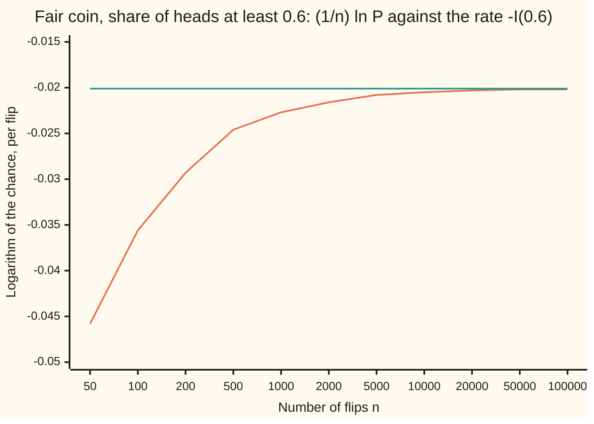
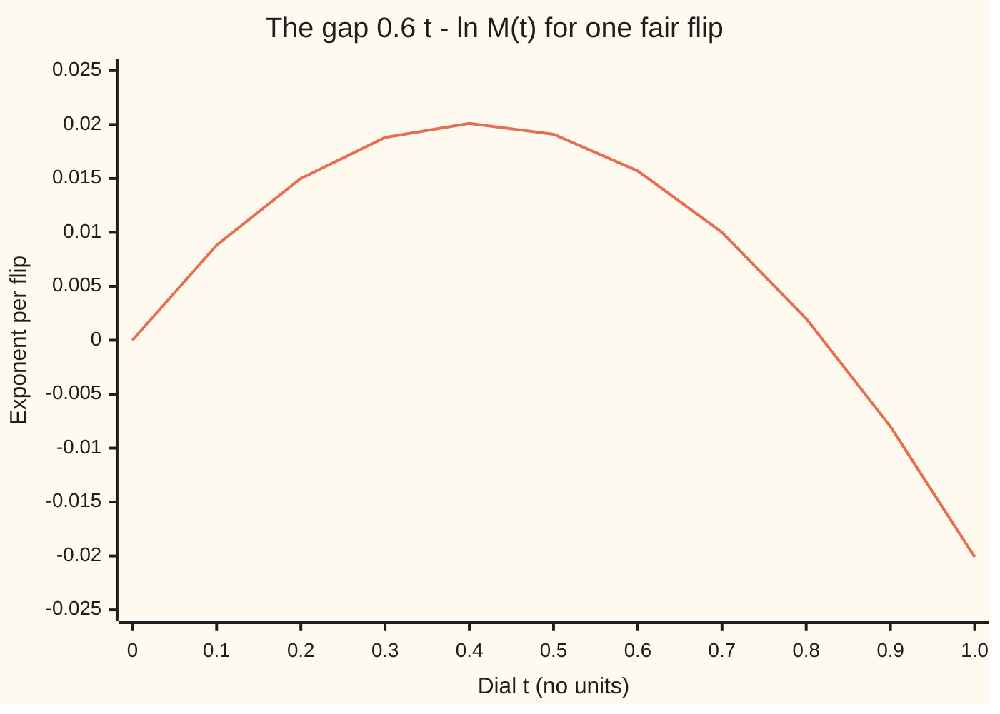

# Cramer's theorem: the chance that an average strays decays exponentially, at a rate given by the Legendre transform of the log-moment function

[Syllabus](../../../SYLLABUS.md) → [Measure and integration](../README.md) → [The Limit Theorems, Proved](../README.md#s10) → Cramer's theorem

---

## General Overview

A fair coin is flipped 1,000 times. On average it shows 500 heads. How likely is a share of heads of 0.6 or more, that is, 600 heads or more?

Counting every sequence gives the exact answer: 1.364e-10, about one chance in seven billion. [The weak law of large numbers](03-weak-law-of-large-numbers.md) only says this chance tends to 0. [The central limit theorem, proved](07-central-limit-theorem.md) describes misses of size about one over the square root of n. Neither says how fast a fixed miss of 0.1 becomes rare.

Harald Cramér answered in 1938, working on insurance risk. The chance falls like $`e^{-nI}`$, where n is the number of flips and I is a fixed rate per flip. For this coin and this share the rate is I(0.6) = 0.020136. Each extra flip multiplies the chance by about $`e^{-0.020136}`$, so doubling the flips roughly squares the chance.

The rate comes from one recipe: the Legendre transform of the logarithm of the moment generating function, defined below. It equals a Kullback–Leibler divergence: how far a coin landing heads 60 percent of the time sits from the fair one.

**The chance that an average of n independent copies reaches a level a above the mean is at most $`e^{-nI(a)}`$ for every n, and its logarithm divided by n tends to $`-I(a)`$, where $`I(a)`$ is the largest value of $`ta - \ln M(t)`$ over all t; the upper bound is Chernoff's, and the matching lower bound comes from tilting the law until a becomes typical.**

**What kind of fact this is:** a theorem, proved on this card in Why it works for laws whose moment generating function is finite everywhere (half-lines in the body, every closed and open set in the Detailed proof). Sanov's theorem for finite alphabets is stated, with the counting bounds behind it checked numerically for this example (the lower bound's counting lemma is cited).

### The picture: the exact rate closing on the limit



Orange: the exact chance of a share of 0.6 or more, its natural logarithm divided by n. Green: the limit, $`-I(0.6)`$ = −0.020136. Orange climbs towards green from below and never crosses it: the bound $`e^{-nI}`$ is never exceeded. The approach is slow, because a factor shrinking like one over the square root of n stays in front.

---

## The formula

Notation, as a reminder. $`X_1, X_2, \dots`$ are independent random variables on one probability space, each with the same law (i.i.d.), and mean $`\mu`$. Here $`X_i`$ is 1 for heads and 0 for tails, so $`\mu`$ = 0.5. Their sum is $`S_n`$, the number of heads, and their average is $`\bar X_n = S_n/n`$, the share of heads.

The **moment generating function** of one copy is $`M(t) = E\,e^{tX_1}`$, for a real number t, the dial ([Moment generating functions](../../09-Probability%20and%20statistics/02-Random%20Variables/07-moment-generating-functions.md)). Its logarithm, $`\Lambda(t) = \ln M(t)`$, is the **log-moment function** (also called the cumulant generating function). For the coin, $`\Lambda(t) = \ln\big((1 + e^t)/2\big)`$.

The **rate function** is the Legendre transform of $`\Lambda`$:

```math
I(a) = \sup_{t \in \mathbb{R}} \big( t\,a - \Lambda(t) \big)
```

**Read it aloud:** for a level a, slide the dial t, and record the largest amount by which the line $`t\,a`$ rises above the curve $`\Lambda(t)`$.

**Cramér's theorem, on a half-line.** Suppose $`M(t)`$ is finite for every t. For every level a at or above the mean, and every n,

```math
P(\bar X_n \ge a) \le e^{-n I(a)}, \qquad \lim_{n \to \infty} \frac{1}{n} \ln P(\bar X_n \ge a) = -I(a) \quad \text{when } \mu \le a < \text{the largest value } X_1 \text{ can take.}
```

**Read it aloud:** the chance that the average reaches a is never above e to the minus n times the rate, and on the logarithmic scale, per copy, it settles exactly at minus the rate.

**Cramér's theorem, on the whole line.** For every closed set F and every open set U of real numbers,

```math
\limsup_{n \to \infty} \frac{1}{n} \ln P(\bar X_n \in F) \le -\inf_{x \in F} I(x), \qquad \liminf_{n \to \infty} \frac{1}{n} \ln P(\bar X_n \in U) \ge -\inf_{x \in U} I(x).
```

**Read it aloud:** the chance of landing in a set decays at the rate of the cheapest point in it; closed sets give the ceiling, open sets the floor.

**Sanov's theorem, finite alphabet.** Let each $`X_i`$ take one of r letters, letter j with chance $`\mu_j > 0`$. The **type** $`L_n`$ is the list of shares of each letter among the first n draws. The **Kullback–Leibler divergence** of a list of chances $`\nu`$ from $`\mu`$ is $`D(\nu \,\Vert\, \mu) = \sum_j \nu_j \ln(\nu_j/\mu_j)`$ ([Densities and likelihood ratios](../08-Densities%20and%20Changing%20Measure/06-densities-and-likelihood-ratios.md)). For a set $`\Gamma`$ of such lists, with interior $`\Gamma^\circ`$ and closure $`\bar\Gamma`$,

```math
-\inf_{\nu \in \Gamma^\circ} D(\nu \,\Vert\, \mu) \le \liminf_{n \to \infty} \frac{1}{n} \ln P(L_n \in \Gamma) \le \limsup_{n \to \infty} \frac{1}{n} \ln P(L_n \in \Gamma) \le -\inf_{\nu \in \bar\Gamma} D(\nu \,\Vert\, \mu).
```

**Read it aloud:** the chance that the observed shares look like some other law decays at the rate of the divergence of the closest such law.

| Symbol | Plain meaning | In our example | Push it up and the answer… |
| --- | --- | --- | --- |
| $`X_i`$, $`\mu`$ | the i-th copy; the mean of one copy | 1 for heads, 0 for tails; 0.5 | — |
| $`n`$, $`S_n`$, $`\bar X_n`$ | number of copies; their sum; their average | 1,000 flips; heads; share of heads | more copies: the chance falls by $`e^{-I}`$ per copy |
| $`a`$ | the level the average must reach | 0.6 | a higher level: a larger rate, 0.192745 at 0.8 |
| $`t`$, $`M(t)`$, $`\Lambda(t)`$ | the dial; $`E\,e^{tX_1}`$; its logarithm | $`(1 + e^t)/2`$; $`\Lambda(0.4)`$ = 0.220 | — |
| $`I(a)`$ | the rate function: the Legendre transform of $`\Lambda`$ | 0.020136 | the chance falls faster |
| $`\theta`$, $`Q_\theta`$, $`Q_t`$ | the best dial, which is also the tilt strength; the tilted law, $`P`$ reweighted by $`e^{\theta X}/M(\theta)`$ | $`\ln 1.5`$ = 0.405465; a coin landing heads with chance 0.6 | the tilted mean rises with $`\theta`$ |
| $`\delta`$ | the width of the window in the lower bound | 0.02 | a looser lower bound |
| $`\sigma^2`$, $`\sigma_Q`$ | variance of one copy; standard deviation under $`Q_\theta`$ | 0.25; $`\sqrt{0.24}`$ | — |
| $`F`$, $`U`$, $`x`$, $`x'`$ | a closed set and an open set of levels; points in them | $`[0.6, 1]`$; $`(0.6, 1.5)`$ | — |
| $`L_n`$, $`\nu`$, $`r`$, $`\mu_j`$, $`\Gamma`$ | the type; another list of chances; number of letters; chance of letter j; a set of lists | shares (heads, tails); (0.6, 0.4); 2; 0.5; heads share at least 0.6 | — |
| $`D(\nu \,\Vert\, \mu)`$ | the Kullback–Leibler divergence | $`D((0.6, 0.4) \,\Vert\, (0.5, 0.5))`$ = 0.020136 | the type is rarer |
| $`g`$, $`m_-`$, $`m_+`$, $`H`$, $`T(\nu)`$, $`k_j`$, $`s`$, $`C`$, $`R`$, $`u`$ | in the proofs and examples: the gap $`ta - \Lambda(t)`$; the smallest and largest values a copy takes; entropy; the set of sequences of type $`\nu`$; letter counts; a mixing weight; a constant; the Lundberg coefficient; an insurer's capital | $`g(0.4)`$ = 0.0201; 0 and 1 | — |

### When it holds

- **Independent copies of one law.** The proof factors $`E\,e^{tS_n}`$ into $`M(t)^n`$. With dependence, such as a Markov chain, the rate changes.
- **A finite moment generating function.** The proof needs $`M(t)`$ finite for every t, as for any bounded copy. If $`M(t)`$ is infinite for every positive t, then $`I(a) = 0`$ above the mean: the chance decays more slowly than any exponential, because one huge copy is the cheap way to a high average.
- **A fixed level.** The level a does not move with n. Misses of size about $`1/\sqrt{n}`$ belong to the central limit theorem, and at those the chance does not go to 0 at all.
- **Accuracy on the logarithmic scale only.** The limit pins $`(1/n)\ln P`$, not P. At n = 1,000 the bound 1.800e-09 is 13.2 times the exact 1.364e-10, and that ratio grows like the square root of n.
- **A level the copies can reach.** For a share above 1 the chance is 0 and $`I`$ is infinite. At the very top, a share of exactly 1, the chance is $`2^{-n}`$ and $`I(1) = \ln 2`$.

---

## Why it works

### Step 0: one bound from above, one from below, meeting at the same exponent

The upper bound is an averaging argument. Markov's inequality applied to $`e^{tS_n}`$ caps the chance for every dial t, and the best dial gives the rate.

The lower bound is a change of coin. Swap the fair coin for one landing heads with chance 0.6, under which 600 heads in 1,000 is typical. Each sequence's fair-coin chance is its new-coin chance times an exchange rate, the likelihood ratio. Near 600 heads that rate is about $`e^{-nI}`$.

The two bounds meet because the upper bound's best dial is exactly the tilt that builds the new coin.

### Step 1: the upper bound, for every n

Take $`t \ge 0`$. The event $`\bar X_n \ge a`$ is the event $`e^{tS_n} \ge e^{tna}`$. Markov's inequality applied to the exponential ([Markov and Chebyshev](../04-The%20Lebesgue%20Integral/07-markov-and-chebyshev.md)), and independence, which turns the average of a product into a product of averages, give

```math
P(\bar X_n \ge a) \le e^{-tna}\,E\,e^{tS_n} = e^{-tna}\,M(t)^n = e^{-n\,(t a - \Lambda(t))}.
```

This holds at every $`t \ge 0`$. [Concentration](../../09-Probability%20and%20statistics/06-Limit%20Theorems%20in%20Practice/06-concentration-inequalities-hoeffding-and-chernoff.md) finds the best dial for coins; here it is found for any law.

### Step 2: the best dial is a Legendre transform

The function to maximise is $`g(t) = t\,a - \Lambda(t)`$. Three facts make the maximum well behaved.

- **It starts at 0.** $`\Lambda(0) = \ln 1 = 0`$, so $`g(0) = 0`$ and $`I(a) \ge 0`$.
- **It is concave.** $`\Lambda`$ is convex: its second derivative is a variance, never negative (proved in the fold). So $`g`$ is a single hill.
- **Negative dials never help above the mean.** By Jensen's inequality, $`M(t) = E\,e^{tX} \ge e^{t\mu}`$, so $`\Lambda(t) \ge t\mu`$. For $`t < 0`$ and $`a \ge \mu`$, $`g(t) \le t(a - \mu) \le 0`$. The supremum over all t equals the supremum over $`t \ge 0`$, so the bound of Step 1 is $`e^{-nI(a)}`$.

The hill for the coin at a = 0.6:



Orange is the gap between the line $`0.6\,t`$ and the curve $`\Lambda(t)`$: at t = 0.4, 0.240 against 0.220. The top, 0.020136 at t = 0.405465, is $`I(0.6)`$. A dial of 0.2 reaches only 0.015008; a dial of 1.0 gives −0.020115, a ceiling above 1.

### Step 3: the best dial is a tilt, and the rate is a divergence

At the top of the hill the slope is zero: $`a = \Lambda'(\theta)`$. Differentiating under the average,

```math
\Lambda'(\theta) = \frac{E\,X e^{\theta X}}{E\,e^{\theta X}} = \text{the mean of } X \text{ under } Q_\theta, \qquad \frac{dQ_\theta}{dP} = \frac{e^{\theta X}}{M(\theta)}.
```

$`Q_\theta`$ is the **exponential tilt** from [Densities and likelihood ratios](../08-Densities%20and%20Changing%20Measure/06-densities-and-likelihood-ratios.md): every outcome x has its weight multiplied by $`e^{\theta x}`$, then everything is rescaled to total 1. So the best dial is the tilt whose mean is exactly a.

For the coin, heads gets weight $`e^{\theta}`$ and tails weight 1. A share of 0.6 needs $`e^\theta/(1 + e^\theta) = 0.6`$, so $`e^\theta`$ = 1.5 and $`\theta`$ = 0.405465. The numerical maximum of the hill lands on the same dial.

The value at the top is a divergence. The log of the density is $`\theta X - \Lambda(\theta)`$; averaging it under $`Q_\theta`$ gives

```math
I(a) = \theta a - \Lambda(\theta) = D(Q_\theta \,\Vert\, P).
```

For the coin, $`I(0.6) = 0.6 \ln 1.2 + 0.4 \ln 0.8`$ = 0.020136: the divergence of a 60-percent coin from the fair one. For the shelf's fair die, an average of 4.4 or more needs the tilt $`\theta`$ = 0.328605, and $`I(4.4)`$ = 0.143213, the divergence that the densities card computed for that tilted die.

### Step 4: the exact identity behind the lower bound

On n flips, the fair coin's chance of any sequence with $`S_n`$ heads is its chance under $`Q_\theta`$ times $`e^{-\theta S_n + n\Lambda(\theta)}`$. Add over the sequences with $`S_n \ge na`$ and use $`\theta a - \Lambda(\theta) = I(a)`$:

```math
P(\bar X_n \ge a) = e^{-nI(a)} \; E_{Q_\theta}\!\big[\, e^{-\theta (S_n - na)} \;;\; S_n \ge na \,\big].
```

**Read it aloud:** the exact chance is the bound times a correction: the tilted average of $`e^{-\theta(S_n - na)}`$ over the event.

The correction is at most 1, since $`\theta \ge 0`$ and $`S_n - na \ge 0`$ on the event: Step 1 again. At n = 1,000 it is 0.0758, and 1.800e-09 × 0.0758 = 1.364e-10, the exact chance. The lower bound shows the correction is not exponentially small.

### Step 5: the lower bound, by a window

Keep only the sequences with $`na \le S_n \le n(a + \delta)`$. On them the correction's integrand is at least $`e^{-n\theta\delta}`$, so

```math
P(\bar X_n \ge a) \ge e^{-n\,(I(a) + \theta\delta)}\; Q_\theta\big(na \le S_n \le n(a + \delta)\big).
```

Under $`Q_\theta`$ the copies have mean exactly a. By the central limit theorem, the window's chance tends to 1/2: the half of the bell curve above its centre. So

```math
\liminf_{n \to \infty} \frac{1}{n} \ln P(\bar X_n \ge a) \ge -I(a) - \theta\delta.
```

This holds for every $`\delta > 0`$. Let $`\delta`$ shrink: the floor is $`-I(a)`$. Step 1 gave the matching ceiling, so the limit is $`-I(a)`$.

At n = 1,000 with $`\delta`$ = 0.02: the window $`600 \le S_n \le 620`$ has tilted chance 0.4211, and the floor is 2.280e-13, below the exact 1.364e-10. Its limiting exponent is −0.028245; shrinking $`\delta`$ lifts it to −0.020136.

### Step 6: from half-lines to any set, and to types

**Whole line.** A closed set that avoids the mean sits inside two half-lines, and each obeys Step 1. An open set contains a small window around each of its points; tilting to that point gives the floor. The fold has the details.

**Sanov.** For two letters, heads and tails, the type is (share of heads, share of tails), and the share of heads is its first entry. The chance of one exact type $`\nu`$ sits between two bounds:

```math
(n + 1)^{-r}\, e^{-n D(\nu \,\Vert\, \mu)} \le P(L_n = \nu) \le e^{-n D(\nu \,\Vert\, \mu)}.
```

At n = 1,000, the type (0.6, 0.4) has chance 4.634e-11, between 1.796e-15 and 1.800e-09. The number of possible types is at most $`(n + 1)^r`$, a power of n. Powers of n vanish on the scale $`(1/n)\ln`$, so the cheapest type in a set sets the rate. For "share of heads at least 0.6" the cheapest type is (0.6, 0.4), with divergence 0.020136, the same as Cramér's $`I(0.6)`$.

The match is general. Among laws with mean a, the tilt has the smallest divergence from $`P`$ (proved on the densities card). So $`I(a)`$ is the least divergence of a law with mean a: Cramér's theorem is Sanov's seen through the mean.

<details>
<summary>Detailed proof</summary>

**Setting.** $`X_1, X_2, \dots`$ are i.i.d. real random variables on $`(\Omega, \mathcal{F}, P)`$ with $`M(t) = E\,e^{tX_1} < \infty`$ for every real t. Let $`m_- \le m_+`$ be the essential infimum and supremum of $`X_1`$: the smallest and largest values it takes with positive probability nearby. Assume $`m_- < m_+`$; a constant copy is trivial.

**1. Properties of Λ.** For $`0 < s < 1`$, Hölder's inequality with exponents $`1/s`$ and $`1/(1 - s)`$ gives $`M(s t_1 + (1 - s) t_2) \le M(t_1)^s M(t_2)^{1 - s}`$, so $`\Lambda`$ is convex. Since $`\lvert x \rvert^k e^{tx} \le C(e^{(t + 1)x} + e^{(t - 1)x})`$ for a constant C depending on k, dominated convergence lets us differentiate under the average ([Dominated convergence](../05-Swapping%20Limits%20and%20Integrals/02-dominated-convergence-theorem.md)):

$`\displaystyle \Lambda'(t) = \frac{E\,X e^{tX}}{M(t)} = E_{Q_t} X, \qquad \Lambda''(t) = \frac{E\,X^2 e^{tX}}{M(t)} - \Lambda'(t)^2 = \mathrm{Var}_{Q_t}(X) > 0.`$

So $`\Lambda'`$ is continuous and strictly increasing, with $`\Lambda'(0) = \mu`$. As $`t \to \pm\infty`$ the tilt piles its weight near $`m_+`$ or $`m_-`$, so $`\Lambda'(t)`$ tends there. Hence each a in $`(m_-, m_+)`$ equals $`\Lambda'(\theta)`$ for exactly one $`\theta`$, and $`I(a) = \theta a - \Lambda(\theta)`$.

**2. Properties of I.** I is a supremum of lines in a, so it is convex and lower semicontinuous. $`I(\mu) = 0`$, since $`g(t) = t\mu - \Lambda(t) \le 0`$ by Jensen. On $`[\mu, \infty)`$, I is non-decreasing: for $`\mu \le a \le b`$, the dials that matter are $`t \ge 0`$ (Step 2), and $`ta \le tb`$. Symmetrically, I is non-increasing on $`(-\infty, \mu]`$, where only $`t \le 0`$ matters. A convex, lower semicontinuous function on the line is continuous on the closed interval where it is finite.

**3. Upper bound for a closed set F.** If $`\mu \in F`$ the bound reads $`\le 0`$, true. Otherwise let $`a_+ = \inf (F \cap [\mu, \infty))`$ and $`a_- = \sup(F \cap (-\infty, \mu])`$; both are in F, as F is closed. Then $`P(\bar X_n \in F) \le P(\bar X_n \ge a_+) + P(\bar X_n \le a_-) \le e^{-nI(a_+)} + e^{-nI(a_-)} \le 2\, e^{-n \inf_F I}`$, using Step 1 and its mirror with $`t \le 0`$, and the monotonicity of I on each side (so $`\inf_F I = \min(I(a_+), I(a_-))`$). Taking $`(1/n)\ln`$, the 2 contributes $`(\ln 2)/n \to 0`$.

**4. Lower bound for an open set U.** It suffices to show, for each x in U with $`I(x) < \infty`$ and each small $`\delta > 0`$ with $`(x - \delta, x + \delta) \subseteq U`$,

$`\displaystyle \liminf_{n \to \infty} \frac{1}{n} \ln P\big(\lvert \bar X_n - x \rvert < \delta\big) \ge -I(x).`$

Case $`m_- < x < m_+`$. Take $`\theta`$ with $`\Lambda'(\theta) = x`$. Under the product of n copies of $`Q_\theta`$, the density of P against it on $`\sigma(X_1, \dots, X_n)`$ is $`e^{-\theta S_n + n\Lambda(\theta)}`$. On the event $`\lvert \bar X_n - x \rvert < \delta`$ this is at least $`e^{-n(I(x) + \lvert \theta \rvert \delta)}`$. So

$`\displaystyle P\big(\lvert \bar X_n - x \rvert < \delta\big) \ge e^{-n(I(x) + \lvert \theta \rvert\delta)}\; Q_\theta\big(\lvert \bar X_n - x \rvert < \delta\big).`$

Under $`Q_\theta`$ the copies are i.i.d. with mean x and finite variance, so by [The weak law of large numbers](03-weak-law-of-large-numbers.md) the last factor tends to 1. Hence the liminf is at least $`-I(x) - \lvert\theta\rvert\delta`$. The chance on the left only grows with $`\delta`$, so the floor found for any smaller width also holds at $`\delta`$; letting that width tend to 0 gives $`-I(x)`$.

Case x at an end, say $`x = m_+`$ with $`I(m_+) < \infty`$. Then U contains points $`x' \in (m_-, m_+)`$ close to x, and by part 2, $`I(x') \to I(x)`$ as $`x' \to x`$ from inside. Apply the first case at $`x'`$. Points outside $`[m_-, m_+]`$ have $`I = \infty`$ and add nothing.

**5. The half-line limit.** For $`\mu \le a < m_+`$: part 3 with $`F = [a, \infty)`$ gives the ceiling $`-I(a)`$, and part 4 with $`U = (a, \infty)`$ gives the floor $`-\inf_{x > a} I(x) = -I(a)`$ by continuity of I at a.

**6. Type bounds for Sanov, r letters.** Let $`\nu`$ be a type: a list of shares $`k_j/n`$. The set $`T(\nu)`$ of sequences with that type has $`n!/\prod_j k_j!`$ members, each with chance $`\prod_j \mu_j^{k_j} = e^{-n(H(\nu) + D(\nu \,\Vert\, \mu))}`$ under $`\mu`$, where $`H(\nu) = -\sum_j \nu_j \ln \nu_j`$ is the entropy. Under $`\nu`$ itself each member has chance $`e^{-nH(\nu)}`$, and the members' chances add to at most 1, so $`\lvert T(\nu) \rvert \le e^{nH(\nu)}`$; this is the upper bound $`P(L_n = \nu) \le e^{-nD(\nu \,\Vert\, \mu)}`$. For the lower bound, $`T(\nu)`$ is the most likely type class under $`\nu`$ (a counting lemma, proved in Dembo and Zeitouni, section 2.1), and there are at most $`(n + 1)^r`$ type classes, so $`\nu^n(T(\nu)) \ge (n + 1)^{-r}`$ and $`\lvert T(\nu) \rvert \ge (n + 1)^{-r} e^{nH(\nu)}`$. Sanov's theorem follows as in parts 3 and 4, with types in place of averages (same book, section 2.1).

</details>

---

## Worked numbers, by hand

A fair coin, n = 1,000 flips, level a = 0.6.

| Step | Arithmetic | Value |
| --- | --- | --- |
| best dial: $`e^\theta = a(1 - \mu)/(\mu(1 - a))`$ | $`0.6 \times 0.5 / (0.5 \times 0.4) = 1.5`$ | $`\theta`$ = 0.405465 |
| tilted coin's chance of heads | $`1.5/(1 + 1.5)`$ | 0.6000 |
| rate $`I(0.6)`$ | $`0.6 \ln 1.2 + 0.4 \ln 0.8`$ | 0.020136 |
| bell-curve guess at the rate, $`(a - \mu)^2/(2\sigma^2)`$ | $`0.01/0.5`$ | 0.020000 |
| Chernoff ceiling $`e^{-nI}`$ | $`e^{-20.136}`$ | 1.800e-09 |
| exact chance of 600 heads or more | sum of 401 binomial terms | 1.364e-10 |
| per-flip log of the exact chance | $`\ln(1.364\text{e-}10)/1000`$ | −0.0227 |
| correction factor of Step 4 | tilted average | 0.0758 |
| sharper prediction of that factor | $`1/\big((1 - e^{-\theta})\,\sigma_Q \sqrt{2\pi n}\big)`$ | 0.0773 |
| **rate the per-flip log tends to** | $`-I(0.6)`$ | **−0.020136** |

The chance of 600 or more heads is 1.364e-10. The sharper prediction is the Bahadur–Rao refinement, cited, not proved: it explains the factor 13.2 between the ceiling and the truth.

### What breaks if you drop a piece

| Mistake | Comes out at | What went wrong |
| --- | --- | --- |
| Use the bell curve for 800 or more heads in 1,000 | 1.408e-80, against the exact 8.225e-86 | the bell curve uses the quadratic rate 0.18; the true rate is 0.192745, and n multiplies the difference |
| Guess the dial t = 0.2 | ceiling 3.034e-07, against 1.800e-09 | exponent 0.015008, not the top of the hill |
| Read $`e^{-nI}`$ as the chance | 1.800e-09, against 1.364e-10 | the theorem fixes the exponent; the factor 0.0758 in front is dropped |
| Simulate the fair coin directly, 4,000 runs | 0 runs reach 600 heads | an event of chance 1.364e-10 never shows; tilting is needed |

---

## Code, from first principles, and it actually runs

The code reaches the answer by several independent roads. The rate comes from its closed form and from a numerical maximum of $`t a - \Lambda(t)`$ by golden-section search (narrowing an interval by a fixed ratio each step). The exact chance comes from logarithms of factorials and, separately, from a recursion that starts at $`P(S_n = n) = 2^{-n}`$ and steps down one term at a time. The tilting identity of Step 4 is checked against the exact chance, and a simulation of the tilted coin, reweighted by the likelihood ratio, estimates it a fourth way. The bell-curve tail is held between two classical bounds. Both programs use the same random-number generator (splitmix64) and seed, so their outputs match line for line.

### Python

```python
# Cramer's theorem and large deviations -- the check behind the card.
# Standard library only (math). Fair coin, share of heads at least 0.6.
# Roads: the rate by formula and by a numerical maximum (Legendre transform);
# the exact tail by log-factorials and by a step-down recursion; the exact
# tail again through the tilting identity; and a tilted simulation.
import math

P, A, N = 0.5, 0.6, 1000

def lam(t, p=P):                        # log-moment function of one flip
    return math.log(1 - p + p * math.exp(t))
def lam_die(t):                         # log-moment function of one die roll
    return math.log(sum(math.exp(t * k) for k in range(1, 7)) / 6)
def kl2(c, p):                          # D((c, 1 - c) || (p, 1 - p))
    return c * math.log(c / p) + (1 - c) * math.log((1 - c) / (1 - p))

def legendre(a, f):                     # sup over t of (t a - f(t)), golden section
    lo, hi, g = -30.0, 30.0, (math.sqrt(5) - 1) / 2
    for _ in range(200):
        x1, x2 = hi - g * (hi - lo), lo + g * (hi - lo)
        lo, hi = (x1, hi) if x1 * a - f(x1) < x2 * a - f(x2) else (lo, x2)
    t = (lo + hi) / 2
    return t, t * a - f(t)

LF = [0.0]                              # LF[k] = ln k!
for i in range(1, 100001): LF.append(LF[-1] + math.log(i))

def log_pmf(n, k, p): return LF[n] - LF[k] - LF[n - k] + k * math.log(p) + (n - k) * math.log(1 - p)

def log_tail(n, k0, p=P):               # road 1: ln P(S >= k0), summed in log space
    lt = [log_pmf(n, k, p) for k in range(k0, n + 1)]; m = max(lt)
    return m + math.log(sum(math.exp(x - m) for x in lt))

def tail_recursion(n, k0):              # road 2: start at P(S = n) = 2^-n, step down
    term = 0.5 ** n; total = term
    for k in range(n, k0, -1):
        term *= k / (n - k + 1); total += term
    return total

def log_normal_tail(z):                 # ln P(G >= z) for large z, Laplace's continued fraction
    cf = z
    for k in range(80, 0, -1): cf = z + k / cf
    return -z * z / 2 - math.log(math.sqrt(2 * math.pi)) - math.log(cf)

def ceil_share(n, num, den): return -(-num * n // den)

def row(label, v): print(f"{label:<58} {v}")
# The rate, two roads
I = kl2(A, P)
t_num, I_num = legendre(A, lam)
theta = math.log(A * (1 - P) / (P * (1 - A)))
row("I(0.6) = 0.6 ln 1.2 + 0.4 ln 0.8", f"{I:.6f}")
row("I(0.6) by maximising 0.6 t - ln M(t): best t", f"{t_num:.6f}")
row("I(0.6) by maximising 0.6 t - ln M(t): value", f"{I_num:.6f}")
row("tilt theta = ln 1.5; tilted coin's chance of heads", f"{theta:.6f} {P * math.exp(theta) / (1 - P + P * math.exp(theta)):.4f}")
row("quadratic guess (a - mu)^2 / (2 sigma^2)", f"{(A - P) ** 2 / (2 * P * (1 - P)):.6f}")
for t in (0.2, 1.0):
    row(f"Chernoff exponent at a guessed dial t = {t}", f"{t * A - lam(t):.6f}")
row("Chernoff bound at t = 0.2, n = 1000", f"{math.exp(-N * (0.2 * A - lam(0.2))):.3e}")
print("chart, Lambda(t)    " + " ".join(f"{lam(i / 10):.3f}" for i in range(11)))
print("chart, 0.6 t        " + " ".join(f"{0.6 * i / 10:.3f}" for i in range(11)))
print("chart, gap          " + " ".join(f"{0.6 * i / 10 - lam(i / 10):.4f}" for i in range(11)))
# The exact chance at n = 1000, two roads, against the bound
k0 = ceil_share(N, 6, 10)
lt = log_tail(N, k0); exact = math.exp(lt); rec = tail_recursion(N, k0); bound = math.exp(-N * I)
row("n = 1000: exact P(S >= 600), log-factorials", f"{exact:.4e}")
row("n = 1000: exact P(S >= 600), step-down recursion", f"{rec:.4e}")
row("n = 1000: (1/n) ln P", f"{lt / N:.4f}")
row("n = 1000: bound e^(-nI)", f"{bound:.3e}")
row("n = 1000: bound / exact", f"{bound / exact:.1f}")
# The tilting identity and the lower bound's window
pref = sum(math.exp(log_pmf(N, k, A) - theta * (k - k0)) for k in range(k0, N + 1))
row("prefactor E_Q[e^(-theta (S - 600)); S >= 600]", f"{pref:.4f}")
row("e^(-nI) x prefactor", f"{bound * pref:.4e}")
sq = math.sqrt(A * (1 - A))
br = 1 / ((1 - math.exp(-theta)) * sq * math.sqrt(2 * math.pi * N))
row("Bahadur-Rao prefactor 1/((1 - e^-theta) sigma_Q sqrt(2 pi n))", f"{br:.4f}")
qw = sum(math.exp(log_pmf(N, k, A)) for k in range(k0, ceil_share(N, 62, 100) + 1))
low = math.exp(-N * (I + theta * 0.02)) * qw
row("window: Q(600 <= S <= 620)", f"{qw:.4f}")
row("window: lower bound e^(-n(I + 0.02 theta)) Q(window)", f"{low:.3e}")
row("window: limit of (1/n) ln, -(I + 0.02 theta)", f"{-(I + theta * 0.02):.6f}")
# The approach to -I as n grows
ns = [50, 100, 200, 500, 1000, 2000, 5000, 10000, 20000, 50000, 100000]
rates = [log_tail(n, ceil_share(n, 6, 10)) / n for n in ns]
print("chart, n            " + " ".join(f"{n}" for n in ns))
print("chart, (1/n) ln P   " + " ".join(f"{r:.4f}" for r in rates))
print("chart, -I           " + " ".join(f"{-I:.4f}" for _ in ns))
# The bell curve far out: share 0.8 at n = 1000
z8 = 300 / math.sqrt(N * 0.25); I8, lt8, ln8 = kl2(0.8, P), log_tail(N, 800), log_normal_tail(z8)
row("share 0.8: I(0.8) against quadratic 0.18", f"{I8:.6f}")
row("share 0.8: exact P(S >= 800)", f"{math.exp(lt8):.3e}")
row("share 0.8: bell-curve tail at z = 18.97", f"{math.exp(ln8):.3e}")
row("share 0.6: bell-curve tail at z = 6.32", f"{math.exp(log_normal_tail(100 / math.sqrt(N * 0.25))):.3e}")
# Sanov, two letters: the type (0.6, 0.4) at n = 1000
tp = math.exp(log_pmf(N, k0, P))
row("Sanov: D((0.6, 0.4) || (0.5, 0.5))", f"{kl2(A, P):.6f}")
row("Sanov: P(type = (0.6, 0.4)), with its two bounds", f"{tp:.3e} in [{bound / (N + 1) ** 2:.3e}, {bound:.3e}]")
# The house die: average at least 4.4
lo, hi = 0.0, 5.0
for _ in range(200):
    mid = (lo + hi) / 2
    w = [math.exp(mid * k) for k in range(1, 7)]
    lo, hi = (mid, hi) if sum(k * x for k, x in zip(range(1, 7), w)) / sum(w) < 4.4 else (lo, mid)
q = [x / sum(w) for x in w]
Id = sum(x * math.log(6 * x) for x in q)
td, Id_num = legendre(4.4, lam_die)
row("die: tilt theta to mean 4.4; D(tilt || fair)", f"{lo:.6f} {Id:.6f}")
row("die: I(4.4) by maximising 4.4 t - ln M(t)", f"{Id_num:.6f}")
# A tilted simulation against a plain one, splitmix64, same seed in Rust
s = 20261123
def nxt():
    global s
    s = (s + 0x9E3779B97F4A7C15) & 0xFFFFFFFFFFFFFFFF
    z = ((s ^ (s >> 30)) * 0xBF58476D1CE4E5B9) & 0xFFFFFFFFFFFFFFFF
    z = ((z ^ (z >> 27)) * 0x94D049BB133111EB) & 0xFFFFFFFFFFFFFFFF
    return (z ^ (z >> 31)) >> 11
R = 4000
cut_q, cut_p = int(A * 2 ** 53), int(P * 2 ** 53)
ws, hits = [], 0
for _ in range(R):
    S = sum(1 for _ in range(N) if nxt() < cut_q)
    ws.append(math.exp(S * math.log(P / A) + (N - S) * math.log((1 - P) / (1 - A))) if S >= k0 else 0.0)
    if sum(1 for _ in range(N) if nxt() < cut_p) >= k0: hits += 1
est = sum(ws) / R; se = math.sqrt(sum((x - est) ** 2 for x in ws) / (R - 1) / R)
row("simulation, 4000 runs: plain coin, runs with S >= 600", f"{hits}")
row("simulation, 4000 runs: tilted coin, estimate and std error", f"{est:.4e} {se:.1e}")

assert abs(I - I_num) < 1e-9 and abs(t_num - theta) < 1e-6, "Legendre maximum vs closed form"
assert abs(rec - exact) < 1e-9 * exact, "two exact roads"
assert exact <= bound and all(r <= -I for r in rates), "Chernoff bound never exceeded"
assert abs(bound * pref - exact) < 1e-9 * exact, "tilting identity"
assert low <= exact and abs(br - pref) < 0.05 * pref, "lower bound and prefactor"
assert abs(rates[-1] + I) < 1e-4 and rates == sorted(rates), "(1/n) ln P rises to -I"
assert bound / (N + 1) ** 2 <= tp <= bound, "Sanov type bounds"
assert abs(Id - Id_num) < 1e-9 and abs(Id - 0.143213) < 1e-6, "die: two roads to I(4.4)"
assert abs(est - exact) < 4 * se and hits == 0, "tilted simulation"
c8 = math.exp(ln8 + z8 * z8 / 2) * math.sqrt(2 * math.pi)    # tail / phi, between two Mills series bounds
assert 1 / z8 - z8 ** -3 < c8 < 1 / z8 - z8 ** -3 + 3 * z8 ** -5 and ln8 > lt8 + 10, "bell curve: Mills bounds; overstates"
print("ALL CHECKS PASS")
```

**Ran 2026-11-23 on macOS, Python 3.14.10, standard library only. All checks passed. Output, pasted from the run:**

```
I(0.6) = 0.6 ln 1.2 + 0.4 ln 0.8                           0.020136
I(0.6) by maximising 0.6 t - ln M(t): best t               0.405465
I(0.6) by maximising 0.6 t - ln M(t): value                0.020136
tilt theta = ln 1.5; tilted coin's chance of heads         0.405465 0.6000
quadratic guess (a - mu)^2 / (2 sigma^2)                   0.020000
Chernoff exponent at a guessed dial t = 0.2                0.015008
Chernoff exponent at a guessed dial t = 1.0                -0.020115
Chernoff bound at t = 0.2, n = 1000                        3.034e-07
chart, Lambda(t)    0.000 0.051 0.105 0.161 0.220 0.281 0.344 0.410 0.478 0.548 0.620
chart, 0.6 t        0.000 0.060 0.120 0.180 0.240 0.300 0.360 0.420 0.480 0.540 0.600
chart, gap          0.0000 0.0088 0.0150 0.0188 0.0201 0.0191 0.0157 0.0100 0.0020 -0.0080 -0.0201
n = 1000: exact P(S >= 600), log-factorials                1.3642e-10
n = 1000: exact P(S >= 600), step-down recursion           1.3642e-10
n = 1000: (1/n) ln P                                       -0.0227
n = 1000: bound e^(-nI)                                    1.800e-09
n = 1000: bound / exact                                    13.2
prefactor E_Q[e^(-theta (S - 600)); S >= 600]              0.0758
e^(-nI) x prefactor                                        1.3642e-10
Bahadur-Rao prefactor 1/((1 - e^-theta) sigma_Q sqrt(2 pi n)) 0.0773
window: Q(600 <= S <= 620)                                 0.4211
window: lower bound e^(-n(I + 0.02 theta)) Q(window)       2.280e-13
window: limit of (1/n) ln, -(I + 0.02 theta)               -0.028245
chart, n            50 100 200 500 1000 2000 5000 10000 20000 50000 100000
chart, (1/n) ln P   -0.0458 -0.0356 -0.0293 -0.0246 -0.0227 -0.0216 -0.0208 -0.0205 -0.0203 -0.0202 -0.0202
chart, -I           -0.0201 -0.0201 -0.0201 -0.0201 -0.0201 -0.0201 -0.0201 -0.0201 -0.0201 -0.0201 -0.0201
share 0.8: I(0.8) against quadratic 0.18                   0.192745
share 0.8: exact P(S >= 800)                               8.225e-86
share 0.8: bell-curve tail at z = 18.97                    1.408e-80
share 0.6: bell-curve tail at z = 6.32                     1.270e-10
Sanov: D((0.6, 0.4) || (0.5, 0.5))                         0.020136
Sanov: P(type = (0.6, 0.4)), with its two bounds           4.634e-11 in [1.796e-15, 1.800e-09]
die: tilt theta to mean 4.4; D(tilt || fair)               0.328605 0.143213
die: I(4.4) by maximising 4.4 t - ln M(t)                  0.143213
simulation, 4000 runs: plain coin, runs with S >= 600      0
simulation, 4000 runs: tilted coin, estimate and std error 1.4067e-10 5.8e-12
ALL CHECKS PASS
```

All roads agree. The tilted simulation lands at 1.4067e-10, within one standard error of the exact 1.3642e-10; the plain simulation never sees the event.

### Rust

```rust
// Cramer's theorem and large deviations -- the same check as the Python, in Rust.
// Standard library only, no crates. Fair coin, share of heads at least 0.6.
// Roads: the rate by formula and by a numerical maximum (Legendre transform);
// the exact tail by log-factorials and by a step-down recursion; the exact
// tail again through the tilting identity; and a tilted simulation.
use std::f64::consts::PI;

const P: f64 = 0.5; const A: f64 = 0.6; const N: usize = 1000;

fn lam(t: f64) -> f64 { (1.0 - P + P * t.exp()).ln() } // log-moment function of one flip
fn lam_die(t: f64) -> f64 { // log-moment function of one die roll
    ((1..7).fold(0.0, |acc, k| acc + (t * k as f64).exp()) / 6.0).ln()
}
fn kl2(c: f64, p: f64) -> f64 { c * (c / p).ln() + (1.0 - c) * ((1.0 - c) / (1.0 - p)).ln() }
fn legendre(a: f64, f: fn(f64) -> f64) -> (f64, f64) { // sup over t of (t a - f(t)), golden section
    let (mut lo, mut hi, g) = (-30.0f64, 30.0f64, (5.0f64.sqrt() - 1.0) / 2.0);
    for _ in 0..200 {
        let (x1, x2) = (hi - g * (hi - lo), lo + g * (hi - lo));
        if x1 * a - f(x1) < x2 * a - f(x2) { lo = x1 } else { hi = x2 }
    }
    let t = (lo + hi) / 2.0;
    (t, t * a - f(t))
}
fn log_pmf(lf: &[f64], n: usize, k: usize, p: f64) -> f64 {
    lf[n] - lf[k] - lf[n - k] + k as f64 * p.ln() + (n - k) as f64 * (1.0 - p).ln()
}
fn log_tail(lf: &[f64], n: usize, k0: usize, p: f64) -> f64 { // road 1: ln P(S >= k0)
    let lt: Vec<f64> = (k0..n + 1).map(|k| log_pmf(lf, n, k, p)).collect();
    let m = lt.iter().cloned().fold(f64::NEG_INFINITY, f64::max);
    m + lt.iter().fold(0.0, |acc, x| acc + (x - m).exp()).ln()
}
fn tail_recursion(n: usize, k0: usize) -> f64 { // road 2: start at P(S = n) = 2^-n, step down
    let mut term = 0.5f64.powi(n as i32);
    let mut total = term;
    for k in (k0 + 1..n + 1).rev() { term *= k as f64 / (n - k + 1) as f64; total += term; }
    total
}
fn log_normal_tail(z: f64) -> f64 { // ln P(G >= z) for large z, Laplace's continued fraction
    let mut cf = z;
    for k in (1..81).rev() { cf = z + k as f64 / cf; }
    -z * z / 2.0 - (2.0 * PI).sqrt().ln() - cf.ln()
}
fn ceil_share(n: usize, num: usize, den: usize) -> usize { (num * n + den - 1) / den }
fn sci(x: f64, d: usize) -> String { // Python-style exponent: 1.800e-09
    let s = format!("{:.*e}", d, x);
    let (m, e) = s.split_once('e').unwrap();
    let e: i32 = e.parse().unwrap();
    format!("{}e{}{:02}", m, if e < 0 { "-" } else { "+" }, e.abs())
}
fn row(label: &str, v: String) { println!("{:<58} {}", label, v); }
fn join(v: &[f64], d: usize) -> String { v.iter().map(|x| format!("{:.*}", d, x)).collect::<Vec<_>>().join(" ") }

fn main() {
    // The rate, two roads
    let i_r = kl2(A, P);
    let (t_num, i_num) = legendre(A, lam);
    let theta = (A * (1.0 - P) / (P * (1.0 - A))).ln();
    row("I(0.6) = 0.6 ln 1.2 + 0.4 ln 0.8", format!("{:.6}", i_r));
    row("I(0.6) by maximising 0.6 t - ln M(t): best t", format!("{:.6}", t_num));
    row("I(0.6) by maximising 0.6 t - ln M(t): value", format!("{:.6}", i_num));
    row("tilt theta = ln 1.5; tilted coin's chance of heads",
        format!("{:.6} {:.4}", theta, P * theta.exp() / (1.0 - P + P * theta.exp())));
    row("quadratic guess (a - mu)^2 / (2 sigma^2)", format!("{:.6}", (A - P).powi(2) / (2.0 * P * (1.0 - P))));
    for (t, name) in [(0.2, "0.2"), (1.0, "1.0")] {
        row(&format!("Chernoff exponent at a guessed dial t = {}", name), format!("{:.6}", t * A - lam(t)));
    }
    row("Chernoff bound at t = 0.2, n = 1000", sci((-(N as f64) * (0.2 * A - lam(0.2))).exp(), 3));
    let ts: Vec<f64> = (0..11).map(|i| i as f64 / 10.0).collect();
    println!("chart, Lambda(t)    {}", join(&ts.iter().map(|&t| lam(t)).collect::<Vec<_>>(), 3));
    println!("chart, 0.6 t        {}", join(&ts.iter().map(|&t| 0.6 * t).collect::<Vec<_>>(), 3));
    println!("chart, gap          {}", join(&ts.iter().map(|&t| 0.6 * t - lam(t)).collect::<Vec<_>>(), 4));
    // The exact chance at n = 1000, two roads, against the bound
    let mut lf = vec![0.0f64]; // lf[k] = ln k!
    for i in 1..100001 { let l = lf[i - 1] + (i as f64).ln(); lf.push(l); }
    let nf = N as f64;
    let k0 = ceil_share(N, 6, 10);
    let lt = log_tail(&lf, N, k0, P);
    let (exact, rec, bound) = (lt.exp(), tail_recursion(N, k0), (-nf * i_r).exp());
    row("n = 1000: exact P(S >= 600), log-factorials", sci(exact, 4));
    row("n = 1000: exact P(S >= 600), step-down recursion", sci(rec, 4));
    row("n = 1000: (1/n) ln P", format!("{:.4}", lt / nf));
    row("n = 1000: bound e^(-nI)", sci(bound, 3));
    row("n = 1000: bound / exact", format!("{:.1}", bound / exact));
    // The tilting identity and the lower bound's window
    let mut pref = 0.0;
    for k in k0..N + 1 { pref += (log_pmf(&lf, N, k, A) - theta * (k - k0) as f64).exp(); }
    row("prefactor E_Q[e^(-theta (S - 600)); S >= 600]", format!("{:.4}", pref));
    row("e^(-nI) x prefactor", sci(bound * pref, 4));
    let sq = (A * (1.0 - A)).sqrt();
    let br = 1.0 / ((1.0 - (-theta).exp()) * sq * (2.0 * PI * nf).sqrt());
    row("Bahadur-Rao prefactor 1/((1 - e^-theta) sigma_Q sqrt(2 pi n))", format!("{:.4}", br));
    let mut qw = 0.0;
    for k in k0..ceil_share(N, 62, 100) + 1 { qw += log_pmf(&lf, N, k, A).exp(); }
    let low = (-nf * (i_r + theta * 0.02)).exp() * qw;
    row("window: Q(600 <= S <= 620)", format!("{:.4}", qw));
    row("window: lower bound e^(-n(I + 0.02 theta)) Q(window)", sci(low, 3));
    row("window: limit of (1/n) ln, -(I + 0.02 theta)", format!("{:.6}", -(i_r + theta * 0.02)));
    // The approach to -I as n grows
    let ns = [50usize, 100, 200, 500, 1000, 2000, 5000, 10000, 20000, 50000, 100000];
    let rates: Vec<f64> = ns.iter().map(|&n| log_tail(&lf, n, ceil_share(n, 6, 10), P) / n as f64).collect();
    println!("chart, n            {}", ns.iter().map(|n| n.to_string()).collect::<Vec<_>>().join(" "));
    println!("chart, (1/n) ln P   {}", join(&rates, 4));
    println!("chart, -I           {}", join(&vec![-i_r; ns.len()], 4));
    // The bell curve far out: share 0.8 at n = 1000
    let (i8, lt8) = (kl2(0.8, P), log_tail(&lf, N, 800, P));
    let z8 = 300.0 / (nf * 0.25).sqrt();
    let ln8 = log_normal_tail(z8);
    row("share 0.8: I(0.8) against quadratic 0.18", format!("{:.6}", i8));
    row("share 0.8: exact P(S >= 800)", sci(lt8.exp(), 3));
    row("share 0.8: bell-curve tail at z = 18.97", sci(ln8.exp(), 3));
    row("share 0.6: bell-curve tail at z = 6.32", sci(log_normal_tail(100.0 / (nf * 0.25).sqrt()).exp(), 3));
    // Sanov, two letters: the type (0.6, 0.4) at n = 1000
    let tp = log_pmf(&lf, N, k0, P).exp();
    let tlo = bound / ((N + 1) as f64).powi(2);
    row("Sanov: D((0.6, 0.4) || (0.5, 0.5))", format!("{:.6}", kl2(A, P)));
    row("Sanov: P(type = (0.6, 0.4)), with its two bounds", format!("{} in [{}, {}]", sci(tp, 3), sci(tlo, 3), sci(bound, 3)));
    // The house die: average at least 4.4
    let (mut lo, mut hi) = (0.0f64, 5.0f64);
    let mut w = [0.0f64; 6];
    for _ in 0..200 {
        let mid = (lo + hi) / 2.0;
        for k in 1..7 { w[k - 1] = (mid * k as f64).exp(); }
        let (mut sk, mut sw) = (0.0, 0.0);
        for k in 1..7 { sk += k as f64 * w[k - 1]; sw += w[k - 1]; }
        if sk / sw < 4.4 { lo = mid } else { hi = mid }
    }
    let (mut sw, mut id) = (0.0, 0.0);
    for k in 0..6 { sw += w[k]; }
    for k in 0..6 { let x = w[k] / sw; id += x * (6.0 * x).ln(); }
    let (_, id_num) = legendre(4.4, lam_die);
    row("die: tilt theta to mean 4.4; D(tilt || fair)", format!("{:.6} {:.6}", lo, id));
    row("die: I(4.4) by maximising 4.4 t - ln M(t)", format!("{:.6}", id_num));
    // A tilted simulation against a plain one, splitmix64, same seed as Python
    let mut s: u64 = 20261123;
    let mut nxt = || {
        s = s.wrapping_add(0x9E3779B97F4A7C15);
        let mut z = (s ^ (s >> 30)).wrapping_mul(0xBF58476D1CE4E5B9);
        z = (z ^ (z >> 27)).wrapping_mul(0x94D049BB133111EB);
        (z ^ (z >> 31)) >> 11
    };
    let r = 4000usize;
    let (cut_q, cut_p) = ((A * 9007199254740992.0) as u64, (P * 9007199254740992.0) as u64);
    let (mut ws, mut hits) = (Vec::new(), 0);
    for _ in 0..r {
        let sq_: usize = (0..N).filter(|_| nxt() < cut_q).count();
        let sf = sq_ as f64;
        ws.push(if sq_ >= k0 { (sf * (P / A).ln() + (nf - sf) * ((1.0 - P) / (1.0 - A)).ln()).exp() } else { 0.0 });
        if (0..N).filter(|_| nxt() < cut_p).count() >= k0 { hits += 1; }
    }
    let mut est = 0.0; for x in &ws { est += x; }
    est /= r as f64;
    let v: f64 = ws.iter().fold(0.0, |acc, x| acc + (x - est).powi(2));
    let se = (v / (r - 1) as f64 / r as f64).sqrt();
    row("simulation, 4000 runs: plain coin, runs with S >= 600", format!("{}", hits));
    row("simulation, 4000 runs: tilted coin, estimate and std error", format!("{} {}", sci(est, 4), sci(se, 1)));

    assert!((i_r - i_num).abs() < 1e-9 && (t_num - theta).abs() < 1e-6, "Legendre maximum vs closed form");
    assert!((rec - exact).abs() < 1e-9 * exact, "two exact roads");
    assert!(exact <= bound && rates.iter().all(|&x| x <= -i_r), "Chernoff bound never exceeded");
    assert!((bound * pref - exact).abs() < 1e-9 * exact, "tilting identity");
    assert!(low <= exact && (br - pref).abs() < 0.05 * pref, "lower bound and prefactor");
    assert!((rates[rates.len() - 1] + i_r).abs() < 1e-4 && rates.windows(2).all(|p| p[0] <= p[1]), "(1/n) ln P rises to -I");
    assert!(tlo <= tp && tp <= bound, "Sanov type bounds");
    assert!((id - id_num).abs() < 1e-9 && (id - 0.143213).abs() < 1e-6, "die: two roads to I(4.4)");
    assert!((est - exact).abs() < 4.0 * se && hits == 0, "tilted simulation");
    let c8 = (ln8 + z8 * z8 / 2.0).exp() * (2.0 * PI).sqrt(); // tail / phi, between two Mills series bounds
    let (m_lo, m_hi) = (1.0 / z8 - z8.powi(-3), 1.0 / z8 - z8.powi(-3) + 3.0 * z8.powi(-5));
    assert!(m_lo < c8 && c8 < m_hi && ln8 > lt8 + 10.0, "bell curve: Mills bounds; overstates");
    println!("ALL CHECKS PASS");
}
```

**Ran 2026-11-23 on macOS, rustc 1.98.1, no crates. All checks passed. Output, pasted from the run:**

```
I(0.6) = 0.6 ln 1.2 + 0.4 ln 0.8                           0.020136
I(0.6) by maximising 0.6 t - ln M(t): best t               0.405465
I(0.6) by maximising 0.6 t - ln M(t): value                0.020136
tilt theta = ln 1.5; tilted coin's chance of heads         0.405465 0.6000
quadratic guess (a - mu)^2 / (2 sigma^2)                   0.020000
Chernoff exponent at a guessed dial t = 0.2                0.015008
Chernoff exponent at a guessed dial t = 1.0                -0.020115
Chernoff bound at t = 0.2, n = 1000                        3.034e-07
chart, Lambda(t)    0.000 0.051 0.105 0.161 0.220 0.281 0.344 0.410 0.478 0.548 0.620
chart, 0.6 t        0.000 0.060 0.120 0.180 0.240 0.300 0.360 0.420 0.480 0.540 0.600
chart, gap          0.0000 0.0088 0.0150 0.0188 0.0201 0.0191 0.0157 0.0100 0.0020 -0.0080 -0.0201
n = 1000: exact P(S >= 600), log-factorials                1.3642e-10
n = 1000: exact P(S >= 600), step-down recursion           1.3642e-10
n = 1000: (1/n) ln P                                       -0.0227
n = 1000: bound e^(-nI)                                    1.800e-09
n = 1000: bound / exact                                    13.2
prefactor E_Q[e^(-theta (S - 600)); S >= 600]              0.0758
e^(-nI) x prefactor                                        1.3642e-10
Bahadur-Rao prefactor 1/((1 - e^-theta) sigma_Q sqrt(2 pi n)) 0.0773
window: Q(600 <= S <= 620)                                 0.4211
window: lower bound e^(-n(I + 0.02 theta)) Q(window)       2.280e-13
window: limit of (1/n) ln, -(I + 0.02 theta)               -0.028245
chart, n            50 100 200 500 1000 2000 5000 10000 20000 50000 100000
chart, (1/n) ln P   -0.0458 -0.0356 -0.0293 -0.0246 -0.0227 -0.0216 -0.0208 -0.0205 -0.0203 -0.0202 -0.0202
chart, -I           -0.0201 -0.0201 -0.0201 -0.0201 -0.0201 -0.0201 -0.0201 -0.0201 -0.0201 -0.0201 -0.0201
share 0.8: I(0.8) against quadratic 0.18                   0.192745
share 0.8: exact P(S >= 800)                               8.225e-86
share 0.8: bell-curve tail at z = 18.97                    1.408e-80
share 0.6: bell-curve tail at z = 6.32                     1.270e-10
Sanov: D((0.6, 0.4) || (0.5, 0.5))                         0.020136
Sanov: P(type = (0.6, 0.4)), with its two bounds           4.634e-11 in [1.796e-15, 1.800e-09]
die: tilt theta to mean 4.4; D(tilt || fair)               0.328605 0.143213
die: I(4.4) by maximising 4.4 t - ln M(t)                  0.143213
simulation, 4000 runs: plain coin, runs with S >= 600      0
simulation, 4000 runs: tilted coin, estimate and std error 1.4067e-10 5.8e-12
ALL CHECKS PASS
```

### Lean

Lean proves Cramér's theorem on a half-line, its upper bound for every n, and the coin's rate as a divergence.

- Suppose $`X_1, X_2, \dots`$ are i.i.d., $`M(t)`$ is finite for every t, and $`\mu \le a`$. Then $`P(\bar X_n \ge a) \le e^{-nI(a)}`$ for every n.
- Suppose also that a is below the largest value $`X_1`$ can take, that is, $`P(X_1 > a) > 0`$. Then $`\frac{1}{n} \ln P(\bar X_n \ge a) \to -I(a)`$.
- Take a coin landing heads with chance p, and a level a, both strictly between 0 and 1. Then its rate $`I(a)`$ equals the divergence $`a \ln(a/p) + (1 - a) \ln((1 - a)/(1 - p))`$.
- The hand arithmetic holds exactly as fractions. The tilt $`e^\theta`$ = 3/2 gives heads chance 3/5, and the variances are 1/4 and 6/25.
- At n = 1,000, a share of 3/5 is 600 heads, and the window of width 1/50 ends at 620 heads.
- The divergence's ratios are 0.6/0.5 = 6/5 and 0.4/0.5 = 4/5. The 1,001 two-letter types at n = 1,000 fit within $`(n + 1)^r`$ = $`1001^2`$.

The decimals, the exact chances, the tilting identity, Sanov's type bounds, the die and the simulations are left to the Python and Rust checks.

```lean
-- Cramer's theorem: for independent copies of one law with a moment generating function finite everywhere, the chance that the average of n copies reaches a level a at or above the mean is at most e^(-n I(a)), where I(a) is the supremum over t of t a - ln M(t), and (1/n) ln of that chance tends to -I(a) when a is below the largest value a copy can take.
import Mathlib.Probability.Moments.Basic
import Mathlib.Probability.Moments.MGFAnalytic
import Mathlib.Probability.Independence.Basic
import Mathlib.Probability.IdentDistrib
import Mathlib.Analysis.SpecialFunctions.Log.ERealExp

open MeasureTheory ProbabilityTheory Filter Topology

lemma cramer_mgf_sum {Ω : Type*} [MeasurableSpace Ω] {μ : Measure Ω}
    [IsProbabilityMeasure μ] (X : ℕ → Ω → ℝ) (hmeas : ∀ i, Measurable (X i))
    (hindep : iIndepFun X μ) (hident : ∀ i, IdentDistrib (X i) (X 0) μ μ)
    (hmgf : ∀ t : ℝ, Integrable (fun ω => Real.exp (t * X 0 ω)) μ) (n : ℕ) (u : ℝ) :
    mgf (∑ i ∈ Finset.range n, X i) μ u = Real.exp (n * cgf (X 0) μ u) := by
  rw [hindep.mgf_sum hmeas, Finset.prod_congr rfl
    (fun i _ => mgf_congr_of_identDistrib (X i) (X 0) (hident i) u), Finset.prod_const,
    Finset.card_range, Real.exp_nat_mul, exp_cgf (hmgf u)]

lemma cramer_integrable_sum {Ω : Type*} [MeasurableSpace Ω] {μ : Measure Ω}
    [IsProbabilityMeasure μ] (X : ℕ → Ω → ℝ) (hmeas : ∀ i, Measurable (X i))
    (hindep : iIndepFun X μ) (hident : ∀ i, IdentDistrib (X i) (X 0) μ μ)
    (hmgf : ∀ t : ℝ, Integrable (fun ω => Real.exp (t * X 0 ω)) μ) (n : ℕ) (u : ℝ) :
    Integrable (fun ω => Real.exp (u * (∑ i ∈ Finset.range n, X i) ω)) μ := by
  refine hindep.integrable_exp_mul_sum hmeas (fun i _ => ?_)
  have h := (hident i).comp (measurable_const_mul u).exp
  exact h.integrable_iff.2 (hmgf u)

lemma cramer_jensen {Ω : Type*} [MeasurableSpace Ω] {μ : Measure Ω}
    [IsProbabilityMeasure μ] (Y : Ω → ℝ)
    (hmgf : ∀ t : ℝ, Integrable (fun ω => Real.exp (t * Y ω)) μ) (u : ℝ) :
    u * ∫ ω, Y ω ∂μ ≤ cgf Y μ u := by
  have hY : Integrable Y μ := by
    have h0 : (0 : ℝ) ∈ interior (integrableExpSet Y μ) := by
      have : integrableExpSet Y μ = Set.univ := Set.eq_univ_of_forall hmgf
      rw [this, interior_univ]; exact Set.mem_univ _
    exact integrable_of_mem_interior_integrableExpSet h0
  set m := ∫ ω, Y ω ∂μ
  have hpt : ∀ ω, Real.exp (u * m) + Real.exp (u * m) * (u * (Y ω - m)) ≤
      Real.exp (u * Y ω) := by
    intro ω
    have h1 := Real.add_one_le_exp (u * (Y ω - m))
    have h2 : Real.exp (u * Y ω) = Real.exp (u * m) * Real.exp (u * (Y ω - m)) := by
      rw [← Real.exp_add]; ring_nf
    rw [h2]
    have := Real.exp_pos (u * m)
    nlinarith
  have hint : ∫ ω, (Real.exp (u * m) + Real.exp (u * m) * (u * (Y ω - m))) ∂μ =
      Real.exp (u * m) := by
    have hi1 : Integrable (fun ω => Y ω - m) μ := hY.sub (integrable_const m)
    have hi2 : Integrable (fun ω => Real.exp (u * m) * (u * (Y ω - m))) μ :=
      (hi1.const_mul u).const_mul _
    rw [integral_add (integrable_const _) hi2, integral_const_mul, integral_const_mul,
      integral_sub hY (integrable_const m)]
    simp [m]
  have hle : Real.exp (u * m) ≤ mgf Y μ u := by
    rw [← hint]
    have hi2 : Integrable (fun ω => Real.exp (u * m) * (u * (Y ω - m))) μ :=
      ((hY.sub (integrable_const m)).const_mul u).const_mul _
    exact integral_mono ((integrable_const _).add hi2) (hmgf u) hpt
  rw [cgf, Real.le_log_iff_exp_le (mgf_pos (hmgf u))]
  exact hle

lemma cramer_upper {Ω : Type*} [MeasurableSpace Ω] {μ : Measure Ω}
    [IsProbabilityMeasure μ] (X : ℕ → Ω → ℝ) (hmeas : ∀ i, Measurable (X i))
    (hindep : iIndepFun X μ) (hident : ∀ i, IdentDistrib (X i) (X 0) μ μ)
    (hmgf : ∀ t : ℝ, Integrable (fun ω => Real.exp (t * X 0 ω)) μ)
    (a : ℝ) (hmean : ∫ ω, X 0 ω ∂μ ≤ a) (n : ℕ) (t : ℝ) :
    μ.real {ω | a ≤ (∑ i ∈ Finset.range n, X i ω) / n} ≤
      Real.exp (-(n * (t * a - cgf (X 0) μ t))) := by
  rcases Nat.eq_zero_or_pos n with hn | hn
  · subst hn; simp
  rcases le_or_gt 0 t with ht | ht
  · have hn' : (0 : ℝ) < n := by exact_mod_cast hn
    have hset : {ω | a ≤ (∑ i ∈ Finset.range n, X i ω) / n} =
        {ω | n * a ≤ (∑ i ∈ Finset.range n, X i) ω} := by
      ext ω
      simp only [Set.mem_ofPred_eq, Finset.sum_apply, le_div_iff₀ hn', mul_comm]
    rw [hset]
    refine (measure_ge_le_exp_mul_mgf _ ht
      (cramer_integrable_sum X hmeas hindep hident hmgf n t)).trans (le_of_eq ?_)
    rw [cramer_mgf_sum X hmeas hindep hident hmgf, ← Real.exp_add]
    ring_nf
  · have hj := cramer_jensen (X 0) hmgf t
    have : t * a - cgf (X 0) μ t ≤ 0 := by nlinarith
    refine measureReal_le_one.trans ?_
    apply Real.one_le_exp
    have : (0 : ℝ) ≤ n := Nat.cast_nonneg n
    nlinarith
lemma cramer_exists_step {f : ℝ → ℝ} {f' t a b : ℝ} (hf : HasDerivAt f f' t) (ha : a < f')
    (hb : f' < b) : ∃ s > 0, f (t + s) - s * b < f t ∧ f (t - s) + s * a < f t := by
  have h := hasDerivAt_iff_tendsto_slope.1 hf
  have h1 : ∀ᶠ y in 𝓝[≠] t, a < slope f t y ∧ slope f t y < b :=
    (h.eventually (lt_mem_nhds ha)).and (h.eventually (gt_mem_nhds hb))
  rw [eventually_nhdsWithin_iff, Metric.eventually_nhds_iff] at h1
  obtain ⟨ε, hε, hball⟩ := h1
  have hε2 : 0 < ε / 2 := by positivity
  refine ⟨ε / 2, hε2, ?_, ?_⟩
  · have hy := (hball (y := t + ε / 2) (by rw [Real.dist_eq]; rw [abs_of_pos (by linarith)]; linarith)
      (Set.mem_compl_singleton_iff.2 (by linarith))).2
    rw [slope_def_field, show t + ε / 2 - t = ε / 2 by ring, div_lt_iff₀ hε2] at hy
    linarith
  · have hy := (hball (y := t - ε / 2)
      (by rw [Real.dist_eq, show t - ε / 2 - t = -(ε / 2) by ring, abs_neg, abs_of_pos hε2]; linarith)
      (Set.mem_compl_singleton_iff.2 (by linarith))).1
    rw [slope_def_field, show t - ε / 2 - t = -(ε / 2) by ring, div_neg, lt_neg,
      div_lt_iff₀ hε2] at hy
    linarith

lemma cramer_lower_core {Ω : Type*} [MeasurableSpace Ω] {μ : Measure Ω}
    [IsProbabilityMeasure μ] (X : ℕ → Ω → ℝ) (hmeas : ∀ i, Measurable (X i))
    (hindep : iIndepFun X μ) (hident : ∀ i, IdentDistrib (X i) (X 0) μ μ)
    (hmgf : ∀ t : ℝ, Integrable (fun ω => Real.exp (t * X 0 ω)) μ)
    (a b t s : ℝ) (ht : 0 ≤ t) (hs : 0 < s)
    (h1 : cgf (X 0) μ (t + s) - s * b < cgf (X 0) μ t)
    (h2 : cgf (X 0) μ (t - s) + s * a < cgf (X 0) μ t) (δ : ℝ) (hδ : 0 < δ) :
    ∀ᶠ n : ℕ in atTop, 0 < μ.real {ω | a ≤ (∑ i ∈ Finset.range n, X i ω) / n} ∧
      -(t * b - cgf (X 0) μ t) - δ ≤
        Real.log (μ.real {ω | a ≤ (∑ i ∈ Finset.range n, X i ω) / n}) / n := by
  set Λ := cgf (X 0) μ with hΛ
  set c1 := Λ (t + s) - s * b - Λ t with hc1
  set c2 := Λ (t - s) + s * a - Λ t with hc2
  have hr1 : Tendsto (fun n : ℕ => Real.exp c1 ^ n) atTop (𝓝 0) :=
    tendsto_pow_atTop_nhds_zero_of_lt_one (Real.exp_pos _).le (Real.exp_lt_one_iff.2 (by linarith))
  have hr2 : Tendsto (fun n : ℕ => Real.exp c2 ^ n) atTop (𝓝 0) :=
    tendsto_pow_atTop_nhds_zero_of_lt_one (Real.exp_pos _).le (Real.exp_lt_one_iff.2 (by linarith))
  have hlog : Tendsto (fun n : ℕ => Real.log (1 / 2) / (n : ℝ)) atTop (𝓝 0) :=
    tendsto_const_div_atTop_nhds_zero_nat _
  filter_upwards [hr1.eventually (gt_mem_nhds (by norm_num : (0 : ℝ) < 1 / 4)),
    hr2.eventually (gt_mem_nhds (by norm_num : (0 : ℝ) < 1 / 4)),
    hlog.eventually (lt_mem_nhds (neg_lt_zero.2 hδ)), eventually_ge_atTop 1]
    with n hn1 hn2 hn3 hn4
  have hn' : (0 : ℝ) < n := by exact_mod_cast hn4
  set A := {ω | a ≤ (∑ i ∈ Finset.range n, X i ω) / n} with hAdef
  have hA : MeasurableSet A :=
    measurableSet_le measurable_const ((Finset.measurable_sum _ fun i _ => hmeas i).div_const _)
  set Sf := ∑ i ∈ Finset.range n, X i with hSf
  have hSapp : ∀ ω, Sf ω = ∑ i ∈ Finset.range n, X i ω := fun ω => by
    simp [hSf, Finset.sum_apply]
  have hint : ∀ u, Integrable (fun ω => Real.exp (u * Sf ω)) μ :=
    fun u => cramer_integrable_sum X hmeas hindep hident hmgf n u
  have hmgfS : ∀ u, ∫ ω, Real.exp (u * Sf ω) ∂μ = Real.exp (n * Λ u) :=
    fun u => cramer_mgf_sum X hmeas hindep hident hmgf n u
  have hpt : ∀ ω, Real.exp (t * Sf ω) ≤
      Real.exp (t * n * b) * A.indicator 1 ω + Real.exp ((t + s) * Sf ω) * Real.exp (-(s * n * b))
        + Real.exp ((t - s) * Sf ω) * Real.exp (s * n * a) := by
    intro ω
    have e1 : 0 ≤ Real.exp (t * n * b) * A.indicator 1 ω := by
      apply mul_nonneg (Real.exp_pos _).le
      exact Set.indicator_nonneg (fun _ _ => zero_le_one) _
    have e2 := mul_pos (Real.exp_pos ((t + s) * Sf ω)) (Real.exp_pos (-(s * n * b)))
    have e3 := mul_pos (Real.exp_pos ((t - s) * Sf ω)) (Real.exp_pos (s * n * a))
    rcases le_or_gt (Sf ω) (n * a) with hx | hx
    · have : Real.exp (t * Sf ω) ≤ Real.exp ((t - s) * Sf ω) * Real.exp (s * n * a) := by
        rw [← Real.exp_add]; apply Real.exp_le_exp.2; nlinarith
      linarith
    rcases le_or_gt (n * b) (Sf ω) with hy | hy
    · have : Real.exp (t * Sf ω) ≤ Real.exp ((t + s) * Sf ω) * Real.exp (-(s * n * b)) := by
        rw [← Real.exp_add]; apply Real.exp_le_exp.2; nlinarith
      linarith
    · have hωA : ω ∈ A := by
        show a ≤ (∑ i ∈ Finset.range n, X i ω) / n
        rw [← hSapp, le_div_iff₀ hn']; linarith
      have : Real.exp (t * Sf ω) ≤ Real.exp (t * n * b) * A.indicator 1 ω := by
        rw [Set.indicator_of_mem hωA, Pi.one_apply, mul_one]
        apply Real.exp_le_exp.2
        have := mul_le_mul_of_nonneg_left hy.le ht
        linarith
      linarith
  have hiA : Integrable (fun ω => Real.exp (t * n * b) * A.indicator 1 ω) μ :=
    ((integrable_const (1 : ℝ)).indicator hA).const_mul _
  have hi2 : Integrable (fun ω => Real.exp ((t + s) * Sf ω) * Real.exp (-(s * n * b))) μ :=
    (hint _).mul_const _
  have hi3 : Integrable (fun ω => Real.exp ((t - s) * Sf ω) * Real.exp (s * n * a)) μ :=
    (hint _).mul_const _
  have hi12 : Integrable (fun ω => Real.exp (t * n * b) * A.indicator 1 ω +
      Real.exp ((t + s) * Sf ω) * Real.exp (-(s * n * b))) μ := hiA.add hi2
  have hi123 : Integrable (fun ω => Real.exp (t * n * b) * A.indicator 1 ω +
      Real.exp ((t + s) * Sf ω) * Real.exp (-(s * n * b)) +
      Real.exp ((t - s) * Sf ω) * Real.exp (s * n * a)) μ := hi12.add hi3
  have hmono := integral_mono (hint t) hi123 hpt
  rw [integral_add hi12 hi3, integral_add hiA hi2, integral_const_mul,
    integral_mul_const, integral_mul_const, integral_indicator_one hA, hmgfS, hmgfS,
    hmgfS] at hmono
  set p := μ.real A
  set G := Real.exp (n * (Λ t - t * b))
  set F := Real.exp (t * n * b)
  have hE : Real.exp (n * Λ t) = G * F := by
    simp only [G, F]; rw [← Real.exp_add]; ring_nf
  have hE1 : Real.exp (n * Λ (t + s)) * Real.exp (-(s * n * b)) = G * F * Real.exp c1 ^ n := by
    rw [← hE, ← Real.exp_nat_mul, ← Real.exp_add, ← Real.exp_add]; congr 1; rw [hc1]; ring
  have hE2 : Real.exp (n * Λ (t - s)) * Real.exp (s * n * a) = G * F * Real.exp c2 ^ n := by
    rw [← hE, ← Real.exp_nat_mul, ← Real.exp_add, ← Real.exp_add]; congr 1; rw [hc2]; ring
  rw [hE, hE1, hE2] at hmono
  have hG : 0 < G := Real.exp_pos _
  have hF : 0 < F := Real.exp_pos _
  have hGF : 0 < G * F := mul_pos hG hF
  have hkey : F * (1 / 2 * G) ≤ F * p := by
    nlinarith [mul_lt_mul_of_pos_left hn1 hGF, mul_lt_mul_of_pos_left hn2 hGF]
  have hp : 1 / 2 * G ≤ p := le_of_mul_le_mul_left hkey hF
  have hp0 : 0 < p := lt_of_lt_of_le (by positivity) hp
  refine ⟨hp0, ?_⟩
  have hl := Real.log_le_log (by positivity) hp
  rw [Real.log_mul (by norm_num) hG.ne', Real.log_exp] at hl
  rw [lt_div_iff₀ hn'] at hn3
  rw [le_div_iff₀ hn']
  nlinarith

/-- The rate function of the card: the Legendre transform `I(a) = sup over t of (t a - Λ(t))`
of the log-moment function `Λ = cgf X μ`, taken in the extended reals so that an unbounded
supremum is `+∞` rather than a junk value. -/
noncomputable def rateFunction {Ω : Type*} [MeasurableSpace Ω] (X : Ω → ℝ) (μ : Measure Ω)
    (a : ℝ) : EReal :=
  ⨆ t : ℝ, ((t * a - cgf X μ t : ℝ) : EReal)

lemma cramer_rate_eq_coe {Ω : Type*} [MeasurableSpace Ω] {μ : Measure Ω}
    [IsProbabilityMeasure μ] (Y : Ω → ℝ) (a C : ℝ) (hC : ∀ t, t * a - cgf Y μ t ≤ C) :
    ∃ r : ℝ, rateFunction Y μ a = (r : EReal) ∧ 0 ≤ r ∧ (∀ t, t * a - cgf Y μ t ≤ r) ∧
      ∀ c : ℝ, (∀ t, t * a - cgf Y μ t ≤ c) → r ≤ c := by
  have hle : ∀ c : ℝ, (∀ t, t * a - cgf Y μ t ≤ c) → rateFunction Y μ a ≤ (c : EReal) :=
    fun c hc => iSup_le fun t => EReal.coe_le_coe_iff.2 (hc t)
  have hge : ∀ t, ((t * a - cgf Y μ t : ℝ) : EReal) ≤ rateFunction Y μ a :=
    fun t => le_iSup (fun t : ℝ => ((t * a - cgf Y μ t : ℝ) : EReal)) t
  have h0 : (0 : EReal) ≤ rateFunction Y μ a := by
    have := hge 0
    simpa [cgf_zero] using this
  have htop : rateFunction Y μ a ≠ ⊤ := ne_top_of_le_ne_top (EReal.coe_ne_top C) (hle C hC)
  have hbot : rateFunction Y μ a ≠ ⊥ := ne_bot_of_le_ne_bot (EReal.zero_ne_bot) h0
  refine ⟨(rateFunction Y μ a).toReal, (EReal.coe_toReal htop hbot).symm, ?_, ?_, ?_⟩
  · rw [← EReal.coe_le_coe_iff, EReal.coe_toReal htop hbot]; simpa using h0
  · intro t; rw [← EReal.coe_le_coe_iff, EReal.coe_toReal htop hbot]; exact hge t
  · intro c hc; rw [← EReal.coe_le_coe_iff, EReal.coe_toReal htop hbot]; exact hle c hc

/-- Cramer's theorem on a half-line. Let `X 0, X 1, ...` be independent random variables with
one common law whose moment generating function `M(t) = E e^(t X)` is finite for every real `t`.
For a fixed level `a` at or above the mean and below the largest value a copy can take
(that is, a copy exceeds `a` with positive chance), the logarithm of the chance that the average
of the first `n` copies is at least `a`, divided by `n`, tends to `-I(a)`. -/
theorem cramer_log_chance_tendsto_neg_rate {Ω : Type*} [MeasurableSpace Ω] {μ : Measure Ω}
    [IsProbabilityMeasure μ] (X : ℕ → Ω → ℝ) (hmeas : ∀ i, Measurable (X i))
    (hindep : iIndepFun X μ) (hident : ∀ i, IdentDistrib (X i) (X 0) μ μ)
    (hmgf : ∀ t : ℝ, Integrable (fun ω => Real.exp (t * X 0 ω)) μ)
    (a : ℝ) (hmean : ∫ ω, X 0 ω ∂μ ≤ a) (hreach : 0 < μ {ω | a < X 0 ω}) :
    Tendsto
      (fun n : ℕ =>
        ((Real.log (μ.real {ω | a ≤ (∑ i ∈ Finset.range n, X i ω) / n}) / n : ℝ) : EReal))
      atTop (𝓝 (-rateFunction (X 0) μ a)) := by
  set Λ := cgf (X 0) μ with hΛ
  set m := ∫ ω, X 0 ω ∂μ with hm
  have hint : ∀ v, v ∈ interior (integrableExpSet (X 0) μ) := by
    have : integrableExpSet (X 0) μ = Set.univ := Set.eq_univ_of_forall hmgf
    intro v; rw [this, interior_univ]; exact Set.mem_univ _
  have hdiff : ∀ v, HasDerivAt Λ (deriv Λ v) v :=
    fun v => (analyticAt_cgf (hint v)).differentiableAt.hasDerivAt
  have hcont : Continuous Λ := continuous_iff_continuousAt.2 fun v => (hdiff v).continuousAt
  have hcont' : Continuous (deriv Λ) :=
    continuous_iff_continuousAt.2 fun v => (analyticAt_cgf (hint v)).deriv.continuousAt
  have hd0 : deriv Λ 0 = m := by rw [deriv_cgf_zero (hint 0)]; simp [hm]
  have hpos : ∃ b' > a, 0 < μ.real {ω | b' ≤ X 0 ω} := by
    by_contra hcon
    push Not at hcon
    have hU : {ω | a < X 0 ω} = ⋃ k : ℕ, {ω | a + 1 / ((k : ℝ) + 1) ≤ X 0 ω} := by
      ext ω
      simp only [Set.mem_ofPred_eq, Set.mem_iUnion]
      constructor
      · intro h
        obtain ⟨k, hk⟩ := exists_nat_one_div_lt (sub_pos.2 h)
        exact ⟨k, by linarith⟩
      · rintro ⟨k, hk⟩
        have : (0 : ℝ) < 1 / ((k : ℝ) + 1) := by positivity
        linarith
    have hzero : μ {ω | a < X 0 ω} = 0 := by
      rw [hU]
      apply measure_iUnion_null
      intro k
      have hk : (0 : ℝ) < 1 / ((k : ℝ) + 1) := by positivity
      have h := hcon (a + 1 / ((k : ℝ) + 1)) (by linarith)
      exact (measureReal_eq_zero_iff).1 (le_antisymm h measureReal_nonneg)
    exact hreach.ne' hzero
  obtain ⟨b', hb', hq⟩ := hpos
  set q := μ.real {ω | b' ≤ X 0 ω} with hqdef
  have hlow : ∀ t, 0 ≤ t → Real.log q + t * b' ≤ Λ t := by
    intro t ht
    have h := mul_meas_ge_le_integral_of_nonneg
      (ae_of_all _ fun ω => (Real.exp_pos (t * X 0 ω)).le) (hmgf t) (Real.exp (t * b'))
    have hsub : q ≤ μ.real {ω | Real.exp (t * b') ≤ Real.exp (t * X 0 ω)} := by
      refine measureReal_mono (fun ω hω => ?_) (measure_ne_top _ _)
      simp only [Set.mem_ofPred_eq] at hω ⊢
      exact Real.exp_le_exp.2 (mul_le_mul_of_nonneg_left hω ht)
    have hm2 : q * Real.exp (t * b') ≤ mgf (X 0) μ t := by
      rw [mul_comm]
      exact le_trans (mul_le_mul_of_nonneg_left hsub (Real.exp_pos _).le) h
    rw [hΛ, cgf, ← Real.log_exp (t * b'), ← Real.log_mul hq.ne' (Real.exp_pos _).ne']
    exact Real.log_le_log (mul_pos hq (Real.exp_pos _)) hm2
  have hjen : ∀ t, t * m ≤ Λ t := cramer_jensen (X 0) hmgf
  have hC : ∀ t, t * a - Λ t ≤ max 0 (-Real.log q) := by
    intro t
    rcases le_or_gt 0 t with ht | ht
    · have h1 := hlow t ht
      have h2 : t * a ≤ t * b' := mul_le_mul_of_nonneg_left hb'.le ht
      exact le_max_of_le_right (by linarith)
    · have h1 := hjen t
      have h2 : t * a ≤ t * m := by nlinarith
      exact le_max_of_le_left (by linarith)
  obtain ⟨r, hr, hr0, hrle, hrmin⟩ := cramer_rate_eq_coe (X 0) a _ hC
  have hba : 0 < b' - a := sub_pos.2 hb'
  set T := (|Real.log q| + 1) / (b' - a) with hTdef
  have hT : 0 < T := div_pos (by positivity) hba
  have hΛT : T * a < Λ T := by
    have h1 := hlow T hT.le
    have h2 : T * (b' - a) = |Real.log q| + 1 := div_mul_cancel₀ _ hba.ne'
    have h3 := neg_abs_le (Real.log q)
    nlinarith
  obtain ⟨ξ, hξ, hξd⟩ := exists_deriv_eq_slope Λ hT hcont.continuousOn
    (fun x _ => (hdiff x).differentiableAt.differentiableWithinAt)
  have hξa : a < deriv Λ ξ := by
    rw [hξd, hΛ, cgf_zero, sub_zero, sub_zero, lt_div_iff₀ hT]
    linarith
  have hlower : ∀ η > 0, ∀ᶠ n : ℕ in atTop,
      0 < μ.real {ω | a ≤ (∑ i ∈ Finset.range n, X i ω) / n} ∧
      -r - η ≤ Real.log (μ.real {ω | a ≤ (∑ i ∈ Finset.range n, X i ω) / n}) / n := by
    intro η hη
    have hξ0 : 0 < ξ := hξ.1
    set ε := min (deriv Λ ξ - a) (η / (2 * ξ)) with hεdef
    have hε : 0 < ε := lt_min (sub_pos.2 hξa) (by positivity)
    have hεD : ε ≤ deriv Λ ξ - a := min_le_left _ _
    have hεξ : ξ * ε ≤ η / 2 := by
      have := min_le_right (deriv Λ ξ - a) (η / (2 * ξ))
      calc ξ * ε ≤ ξ * (η / (2 * ξ)) := mul_le_mul_of_nonneg_left this hξ0.le
        _ = η / 2 := by field_simp
    obtain ⟨t, ht, htd⟩ := intermediate_value_Icc hξ0.le hcont'.continuousOn
      ⟨(by rw [hd0]; linarith : deriv Λ 0 ≤ a + ε / 2), (by linarith : a + ε / 2 ≤ deriv Λ ξ)⟩
    obtain ⟨s, hs, h1, h2⟩ := cramer_exists_step (hdiff t)
      (by rw [htd]; linarith : a < deriv Λ t) (by rw [htd]; linarith : deriv Λ t < a + ε)
    filter_upwards [cramer_lower_core X hmeas hindep hident hmgf a (a + ε) t s ht.1 hs h1 h2
      (η / 2) (by positivity)] with n hn
    refine ⟨hn.1, ?_⟩
    have e1 := hrle t
    have e2 : t * ε ≤ ξ * ε := mul_le_mul_of_nonneg_right ht.2 hε.le
    have e3 := hn.2
    have e4 : t * (a + ε) = t * a + t * ε := by ring
    linarith
  have hupper : ∀ n : ℕ, 0 < μ.real {ω | a ≤ (∑ i ∈ Finset.range n, X i ω) / n} → 1 ≤ n →
      Real.log (μ.real {ω | a ≤ (∑ i ∈ Finset.range n, X i ω) / n}) / n ≤ -r := by
    intro n hp hn
    have hn' : (0 : ℝ) < n := by exact_mod_cast hn
    have hb : ∀ t, t * a - Λ t ≤
        -Real.log (μ.real {ω | a ≤ (∑ i ∈ Finset.range n, X i ω) / n}) / n := by
      intro t
      have h1 := cramer_upper X hmeas hindep hident hmgf a hmean n t
      rw [← Real.log_le_iff_le_exp hp] at h1
      rw [le_div_iff₀ hn']
      linarith
    have h2 := hrmin _ hb
    rw [le_div_iff₀ hn'] at h2
    rw [div_le_iff₀ hn']
    linarith
  rw [hr, ← EReal.coe_neg, EReal.tendsto_coe, tendsto_order]
  refine ⟨fun c hc => ?_, fun c hc => ?_⟩
  · filter_upwards [hlower ((-r - c) / 2) (by linarith)] with n hn
    linarith [hn.2]
  · filter_upwards [hlower 1 one_pos, eventually_ge_atTop 1] with n hn hn1
    linarith [hupper n hn.1 hn1]

/-- The upper bound, for every `n` (Chernoff's bound at the best dial). For independent copies
of one law with a moment generating function finite everywhere, and a level `a` at or above the
mean, the chance that the average of the first `n` copies is at least `a` is at most
`e^(-n I(a))`. -/
theorem chance_average_ge_le_exp_neg_rate {Ω : Type*} [MeasurableSpace Ω] {μ : Measure Ω}
    [IsProbabilityMeasure μ] (X : ℕ → Ω → ℝ) (hmeas : ∀ i, Measurable (X i))
    (hindep : iIndepFun X μ) (hident : ∀ i, IdentDistrib (X i) (X 0) μ μ)
    (hmgf : ∀ t : ℝ, Integrable (fun ω => Real.exp (t * X 0 ω)) μ)
    (a : ℝ) (hmean : ∫ ω, X 0 ω ∂μ ≤ a) (n : ℕ) :
    μ {ω | a ≤ (∑ i ∈ Finset.range n, X i ω) / n} ≤
      EReal.exp (-((n : EReal) * rateFunction (X 0) μ a)) := by
  rcases Nat.eq_zero_or_pos n with hn | hn
  · subst hn; simpa using prob_le_one
  have hn' : (0 : ℝ) < n := by exact_mod_cast hn
  set S := {ω | a ≤ (∑ i ∈ Finset.range n, X i ω) / n}
  have hμ : μ S = ENNReal.ofReal (μ.real S) := (ofReal_measureReal).symm
  rcases (measureReal_nonneg (μ := μ) (s := S)).eq_or_lt with hc | hc
  · rw [hμ, ← hc]; simp
  have hbound : ∀ t, t * a - cgf (X 0) μ t ≤ -Real.log (μ.real S) / n := by
    intro t
    have h1 := cramer_upper X hmeas hindep hident hmgf a hmean n t
    rw [← Real.log_le_iff_le_exp hc] at h1
    rw [le_div_iff₀ hn']
    linarith
  obtain ⟨r, hr, -, -, hrle⟩ := cramer_rate_eq_coe (X 0) a _ hbound
  have hr' := hrle _ hbound
  rw [hr, hμ, show ((n : EReal)) = ((n : ℝ) : EReal) by simp, ← EReal.coe_mul,
    ← EReal.coe_neg, EReal.exp_coe]
  apply ENNReal.ofReal_le_ofReal
  rw [← Real.log_le_iff_le_exp hc]
  rw [le_div_iff₀ hn'] at hr'
  linarith

/-- For a coin landing heads (value 1) with chance `p` and tails (value 0) otherwise, the rate
is a divergence: the largest value of `t a - ln(1 - p + p e^t)` over all dials `t` equals the
Kullback-Leibler divergence `a ln(a/p) + (1 - a) ln((1 - a)/(1 - p))` of a coin landing heads
with chance `a` from the given coin, for every level `a` strictly between 0 and 1. -/
theorem coin_rate_eq_kl_divergence (p a : ℝ) (hp0 : 0 < p) (hp1 : p < 1)
    (ha0 : 0 < a) (ha1 : a < 1) :
    (⨆ t : ℝ, (t * a - Real.log (1 - p + p * Real.exp t))) =
      a * Real.log (a / p) + (1 - a) * Real.log ((1 - a) / (1 - p)) := by
  have hq : 0 < 1 - p := by linarith
  have hb : 0 < 1 - a := by linarith
  have key : ∀ t : ℝ, t * a - Real.log (1 - p + p * Real.exp t) ≤
      a * Real.log (a / p) + (1 - a) * Real.log ((1 - a) / (1 - p)) := by
    intro t
    have hx : 0 < p * Real.exp t / a := by positivity
    have hy : 0 < (1 - p) / (1 - a) := by positivity
    have hc := (strictConcaveOn_log_Ioi.concaveOn).2 (Set.mem_Ioi.2 hx) (Set.mem_Ioi.2 hy)
      ha0.le hb.le (by ring)
    have hsum : a • (p * Real.exp t / a) + (1 - a) • ((1 - p) / (1 - a)) =
        1 - p + p * Real.exp t := by
      simp only [smul_eq_mul]; field_simp; ring
    rw [hsum] at hc
    simp only [smul_eq_mul] at hc
    rw [Real.log_div (by positivity) ha0.ne', Real.log_mul hp0.ne' (Real.exp_pos t).ne',
      Real.log_exp, Real.log_div hq.ne' hb.ne'] at hc
    rw [Real.log_div ha0.ne' hp0.ne', Real.log_div hb.ne' hq.ne']
    nlinarith
  apply le_antisymm (ciSup_le key)
  have hbdd : BddAbove (Set.range fun t : ℝ => t * a - Real.log (1 - p + p * Real.exp t)) :=
    ⟨_, Set.forall_mem_range.2 key⟩
  refine le_trans (le_of_eq ?_) (le_ciSup hbdd (Real.log (a * (1 - p) / (p * (1 - a)))))
  have he : Real.exp (Real.log (a * (1 - p) / (p * (1 - a)))) = a * (1 - p) / (p * (1 - a)) :=
    Real.exp_log (by positivity)
  have hq' : 1 - p + p * (a * (1 - p) / (p * (1 - a))) = (1 - p) / (1 - a) := by
    field_simp; ring
  rw [he, hq', Real.log_div hq.ne' hb.ne',
    Real.log_div (x := a * (1 - p)) (y := p * (1 - a)) (by positivity) (by positivity),
    Real.log_mul ha0.ne' hq.ne', Real.log_mul hp0.ne' hb.ne', Real.log_div ha0.ne' hp0.ne',
    Real.log_div hb.ne' hq.ne']
  ring

-- The card's whole-number and fraction checks.
-- The tilt: e^θ = 3/2 makes the tilted fair coin land heads with chance 3/5.
example : ((3 : ℚ) / 2) / (1 + 3 / 2) = 3 / 5 := by norm_num
-- Variances: 1/4 for the fair coin, 6/25 (0.24) under the tilted coin.
example : ((1 : ℚ) / 2) * (1 - 1 / 2) = 1 / 4 := by norm_num
example : ((3 : ℚ) / 5) * (1 - 3 / 5) = 6 / 25 := by norm_num
-- At n = 1000, a share of 3/5 is 600 heads, and the window of width 1/50 ends at 620 heads.
example : (1000 : ℚ) * (3 / 5) = 600 := by norm_num
example : (1000 : ℚ) * (3 / 5 + 1 / 50) = 620 := by norm_num
-- The divergence of (3/5, 2/5) from (1/2, 1/2) uses the ratios 6/5 (1.2) and 4/5 (0.8).
example : ((3 : ℚ) / 5) / (1 / 2) = 6 / 5 ∧ ((2 : ℚ) / 5) / (1 / 2) = 4 / 5 := by norm_num
-- Two letters at n = 1000: 1001 possible types, within the count bound (n + 1)^r = 1001^2.
example : (Finset.range 1001).card ≤ (1000 + 1) ^ 2 := by rw [Finset.card_range]; norm_num

#print axioms cramer_mgf_sum
#print axioms cramer_integrable_sum
#print axioms cramer_jensen
#print axioms cramer_upper
#print axioms cramer_exists_step
#print axioms cramer_lower_core
#print axioms cramer_rate_eq_coe
#print axioms cramer_log_chance_tendsto_neg_rate
#print axioms chance_average_ge_le_exp_neg_rate
#print axioms coin_rate_eq_kl_divergence
```

**Checked 2026-11-23 on macOS, Lean 4.36.0-rc2, Mathlib v4.36.0-rc2. Every proof is complete and uses only Lean's standard axioms. Output, pasted from the run:**

```
'cramer_mgf_sum' depends on axioms: [propext, Classical.choice, Quot.sound]
'cramer_integrable_sum' depends on axioms: [propext, Classical.choice, Quot.sound]
'cramer_jensen' depends on axioms: [propext, Classical.choice, Quot.sound]
'cramer_upper' depends on axioms: [propext, Classical.choice, Quot.sound]
'cramer_exists_step' depends on axioms: [propext, Classical.choice, Quot.sound]
'cramer_lower_core' depends on axioms: [propext, Classical.choice, Quot.sound]
'cramer_rate_eq_coe' depends on axioms: [propext, Classical.choice, Quot.sound]
'cramer_log_chance_tendsto_neg_rate' depends on axioms: [propext, Classical.choice, Quot.sound]
'chance_average_ge_le_exp_neg_rate' depends on axioms: [propext, Classical.choice, Quot.sound]
'coin_rate_eq_kl_divergence' depends on axioms: [propext, Classical.choice, Quot.sound]
```

> [!TIP]
> **Try changing**
> - Guess first: try the dials `(0.3, 0.5)` in place of `(0.2, 1.0)`. Which is the better guess? The exponents are 0.018792 and 0.019070: both below 0.020136, as every dial off the top of the hill must be.
> - Guess first: lower `N` to 800 (the labels still say 1000). The exact chance rises to 8.5184e-09, the bound to 1.010e-07, and their ratio drops from 13.2 to 11.9: it grows like the square root of n.
> - Guess first: change the seed `s`. The tilted estimate moves by about one standard error, 5.8e-12.
> - Guess first: in the tilted simulation, use `cut_p` in place of `cut_q`. The tilted estimate collapses to 0 and the simulation assert fails: without the tilt, the rare event never happens to be reweighted.

---

## The usual mistake

> [!warning]
> **Using the bell curve for a rare event.** The central limit theorem describes misses of size about one over the square root of n. A fixed miss lives on Cramér's scale, where the exact rate replaces the bell curve's quadratic $`(a - \mu)^2/(2\sigma^2)`$. For a share of 0.6 the two rates nearly agree, 0.020136 against 0.020000, and the bell curve gives 1.270e-10 against the exact 1.364e-10. For a share of 0.8 the rates are 0.192745 against 0.18, and the bell curve says 1.408e-80 where the truth is 8.225e-86.
>
> - **Reading the limit as the chance.** $`e^{-nI}`$ = 1.800e-09 is 13.2 times the exact 1.364e-10: the factor 0.0758 in front is lost.
> - **Stopping at a convenient dial.** t = 0.2 gives the ceiling 3.034e-07; only the best dial gives the rate.
> - **Using a level below the mean.** For $`a < \mu`$, the chance of $`\bar X_n \ge a`$ tends to 1. The lower tail decays, with dials $`t \le 0`$.
> - **Simulating a rare event directly.** 4,000 fair-coin runs find 0 cases of 600 heads; the tilted runs estimate 1.4067e-10.

---

## Where you meet it in real life

- **Insurance ruin.** Cramér worked as an actuary. The chance that an insurer with starting capital u is ever ruined falls like $`e^{-Ru}`$, where R, the Lundberg coefficient, is the positive root of the claims' log-moment equation $`\Lambda(R) = 0`$, written for claims minus premiums.
- **Rare-event simulation.** Importance sampling (simulating under a reweighted law and correcting by the likelihood ratio) with the Cramér tilt estimates a chance of 1e-10 from a few thousand runs, as the code shows.
- **Error rates of statistical tests.** Chernoff's 1952 paper measured tests by the exponential rate at which their errors vanish as data grows: this card's $`I`$.
- **Information theory.** The method of types behind Sanov's theorem gives how fast the chance of a decoding error falls with block length.

> **Say it back**
> The chance that an average of n independent copies reaches a fixed level above the mean decays like $`e^{-nI}`$. Markov's inequality on $`e^{tS_n}`$, at the best dial, gives $`I(a) = \sup_t (ta - \ln M(t))`$. That best dial is the tilt under which a is the mean, and the rate is the tilted law's divergence from the original. A window near a under the tilted law gives a floor with the same exponent, so $`(1/n)\ln P \to -I(a)`$. For a fair coin and a share of 0.6, $`I`$ = 0.020136 and the exact chance at 1,000 flips is 1.364e-10.

---

## What this builds on

- [Markov and Chebyshev](../04-The%20Lebesgue%20Integral/07-markov-and-chebyshev.md): Markov's inequality applied to an exponential, the one-line upper bound of Step 1.
- [Densities and likelihood ratios](../08-Densities%20and%20Changing%20Measure/06-densities-and-likelihood-ratios.md): the exponential tilt, the likelihood ratio that changes one law into another, and the divergence, including the fact that the tilt is the closest law with a given mean.
- [The weak law of large numbers](03-weak-law-of-large-numbers.md): the tilted average lands near its mean, which finishes the lower bound for open sets.
- [The central limit theorem, proved](07-central-limit-theorem.md): the tilted count lands just above its mean with chance tending to 1/2, the window's chance in Step 5.
- [Concentration](../../09-Probability%20and%20statistics/06-Limit%20Theorems%20in%20Practice/06-concentration-inequalities-hoeffding-and-chernoff.md): the Chernoff bound for coins, optimised by calculus; this card shows it is sharp on the exponential scale.
- [Moment generating functions](../../09-Probability%20and%20statistics/02-Random%20Variables/07-moment-generating-functions.md): $`M(t)`$, and the product rule for sums of independent copies.

## Where this goes next

- [Tightness and Prokhorov's theorem](11-tightness-and-prokhorovs-theorem.md): when a family of laws keeps its mass from escaping to infinity. Its exponential version, exponential tightness, is the condition that carries large-deviation bounds beyond the real line.

The question this card leaves open: a whole random path, not one average, can stray from its typical shape too; what is the rate for that?

---

## Sources

Verified 2026-11-23: every link below resolves to the publisher's page or the paper's record, and each DOI's registered record names the work cited.

- Cramér, Harald. "On a new limit theorem in probability theory." English translation by Hugo Touchette of the 1938 paper. [arXiv:1802.05988](https://arxiv.org/abs/1802.05988). The original theorem.
- Chernoff, Herman. "A Measure of Asymptotic Efficiency for Tests of a Hypothesis Based on the Sum of Observations." *Annals of Mathematical Statistics* 23 (1952), 493–507. [doi:10.1214/aoms/1177729330](https://doi.org/10.1214/aoms/1177729330). The optimised exponential bound and its use for test error rates.
- Bahadur, R. R., and R. Ranga Rao. "On Deviations of the Sample Mean." *Annals of Mathematical Statistics* 31 (1960), 1015–1027. [doi:10.1214/aoms/1177705674](https://doi.org/10.1214/aoms/1177705674). The correction factor in front of the exponential, quoted in Worked numbers.
- Dembo, Amir, and Ofer Zeitouni. *Large Deviations Techniques and Applications*, 2nd ed. Springer, 1998. [doi:10.1007/978-1-4612-5320-4](https://doi.org/10.1007/978-1-4612-5320-4). Section 2.1 proves Sanov's theorem for finite alphabets by the method of types; section 2.2 proves Cramér's theorem on the line.
- Durrett, Rick. *Probability: Theory and Examples*, 5th ed. Cambridge University Press, 2019. [doi:10.1017/9781108591034](https://doi.org/10.1017/9781108591034). Its large-deviations section proves the half-line theorem.
