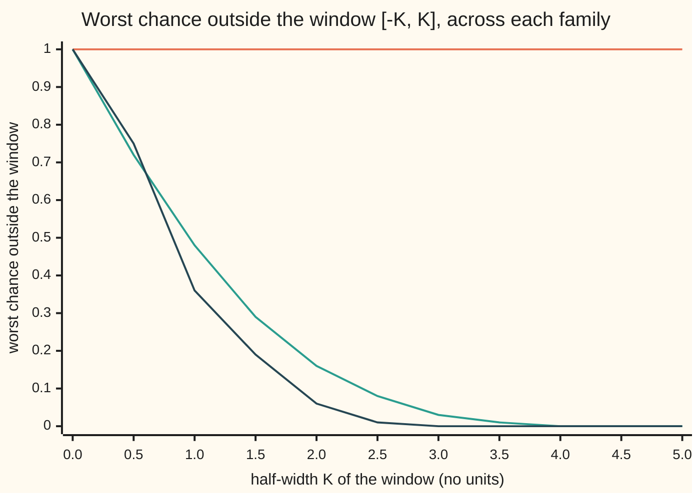

# Tightness and Prokhorov's theorem: if no mass escapes to infinity, every sequence of laws has a convergent subsequence

[Syllabus](../../../SYLLABUS.md) → [Measure and integration](../README.md) → [The Limit Theorems, Proved](../README.md#s10) → Tightness and Prokhorov's theorem

---

## General Overview

The **point mass** at n is the law that puts all its probability on the single number n. Line up the point masses at 0, 1, 2, 3, and so on. Each one is a law. But the sequence settles on nothing: the chance of landing at or below 5 is 1 for the first six and 0 for every one after. All the probability runs off to the right, and no subsequence (a selection of the laws, kept in order) has a law as its limit.

Compare the bell-curve (normal) laws centred at 0 with variances between 1 and 2. A **variance** is the average squared distance from the mean, so these bells have spreads between 1 and about 1.41. The stretch from −3 to 3 holds 0.997300 of the narrowest and 0.966105 of the widest, so at least 0.9661 of every one of them. No probability can get away. Pick any sequence of these bells and some subsequence settles on a bell.

A third family is the shelf's die: the total of n rolls of a fair die, measured from its mean 3.5n in units of its standard deviation (the square root of the variance). Call that standardised total $`Z_n`$. Its variance is 1 at every n, so [Markov and Chebyshev](../04-The%20Lebesgue%20Integral/07-markov-and-chebyshev.md) caps the chance of $`|Z_n| > K`$ at $`1/K^2`$, the same for every n. At K = 3 the cap is 0.111111; the true worst chance over the first 200 totals is 0.002888.

A family of laws is **tight** when one bounded window holds nearly all the probability of every law in it at once. Prokhorov's theorem says this is exactly what makes every sequence have a subsequence converging to a law. The shelf already used this without proof: [Characteristic functions](06-characteristic-functions.md) cites Helly's selection theorem to finish Lévy's continuity theorem. This card proves it.

**A family of laws is tight when, for every small tolerance, one bounded window holds all but that tolerance of every law in it; on the line and in d dimensions this is exactly the condition under which every sequence of the laws has a subsequence converging in distribution to a law.**

**What kind of fact this is:** two theorems, Helly's selection theorem and Prokhorov's theorem, proved on this card in Why it works for laws on the line and in d dimensions; the version on complete separable metric spaces is stated and cited, not proved.

### The picture: how much probability escapes each window



Orange: the point masses; a later one always sits wholly outside the window. Teal: the bells with variance 1 to 2, whose worst member is the variance-2 bell. Dark blue: the die totals, worst over 1 to 200 rolls. The two lower curves fall to 0, so those families are tight; the flat line never falls. Chebyshev's ceiling $`1/K^2`$ for the die reads 0.25 at K = 2, 0.11 at K = 3 and 0.04 at K = 5: higher than the truth, but falling to 0, which is all tightness asks.

---

## The formula

Notation first. A **law** on the line is a probability measure on its Borel sets: the chances a random variable gives to every set of numbers ([Distribution functions and Lebesgue-Stieltjes measures](../02-Length%20Done%20Properly/06-lebesgue-stieltjes-measures.md)). The law $`\mu`$ has distribution function $`F(x) = \mu((-\infty, x])`$, the chance of landing at or below x. A family of laws is written $`\mathcal M`$. The double arrow $`\Rightarrow`$ is read "converges in distribution to": $`F_n(x) \to F(x)`$ at every x where F does not jump, which is the same as $`\int f\,d\mu_n \to \int f\,d\mu`$ for every bounded continuous f ([Convergence in distribution](05-convergence-in-distribution.md)).

**Tightness.**

```math
\mathcal M \text{ is tight} \iff \text{for every } \varepsilon > 0 \text{ there is a } K \text{ with } \mu\big([-K, K]^d\big) \ge 1 - \varepsilon \text{ for every } \mu \in \mathcal M
```

**Read it aloud:** however small a leak ε is allowed, one box of half-width K holds all but ε of every law in the family. On the line, d = 1 and the box is the interval [−K, K].

K depends on ε only, never on the law.

**Helly's selection theorem.** For every sequence of distribution functions $`F_1, F_2, \dots`$ on the line:

```math
\text{there are } n_1 < n_2 < \cdots \text{ and a non-decreasing, right-continuous } F : \mathbb R \to [0, 1] \text{ with } F_{n_k}(x) \to F(x) \text{ wherever } F \text{ is continuous}
```

**Read it aloud:** any sequence of distribution functions has a subsequence that settles at every point where the limit does not jump.

"Right-continuous" means the value at each point equals the limit from the right. The limit F may not reach 0 on the far left or 1 on the far right; the missing amount is the escaped mass.

**Prokhorov's theorem on $`\mathbb R^d`$.**

```math
\mathcal M \text{ is tight} \iff \text{every sequence } \mu_1, \mu_2, \dots \text{ in } \mathcal M \text{ has a subsequence with } \mu_{n_k} \Rightarrow \mu \text{ for some law } \mu
```

**Read it aloud:** a family lets no mass escape exactly when every sequence drawn from it has a subsequence converging in distribution to a genuine law.

The limit need not belong to $`\mathcal M`$: the die totals converge to the bell.

| Symbol | Plain meaning | In our example | Push it up and the answer… |
| --- | --- | --- | --- |
| $`\mathcal M`$ | a family of laws | bells centred at 0 with variance 1 to 2 | a larger family is harder to keep tight |
| $`\mu_n`$, $`\mu`$, $`\nu`$ | laws: a sequence, its limit, and a limit along a subsequence | the bell with variance 1.9104 | — |
| $`F_n`$, $`F`$ | their distribution functions; Helly's limit F may lose mass | point masses: $`F_n(5) = 0`$ for n ≥ 6 | — |
| $`\varepsilon`$, $`K`$ | the allowed leak; the half-width of the box | ε = 0.033895, K = 3 for the bells | a smaller ε needs a larger K |
| $`d`$, $`[-K, K]^d`$ | the number of coordinates; the box | d = 1: the interval [−3, 3] | — |
| $`n_k`$, $`k`$ | the subsequence: the k-th law kept | $`n_1 = 65`$, $`n_2 = 109`$ | — |
| $`q`$, $`G`$ | rational points; the subsequence's limit at them | G(1) = 0.7651 | — |
| $`\sigma^2`$, $`\Phi`$ | a bell's variance; the standard bell's distribution function | Φ(2.1213) = 0.983053 | a larger variance leaks more |
| $`S_n`$, $`Z_n`$ | the total of n die rolls; its standardised form $`(S_n - 3.5n)/\sqrt{35n/12}`$ | worst $`P(\lvert Z_n\rvert > 3)`$ is 0.002888 at n = 44 | — |
| $`\varphi_n`$, $`g`$ | characteristic functions and their pointwise limit | g(t) = $`e^{-t^2/2}`$ for the die totals | — |
| $`S`$, $`\rho`$, $`X_n`$ | a complete separable metric space, its distance, and random points of it | the continuous curves on [0, 1], largest-gap distance; random curves | — |
| $`w_x(h)`$, $`\eta`$ | the modulus of continuity: the largest change of the curve x over any time gap h or less; a jump size | a tent of height 1 on [0, 2/n] has $`w(1/n) = 1`$ | a rougher curve, a larger modulus |

### When it holds

- **One K for the whole family.** Every single law on the line holds nearly all its mass in some window, so tightness is never about one law. The point masses fail because the window each needs, [−n, n], grows without limit.
- **A genuine law as the limit.** Helly's limit always exists, but without tightness it can lose mass. Half at 0 and half at n gives $`F_n(5) = 0.5`$ for every n ≥ 6, so the limit holds total mass 0.5.
- **A complete separable space for the converse.** On a general metric space, tightness still gives convergent subsequences. The way back, from convergent subsequences to tightness, needs the space complete (every Cauchy sequence, one whose terms end up arbitrarily close to each other, has a limit) and separable (a countable set comes arbitrarily close to every point).
- **Tightness of curves is more than tightness at each time.** A tent of height 1 on [0, 2/n], peaking at time 1/n, is 0 at any fixed time once n is large. The curves still do not converge to the zero curve: their largest value stays 1, and the modulus $`w(1/n)`$ stays 1.

---

## Why it works

### Step 0: monotone functions with values in [0, 1] can always be thinned to converge; only the ends can leak

A distribution function never falls and stays between 0 and 1. A bounded sequence of numbers always has a settling subsequence ([Compactness of [a, b]](../../06-Calculus%20and%20analysis/01-Limits%20and%20Continuity/09-compactness-of-closed-intervals.md)). Apply that at each rational point in turn, and a diagonal choice gives one subsequence that settles at every rational at once. Because the functions never fall, the values in between are squeezed and settle too, wherever the limit does not jump.

Nothing stops the limit from staying at 0.4 on the far left: that probability has escaped. Tightness forbids it.

### Step 1: one subsequence settles at every rational

List the rationals as $`q_1, q_2, q_3, \dots`$. The numbers $`F_n(q_1)`$ lie in [0, 1], so some subsequence of them converges. Within that subsequence, the numbers at $`q_2`$ lie in [0, 1], so a further subsequence converges there. Keep going.

Now take the first law of the first subsequence, the second of the second, the third of the third, and so on: the **diagonal**. From its j-th term on, it lies inside the j-th subsequence, so it converges at $`q_j`$. That holds for every j. Call the limit at each rational $`G(q)`$. G never falls, since every $`F_n`$ never falls.

The code runs this on bells whose variances, $`1.5 + 0.5\sin n`$, wander around [1, 2] and never settle. At the threshold 0.5 it halves [0, 1] ten times, each time keeping the half holding more of the values $`F_n(0.5)`$; then it repeats at 1 and 2. Of 20,000 laws, 230 survive, starting $`n_1 = 65`$, $`n_2 = 109`$, $`n_3 = 246`$. Their variances all lie between 1.9053 and 1.9155.

### Step 2: fill in between the rationals

Define $`F(x)`$ as the infimum (greatest lower bound) of $`G(q)`$ over rationals q above x. This F never falls and is right-continuous: pick a rational q above x with $`G(q)`$ close to $`F(x)`$; every point between x and q has F at most $`G(q)`$.

At a point x where F does not jump, pick rationals $`r < x < s`$ close to x. The functions never fall, so $`F_{n_k}(r) \le F_{n_k}(x) \le F_{n_k}(s)`$. The outer terms converge to $`G(r)`$ and $`G(s)`$, and those are squeezed between values of F just left of x and just right of it. As r and s close in on x, both ends approach $`F(x)`$, because F does not jump there. So $`F_{n_k}(x) \to F(x)`$. That is Helly's theorem.

On the wandering bells the selected limits are 0.6411, 0.7651 and 0.9263 at 0.5, 1 and 2. The bell with variance 1.9104, the middle of the surviving variances, gives 0.6412, 0.7653 and 0.9261. The halving was only ten deep, so agreement to within about 0.001 is all it can promise.

### Step 3: tightness stops the leak, so the limit is a law

Suppose the family is tight. Fix ε and its window [−K, K]. Every law in the sequence puts at most ε below −K, so $`F_{n_k}(x) \le \varepsilon`$ for every x < −K. Every law puts at least 1 − ε at or below K, so $`F_{n_k}(x) \ge 1 - \varepsilon`$ for x ≥ K. Taking limits at points where F does not jump, F stays at most ε left of −K and at least 1 − ε right of K.

As ε shrinks, F tends to 0 on the far left and 1 on the far right. So F is a genuine distribution function, it names one law μ, and $`\mu_{n_k} \Rightarrow \mu`$. That is the forward half of Prokhorov's theorem.

The wandering bells sit inside the variance-1-to-2 family, so their limit is a law. For the point masses the leak is total: $`F_n(x) \to 0`$ at every x, and Helly's limit is the zero function.

### Step 4: the converse, no tightness means some sequence has no convergent subsequence

Suppose the family is not tight. Then some leak ε defeats every window: for each n there is a law $`\mu_n`$ in the family with more than ε outside [−n, n].

Suppose some subsequence converged to a law μ with distribution function F. Choose K so large that μ puts less than ε outside (−K, K], with ±K points where F does not jump. Then the chance outside (−K, K] under $`\mu_{n_k}`$ is $`F_{n_k}(-K) + 1 - F_{n_k}(K)`$, which tends to less than ε. But once $`n_k \ge K`$, that same chance is at least the chance outside $`[-n_k, n_k]`$, which is more than ε. The two cannot both hold, so no subsequence converges.

The bells with variances 1, 10, 100 and 1,000 show the leak: [−3, 3] holds 0.9973, 0.6572, 0.2358 and 0.0756 of them. Their distribution functions tend to 1/2 at every point: half the mass escapes each way.

### Step 5: the same proof in d dimensions

The proof uses only two facts: values in [0, 1] can be thinned to converge, and a distribution function is monotone. Both survive in d coordinates.

<details>
<summary>Detailed proof: Helly and Prokhorov on R^d</summary>

**Setting.** A law μ on $`\mathbb R^d`$ has distribution function $`F(x) = \mu\big((-\infty, x_1] \times \cdots \times (-\infty, x_d]\big)`$. Write $`r < x`$ when $`r_i < x_i`$ in every coordinate. F never falls in any coordinate, and it gives every box a mass that is never negative: for the box $`(a, b]`$, the inclusion–exclusion sum of F over the $`2^d`$ corners, each corner signed by the parity of how many of its coordinates come from a, equals $`\mu((a, b]) \ge 0`$. Convergence in distribution means $`F_n(x) \to F(x)`$ at every x where F is continuous; as on the line, this is the same as averages of bounded continuous functions converging (Durrett, section 3.10).

**1. Diagonal.** The points of $`\mathbb Q^d`$ with all coordinates rational are countable. Step 1's diagonal gives a subsequence with $`F_{n_k}(q) \to G(q)`$ at every such q.

**2. Fill in.** Put $`F(x) = \inf\{G(q) : q \in \mathbb Q^d,\ q > x\}`$. F never falls in any coordinate, and it is right-continuous: a point slightly above x in every coordinate is still below each rational above x, once close enough.

**3. Convergence at continuity points.** Fix x where F is continuous and rational points $`r' < r < x < s`$, all near x. Monotonicity gives $`F_{n_k}(r) \le F_{n_k}(x) \le F_{n_k}(s)`$. In the limit, $`G(r) \ge F(r')`$, since r is a rational above r', and $`G(s) \le F(s)`$, since every rational q above s has $`G(q) \ge G(s)`$. So

$`\displaystyle F(r') \le \liminf_k F_{n_k}(x) \le \limsup_k F_{n_k}(x) \le F(s),`$

where liminf and limsup are the lowest and highest values the sequence keeps coming back to. As r′ and s close in on x, continuity makes both ends F(x).

**4. Box masses stay non-negative.** For boxes with rational corners, the corner sum of $`F_{n_k}`$ is a mass, so its limit, the corner sum of G, is never negative. F at any corner is a limit of G at rational points from above, so F's corner sums are never negative either. The Carathéodory construction that turns a distribution function into a measure on the line works the same way on boxes, giving a measure μ of total mass at most 1 with distribution function F.

**5. Tightness gives total mass 1.** If every $`\mu_n`$ puts at least 1 − ε inside $`(-K, K]^d`$, the corner sum over that box is at least 1 − ε for each $`F_{n_k}`$. Moving the corners slightly outwards to points where F is continuous, which is possible because F has continuity points arbitrarily close to any point along each axis, the limit μ also puts at least 1 − ε inside a slightly larger box. So μ has total mass 1, and $`\mu_{n_k} \Rightarrow \mu`$.

**6. Converse.** As in Step 4, with the box $`[-n, n]^d`$ in place of the interval and a limit box whose corners are continuity points.

**7. Tightness coordinate by coordinate.** The box $`[-K, K]^d`$ misses x only if some coordinate has $`|x_i| > K`$, so the chance outside the box is at most the sum of the d coordinate chances. A family on $`\mathbb R^d`$ is tight exactly when each of its d coordinate families is tight. ∎

</details>

### Step 6: finishing Lévy's continuity theorem

[Characteristic functions](06-characteristic-functions.md) proved most of the converse half of Lévy's theorem and borrowed one step. Here is the whole argument. The characteristic function of $`\mu_n`$ is $`\varphi_n(t) = \int e^{itx}\,d\mu_n(x)`$, and the hypothesis is $`\varphi_n(t) \to g(t)`$ at every t, with g continuous at 0.

1. **Tight.** That card's tail bound caps the chance outside [−2/u, 2/u] by $`\frac1u\int_{-u}^{u}(1 - \varphi_n(t))\,dt`$, twice the average of $`1 - \varphi_n`$ over [−u, u]. Continuity of g at 0 makes it small for one small u and all large n; the finitely many early laws need only their own windows.
2. **Subsequences converge.** By Prokhorov, every subsequence has a further subsequence converging in distribution to some law ν.
3. **Every limit is the same law.** Along that further subsequence, Lévy's forward half gives $`\varphi_\nu = g`$. By the uniqueness theorem (a characteristic function determines its law), all such ν are one law μ.
4. **The whole sequence converges.** If $`F_n(x)`$ failed to tend to $`F_\mu(x)`$ at some point x where $`F_\mu`$ does not jump, a subsequence would stay at least some fixed distance away. Steps 2 and 3, applied to that subsequence, give a further subsequence converging to μ, which is a contradiction. So $`\mu_n \Rightarrow \mu`$.

Move 4 is the **subsequence principle**: a sequence converges to μ when every subsequence has a further subsequence converging to μ. Tightness gives limits along subsequences; some other fact pins down which limit.

For the die totals that fact is the limit $`e^{-t^2/2}`$, which pins every subsequential limit to the bell: the second road to [The central limit theorem, proved](07-central-limit-theorem.md). Chebyshev gives the tightness more cheaply: $`P(|Z_n| > K) \le 1/K^2`$ at every n.

### Step 7: the version that functional limit theorems need

A **complete separable metric space** S, also called a Polish space, is a set with a distance ρ in which every Cauchy sequence has a limit and some countable set comes arbitrarily close to every point. A law on S is a probability measure on its Borel sets. A family is tight when for every ε there is one **compact** set (one in which every sequence has a convergent subsequence) holding at least 1 − ε of every law in it. Laws converge weakly when $`\int f\,d\mu_n \to \int f\,d\mu`$ for every bounded continuous f on S.

- **Prokhorov's theorem, general form.** On any metric space, a tight family has a weakly convergent subsequence from every sequence. On a complete separable metric space the converse holds too (Billingsley, Theorems 5.1 and 5.2).
- **Every single law is tight** there (Billingsley, Theorem 1.3).
- **The space of curves.** Take S to be the continuous functions on [0, 1] with the largest-gap distance $`\rho(x, y) = \max_t |x(t) - y(t)|`$. The modulus of continuity $`w_x(h)`$ is the largest $`|x(s) - x(t)|`$ over times s and t at most h apart. By the Arzelà–Ascoli theorem, a set of curves has compact closure exactly when the values at time 0 are bounded and the moduli shrink to 0 together as h does.

That turns into a test for random curves $`X_n`$ (Billingsley, Theorem 7.3). Their laws are tight exactly when:

```math
\text{the laws of } X_n(0) \text{ are tight, and for every } \eta > 0:\ \lim_{h \to 0}\ \limsup_{n \to \infty}\ P\big(w_{X_n}(h) > \eta\big) = 0
```

**Read it aloud:** the starting values do not escape, and for small enough time gaps, no curve far along the sequence is likely to jump by more than η inside one gap.

Donsker's theorem, planned for wing 11, uses exactly this. The scaled random walk converges at any finite set of times by the central limit theorem; tightness through the modulus of continuity upgrades that to convergence of the whole curve to Brownian motion. The tent in When it holds shows why the upgrade is needed.

---

## Worked numbers, by hand

The bells with variance between 1 and 2, the window [−3, 3].

| Step | Arithmetic | Value |
| --- | --- | --- |
| which bell leaks most | the mass in [−3, 3] falls as the variance rises | variance 2 |
| the window in standard deviations | 3 / √2 | 2.1213 |
| standard bell below that | Φ(2.1213), from a table | 0.983053 |
| mass inside [−3, 3] | 2 × 0.983053 − 1 | **0.966105** |
| window for a 0.01 leak | solve 2Φ(K/√2) − 1 = 0.99 | K = 3.6428 |
| die totals, Chebyshev at K = 3 | variance 1, so 1/3² | 0.111111 |
| die totals, exact worst at K = 3 | counted, n = 1 to 200 | 0.002888, at n = 44 |
| die totals, Chebyshev at K = 10 | 1/10² | 0.010000 |

Every bell in the family keeps at least 0.966105 inside [−3, 3]: one window, a leak of at most 0.033895 for all. Doing this for every leak is tightness.

### What breaks if you drop a piece

| Mistake | Comes out at | What went wrong |
| --- | --- | --- |
| Taking Helly's limit for the point masses as a law | $`F_n(5)`$ is 1 for n ≤ 5 and 0 from n = 6 on; the limit is 0 everywhere | all the mass escaped to the right; there is no window that holds it |
| Taking half at 0, half at n as converging to a law | $`F_n(5) = 0.5`$ for n = 6 and n = 100; the limit holds mass 0.5 | half the mass escaped; Helly's limit is not a distribution function |
| Bounding each law instead of the family | [−3, 3] holds 0.9973, 0.6572, 0.2358, 0.0756 of the bells with variance 1, 10, 100, 1,000 | each law has its own window, but no single window serves all |
| Reading Chebyshev's ceiling as the chance | 0.111111 against the true worst 0.002888 at K = 3 | the ceiling only has to fall to 0; tightness needs no sharp tail |

---

## Code, from first principles, and it actually runs

Both programs print every number on this card, by independent roads. A bell's mass in a window comes from a power series for the error function, $`\mathrm{erf}(x) = \frac{2}{\sqrt\pi}\sum_k (-1)^k x^{2k+1}/(k!\,(2k+1))`$, and from Simpson's rule on the density. The die totals' exact laws are built roll by roll and checked against Chebyshev and a direct variance. Helly's selection on 20,000 wandering bells is checked against the bell its variances settle on. The code checks chosen cases; the theorems rest on the proofs.

### Python

```python
# Tightness and Prokhorov's theorem -- the check behind the card.  Standard library
# only.  Normal chances come two ways: a power series for erf, and Simpson's rule on
# the bell-curve density.  Die totals come from the exact law, built roll by roll.
# Helly's selection is run on a real sequence of laws and checked against its limit.
from math import sin, sqrt, pi, exp

def erf(x):                                   # road 1: 2/sqrt(pi) times sum of (-1)^k x^(2k+1) / (k! (2k+1))
    term, total = x, 0.0
    for k in range(90):
        total += term / (2 * k + 1)
        term *= -x * x / (k + 1)
    return 2 / sqrt(pi) * total
def Phi(x): return 0.5 * (1 + erf(x / sqrt(2)))
def dens(x): return exp(-x * x / 2) / sqrt(2 * pi)
def simpson(f, a, b, n):                      # road 2: Simpson's rule
    h = (b - a) / n
    return (f(a) + f(b) + sum((4 if i % 2 else 2) * f(a + i * h) for i in range(1, n))) * h / 3
def inside(var, K): return 2 * Phi(K / sqrt(var)) - 1
def inside_simpson(var, K): return simpson(dens, -K / sqrt(var), K / sqrt(var), 2000)
def f4(x): return f"{x:.4f}"
def f6(x): return f"{x:.6f}"

# ---- 1. point masses at 0, 1, 2, ...: every one is a law, the family is not tight ----
Fdelta = [1.0 if 5 >= n else 0.0 for n in range(11)]            # F_n(5) = P(n <= 5)
print("point masses: F_n(5) for n = 0..10:", " ".join(f"{v:.0f}" for v in Fdelta))
worst = [max(0.0 if n <= K else 1.0 for n in range(10001)) for K in (1, 10, 100)]
print("point masses: worst mass outside [-K, K] over n <= 10000, K = 1, 10, 100:", " ".join(f"{v:.0f}" for v in worst))
mix = [0.5 + (0.5 if n <= 5 else 0.0) for n in (1, 5, 6, 100)]  # half at 0, half at n
print("half at 0, half at n: F_n(5) for n = 1, 5, 6, 100:", " ".join(f"{v:.1f}" for v in mix))

# ---- 2. normal laws with variance between 1 and 2 ----
vs = [1.0, 1.25, 1.5, 1.75, 2.0]
a, b = [inside(v, 3) for v in vs], [inside_simpson(v, 3) for v in vs]
print("normal, mass in [-3, 3], variance 1 .. 2 (series):  ", " ".join(f6(x) for x in a))
print("normal, mass in [-3, 3], variance 1 .. 2 (Simpson): ", " ".join(f6(x) for x in b))
assert max(abs(x - y) for x, y in zip(a, b)) < 1e-10                 # two roads agree
assert all(a[i] > a[i + 1] for i in range(4)) and abs(a[-1] - 0.9661) < 5e-5   # worst case is variance 2
print("normal, variance 2: K / sigma = 3 / sqrt 2 =", f4(3 / sqrt(2)), "; Phi of it =", f6(Phi(3 / sqrt(2))),
      "; leak", f6(1 - inside(2.0, 3)))
lo, hi = 0.0, 10.0                             # smallest K holding 0.99 of every law in the family
for _ in range(60):
    mid = (lo + hi) / 2
    lo, hi = (lo, mid) if inside(2.0, mid) >= 0.99 else (mid, hi)
print("normal family: smallest K with mass >= 0.99 in [-K, K] for all:", f4(hi))
wide = [inside(v, 3) for v in (1, 10, 100, 1000)]
print("normal, variance 1, 10, 100, 1000: mass in [-3, 3]:", " ".join(f4(x) for x in wide))
assert wide[3] < 0.08                          # no bound on the variance, no tightness

# ---- 3. the standardised die total Z_n = (S_n - 3.5n) / sqrt(35n/12) ----
laws = [[1.0]]
for n in range(1, 201):
    q = [0.0] * (len(laws[-1]) + 6)
    for s, p in enumerate(laws[-1]):
        for k in range(1, 7):
            q[s + k] += p / 6
    laws.append(q)
def tail(n, k2):                               # P(|Z_n| > K), with k2 = (2K)^2, by whole-number test
    return sum(p for s, p in enumerate(laws[n]) if 12 * (2 * s - 7 * n) ** 2 > 35 * n * k2)
var100 = sum(p * (s - 350) ** 2 for s, p in enumerate(laws[100])) / (100 * 35 / 12)
print("die total, variance of Z_100 from its law:", f6(var100))
for K in (2, 3):
    row = [tail(n, 4 * K * K) for n in (1, 2, 10, 100, 200)]
    print(f"die total, P(|Z_n| > {K}), n = 1, 2, 10, 100, 200:", " ".join(f6(x) for x in row), "  Chebyshev", f6(1 / K ** 2))
t3 = [tail(n, 36) for n in range(1, 201)]
m3 = max(t3)
print("die total, worst P(|Z_n| > 3) over n = 1..200:", f6(m3), "at n =", t3.index(m3) + 1)
print("die total, K = 10: Chebyshev", f6(1 / 100), "; worst exact over n = 1..200:", f6(max(tail(n, 400) for n in range(1, 201))))
print("normal tail outside [-3, 3]:", f6(1 - inside(1.0, 3)))
assert abs(var100 - 1) < 1e-9 and m3 <= 1 / 9                    # law against formula; Chebyshev holds
assert abs(t3[99] - (1 - inside(1.0, 3))) < 1e-3                 # exact law against the CLT bell

# ---- 4. the chart: worst mass outside [-K, K] across each family, K = 0, 0.5, ..., 5 ----
Ks = [k / 2 for k in range(11)]
die_worst = [max(tail(n, k * k) for n in range(1, 201)) for k in range(11)]
print("figure, K:", " ".join(f"{K:.1f}" for K in Ks))
print("figure, point masses:", " ".join("1.00" for _ in Ks))
print("figure, normal variance 2:", " ".join(f"{1 - inside(2.0, K):.2f}" for K in Ks))
print("figure, die totals n <= 200:", " ".join(f"{x:.2f}" for x in die_worst))
print("figure, Chebyshev 1/K^2:", " ".join(f"{min(1.0, 1 / K ** 2) if K else 1.0:.2f}" for K in Ks))
assert all(x <= min(1.0, 4 / k ** 2) + 1e-12 for x, k in zip(die_worst[1:], range(1, 11)))

# ---- 5. Helly's selection on variances 1.5 + 0.5 sin n, which never settle ----
N = 20000
var = {n: 1.5 + 0.5 * sin(n) for n in range(1, N + 1)}
idx, G = list(range(1, N + 1)), {}
for x in (0.5, 1.0, 2.0):                      # one threshold at a time, as in the diagonal argument
    F = {n: Phi(x / sqrt(var[n])) for n in idx}
    lo, hi = 0.0, 1.0
    for _ in range(10):                        # keep the half of [0, 1] that holds more of F_n(x)
        mid = (lo + hi) / 2
        left = [n for n in idx if F[n] <= mid]
        right = [n for n in idx if F[n] > mid]
        idx, lo, hi = (left, lo, mid) if len(left) >= len(right) else (right, mid, hi)
    G[x] = (lo + hi) / 2
print("Helly: sequence kept", len(idx), "of", N, "; first n_k:", " ".join(str(n) for n in idx[:6]))
print("Helly: variances along it:", " ".join(f4(var[n]) for n in idx[:6]))
s = (min(var[n] for n in idx) + max(var[n] for n in idx)) / 2
print("Helly: variances kept lie in", f4(min(var[n] for n in idx)), "..", f4(max(var[n] for n in idx)), "; s =", f4(s))
for x in (0.5, 1.0, 2.0):
    print(f"Helly: limit at x = {x}: selected {G[x]:.4f}   normal with variance s {Phi(x / sqrt(s)):.4f}")
    assert abs(G[x] - Phi(x / sqrt(s))) < 1 / 1024 + 1e-3        # selection against the parameter limit
print("ALL CHECKS PASS")
```

**Ran 2026-11-23 on macOS, Python 3.14.10, standard library only. All checks passed. Output, pasted from the run:**

```
point masses: F_n(5) for n = 0..10: 1 1 1 1 1 1 0 0 0 0 0
point masses: worst mass outside [-K, K] over n <= 10000, K = 1, 10, 100: 1 1 1
half at 0, half at n: F_n(5) for n = 1, 5, 6, 100: 1.0 1.0 0.5 0.5
normal, mass in [-3, 3], variance 1 .. 2 (series):   0.997300 0.992710 0.985694 0.976658 0.966105
normal, mass in [-3, 3], variance 1 .. 2 (Simpson):  0.997300 0.992710 0.985694 0.976658 0.966105
normal, variance 2: K / sigma = 3 / sqrt 2 = 2.1213 ; Phi of it = 0.983053 ; leak 0.033895
normal family: smallest K with mass >= 0.99 in [-K, K] for all: 3.6428
normal, variance 1, 10, 100, 1000: mass in [-3, 3]: 0.9973 0.6572 0.2358 0.0756
die total, variance of Z_100 from its law: 1.000000
die total, P(|Z_n| > 2), n = 1, 2, 10, 100, 200: 0.000000 0.055556 0.050496 0.043221 0.044560   Chebyshev 0.250000
die total, P(|Z_n| > 3), n = 1, 2, 10, 100, 200: 0.000000 0.000000 0.001426 0.002479 0.002640   Chebyshev 0.111111
die total, worst P(|Z_n| > 3) over n = 1..200: 0.002888 at n = 44
die total, K = 10: Chebyshev 0.010000 ; worst exact over n = 1..200: 0.000000
normal tail outside [-3, 3]: 0.002700
figure, K: 0.0 0.5 1.0 1.5 2.0 2.5 3.0 3.5 4.0 4.5 5.0
figure, point masses: 1.00 1.00 1.00 1.00 1.00 1.00 1.00 1.00 1.00 1.00 1.00
figure, normal variance 2: 1.00 0.72 0.48 0.29 0.16 0.08 0.03 0.01 0.00 0.00 0.00
figure, die totals n <= 200: 1.00 0.75 0.36 0.19 0.06 0.01 0.00 0.00 0.00 0.00 0.00
figure, Chebyshev 1/K^2: 1.00 1.00 1.00 0.44 0.25 0.16 0.11 0.08 0.06 0.05 0.04
Helly: sequence kept 230 of 20000 ; first n_k: 65 109 246 290 442 486
Helly: variances along it: 1.9134 1.9084 1.9084 1.9134 1.9109 1.9058
Helly: variances kept lie in 1.9053 .. 1.9155 ; s = 1.9104
Helly: limit at x = 0.5: selected 0.6411   normal with variance s 0.6412
Helly: limit at x = 1.0: selected 0.7651   normal with variance s 0.7653
Helly: limit at x = 2.0: selected 0.9263   normal with variance s 0.9261
ALL CHECKS PASS
```

### Rust

Same numbers, same labels, built with `rustc --edition 2021 -O`.

```rust
// Tightness and Prokhorov's theorem -- the same check as the Python, in Rust.  No
// crates.  Normal chances come two ways: a power series for erf, and Simpson's rule
// on the bell-curve density.  Die totals come from the exact law, built roll by roll.
// Helly's selection is run on a real sequence of laws and checked against its limit.
use std::f64::consts::PI;

fn erf(x: f64) -> f64 {                       // road 1: the power series, term by term
    let (mut term, mut total) = (x, 0.0);
    for k in 0..90 {
        total += term / (2 * k + 1) as f64;
        term *= -x * x / (k + 1) as f64;
    }
    2.0 / PI.sqrt() * total
}
fn phi(x: f64) -> f64 { 0.5 * (1.0 + erf(x / 2f64.sqrt())) }
fn dens(x: f64) -> f64 { (-x * x / 2.0).exp() / (2.0 * PI).sqrt() }
fn simpson(f: fn(f64) -> f64, a: f64, b: f64, n: usize) -> f64 {   // road 2: Simpson's rule
    let h = (b - a) / n as f64;
    let mut s = f(a) + f(b);
    for i in 1..n { s += if i % 2 == 1 { 4.0 } else { 2.0 } * f(a + i as f64 * h); }
    s * h / 3.0
}
fn inside(var: f64, k: f64) -> f64 { 2.0 * phi(k / var.sqrt()) - 1.0 }
fn inside_simpson(var: f64, k: f64) -> f64 { simpson(dens, -k / var.sqrt(), k / var.sqrt(), 2000) }
fn f4(x: f64) -> String { format!("{:.4}", x) }
fn f6(x: f64) -> String { format!("{:.6}", x) }
fn join(v: &[String]) -> String { v.join(" ") }

fn main() {
    // ---- 1. point masses at 0, 1, 2, ...: every one is a law, the family is not tight ----
    let fdelta: Vec<f64> = (0..11).map(|n| if 5 >= n { 1.0 } else { 0.0 }).collect();
    println!("point masses: F_n(5) for n = 0..10: {}", join(&fdelta.iter().map(|v| format!("{:.0}", v)).collect::<Vec<_>>()));
    let worst: Vec<f64> = [1, 10, 100].iter().map(|&k| (0..10001).map(|n| if n <= k { 0.0 } else { 1.0 }).fold(0.0, f64::max)).collect();
    println!("point masses: worst mass outside [-K, K] over n <= 10000, K = 1, 10, 100: {}", join(&worst.iter().map(|v| format!("{:.0}", v)).collect::<Vec<_>>()));
    let mix: Vec<String> = [1, 5, 6, 100].iter().map(|&n| format!("{:.1}", 0.5 + if n <= 5 { 0.5 } else { 0.0 })).collect();
    println!("half at 0, half at n: F_n(5) for n = 1, 5, 6, 100: {}", join(&mix));

    // ---- 2. normal laws with variance between 1 and 2 ----
    let vs = [1.0, 1.25, 1.5, 1.75, 2.0];
    let a: Vec<f64> = vs.iter().map(|&v| inside(v, 3.0)).collect();
    let b: Vec<f64> = vs.iter().map(|&v| inside_simpson(v, 3.0)).collect();
    println!("normal, mass in [-3, 3], variance 1 .. 2 (series):   {}", join(&a.iter().map(|&x| f6(x)).collect::<Vec<_>>()));
    println!("normal, mass in [-3, 3], variance 1 .. 2 (Simpson):  {}", join(&b.iter().map(|&x| f6(x)).collect::<Vec<_>>()));
    assert!(a.iter().zip(&b).map(|(x, y)| (x - y).abs()).fold(0.0, f64::max) < 1e-10);
    assert!((0..4).all(|i| a[i] > a[i + 1]) && (a[4] - 0.9661).abs() < 5e-5);
    println!("normal, variance 2: K / sigma = 3 / sqrt 2 = {} ; Phi of it = {} ; leak {}", f4(3.0 / 2f64.sqrt()),
             f6(phi(3.0 / 2f64.sqrt())), f6(1.0 - inside(2.0, 3.0)));
    let (mut lo, mut hi) = (0.0, 10.0);
    for _ in 0..60 {
        let mid = (lo + hi) / 2.0;
        if inside(2.0, mid) >= 0.99 { hi = mid } else { lo = mid }
    }
    println!("normal family: smallest K with mass >= 0.99 in [-K, K] for all: {}", f4(hi));
    let wide: Vec<f64> = [1.0, 10.0, 100.0, 1000.0].iter().map(|&v| inside(v, 3.0)).collect();
    println!("normal, variance 1, 10, 100, 1000: mass in [-3, 3]: {}", join(&wide.iter().map(|&x| f4(x)).collect::<Vec<_>>()));
    assert!(wide[3] < 0.08);

    // ---- 3. the standardised die total Z_n = (S_n - 3.5n) / sqrt(35n/12) ----
    let mut laws: Vec<Vec<f64>> = vec![vec![1.0]];
    for _ in 1..=200 {
        let last = laws.last().unwrap();
        let mut q = vec![0.0; last.len() + 6];
        for (s, &p) in last.iter().enumerate() { for k in 1..=6 { q[s + k] += p / 6.0; } }
        laws.push(q);
    }
    let tail = |n: usize, k2: i64| -> f64 {      // P(|Z_n| > K), with k2 = (2K)^2, by whole-number test
        laws[n].iter().enumerate().filter(|&(s, _)| { let d = 2 * s as i64 - 7 * n as i64; 12 * d * d > 35 * n as i64 * k2 })
            .fold(0.0, |acc, (_, &p)| acc + p)
    };
    let var100 = laws[100].iter().enumerate().fold(0.0, |acc, (s, &p)| acc + p * ((s as f64 - 350.0) * (s as f64 - 350.0))) / (100.0 * 35.0 / 12.0);
    println!("die total, variance of Z_100 from its law: {}", f6(var100));
    for k in [2i64, 3] {
        let row: Vec<String> = [1, 2, 10, 100, 200].iter().map(|&n| f6(tail(n, 4 * k * k))).collect();
        println!("die total, P(|Z_n| > {}), n = 1, 2, 10, 100, 200: {}   Chebyshev {}", k, join(&row), f6(1.0 / (k * k) as f64));
    }
    let t3: Vec<f64> = (1..=200).map(|n| tail(n, 36)).collect();
    let m3 = t3.iter().cloned().fold(0.0, f64::max);
    println!("die total, worst P(|Z_n| > 3) over n = 1..200: {} at n = {}", f6(m3), t3.iter().position(|&x| x == m3).unwrap() + 1);
    println!("die total, K = 10: Chebyshev {} ; worst exact over n = 1..200: {}", f6(1.0 / 100.0), f6((1..=200).map(|n| tail(n, 400)).fold(0.0, f64::max)));
    println!("normal tail outside [-3, 3]: {}", f6(1.0 - inside(1.0, 3.0)));
    assert!((var100 - 1.0).abs() < 1e-9 && m3 <= 1.0 / 9.0);
    assert!((t3[99] - (1.0 - inside(1.0, 3.0))).abs() < 1e-3);

    // ---- 4. the chart: worst mass outside [-K, K] across each family, K = 0, 0.5, ..., 5 ----
    let die_worst: Vec<f64> = (0..11).map(|k: i64| (1..=200).map(|n| tail(n, k * k)).fold(0.0, f64::max)).collect();
    println!("figure, K: {}", join(&(0..11).map(|k| format!("{:.1}", k as f64 / 2.0)).collect::<Vec<_>>()));
    println!("figure, point masses: {}", join(&(0..11).map(|_| "1.00".to_string()).collect::<Vec<_>>()));
    println!("figure, normal variance 2: {}", join(&(0..11).map(|k| format!("{:.2}", 1.0 - inside(2.0, k as f64 / 2.0))).collect::<Vec<_>>()));
    println!("figure, die totals n <= 200: {}", join(&die_worst.iter().map(|x| format!("{:.2}", x)).collect::<Vec<_>>()));
    println!("figure, Chebyshev 1/K^2: {}", join(&(0..11).map(|k| { let kk = k as f64 / 2.0;
        format!("{:.2}", if k == 0 { 1.0 } else { f64::min(1.0, 1.0 / (kk * kk)) }) }).collect::<Vec<_>>()));
    assert!((1..11).all(|k| die_worst[k] <= f64::min(1.0, 4.0 / (k * k) as f64) + 1e-12));

    // ---- 5. Helly's selection on variances 1.5 + 0.5 sin n, which never settle ----
    let big_n = 20000usize;
    let var: Vec<f64> = (0..=big_n).map(|n| 1.5 + 0.5 * (n as f64).sin()).collect();
    let mut idx: Vec<usize> = (1..=big_n).collect();
    let mut g = Vec::new();
    for x in [0.5, 1.0, 2.0] {                 // one threshold at a time, as in the diagonal argument
        let f: Vec<f64> = var.iter().map(|&v| phi(x / v.sqrt())).collect();
        let (mut lo, mut hi) = (0.0, 1.0);
        for _ in 0..10 {                       // keep the half of [0, 1] that holds more of F_n(x)
            let mid = (lo + hi) / 2.0;
            let left: Vec<usize> = idx.iter().cloned().filter(|&n| f[n] <= mid).collect();
            let right: Vec<usize> = idx.iter().cloned().filter(|&n| f[n] > mid).collect();
            if left.len() >= right.len() { idx = left; hi = mid } else { idx = right; lo = mid }
        }
        g.push((lo + hi) / 2.0);
    }
    println!("Helly: sequence kept {} of {} ; first n_k: {}", idx.len(), big_n, join(&idx[..6].iter().map(|n| n.to_string()).collect::<Vec<_>>()));
    println!("Helly: variances along it: {}", join(&idx[..6].iter().map(|&n| f4(var[n])).collect::<Vec<_>>()));
    let vmin = idx.iter().map(|&n| var[n]).fold(f64::MAX, f64::min);
    let vmax = idx.iter().map(|&n| var[n]).fold(f64::MIN, f64::max);
    let s = (vmin + vmax) / 2.0;
    println!("Helly: variances kept lie in {} .. {} ; s = {}", f4(vmin), f4(vmax), f4(s));
    for (i, x) in [0.5f64, 1.0, 2.0].iter().enumerate() {
        println!("Helly: limit at x = {:?}: selected {:.4}   normal with variance s {:.4}", x, g[i], phi(x / s.sqrt()));
        assert!((g[i] - phi(x / s.sqrt())).abs() < 1.0 / 1024.0 + 1e-3);
    }
    println!("ALL CHECKS PASS");
}
```

**Ran 2026-11-23 on macOS, rustc 1.98.1, no crates. All checks passed. Output, pasted from the run:**

```
point masses: F_n(5) for n = 0..10: 1 1 1 1 1 1 0 0 0 0 0
point masses: worst mass outside [-K, K] over n <= 10000, K = 1, 10, 100: 1 1 1
half at 0, half at n: F_n(5) for n = 1, 5, 6, 100: 1.0 1.0 0.5 0.5
normal, mass in [-3, 3], variance 1 .. 2 (series):   0.997300 0.992710 0.985694 0.976658 0.966105
normal, mass in [-3, 3], variance 1 .. 2 (Simpson):  0.997300 0.992710 0.985694 0.976658 0.966105
normal, variance 2: K / sigma = 3 / sqrt 2 = 2.1213 ; Phi of it = 0.983053 ; leak 0.033895
normal family: smallest K with mass >= 0.99 in [-K, K] for all: 3.6428
normal, variance 1, 10, 100, 1000: mass in [-3, 3]: 0.9973 0.6572 0.2358 0.0756
die total, variance of Z_100 from its law: 1.000000
die total, P(|Z_n| > 2), n = 1, 2, 10, 100, 200: 0.000000 0.055556 0.050496 0.043221 0.044560   Chebyshev 0.250000
die total, P(|Z_n| > 3), n = 1, 2, 10, 100, 200: 0.000000 0.000000 0.001426 0.002479 0.002640   Chebyshev 0.111111
die total, worst P(|Z_n| > 3) over n = 1..200: 0.002888 at n = 44
die total, K = 10: Chebyshev 0.010000 ; worst exact over n = 1..200: 0.000000
normal tail outside [-3, 3]: 0.002700
figure, K: 0.0 0.5 1.0 1.5 2.0 2.5 3.0 3.5 4.0 4.5 5.0
figure, point masses: 1.00 1.00 1.00 1.00 1.00 1.00 1.00 1.00 1.00 1.00 1.00
figure, normal variance 2: 1.00 0.72 0.48 0.29 0.16 0.08 0.03 0.01 0.00 0.00 0.00
figure, die totals n <= 200: 1.00 0.75 0.36 0.19 0.06 0.01 0.00 0.00 0.00 0.00 0.00
figure, Chebyshev 1/K^2: 1.00 1.00 1.00 0.44 0.25 0.16 0.11 0.08 0.06 0.05 0.04
Helly: sequence kept 230 of 20000 ; first n_k: 65 109 246 290 442 486
Helly: variances along it: 1.9134 1.9084 1.9084 1.9134 1.9109 1.9058
Helly: variances kept lie in 1.9053 .. 1.9155 ; s = 1.9104
Helly: limit at x = 0.5: selected 0.6411   normal with variance s 0.6412
Helly: limit at x = 1.0: selected 0.7651   normal with variance s 0.7653
Helly: limit at x = 2.0: selected 0.9263   normal with variance s 0.9261
ALL CHECKS PASS
```

The two outputs match line for line.

### Lean

Lean proves all three theorems: Prokhorov's on $`\mathbb R^d`$ for every d, Helly's selection, and the complete separable version.

- Take a family $`\mathcal M`$ of laws on $`\mathbb R^d`$. Then $`\mathcal M`$ is tight exactly when every sequence in it has a subsequence converging in distribution to a law.
- Take any sequence of laws on the line. Then a subsequence of their distribution functions converges wherever the limit F is continuous.
- That limit F is non-decreasing and right-continuous, with values in [0, 1].
- Take a complete separable metric space S. Then a family of laws on S is tight exactly when every sequence in it has a weakly convergent subsequence.
- The die's arithmetic holds exactly as fractions: mean 7/2 and variance 35/12.
- Chebyshev's cap $`1/K^2`$ is 1/4, 1/9 and 1/100 at K = 2, 3 and 10.
- Among the point masses at 0 to 10, exactly six have $`F_n(5) = 1`$.

The decimals, the bells, the die totals' exact laws and Helly's run on wandering bells are left to the Python and Rust checks.

```lean
-- Tightness and Prokhorov's theorem: a family of laws on R^d is tight exactly when every sequence in it has a subsequence converging in distribution to a law, with Helly's selection theorem on the line and the version on complete separable metric spaces.
import Mathlib.MeasureTheory.Measure.Prokhorov
import Mathlib.MeasureTheory.Measure.LevyProkhorovMetric
import Mathlib.Probability.CDF
import Mathlib.Topology.Instances.Real.Lemmas
import Mathlib.Analysis.SpecialFunctions.Trigonometric.Arctan

open MeasureTheory Filter Topology Set ProbabilityTheory
open scoped NNReal

theorem tp_polish_aux
    {S : Type*} [MetricSpace S] [CompleteSpace S] [TopologicalSpace.SeparableSpace S]
    [MeasurableSpace S] [BorelSpace S] (M : Set (ProbabilityMeasure S)) :
    (∀ ε : ℝ, 0 < ε → ∃ K : Set S, IsCompact K ∧ ∀ μ ∈ M, 1 - ε ≤ ((μ K : ℝ≥0) : ℝ)) ↔
      ∀ μs : ℕ → ProbabilityMeasure S, (∀ n, μs n ∈ M) →
        ∃ φ : ℕ → ℕ, StrictMono φ ∧
          ∃ μ : ProbabilityMeasure S, Tendsto (fun k => μs (φ k)) atTop (𝓝 μ) := by
  have key : ∀ (μ : ProbabilityMeasure S) (K : Set S), IsClosed K →
      ((μ : Measure S) Kᶜ).toReal = 1 - ((μ K : ℝ≥0) : ℝ) := by
    intro μ K hK
    rw [← measureReal_def, measureReal_compl hK.measurableSet, probReal_univ]
    rfl
  constructor
  · intro h μs hμs
    have hT : IsTightMeasureSet {((μ : ProbabilityMeasure S) : Measure S) | μ ∈ M} := by
      rw [isTightMeasureSet_iff_exists_isCompact_measure_compl_le]
      intro ε hε
      by_cases htop : ε = ⊤
      · exact ⟨∅, isCompact_empty, fun _ _ => by simp [htop]⟩
      obtain ⟨K, hK, hKM⟩ := h ε.toReal (ENNReal.toReal_pos hε.ne' htop)
      refine ⟨K, hK, ?_⟩
      rintro _ ⟨μ, hμ, rfl⟩
      rw [← ENNReal.toReal_le_toReal (measure_ne_top _ _) htop, key μ K hK.isClosed]
      linarith [hKM μ hμ]
    obtain ⟨μ, -, φ, hφ, hlim⟩ :=
      (isCompact_closure_of_isTightMeasureSet hT).isSeqCompact (fun n => subset_closure (hμs n))
    exact ⟨φ, hφ, μ, hlim⟩
  · intro h
    have hcl : IsCompact (closure M) := by
      let _ : MetricSpace (ProbabilityMeasure S) := TopologicalSpace.metrizableSpaceMetric _
      apply IsSeqCompact.isCompact
      intro x hx
      have : ∀ n : ℕ, ∃ y ∈ M, dist (x n) y < 1 / ((n : ℝ) + 1) := fun n =>
        Metric.mem_closure_iff.1 (hx n) _ Nat.one_div_pos_of_nat
      choose y hyM hy using this
      obtain ⟨φ, hφ, μ, hμ⟩ := h y hyM
      refine ⟨μ, mem_closure_of_tendsto hμ (Eventually.of_forall fun k => hyM _), φ, hφ, ?_⟩
      rw [tendsto_iff_dist_tendsto_zero]
      have h1 : Tendsto (fun k => 1 / ((φ k : ℝ) + 1)) atTop (𝓝 0) :=
        tendsto_one_div_add_atTop_nhds_zero_nat.comp hφ.tendsto_atTop
      have h2 : Tendsto (fun k => dist (y (φ k)) μ) atTop (𝓝 0) :=
        (tendsto_iff_dist_tendsto_zero).1 hμ
      have h3 := h1.add h2
      rw [add_zero] at h3
      refine squeeze_zero (fun _ => dist_nonneg) (fun k => ?_) h3
      exact (dist_triangle _ (y (φ k)) _).trans (add_le_add_left (hy (φ k)).le _)
    have hT := isTightMeasureSet_of_isCompact_closure hcl
    rw [isTightMeasureSet_iff_exists_isCompact_measure_compl_le] at hT
    intro ε hε
    obtain ⟨K, hK, hKM⟩ := hT (ENNReal.ofReal ε) (ENNReal.ofReal_pos.2 hε)
    refine ⟨K, hK, fun μ hμ => ?_⟩
    have := hKM _ ⟨μ, hμ, rfl⟩
    rw [← ENNReal.toReal_le_toReal (measure_ne_top _ _) ENNReal.ofReal_ne_top,
      key μ K hK.isClosed, ENNReal.toReal_ofReal hε.le] at this
    linarith

#print axioms tp_polish_aux

/-- **Prokhorov's theorem on R^d.** A family of laws on `R^d` is tight (for every leak
`ε > 0` one box `[-K, K]^d` holds at least `1 - ε` of every law in the family) exactly when
every sequence of laws from the family has a subsequence converging in distribution to some law. -/
theorem tight_iff_every_sequence_has_convergent_subsequence {d : ℕ}
    (M : Set (ProbabilityMeasure (Fin d → ℝ))) :
    (∀ ε : ℝ, 0 < ε → ∃ K : ℝ, ∀ μ ∈ M,
        1 - ε ≤ ((μ (Set.univ.pi fun _ : Fin d => Set.Icc (-K) K) : ℝ≥0) : ℝ)) ↔
      ∀ μs : ℕ → ProbabilityMeasure (Fin d → ℝ), (∀ n, μs n ∈ M) →
        ∃ φ : ℕ → ℕ, StrictMono φ ∧
          ∃ μ : ProbabilityMeasure (Fin d → ℝ), Tendsto (fun k => μs (φ k)) atTop (𝓝 μ) := by
  rw [← tp_polish_aux M]
  constructor
  · intro h ε hε
    obtain ⟨K, hK⟩ := h ε hε
    exact ⟨_, isCompact_univ_pi fun _ => isCompact_Icc, hK⟩
  · intro h ε hε
    obtain ⟨K, hK, hKM⟩ := h ε hε
    obtain ⟨R, hR⟩ := hK.isBounded.subset_closedBall 0
    refine ⟨R, fun μ hμ => (hKM μ hμ).trans ?_⟩
    refine NNReal.coe_le_coe.2 (μ.apply_mono fun x hx => ?_)
    have hx' : ‖x‖ ≤ R := mem_closedBall_zero_iff.1 (hR hx)
    refine Set.mem_univ_pi.2 fun i => ?_
    have := (norm_le_pi_norm x i).trans hx'
    rw [Real.norm_eq_abs] at this
    exact abs_le.1 this

/-- **Helly's selection theorem.** Every sequence of distribution functions on the line has a
subsequence that converges, at every point where the limit is continuous, to a non-decreasing,
right-continuous function `F` with values in `[0, 1]` (which may lose mass at the ends). -/
theorem helly_selection (μ : ℕ → ProbabilityMeasure ℝ) :
    ∃ φ : ℕ → ℕ, StrictMono φ ∧ ∃ F : StieltjesFunction ℝ,
      (∀ x, F x ∈ Set.Icc (0 : ℝ) 1) ∧
      ∀ x, ContinuousAt F x →
        Tendsto (fun k => cdf (μ (φ k) : Measure ℝ) x) atTop (𝓝 (F x)) := by
  set ν : ℕ → ProbabilityMeasure ℝ := fun n => (μ n).map Real.arctan with hν
  have hpre : ∀ a : ℝ, Real.arctan ⁻¹' Iic (Real.arctan a) = Iic a := by
    intro a; ext y; simp [Real.arctan_strictMono.le_iff_le]
  have hM : ∀ ε : ℝ, 0 < ε → ∃ K : Set ℝ, IsCompact K ∧
      ∀ ρ ∈ range ν, 1 - ε ≤ ((ρ K : ℝ≥0) : ℝ) := by
    intro ε hε
    refine ⟨Icc (-(Real.pi / 2)) (Real.pi / 2), isCompact_Icc, ?_⟩
    rintro _ ⟨n, rfl⟩
    have : ν n (Icc (-(Real.pi / 2)) (Real.pi / 2)) = 1 := by
      rw [hν, ProbabilityMeasure.map_apply _ Real.continuous_arctan.aemeasurable
        measurableSet_Icc]
      have : Real.arctan ⁻¹' Icc (-(Real.pi / 2)) (Real.pi / 2) = univ := by
        ext y
        simp only [mem_preimage, mem_Icc, mem_univ, iff_true]
        exact ⟨(Real.neg_pi_div_two_lt_arctan y).le, (Real.arctan_lt_pi_div_two y).le⟩
      rw [this, ProbabilityMeasure.coeFn_univ]
    rw [this]
    simp
    linarith
  obtain ⟨φ, hφ, ρ, hρ⟩ := (tp_polish_aux (range ν)).1 hM ν (fun n => mem_range_self n)
  let F : StieltjesFunction ℝ :=
    { toFun := fun x => cdf (ρ : Measure ℝ) (Real.arctan x)
      mono' := (cdf (ρ : Measure ℝ)).mono.comp Real.arctan_strictMono.monotone
      right_continuous' := fun x =>
        ((cdf (ρ : Measure ℝ)).right_continuous _).comp
          Real.continuous_arctan.continuousWithinAt
          (fun y hy => Real.arctan_strictMono.monotone hy) }
  have hF : ∀ x, F x = cdf (ρ : Measure ℝ) (Real.arctan x) := fun x => rfl
  refine ⟨φ, hφ, F, fun x => ⟨by rw [hF]; exact cdf_nonneg _ _, by rw [hF]; exact cdf_le_one _ _⟩,
    fun x hx => ?_⟩
  set a := Real.arctan x with ha
  -- continuity of the cdf of ρ at a
  have hcont : ContinuousAt (cdf (ρ : Measure ℝ)) a := by
    have htan : ContinuousAt Real.tan a :=
      Real.continuousOn_tan_Ioo.continuousAt (Ioo_mem_nhds (Real.neg_pi_div_two_lt_arctan x)
        (Real.arctan_lt_pi_div_two x))
    have h1 : ContinuousAt (F ∘ Real.tan) a :=
      ContinuousAt.comp_of_eq hx htan (by rw [ha, Real.tan_arctan])
    refine h1.congr ?_
    filter_upwards [Ioo_mem_nhds (Real.neg_pi_div_two_lt_arctan x)
      (Real.arctan_lt_pi_div_two x)] with y hy
    simp only [Function.comp_apply, hF]
    rw [Real.arctan_tan hy.1 hy.2]
  have hnull : (ρ : Measure ℝ) {a} = 0 := by
    have hm := (cdf (ρ : Measure ℝ)).measure_singleton a
    rw [measure_cdf, hcont.continuousWithinAt.leftLim_eq] at hm
    simpa using hm
  have hfr : ρ (frontier (Iic a)) = 0 := by
    rw [frontier_Iic]
    have : ((ρ {a} : ℝ≥0) : ENNReal) = 0 := by
      rw [ProbabilityMeasure.ennreal_coeFn_eq_coeFn_toMeasure]; exact hnull
    exact_mod_cast this
  have hlim := NNReal.tendsto_coe.2
    (ProbabilityMeasure.tendsto_measure_of_null_frontier_of_tendsto hρ hfr)
  have hcdf : ∀ (P : ProbabilityMeasure ℝ) (b : ℝ),
      cdf (P : Measure ℝ) b = ((P (Iic b) : ℝ≥0) : ℝ) := fun P b => by
    rw [cdf_eq_real]; rfl
  rw [hF, hcdf]
  refine hlim.congr fun k => ?_
  simp only [hν]
  rw [ProbabilityMeasure.map_apply _ Real.continuous_arctan.aemeasurable measurableSet_Iic,
    ha, hpre, hcdf]

/-- **Prokhorov's theorem on a complete separable metric space.** A family of laws is tight
(for every `ε > 0` one compact set holds at least `1 - ε` of every law in it) exactly when
every sequence of laws from it has a weakly convergent subsequence. -/
theorem polish_tight_iff_every_sequence_has_convergent_subsequence
    {S : Type*} [MetricSpace S] [CompleteSpace S] [TopologicalSpace.SeparableSpace S]
    [MeasurableSpace S] [BorelSpace S] (M : Set (ProbabilityMeasure S)) :
    (∀ ε : ℝ, 0 < ε → ∃ K : Set S, IsCompact K ∧ ∀ μ ∈ M, 1 - ε ≤ ((μ K : ℝ≥0) : ℝ)) ↔
      ∀ μs : ℕ → ProbabilityMeasure S, (∀ n, μs n ∈ M) →
        ∃ φ : ℕ → ℕ, StrictMono φ ∧
          ∃ μ : ProbabilityMeasure S, Tendsto (fun k => μs (φ k)) atTop (𝓝 μ) := by
  exact tp_polish_aux M

-- The fair die (faces 1 to 6): mean 7/2 and variance 35/12, used to standardise the die totals.
example : (∑ k ∈ Finset.range 6, ((k : ℚ) + 1)) / 6 = 7 / 2 := by
  norm_num [Finset.sum_range_succ]
example : (∑ k ∈ Finset.range 6, ((k : ℚ) + 1 - 7 / 2) ^ 2) / 6 = 35 / 12 := by
  norm_num [Finset.sum_range_succ]

-- Chebyshev's cap 1/K^2 on P(|Z_n| > K) at K = 2, 3 and 10.
example : (1 : ℚ) / 2 ^ 2 = 1 / 4 ∧ (1 : ℚ) / 3 ^ 2 = 1 / 9 ∧ (1 : ℚ) / 10 ^ 2 = 1 / 100 := by
  norm_num

-- Point masses at 0, 1, 2, ...: F_n(5) = 1 exactly for the six laws n = 0, ..., 5.
example : ((Finset.range 11).filter (fun n => n ≤ 5)).card = 6 := by decide

#print axioms tight_iff_every_sequence_has_convergent_subsequence
#print axioms helly_selection
#print axioms polish_tight_iff_every_sequence_has_convergent_subsequence
```

**Checked 2026-11-23 on macOS, Lean 4.36.0-rc2, Mathlib v4.36.0-rc2. Every proof is complete and uses only Lean's standard axioms. Output, pasted from the run:**

```
'tp_polish_aux' depends on axioms: [propext, Classical.choice, Quot.sound]
'tight_iff_every_sequence_has_convergent_subsequence' depends on axioms: [propext, Classical.choice, Quot.sound]
'helly_selection' depends on axioms: [propext, Classical.choice, Quot.sound]
'polish_tight_iff_every_sequence_has_convergent_subsequence' depends on axioms: [propext, Classical.choice, Quot.sound]
```

> [!TIP]
> **Try changing**
> - **Widen the family.** Guess first: what happens to the worst mass in [−3, 3] if the variances run up to 4? Change the last entry of `vs` to `4.0`. The worst bell now keeps 2Φ(1.5) − 1, about 0.87, and the assert pinned to 0.9661 stops the run. The family is still tight: a wider window, about [−5.2, 5.2] for a 0.01 leak, holds every member.
> - **Let the variance run free.** Guess first: what does [−3, 3] hold of the bell with variance 10,000? Add `10000` to the `wide` list: about 0.024. With no upper bound on the variance, no window survives.
> - **A shallower selection.** Guess first: what does Helly's selection keep with 5 halvings instead of 10? Change `range(10)` to `range(5)` in the halving loop. Now 7,381 laws survive, their variances spread from 1.70 to 2.00, and the first selected limit misses the bell's by about 0.003, so the final assert stops the run: five halvings have not yet settled the subsequence.

---

## The usual mistake

> [!warning]
> **Checking each law instead of the whole family.** Every single law on the line is tight by itself: the point mass at n holds all its probability in [−n, n]. Tightness asks for one window for the whole family, chosen before the law is named. The point masses need a window that grows with n, so the worst chance outside any fixed window stays 1, and no subsequence converges to a law.
>
> Smaller traps:
> - **Taking Helly's limit for a law.** For half at 0 and half at n, $`F_n(5) = 0.5`$ from n = 6 on; the limit has total mass 0.5, not 1.
> - **Trusting a shared mean.** The bells with variances 1, 10, 100 and 1,000 all have mean 0, yet [−3, 3] holds only 0.0756 of the last. A bound on the means and the variances across the family (here mean 0, variance at most 2) is what gives tightness, by Chebyshev.
> - **Testing random curves only at fixed times.** The moving tent is 0 at every fixed time in the limit, yet never close to the zero curve; tightness on the space of curves needs the modulus of continuity.

---

## Where you meet it in real life

- **Proving limit theorems.** Most proofs that laws converge run: show tightness, take limits along subsequences, identify the limit, as in Step 6.
- **Random curves and Donsker's theorem.** Pricing, queueing and statistics use limits of whole random paths: a scaled random walk becomes Brownian motion ([Brownian motion](../../11-Stochastic%20processes%20and%20calculus/05-Brownian%20Motion/01-brownian-motion.md)). Tightness of curves makes those limits more than statements about finitely many times.
- **Statistics with growing data.** Estimators whose errors, scaled by √n, have bounded mean and variance are tight by Chebyshev ("bounded in probability"), checked before asking which bell they approach.
- **Markov chains in simulation.** For a chain whose next step depends continuously on its current state, time-averaged laws that stay tight have a limit along a subsequence, and that limit is a stationary law: a law the chain does not change. Tightness is how such laws are shown to exist.

> **Say it back**
> A family of laws is tight when one window, chosen for a given leak, holds all but that leak of every law in it. Helly's theorem: any sequence of distribution functions has a subsequence that settles, found by a diagonal choice over the rationals. Without tightness the limit can lose mass, as the point masses at 0, 1, 2, … lose all of theirs. Prokhorov's theorem says tightness is exactly what makes every sequence have a subsequence converging to a law. With uniqueness of characteristic functions, it finishes Lévy's continuity theorem, and on the space of curves it is the step Donsker's theorem needs.

---

## What this builds on

- [Convergence in distribution](05-convergence-in-distribution.md): the double arrow, continuity points, and the equivalence with averages of bounded continuous functions.
- [Characteristic functions](06-characteristic-functions.md): the tail bound, the forward half of Lévy's theorem and uniqueness, which Step 6 combines with Prokhorov.
- [The central limit theorem, proved](07-central-limit-theorem.md): the die totals' limit, which Step 6 reaches by the characteristic-function road.
- [Markov and Chebyshev](../04-The%20Lebesgue%20Integral/07-markov-and-chebyshev.md): the ceiling $`1/K^2`$ that makes the die totals tight.
- [Distribution functions and Lebesgue-Stieltjes measures](../02-Length%20Done%20Properly/06-lebesgue-stieltjes-measures.md): why Helly's limit, once it reaches 0 and 1, names exactly one law.
- [Compactness of [a, b]](../../06-Calculus%20and%20analysis/01-Limits%20and%20Continuity/09-compactness-of-closed-intervals.md): every bounded sequence has a settling subsequence, the engine of the diagonal argument.

## Where this goes next

- [Brownian motion](../../11-Stochastic%20processes%20and%20calculus/05-Brownian%20Motion/01-brownian-motion.md): the scaled walk's limit, where Donsker's theorem uses tightness through the modulus of continuity.
- [Compactness three ways](../../17-Topology/01-Metric%20Spaces/06-compactness-in-metric-spaces.md): compact sets in metric spaces, the setting of Prokhorov's general form.
- [Arzela-Ascoli](../../17-Topology/01-Metric%20Spaces/09-arzela-ascoli.md): which sets of curves are compact, the source of the modulus-of-continuity test.

This card proved the converse of Prokhorov's theorem on the line and in d dimensions only; why completeness and separability are what the converse needs on a general metric space is left open here.

---

## Sources

Verified 2026-11-23: every link below resolves to the publisher's page.

- Durrett, Rick. *Probability: Theory and Examples*, 5th ed. Cambridge University Press, 2019. [doi:10.1017/9781108591034](https://doi.org/10.1017/9781108591034). Section 3.2: Helly's selection theorem, tightness and the converse on the line; section 3.10: the same in d dimensions.
- Billingsley, Patrick. *Convergence of Probability Measures*, 2nd ed. Wiley, 1999. [doi:10.1002/9780470316962](https://doi.org/10.1002/9780470316962). Sections 1, 5 and 7: single laws are tight, Prokhorov's theorem both ways, and tightness of curves by the modulus of continuity.
- Klenke, Achim. *Probability Theory: A Comprehensive Course*, 3rd ed. Springer, 2020. [doi:10.1007/978-3-030-56402-5](https://doi.org/10.1007/978-3-030-56402-5). Chapter 13: tightness, Helly and Prokhorov in a modern treatment.
- Prokhorov, Yu. V. "Convergence of Random Processes and Limit Theorems in Probability Theory." *Theory of Probability and Its Applications* 1 (1956): 157–214. [doi:10.1137/1101016](https://doi.org/10.1137/1101016). The original paper.
