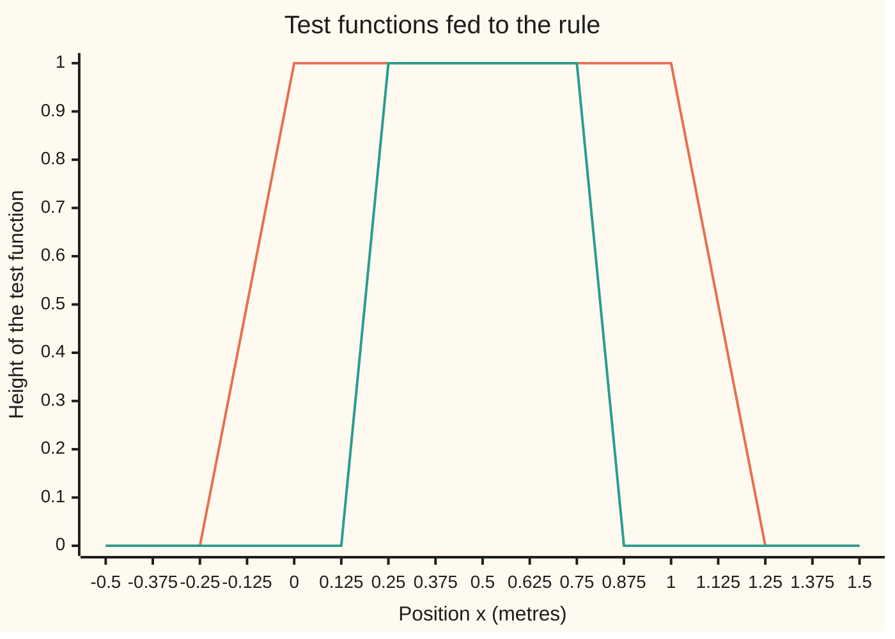
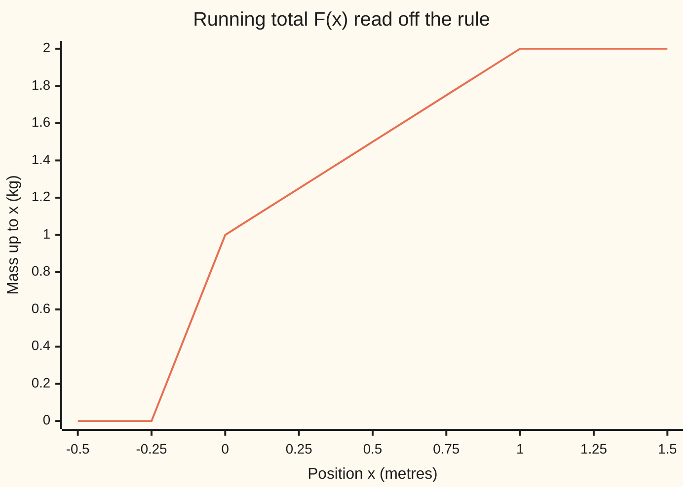

# Radon measures and the Riesz representation theorem: every positive linear rule on continuous functions is an integral against exactly one measure

[Syllabus](../../../SYLLABUS.md) → [Measure and integration](../README.md) → [Derivatives Meet the Lebesgue Integral](../README.md#s11) → Radon measures and the Riesz representation theorem

---

## General Overview

A steel rod is 1 metre long and weighs 1 kg per metre. A 1 kg clamp is bolted to its left end, at position 0. Lift the rod so that the point at position x sits f(x) metres above the floor, with f continuous. Its potential energy is gravity times the sum of height times mass: the clamp's f(0) plus the area under f from 0 to 1.

Call that sum the rule Λ (capital lambda): $`\Lambda(f) = f(0) + \int_0^1 f(x)\,dx`$, in kilogram-metres. It takes a function and returns one number. It is **linear**: doubling f doubles the answer, and adding two functions adds the answers. It is **positive**: a function that is never negative gets an answer that is never negative.

Now hide the rod and keep only the rule, as a black box. Feed it **tents**, functions equal to 1 on [0, 1] that fall to 0 just outside. Every tent returns exactly 2. Feed it **bumps**, functions that rise to 1 strictly inside (0, 1) and vanish near the ends. They return 0.25, 0.625, 0.97, 0.997, and never more than 1. So the closed stretch [0, 1] weighs 2 and the open stretch (0, 1) weighs 1. The missing 1 sits on the end points, and spikes at 0 show it sits at 0. The rule alone has rebuilt the rod: a point mass of 1 at 0 plus length on [0, 1].

The Riesz representation theorem says this always works, on the line and in every dimension, and only one measure of the right kind, a **Radon measure**, does it.

**Every positive linear rule on continuous functions with bounded support is the integral against exactly one Radon measure, read off by fitting functions inside open sets and laying them over compact ones; every bounded linear rule on continuous functions that fade at infinity is the integral against one finite signed measure, with norm equal to its total variation.**

**What kind of fact this is:** a theorem, proved on this card in Why it works (the construction in folds); the statement about bounded rules on functions that fade at infinity is proved in outline in a fold.

### The picture: a tent over [0, 1] and a bump inside it



First line (orange): a tent, 1 on [0, 1], falling to 0 a quarter metre outside; the rule gives it 1 + 1 = 2. Second line (green): a bump, 0 outside (0.125, 0.875) and 1 on [0.25, 0.75]; the rule gives it 0 + 0.625.

---

## The formula

Notation first, in words.

- $`\mathbb{R}^n`$ is n-dimensional space: the line for n = 1, the plane for n = 2.
- A set is **compact** when it is closed and bounded, like [0, 1] ([Compactness of [a, b]](../../06-Calculus%20and%20analysis/01-Limits%20and%20Continuity/09-compactness-of-closed-intervals.md)). Its key property: every cover by open sets has a finite sub-cover.
- The **support** of f, $`\mathrm{supp}\, f`$, is the closure of the set where f is not 0.
- $`C_c(\mathbb{R}^n)`$ is the continuous functions with compact support. These are the **test functions**.
- $`C_0(\mathbb{R}^n)`$ is the continuous functions that fade to 0 far out, sized by their largest absolute value $`\lVert f\rVert_\infty`$.
- A Borel measure is a measure defined on the Borel sets, the sets built from open sets by countable unions, intersections and complements.

**Radon measure.** A Borel measure μ on $`\mathbb{R}^n`$ is **Radon** when it has three properties:

1. **Finite on compact sets:** $`\mu(K) < \infty`$ for every compact K.
2. **Outer regular:** every Borel set E is weighed from outside by open sets, $`\mu(E) = \inf\{\mu(U) : U \supseteq E,\ U \text{ open}\}`$.
3. **Inner regular on open sets:** every open set U is weighed from inside by compact sets, $`\mu(U) = \sup\{\mu(K) : K \subseteq U,\ K \text{ compact}\}`$.

**The theorem.** Let Λ be a positive linear functional on $`C_c(\mathbb{R}^n)`$: a linear rule with $`\Lambda f \ge 0`$ whenever $`f \ge 0`$. Then exactly one Radon measure μ satisfies

```math
\Lambda f = \int_{\mathbb{R}^n} f\,d\mu \quad \text{for every } f \in C_c(\mathbb{R}^n).
```

**Read it aloud:** whatever the rule does to a test function, integrating that function against μ does the same.

**How μ is read off the rule.** Open sets are weighed from inside, compact sets from outside:

```math
\mu(U) = \sup\{\Lambda f : 0 \le f \le 1,\ \mathrm{supp}\, f \subseteq U\}, \qquad \mu(K) = \inf\{\Lambda f : f \in C_c(\mathbb{R}^n),\ f \ge 0,\ f \ge 1 \text{ on } K\}.
```

**Read it aloud:** an open set weighs the most the rule gives a function under height 1 that fits inside it; a compact set, the least it gives a function that is never negative and at least 1 on it.

**The bounded version.** A linear rule Λ on $`C_0(\mathbb{R}^n)`$ is **bounded** when its norm $`\lVert\Lambda\rVert = \sup\{\lvert\Lambda f\rvert : \lVert f\rVert_\infty \le 1\}`$ is finite. Every bounded rule is the integral against exactly one finite signed Radon measure μ (complex, for complex functions), and

```math
\lVert\Lambda\rVert = \lvert\mu\rvert(\mathbb{R}^n).
```

**Read it aloud:** the largest the rule can return on a function of size at most 1 is the total variation of μ, its positive mass plus its negative mass ([Complex measures](../08-Densities%20and%20Changing%20Measure/07-complex-measures-and-total-variation.md)).

On the rod: μ = δ₀ + λ on [0, 1], where δ₀ is a point mass of 1 at 0 and λ is length. So μ([0, 1]) = 2, μ((0, 1)) = 1, μ({0}) = 1 and ‖Λ‖ = μ(ℝ) = 2.

| Symbol | Plain meaning | In our example | Push it up and the answer… |
| --- | --- | --- | --- |
| Λ, Λ_s | a positive linear rule; a linear rule that is not positive | f(0) + area over [0, 1]; f(0) − area | a heavier rule gives heavier sets |
| Λ⁺, Λ⁻, h | positive and negative parts of a bounded rule; the sign of μ, +1 or −1 | the clamp's f(0); the rod's area; +1 at 0, −1 on (0, 1] | a larger part, a larger norm ‖Λ‖ |
| f, g, φ, φᵢ, hᵢ | test functions; φ ≥ 0, and φ ≥ 1 on a compact set (φᵢ on Kᵢ); the hᵢ, a partition of unity | tents, bumps, spikes, 1 − x² on [−1, 1] | a larger f gives a larger Λf |
| $`C_c(\mathbb{R}^n)`$, $`C_0(\mathbb{R}^n)`$, supp f | continuous with compact support; continuous and fading at infinity; closure of where f ≠ 0 | tents lie in both; [−0.25, 1.25] for the chart's tent | — |
| μ, ν, δ₀, λ | Radon measures (ν a second candidate); point mass 1 at 0; length | μ = δ₀ + λ on [0, 1]: 1 kg clamp, 1 kg per metre | a heavier clamp: μ({0}) grows |
| U, K, E; Uᵢ, Kᵢ, m | open, compact, any Borel set; in the subadditivity fold, the open sets of a union, compact sets inside them, and their number | (0, 1); [0, 1]; {0} | larger sets weigh more |
| k, d, e | sharpness index (ramps of width 1/k); ramp width in the code; width in the norm test | k = 8; d = 0.0001; e = 0.01 | thinner ramps, sharper estimates |
| F(x) | running total μ((−∞, x]) on the line | 0, then 1 + x on [0, 1], then 2 | a steeper F, more mass there; a jump is a point mass |
| t, N, M, j, $`f_j`$, $`K_j`$ | a height level; number of layers (M in the code); layer index; layer j of f; where f reaches j/N | f > t is (−√(1−t), √(1−t)); M = 200 | more layers, tighter squeeze |
| ‖f‖∞, ‖Λ‖, \|μ\|, μ⁺, μ⁻ | largest absolute value; norm of a rule; total variation; positive and negative parts of a signed μ | 1; 2; 2; for Λ_s, δ₀ and length on (0, 1] | a larger ‖f‖∞, a larger bound Λ(φ)‖f‖∞ |
| n, x, R, ε, c | dimension (in the code, Stieltjes pieces); a point; plateau half-width; a small tolerance; a level just below 1 | n = 1 (code: 300); x in metres; R = 10 | a wider plateau gets more from length: 2R + 1 |

### When it holds

- **The rule must be positive.** Λ_s f = f(0) − ∫₀¹ f is linear but not positive. The open-set formula gives (0, 1) the weight 0, since every bump inside returns a negative number. The true signed weight is −1. Signed rules need the bounded version, which splits them first.
- **The space needs test functions.** In $`\mathbb{R}^n`$ tents exist by a formula (Step 1). In an infinite-dimensional space such as the sequences of finite square sum, a compact set contains no ball, so the only test function is 0 and the theorem says nothing.
- **Uniqueness needs the regularity.** On $`\mathbb{R}^n`$ every Borel measure finite on compact sets is automatically Radon (Folland, Theorem 7.8). On some larger spaces, two different measures give every test function the same integral, and regularity picks out one.
- **The bounded version needs a bounded rule, and gives a finite measure.** Length, ∫ f dx, is positive on $`C_c(\mathbb{R})`$, but plateaus of height 1 over [−R, R] get 21 at R = 10 and 201 at R = 100. It is a Radon measure of infinite total mass, and no bounded rule on $`C_0(\mathbb{R})`$.

---

## Why it works

### Step 0: weigh from inside and from outside, and let positivity squeeze

A positive rule is a weighing machine that only accepts smooth loads. To weigh an open set, slide test functions inside it: each gives a lower bound. To weigh a compact set, lay a test function over it: each gives an upper bound. Positivity makes both bounds honest: if f ≤ g then Λf ≤ Λg, because g − f ≥ 0.

The construction defines μ by these two limits, then proves that μ is a measure and that integrating against it returns Λ.


### Step 1: positivity gives control for free

Let K be compact and φ ≥ 0 a test function with φ ≥ 1 on K. If supp f lies in K, then $`\varphi\lVert f\rVert_\infty - f \ge 0`$ and $`\varphi\lVert f\rVert_\infty + f \ge 0`$. Apply Λ to both:

```math
\lvert\Lambda f\rvert \le \Lambda(\varphi)\,\lVert f\rVert_\infty .
```

On the rod, take K = [−1, 1] and φ = 1 on K, falling to 0 one metre outside: Λφ = 1 + 1 = 2. For f(x) = 1 − x² on [−1, 1], Λf = 1.667, below 2 × 1. Positivity supplied the continuity.

The functions φ exist in $`\mathbb{R}^n`$ by a formula. For K compact inside U open, the gap between K and the outside of U is a positive distance, because K is compact. Take d smaller than that gap: $`\varphi(x) = \max(0, 1 - \mathrm{dist}(x, K)/d)`$ is continuous, 1 on K, and has support inside U. This is the explicit form of Urysohn's lemma.

### Step 2: the open-set formula gives an outer measure

Define μ(U) by the sup over functions inside U. For any set E, define μ(E) as the inf of μ(U) over open U containing E. The result is an **outer measure** ([Outer measure](../02-Length%20Done%20Properly/01-lebesgue-outer-measure.md)): it never shrinks when the set grows, and it is **countably subadditive**, so the weight of a union is at most the sum of the weights.

Compactness enters here. A function inside a union of open sets has compact support, so finitely many of the sets cover it, and a **partition of unity** (test functions adding to 1 on that support, each inside one set) cuts it into pieces, one per set.

<details>
<summary>Detailed proof: countable subadditivity, and every Borel set passes Carathéodory's test</summary>

**Subadditivity.** Let U be the union of open sets $`U_1, U_2, \dots`$ and let f be a test function inside U with 0 ≤ f ≤ 1. Its support K is compact, so $`K \subseteq U_1 \cup \dots \cup U_m`$ for some m. Choose compact sets $`K_i \subseteq U_i`$ that still cover K, and Step 1's tents $`\varphi_i`$, 1 on $`K_i`$ and living in $`U_i`$. Set $`h_1 = \varphi_1`$ and $`h_i = \varphi_i (1 - \varphi_1) \cdots (1 - \varphi_{i-1})`$ after clipping each φ to [0, 1]. The $`h_i`$ are test functions living in $`U_i`$, never negative, and they add to $`1 - (1 - \varphi_1)\cdots(1 - \varphi_m)`$, which is 1 on K.

So $`f = \sum f h_i`$ and $`\Lambda f = \sum \Lambda(f h_i) \le \sum \mu(U_i)`$, since each $`f h_i`$ lies inside $`U_i`$ under height 1. Taking the sup over f gives $`\mu(U) \le \sum \mu(U_i)`$. For general sets, cover each by an open set within $`\varepsilon/2^i`$ of its weight and add.

**Open sets pass the test.** Carathéodory's test asks that a set V split every test set E with no loss ([Caratheodory's criterion](../02-Length%20Done%20Properly/02-caratheodory-measurable-sets.md)). Let V and E be open, with μ(E) finite. Pick f inside E ∩ V with $`\Lambda f > \mu(E \cap V) - \varepsilon`$. The set $`E \setminus \mathrm{supp}\, f`$ is open, so pick g inside it with $`\Lambda g > \mu(E \setminus \mathrm{supp}\, f) - \varepsilon`$. Then f + g lies inside E under height 1, so

$`\displaystyle \mu(E) \ge \Lambda f + \Lambda g > \mu(E \cap V) + \mu(E \setminus V) - 2\varepsilon,`$

using $`E \setminus V \subseteq E \setminus \mathrm{supp}\, f`$. For a general E, apply this to open sets around E and use the definition by inf. So every open set is Carathéodory-measurable. Those sets form a sigma-algebra, which therefore holds every Borel set, and μ is countably additive on it.

</details>

### Step 3: the result is a Radon measure

- **Outer regular:** by definition, μ(E) is an inf over open sets.
- **Compact sets:** $`\mu(K) = \inf\{\Lambda f : f \ge 0,\ f \ge 1 \text{ on } K\}`$. If f ≥ 0 and f ≥ 1 on K, then for any c < 1 the set {f > c} is open and holds K, and every function inside it under height 1 lies below f/c; so μ(K) ≤ Λf/c. In the other direction, tents φ from Step 1 that live inside any open U around K give Λφ ≤ μ(U).
- **Finite on compact sets:** μ(K) ≤ Λφ for a single tent φ, a finite number.
- **Inner regular on open sets:** a function f inside U, under height 1, has compact support K inside U. Every φ ≥ 0 that is at least 1 on K lies above f, so Λf ≤ Λφ, and the compact-set formula gives Λf ≤ μ(K). So μ(U), the sup of Λf, is at most the sup of μ(K).

On the rod the formulas give μ([0, 1]) = 2 from tents and μ({0}) = 1 from spikes: spikes of half-width 1/k at 0 return 1 + 1/(2k), which is 1.125 at k = 4 and 1.005 at k = 100.

### Step 4: slicing f into thin layers gives Λf = ∫ f dμ

Take a test function with 0 ≤ f ≤ 1 (others follow by scaling and by splitting f into its positive and negative parts). Cut its height into N layers. Layer j is

```math
f_j = \min\!\Big(\max\big(f - \tfrac{j-1}{N},\, 0\big),\, \tfrac{1}{N}\Big), \qquad K_j = \{f \ge j/N\} \ (j \ge 1), \qquad K_0 = \mathrm{supp}\, f.
```

**Read it aloud:** layer j is the slice of f between heights (j − 1)/N and j/N, and $`K_j`$ is where f reaches the top of that slice; $`K_0`$ is the support of f.

The layers add up to f. Layer j is a full 1/N over $`K_j`$ and 0 off $`K_{j-1}`$. So the Step 3 formulas squeeze both Λ of the layer and its integral between $`\mu(K_j)/N`$ and $`\mu(K_{j-1})/N`$. Summing, Λf and ∫ f dμ sit in the same interval, of width $`(\mu(K_0) - \mu(K_N))/N \le \mu(\mathrm{supp}\, f)/N`$. Let N grow: they are equal.

On the rod with f(x) = 1 − x² on [−1, 1], the set {f > t} is the open interval (−√(1 − t), √(1 − t)). Its weight, read off by bumps alone, is 1 + √(1 − t), the clamp plus the part of the interval inside [0, 1]. Averaging over 200 levels of t, as [The layer-cake formula](../06-Product%20Measures%20and%20Fubini/06-layer-cake-and-tail-integrals.md) does, gives 1.666538. The rule directly gives 1 + 2/3 = 1.666667. The small gap is the bumps' ramps, which miss a thin sliver at the right edge of each interval.

<details>
<summary>Detailed proof: the squeeze on one layer</summary>

Fix j. The layer $`f_j`$ is not 0 only where f > (j − 1)/N, so its support lies inside $`K_{j-1}`$.

**Λ of the layer.** $`N f_j`$ is at least 1 on $`K_j`$, so the compact-set formula gives $`\mu(K_j) \le \Lambda(N f_j)`$. Also $`0 \le N f_j \le 1`$ and its support lies in every open set U around $`K_{j-1}`$, so $`\Lambda(N f_j) \le \mu(U)`$. Outer regularity, an inf over such U, gives $`\Lambda(N f_j) \le \mu(K_{j-1})`$.

**The integral of the layer.** $`N f_j`$ is 1 on $`K_j`$, 0 off $`K_{j-1}`$ and between 0 and 1 in between, so

$`\displaystyle \mu(K_j) \le \int N f_j\,d\mu \le \mu(K_{j-1}).`$

**Summing.** Divide by N and add over j = 1 to N. Both Λf and ∫ f dμ lie between $`\tfrac{1}{N}\sum_{j=1}^{N} \mu(K_j)`$ and $`\tfrac{1}{N}\sum_{j=0}^{N-1} \mu(K_j)`$. The two sums differ by $`(\mu(K_0) - \mu(K_N))/N`$, and $`K_0`$ is the support of f, a compact set of finite weight.

</details>

### Step 5: only one Radon measure does it

Suppose Radon measures μ and ν both represent Λ. Take K compact and ε > 0. Outer regularity of ν gives an open U around K with ν(U) < ν(K) + ε. Step 1 gives a tent φ, 1 on K and living in U. Then

```math
\mu(K) \le \int \varphi\,d\mu = \Lambda\varphi = \int \varphi\,d\nu \le \nu(U) < \nu(K) + \varepsilon .
```

Swap μ and ν: the two agree on every compact set. Inner regularity carries this to every open set, and outer regularity to every Borel set.

### Step 6: on the line, the measure is a Stieltjes running total

On $`\mathbb{R}`$, when every half-line $`(-\infty, x]`$ has finite weight, as here, the running total $`F(x) = \mu((-\infty, x])`$ is increasing and right-continuous, and integrating against μ is integrating against F ([The Lebesgue-Stieltjes integral](05-lebesgue-stieltjes-integral.md)). The code builds F from tents over [−2, x], from the rule alone:



One line: F at quarter-metre steps. It jumps by 1 at x = 0, the clamp (drawn as a steep segment), rises with slope 1 along the rod, and stays at 2.

A Stieltjes sum of f(x) = 1 − x² against this F, on 300 pieces of (−1.5, 1.5], gives 1.6666995: a third road to Λf = 1.666667. This is Riesz's 1909 form of the theorem, on an interval.

### Step 7: bounded rules split into two positive rules

Let Λ be bounded on $`C_0(\mathbb{R}^n)`$ and real. For f ≥ 0 define

```math
\Lambda^{+}(f) = \sup\{\Lambda g : 0 \le g \le f\}.
```

**Read it aloud:** the positive part at f is the most the rule returns on any function squeezed between 0 and f.

Λ⁺ extends to a positive linear rule, and $`\Lambda^{-} = \Lambda^{+} - \Lambda`$ is positive too. Each is integration against a finite Radon measure by Steps 2 to 5, so Λ is the integral against $`\mu = \mu^{+} - \mu^{-}`$. A complex rule splits into real and imaginary parts first.

For Λ_s f = f(0) − ∫₀¹ f and f the tent 1 on [0, 1] with ramps of width 1, spikes of half-width 1/k at 0 lie below f and return 0.95, 0.995, 0.9995 at k = 10, 100, 1000, and no g with 0 ≤ g ≤ f returns more than g(0) ≤ f(0) = 1. So Λ⁺(f) = 1 = f(0), and Λ⁻(f) = 1 − 0 = 1, the area: Λ⁺ is the clamp and Λ⁻ is the rod.

**The norm.** The bound |∫ f dμ| ≤ ‖f‖∞ |μ|(ℝⁿ) gives one direction. For the other, let h be the sign of μ: +1 on the positive part of the space and −1 on the negative part of its Hahn decomposition ([Signed measures](../08-Densities%20and%20Changing%20Measure/02-signed-measures-and-hahn-jordan.md)). Then ∫ h dμ = |μ|(ℝⁿ). The function h is measurable, not continuous, but [Lusin's theorem](../05-Swapping%20Limits%20and%20Integrals/06-lusins-theorem.md) gives a continuous g with |g| ≤ 1 that equals h except on a set of |μ|-weight as small as wished.

On $`\Lambda_s`$, h is +1 at 0 and −1 on (0, 1]. The continuous stand-in g is 1 at 0, falls to −1 by x = e and stays −1 to x = 1. It returns 2 − e: 1.9 at e = 0.1, 1.99 at e = 0.01. So ‖Λ_s‖ = 2 = |μ|(ℝ), although μ(ℝ) = 1 − 1 = 0.

<details>
<summary>Detailed proof, in outline: the positive part is additive</summary>

For f₁, f₂ ≥ 0: if 0 ≤ g₁ ≤ f₁ and 0 ≤ g₂ ≤ f₂, then 0 ≤ g₁ + g₂ ≤ f₁ + f₂, so $`\Lambda^{+}(f_1 + f_2) \ge \Lambda^{+}(f_1) + \Lambda^{+}(f_2)`$. Conversely, if 0 ≤ g ≤ f₁ + f₂, set g₁ = min(g, f₁) and g₂ = g − g₁. Both are continuous, 0 ≤ g₁ ≤ f₁ and 0 ≤ g₂ ≤ f₂, so $`\Lambda g \le \Lambda^{+}(f_1) + \Lambda^{+}(f_2)`$. Scaling by c ≥ 0 is clear. Each real f is $`f^{+} - f^{-}`$, its positive and negative parts, and $`\Lambda^{+}(f) = \Lambda^{+}(f^{+}) - \Lambda^{+}(f^{-})`$ is well defined by additivity. Also $`0 \le \Lambda^{+}(f) \le \lVert\Lambda\rVert\,\lVert f\rVert_\infty`$ for f ≥ 0, so Λ⁺ is bounded. Steps 2 to 5 give its measure from its values on test functions; its total mass is the sup of Λ⁺f over test functions with 0 ≤ f ≤ 1, at most ‖Λ‖. Test functions come within any distance of every function in $`C_0(\mathbb{R}^n)`$, so the integral formula extends to all of it by the bound. The norm computation uses Lusin's theorem for the finite measure |μ|, and the measure is unique because two finite signed Radon measures with the same integrals have a difference whose norm, by the formula, is 0.

</details>

---

## Worked numbers, by hand

| Step | Arithmetic | Value |
| --- | --- | --- |
| tent over [0, 1], any ramp | f(0) + area over [0, 1] = 1 + 1 | 2 |
| bump inside (0, 1), k = 8 | 0 + (1 − 3/8) | 0.625 |
| bump inside (0, 1), k = 1000 | 0 + (1 − 3/1000) | 0.997 |
| spike over {0}, k = 100 | 1 + 1/200 | 1.005 |
| μ([0, 1]), inf over tents | 2 | **2** |
| μ((0, 1)), sup over bumps | 1 − 3/k as k grows | **1** |
| μ({0}), inf over spikes | 1 + 1/(2k) as k grows | **1** |
| μ((−1, 0.5)) | clamp + 0.5 of rod | 1.5 |
| Λ(1 − x² on [−1, 1]) | 1 + (1 − 1/3) | **1.667** |
| bound from Step 1 | Λφ × max\|f\| = 2 × 1 | 2 |
| ‖Λ_s‖, from g with e = 0.01 | 1 − (−0.99) | 1.99, rising to 2 |

The rule weighs rod and clamp at 2 kg, 1 kg of it on the point 0, and integrating against that measure returns 1.667 for 1 − x².

### What breaks if you drop a piece

| Mistake | Comes out at | What went wrong |
| --- | --- | --- |
| Weighing the open set (0, 1) from outside, with tents | 2, not 1 | tents over [0, 1] must be 1 at 0, so they catch the clamp |
| Reading the rule as length only | 0.667, not 1.667, for 1 − x² | the point mass at 0 is part of the measure |
| Norm of Λ_s read as \|μ(ℝ)\| | 0, not 2 | the norm is the total variation, positive plus negative mass |
| Open-set formula applied to Λ_s | 0, not −1, for (0, 1) | the formula needs a positive rule; split first |

The code prints all four.

---

## Code, from first principles, and it actually runs

The code uses the rule only as a black box: feed in a continuous function, read out a number. It weighs six sets with bumps and tents and compares each with point mass plus length. It reaches Λf for f = 1 − x² by three independent roads: the rule directly, a layer-cake average of the weights of {f > t}, and a Stieltjes sum against a running total built from tents. It also tests the signed rule's split and norm. Simpson's rule is written out. The asserts compare against closed forms: 1 + 2/3, 1 − 3/k, 2 − e and 1 − 1/(2k).

### Python

```python
# Radon measures and the Riesz representation theorem -- the check behind the card.
# Standard library only. The rule is Lambda(f) = f(0) + (integral of f over [0, 1]).
# The code treats Lambda as a black box: it builds the measure mu from Lambda alone,
# with bumps that fit inside open sets and tents that sit over compact sets, then checks
# that integrating against mu gives Lambda back, by a layer-cake road and a Stieltjes road.
N, D = 120000, 1e-4           # Simpson pieces on [0, 1]; ramp width of bumps and tents

def simpson(f, a, b, n):      # Simpson's rule with n (even) pieces, written out here
    h = (b - a) / n
    s = f(a) + f(b)
    for i in range(1, n):
        s += (4 if i % 2 else 2) * f(a + i * h)
    return s * h / 3

def lam(f):                   # the positive rule: reading at 0 plus area over [0, 1]
    return f(0.0) + simpson(f, 0.0, 1.0, N)

def lam_signed(f):            # linear, but not positive: reading at 0 minus the area
    return f(0.0) - simpson(f, 0.0, 1.0, N)

def clamp(v):
    return max(0.0, min(1.0, v))

def bump(p, q, d):            # 0 outside (p + d, q - d), 1 on [p + 2d, q - 2d]
    return lambda x: clamp(min(x - p - d, q - d - x) / d)

def tent(p, q, d):            # 1 on [p, q], falling to 0 at distance d outside it
    return lambda x: clamp(1 - max(p - x, x - q, 0.0) / d)

def mu_formula(p, q, kind):   # the answer to test: point mass at 0 plus length on [0, 1]
    holds_0 = p <= 0 <= q if kind == "c" else p < 0 < q
    return (1.0 if holds_0 else 0.0) + max(0.0, min(q, 1) - max(p, 0))

def f(x):                     # a test function: (1 - x^2) on [-1, 1], 0 outside
    return max(0.0, 1 - x * x)

def row(label, vals, fmt):
    print(label + " ".join(format(v, fmt) for v in vals))

def norm_test(e):             # 1 at 0, -1 on [e, 1], 0 outside (-e, 1 + e), straight between
    def g(x):
        if x < 0: return clamp(1 + x / e)
        if x <= e: return 1 - 2 * x / e
        if x <= 1: return -1.0
        return min(0.0, -1 + (x - 1) / e)
    return g

print("rule: Lambda(f) = f(0) + integral of f over [0, 1]; ramps of width d = 0.0001")
xs = [-0.5 + 0.125 * i for i in range(17)]
row("chart x: ", xs, ".3f")
row("chart tent, 1 on [0, 1], ramps 0.25: ", [tent(0, 1, 0.25)(x) for x in xs], ".2f")
row("chart bump, 0 outside (0.125, 0.875): ", [bump(0, 1, 0.125)(x) for x in xs], ".2f")
tents = [lam(tent(0, 1, 1 / k)) for k in (1, 10, 100)]
bumps = [lam(bump(0, 1, 1 / k)) for k in (4, 8, 100, 1000)]
spikes = [lam(tent(0, 0, 1 / k)) for k in (4, 100)]
row("tents over [0, 1], k = 1, 10, 100: Lambda = ", tents, ".6f")
row("bumps inside (0, 1), k = 4, 8, 100, 1000: Lambda = ", bumps, ".6f")
row("spikes over {0}, k = 4, 100: Lambda = ", spikes, ".6f")
sets = [("[0, 1]", 0, 1, "c"), ("(0, 1)", 0, 1, "o"), ("{0}", 0, 0, "c"),
        ("(-1, 0)", -1, 0, "o"), ("(-1, 0.5)", -1, 0.5, "o"), ("[-2, 2]", -2, 2, "c")]
for name, p, q, kind in sets:
    built = lam(bump(p, q, D)) if kind == "o" else lam(tent(p, q, D))
    exact = mu_formula(p, q, kind)
    print(f"mu{name} built from Lambda: {built:.3f}; point mass plus length: {exact:.3f}")
    assert abs(built - exact) < 1e-3                       # Lambda's measure is delta_0 + length
Fx = [-0.5 + 0.25 * i for i in range(9)]
row("F(x) = mu((-inf, x]) at x = -0.5, -0.25, ..., 1.5: ", [lam(tent(-2, x, D)) for x in Fx], ".3f")
exact = 1 + 2 / 3
road1 = lam(f)
M = 200                                                     # layer cake: mu({f > t}) by bumps
road2 = sum(lam(bump(-(1 - t) ** 0.5, (1 - t) ** 0.5, D)) for t in
            [(j + 0.5) / M for j in range(M)]) / M
n = 300                                                     # Stieltjes sums on (-1.5, 1.5]
grid = [-1.5 + 3 * i / n for i in range(n + 1)]
F = [lam(tent(-2, x, D)) for x in grid]
road3 = sum(f((grid[i] + grid[i + 1]) / 2) * (F[i + 1] - F[i]) for i in range(n))
print(f"test function (1 - x^2) on [-1, 1]: exact 1 + 2/3 = {exact:.6f}")
print(f"road 1, Lambda(f) directly: {road1:.6f}")
print(f"road 2, layer cake, {M} levels of mu(f > t) built from bumps: {road2:.6f}")
print(f"road 3, Stieltjes sum of f against F, {n} pieces: {road3:.7f}")
bound = lam(tent(-1, 1, 1))
print(f"bound on [-1, 1]: |Lambda(f)| <= Lambda(phi) x max|f| = {bound:.3f} x 1; "
      f"Lambda(f) = {road1:.3f}")
print("signed rule: Lambda_s(f) = f(0) - integral of f over [0, 1]")
sb = [lam_signed(bump(0, 1, 1 / k)) for k in (4, 8, 100)]
row("bumps inside (0, 1), k = 4, 8, 100: Lambda_s = ", sb, ".3f")
print(f"sup over 0 <= g <= 1 inside (0, 1), g = 0 included: {max(sb + [0.0]):.3f}; "
      f"signed mass of (0, 1): -1.000")
nt = [lam_signed(norm_test(e)) for e in (0.1, 0.01)]
row("norm test, |g| <= 1, e = 0.1, 0.01: Lambda_s(g) = ", nt, ".4f")
mass = lam_signed(tent(-2, 2, 1))
print(f"signed mass of R: {mass:.3f}; total variation |mu|(R) = 1 + 1 = 2")
ups = [lam_signed(tent(0, 0, 1 / k)) for k in (10, 100, 1000)]
row("positive part at the tent over [0, 1], spikes k = 10, 100, 1000: ", ups, ".4f")
lebesgue = [simpson(tent(-R, R, 1), -R - 1, R + 1, 4 * (R + 1)) for R in (10, 100)]
row("length rule on plateaus of height 1 over [-R, R], R = 10, 100: ", lebesgue, ".1f")
print("mistakes:")
print(f"  mu((0, 1)) from outside, by tents over [0, 1]: {tents[2]:.3f} (true 1.000)")
print(f"  length only, integral of f over [0, 1]: {simpson(f, 0, 1, N):.3f} "
      f"(true {exact:.3f})")
print(f"  norm of Lambda_s read as |mu(R)|: {abs(mass):.3f} (true 2.000)")
print(f"  sup over bumps for Lambda_s on (0, 1): {max(sb + [0.0]):.3f} (true -1.000)")
assert abs(road1 - exact) < 1e-12                           # Simpson is exact on a quadratic
assert abs(road2 - exact) < 1e-3 and abs(road3 - exact) < 1e-3   # three roads agree
assert all(abs(b - (1 - 3 / k)) < 1e-9 for b, k in zip(bumps, (4, 8, 100, 1000)))
assert all(abs(v - (2 - e)) < 1e-9 for v, e in zip(nt, (0.1, 0.01)))
assert all(abs(v - (1 - 1 / (2 * k))) < 1e-9 for v, k in zip(ups, (10, 100, 1000)))
assert abs(lebesgue[1] - 201) < 1e-9 and abs(mass) < 1e-9
print("ALL CHECKS PASS")
```

**Ran 2026-11-23 on macOS, Python 3.14.10, standard library only. All checks passed. Output, pasted from the run:**

```
rule: Lambda(f) = f(0) + integral of f over [0, 1]; ramps of width d = 0.0001
chart x: -0.500 -0.375 -0.250 -0.125 0.000 0.125 0.250 0.375 0.500 0.625 0.750 0.875 1.000 1.125 1.250 1.375 1.500
chart tent, 1 on [0, 1], ramps 0.25: 0.00 0.00 0.00 0.50 1.00 1.00 1.00 1.00 1.00 1.00 1.00 1.00 1.00 0.50 0.00 0.00 0.00
chart bump, 0 outside (0.125, 0.875): 0.00 0.00 0.00 0.00 0.00 0.00 1.00 1.00 1.00 1.00 1.00 0.00 0.00 0.00 0.00 0.00 0.00
tents over [0, 1], k = 1, 10, 100: Lambda = 2.000000 2.000000 2.000000
bumps inside (0, 1), k = 4, 8, 100, 1000: Lambda = 0.250000 0.625000 0.970000 0.997000
spikes over {0}, k = 4, 100: Lambda = 1.125000 1.005000
mu[0, 1] built from Lambda: 2.000; point mass plus length: 2.000
mu(0, 1) built from Lambda: 1.000; point mass plus length: 1.000
mu{0} built from Lambda: 1.000; point mass plus length: 1.000
mu(-1, 0) built from Lambda: 0.000; point mass plus length: 0.000
mu(-1, 0.5) built from Lambda: 1.500; point mass plus length: 1.500
mu[-2, 2] built from Lambda: 2.000; point mass plus length: 2.000
F(x) = mu((-inf, x]) at x = -0.5, -0.25, ..., 1.5: 0.000 0.000 1.000 1.250 1.500 1.750 2.000 2.000 2.000
test function (1 - x^2) on [-1, 1]: exact 1 + 2/3 = 1.666667
road 1, Lambda(f) directly: 1.666667
road 2, layer cake, 200 levels of mu(f > t) built from bumps: 1.666538
road 3, Stieltjes sum of f against F, 300 pieces: 1.6666995
bound on [-1, 1]: |Lambda(f)| <= Lambda(phi) x max|f| = 2.000 x 1; Lambda(f) = 1.667
signed rule: Lambda_s(f) = f(0) - integral of f over [0, 1]
bumps inside (0, 1), k = 4, 8, 100: Lambda_s = -0.250 -0.625 -0.970
sup over 0 <= g <= 1 inside (0, 1), g = 0 included: 0.000; signed mass of (0, 1): -1.000
norm test, |g| <= 1, e = 0.1, 0.01: Lambda_s(g) = 1.9000 1.9900
signed mass of R: 0.000; total variation |mu|(R) = 1 + 1 = 2
positive part at the tent over [0, 1], spikes k = 10, 100, 1000: 0.9500 0.9950 0.9995
length rule on plateaus of height 1 over [-R, R], R = 10, 100: 21.0 201.0
mistakes:
  mu((0, 1)) from outside, by tents over [0, 1]: 2.000 (true 1.000)
  length only, integral of f over [0, 1]: 0.667 (true 1.667)
  norm of Lambda_s read as |mu(R)|: 0.000 (true 2.000)
  sup over bumps for Lambda_s on (0, 1): 0.000 (true -1.000)
ALL CHECKS PASS
```

### Rust

Same numbers, same labels, built with `rustc --edition 2021 -O`.

```rust
// Radon measures and the Riesz representation theorem -- the same check as the Python.
// No crates. The rule is Lambda(f) = f(0) + (integral of f over [0, 1]).
// The code treats Lambda as a black box: it builds the measure mu from Lambda alone,
// with bumps that fit inside open sets and tents that sit over compact sets, then checks
// that integrating against mu gives Lambda back, by a layer-cake road and a Stieltjes road.
const N: usize = 120000; // Simpson pieces on [0, 1]
const D: f64 = 1e-4; // ramp width of bumps and tents

fn simpson(f: &dyn Fn(f64) -> f64, a: f64, b: f64, n: usize) -> f64 {
    let h = (b - a) / n as f64;
    let mut s = f(a) + f(b);
    for i in 1..n {
        s += (if i % 2 == 1 { 4.0 } else { 2.0 }) * f(a + i as f64 * h);
    }
    s * h / 3.0
}

fn lam(f: &dyn Fn(f64) -> f64) -> f64 { f(0.0) + simpson(f, 0.0, 1.0, N) }

fn lam_signed(f: &dyn Fn(f64) -> f64) -> f64 { f(0.0) - simpson(f, 0.0, 1.0, N) }

fn clamp(v: f64) -> f64 { v.min(1.0).max(0.0) }

// 0 outside (p + d, q - d), 1 on [p + 2d, q - 2d]
fn bump(p: f64, q: f64, d: f64) -> impl Fn(f64) -> f64 {
    move |x: f64| clamp((x - p - d).min(q - d - x) / d)
}

// 1 on [p, q], falling to 0 at distance d outside it
fn tent(p: f64, q: f64, d: f64) -> impl Fn(f64) -> f64 {
    move |x: f64| clamp(1.0 - (p - x).max(x - q).max(0.0) / d)
}

// the answer to test: point mass at 0 plus length on [0, 1]
fn mu_formula(p: f64, q: f64, closed: bool) -> f64 {
    let holds_0 = if closed { p <= 0.0 && 0.0 <= q } else { p < 0.0 && 0.0 < q };
    (if holds_0 { 1.0 } else { 0.0 }) + (q.min(1.0) - p.max(0.0)).max(0.0)
}

fn f(x: f64) -> f64 { (1.0 - x * x).max(0.0) } // (1 - x^2) on [-1, 1], 0 outside

fn row(label: &str, vals: &[f64], dp: usize) {
    let parts: Vec<String> = vals.iter().map(|v| format!("{:.*}", dp, v)).collect();
    println!("{}{}", label, parts.join(" "));
}

// 1 at 0, -1 on [e, 1], 0 outside (-e, 1 + e), straight between
fn norm_test(e: f64) -> impl Fn(f64) -> f64 {
    move |x: f64| {
        if x < 0.0 { clamp(1.0 + x / e) }
        else if x <= e { 1.0 - 2.0 * x / e }
        else if x <= 1.0 { -1.0 }
        else { (-1.0 + (x - 1.0) / e).min(0.0) }
    }
}

fn main() {
    println!("rule: Lambda(f) = f(0) + integral of f over [0, 1]; ramps of width d = 0.0001");
    let xs: Vec<f64> = (0..17).map(|i| -0.5 + 0.125 * i as f64).collect();
    row("chart x: ", &xs, 3);
    let t4 = tent(0.0, 1.0, 0.25);
    let b8 = bump(0.0, 1.0, 0.125);
    row("chart tent, 1 on [0, 1], ramps 0.25: ", &xs.iter().map(|&x| t4(x)).collect::<Vec<_>>(), 2);
    row("chart bump, 0 outside (0.125, 0.875): ", &xs.iter().map(|&x| b8(x)).collect::<Vec<_>>(), 2);
    let tents: Vec<f64> = [1.0, 10.0, 100.0].iter().map(|&k: &f64| lam(&tent(0.0, 1.0, 1.0 / k))).collect();
    let ks = [4.0, 8.0, 100.0, 1000.0];
    let bumps: Vec<f64> = ks.iter().map(|&k: &f64| lam(&bump(0.0, 1.0, 1.0 / k))).collect();
    let spikes: Vec<f64> = [4.0, 100.0].iter().map(|&k: &f64| lam(&tent(0.0, 0.0, 1.0 / k))).collect();
    row("tents over [0, 1], k = 1, 10, 100: Lambda = ", &tents, 6);
    row("bumps inside (0, 1), k = 4, 8, 100, 1000: Lambda = ", &bumps, 6);
    row("spikes over {0}, k = 4, 100: Lambda = ", &spikes, 6);
    let sets = [("[0, 1]", 0.0, 1.0, true), ("(0, 1)", 0.0, 1.0, false), ("{0}", 0.0, 0.0, true),
                ("(-1, 0)", -1.0, 0.0, false), ("(-1, 0.5)", -1.0, 0.5, false), ("[-2, 2]", -2.0, 2.0, true)];
    for &(name, p, q, closed) in sets.iter() {
        let built = if closed { lam(&tent(p, q, D)) } else { lam(&bump(p, q, D)) };
        let exact = mu_formula(p, q, closed);
        println!("mu{} built from Lambda: {:.3}; point mass plus length: {:.3}", name, built, exact);
        assert!((built - exact).abs() < 1e-3); // Lambda's measure is delta_0 + length
    }
    let fx: Vec<f64> = (0..9).map(|i| -0.5 + 0.25 * i as f64).collect();
    row("F(x) = mu((-inf, x]) at x = -0.5, -0.25, ..., 1.5: ",
        &fx.iter().map(|&x| lam(&tent(-2.0, x, D))).collect::<Vec<_>>(), 3);
    let exact = 1.0 + 2.0 / 3.0;
    let road1 = lam(&f);
    let m = 200; // layer cake: mu({f > t}) by bumps
    let road2 = (0..m).map(|j| {
        let a = (1.0 - (j as f64 + 0.5) / m as f64).sqrt();
        lam(&bump(-a, a, D))
    }).sum::<f64>() / m as f64;
    let n = 300; // Stieltjes sums on (-1.5, 1.5]
    let grid: Vec<f64> = (0..=n).map(|i| -1.5 + 3.0 * i as f64 / n as f64).collect();
    let fg: Vec<f64> = grid.iter().map(|&x| lam(&tent(-2.0, x, D))).collect();
    let road3: f64 = (0..n).map(|i| f((grid[i] + grid[i + 1]) / 2.0) * (fg[i + 1] - fg[i])).sum();
    println!("test function (1 - x^2) on [-1, 1]: exact 1 + 2/3 = {:.6}", exact);
    println!("road 1, Lambda(f) directly: {:.6}", road1);
    println!("road 2, layer cake, {} levels of mu(f > t) built from bumps: {:.6}", m, road2);
    println!("road 3, Stieltjes sum of f against F, {} pieces: {:.7}", n, road3);
    let bound = lam(&tent(-1.0, 1.0, 1.0));
    println!("bound on [-1, 1]: |Lambda(f)| <= Lambda(phi) x max|f| = {:.3} x 1; Lambda(f) = {:.3}", bound, road1);
    println!("signed rule: Lambda_s(f) = f(0) - integral of f over [0, 1]");
    let sb: Vec<f64> = [4.0, 8.0, 100.0].iter().map(|&k: &f64| lam_signed(&bump(0.0, 1.0, 1.0 / k))).collect();
    row("bumps inside (0, 1), k = 4, 8, 100: Lambda_s = ", &sb, 3);
    let sup = sb.iter().fold(0.0_f64, |a, &b| a.max(b));
    println!("sup over 0 <= g <= 1 inside (0, 1), g = 0 included: {:.3}; signed mass of (0, 1): -1.000", sup);
    let es = [0.1, 0.01];
    let nt: Vec<f64> = es.iter().map(|&e| lam_signed(&norm_test(e))).collect();
    row("norm test, |g| <= 1, e = 0.1, 0.01: Lambda_s(g) = ", &nt, 4);
    let mass = lam_signed(&tent(-2.0, 2.0, 1.0));
    println!("signed mass of R: {:.3}; total variation |mu|(R) = 1 + 1 = 2", mass);
    let uk = [10.0, 100.0, 1000.0];
    let ups: Vec<f64> = uk.iter().map(|&k: &f64| lam_signed(&tent(0.0, 0.0, 1.0 / k))).collect();
    row("positive part at the tent over [0, 1], spikes k = 10, 100, 1000: ", &ups, 4);
    let lebesgue: Vec<f64> = [10.0, 100.0].iter()
        .map(|&r: &f64| simpson(&tent(-r, r, 1.0), -r - 1.0, r + 1.0, 4 * (r as usize + 1))).collect();
    row("length rule on plateaus of height 1 over [-R, R], R = 10, 100: ", &lebesgue, 1);
    println!("mistakes:");
    println!("  mu((0, 1)) from outside, by tents over [0, 1]: {:.3} (true 1.000)", tents[2]);
    println!("  length only, integral of f over [0, 1]: {:.3} (true {:.3})", simpson(&f, 0.0, 1.0, N), exact);
    println!("  norm of Lambda_s read as |mu(R)|: {:.3} (true 2.000)", mass.abs());
    println!("  sup over bumps for Lambda_s on (0, 1): {:.3} (true -1.000)", sup);
    assert!((road1 - exact).abs() < 1e-12); // Simpson is exact on a quadratic
    assert!((road2 - exact).abs() < 1e-3 && (road3 - exact).abs() < 1e-3); // three roads agree
    assert!(bumps.iter().zip(ks.iter()).all(|(b, k)| (b - (1.0 - 3.0 / k)).abs() < 1e-9));
    assert!(nt.iter().zip(es.iter()).all(|(v, e)| (v - (2.0 - e)).abs() < 1e-9));
    assert!(ups.iter().zip(uk.iter()).all(|(v, k)| (v - (1.0 - 1.0 / (2.0 * k))).abs() < 1e-9));
    assert!((lebesgue[1] - 201.0).abs() < 1e-9 && mass.abs() < 1e-9);
    println!("ALL CHECKS PASS");
}
```

**Ran 2026-11-23 on macOS, rustc 1.98.1, no crates. All checks passed. Output, pasted from the run:**

```
rule: Lambda(f) = f(0) + integral of f over [0, 1]; ramps of width d = 0.0001
chart x: -0.500 -0.375 -0.250 -0.125 0.000 0.125 0.250 0.375 0.500 0.625 0.750 0.875 1.000 1.125 1.250 1.375 1.500
chart tent, 1 on [0, 1], ramps 0.25: 0.00 0.00 0.00 0.50 1.00 1.00 1.00 1.00 1.00 1.00 1.00 1.00 1.00 0.50 0.00 0.00 0.00
chart bump, 0 outside (0.125, 0.875): 0.00 0.00 0.00 0.00 0.00 0.00 1.00 1.00 1.00 1.00 1.00 0.00 0.00 0.00 0.00 0.00 0.00
tents over [0, 1], k = 1, 10, 100: Lambda = 2.000000 2.000000 2.000000
bumps inside (0, 1), k = 4, 8, 100, 1000: Lambda = 0.250000 0.625000 0.970000 0.997000
spikes over {0}, k = 4, 100: Lambda = 1.125000 1.005000
mu[0, 1] built from Lambda: 2.000; point mass plus length: 2.000
mu(0, 1) built from Lambda: 1.000; point mass plus length: 1.000
mu{0} built from Lambda: 1.000; point mass plus length: 1.000
mu(-1, 0) built from Lambda: 0.000; point mass plus length: 0.000
mu(-1, 0.5) built from Lambda: 1.500; point mass plus length: 1.500
mu[-2, 2] built from Lambda: 2.000; point mass plus length: 2.000
F(x) = mu((-inf, x]) at x = -0.5, -0.25, ..., 1.5: 0.000 0.000 1.000 1.250 1.500 1.750 2.000 2.000 2.000
test function (1 - x^2) on [-1, 1]: exact 1 + 2/3 = 1.666667
road 1, Lambda(f) directly: 1.666667
road 2, layer cake, 200 levels of mu(f > t) built from bumps: 1.666538
road 3, Stieltjes sum of f against F, 300 pieces: 1.6666995
bound on [-1, 1]: |Lambda(f)| <= Lambda(phi) x max|f| = 2.000 x 1; Lambda(f) = 1.667
signed rule: Lambda_s(f) = f(0) - integral of f over [0, 1]
bumps inside (0, 1), k = 4, 8, 100: Lambda_s = -0.250 -0.625 -0.970
sup over 0 <= g <= 1 inside (0, 1), g = 0 included: 0.000; signed mass of (0, 1): -1.000
norm test, |g| <= 1, e = 0.1, 0.01: Lambda_s(g) = 1.9000 1.9900
signed mass of R: 0.000; total variation |mu|(R) = 1 + 1 = 2
positive part at the tent over [0, 1], spikes k = 10, 100, 1000: 0.9500 0.9950 0.9995
length rule on plateaus of height 1 over [-R, R], R = 10, 100: 21.0 201.0
mistakes:
  mu((0, 1)) from outside, by tents over [0, 1]: 2.000 (true 1.000)
  length only, integral of f over [0, 1]: 0.667 (true 1.667)
  norm of Lambda_s read as |mu(R)|: 0.000 (true 2.000)
  sup over bumps for Lambda_s on (0, 1): 0.000 (true -1.000)
ALL CHECKS PASS
```

The two outputs match line for line.

### Lean

Lean proves the theorem and how μ is read off, in every dimension n, and finds the rod's measure on the line.

- Take a positive linear rule Λ on $`C_c(\mathbb{R}^n)`$. Then exactly one Radon measure μ satisfies $`\Lambda f = \int f\,d\mu`$ for every test function f.
- Suppose a Radon measure μ represents such a rule Λ. Then an open set weighs the most Λ gives a function under height 1 that fits inside it.
- Take the same μ and Λ. Then a compact set weighs the least Λ gives a function that is never negative and at least 1 on it.
- Suppose a Radon measure μ on the line represents the rod's rule Λ. Then μ is a point mass of 1 at 0 plus length on [0, 1].
- That μ gives μ([0, 1]) = 2, μ((0, 1)) = 1, μ({0}) = 1 and μ((−1, 0.5)) = 1.5, exactly.
- The worked numbers hold as exact fractions: 2 for tents, 0.625 for the bump at k = 8, 1.005 for the spike at k = 100.
- Also exact: Λ gives 5/3 on 1 − x², and length gives 21 and 201 on plateaus at R = 10 and 100.

The bounded version, the signed rule Λ_s and the layer-cake and Stieltjes roads are left to the Python and Rust checks.

```lean
-- Radon measures and the Riesz representation theorem: every positive linear rule on continuous compactly supported functions on n-dimensional space is the integral against exactly one Radon measure, that measure weighs open sets by functions inside them and compact sets by functions over them, and the rod rule f(0) + area over [0, 1] gives a point mass at 0 plus length on [0, 1].
import Mathlib.MeasureTheory.Integral.RieszMarkovKakutani.Real
import Mathlib.MeasureTheory.Integral.IntervalIntegral.Basic
import Mathlib.MeasureTheory.Measure.Lebesgue.EqHaar
import Mathlib.MeasureTheory.Measure.Dirac.Basic
import Mathlib.Analysis.Normed.Lp.MeasurableSpace
import Mathlib.Analysis.InnerProductSpace.PiL2

open MeasureTheory Set
open scoped CompactlySupported ENNReal

/-- A nonnegative compactly supported function that is at least `1` on a compact set `K`
bounds the measure of `K` by its integral. -/
theorem radon_helper_measure_le_integral {X : Type*} [TopologicalSpace X] [MeasurableSpace X]
    [BorelSpace X] [T2Space X] (μ : Measure X) [IsFiniteMeasureOnCompacts μ]
    (f : C_c(X, ℝ)) (hf : ∀ x, 0 ≤ f x) {K : Set X} (hK : IsCompact K)
    (hfK : ∀ x ∈ K, 1 ≤ f x) : μ K ≤ ENNReal.ofReal (∫ x, f x ∂μ) := by
  rw [ofReal_integral_eq_lintegral_ofReal f.integrable (Filter.Eventually.of_forall hf)]
  calc μ K = ∫⁻ x, K.indicator 1 x ∂μ := (lintegral_indicator_one hK.measurableSet).symm
    _ ≤ ∫⁻ x, ENNReal.ofReal (f x) ∂μ := by
      refine lintegral_mono fun x => ?_
      by_cases hx : x ∈ K
      · simpa [hx] using hfK x hx
      · simp [hx]

/-- A compactly supported function with values in `[0, 1]` and support inside an open set `U`
has integral at most the measure of `U`. -/
theorem radon_helper_integral_le_measure {X : Type*} [TopologicalSpace X] [MeasurableSpace X]
    [BorelSpace X] (μ : Measure X) [IsFiniteMeasureOnCompacts μ]
    (f : C_c(X, ℝ)) (hf : ∀ x, 0 ≤ f x ∧ f x ≤ 1) {U : Set X} (hU : IsOpen U)
    (hfU : tsupport f ⊆ U) : ENNReal.ofReal (∫ x, f x ∂μ) ≤ μ U := by
  rw [ofReal_integral_eq_lintegral_ofReal f.integrable
    (Filter.Eventually.of_forall fun x => (hf x).1)]
  calc ∫⁻ x, ENNReal.ofReal (f x) ∂μ ≤ ∫⁻ x, U.indicator 1 x ∂μ := by
        refine lintegral_mono fun x => ?_
        by_cases hx : x ∈ U
        · simpa [hx] using (hf x).2
        · have : f x = 0 := image_eq_zero_of_notMem_tsupport fun h => hx (hfU h)
          simp [hx, this]
    _ = μ U := lintegral_indicator_one hU.measurableSet

/-- The Riesz representation theorem on `ℝⁿ`: let `Λ` be a linear rule on the continuous functions
with compact support on `ℝⁿ` that is positive (`Λ f ≥ 0` whenever `f ≥ 0`). Then exactly one Radon
measure `μ` (finite on compact sets, outer regular, inner regular on open sets: Mathlib's
`Measure.Regular`) satisfies `Λ f = ∫ f dμ` for every such `f`. -/
theorem riesz_representation_positive_functional (n : ℕ)
    (Λ : C_c(EuclideanSpace ℝ (Fin n), ℝ) →ₗ[ℝ] ℝ)
    (hΛ : ∀ f : C_c(EuclideanSpace ℝ (Fin n), ℝ), (∀ x, 0 ≤ f x) → 0 ≤ Λ f) :
    ∃! μ : Measure (EuclideanSpace ℝ (Fin n)),
      μ.Regular ∧ ∀ f : C_c(EuclideanSpace ℝ (Fin n), ℝ), Λ f = ∫ x, f x ∂μ := by
  let Λ' : C_c(EuclideanSpace ℝ (Fin n), ℝ) →ₚ[ℝ] ℝ :=
    PositiveLinearMap.mk₀ Λ fun f hf => hΛ f fun x => hf x
  refine ⟨RealRMK.rieszMeasure Λ',
    ⟨inferInstance, fun f => by rw [RealRMK.integral_rieszMeasure]; rfl⟩, ?_⟩
  rintro ν ⟨hν, hνrep⟩
  have := hν
  exact Measure.ext_of_integral_eq_on_compactlySupported fun f => by
    rw [← hνrep, RealRMK.integral_rieszMeasure]
    rfl

/-- How the measure is read off the rule: if the Radon measure `μ` represents the positive linear
rule `Λ`, then an open set `U` weighs the most `Λ` gives a function with `0 ≤ f ≤ 1` whose support
lies inside `U`, and a compact set `K` weighs the least `Λ` gives a function that is never negative
and at least `1` on `K`. -/
theorem radon_measure_read_off_from_rule (n : ℕ)
    (Λ : C_c(EuclideanSpace ℝ (Fin n), ℝ) →ₗ[ℝ] ℝ)
    (hΛ : ∀ f : C_c(EuclideanSpace ℝ (Fin n), ℝ), (∀ x, 0 ≤ f x) → 0 ≤ Λ f)
    (μ : Measure (EuclideanSpace ℝ (Fin n))) (hμ : μ.Regular)
    (hrep : ∀ f : C_c(EuclideanSpace ℝ (Fin n), ℝ), Λ f = ∫ x, f x ∂μ) :
    (∀ U : Set (EuclideanSpace ℝ (Fin n)), IsOpen U →
      μ U = ⨆ (f : C_c(EuclideanSpace ℝ (Fin n), ℝ)) (_ : ∀ x, 0 ≤ f x ∧ f x ≤ 1)
        (_ : tsupport f ⊆ U), ENNReal.ofReal (Λ f)) ∧
    (∀ K : Set (EuclideanSpace ℝ (Fin n)), IsCompact K →
      μ K = ⨅ (f : C_c(EuclideanSpace ℝ (Fin n), ℝ)) (_ : ∀ x, 0 ≤ f x)
        (_ : ∀ x ∈ K, 1 ≤ f x), ENNReal.ofReal (Λ f)) := by
  have := hμ
  refine ⟨fun U hU => le_antisymm ?_ ?_, fun K hK => le_antisymm ?_ ?_⟩
  · refine le_of_forall_lt fun r hr => ?_
    obtain ⟨K, hKU, hK, hrK⟩ := hU.exists_lt_isCompact hr
    obtain ⟨g, hg1, hg2, hg3, hg4⟩ := exists_continuousMap_one_of_isCompact_subset_isOpen hK hU hKU
    let f : C_c(EuclideanSpace ℝ (Fin n), ℝ) := ⟨g, hg2⟩
    refine hrK.trans_le ?_
    refine le_trans ?_ (le_iSup_of_le f (le_iSup_of_le (fun x => hg4 x)
      (le_iSup_of_le hg3 le_rfl)))
    rw [hrep]
    exact radon_helper_measure_le_integral μ f (fun x => (hg4 x).1) hK
      fun x hx => (hg1 hx).ge
  · refine iSup_le fun f => iSup_le fun h1 => iSup_le fun h2 => ?_
    rw [hrep]
    exact radon_helper_integral_le_measure μ f h1 hU h2
  · refine le_iInf fun f => le_iInf fun h1 => le_iInf fun h2 => ?_
    rw [hrep]
    exact radon_helper_measure_le_integral μ f h1 hK h2
  · refine le_of_forall_gt fun r hr => ?_
    obtain ⟨U, hKU, hU, hUr⟩ := Set.exists_isOpen_lt_of_lt K r hr
    obtain ⟨g, hg1, hg2, hg3, hg4⟩ := exists_continuousMap_one_of_isCompact_subset_isOpen hK hU hKU
    let f : C_c(EuclideanSpace ℝ (Fin n), ℝ) := ⟨g, hg2⟩
    refine lt_of_le_of_lt (iInf_le_of_le f (iInf_le_of_le (fun x => (hg4 x).1)
      (iInf_le_of_le (fun x hx => (hg1 hx).ge) le_rfl))) ?_
    rw [hrep]
    exact (radon_helper_integral_le_measure μ f (fun x => hg4 x) hU hg3).trans_lt hUr

/-- The rod: the Radon measure on the line that represents the rule `f ↦ f(0) + ∫₀¹ f` is a point
mass of 1 at 0 plus length on `[0, 1]`. So `μ([0, 1]) = 2`, `μ((0, 1)) = 1`, `μ({0}) = 1` and
`μ((-1, 1/2)) = 3/2`. -/
theorem rod_rule_measure (μ : Measure ℝ) (hμ : μ.Regular)
    (hrep : ∀ f : C_c(ℝ, ℝ), f 0 + ∫ x in (0 : ℝ)..1, f x = ∫ x, f x ∂μ) :
    μ = Measure.dirac 0 + volume.restrict (Icc (0 : ℝ) 1) ∧
      μ (Icc 0 1) = 2 ∧ μ (Ioo 0 1) = 1 ∧ μ {0} = 1 ∧ μ (Ioo (-1) (1 / 2)) = 3 / 2 := by
  have := hμ
  have : IsFiniteMeasure (volume.restrict (Icc (0 : ℝ) 1)) :=
    isFiniteMeasure_restrict.mpr (by simp)
  have hμν : μ = Measure.dirac 0 + volume.restrict (Icc (0 : ℝ) 1) :=
    Measure.ext_of_integral_eq_on_compactlySupported fun f => by
      rw [← hrep, integral_add_measure f.integrable f.integrable, integral_dirac,
        intervalIntegral.integral_of_le zero_le_one, integral_Icc_eq_integral_Ioc]
  subst hμν
  refine ⟨rfl, ?_, ?_, ?_, ?_⟩
  · rw [Measure.add_apply, Measure.restrict_apply measurableSet_Icc, inter_self,
      Measure.dirac_apply_of_mem (by simp), Real.volume_Icc]
    norm_num
  · rw [Measure.add_apply, Measure.restrict_apply measurableSet_Ioo,
      inter_eq_left.mpr Ioo_subset_Icc_self, Measure.dirac_apply' _ measurableSet_Ioo,
      Real.volume_Ioo]
    simp
  · rw [Measure.add_apply, Measure.restrict_apply (measurableSet_singleton 0),
      Measure.dirac_apply_of_mem rfl]
    simp
  · have : Ioo (-1 : ℝ) (1 / 2) ∩ Icc 0 1 = Ico 0 (1 / 2) := by
      ext x
      simp only [mem_inter_iff, mem_Ioo, mem_Icc, mem_Ico]
      constructor
      · rintro ⟨⟨_, h2⟩, h3, _⟩
        exact ⟨h3, h2⟩
      · rintro ⟨h1, h2⟩
        exact ⟨⟨by linarith, h2⟩, h1, by linarith⟩
    rw [Measure.add_apply, Measure.restrict_apply measurableSet_Ioo, this,
      Measure.dirac_apply_of_mem (by norm_num), Real.volume_Ico]
    rw [← ENNReal.ofReal_one, ← ENNReal.ofReal_add (by norm_num) (by norm_num),
      show (1 : ℝ) + (1 / 2 - 0) = 3 / 2 by norm_num, ENNReal.ofReal_div_of_pos two_pos]
    simp

-- The card's hand-worked numbers, exactly.
-- A tent over [0, 1]: f(0) + area = 1 + 1.
example : (1 : ℚ) + 1 = 2 := by norm_num
-- A bump inside (0, 1) with ramps of width 1/8: 0 + (1 - 3/8).
example : (0 : ℚ) + (1 - 3 / 8) = 5 / 8 := by norm_num
-- A spike over {0} with half-width 1/100: 1 + 1/200.
example : (1 : ℚ) + 1 / (2 * 100) = 201 / 200 := by norm_num
-- The rule on 1 - x² over [-1, 1]: 1 + (1 - 1/3).
example : (1 : ℚ) + (1 - 1 / 3) = 5 / 3 := by norm_num
-- μ((-1, 1/2)): clamp plus half the rod.
example : (1 : ℚ) + 1 / 2 = 3 / 2 := by norm_num
-- Length on a plateau over [-10, 10] with ramps of width 1: 2R + 1 at R = 10 and R = 100.
example : 2 * 10 + 1 = 21 ∧ 2 * 100 + 1 = 201 := by decide

#print axioms radon_helper_measure_le_integral
#print axioms radon_helper_integral_le_measure
#print axioms riesz_representation_positive_functional
#print axioms radon_measure_read_off_from_rule
#print axioms rod_rule_measure
```

**Checked 2026-11-23 on macOS, Lean 4.36.0-rc2, Mathlib v4.36.0-rc2. Every proof is complete and uses only Lean's standard axioms. Output, pasted from the run:**

```
'radon_helper_measure_le_integral' depends on axioms: [propext, Classical.choice, Quot.sound]
'radon_helper_integral_le_measure' depends on axioms: [propext, Classical.choice, Quot.sound]
'riesz_representation_positive_functional' depends on axioms: [propext, Classical.choice, Quot.sound]
'radon_measure_read_off_from_rule' depends on axioms: [propext, Classical.choice, Quot.sound]
'rod_rule_measure' depends on axioms: [propext, Classical.choice, Quot.sound]
```

> [!TIP]
> **Try changing**
> Guess first, then run it. The asserts are pinned to the rod, so some changes stop the program.
> - **Move the clamp to the middle.** In `lam`, change `f(0.0)` to `f(0.5)`. Guess first: what do bumps inside (0, 1) now weigh? The open set (0, 1) weighs 2.000 against the formula's 1.000, and the assert in the loop over sets stops it.
> - **Make the clamp 3 kg.** Change `f(0.0)` to `3 * f(0.0)` in `lam`. Guess first: what do the tents over [0, 1] return? 4.000 against the formula's 2.000, and the same assert stops it.
> - **Fewer layers.** Set `M = 20`. Guess first: does the layer cake still agree? It gives 1.667145, and every assert passes.
> - **Fewer Stieltjes pieces.** Set `n = 30`. Guess first: is a piece width of 0.1 fine enough? The sum gives 1.6650450, more than 0.001 off, and the three-roads assert stops it.

---

## The usual mistake

> [!warning]
> **Weighing every set from inside, or every set from outside.** An open set is weighed by functions that fit inside it, a compact set by functions laid over it. Weigh (0, 1) by tents over it and the tents must equal 1 at the end point 0, so they catch the 1 kg clamp: 2 instead of 1. The two directions agree only where the boundary carries no mass.
>
> - **Expecting a density.** The rule f(0) + area has no density function: its measure puts 1 on a single point. Length alone gives 0.667 for 1 − x², not 1.667.
> - **Norm as total mass.** For f(0) − area the signed mass is 0, but the norm is 2.
> - **Assuming every positive rule is bounded.** Length is positive, yet plateaus of height 1 over [−100, 100] get 201: its Radon measure is infinite.
> - **The open-set formula on a signed rule.** It gives (0, 1) the weight 0, not −1.

---

## Where you meet it in real life

- **Probability.** An expectation is a positive linear rule of total mass 1. Riesz turns it into a probability law, which is why [Convergence in distribution](../10-The%20Limit%20Theorems%2C%20Proved/05-convergence-in-distribution.md) can define convergence of laws by testing against continuous functions.
- **Numerical integration.** A quadrature rule, a weighted sum of f at chosen nodes with positive weights, is a positive linear rule: its measure is a point mass at each node, of size its weight ([Gaussian quadrature](../../16-Numerical%20analysis/05-Quadrature/03-gaussian-quadrature.md)). Error analysis compares that measure with length.
- **Functional analysis.** The dual of the continuous functions, the set of all bounded linear measurements on them, is the space of finite signed measures ([Dual spaces](../../18-Functional%20analysis/01-Normed%20and%20Banach%20Spaces/09-dual-spaces-and-lp-duality.md)). Weak-star limits of measures, used for limits of probability laws and for invariant measures of dynamical systems, live there.

> **Say it back**
> A positive linear rule on continuous functions with bounded support can only weigh sets through test functions. Weigh open sets by functions fitting inside them and compact sets by functions laid over them: the result is a Radon measure, finite on compact sets and regular from inside and outside. Slicing a function into thin layers shows that integrating against this measure returns the rule, and regularity makes the measure unique. For the rule f(0) + area over [0, 1], tents give 2, bumps give 1, and the measure is a point mass at 0 plus length. Bounded signed rules split into two positive ones, and their norm is the total variation of the measure.

---

## What this builds on

- [The Lebesgue-Stieltjes integral](05-lebesgue-stieltjes-integral.md): on the line, the measure is a running total F, and the rule is the integral against F.
- [Lusin's theorem](../05-Swapping%20Limits%20and%20Integrals/06-lusins-theorem.md): a measurable sign function is nearly continuous, which proves the norm equals the total variation.
- [Outer measure](../02-Length%20Done%20Properly/01-lebesgue-outer-measure.md): weighing every set by an inf over covers, the shape of the construction.
- [Caratheodory's criterion](../02-Length%20Done%20Properly/02-caratheodory-measurable-sets.md): the test that turns the outer measure into a measure on the Borel sets.
- [The monotone convergence theorem](../04-The%20Lebesgue%20Integral/03-monotone-convergence-theorem.md): the integral against μ is a limit of simple functions rising to f, which Step 4's layers imitate.
- [Complex measures](../08-Densities%20and%20Changing%20Measure/07-complex-measures-and-total-variation.md): total variation |μ|, the norm in the bounded version.
- [Compactness of [a, b]](../../06-Calculus%20and%20analysis/01-Limits%20and%20Continuity/09-compactness-of-closed-intervals.md): the finite sub-cover behind subadditivity and the positive gap behind the tents.

## Where this goes next

- [Rademacher's theorem](07-rademachers-theorem.md): the next card on this shelf, on where Lipschitz functions have derivatives.
- [The area and coarea formulas](08-area-and-coarea-formulas.md): measures on curves and surfaces in $`\mathbb{R}^n`$, all Radon.
- [Urysohn and Tietze](../../17-Topology/02-Topological%20Spaces/10-urysohn-tietze-and-metrisation.md): test functions in spaces with no distance, which is what the theorem needs on a locally compact Hausdorff space.
- [Dual spaces](../../18-Functional%20analysis/01-Normed%20and%20Banach%20Spaces/09-dual-spaces-and-lp-duality.md): the dual of C[a, b] by Stieltjes integrals, the same theorem seen from the functional side.

On $`\mathbb{R}^n`$ the tents came from a distance formula and every reasonable measure was automatically regular; which spaces still carry enough test functions, and when regularity has to be demanded, is the question [Urysohn and Tietze](../../17-Topology/02-Topological%20Spaces/10-urysohn-tietze-and-metrisation.md) opens.

---

## Sources

Verified 2026-11-23: every link below resolves to the publisher's page.

- Folland, Gerald B. *Real Analysis: Modern Techniques and Their Applications*, 2nd ed. Wiley, 1999. [Publisher page](https://www.wiley.com/en-us/Real+Analysis%3A+Modern+Techniques+and+Their+Applications%2C+2nd+Edition-p-9780471317166). Chapter 7: Radon measures, the Riesz representation theorem by this construction, and the dual of the functions that fade at infinity.
- Evans, Lawrence C., and Ronald F. Gariepy. *Measure Theory and Fine Properties of Functions*, revised ed. CRC Press, 2015. [DOI 10.1201/b18333](https://doi.org/10.1201/b18333). Chapter 1: Radon measures on $`\mathbb{R}^n`$ and the representation of positive rules, in the setting of this card.
- Kakutani, Shizuo. "Concrete Representation of Abstract (M)-Spaces (A Characterization of the Space of Continuous Functions)." *Annals of Mathematics* 42, no. 4 (1941): 994–1024. [DOI 10.2307/1968778](https://doi.org/10.2307/1968778). The extension of Riesz's 1909 interval theorem to measures on general compact spaces.
