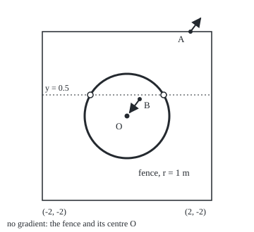

# Rademacher's theorem: a Lipschitz function on R^n has a derivative almost everywhere

[Syllabus](../../../SYLLABUS.md) → [Measure and integration](../README.md) → [Derivatives Meet the Lebesgue Integral](../README.md#s11) → Rademacher's theorem

---

## General Overview

A robot mower works a yard 4 m by 4 m. In the middle stands a thin round fence of radius 1 m, with lawn on both sides, and the mower is let in through a gate. Its planner stores one number at every point: d, the distance in metres to the fence. To steer clear of the fence, the mower moves in the direction where d climbs fastest. That direction, with the climb rate as its length, is the **gradient** of d.

At mower A, 1.5 m east and 2.0 m north of the fence's centre, the distance to the centre is 2.5 m, so d = 1.5 m. The gradient is (0.6, 0.8): straight away from the centre, climbing 1 m of clearance per metre moved. Inside the fence, at mower B = (0.3, 0.4), d = 0.5 m and the gradient is (−0.6, −0.8), pointing at the centre. Both gradients have length 1.

Two kinds of point have no gradient at all. On the fence, d is 0 and grows at rate 1 when the mower steps straight off it, inward or outward, like the bottom of a V. At the centre O, d is 1 and falls at rate 1 in every direction, like the tip of a cone. These bad points are a circle and one point: they fill no area. The function f1(x, y) = |x| + |y|, the walking distance to a crossroads on a street grid, behaves the same way: it has a gradient everywhere except on the two axes.

This is no accident of the examples. The distance d never changes faster than the mower moves: that cap on the rate of change is the **Lipschitz** condition. Hans Rademacher proved in 1919 that the cap alone forces a gradient, and a tangent plane, at every point outside a set of zero area.

**A function on n-dimensional space whose change is capped by a fixed multiple of the distance moved has a derivative, a tangent plane, at every point except a set of measure zero.**

**What kind of fact this is:** a theorem, proved on this card in Why it works, using the one-variable result from [Absolutely continuous functions and the fundamental theorem](04-absolutely-continuous-functions-and-the-fundamental-theorem.md) and slicing by [Tonelli and Fubini](../06-Product%20Measures%20and%20Fubini/03-tonelli-and-fubini.md).

### The picture: the yard, the fence and two gradients

<p align="center"></p>

One metre is 60 pixels. The heavy circle is the fence and the dot at O is its centre: together they are the whole bad set of d. The arrows are the gradients at A and B, drawn 0.4 m long. The dotted line y = 0.5 is one slice used in Step 1; it meets the bad set at the two hollow dots, x = −0.866025 and 0.866025.

---

## The formula

Notation first, in words. A point of n-dimensional space is a list of n coordinates. The length of a step $`h`$ is the straight-line distance $`\lvert h\rvert`$. A real function $`f`$ is **Lipschitz with constant L** when its values at two points never differ by more than L times their distance. Its **gradient** $`\nabla f(p)`$ is the list of its partial derivatives $`\partial_i f(p)`$, the slopes along the n coordinate axes. $`\lambda^n`$ is Lebesgue measure on n-dimensional space: length, area, volume.

```math
\lvert f(p) - f(q)\rvert \le L\,\lvert p - q\rvert \ \text{ for all } p, q \quad\Longrightarrow\quad \lim_{h \to 0} \frac{\lvert f(p + h) - f(p) - \nabla f(p)\cdot h\rvert}{\lvert h\rvert} = 0 \ \text{ for } \lambda^n\text{-almost every } p
```

**Read it aloud:** if f never rises faster than L per unit of distance, then at almost every point the tangent plane built from the gradient predicts f with an error that shrinks faster than the step.

The limit on the right is the definition of **differentiable** at p ([Tangent planes](../../06-Calculus%20and%20analysis/07-Several%20Variables/02-differentiability-and-tangent-planes.md)). At every such point the gradient is at most L long: $`\lvert\nabla f(p)\rvert \le L`$. For the distance to the fence, the gradient is the unit vector away from the fence:

```math
d(p) = \big\lvert\, \lvert p\rvert - 1 \,\big\rvert, \qquad \nabla d(p) = \pm\frac{p}{\lvert p\rvert} \quad (+ \text{ outside the fence}, - \text{ inside}), \qquad \lvert \nabla d(p)\rvert = 1
```

**Read it aloud:** the distance to the fence is the gap between the distance to the centre and 1, and its gradient points straight away from the fence, with length 1.

| Symbol | Plain meaning | In our example | Push it up and the answer… |
| --- | --- | --- | --- |
| $`f`$ | a Lipschitz function on n-dimensional space | d, or f1 = \|x\| + \|y\| | — |
| $`d`$, f1, $`g`$, $`T`$ | the examples: distance to the fence; walking distance to the crossroads; two counterexamples in What breaks | d(A) = 1.5 | — |
| $`n`$ | how many coordinates a point has | 2 | the proof runs the same way |
| $`p`$, $`q`$, $`h`$ | points, and a step from p; A, B, C, O, P name points in the yard | A = (1.5, 2.0), h = (0.1, 0) | a bigger step, a bigger plane error |
| $`\lvert p - q\rvert`$ | straight-line distance between two points | $`\lvert A\rvert`$ = 2.5 | — |
| $`L`$ | the Lipschitz constant: the cap on rise per metre | 1 for d, 1.414214 for f1 | a longer gradient is allowed |
| $`\nabla f`$, $`\partial_i f`$, $`e_i`$ | the gradient; the slope along axis i; the unit step along axis i | (0.6, 0.8) at A | the plane tilts more |
| $`v`$, $`t`$ | a direction of length 1; a distance along it | v = (1, 0), t = 0.001 | — |
| $`D_v f`$ | the directional derivative: the limit of the slope (f(p + tv) − f(p))/t as t shrinks | 1 at A along (0.6, 0.8) | — |
| $`\lambda^n`$ | Lebesgue measure: length, area, volume | area of the bad set of d: 0 | — |
| $`\varphi`$ | a test function: a smooth bump, zero outside a disc | radius 0.5 around C = (1.2, 0) | — |
| $`v_k`$, $`Q`$, $`\varepsilon`$, $`\delta`$, $`N_v`$ | in the proof: listed directions; the error per unit step; two small numbers; the set where $`D_v f`$ fails | 3,600 directions at A | — |

### When it holds

- **A Lipschitz cap.** Drop it and a continuous function can fail to have a derivative anywhere. The Takagi function, rebuilt on the plane, has slopes 1, 0, 1, 0, … across shrinking cells (What breaks). A cap that holds on each ball but not across the whole space is enough, since space is a countable union of balls.
- **Almost every point, not every point.** d fails on the whole fence, an uncountable set; f1 fails on both axes. The theorem allows any set of measure zero.
- **Finite dimension.** "Almost every" needs Lebesgue measure on n-dimensional space. On infinite-dimensional spaces there is no such measure, and the statement must change.
- **Real values, or finitely many.** A map into m-dimensional space is Lipschitz exactly when each coordinate is, so the theorem applies one coordinate at a time. For some infinite-dimensional targets it fails.

---

## Why it works

### Step 0: the cap makes every slope bounded, and bounded slopes can pass through integrals

Along any line, a Lipschitz function is a Lipschitz function of one variable, and the one-variable theory already gives it a slope almost everywhere. That handles one direction at a time.

Slopes in separate directions need not fit one plane, so a second idea is needed. Every difference quotient of f is at most L in size. Bounded quotients let limits pass through integrals by dominated convergence, and integrals against smooth bumps can move the derivative off f and onto the bump. That forces the slopes to fit one plane almost everywhere. A countable set of directions, spread densely over the unit sphere, then covers all directions at once.

### Step 1: one direction at a time, by slicing

Fix a direction v of length 1. On each line parallel to v, the function t ↦ f(p + tv) is Lipschitz in one variable with the same constant L. A Lipschitz function of one variable is absolutely continuous, so it has a derivative at almost every point of the line ([Absolutely continuous functions and the fundamental theorem](04-absolutely-continuous-functions-and-the-fundamental-theorem.md), which rests on [Lebesgue's theorem on monotone functions](03-monotone-functions-differentiable-almost-everywhere.md)).

Let $`N_v`$ be the set of points where $`D_v f`$ does not exist. Each line parallel to v meets $`N_v`$ in a set of length zero. Turn the axes so that v points along the first one, and add up those lengths line by line: by [Tonelli and Fubini](../06-Product%20Measures%20and%20Fubini/03-tonelli-and-fubini.md) the total is the area of $`N_v`$, so $`\lambda^n(N_v) = 0`$.

On the slice y = 0.5 the bad set of d is two points, x = ±0.866025, where the slice crosses the fence. There the slope is −0.866025 from the left and +0.866025 from the right: a V. Everywhere else on the slice the slope exists. The same slice meets the bad set of f1 at x = 0, on the y-axis, with slope −1 from the left and +1 from the right. Off the axes, at (0.5, −0.3), f1 has the gradient (1, −1), the signs of x and y, and difference quotients agree. Taking v = $`e_1`$, …, $`e_n`$ shows that the whole gradient exists almost everywhere.

<details>
<summary>Detailed proof: the bad set of one direction is measurable and null</summary>

The upper and lower directional slopes, $`\limsup_{t \to 0}`$ and $`\liminf_{t \to 0}`$ of (f(p + tv) − f(p))/t, can be taken over rational t only, because the quotient is continuous in t for t ≠ 0. A lim sup or lim inf of countably many continuous functions of p is Borel measurable. So $`N_v`$, the set where they differ, is Borel.

Turn the axes so that v is the first one: write p = (s, y) with s along v and y in the other n − 1 coordinates. The rotation keeps Lebesgue measure. For each fixed y, the section of $`N_v`$ is the set of s where s ↦ f(s, y) has no derivative. That function is L-Lipschitz, so it is absolutely continuous and differentiable outside a set of length 0. Tonelli on the indicator of $`N_v`$ gives

$`\displaystyle \lambda^n(N_v) = \int \lambda^1\big(\{ s : (s, y) \in N_v \}\big)\, dy = \int 0 \, dy = 0.`$

Wherever $`D_v f(p)`$ exists it is a limit of quotients of size at most L, so $`\lvert D_v f(p)\rvert \le L`$.

</details>

### Step 2: the directional slope is the gradient dotted with the direction, almost everywhere

Slopes along the axes do not yet fix the slope in other directions. The function g = x²y/(x² + y²), with g = 0 at O, shows the danger: at the origin its slopes along both axes are 0, yet along the diagonal its slope is 0.353553, from both sides (What breaks). A tangent plane needs $`D_v f = v\cdot\nabla f`$ for every v.

The trick is to multiply by a test function $`\varphi`$ and integrate. Shifting every point by tv does not change Lebesgue measure, so the shift can move from f onto $`\varphi`$:

```math
\int \frac{f(x + tv) - f(x)}{t}\,\varphi(x)\,dx = -\int f(x)\,\frac{\varphi(x) - \varphi(x - tv)}{t}\,dx
```

**Read it aloud:** averaging f's slope against a bump equals minus the average of f against the bump's slope.

Now let t shrink.

1. On the left, each quotient is at most L in size and $`\varphi`$ is bounded and zero outside a disc. [Dominated convergence](../05-Swapping%20Limits%20and%20Integrals/02-dominated-convergence-theorem.md) sends the left side to the integral of $`D_v f\,\varphi`$.
2. On the right, $`\varphi`$ is smooth, so its slope is $`v\cdot\nabla\varphi = \sum_i v_i\,\partial_i\varphi`$. The right side tends to $`-\sum_i v_i \int f\,\partial_i\varphi`$.
3. The same identity with v = $`e_i`$ turns each $`-\int f\,\partial_i\varphi`$ into $`\int \partial_i f\,\varphi`$.

Together:

```math
\int \big( D_v f - v\cdot\nabla f \big)\,\varphi \, dx = 0 \quad \text{for every test function } \varphi
```

**Read it aloud:** the gap between the directional slope and the gradient's prediction averages to zero against every bump.

A function that averages to zero against every bump is zero almost everywhere: shrink the bumps round a point, and averages read off its value there ([The Lebesgue differentiation theorem](02-lebesgue-differentiation-theorem.md), proved there on the line; the fold below gives the change for n dimensions). So $`D_v f = v\cdot\nabla f`$ almost everywhere, for each fixed v.

With the bump of radius 0.5 at C = (1.2, 0), straddling the fence, and v = (1, 0), both sides come to 0.08384. The averaged difference quotients approach it as t shrinks: 0.09615 at t = 0.1, 0.08526 at t = 0.01, 0.08399 at t = 0.001.

<details>
<summary>Detailed proof: from integrals against bumps to equality almost everywhere</summary>

Fix v. Write $`q_t(x) = (f(x + tv) - f(x))/t`$. Then $`\lvert q_t\rvert \le L`$, and $`q_t \to D_v f`$ outside the null set $`N_v`$ of Step 1. For a test function $`\varphi`$ (smooth, zero outside a ball), $`\lvert q_t\varphi\rvert \le L\lvert\varphi\rvert`$, which is integrable, so dominated convergence gives $`\int q_t\varphi \to \int D_v f\,\varphi`$.

The change of variables x ↦ x − tv keeps Lebesgue measure, so $`\int f(x + tv)\varphi(x)\,dx = \int f(x)\varphi(x - tv)\,dx`$. Hence

$`\displaystyle \int q_t\,\varphi\,dx = -\int f(x)\,\frac{\varphi(x) - \varphi(x - tv)}{t}\,dx.`$

As t → 0 the fraction tends to $`v\cdot\nabla\varphi(x)`$, uniformly, and stays zero outside a fixed ball; f is continuous, so bounded there. The right side tends to $`-\int f\, v\cdot\nabla\varphi = -\sum_i v_i\int f\,\partial_i\varphi`$. Applying the same two limits with v = $`e_i`$ gives $`-\int f\,\partial_i\varphi = \int \partial_i f\,\varphi`$. So $`\int (D_v f - v\cdot\nabla f)\varphi = 0`$ for every $`\varphi`$.

Let $`u = D_v f - v\cdot\nabla f`$, bounded by $`(1 + \sqrt{n})L`$ and measurable. Take a smooth bump $`\eta \ge 0`$ of integral 1 supported in the unit ball and set $`\eta_r(y) = r^{-n}\eta(y/r)`$. Then $`\int u(y)\eta_r(x - y)\,dy = 0`$ for every x and r. At a Lebesgue point x of u, which is almost every x,

$`\displaystyle \Big\lvert u(x) - \int u(y)\,\eta_r(x - y)\,dy \Big\rvert \le \max\eta \cdot \frac{1}{r^n}\int_{\lvert y - x\rvert < r} \lvert u(y) - u(x)\rvert \,dy \to 0,`$

so u(x) = 0. The Lebesgue differentiation theorem in n dimensions is proved the same way as on the line, with balls in place of intervals and a covering constant $`3^n`$ in place of 3. ∎

</details>

### Step 3: countably many directions give all of them at once

Choose a list of directions $`v_1, v_2, \dots`$ that comes as close as wanted to every direction, for instance, in the plane, the angles that are rational multiples of a full turn. Let G be the set of points where the gradient exists and $`D_{v_k} f = v_k\cdot\nabla f`$ for every k in the list. Each requirement fails only on a null set, and a countable union of null sets is null. So G is almost everything.

At a point p of G, write the error per unit step in direction v as

```math
Q(v, t) = \frac{f(p + tv) - f(p)}{t} - v\cdot\nabla f(p)
```

**Read it aloud:** Q is the slope over a step of length t in direction v, minus the slope the tangent plane predicts.

The Lipschitz cap ties nearby directions together: $`\lvert Q(v, t) - Q(v', t)\rvert \le 2L\,\lvert v - v'\rvert`$. Pick finitely many listed directions within $`\varepsilon/(4L)`$ of every direction. For small t each of them has $`\lvert Q\rvert < \varepsilon/2`$, so every direction has $`\lvert Q\rvert < \varepsilon`$. The error is small in all directions at once, which is differentiability.

The code tests this with 3,600 directions. At A the worst error per unit step is 0.020000, 0.002000 and 0.000200 at t = 0.1, 0.01 and 0.001: it falls tenfold each time. At the fence point P = (1, 0) the flat plane stays at 1.000000 for every t, and Worked numbers shows that no plane does better.

<details>
<summary>Detailed proof: from the listed directions to differentiability</summary>

Let p be in G. First, $`\lvert\nabla f(p)\rvert \le L`$: for each listed direction, $`\lvert v_k\cdot\nabla f(p)\rvert = \lvert D_{v_k} f(p)\rvert \le L`$, and the $`v_k`$ come arbitrarily close to $`\nabla f(p)/\lvert\nabla f(p)\rvert`$.

For unit vectors v, v′ and t ≠ 0,

$`\displaystyle \lvert Q(v, t) - Q(v', t)\rvert \le \frac{\lvert f(p + tv) - f(p + tv')\rvert}{\lvert t\rvert} + \lvert (v - v')\cdot\nabla f(p)\rvert \le L\lvert v - v'\rvert + L\lvert v - v'\rvert.`$

Given ε > 0, the unit sphere is compact, so finitely many listed directions $`v_1, \dots, v_m`$ lie within $`\varepsilon/(4L)`$ of every unit vector. Each $`Q(v_k, t) \to 0`$ as t → 0, so there is δ > 0 with $`\lvert Q(v_k, t)\rvert < \varepsilon/2`$ for k ≤ m and 0 < |t| < δ. For any unit v pick $`v_k`$ within $`\varepsilon/(4L)`$; then $`\lvert Q(v, t)\rvert < \varepsilon/2 + 2L\cdot\varepsilon/(4L) = \varepsilon`$.

Any step h with 0 < |h| < δ is h = tv with t = |h| and v = h/|h|. So $`\lvert f(p + h) - f(p) - \nabla f(p)\cdot h\rvert < \varepsilon\lvert h\rvert`$, which is differentiability at p. ∎

</details>

### What the code shows and what only the proof shows

The code checks one function's numbers: its Lipschitz ratios, its gradient two ways, the identity of Step 2 for one bump, and the error of Step 3 at two points. That every Lipschitz function on every n-dimensional space has a derivative almost everywhere only the proof shows.

---

## Worked numbers, by hand

Mower A at (1.5, 2.0), and the fence point P = (1, 0).

| Step | Arithmetic | Value |
| --- | --- | --- |
| Distance from A to the centre | √(1.5² + 2.0²) = √6.25 | 2.5 |
| Distance from A to the fence | 2.5 − 1 | d(A) = 1.5 |
| Gradient at A | A divided by its length: (1.5/2.5, 2.0/2.5) | (0.6, 0.8) |
| Its length | √(0.36 + 0.64) | 1 |
| Step 0.1 east: true distance | √(1.6² + 2.0²) − 1 = √6.56 − 1 | 1.561250 |
| Step 0.1 east: the plane | 1.5 + 0.6 × 0.1 | 1.56 |
| Error per unit step | (√6.56 − 1 − 1.56) / 0.1 | 0.012497 |
| Step 0.01 east: error per unit step | (√6.2801 − 1 − 1.506) / 0.01 | 0.001277 |
| At P, steps ±0.1 along x | d(1.1, 0) and d(0.9, 0) | 0.1 and 0.1 |
| Best plane through d(P) = 0 | predicts +0.1c and −0.1c for some slope c; their errors average 0.1 | error per unit step ≥ 1 |
| Area of the bad set | a circle plus one point | **0** |

At A the plane's error per unit step drops about tenfold when the step drops tenfold, so d has the tangent plane with gradient (0.6, 0.8) there. At P no plane gets below 1, and every such P lies in a set of **zero area**.

How small is that set? The share of the yard within h of the fence or the centre is $`(4\pi h + \pi h^2)/16`$. Counting a 1,000 by 1,000 grid of points gives the same shares:

| Band width h | Grid share | Formula |
| --- | --- | --- |
| 0.2 m | 0.164976 | 0.164934 |
| 0.1 m | 0.080516 | 0.080503 |
| 0.05 m | 0.039772 | 0.039761 |

Halve the band and the share halves; the bad set itself is what is left as h reaches 0, a share of 0.

### What breaks if you drop a piece

| Mistake | Comes out at | What went wrong |
| --- | --- | --- |
| Slopes in every direction taken as enough | g = x²y/(x² + y²) at O: partials 0.000000 and 0.000000, slope 0.353553 along (0.707107, 0.707107), forward and backward; the plane predicts 0 | the slopes exist but do not fit one plane; Step 2's linearity is what fails, here at one point |
| The Lipschitz constant of f1 taken as 1 | ratio 1.414214 along the diagonal | distance is straight-line distance: one diagonal metre changes \|x\| + \|y\| by √2 |
| A derivative expected at every point | at P: slope outward 1.000000, slope inward 1.000000 | a plane needs those two to cancel; the fence is the allowed null set |
| The Lipschitz cap dropped | Takagi T(x) on the plane: slopes across the cells holding x = 1/3 are 1, 0, 1, 0, 1, 0 | with no cap, Step 2's domination fails, and a continuous function can have no derivative anywhere |

The function g = x²y/(x² + y²) is Lipschitz and has a derivative everywhere except at O, so it agrees with the theorem. At O its slope along v = (v₁, v₂) is v₁²v₂ from both sides, which is not linear in v, so no plane gives it. It shows why Step 2 is needed: the partial derivatives alone would predict slope 0 in every direction. The **Takagi function** $`T`$ adds up the distance from $`2^k x`$ to the nearest whole number, divided by $`2^k`$, for k = 0, 1, 2, …; [Lebesgue's theorem on monotone functions](03-monotone-functions-differentiable-almost-everywhere.md) shows its slopes never settle.

---

## Code, from first principles, and it actually runs

The code builds d and f1 from square roots and absolute values, with its own random number generator for the Lipschitz test, a midpoint grid for the integrals, and the bump and its slope written out by hand. It takes three independent roads. The gradient comes from the formula and from difference quotients of d alone. Step 2's identity is computed from both sides, and against the shrinking difference quotients. The bad set's share of the yard comes from a grid count and from the exact area of the band.

### Python

```python
# Rademacher's theorem -- the check behind the card.  Standard library only.
# d(p) = | |p| - 1 | is the distance from p to the unit circle (a round fence of
# radius 1 m); f1(p) = |x| + |y|.  Both are Lipschitz.  The script checks the
# Lipschitz bounds, the gradient two ways, the size of the bad set, the
# test-function identity of Step 2, and the uniform error of Step 3.
import math
hyp = lambda x, y: math.sqrt(x * x + y * y)  # length of (x, y)

def d(x, y): return abs(hyp(x, y) - 1.0)
def f1(x, y): return abs(x) + abs(y)
def grad_d(x, y):                          # the formula, valid off the circle and origin
    r = hyp(x, y); s = 1.0 if r > 1.0 else -1.0
    return (s * x / r, s * y / r)
def central(f, x, y, h=1e-6):              # road two: difference quotients only
    return ((f(x + h, y) - f(x - h, y)) / (2 * h), (f(x, y + h) - f(x, y - h)) / (2 * h))
def fmt(p): return f"({p[0]:.6f}, {p[1]:.6f})"

state = 12345                              # a hand-written random number generator
def rnd():
    global state
    state = (state * 6364136223846793005 + 1442695040888963407) % 2**64
    return (state >> 11) / 2**53 * 4.0 - 2.0

best_d = best_f = 0.0
for _ in range(200000):                    # Lipschitz ratios over random pairs in [-2, 2]^2
    px, py, qx, qy = rnd(), rnd(), rnd(), rnd()
    dist = hyp(px - qx, py - qy)
    best_d = max(best_d, abs(d(px, py) - d(qx, qy)) / dist)
    best_f = max(best_f, abs(f1(px, py) - f1(qx, qy)) / dist)
print("d = distance to the unit circle; f1 = |x| + |y|")
print(f"largest ratio |f(p) - f(q)| / |p - q| over 200000 pairs: d {best_d:.6f} (L = 1), f1 {best_f:.6f} (L = {math.sqrt(2):.6f})")
assert 0.99 < best_d <= 1.0 + 1e-12 and 1.40 < best_f <= math.sqrt(2) + 1e-12

for name, (x, y) in [("A", (1.5, 2.0)), ("B", (0.3, 0.4))]:
    g, c = grad_d(x, y), central(d, x, y)
    print(f"mower {name} = ({x}, {y}): |p| {hyp(x, y):.6f}, d {d(x, y):.6f}, grad by formula {fmt(g)}, "
          f"by difference quotients {fmt(c)}, length {hyp(*g):.6f}")
    assert abs(g[0] - c[0]) < 1e-6 and abs(g[1] - c[1]) < 1e-6
for h in (0.1, 0.01):                      # the tangent-plane error at A, divided by the step
    plane = 1.5 + 0.6 * h
    print(f"step ({h}, 0) from A: d {d(1.5 + h, 2.0):.6f}, plane {plane:.6f}, error/step {abs(d(1.5 + h, 2.0) - plane) / h:.6f}")
print(f"fence point P = (1, 0), steps +0.1 and -0.1 along x: d {d(1.1, 0):.6f} and {d(0.9, 0):.6f}; "
      f"every plane misses one by at least {(d(1.1, 0) + d(0.9, 0)) / 2:.6f}, error/step {(d(1.1, 0) + d(0.9, 0)) / 0.2:.6f}")
print(f"centre O = (0, 0), step 0.1 in any direction: d {d(0.1, 0):.6f}, slope {(d(0.06, 0.08) - d(0, 0)) / 0.1:.6f} every way")
t0 = math.sqrt(1 - 0.25)                   # the line y = 0.5 meets the circle at x = +-t0
g = lambda t: d(t, 0.5)
print(f"line y = 0.5 meets the bad set at x = {-t0:.6f} and {t0:.6f}; slopes at x = {t0:.6f}: "
      f"left {(g(t0) - g(t0 - 1e-7)) / 1e-7:.6f}, right {(g(t0 + 1e-7) - g(t0)) / 1e-7:.6f}")
lf, rf = (f1(0, 0.5) - f1(-1e-3, 0.5)) / 1e-3, (f1(1e-3, 0.5) - f1(0, 0.5)) / 1e-3
cf = central(f1, 0.5, -0.3)                # off the axes the formula is (sign x, sign y) = (1, -1)
print(f"f1 on the line y = 0.5 at the axis x = 0: slope left {lf:.6f}, right {rf:.6f}; "
      f"at (0.5, -0.3), off the axes: grad (1, -1) by formula, {fmt(cf)} by difference quotients")
assert abs(lf + 1) < 1e-9 and abs(rf - 1) < 1e-9 and abs(cf[0] - 1) < 1e-6 and abs(cf[1] + 1) < 1e-6

M = 1000                                   # grid fraction of [-2, 2]^2 within h of the bad set
for h in (0.2, 0.1, 0.05):
    hits = 0
    for i in range(M):
        for j in range(M):
            x, y = -2 + 4 * (i + 0.5) / M, -2 + 4 * (j + 0.5) / M
            r = hyp(x, y)
            hits += abs(r - 1) < h or r < h
    exact = (4 * math.pi * h + math.pi * h * h) / 16
    print(f"share of the 4 m x 4 m yard within {h} m of circle or centre: grid {hits / M**2:.6f}, formula {exact:.6f}")
    assert abs(hits / M**2 - exact) < 1e-3

cx, cy, R, vx, vy, K = 1.2, 0.0, 0.5, 1.0, 0.0, 800   # Step 2: bump at C, direction v
def phi(x, y):
    s = ((x - cx) ** 2 + (y - cy) ** 2) / R**2
    return math.exp(-1 / (1 - s)) if s < 1 else 0.0
def dphi_v(x, y):                          # v . grad phi, from the chain rule
    s = ((x - cx) ** 2 + (y - cy) ** 2) / R**2
    if s >= 1: return 0.0
    return phi(x, y) * (-1 / (1 - s) ** 2) * 2 * (vx * (x - cx) + vy * (y - cy)) / R**2
lhs = rhs = 0.0; quot = [0.0, 0.0, 0.0]; ts = (0.1, 0.01, 0.001); w = (2 * R / K) ** 2
for i in range(K):
    for j in range(K):
        x, y = cx - R + 2 * R * (i + 0.5) / K, cy - R + 2 * R * (j + 0.5) / K
        p = phi(x, y)
        if p == 0.0: continue
        gx, gy = grad_d(x, y)
        lhs += (vx * gx + vy * gy) * p * w
        rhs -= d(x, y) * dphi_v(x, y) * w
        for k, t in enumerate(ts):
            quot[k] += (d(x + t * vx, y + t * vy) - d(x, y)) / t * p * w
print(f"Step 2, bump of radius 0.5 at C = (1.2, 0), v = (1, 0): integral of (v . grad d) phi {lhs:.5f}; "
      f"minus integral of d (v . grad phi) {rhs:.5f}")
print("  integral of the difference quotient times phi: " + ", ".join(f"t = {t}: {q:.5f}" for t, q in zip(ts, quot)))
assert abs(lhs - rhs) < 1e-5 and abs(quot[2] - lhs) < 1e-3 and abs(quot[0] - lhs) > 1e-4

dirs = [(math.cos(2 * math.pi * k / 3600), math.sin(2 * math.pi * k / 3600)) for k in range(3600)]
def worst(px, py, gx, gy, t):              # largest |error/step| over 3600 unit directions
    return max(abs((d(px + t * u, py + t * v) - d(px, py)) / t - (gx * u + gy * v)) for u, v in dirs)
wa = [worst(1.5, 2.0, 0.6, 0.8, t) for t in ts]
wp = [worst(1.0, 0.0, 0.0, 0.0, t) for t in ts]
print("Step 3, worst error/step over 3600 directions, t = 0.1, 0.01, 0.001:")
print("  at A with grad (0.6, 0.8): " + ", ".join(f"{q:.6f}" for q in wa))
print("  at P with the flat plane:  " + ", ".join(f"{q:.6f}" for q in wp))
assert wa[0] > wa[1] > wa[2] and wa[2] < 1e-3 and min(wp) > 1 - 1e-9

gxy = lambda x, y: 0.0 if x == y == 0 else x * x * y / (x * x + y * y)
u = 1 / math.sqrt(2)                       # slope of gxy at O along v, from both sides: v1^2 v2
fwd, bwd = gxy(1e-3 * u, 1e-3 * u) / 1e-3, gxy(-1e-3 * u, -1e-3 * u) / -1e-3
print(f"mistake 1, g = x^2 y/(x^2 + y^2) at O: partials {gxy(1e-3, 0) / 1e-3:.6f} and {gxy(0, 1e-3) / 1e-3:.6f}, "
      f"slope along ({u:.6f}, {u:.6f}) is {fwd:.6f} forward and {bwd:.6f} backward, the plane predicts 0")
print(f"mistake 2, f1 with L taken as 1: ratio along the diagonal {(f1(1e-3, 1e-3) - f1(0, 0)) / hyp(1e-3, 1e-3):.6f}")
print(f"mistake 3, a derivative expected at P: slope outward {(d(1.001, 0) - d(1, 0)) / 0.001:.6f}, "
      f"slope inward {(d(0.999, 0) - d(1, 0)) / 0.001:.6f}; a plane needs them to cancel")
def takagi(x): return sum(abs(2**k * x - round(2**k * x)) / 2**k for k in range(60))
slopes = []
for n in range(1, 7):                      # cells of width 2^-n holding 1/3
    a = math.floor(2**n / 3) / 2**n
    slopes.append(round((takagi(a + 2**-n) - takagi(a)) * 2**n))
print(f"mistake 4, Lipschitz dropped, Takagi T(x) on the plane: slopes across the cells holding x = 1/3: {slopes}")
assert abs(fwd - u ** 3) < 1e-12 and abs(bwd - u ** 3) < 1e-12 and slopes == [1, 0, 1, 0, 1, 0]

S, O = 60, (180, 165)                      # figure: 60 px per metre, centre at pixel (180, 165)
px = lambda x, y: f"({O[0] + S * x:.2f}, {O[1] - S * y:.2f})"
print(f"figure, circle r {S}px at {px(0, 0)}; A {px(1.5, 2.0)} to {px(1.74, 2.32)}; "
      f"B {px(0.3, 0.4)} to {px(0.06, 0.08)}; line y = 0.5 bad points {px(-t0, 0.5)} {px(t0, 0.5)}")
print("ALL CHECKS PASS")
```

**Ran 2026-11-23 on macOS, Python 3.14.10, standard library only. All checks passed. Output, pasted from the run:**

```
d = distance to the unit circle; f1 = |x| + |y|
largest ratio |f(p) - f(q)| / |p - q| over 200000 pairs: d 1.000000 (L = 1), f1 1.414214 (L = 1.414214)
mower A = (1.5, 2.0): |p| 2.500000, d 1.500000, grad by formula (0.600000, 0.800000), by difference quotients (0.600000, 0.800000), length 1.000000
mower B = (0.3, 0.4): |p| 0.500000, d 0.500000, grad by formula (-0.600000, -0.800000), by difference quotients (-0.600000, -0.800000), length 1.000000
step (0.1, 0) from A: d 1.561250, plane 1.560000, error/step 0.012497
step (0.01, 0) from A: d 1.506013, plane 1.506000, error/step 0.001277
fence point P = (1, 0), steps +0.1 and -0.1 along x: d 0.100000 and 0.100000; every plane misses one by at least 0.100000, error/step 1.000000
centre O = (0, 0), step 0.1 in any direction: d 0.900000, slope -1.000000 every way
line y = 0.5 meets the bad set at x = -0.866025 and 0.866025; slopes at x = 0.866025: left -0.866025, right 0.866025
f1 on the line y = 0.5 at the axis x = 0: slope left -1.000000, right 1.000000; at (0.5, -0.3), off the axes: grad (1, -1) by formula, (1.000000, -1.000000) by difference quotients
share of the 4 m x 4 m yard within 0.2 m of circle or centre: grid 0.164976, formula 0.164934
share of the 4 m x 4 m yard within 0.1 m of circle or centre: grid 0.080516, formula 0.080503
share of the 4 m x 4 m yard within 0.05 m of circle or centre: grid 0.039772, formula 0.039761
Step 2, bump of radius 0.5 at C = (1.2, 0), v = (1, 0): integral of (v . grad d) phi 0.08384; minus integral of d (v . grad phi) 0.08384
  integral of the difference quotient times phi: t = 0.1: 0.09615, t = 0.01: 0.08526, t = 0.001: 0.08399
Step 3, worst error/step over 3600 directions, t = 0.1, 0.01, 0.001:
  at A with grad (0.6, 0.8): 0.020000, 0.002000, 0.000200
  at P with the flat plane:  1.000000, 1.000000, 1.000000
mistake 1, g = x^2 y/(x^2 + y^2) at O: partials 0.000000 and 0.000000, slope along (0.707107, 0.707107) is 0.353553 forward and 0.353553 backward, the plane predicts 0
mistake 2, f1 with L taken as 1: ratio along the diagonal 1.414214
mistake 3, a derivative expected at P: slope outward 1.000000, slope inward 1.000000; a plane needs them to cancel
mistake 4, Lipschitz dropped, Takagi T(x) on the plane: slopes across the cells holding x = 1/3: [1, 0, 1, 0, 1, 0]
figure, circle r 60px at (180.00, 165.00); A (270.00, 45.00) to (284.40, 25.80); B (198.00, 141.00) to (183.60, 160.20); line y = 0.5 bad points (128.04, 135.00) (231.96, 135.00)
ALL CHECKS PASS
```

### Rust

Same numbers, same labels, built with `rustc --edition 2021 -O`.

```rust
// Rademacher's theorem -- the same check as the Python, in Rust.  No crates.
// d(p) = | |p| - 1 | is the distance from p to the unit circle (a round fence of
// radius 1 m); f1(p) = |x| + |y|.  Both are Lipschitz.  The program checks the
// Lipschitz bounds, the gradient two ways, the size of the bad set, the
// test-function identity of Step 2, and the uniform error of Step 3.
use std::f64::consts::PI;

fn hyp(x: f64, y: f64) -> f64 { (x * x + y * y).sqrt() }       // length of (x, y)
fn d(x: f64, y: f64) -> f64 { (hyp(x, y) - 1.0).abs() }
fn f1(x: f64, y: f64) -> f64 { x.abs() + y.abs() }
fn grad_d(x: f64, y: f64) -> (f64, f64) {      // the formula, valid off the circle and origin
    let r = hyp(x, y);
    let s = if r > 1.0 { 1.0 } else { -1.0 };
    (s * x / r, s * y / r)
}
fn central(f: fn(f64, f64) -> f64, x: f64, y: f64) -> (f64, f64) {     // road two: difference quotients only
    let h = 1e-6;
    ((f(x + h, y) - f(x - h, y)) / (2.0 * h), (f(x, y + h) - f(x, y - h)) / (2.0 * h))
}
fn fmt(p: (f64, f64)) -> String { format!("({:.6}, {:.6})", p.0, p.1) }
fn takagi(x: f64) -> f64 {
    let mut s = 0.0;
    for k in 0..60 {
        let p = 2f64.powi(k);
        s += (p * x - (p * x).round()).abs() / p;
    }
    s
}
fn join(v: &[f64]) -> String { v.iter().map(|q| format!("{:.6}", q)).collect::<Vec<_>>().join(", ") }

fn main() {
    let mut state: u64 = 12345;                // a hand-written random number generator
    let mut rnd = || {
        state = state.wrapping_mul(6364136223846793005).wrapping_add(1442695040888963407);
        (state >> 11) as f64 / 9007199254740992.0 * 4.0 - 2.0
    };
    let (mut best_d, mut best_f) = (0.0f64, 0.0f64);
    for _ in 0..200000 {                       // Lipschitz ratios over random pairs in [-2, 2]^2
        let (px, py, qx, qy) = (rnd(), rnd(), rnd(), rnd());
        let dist = hyp(px - qx, py - qy);
        best_d = best_d.max((d(px, py) - d(qx, qy)).abs() / dist);
        best_f = best_f.max((f1(px, py) - f1(qx, qy)).abs() / dist);
    }
    let r2 = 2f64.sqrt();
    println!("d = distance to the unit circle; f1 = |x| + |y|");
    println!("largest ratio |f(p) - f(q)| / |p - q| over 200000 pairs: d {:.6} (L = 1), f1 {:.6} (L = {:.6})", best_d, best_f, r2);
    assert!(0.99 < best_d && best_d <= 1.0 + 1e-12 && 1.40 < best_f && best_f <= r2 + 1e-12);

    for (name, xs, ys, x, y) in [("A", "1.5", "2.0", 1.5, 2.0), ("B", "0.3", "0.4", 0.3, 0.4)] {
        let (g, c) = (grad_d(x, y), central(d, x, y));
        println!("mower {} = ({}, {}): |p| {:.6}, d {:.6}, grad by formula {}, by difference quotients {}, length {:.6}",
                 name, xs, ys, hyp(x, y), d(x, y), fmt(g), fmt(c), hyp(g.0, g.1));
        assert!((g.0 - c.0).abs() < 1e-6 && (g.1 - c.1).abs() < 1e-6);
    }
    for h in [0.1, 0.01] {                     // the tangent-plane error at A, divided by the step
        let plane = 1.5 + 0.6 * h;
        println!("step ({}, 0) from A: d {:.6}, plane {:.6}, error/step {:.6}", h, d(1.5 + h, 2.0), plane, (d(1.5 + h, 2.0) - plane).abs() / h);
    }
    println!("fence point P = (1, 0), steps +0.1 and -0.1 along x: d {:.6} and {:.6}; every plane misses one by at least {:.6}, error/step {:.6}",
             d(1.1, 0.0), d(0.9, 0.0), (d(1.1, 0.0) + d(0.9, 0.0)) / 2.0, (d(1.1, 0.0) + d(0.9, 0.0)) / 0.2);
    println!("centre O = (0, 0), step 0.1 in any direction: d {:.6}, slope {:.6} every way", d(0.1, 0.0), (d(0.06, 0.08) - d(0.0, 0.0)) / 0.1);
    let t0 = (1.0f64 - 0.25).sqrt();          // the line y = 0.5 meets the circle at x = +-t0
    let g = |t: f64| d(t, 0.5);
    println!("line y = 0.5 meets the bad set at x = {:.6} and {:.6}; slopes at x = {:.6}: left {:.6}, right {:.6}",
             -t0, t0, t0, (g(t0) - g(t0 - 1e-7)) / 1e-7, (g(t0 + 1e-7) - g(t0)) / 1e-7);
    let (lf, rf) = ((f1(0.0, 0.5) - f1(-1e-3, 0.5)) / 1e-3, (f1(1e-3, 0.5) - f1(0.0, 0.5)) / 1e-3);
    let cf = central(f1, 0.5, -0.3);           // off the axes the formula is (sign x, sign y) = (1, -1)
    println!("f1 on the line y = 0.5 at the axis x = 0: slope left {:.6}, right {:.6}; at (0.5, -0.3), off the axes: grad (1, -1) by formula, {} by difference quotients",
             lf, rf, fmt(cf));
    assert!((lf + 1.0).abs() < 1e-9 && (rf - 1.0).abs() < 1e-9 && (cf.0 - 1.0).abs() < 1e-6 && (cf.1 + 1.0).abs() < 1e-6);

    let m = 1000usize;                         // grid fraction of [-2, 2]^2 within h of the bad set
    for h in [0.2, 0.1, 0.05] {
        let mut hits = 0usize;
        for i in 0..m {
            for j in 0..m {
                let x = -2.0 + 4.0 * (i as f64 + 0.5) / m as f64;
                let y = -2.0 + 4.0 * (j as f64 + 0.5) / m as f64;
                let r = hyp(x, y);
                if (r - 1.0).abs() < h || r < h { hits += 1 }
            }
        }
        let exact = (4.0 * PI * h + PI * h * h) / 16.0;
        let share = hits as f64 / (m * m) as f64;
        println!("share of the 4 m x 4 m yard within {} m of circle or centre: grid {:.6}, formula {:.6}", h, share, exact);
        assert!((share - exact).abs() < 1e-3);
    }

    let (cx, cy, rr, vx, vy, k) = (1.2f64, 0.0f64, 0.5f64, 1.0f64, 0.0f64, 800usize); // Step 2: bump at C
    let phi = |x: f64, y: f64| {
        let s = ((x - cx).powi(2) + (y - cy).powi(2)) / rr.powi(2);
        if s < 1.0 { (-1.0 / (1.0 - s)).exp() } else { 0.0 }
    };
    let dphi_v = |x: f64, y: f64| {            // v . grad phi, from the chain rule
        let s = ((x - cx).powi(2) + (y - cy).powi(2)) / rr.powi(2);
        if s >= 1.0 { return 0.0 }
        phi(x, y) * (-1.0 / (1.0 - s).powi(2)) * 2.0 * (vx * (x - cx) + vy * (y - cy)) / rr.powi(2)
    };
    let ts = [0.1, 0.01, 0.001];
    let (mut lhs, mut rhs, mut quot) = (0.0f64, 0.0f64, [0.0f64; 3]);
    let w = (2.0 * rr / k as f64).powi(2);
    for i in 0..k {
        for j in 0..k {
            let x = cx - rr + 2.0 * rr * (i as f64 + 0.5) / k as f64;
            let y = cy - rr + 2.0 * rr * (j as f64 + 0.5) / k as f64;
            let p = phi(x, y);
            if p == 0.0 { continue }
            let (gx, gy) = grad_d(x, y);
            lhs += (vx * gx + vy * gy) * p * w;
            rhs -= d(x, y) * dphi_v(x, y) * w;
            for (q, t) in quot.iter_mut().zip(ts) { *q += (d(x + t * vx, y + t * vy) - d(x, y)) / t * p * w }
        }
    }
    println!("Step 2, bump of radius 0.5 at C = (1.2, 0), v = (1, 0): integral of (v . grad d) phi {:.5}; minus integral of d (v . grad phi) {:.5}", lhs, rhs);
    let qs: Vec<String> = ts.iter().zip(quot).map(|(t, q)| format!("t = {}: {:.5}", t, q)).collect();
    println!("  integral of the difference quotient times phi: {}", qs.join(", "));
    assert!((lhs - rhs).abs() < 1e-5 && (quot[2] - lhs).abs() < 1e-3 && (quot[0] - lhs).abs() > 1e-4);

    let dirs: Vec<(f64, f64)> = (0..3600).map(|j| { let a = 2.0 * PI * j as f64 / 3600.0; (a.cos(), a.sin()) }).collect();
    let worst = |px: f64, py: f64, gx: f64, gy: f64, t: f64| {   // largest |error/step| over 3600 directions
        dirs.iter().map(|&(u, v)| ((d(px + t * u, py + t * v) - d(px, py)) / t - (gx * u + gy * v)).abs()).fold(0.0f64, f64::max)
    };
    let wa: Vec<f64> = ts.iter().map(|&t| worst(1.5, 2.0, 0.6, 0.8, t)).collect();
    let wp: Vec<f64> = ts.iter().map(|&t| worst(1.0, 0.0, 0.0, 0.0, t)).collect();
    println!("Step 3, worst error/step over 3600 directions, t = 0.1, 0.01, 0.001:");
    println!("  at A with grad (0.6, 0.8): {}", join(&wa));
    println!("  at P with the flat plane:  {}", join(&wp));
    assert!(wa[0] > wa[1] && wa[1] > wa[2] && wa[2] < 1e-3 && wp.iter().all(|&q| q > 1.0 - 1e-9));

    let gxy = |x: f64, y: f64| if x == 0.0 && y == 0.0 { 0.0 } else { x * x * y / (x * x + y * y) };
    let u = 1.0 / 2f64.sqrt();                 // slope of gxy at O along v, from both sides: v1^2 v2
    let (fwd, bwd) = (gxy(1e-3 * u, 1e-3 * u) / 1e-3, gxy(-1e-3 * u, -1e-3 * u) / -1e-3);
    println!("mistake 1, g = x^2 y/(x^2 + y^2) at O: partials {:.6} and {:.6}, slope along ({:.6}, {:.6}) is {:.6} forward and {:.6} backward, the plane predicts 0",
             gxy(1e-3, 0.0) / 1e-3, gxy(0.0, 1e-3) / 1e-3, u, u, fwd, bwd);
    println!("mistake 2, f1 with L taken as 1: ratio along the diagonal {:.6}", (f1(1e-3, 1e-3) - f1(0.0, 0.0)) / hyp(1e-3, 1e-3));
    println!("mistake 3, a derivative expected at P: slope outward {:.6}, slope inward {:.6}; a plane needs them to cancel",
             (d(1.001, 0.0) - d(1.0, 0.0)) / 0.001, (d(0.999, 0.0) - d(1.0, 0.0)) / 0.001);
    let mut slopes: Vec<i64> = Vec::new();
    for n in 1..7 {                            // cells of width 2^-n holding 1/3
        let a = (2f64.powi(n) / 3.0).floor() / 2f64.powi(n);
        slopes.push(((takagi(a + 2f64.powi(-n)) - takagi(a)) * 2f64.powi(n)).round() as i64);
    }
    println!("mistake 4, Lipschitz dropped, Takagi T(x) on the plane: slopes across the cells holding x = 1/3: {:?}", slopes);
    assert!((fwd - u.powi(3)).abs() < 1e-12 && (bwd - u.powi(3)).abs() < 1e-12 && slopes == vec![1, 0, 1, 0, 1, 0]);

    let px = |x: f64, y: f64| format!("({:.2}, {:.2})", 180.0 + 60.0 * x, 165.0 - 60.0 * y);
    println!("figure, circle r 60px at {}; A {} to {}; B {} to {}; line y = 0.5 bad points {} {}",
             px(0.0, 0.0), px(1.5, 2.0), px(1.74, 2.32), px(0.3, 0.4), px(0.06, 0.08), px(-t0, 0.5), px(t0, 0.5));
    println!("ALL CHECKS PASS");
}
```

**Ran 2026-11-23 on macOS, rustc 1.98.1, no crates. All checks passed. Output, pasted from the run:**

```
d = distance to the unit circle; f1 = |x| + |y|
largest ratio |f(p) - f(q)| / |p - q| over 200000 pairs: d 1.000000 (L = 1), f1 1.414214 (L = 1.414214)
mower A = (1.5, 2.0): |p| 2.500000, d 1.500000, grad by formula (0.600000, 0.800000), by difference quotients (0.600000, 0.800000), length 1.000000
mower B = (0.3, 0.4): |p| 0.500000, d 0.500000, grad by formula (-0.600000, -0.800000), by difference quotients (-0.600000, -0.800000), length 1.000000
step (0.1, 0) from A: d 1.561250, plane 1.560000, error/step 0.012497
step (0.01, 0) from A: d 1.506013, plane 1.506000, error/step 0.001277
fence point P = (1, 0), steps +0.1 and -0.1 along x: d 0.100000 and 0.100000; every plane misses one by at least 0.100000, error/step 1.000000
centre O = (0, 0), step 0.1 in any direction: d 0.900000, slope -1.000000 every way
line y = 0.5 meets the bad set at x = -0.866025 and 0.866025; slopes at x = 0.866025: left -0.866025, right 0.866025
f1 on the line y = 0.5 at the axis x = 0: slope left -1.000000, right 1.000000; at (0.5, -0.3), off the axes: grad (1, -1) by formula, (1.000000, -1.000000) by difference quotients
share of the 4 m x 4 m yard within 0.2 m of circle or centre: grid 0.164976, formula 0.164934
share of the 4 m x 4 m yard within 0.1 m of circle or centre: grid 0.080516, formula 0.080503
share of the 4 m x 4 m yard within 0.05 m of circle or centre: grid 0.039772, formula 0.039761
Step 2, bump of radius 0.5 at C = (1.2, 0), v = (1, 0): integral of (v . grad d) phi 0.08384; minus integral of d (v . grad phi) 0.08384
  integral of the difference quotient times phi: t = 0.1: 0.09615, t = 0.01: 0.08526, t = 0.001: 0.08399
Step 3, worst error/step over 3600 directions, t = 0.1, 0.01, 0.001:
  at A with grad (0.6, 0.8): 0.020000, 0.002000, 0.000200
  at P with the flat plane:  1.000000, 1.000000, 1.000000
mistake 1, g = x^2 y/(x^2 + y^2) at O: partials 0.000000 and 0.000000, slope along (0.707107, 0.707107) is 0.353553 forward and 0.353553 backward, the plane predicts 0
mistake 2, f1 with L taken as 1: ratio along the diagonal 1.414214
mistake 3, a derivative expected at P: slope outward 1.000000, slope inward 1.000000; a plane needs them to cancel
mistake 4, Lipschitz dropped, Takagi T(x) on the plane: slopes across the cells holding x = 1/3: [1, 0, 1, 0, 1, 0]
figure, circle r 60px at (180.00, 165.00); A (270.00, 45.00) to (284.40, 25.80); B (198.00, 141.00) to (183.60, 160.20); line y = 0.5 bad points (128.04, 135.00) (231.96, 135.00)
ALL CHECKS PASS
```

The two outputs match line for line.

### Lean

Lean proves the theorem in n dimensions, for real values and for maps into m-dimensional space, under the card's Lipschitz cap.

- Suppose $`f`$ on n-dimensional space is Lipschitz with constant L. Then $`f`$ has a derivative, a tangent plane, at almost every point.
- Take the same $`f`$. Then at almost every $`p`$, the plane built from the gradient predicts $`f`$ with an error that shrinks faster than the step.
- Take the same $`f`$. Then at almost every $`p`$ its gradient has length at most L: $`\lvert\nabla f(p)\rvert \le L`$.
- Suppose a map from n-dimensional space to m-dimensional space is Lipschitz with constant L. Then it has a derivative at almost every point.
- Exact fractions confirm the hand arithmetic at mowers A and B: the distances 1.5 and 0.5, and both gradients of length 1.
- They also confirm the plane's 1.56 at A, the error 1 at P, and $`x^2 = 0.75`$ where the slice meets the fence.

The Lipschitz ratios, the bad-set shares, the test-function integrals, the 3,600 directions and the counterexamples are left to the Python and Rust checks.

```lean
-- Rademacher's theorem: a function on n-dimensional space that is Lipschitz is differentiable, with a gradient of length at most its Lipschitz constant, at almost every point.
import Mathlib.Analysis.Calculus.Rademacher
import Mathlib.Analysis.Calculus.Gradient.Basic
import Mathlib.MeasureTheory.Measure.Haar.InnerProductSpace

open MeasureTheory
open scoped NNReal Gradient

/-- Rademacher's theorem: if a real function `f` on n-dimensional space is Lipschitz with
constant `L` (its values at two points never differ by more than `L` times their distance),
then `f` is differentiable, that is, has a tangent plane, at every point outside a set of
Lebesgue measure zero. -/
theorem lipschitz_differentiable_ae {n : ℕ} {f : EuclideanSpace ℝ (Fin n) → ℝ} {L : ℝ≥0}
    (hf : LipschitzWith L f) :
    ∀ᵐ p ∂(volume : Measure (EuclideanSpace ℝ (Fin n))), DifferentiableAt ℝ f p := by
  exact hf.ae_differentiableAt

/-- The card's formula in gradient form: for a real function `f` on n-dimensional space that is
Lipschitz with constant `L`, at almost every point `p` the tangent plane built from the gradient
`∇ f p` predicts `f` with an error that shrinks faster than the step, and that gradient has
length at most `L`. -/
theorem lipschitz_hasGradientAt_ae_norm_le {n : ℕ} {f : EuclideanSpace ℝ (Fin n) → ℝ}
    {L : ℝ≥0} (hf : LipschitzWith L f) :
    ∀ᵐ p ∂(volume : Measure (EuclideanSpace ℝ (Fin n))),
      HasGradientAt f (∇ f p) p ∧ ‖∇ f p‖ ≤ L := by
  filter_upwards [hf.ae_differentiableAt] with p hp
  refine ⟨hp.hasGradientAt, ?_⟩
  have h1 : ‖∇ f p‖ = ‖fderiv ℝ f p‖ := by
    simp only [gradient]
    exact (InnerProductSpace.toDual ℝ _).symm.norm_map _
  rw [h1]
  exact norm_fderiv_le_of_lipschitz ℝ hf

/-- Finitely many real values: a map from n-dimensional space to m-dimensional space that is
Lipschitz with constant `L` is differentiable at almost every point. -/
theorem lipschitz_differentiable_ae_vector {n m : ℕ}
    {f : EuclideanSpace ℝ (Fin n) → EuclideanSpace ℝ (Fin m)} {L : ℝ≥0}
    (hf : LipschitzWith L f) :
    ∀ᵐ p ∂(volume : Measure (EuclideanSpace ℝ (Fin n))), DifferentiableAt ℝ f p := by
  exact hf.ae_differentiableAt

-- Worked numbers from the card, in exact fractions (metres).
-- Mower A = (1.5, 2.0): its distance to the centre is 2.5, since 1.5^2 + 2.0^2 = 6.25 = 2.5^2.
example : (3 / 2 : ℚ) ^ 2 + 2 ^ 2 = (5 / 2) ^ 2 := by norm_num
-- d(A) = 2.5 - 1 = 1.5.
example : (5 / 2 : ℚ) - 1 = 3 / 2 := by norm_num
-- The gradient at A is A divided by its length: (1.5/2.5, 2.0/2.5) = (0.6, 0.8), of length 1.
example : (3 / 2 : ℚ) / (5 / 2) = 3 / 5 ∧ (2 : ℚ) / (5 / 2) = 4 / 5 := by norm_num
example : (3 / 5 : ℚ) ^ 2 + (4 / 5) ^ 2 = 1 := by norm_num
-- Mower B = (0.3, 0.4): distance 0.5 to the centre, so d(B) = 1 - 0.5 = 0.5, gradient (-0.6, -0.8).
example : (3 / 10 : ℚ) ^ 2 + (4 / 10) ^ 2 = (1 / 2) ^ 2 := by norm_num
example : (-3 / 5 : ℚ) ^ 2 + (-4 / 5) ^ 2 = 1 := by norm_num
-- Step 0.1 east from A: the plane predicts 1.5 + 0.6 × 0.1 = 1.56.
example : (3 / 2 : ℚ) + 3 / 5 * (1 / 10) = 39 / 25 := by norm_num
-- At the fence point P, d(1.1, 0) = d(0.9, 0) = 0.1; their average 0.1 over step 0.1 is error 1.
example : ((1 / 10 : ℚ) + 1 / 10) / 2 / (1 / 10) = 1 := by norm_num
-- The slice y = 0.5 meets the fence where x^2 = 1 - 0.25 = 0.75.
example : (1 : ℚ) - (1 / 2) ^ 2 = 3 / 4 := by norm_num

#print axioms lipschitz_differentiable_ae
#print axioms lipschitz_hasGradientAt_ae_norm_le
#print axioms lipschitz_differentiable_ae_vector
```

**Checked 2026-11-23 on macOS, Lean 4.36.0-rc2, Mathlib v4.36.0-rc2. Every proof is complete and uses only Lean's standard axioms. Output, pasted from the run:**

```
'lipschitz_differentiable_ae' depends on axioms: [propext, Classical.choice, Quot.sound]
'lipschitz_hasGradientAt_ae_norm_le' depends on axioms: [propext, Classical.choice, Quot.sound]
'lipschitz_differentiable_ae_vector' depends on axioms: [propext, Classical.choice, Quot.sound]
```

> [!TIP]
> **Try changing**
> Guess first, then run it.
> - **Bump on the cone tip.** Set `cx, cy` to `0.0, 0.0`, so the bump sits on the centre O. Guess the two sides of Step 2. They print 0.00000 and -0.00000, both zero by symmetry, and the quotients −0.01728, −0.00174, −0.00017 shrink towards it; the label still says C. The bad point O changes nothing, being one point.
> - **A thinner band.** Add `0.025` to the band widths. Guess the share. The grid gives 0.019724 and the formula 0.019758: halved again.
> - **Another Takagi point.** In the Takagi loop change `2**n / 3` to `2**n / 5`. Guess whether the slopes settle. They read 1, 2, 1, 0, 1, 2 and keep cycling, so the last assert, pinned to 1/3, stops the run.

---

## The usual mistake

> [!warning]
> **Checking slopes along the axes, or even along every direction, and calling the function differentiable.** A derivative needs one plane that fits all directions at once. The function g = x²y/(x² + y²) has slope 0 along both axes at O but slope 0.353553 along the diagonal, from both sides, so no plane fits. Rademacher's theorem gives the plane only at almost every point, and Step 2 is the part that earns it.
>
> - **Reading "almost everywhere" as "everywhere except a few points".** d fails on the whole fence, uncountably many points; they still have area 0.
> - **Measuring the Lipschitz constant along the axes only.** f1 = |x| + |y| changes by 1 per metre along each axis, but by 1.414214 per metre along the diagonal.
> - **Expecting continuity to be enough.** The Takagi function is continuous, and its slopes at x = 1/3 run 1, 0, 1, 0, 1, 0 without settling.

---

## Where you meet it in real life

- **Robot path planning and graphics.** Planners and renderers store distance fields, like d, and follow their gradients. The theorem guarantees that a distance field has a gradient almost everywhere. For a distance field that gradient has length 1, the eikonal equation $`\lvert\nabla d\rvert = 1`$.
- **Neural networks.** A network built from ReLU units, max(0, x), is locally Lipschitz in its weights, which the theorem allows. Training follows its gradient in the weights, which exists almost everywhere; at the kinks the software picks one of the one-sided slopes.
- **Optimal transport.** The cheapest way to move one distribution of mass onto another is read off the gradient of a Lipschitz potential function. Rademacher's theorem makes that gradient exist almost everywhere, so the transport map is defined (Villani, below).
- **Areas of curved surfaces.** The area formula of geometric measure theory integrates the stretch factor of a Lipschitz map, built from its derivative, which this theorem supplies almost everywhere.

> **Say it back**
> A Lipschitz function never changes faster than a fixed multiple of the distance moved. On each line it is a Lipschitz function of one variable, so slicing and Fubini give a slope in each direction at almost every point. Integrating against smooth bumps, with dominated convergence, forces those slopes to fit the gradient almost everywhere. A countable dense list of directions and the Lipschitz cap then give one tangent plane for all directions at once. The distance to a round fence has a gradient of length 1 everywhere except on the fence and at its centre, a set of zero area.

---

## What this builds on

- [The Lebesgue differentiation theorem](02-lebesgue-differentiation-theorem.md): a function that averages to zero against every small bump is zero almost everywhere, the last move of Step 2.
- [Lebesgue's theorem on monotone functions](03-monotone-functions-differentiable-almost-everywhere.md): an increasing function has a slope almost everywhere, the root of the one-variable result.
- [Absolutely continuous functions and the fundamental theorem](04-absolutely-continuous-functions-and-the-fundamental-theorem.md): a Lipschitz function of one variable is absolutely continuous, so it has a slope almost everywhere on each line.
- [Tonelli and Fubini](../06-Product%20Measures%20and%20Fubini/03-tonelli-and-fubini.md): the area of a set is the integral of the lengths of its slices, which turns null slices into a null set in Step 1.
- [Dominated convergence](../05-Swapping%20Limits%20and%20Integrals/02-dominated-convergence-theorem.md): the bound L on every quotient lets the limit pass through the integral in Step 2.
- [Tangent planes](../../06-Calculus%20and%20analysis/07-Several%20Variables/02-differentiability-and-tangent-planes.md): the definition of differentiable that Step 3 proves.
- [Uniform continuity](../../06-Calculus%20and%20analysis/01-Limits%20and%20Continuity/08-uniform-continuity-and-lipschitz.md): the Lipschitz constant, defined there on the line.

## Where this goes next

- [The area and coarea formulas](08-area-and-coarea-formulas.md): integration theorems for Lipschitz maps, which need the derivative this card supplies almost everywhere.

The question this card leaves open: once a Lipschitz map has a derivative almost everywhere, how does that derivative measure the area of the map's image?

---

## Sources

Verified 2026-11-23: every link below resolves to the publisher's page.

- Rademacher, Hans. "Über partielle und totale Differenzierbarkeit von Funktionen mehrerer Variabeln und über die Transformation der Doppelintegrale." *Mathematische Annalen* 79 (1919), 340–359. [doi:10.1007/BF01498415](https://doi.org/10.1007/BF01498415). The original theorem, for functions of two and more variables.
- Evans, Lawrence C., and Ronald F. Gariepy. *Measure Theory and Fine Properties of Functions*, revised ed. CRC Press, 2015. [doi:10.1201/b18333](https://doi.org/10.1201/b18333). Section 3.1 proves Rademacher's theorem by this card's three steps: slices, test functions, a dense set of directions.
- Federer, Herbert. *Geometric Measure Theory*. Springer, 1969; reprinted in Classics in Mathematics, 1996. [doi:10.1007/978-3-642-62010-2](https://doi.org/10.1007/978-3-642-62010-2). Section 3.1.6 states and proves the theorem in the setting of the area formula.
- Evans, Lawrence C. *Partial Differential Equations*, 2nd ed. American Mathematical Society, 2010. [doi:10.1090/gsm/019](https://doi.org/10.1090/gsm/019). Proves Rademacher's theorem in the chapter on Sobolev spaces and uses Lipschitz solutions of Hamilton-Jacobi equations, which hold almost everywhere.
- Villani, Cédric. *Topics in Optimal Transportation*. American Mathematical Society, 2003. [doi:10.1090/gsm/058](https://doi.org/10.1090/gsm/058). Uses the almost-everywhere gradient of a potential to build the optimal transport map.
