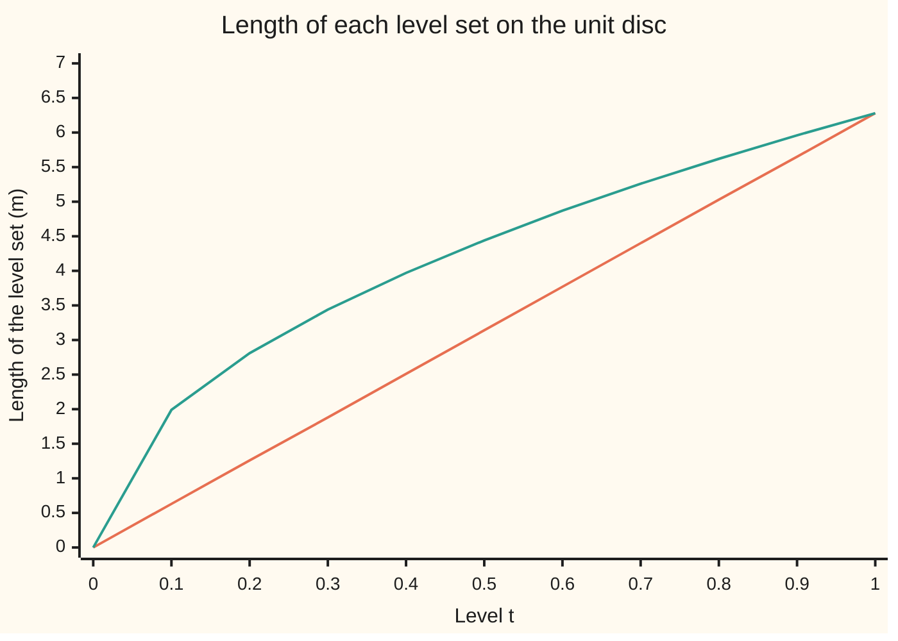

# The area and coarea formulas: Jacobians turn the Hausdorff measure of images and of level sets into ordinary integrals

[Syllabus](../../../SYLLABUS.md) → [Measure and integration](../README.md) → [Derivatives Meet the Lebesgue Integral](../README.md#s11) → The area and coarea formulas

---

## General Overview

A solar-cooker dish is 2 m across and 1 m deep. In metres, its shape is the bowl $`z = x^2 + y^2`$ over the unit disc: the points at most 1 m from the centre. How much sheet metal does it take? The flat disc under it has area π = 3.141593 m², and the bowl is clearly bigger.

The **area formula** answers it. Near each ground point, the map that lifts the ground onto the bowl acts like a matrix, its derivative. That matrix turns a small ground square into a small tilted parallelogram. The parallelogram's area divided by the square's area is the **Jacobian** $`Jf`$, the local stretch factor. Add the stretch factors over the ground and the total is the bowl's area: 5.330414 m², 1.696723 times the flat disc.

The **coarea formula** reads a shape the other way: by slicing it into level sets (the points where a function takes one value). Slice the disc into circles of radius $`t`$, the level sets of distance from the centre. Each circle has length $`2\pi t`$. Add the lengths from $`t = 0`$ to 1 and the total is π, the disc's area. Slices that crowd together need a correction: divide by how fast the function climbs.

Both formulas say the same thing at heart. **The size of a curved image, or of a stack of level sets, is an ordinary integral of a Jacobian, provided size means Hausdorff measure.**

**What kind of fact this is:** theorems. The area formula for a smooth one-to-one map is proved on this card in Why it works; its Lipschitz version is proved in outline, using [Rademacher's theorem](07-rademachers-theorem.md). The coarea formula is proved for linear functions and stated in general, with the proof cited.

### The picture: the lengths of the level sets, slice by slice



Orange: the circles where distance from the centre is $`t`$, length $`2\pi t`$. The area under it is π, the disc's area, because distance climbs at rate 1 everywhere. Green: the dish's contour rings, where the height $`x^2 + y^2`$ is $`t`$, length $`2\pi\sqrt t`$. The area under it is 4.188790, not π: adding contour lengths counts each bit of the disc weighted by the climbing rate $`2r`$.

---

## The formula

Notation first, in words.

- $`f`$ is a map from $`\mathbb R^m`$ to $`\mathbb R^n`$ with $`m \le n`$: it takes points with $`m`$ coordinates to points with $`n`$. For the dish, $`m = 2`$, $`n = 3`$ and $`f(x, y) = (x, y, x^2 + y^2)`$.
- $`Df(x)`$ is its **derivative matrix**: $`n`$ rows and $`m`$ columns of partial derivatives. Column $`j`$ is the arrow along which $`f(x)`$ moves when coordinate $`j`$ moves by one unit.
- $`Df^{\mathsf T}`$ is its transpose (rows and columns swapped). The $`m`$ by $`m`$ matrix $`Df^{\mathsf T} Df`$ holds the dot products of the columns: their lengths squared and their overlaps.
- $`\mathcal H^m`$ is $`m`$-dimensional Hausdorff measure ([Hausdorff measure and dimension](../02-Length%20Done%20Properly/08-hausdorff-measure-and-dimension.md)), **normalised**: the measure on that card times $`V_m/2^m`$, where $`V_m`$ is the volume of the ball of radius 1 in $`\mathbb R^m`$. The factor is 1 for length and π/4 for area. With it, $`\mathcal H^m`$ of a flat piece of $`\mathbb R^m`$ is its ordinary area or volume $`\lambda_m`$.
- $`\mathcal H^0`$ counts points.

The Jacobian of $`f`$ at $`x`$:

```math
Jf(x) = \sqrt{\det\big(Df(x)^{\mathsf T}\, Df(x)\big)}
```

**Read it aloud:** the stretch factor is the square root of the determinant of the matrix of dot products of the derivative's columns.

The **area formula**, for a one-to-one map $`f`$ with continuous partial derivatives, and every Borel set $`A`$ in $`\mathbb R^m`$:

```math
\mathcal H^m\big(f(A)\big) = \int_A Jf(x)\,dx
```

**Read it aloud:** the m-dimensional size of the image of A equals the integral of the stretch factor over A.

The same holds for a **Lipschitz** map (one that stretches no distance by more than a fixed factor), if the image is counted with multiplicity:

```math
\int_A Jf(x)\,dx = \int_{\mathbb R^n} \mathcal H^0\big(A \cap f^{-1}\{y\}\big)\, d\mathcal H^m(y)
```

**Read it aloud:** integrating the stretch factor over A gives the size of the image, with each image point counted as many times as A lands on it.

The **coarea formula**, for a Lipschitz function $`u`$ from $`\mathbb R^n`$ to the line, with gradient $`\nabla u`$ (the arrow of its partial derivatives, whose length $`\lvert\nabla u\rvert`$ is how fast $`u`$ climbs):

```math
\int_A \lvert\nabla u(x)\rvert\,dx = \int_{-\infty}^{\infty} \mathcal H^{n-1}\big(A \cap \{u = t\}\big)\,dt
```

**Read it aloud:** the integral of the climbing rate over A equals the total, over all levels t, of the (n − 1)-dimensional size of the part of A where u equals t.

With a weight $`g \ge 0`$ inside, it reads $`\int_A g\,\lvert\nabla u\rvert\,dx = \int \int_{A \cap \{u = t\}} g\,d\mathcal H^{n-1}\,dt`$. Putting $`g = 1/\lvert\nabla u\rvert`$ recovers plain volume from the level sets, on the part of $`A`$ where $`\nabla u \ne 0`$.

| Symbol | Plain meaning | In our example | Push it up and the answer… |
| --- | --- | --- | --- |
| $`m`$, $`n`$; $`x`$, $`y`$ | coordinates in and out; a point going in, a point coming out | 2 in, 3 out for the dish; $`x`$ = (0.3, 0.4) | — |
| $`f`$, $`h`$; $`A`$, $`E`$, $`f(A)`$ | the map, or the height $`h`$ of a graph $`z = h(x, y)`$; sets it lifts; the image | ground point to bowl point, $`h = x^2 + y^2`$; the unit disc; the dish | a steeper bowl has a larger image |
| $`Df`$, $`Df^{\mathsf T}`$ | derivative matrix, its transpose | columns $`(1, 0, 2x)`$ and $`(0, 1, 2y)`$ | — |
| $`Jf`$ | stretch factor, $`\sqrt{\det(Df^{\mathsf T} Df)}`$ | $`\sqrt{1 + 4r^2}`$; 1.414214 at (0.3, 0.4) | more area per unit of ground |
| $`\mathcal H^m`$, $`\mathcal H^0`$, $`V_m`$, $`\sigma`$ | normalised Hausdorff measure; point count; unit-ball volume; the polar card's surface measure on the sphere | $`\mathcal H^2`$(dish) = 5.330414 | — |
| $`\lambda_m`$ | ordinary length, area or volume in $`\mathbb R^m`$ | λ₂(disc) = π | — |
| $`r`$, $`\theta`$, $`\varphi`$ | distance from the centre; angle round; angle down from the north pole | $`r`$ from 0 to 1 | — |
| $`c`$ | the dish's depth factor, $`z = c(x^2 + y^2)`$ | 1 | area 9.044226 at $`c = 2`$ |
| $`u`$, $`\nabla u`$, $`t`$, $`a`$ | a function to slice by; its gradient; a level; the arrow of a linear $`u = a \cdot x`$ | $`u = \lvert x\rvert`$, rate 1; height $`x^2 + y^2`$, rate $`2r`$; $`a = (3, 4)`$ | faster climb, more weight per slice |
| $`g`$ | a weight inside the integral | $`1/\lvert\nabla u\rvert`$ for the contour map | — |
| $`L`$, $`O`$, $`S`$ | a matrix; one that keeps lengths; a square matrix | the derivative at one point, split as $`L = OS`$ | — |
| $`\varepsilon`$, $`x_0`$, $`U`$, $`s`$, $`k`$, and in the fold $`Q`$, $`M`$, $`\delta`$, $`P`$, $`K`$, $`z`$ | proof tools: a tolerance, a base point, a ball round it, the least stretch of $`L`$, a stretch bound; each defined where it appears | — | — |

### When it holds

- **One-to-one, or counted with multiplicity.** Run the dish's angle twice round and the Jacobian integral gives 10.660827, twice the metal. The plain area formula needs $`f`$ one-to-one; the Lipschitz form counts each image point as often as it is hit.
- **The right Jacobian.** Use the $`m`$ by $`m`$ matrix $`Df^{\mathsf T} Df`$. The $`n`$ by $`n`$ matrix $`Df\,Df^{\mathsf T}`$ has rank at most $`m`$, so for $`m < n`$ its determinant is 0 everywhere. (The coarea formula, where the map lowers dimension, uses $`Df\,Df^{\mathsf T}`$; for one function $`u`$ that is $`\lvert\nabla u\rvert^2`$.)
- **Lipschitz, at least.** Then the derivative exists almost everywhere ([Rademacher's theorem](07-rademachers-theorem.md)), and null sets go to null images. A map that is merely continuous can carry a set of area 0 onto a set of positive area, and the formula fails.
- **Normalised Hausdorff measure.** With the unnormalised measure of [Hausdorff measure and dimension](../02-Length%20Done%20Properly/08-hausdorff-measure-and-dimension.md), every area comes out 4/π = 1.273240 times too big: 6.786893 for the dish.
- **The climbing-rate weight in the coarea formula.** Adding contour lengths alone gives the integral of $`\lvert\nabla u\rvert`$, not area. For the dish's height that is 4.188790, not π.

---

## Why it works

### Step 0: a smooth map is a matrix on small pieces, and a matrix scales size by one number

Zoom in on the dish near one ground point. The bowl looks flat there, and the lift looks like a matrix: its derivative $`L = Df(x_0)`$. A matrix from $`\mathbb R^m`$ into $`\mathbb R^n`$ multiplies the $`m`$-dimensional size of every set by the same number, $`\sqrt{\det(L^{\mathsf T} L)}`$ (Step 1). A smooth map differs from its matrix by a little on a small ball, so it scales sizes there by nearly that number (Step 2). Cut the ground into small pieces, add, and let the pieces shrink (Step 3).

This is the plan of [Change of variables for Lebesgue measure](../06-Product%20Measures%20and%20Fubini/08-lebesgue-change-of-variables-and-polar-coordinates.md). The new part is $`m < n`$: the image is a thin surface with volume 0 in $`\mathbb R^n`$, so its size must be measured by $`\mathcal H^m`$.

### Step 1: the linear case

Let $`L`$ be an $`n`$ by $`m`$ matrix of rank $`m`$ (its columns point in $`m`$ independent directions). Write it as $`L = OS`$:

- $`S = \sqrt{L^{\mathsf T} L}`$, the $`m`$ by $`m`$ square root of the matrix of dot products. It equals its own transpose and stretches along its own axes by positive factors (its eigenvalues), so it has an inverse.
- $`O = L S^{-1}`$. Then $`O^{\mathsf T} O = S^{-1} L^{\mathsf T} L S^{-1}`$ is the identity, so $`O`$ keeps every length and every distance.

Hausdorff measure is built from diameters alone, so a map that keeps distances keeps $`\mathcal H^m`$. And $`\mathcal H^m = \lambda_m`$ on $`\mathbb R^m`$ itself (the normalisation; the constant comes from the isodiametric inequality, cited on the Hausdorff card). So, for a Borel set $`E`$ in $`\mathbb R^m`$:

```math
\mathcal H^m\big(L(E)\big) = \mathcal H^m\big(O(S(E))\big) = \lambda_m\big(S(E)\big) = \lvert\det S\rvert\,\lambda_m(E) = \sqrt{\det(L^{\mathsf T} L)}\;\lambda_m(E)
```

The third equality is the linear case of [Change of variables for Lebesgue measure](../06-Product%20Measures%20and%20Fubini/08-lebesgue-change-of-variables-and-polar-coordinates.md); the last uses $`(\det S)^2 = \det(S^2)`$ ([Determinants](../../03-Algebra/05-Solving%20Systems/04-determinants.md)). If $`L`$ has rank below $`m`$, $`L(E)`$ lies in a flat of dimension below $`m`$, so $`\mathcal H^m(L(E)) = 0 = \det(L^{\mathsf T} L)`$.

**A second way to read the number.** The Cauchy–Binet formula, proved on [The matrix-tree theorem](../../04-Combinatorics%20and%20graphs/10-Trees%20and%20Cheapest%20Routes/07-matrix-tree-theorem.md), says $`\det(L^{\mathsf T} L)`$ is the sum of the squares of all $`m`$ by $`m`$ minors of $`L`$ (determinants of $`m`$ of its rows). For $`m = 2`$, $`n = 3`$, the minors are the entries of the cross product of the two columns. So $`Jf`$ is the length of the cross product, the area vector of [Surface integrals](../../06-Calculus%20and%20analysis/09-Vector%20Calculus/05-surface-integrals-and-flux.md). The calculus card's formula is the area formula, and its "area" is $`\mathcal H^2`$.

### Step 2: near one point, a smooth map is its matrix up to a factor 1 ± ε

Take a point $`x_0`$ with $`Jf(x_0) > 0`$, and let $`L = Df(x_0)`$. Then $`L`$ has rank $`m`$, so it shrinks no arrow below some fixed fraction $`s > 0`$ of its length: $`\lvert Lv\rvert \ge s\lvert v\rvert`$.

Fix a small $`\varepsilon`$ between 0 and 1. The partial derivatives are continuous, so on a small ball $`U`$ round $`x_0`$ the derivative stays within $`\varepsilon s`$ of $`L`$. For $`x`$ and $`y`$ in $`U`$, the fundamental theorem of calculus along the segment between them gives

```math
\big\lvert f(x) - f(y) - L(x - y)\big\rvert \le \varepsilon s\,\lvert x - y\rvert \le \varepsilon\,\lvert L(x - y)\rvert .
```

So on $`U`$, $`f`$ is $`L`$ followed by a map that stretches every distance by a factor between $`1 - \varepsilon`$ and $`1 + \varepsilon`$. A map that stretches distances by at most $`k`$ stretches every diameter by at most $`k`$, so it multiplies $`\mathcal H^m`$ by at most $`k^m`$. With Step 1, for Borel $`E`$ inside $`U`$:

```math
(1 - \varepsilon)^m\, JL\;\lambda_m(E) \;\le\; \mathcal H^m\big(f(E)\big) \;\le\; (1 + \varepsilon)^m\, JL\;\lambda_m(E)
```

Here $`JL = \sqrt{\det(L^{\mathsf T} L)}`$. Shrink $`U`$ further so that $`Jf`$ stays between $`(1 - \varepsilon)JL`$ and $`(1 + \varepsilon)JL`$ on it. Then $`\int_E Jf`$ lies between $`(1 - \varepsilon)`$ and $`(1 + \varepsilon)`$ times $`JL\,\lambda_m(E)`$. So the ratio of $`\mathcal H^m(f(E))`$ to $`\int_E Jf`$ lies between $`(1 - \varepsilon)^m/(1 + \varepsilon)`$ and $`(1 + \varepsilon)^m/(1 - \varepsilon)`$, both close to 1.

### Step 3: patch the pieces together, and throw away the flat points

**Where Jf is positive.** Every point of that open set has a ball $`U`$ from Step 2, and countably many of the balls cover the set (balls with rational centres and radii are enough). Cut $`A`$ into disjoint Borel pieces, each inside one ball. Because $`f`$ is one-to-one, the images of the pieces do not overlap. They are Borel sets (a continuous one-to-one map sends Borel sets to Borel sets: the Lusin–Souslin theorem, a standard result not proved here). So $`\mathcal H^m`$ adds over them, and so does the integral. Each piece obeys Step 2's bounds, so the totals obey them too. Let $`\varepsilon \to 0`$: $`\mathcal H^m(f(A)) = \int_A Jf`$.

**Where Jf is zero.** There both sides must be 0. The integral is 0 at once. The image has $`\mathcal H^m`$ zero because, at such a point, the derivative squashes a small cube into a flat of lower dimension, and the image of the cube is a thin slab that small balls cover cheaply. The fold gives the count.

<details>
<summary>Detailed proof: the flat points have an image of size zero</summary>

Work inside one closed cube $`Q`$ of side 1; countably many cover $`\mathbb R^m`$. On $`Q`$ the derivative is bounded by some $`M`$ and uniformly continuous. Fix $`\varepsilon`$ with $`0 < \varepsilon \le M`$, and choose a side $`\delta`$ so small that the derivative changes by at most $`\varepsilon`$ between points $`\sqrt m\,\delta`$ apart.

Cut $`Q`$ into $`\delta^{-m}`$ small cubes of side $`\delta`$. Take one that holds a point $`x`$ with $`Jf(x) = 0`$, and let $`L = Df(x)`$. Its rank is below $`m`$, so $`L`$ sends everything into a flat $`P`$ of dimension $`m - 1`$. For $`z`$ in the small cube, $`\lvert z - x\rvert \le \sqrt m\,\delta`$, and Step 2's estimate gives

$`\displaystyle \lvert f(z) - f(x) - L(z - x)\rvert \le \varepsilon\sqrt m\,\delta, \qquad \lvert L(z - x)\rvert \le M\sqrt m\,\delta .`$

So the image of the small cube lies in a box with $`m - 1`$ sides of length $`2(M + \varepsilon)\sqrt m\,\delta`$, along $`P`$, and the other $`n - m + 1`$ sides of length $`2\varepsilon\sqrt m\,\delta`$. Cover the box by cubes of side $`2\varepsilon\sqrt m\,\delta`$. It takes at most $`(M/\varepsilon + 2)^{m-1}`$ of them, each of diameter $`2\varepsilon\sqrt{mn}\,\delta`$. Their total weight at power $`m`$ is at most

$`\displaystyle \Big(\frac{M}{\varepsilon} + 2\Big)^{m-1} \big(2\varepsilon\sqrt{mn}\,\delta\big)^m \le K\,\varepsilon\,\delta^m, \qquad K = (3M)^{m-1}\,(2\sqrt{mn})^m .`$

Adding over at most $`\delta^{-m}`$ small cubes, the flat points of $`Q`$ have an image of weight at most $`K\varepsilon`$, with covers that shrink as $`\delta`$ does. $`K`$ does not depend on $`\varepsilon`$, so the image has $`\mathcal H^m`$ zero.

</details>

**A sphere, as a check.** The unit sphere, named by the angle $`\varphi`$ down from the north pole and the angle $`\theta`$ round, has $`Jf = \sin\varphi`$. The area formula gives $`2\pi\int_0^\pi \sin\varphi\,d\varphi = 4\pi`$ = 12.566371; a mesh of flat triangles gives 12.565725.

**From sets to functions.** Sets give indicator functions; simple functions and monotone convergence then give, for Borel $`g \ge 0`$, $`\int_A g(x)\,Jf(x)\,dx = \int_{f(A)} g(f^{-1}(y))\,d\mathcal H^m(y)`$. That is how a surface integral of a density, such as kilograms per square metre, becomes a ground integral.

### Step 4: the Lipschitz version, in outline

A Lipschitz map need not have a derivative everywhere: the cone $`z = \sqrt{x^2 + y^2}`$ has a point at its tip. Three facts carry the formula over.

1. **The derivative exists almost everywhere.** That is [Rademacher's theorem](07-rademachers-theorem.md). So $`Jf`$ is defined except on a null set.
2. **Null sets go to null images.** A map that stretches distances by at most $`k`$ multiplies $`\mathcal H^m`$ by at most $`k^m`$, so a null set's image has $`\mathcal H^m`$ zero. The tip, and every other bad point, costs nothing.
3. **Almost all of A splits into countably many pieces on each of which f is within a factor 1 ± ε of one fixed matrix**, as in Step 2 (Evans and Gariepy, section 3.3, cited). Step 3's adding then works piece by piece, with points hit twice counted twice.

For the cone over the unit disc, $`Jf = \sqrt 2`$ everywhere but the tip, and the area is $`\sqrt2\,\pi`$ = 4.442883.

### Step 5: the coarea formula for a linear function

Take $`u(x) = a \cdot x`$, a dot product with a fixed nonzero arrow $`a`$. Its climbing rate is $`\lvert\nabla u\rvert = \lvert a\rvert`$ everywhere. Turn space so that $`a`$ points along the last axis. Turning keeps distances, so it keeps $`\lambda_n`$ and $`\mathcal H^{n-1}`$. The level set $`\{u = t\}`$ becomes the flat $`x_n = t/\lvert a\rvert`$, where $`\mathcal H^{n-1}`$ is ordinary $`(n-1)`$-dimensional volume. Fubini ([Tonelli and Fubini](../06-Product%20Measures%20and%20Fubini/03-tonelli-and-fubini.md)) slices $`A`$ along the last axis:

```math
\lambda_n(A) = \int \mathcal H^{n-1}\big(A \cap \{x_n = s\}\big)\,ds = \frac{1}{\lvert a\rvert}\int \mathcal H^{n-1}\big(A \cap \{u = t\}\big)\,dt
```

The second step substitutes $`t = \lvert a\rvert s`$. Multiply by $`\lvert a\rvert`$: $`\int_A \lvert\nabla u\rvert = \lvert a\rvert\,\lambda_n(A) = \int \mathcal H^{n-1}(A \cap \{u = t\})\,dt`$. Slices of a steep function crowd together, $`1/\lvert a\rvert`$ apart per unit of $`t`$, and the weight $`\lvert a\rvert`$ pays for the crowding.

For $`u = 3x + 4y`$ on the unit square, $`\lvert\nabla u\rvert = 5`$. The level segments, added over $`t`$ from 0 to 7, total 5.000000.

### Step 6: the general coarea formula, stated

For a Lipschitz $`u`$, the same two moves as Steps 2 to 4 work: $`u`$ is nearly linear on small pieces almost everywhere, by Rademacher's theorem, and Step 5 handles each piece. The set where $`\nabla u = 0`$ needs its own argument: there the level sets have total size 0 for almost every level. The full proof is in Evans and Gariepy, section 3.4, and goes back to the 1959 paper on curvature measures listed in Sources; it is not reproduced here.

**Polar coordinates are one case of it.** Take $`u(x) = \lvert x\rvert`$, distance from the centre. Away from the centre, $`\lvert\nabla u\rvert = 1`$, and the level sets are the spheres of radius $`t`$. The weighted coarea formula becomes

```math
\int_{\mathbb R^n} g(x)\,dx = \int_0^\infty \int_{\{\lvert x\rvert = t\}} g\;d\mathcal H^{n-1}\,dt
```

That is the polar formula of [Change of variables for Lebesgue measure](../06-Product%20Measures%20and%20Fubini/08-lebesgue-change-of-variables-and-polar-coordinates.md). Put $`g`$ = 1 on a cone of directions over a set $`E`$ of the unit sphere, out to radius 1: the left side is the cone's volume, the right side $`\mathcal H^{n-1}(E)/n`$. So that card's surface measure $`\sigma`$, defined as $`n`$ times the cone's volume, is $`\mathcal H^{n-1}`$ on the sphere.

On the unit disc, $`\int_0^1 2\pi t\,dt = \pi`$: the polar formula again.

---

## Worked numbers, by hand

The dish $`z = x^2 + y^2`$ over the unit disc, then the two coarea checks.

| Step | Arithmetic | Value |
| --- | --- | --- |
| derivative columns at (0.3, 0.4) | $`(1, 0, 2x)`$, $`(0, 1, 2y)`$ | $`(1, 0, 0.6)`$, $`(0, 1, 0.8)`$ |
| $`Df^{\mathsf T} Df`$ | lengths squared and overlap | 1.36, 0.48, 0.48, 1.64 |
| its determinant | $`1.36 \times 1.64 - 0.48^2`$ | 2.000000 |
| by minors (cross product) | $`1^2 + 0.8^2 + (-0.6)^2`$ | 2.000000 |
| $`Jf`$ there | $`\sqrt 2 = \sqrt{1 + 4 \times 0.25}`$ | 1.414214 |
| $`Jf`$ in general | $`\det = 1 + 4x^2 + 4y^2`$ | $`\sqrt{1 + 4r^2}`$ |
| area integral, in polar coordinates | $`2\pi\int_0^1 \sqrt{1 + 4r^2}\; r\,dr = 2\pi \cdot \tfrac{1}{12}\big[(1 + 4r^2)^{3/2}\big]_0^1`$ | $`\tfrac{\pi}{6}(5\sqrt5 - 1)`$ |
| the numbers | 0.523599 × 10.180340 | **5.330414 m²** |
| coarea, $`u = \lvert x\rvert`$ | $`\int_0^1 2\pi t\,dt`$ | π = 3.141593 |
| coarea, height $`u = x^2 + y^2`$ | $`\int_{\text{disc}} 2r = \int_0^1 2\pi\sqrt t\,dt = \tfrac{4\pi}{3}`$ | 4.188790 |
| contour map, weight $`1/\lvert\nabla u\rvert`$ | $`\int_0^1 2\pi\sqrt t \,/\, (2\sqrt t)\,dt`$ | π |

The dish takes 5.330414 m² of sheet metal before trimming and seams, 1.696723 times the flat disc beneath it.

### What breaks if you drop a piece

| Mistake | Comes out at | What went wrong |
| --- | --- | --- |
| No Jacobian: area of the shadow | 3.141593 | Counts ground, not bowl; the bowl is 1.696723 times bigger |
| $`Jf = 1 + \lvert\nabla h\rvert`$ for a graph $`z = h(x, y)`$ | 7.330383 | Stretches add like the sides of a right triangle, $`\sqrt{1 + \lvert\nabla h\rvert^2}`$, not in a line |
| $`\sqrt{\det(Df\,Df^{\mathsf T})}`$, the 3 by 3 matrix | 0.000000 at (0.3, 0.4) | That matrix has rank 2, so its determinant is 0 for every surface in space |
| Unnormalised Hausdorff measure | 6.786893 | Off by 4/π = 1.273240; only normalised $`\mathcal H^2`$ equals area |
| Angle run twice round | 10.660827 | Not one-to-one: each point counted twice |
| Contour lengths added with no weight | 4.188790, not π | That is the integral of $`\lvert\nabla u\rvert`$; area needs the weight $`1/\lvert\nabla u\rvert`$ |

---

## Code, from first principles, and it actually runs

The scripts reach each area by roads that share no formula. The Jacobian is built from the columns of the derivative and integrated by Simpson's rule. The closed form is checked against it. A mesh of 160000 flat triangles, whose areas come from cross products, measures each surface with no Jacobian at all: dish, unit sphere, and the Lipschitz cone. The coarea formula is checked three ways: the linear case by exact segment lengths, $`u = \lvert x\rvert`$ by a grid count against circle lengths and 1000-sided polygons, and the dish's height by polar coordinates against a grid and against contour lengths. Every number on the card, including the chart and the broken answers, is printed.

### Python

```python
# Area and coarea formulas -- the check behind the card.  Standard library only.
# Every area is reached by roads that do not share a formula: the Jacobian
# integrated by Simpson's rule, a closed form, and a mesh of flat triangles
# whose areas come from cross products, with no Jacobian anywhere.
from math import sqrt, pi, sin, cos

def gram_jf(cols):                     # Jf = sqrt(det(Df^T Df)) for two columns
    a, b = cols
    aa = sum(x * x for x in a); bb = sum(x * x for x in b); ab = sum(x * y for x, y in zip(a, b))
    return sqrt(aa * bb - ab * ab)

def minors_sq(a, b):                   # sum of squared 2x2 minors (Cauchy-Binet)
    return sum((a[i] * b[j] - a[j] * b[i]) ** 2 for i in range(3) for j in range(i + 1, 3))

def det3(m):
    return (m[0][0] * (m[1][1] * m[2][2] - m[1][2] * m[2][1]) - m[0][1] * (m[1][0] * m[2][2] - m[1][2] * m[2][0])
            + m[0][2] * (m[1][0] * m[2][1] - m[1][1] * m[2][0]))

def simpson(g, a, b, n=2000):
    h = (b - a) / n
    s = g(a) + g(b) + sum((4 if k % 2 else 2) * g(a + k * h) for k in range(1, n))
    return s * h / 3

def tri(p, q, r):                      # area of a flat triangle in space
    u = [q[i] - p[i] for i in range(3)]; v = [r[i] - p[i] for i in range(3)]
    c = (u[1] * v[2] - u[2] * v[1], u[2] * v[0] - u[0] * v[2], u[0] * v[1] - u[1] * v[0])
    return 0.5 * sqrt(c[0] ** 2 + c[1] ** 2 + c[2] ** 2)

def mesh(f, a0, a1, b0, b1, na, nb):   # triangle-mesh area of f over a rectangle of parameters
    pts = [[f(a0 + (a1 - a0) * i / na, b0 + (b1 - b0) * j / nb) for j in range(nb + 1)] for i in range(na + 1)]
    return sum(tri(pts[i][j], pts[i + 1][j], pts[i + 1][j + 1]) + tri(pts[i][j], pts[i + 1][j + 1], pts[i][j + 1])
               for i in range(na) for j in range(nb))

def show(label, x):
    print(f"{label:<48}{x:>12.6f}")

dish = lambda r, t, c=1.0: (r * cos(t), r * sin(t), c * r * r)      # z = c(x^2 + y^2) over the unit disc
dish_cols = lambda x, y, c=1.0: ((1.0, 0.0, 2 * c * x), (0.0, 1.0, 2 * c * y))
def dish_area(c):
    return 2 * pi * simpson(lambda r: gram_jf(dish_cols(r, 0.0, c)) * r, 0.0, 1.0)

a, b = dish_cols(0.3, 0.4)
gm = [[sum(p * q for p, q in zip(u, v)) for v in (a, b)] for u in (a, b)]
print("Df^T Df at (0.3, 0.4)" + " " * 21 + " ".join(f"{x:.2f}" for x in gm[0] + gm[1]))
print("2x2 minors of Df at (0.3, 0.4)" + " " * 16 + " ".join(f"{a[i] * b[j] - a[j] * b[i]:.2f}" for i, j in [(0, 1), (0, 2), (1, 2)]))
g = gram_jf((a, b)); show("Jf at (0.3, 0.4): det(Df^T Df)", g * g)
show("Jf at (0.3, 0.4): sum of squared minors", minors_sq(a, b))
show("Jf at (0.3, 0.4)", g)
assert abs(g - sqrt(1 + 4 * 0.25)) < 1e-12 and abs(g * g - minors_sq(a, b)) < 1e-12
big = abs(det3([[a[i] * a[j] + b[i] * b[j] for j in range(3)] for i in range(3)]))   # the wrong 3 by 3
closed = pi / 6 * (5 * sqrt(5) - 1)
by_jf, by_mesh = dish_area(1.0), mesh(dish, 0.0, 1.0, 0.0, 2 * pi, 200, 400)
show("5 sqrt5 - 1", 5 * sqrt(5) - 1); show("pi/6", pi / 6)
show("dish area, closed form (pi/6)(5 sqrt5 - 1)", closed)
show("dish area, Simpson on Jf in polar", by_jf)
show("dish area, mesh of 160000 flat triangles", by_mesh)
show("dish area / flat disc", by_jf / pi)
assert abs(by_jf - closed) < 1e-9 and abs(by_mesh - closed) < 2e-3

sph = lambda p, t: (sin(p) * cos(t), sin(p) * sin(t), cos(p))
sph_jf = lambda p: gram_jf(((cos(p), 0.0, -sin(p)), (0.0, sin(p), 0.0)))   # columns at angle t = 0
s_jf, s_mesh = 2 * pi * simpson(sph_jf, 0.0, pi), mesh(sph, 0.0, pi, 0.0, 2 * pi, 200, 400)
show("sphere area, 4 pi", 4 * pi)
show("sphere area, Simpson on Jf = sin(phi)", s_jf)
show("sphere area, mesh of 160000 flat triangles", s_mesh)
assert abs(s_jf - 4 * pi) < 1e-9 and abs(s_mesh - 4 * pi) < 2e-3

cone = lambda r, t: (r * cos(t), r * sin(t), r)                    # z = |x|: Lipschitz, no slope at 0
c_jf = 2 * pi * simpson(lambda r: gram_jf(((1.0, 0.0, 1.0), (0.0, 1.0, 0.0))) * r, 0.0, 1.0)
c_mesh = mesh(cone, 0.0, 1.0, 0.0, 2 * pi, 200, 400)
show("cone area, sqrt2 pi", sqrt(2) * pi)
show("cone area, Simpson on Jf = sqrt2", c_jf)
show("cone area, mesh of 160000 flat triangles", c_mesh)
assert abs(c_jf - sqrt(2) * pi) < 1e-9 and abs(c_mesh - sqrt(2) * pi) < 2e-3

def seg_len(p, q, t):                  # length of {p x + q y = t} inside the unit square
    lo, hi = max(0.0, (t - q) / p), min(1.0, t / p)
    return max(0.0, hi - lo) * sqrt(1 + (p / q) ** 2)
def coarea_linear(p, q):               # breaks at q and p, so Simpson is exact piece by piece
    return sum(simpson(lambda t: seg_len(p, q, t), u, v, 20) for u, v in [(0, p), (p, q), (q, p + q)])
show("linear u = 3x + 4y: |grad u| x area", sqrt(3 * 3 + 4 * 4) * 1.0)
show("linear u = 3x + 4y: integral of level lengths", coarea_linear(3.0, 4.0))
show("linear u = 5x + 12y: integral of level lengths", coarea_linear(5.0, 12.0))
assert abs(coarea_linear(3.0, 4.0) - 5.0) < 1e-12 and abs(coarea_linear(5.0, 12.0) - 13.0) < 1e-12

n = 1000; h = 2.0 / n; cnt = 0; gsum = 0.0
for i in range(n):
    for j in range(n):
        x, y = -1 + (i + 0.5) * h, -1 + (j + 0.5) * h
        if x * x + y * y < 1:
            cnt += 1; gsum += 2 * sqrt(x * x + y * y)
poly = lambda t, k=1000: sum(sqrt((t * cos(2 * pi * (i + 1) / k) - t * cos(2 * pi * i / k)) ** 2
                                  + (t * sin(2 * pi * (i + 1) / k) - t * sin(2 * pi * i / k)) ** 2) for i in range(k))
show("u = |x|: integral of |grad u| = 1, grid count", cnt * h * h)
show("u = |x|: integral of circle lengths 2 pi t", simpson(lambda t: 2 * pi * t, 0.0, 1.0))
show("u = |x|: integral of 1000-gon perimeters", simpson(poly, 0.0, 1.0, 40))
assert abs(cnt * h * h - pi) < 1e-3 and abs(simpson(poly, 0.0, 1.0, 40) - pi) < 1e-4
lhs = 2 * pi * simpson(lambda r: 2 * r * r, 0.0, 1.0)
rhs = simpson(lambda t: 2 * pi * sqrt(t), 0.0, 1.0, 200000)
show("u = x^2 + y^2: integral of |grad u| = 2r, polar", lhs)
show("u = x^2 + y^2: integral of |grad u|, grid", gsum * h * h)
show("u = x^2 + y^2: integral of contour lengths", rhs)
m = 200; cmap = sum(poly(sqrt((k + 0.5) / m)) / (2 * sqrt((k + 0.5) / m)) for k in range(m)) / m
show("contour map: integral of length / |grad u|", cmap)
assert abs(cmap - pi) < 1e-4 and abs(lhs - 4 * pi / 3) < 1e-9 and abs(rhs - lhs) < 1e-5 and abs(gsum * h * h - lhs) < 1e-3

print("chart, lengths of {|x| = t}   " + " ".join(f"{2 * pi * k / 10:.2f}" for k in range(11)))
print("chart, lengths of {r^2 = t}   " + " ".join(f"{2 * pi * sqrt(k / 10):.2f}" for k in range(11)))
wrong = [("break, no Jacobian (shadow area)", pi), ("break, Jf = 1 + |grad h|", 2 * pi * simpson(lambda r: (1 + 2 * r) * r, 0.0, 1.0)),
         ("break, det(Df Df^T), 3 by 3, at (0.3, 0.4)", big), ("break, unnormalised H^2 (x 4/pi)", closed * 4 / pi),
         ("break, angle run twice round", 2 * dish_area(1.0)), ("break, contour lengths added, no |grad u|", rhs)]
show("4/pi, the Hausdorff card's area constant", 4 / pi)
for label, v in wrong:
    show(label, v)
assert big < 1e-12 and abs(wrong[1][1] - 7 * pi / 3) < 1e-9
show("try, dish z = 2(x^2 + y^2), Simpson on Jf", dish_area(2.0))
show("try, dish z = 2(x^2 + y^2), closed form", pi / 24 * (17 * sqrt(17) - 1))
show("try, dish mesh starved to 10 x 20", mesh(dish, 0.0, 1.0, 0.0, 2 * pi, 10, 20))
print("ALL CHECKS PASS")
```

**Ran 2026-11-23 on macOS, Python 3.14.10, standard library only. All checks passed. Output, pasted from the run:**

```
Df^T Df at (0.3, 0.4)                     1.36 0.48 0.48 1.64
2x2 minors of Df at (0.3, 0.4)                1.00 0.80 -0.60
Jf at (0.3, 0.4): det(Df^T Df)                      2.000000
Jf at (0.3, 0.4): sum of squared minors             2.000000
Jf at (0.3, 0.4)                                    1.414214
5 sqrt5 - 1                                        10.180340
pi/6                                                0.523599
dish area, closed form (pi/6)(5 sqrt5 - 1)          5.330414
dish area, Simpson on Jf in polar                   5.330414
dish area, mesh of 160000 flat triangles            5.330279
dish area / flat disc                               1.696723
sphere area, 4 pi                                  12.566371
sphere area, Simpson on Jf = sin(phi)              12.566371
sphere area, mesh of 160000 flat triangles         12.565725
cone area, sqrt2 pi                                 4.442883
cone area, Simpson on Jf = sqrt2                    4.442883
cone area, mesh of 160000 flat triangles            4.442769
linear u = 3x + 4y: |grad u| x area                 5.000000
linear u = 3x + 4y: integral of level lengths       5.000000
linear u = 5x + 12y: integral of level lengths     13.000000
u = |x|: integral of |grad u| = 1, grid count       3.141824
u = |x|: integral of circle lengths 2 pi t          3.141593
u = |x|: integral of 1000-gon perimeters            3.141587
u = x^2 + y^2: integral of |grad u| = 2r, polar     4.188790
u = x^2 + y^2: integral of |grad u|, grid           4.189253
u = x^2 + y^2: integral of contour lengths          4.188790
contour map: integral of length / |grad u|          3.141587
chart, lengths of {|x| = t}   0.00 0.63 1.26 1.88 2.51 3.14 3.77 4.40 5.03 5.65 6.28
chart, lengths of {r^2 = t}   0.00 1.99 2.81 3.44 3.97 4.44 4.87 5.26 5.62 5.96 6.28
4/pi, the Hausdorff card's area constant            1.273240
break, no Jacobian (shadow area)                    3.141593
break, Jf = 1 + |grad h|                            7.330383
break, det(Df Df^T), 3 by 3, at (0.3, 0.4)          0.000000
break, unnormalised H^2 (x 4/pi)                    6.786893
break, angle run twice round                       10.660827
break, contour lengths added, no |grad u|           4.188790
try, dish z = 2(x^2 + y^2), Simpson on Jf           9.044226
try, dish z = 2(x^2 + y^2), closed form             9.044226
try, dish mesh starved to 10 x 20                   5.276870
ALL CHECKS PASS
```

### Rust

```rust
// Area and coarea formulas -- the check behind the card.  std only.
// Every area is reached by roads that do not share a formula: the Jacobian
// integrated by Simpson's rule, a closed form, and a mesh of flat triangles
// whose areas come from cross products, with no Jacobian anywhere.
use std::f64::consts::PI;
type V3 = [f64; 3];

fn dot(a: &V3, b: &V3) -> f64 { let mut s = 0.0; for i in 0..3 { s += a[i] * b[i]; } s }

// Jf = sqrt(det(Df^T Df)) for two columns
fn gram_jf(a: &V3, b: &V3) -> f64 { let (aa, bb, ab) = (dot(a, a), dot(b, b), dot(a, b)); (aa * bb - ab * ab).sqrt() }

// sum of squared 2x2 minors (Cauchy-Binet)
fn minors_sq(a: &V3, b: &V3) -> f64 {
    let mut s = 0.0;
    for i in 0..3 { for j in (i + 1)..3 { let m = a[i] * b[j] - a[j] * b[i]; s += m * m; } }
    s
}

fn det3(m: &[[f64; 3]; 3]) -> f64 {
    m[0][0] * (m[1][1] * m[2][2] - m[1][2] * m[2][1]) - m[0][1] * (m[1][0] * m[2][2] - m[1][2] * m[2][0])
        + m[0][2] * (m[1][0] * m[2][1] - m[1][1] * m[2][0])
}

fn simpson<F: Fn(f64) -> f64>(g: F, a: f64, b: f64, n: usize) -> f64 {
    let h = (b - a) / n as f64;
    let mut acc = 0.0;
    for k in 1..n { acc += (if k % 2 == 1 { 4.0 } else { 2.0 }) * g(a + k as f64 * h); }
    (g(a) + g(b) + acc) * h / 3.0
}

// area of a flat triangle in space
fn tri(p: &V3, q: &V3, r: &V3) -> f64 {
    let u = [q[0] - p[0], q[1] - p[1], q[2] - p[2]];
    let v = [r[0] - p[0], r[1] - p[1], r[2] - p[2]];
    let c = [u[1] * v[2] - u[2] * v[1], u[2] * v[0] - u[0] * v[2], u[0] * v[1] - u[1] * v[0]];
    0.5 * (c[0] * c[0] + c[1] * c[1] + c[2] * c[2]).sqrt()
}

// triangle-mesh area of f over a rectangle of parameters
fn mesh<F: Fn(f64, f64) -> V3>(f: F, a0: f64, a1: f64, b0: f64, b1: f64, na: usize, nb: usize) -> f64 {
    let pts: Vec<Vec<V3>> = (0..=na).map(|i| (0..=nb).map(|j|
        f(a0 + (a1 - a0) * i as f64 / na as f64, b0 + (b1 - b0) * j as f64 / nb as f64)).collect()).collect();
    let mut s = 0.0;
    for i in 0..na { for j in 0..nb {
        s += tri(&pts[i][j], &pts[i + 1][j], &pts[i + 1][j + 1]) + tri(&pts[i][j], &pts[i + 1][j + 1], &pts[i][j + 1]);
    } }
    s
}

fn show(label: &str, x: f64) { println!("{:<48}{:>12.6}", label, x); }

// z = c(x^2 + y^2) over the unit disc
fn dish(r: f64, t: f64, c: f64) -> V3 { [r * t.cos(), r * t.sin(), c * r * r] }
fn dish_cols(x: f64, y: f64, c: f64) -> (V3, V3) { ([1.0, 0.0, 2.0 * c * x], [0.0, 1.0, 2.0 * c * y]) }
fn dish_area(c: f64) -> f64 {
    2.0 * PI * simpson(|r| { let (a, b) = dish_cols(r, 0.0, c); gram_jf(&a, &b) * r }, 0.0, 1.0, 2000)
}

// length of {p x + q y = t} inside the unit square
fn seg_len(p: f64, q: f64, t: f64) -> f64 {
    let (lo, hi) = (f64::max(0.0, (t - q) / p), f64::min(1.0, t / p));
    f64::max(0.0, hi - lo) * (1.0 + (p / q) * (p / q)).sqrt()
}
// breaks at q and p, so Simpson is exact piece by piece
fn coarea_linear(p: f64, q: f64) -> f64 {
    let mut s = 0.0;
    for (u, v) in [(0.0, p), (p, q), (q, p + q)] { s += simpson(|t| seg_len(p, q, t), u, v, 20); }
    s
}

fn poly(t: f64) -> f64 {
    let k = 1000; let mut s = 0.0;
    for i in 0..k {
        let (a0, a1) = (2.0 * PI * i as f64 / k as f64, 2.0 * PI * (i + 1) as f64 / k as f64);
        let (dx, dy) = (t * a1.cos() - t * a0.cos(), t * a1.sin() - t * a0.sin());
        s += (dx * dx + dy * dy).sqrt();
    }
    s
}

fn main() {
    let (a, b) = dish_cols(0.3, 0.4, 1.0);
    let gm = [dot(&a, &a), dot(&a, &b), dot(&b, &a), dot(&b, &b)];
    println!("Df^T Df at (0.3, 0.4){}{}", " ".repeat(21), gm.iter().map(|x| format!("{:.2}", x)).collect::<Vec<_>>().join(" "));
    let mn: Vec<String> = [(0, 1), (0, 2), (1, 2)].iter().map(|&(i, j)| format!("{:.2}", a[i] * b[j] - a[j] * b[i])).collect();
    println!("2x2 minors of Df at (0.3, 0.4){}{}", " ".repeat(16), mn.join(" "));
    let g = gram_jf(&a, &b);
    show("Jf at (0.3, 0.4): det(Df^T Df)", g * g);
    show("Jf at (0.3, 0.4): sum of squared minors", minors_sq(&a, &b));
    show("Jf at (0.3, 0.4)", g);
    assert!((g - (1.0f64 + 4.0 * 0.25).sqrt()).abs() < 1e-12 && (g * g - minors_sq(&a, &b)).abs() < 1e-12);
    let mut m = [[0.0; 3]; 3];
    for i in 0..3 { for j in 0..3 { m[i][j] = a[i] * a[j] + b[i] * b[j]; } }
    let big = det3(&m).abs(); // the wrong 3 by 3
    let closed = PI / 6.0 * (5.0 * 5.0f64.sqrt() - 1.0);
    let (by_jf, by_mesh) = (dish_area(1.0), mesh(|r, t| dish(r, t, 1.0), 0.0, 1.0, 0.0, 2.0 * PI, 200, 400));
    show("5 sqrt5 - 1", 5.0 * 5.0f64.sqrt() - 1.0);
    show("pi/6", PI / 6.0);
    show("dish area, closed form (pi/6)(5 sqrt5 - 1)", closed);
    show("dish area, Simpson on Jf in polar", by_jf);
    show("dish area, mesh of 160000 flat triangles", by_mesh);
    show("dish area / flat disc", by_jf / PI);
    assert!((by_jf - closed).abs() < 1e-9 && (by_mesh - closed).abs() < 2e-3);

    let sph = |p: f64, t: f64| [p.sin() * t.cos(), p.sin() * t.sin(), p.cos()];
    let sph_jf = |p: f64| gram_jf(&[p.cos(), 0.0, -p.sin()], &[0.0, p.sin(), 0.0]); // columns at angle t = 0
    let (s_jf, s_mesh) = (2.0 * PI * simpson(sph_jf, 0.0, PI, 2000), mesh(sph, 0.0, PI, 0.0, 2.0 * PI, 200, 400));
    show("sphere area, 4 pi", 4.0 * PI);
    show("sphere area, Simpson on Jf = sin(phi)", s_jf);
    show("sphere area, mesh of 160000 flat triangles", s_mesh);
    assert!((s_jf - 4.0 * PI).abs() < 1e-9 && (s_mesh - 4.0 * PI).abs() < 2e-3);

    let cone = |r: f64, t: f64| [r * t.cos(), r * t.sin(), r]; // z = |x|: Lipschitz, no slope at 0
    let c_jf = 2.0 * PI * simpson(|r| gram_jf(&[1.0, 0.0, 1.0], &[0.0, 1.0, 0.0]) * r, 0.0, 1.0, 2000);
    let c_mesh = mesh(cone, 0.0, 1.0, 0.0, 2.0 * PI, 200, 400);
    show("cone area, sqrt2 pi", 2.0f64.sqrt() * PI);
    show("cone area, Simpson on Jf = sqrt2", c_jf);
    show("cone area, mesh of 160000 flat triangles", c_mesh);
    assert!((c_jf - 2.0f64.sqrt() * PI).abs() < 1e-9 && (c_mesh - 2.0f64.sqrt() * PI).abs() < 2e-3);

    show("linear u = 3x + 4y: |grad u| x area", (3.0f64 * 3.0 + 4.0 * 4.0).sqrt() * 1.0);
    show("linear u = 3x + 4y: integral of level lengths", coarea_linear(3.0, 4.0));
    show("linear u = 5x + 12y: integral of level lengths", coarea_linear(5.0, 12.0));
    assert!((coarea_linear(3.0, 4.0) - 5.0).abs() < 1e-12 && (coarea_linear(5.0, 12.0) - 13.0).abs() < 1e-12);

    let n = 1000; let h = 2.0 / n as f64; let mut cnt = 0u64; let mut gsum = 0.0;
    for i in 0..n { for j in 0..n {
        let (x, y) = (-1.0 + (i as f64 + 0.5) * h, -1.0 + (j as f64 + 0.5) * h);
        if x * x + y * y < 1.0 { cnt += 1; gsum += 2.0 * (x * x + y * y).sqrt(); }
    } }
    let area = cnt as f64 * h * h;
    show("u = |x|: integral of |grad u| = 1, grid count", area);
    show("u = |x|: integral of circle lengths 2 pi t", simpson(|t| 2.0 * PI * t, 0.0, 1.0, 2000));
    let pp = simpson(poly, 0.0, 1.0, 40);
    show("u = |x|: integral of 1000-gon perimeters", pp);
    assert!((area - PI).abs() < 1e-3 && (pp - PI).abs() < 1e-4);
    let lhs = 2.0 * PI * simpson(|r| 2.0 * r * r, 0.0, 1.0, 2000);
    let rhs = simpson(|t| 2.0 * PI * t.sqrt(), 0.0, 1.0, 200000);
    show("u = x^2 + y^2: integral of |grad u| = 2r, polar", lhs);
    show("u = x^2 + y^2: integral of |grad u|, grid", gsum * h * h);
    show("u = x^2 + y^2: integral of contour lengths", rhs);
    let mm = 200; let mut cmap = 0.0;
    for k in 0..mm { let t = (k as f64 + 0.5) / mm as f64; cmap += poly(t.sqrt()) / (2.0 * t.sqrt()); }
    cmap /= mm as f64;
    show("contour map: integral of length / |grad u|", cmap);
    assert!((cmap - PI).abs() < 1e-4 && (lhs - 4.0 * PI / 3.0).abs() < 1e-9 && (rhs - lhs).abs() < 1e-5
        && (gsum * h * h - lhs).abs() < 1e-3);

    let c1: Vec<String> = (0..11).map(|k| format!("{:.2}", 2.0 * PI * k as f64 / 10.0)).collect();
    let c2: Vec<String> = (0..11).map(|k| format!("{:.2}", 2.0 * PI * (k as f64 / 10.0).sqrt())).collect();
    println!("chart, lengths of {{|x| = t}}   {}", c1.join(" "));
    println!("chart, lengths of {{r^2 = t}}   {}", c2.join(" "));
    let w1 = 2.0 * PI * simpson(|r| (1.0 + 2.0 * r) * r, 0.0, 1.0, 2000);
    let wrong = [("break, no Jacobian (shadow area)", PI), ("break, Jf = 1 + |grad h|", w1),
        ("break, det(Df Df^T), 3 by 3, at (0.3, 0.4)", big), ("break, unnormalised H^2 (x 4/pi)", closed * 4.0 / PI),
        ("break, angle run twice round", 2.0 * dish_area(1.0)), ("break, contour lengths added, no |grad u|", rhs)];
    show("4/pi, the Hausdorff card's area constant", 4.0 / PI);
    for (label, v) in wrong.iter() { show(label, *v); }
    assert!(big < 1e-12 && (w1 - 7.0 * PI / 3.0).abs() < 1e-9);
    show("try, dish z = 2(x^2 + y^2), Simpson on Jf", dish_area(2.0));
    show("try, dish z = 2(x^2 + y^2), closed form", PI / 24.0 * (17.0 * 17.0f64.sqrt() - 1.0));
    show("try, dish mesh starved to 10 x 20", mesh(|r, t| dish(r, t, 1.0), 0.0, 1.0, 0.0, 2.0 * PI, 10, 20));
    println!("ALL CHECKS PASS");
}
```

**Ran 2026-11-23 on macOS, rustc 1.98.1, no crates. All checks passed. Output, pasted from the run:**

```
Df^T Df at (0.3, 0.4)                     1.36 0.48 0.48 1.64
2x2 minors of Df at (0.3, 0.4)                1.00 0.80 -0.60
Jf at (0.3, 0.4): det(Df^T Df)                      2.000000
Jf at (0.3, 0.4): sum of squared minors             2.000000
Jf at (0.3, 0.4)                                    1.414214
5 sqrt5 - 1                                        10.180340
pi/6                                                0.523599
dish area, closed form (pi/6)(5 sqrt5 - 1)          5.330414
dish area, Simpson on Jf in polar                   5.330414
dish area, mesh of 160000 flat triangles            5.330279
dish area / flat disc                               1.696723
sphere area, 4 pi                                  12.566371
sphere area, Simpson on Jf = sin(phi)              12.566371
sphere area, mesh of 160000 flat triangles         12.565725
cone area, sqrt2 pi                                 4.442883
cone area, Simpson on Jf = sqrt2                    4.442883
cone area, mesh of 160000 flat triangles            4.442769
linear u = 3x + 4y: |grad u| x area                 5.000000
linear u = 3x + 4y: integral of level lengths       5.000000
linear u = 5x + 12y: integral of level lengths     13.000000
u = |x|: integral of |grad u| = 1, grid count       3.141824
u = |x|: integral of circle lengths 2 pi t          3.141593
u = |x|: integral of 1000-gon perimeters            3.141587
u = x^2 + y^2: integral of |grad u| = 2r, polar     4.188790
u = x^2 + y^2: integral of |grad u|, grid           4.189253
u = x^2 + y^2: integral of contour lengths          4.188790
contour map: integral of length / |grad u|          3.141587
chart, lengths of {|x| = t}   0.00 0.63 1.26 1.88 2.51 3.14 3.77 4.40 5.03 5.65 6.28
chart, lengths of {r^2 = t}   0.00 1.99 2.81 3.44 3.97 4.44 4.87 5.26 5.62 5.96 6.28
4/pi, the Hausdorff card's area constant            1.273240
break, no Jacobian (shadow area)                    3.141593
break, Jf = 1 + |grad h|                            7.330383
break, det(Df Df^T), 3 by 3, at (0.3, 0.4)          0.000000
break, unnormalised H^2 (x 4/pi)                    6.786893
break, angle run twice round                       10.660827
break, contour lengths added, no |grad u|           4.188790
try, dish z = 2(x^2 + y^2), Simpson on Jf           9.044226
try, dish z = 2(x^2 + y^2), closed form             9.044226
try, dish mesh starved to 10 x 20                   5.276870
ALL CHECKS PASS
```

### Lean

Lean proves the area formula for smooth one-to-one maps and the coarea formula for linear functions, in every dimension.

- Suppose $`m \le n`$, $`f`$ maps $`\mathbb R^m`$ one-to-one into $`\mathbb R^n`$ with continuous partial derivatives, and $`A`$ is Borel. Then $`\mathcal H^m(f(A)) = \int_A Jf(x)\,dx`$, with $`\mathcal H^m`$ normalised.
- Take $`u(x) = a \cdot x`$ with a fixed nonzero arrow $`a`$, and a Borel set $`A`$. Then $`\int_A \lvert\nabla u\rvert\,dx = \int \mathcal H^{n-1}(A \cap \{u = t\})\,dt`$.
- Take normalised $`\mathcal H^m`$ on $`\mathbb R^m`$ itself. Then it equals ordinary volume $`\lambda_m`$, by the isodiametric inequality, which Lean proves too.
- Take any 3 by 2 matrix $`L`$. Then $`\det(L^{\mathsf T} L)`$ is the squared length of the cross product of its two columns.
- Take the same $`L`$. Then $`\det(L^{\mathsf T} L)`$ is also the sum of the squares of its three 2 by 2 minors.
- Exact fractions confirm the hand arithmetic for the dish at (0.3, 0.4): $`Df^{\mathsf T} Df`$, its determinant 2, and the minors.
- They also confirm the general determinant $`1 + 4x^2 + 4y^2`$ and the 3 by 3 matrix's determinant 0.
- Finally, they confirm the gradient lengths 5 and 13, and the levels 0 to 7 on the unit square.

The decimals for the dish, sphere, cone and disc, and the Lipschitz and general coarea cases, are left to the Python and Rust checks.

```lean
-- The area and coarea formulas: for a one-to-one map with continuous partial derivatives from m-dimensional to n-dimensional space, the normalised m-dimensional Hausdorff measure of the image of a Borel set equals the integral of the Jacobian sqrt(det(Df^T Df)) over the set; for a linear function the coarea formula holds, and det(L^T L) is the squared length of the cross product of the two columns.
import Mathlib.MeasureTheory.Measure.Hausdorff
import Mathlib.MeasureTheory.Measure.Lebesgue.EqHaar
import Mathlib.MeasureTheory.Measure.Haar.InnerProductSpace
import Mathlib.Analysis.InnerProductSpace.PiL2
import Mathlib.Analysis.Calculus.FDeriv.Basic
import Mathlib.Analysis.Calculus.ContDiff.Defs
import Mathlib.LinearAlgebra.CrossProduct
import Mathlib.LinearAlgebra.Matrix.Determinant.Basic
import Mathlib.Analysis.InnerProductSpace.NormDet
import Mathlib.Analysis.InnerProductSpace.ProdL2
import Mathlib.Analysis.Calculus.InverseFunctionTheorem.ApproximatesLinearOn
import Mathlib.MeasureTheory.Function.Jacobian
import Mathlib.MeasureTheory.Integral.Marginal
import Mathlib.MeasureTheory.Covering.Besicovitch
import Mathlib.MeasureTheory.Covering.BesicovitchVectorSpace

open MeasureTheory Matrix
open scoped ENNReal

namespace AreaCoarea

open Filter Topology
open scoped NNReal

section Iso

/-- The set of reals `t` with `2|t| < c` has length `c`. -/
lemma volume_twice_abs_lt (c : ℝ≥0∞) :
    volume {t : ℝ | ENNReal.ofReal (2 * |t|) < c} = c := by
  rcases eq_or_ne c ∞ with rfl | hc
  · have : ∀ t : ℝ, ENNReal.ofReal (2 * |t|) < ∞ := fun t => ENNReal.ofReal_lt_top
    simp only [this, Set.ofPred_true, Real.volume_univ]
  · have hset : {t : ℝ | ENNReal.ofReal (2 * |t|) < c} = Set.Ioo (-(c.toReal / 2)) (c.toReal / 2) := by
      ext t
      simp only [Set.mem_ofPred_eq, Set.mem_Ioo]
      rw [ENNReal.ofReal_lt_iff_lt_toReal (by positivity) hc]
      constructor
      · intro h1
        constructor <;> cases abs_cases t <;> linarith
      · rintro ⟨h1, h2⟩
        cases abs_cases t <;> linarith
    rw [hset, Real.volume_Ioo]
    rw [show c.toReal / 2 - -(c.toReal / 2) = c.toReal by ring, ENNReal.ofReal_toReal hc]

/-- Two sets of reals whose points are all within `M` of each other have total length at most
`2M`. -/
lemma volume_add_volume_le {A B : Set ℝ} (hA : A.Nonempty) (hB : B.Nonempty) {M : ℝ}
    (h : ∀ a ∈ A, ∀ b ∈ B, |a - b| ≤ M) :
    volume A + volume B ≤ ENNReal.ofReal (2 * M) := by
  obtain ⟨a0, ha0⟩ := hA
  obtain ⟨b0, hb0⟩ := hB
  have key : ∀ a1 ∈ A, ∀ a2 ∈ A, ∀ b1 ∈ B, ∀ b2 ∈ B, |a1 - a2| + |b1 - b2| ≤ 2 * M := by
    intro a1 ha1 a2 ha2 b1 hb1 b2 hb2
    have h11 := abs_le.mp (h a1 ha1 b1 hb1)
    have h12 := abs_le.mp (h a1 ha1 b2 hb2)
    have h21 := abs_le.mp (h a2 ha2 b1 hb1)
    have h22 := abs_le.mp (h a2 ha2 b2 hb2)
    cases abs_cases (a1 - a2) <;> cases abs_cases (b1 - b2) <;> linarith
  have hAb : Bornology.IsBounded A := by
    refine (Metric.isBounded_closedBall (x := b0) (r := M)).subset ?_
    intro a ha
    rw [Metric.mem_closedBall, Real.dist_eq]
    exact h a ha b0 hb0
  have hdA : ∀ b1 ∈ B, ∀ b2 ∈ B, Metric.diam A ≤ 2 * M - |b1 - b2| := by
    intro b1 hb1 b2 hb2
    refine Metric.diam_le_of_forall_dist_le ?_ ?_
    · have := key a0 ha0 a0 ha0 b1 hb1 b2 hb2
      simp at this
      linarith
    · intro a1 ha1 a2 ha2
      rw [Real.dist_eq]
      have := key a1 ha1 a2 ha2 b1 hb1 b2 hb2
      linarith
  have hdB : Metric.diam B ≤ 2 * M - Metric.diam A := by
    refine Metric.diam_le_of_forall_dist_le ?_ ?_
    · have := hdA b0 hb0 b0 hb0
      simp at this
      linarith
    · intro b1 hb1 b2 hb2
      rw [Real.dist_eq]
      have := hdA b1 hb1 b2 hb2
      linarith
  have hBb : Bornology.IsBounded B := by
    refine (Metric.isBounded_closedBall (x := a0) (r := M)).subset ?_
    intro b hb
    rw [Metric.mem_closedBall, Real.dist_eq, abs_sub_comm]
    exact h a0 ha0 b hb
  have vA : volume A ≤ ENNReal.ofReal (Metric.diam A) :=
    (Real.volume_le_diam A).trans
      (Metric.ediam_le_of_forall_dist_le fun x hx y hy => Metric.dist_le_diam_of_mem hAb hx hy)
  have vB : volume B ≤ ENNReal.ofReal (Metric.diam B) :=
    (Real.volume_le_diam B).trans
      (Metric.ediam_le_of_forall_dist_le fun x hx y hy => Metric.dist_le_diam_of_mem hBb hx hy)
  calc volume A + volume B ≤ ENNReal.ofReal (Metric.diam A) + ENNReal.ofReal (Metric.diam B) :=
        add_le_add vA vB
    _ = ENNReal.ofReal (Metric.diam A + Metric.diam B) :=
        (ENNReal.ofReal_add Metric.diam_nonneg Metric.diam_nonneg).symm
    _ ≤ ENNReal.ofReal (2 * M) := ENNReal.ofReal_le_ofReal (by linarith)

variable {d : ℕ}

/-- Length of the slice of `S` through `x` along coordinate `i`. -/
noncomputable def sliceLen (i : Fin d) (S : Set (Fin d → ℝ)) : (Fin d → ℝ) → ℝ≥0∞ :=
  ∫⋯∫⁻_{i}, S.indicator 1 ∂(fun _ => (volume : Measure ℝ))

lemma sliceLen_eq (i : Fin d) {S : Set (Fin d → ℝ)} (hS : MeasurableSet S) (x : Fin d → ℝ) :
    sliceLen i S x = volume {t : ℝ | Function.update x i t ∈ S} := by
  rw [sliceLen, lmarginal_singleton]
  have hm : MeasurableSet {t : ℝ | Function.update x i t ∈ S} :=
    hS.preimage (measurable_update x)
  rw [← lintegral_indicator_one hm]
  rfl

lemma sliceLen_update (i : Fin d) (S : Set (Fin d → ℝ)) (x : Fin d → ℝ) (t : ℝ) :
    sliceLen i S (Function.update x i t) = sliceLen i S x :=
  lmarginal_update_of_mem _ (Finset.mem_singleton_self i) _ x t

lemma measurable_sliceLen (i : Fin d) {S : Set (Fin d → ℝ)} (hS : MeasurableSet S) :
    Measurable (sliceLen i S) :=
  (measurable_one.indicator hS).lmarginal _

/-- Steiner symmetrization along coordinate `i`. -/
def steiner (i : Fin d) (S : Set (Fin d → ℝ)) : Set (Fin d → ℝ) :=
  {x | ENNReal.ofReal (2 * |x i|) < sliceLen i S x}

lemma measurableSet_steiner (i : Fin d) {S : Set (Fin d → ℝ)} (hS : MeasurableSet S) :
    MeasurableSet (steiner i S) :=
  measurableSet_lt (by fun_prop) (measurable_sliceLen i hS)

lemma sliceLen_steiner (i : Fin d) (S : Set (Fin d → ℝ)) (hS : MeasurableSet S) :
    sliceLen i (steiner i S) = sliceLen i S := by
  ext x
  rw [sliceLen_eq i (measurableSet_steiner i hS)]
  have : {t : ℝ | Function.update x i t ∈ steiner i S} =
      {t : ℝ | ENNReal.ofReal (2 * |t|) < sliceLen i S x} := by
    ext t
    simp [steiner, sliceLen_update]
  rw [this, volume_twice_abs_lt]

lemma volume_steiner (i : Fin d) {S : Set (Fin d → ℝ)} (hS : MeasurableSet S) :
    volume (steiner i S) = volume S := by
  rw [← lintegral_indicator_one (measurableSet_steiner i hS), ← lintegral_indicator_one hS,
    volume_pi]
  exact lintegral_eq_of_lmarginal_eq {i} (measurable_one.indicator (measurableSet_steiner i hS))
    (measurable_one.indicator hS) (sliceLen_steiner i S hS)

/-- Squared Euclidean distance bound. -/
def DiamLE (S : Set (Fin d → ℝ)) (D : ℝ) : Prop :=
  ∀ x ∈ S, ∀ y ∈ S, ∑ k, (x k - y k) ^ 2 ≤ D ^ 2

lemma sum_update_sq (i : Fin d) (u v : Fin d → ℝ) (a b : ℝ) :
    ∑ k, (Function.update u i a k - Function.update v i b k) ^ 2 =
      (a - b) ^ 2 + ∑ k ∈ Finset.univ.erase i, (u k - v k) ^ 2 := by
  rw [← Finset.add_sum_erase _ _ (Finset.mem_univ i)]
  simp only [Function.update_self]
  congr 1
  refine Finset.sum_congr rfl fun k hk => ?_
  rw [Function.update_of_ne (Finset.ne_of_mem_erase hk),
    Function.update_of_ne (Finset.ne_of_mem_erase hk)]

lemma diamLE_steiner (i : Fin d) {S : Set (Fin d → ℝ)} (hS : MeasurableSet S) {D : ℝ}
    (h : DiamLE S D) : DiamLE (steiner i S) D := by
  intro x hx y hy
  simp only [steiner, Set.mem_ofPred_eq, sliceLen_eq i hS] at hx hy
  set A := {t : ℝ | Function.update x i t ∈ S}
  set B := {t : ℝ | Function.update y i t ∈ S}
  set R := ∑ k ∈ Finset.univ.erase i, (x k - y k) ^ 2
  have hAne : A.Nonempty := nonempty_of_measure_ne_zero (ne_bot_of_gt hx)
  have hBne : B.Nonempty := nonempty_of_measure_ne_zero (ne_bot_of_gt hy)
  have hab : ∀ a ∈ A, ∀ b ∈ B, (a - b) ^ 2 ≤ D ^ 2 - R := by
    intro a ha b hb
    have := h _ ha _ hb
    rw [sum_update_sq] at this
    linarith
  obtain ⟨a0, ha0⟩ := hAne
  obtain ⟨b0, hb0⟩ := hBne
  have hR : 0 ≤ D ^ 2 - R := (sq_nonneg _).trans (hab a0 ha0 b0 hb0)
  set M := Real.sqrt (D ^ 2 - R)
  have hM : ∀ a ∈ A, ∀ b ∈ B, |a - b| ≤ M := fun a ha b hb =>
    Real.abs_le_sqrt (hab a ha b hb)
  have hsum := volume_add_volume_le ⟨a0, ha0⟩ ⟨b0, hb0⟩ hM
  have hlt : ENNReal.ofReal (2 * |x i|) + ENNReal.ofReal (2 * |y i|) < ENNReal.ofReal (2 * M) :=
    (ENNReal.add_lt_add hx hy).trans_le hsum
  rw [← ENNReal.ofReal_add (by positivity) (by positivity),
    ENNReal.ofReal_lt_ofReal_iff'] at hlt
  have hxy : |x i - y i| ≤ M := by
    have := abs_sub (x i) (y i)
    linarith [hlt.1]
  have hsq : (x i - y i) ^ 2 ≤ D ^ 2 - R := by
    have h2 := sq_le_sq' (abs_le.mp hxy).1 (abs_le.mp hxy).2
    rw [Real.sq_sqrt hR] at h2
    exact h2
  have := sum_update_sq i x y (x i) (y i)
  simp only [Function.update_eq_self] at this
  rw [this]
  linarith

/-- Reflection in coordinate `j`. -/
def refl (j : Fin d) (x : Fin d → ℝ) : Fin d → ℝ := Function.update x j (-x j)

lemma refl_refl (j : Fin d) (x : Fin d → ℝ) : refl j (refl j x) = x := by
  ext k
  by_cases hk : k = j
  · subst hk; simp [refl]
  · simp [refl, Function.update_of_ne hk]

/-- `S` is symmetric in coordinate `j`. -/
def SymmIn (j : Fin d) (S : Set (Fin d → ℝ)) : Prop := ∀ x ∈ S, refl j x ∈ S

lemma symmIn_iff {j : Fin d} {S : Set (Fin d → ℝ)} (h : SymmIn j S) (x : Fin d → ℝ) :
    refl j x ∈ S ↔ x ∈ S :=
  ⟨fun hx => by simpa [refl_refl] using h _ hx, h x⟩

lemma symmIn_steiner_self (i : Fin d) (S : Set (Fin d → ℝ)) : SymmIn i (steiner i S) := by
  intro x hx
  simp only [steiner, Set.mem_ofPred_eq] at hx ⊢
  rw [refl, sliceLen_update]
  simpa using hx

lemma symmIn_steiner_of_ne {i j : Fin d} (hij : j ≠ i) {S : Set (Fin d → ℝ)}
    (h : SymmIn j S) : SymmIn j (steiner i S) := by
  intro x hx
  simp only [steiner, Set.mem_ofPred_eq] at hx ⊢
  have h1 : (refl j x) i = x i := by simp [refl, Function.update_of_ne hij.symm]
  have h2 : sliceLen i S (refl j x) = sliceLen i S x := by
    simp only [sliceLen, lmarginal_singleton]
    congr 1
    ext t
    have : Function.update (refl j x) i t = refl j (Function.update x i t) := by
      ext k
      by_cases hk : k = i
      · subst hk; simp [refl, Function.update_of_ne hij.symm]
      · by_cases hkj : k = j
        · subst hkj; simp [refl, Function.update_of_ne hk]
        · simp [refl, Function.update_of_ne hk, Function.update_of_ne hkj]
    rw [this]
    by_cases hz : Function.update x i t ∈ S <;> simp [Set.indicator, hz, symmIn_iff h]
  rw [h1, h2]
  exact hx

/-- The iterated symmetrization. -/
noncomputable def iter (S : Set (Fin d → ℝ)) : ℕ → Set (Fin d → ℝ)
  | 0 => S
  | k + 1 => if h : k < d then steiner ⟨k, h⟩ (iter S k) else iter S k

lemma iter_props {S : Set (Fin d → ℝ)} (hS : MeasurableSet S) {D : ℝ} (hD : DiamLE S D)
    (k : ℕ) : MeasurableSet (iter S k) ∧ DiamLE (iter S k) D ∧ volume (iter S k) = volume S ∧
      ∀ j : Fin d, j.val < k → SymmIn j (iter S k) := by
  induction k with
  | zero => exact ⟨hS, hD, rfl, fun j hj => absurd hj (Nat.not_lt_zero _)⟩
  | succ k ih =>
    obtain ⟨h1, h2, h3, h4⟩ := ih
    by_cases hk : k < d
    · simp only [iter, hk, dite_true]
      refine ⟨measurableSet_steiner _ h1, diamLE_steiner _ h1 h2,
        (volume_steiner _ h1).trans h3, fun j hj => ?_⟩
      rcases Nat.lt_succ_iff_lt_or_eq.mp hj with hj | hj
      · exact symmIn_steiner_of_ne (fun h => by subst h; simp at hj) (h4 j hj)
      · have : j = ⟨k, hk⟩ := Fin.ext hj
        subst this
        exact symmIn_steiner_self _ _
    · simp only [iter, hk, dite_false]
      exact ⟨h1, h2, h3, fun j hj => h4 j (by have := j.isLt; omega)⟩

lemma neg_mem_of_symm {T : Set (Fin d → ℝ)} (hT : ∀ j : Fin d, SymmIn j T) {x : Fin d → ℝ}
    (hx : x ∈ T) : -x ∈ T := by
  have : ∀ m : ℕ, (fun k : Fin d => if k.val < m then -x k else x k) ∈ T := by
    intro m
    induction m with
    | zero => simpa using hx
    | succ m ih =>
      by_cases hm : m < d
      · have := hT ⟨m, hm⟩ _ ih
        convert this using 1
        ext k
        by_cases hk : k = ⟨m, hm⟩
        · subst hk; simp [refl]
        · have hk' : k.val ≠ m := fun h => hk (Fin.ext h)
          simp only [refl, Function.update_of_ne hk]
          by_cases hkm : k.val < m
          · simp [hkm, show k.val < m + 1 by omega]
          · simp [hkm, show ¬ k.val < m + 1 by omega]
      · convert ih using 1
        ext k
        have := k.isLt
        simp [show k.val < m + 1 by omega, show k.val < m by omega]
  convert this d using 1
  ext k
  simp [k.isLt]

/-- The isodiametric inequality on `EuclideanSpace`. -/
theorem isodiametric (s : Set (EuclideanSpace ℝ (Fin d))) :
    volume s ≤ volume (Metric.ball (0 : EuclideanSpace ℝ (Fin d)) 1) / 2 ^ d *
      Metric.ediam s ^ d := by
  set V := volume (Metric.ball (0 : EuclideanSpace ℝ (Fin d)) 1)
  have hV0 : V ≠ 0 := (Metric.measure_ball_pos _ _ zero_lt_one).ne'
  have hVt : V ≠ ∞ := measure_ball_lt_top.ne
  rcases Nat.eq_zero_or_pos d with rfl | hd
  · simp only [pow_zero, div_one, mul_one]
    refine measure_mono fun x _ => ?_
    simp [Subsingleton.elim x 0]
  rcases eq_or_ne (Metric.ediam s) ∞ with htop | htop
  · rw [htop, ENNReal.top_pow hd.ne']
    rw [ENNReal.mul_top (ENNReal.div_pos hV0 (by simp)).ne']
    exact le_top
  set D := (Metric.ediam s).toReal
  have hD0 : 0 ≤ D := ENNReal.toReal_nonneg
  have hDs : Metric.ediam s = ENNReal.ofReal D := (ENNReal.ofReal_toReal htop).symm
  set s' := closure s
  have hdist : ∀ x ∈ s', ∀ y ∈ s', dist x y ≤ D := by
    intro x hx y hy
    have := Metric.edist_le_ediam_of_mem hx hy
    rw [Metric.ediam_closure] at this
    rw [edist_dist, hDs] at this
    exact (ENNReal.ofReal_le_ofReal_iff hD0).mp this
  let e := (MeasurableEquiv.toLp 2 (Fin d → ℝ))
  have he : MeasurePreserving e volume volume := PiLp.volume_preserving_toLp (Fin d)
  set S : Set (Fin d → ℝ) := e ⁻¹' s'
  have hS : MeasurableSet S := isClosed_closure.measurableSet.preimage e.measurable
  have hSD : DiamLE S D := by
    intro x hx y hy
    have := hdist _ hx _ hy
    rw [EuclideanSpace.dist_eq, Real.sqrt_le_left hD0] at this
    simpa [Real.dist_eq, sq_abs, e, MeasurableEquiv.coe_toLp] using this
  obtain ⟨h1, h2, h3, h4⟩ := iter_props hS hSD d
  set T := iter S d
  have hT : T ⊆ e ⁻¹' Metric.closedBall 0 (D / 2) := by
    intro x hx
    have hneg := neg_mem_of_symm (fun j => h4 j j.isLt) hx
    have := h2 x hx (-x) hneg
    simp only [Pi.neg_apply] at this
    simp only [Set.mem_preimage, Metric.mem_closedBall, dist_zero_right]
    rw [EuclideanSpace.norm_eq, Real.sqrt_le_left (by positivity)]
    have h' : ∑ k, (x k - -x k) ^ 2 = 4 * ∑ k, x k ^ 2 := by
      rw [Finset.mul_sum]; congr 1; ext k; ring
    simp only [Real.norm_eq_abs, sq_abs]
    change ∑ k, x k ^ 2 ≤ (D / 2) ^ 2
    rw [h'] at this
    have : (D / 2) ^ 2 = D ^ 2 / 4 := by ring
    linarith
  calc volume s ≤ volume s' := measure_mono subset_closure
    _ = volume S := (he.measure_preimage isClosed_closure.measurableSet.nullMeasurableSet).symm
    _ = volume T := h3.symm
    _ ≤ volume (e ⁻¹' Metric.closedBall 0 (D / 2)) := measure_mono hT
    _ = volume (Metric.closedBall (0 : EuclideanSpace ℝ (Fin d)) (D / 2)) :=
        he.measure_preimage measurableSet_closedBall.nullMeasurableSet
    _ = ENNReal.ofReal ((D / 2) ^ d) * V := by
        rw [Measure.addHaar_closedBall _ _ (by positivity), finrank_euclideanSpace_fin]
    _ = V / 2 ^ d * Metric.ediam s ^ d := by
        rw [hDs, div_pow, ENNReal.ofReal_div_of_pos (by positivity), ← ENNReal.ofReal_pow hD0]
        rw [ENNReal.ofReal_pow (by norm_num : (0:ℝ) ≤ 2)]
        simp only [ENNReal.ofReal_ofNat]
        rw [ENNReal.div_eq_inv_mul, ENNReal.div_eq_inv_mul]
        ring

lemma vol_le_smul_hausdorff :
    (volume : Measure (EuclideanSpace ℝ (Fin d))) ≤
      (volume (Metric.ball (0 : EuclideanSpace ℝ (Fin d)) 1) / 2 ^ d) • μH[d] := by
  set V := volume (Metric.ball (0 : EuclideanSpace ℝ (Fin d)) 1)
  have hV0 : V ≠ 0 := (Metric.measure_ball_pos _ _ zero_lt_one).ne'
  have hVt : V ≠ ∞ := measure_ball_lt_top.ne
  have hc0 : V / 2 ^ d ≠ 0 := (ENNReal.div_pos hV0 (by simp)).ne'
  have hct : V / 2 ^ d ≠ ∞ := ENNReal.div_ne_top hVt (by simp)
  have h := Measure.le_hausdorffMeasure (X := EuclideanSpace ℝ (Fin d)) (d : ℝ)
    ((V / 2 ^ d)⁻¹ • volume) 1 one_pos (fun s _ => by
      rw [Measure.smul_apply, smul_eq_mul, ENNReal.rpow_natCast]
      calc (V / 2 ^ d)⁻¹ * volume s ≤ (V / 2 ^ d)⁻¹ * (V / 2 ^ d * Metric.ediam s ^ d) :=
            mul_le_mul_right (isodiametric s) _
        _ = Metric.ediam s ^ d := by rw [← mul_assoc, ENNReal.inv_mul_cancel hc0 hct, one_mul])
  rw [Measure.le_iff'] at h ⊢
  intro s
  have hs := h s
  rw [Measure.smul_apply, smul_eq_mul] at hs ⊢
  calc volume s = V / 2 ^ d * ((V / 2 ^ d)⁻¹ * volume s) := by
        rw [← mul_assoc, ENNReal.mul_inv_cancel hc0 hct, one_mul]
    _ ≤ V / 2 ^ d * μH[d] s := mul_le_mul_right hs _

lemma hausdorff_ball_le :
    (μH[d] : Measure (EuclideanSpace ℝ (Fin d))) (Metric.ball 0 1) ≤
      2 ^ d / volume (Metric.ball (0 : EuclideanSpace ℝ (Fin d)) 1) *
        volume (Metric.ball (0 : EuclideanSpace ℝ (Fin d)) 1) := by
  set B := Metric.ball (0 : EuclideanSpace ℝ (Fin d)) 1
  set V := volume B
  have hV0 : V ≠ 0 := (Metric.measure_ball_pos _ _ zero_lt_one).ne'
  have hVt : V ≠ ∞ := measure_ball_lt_top.ne
  set m : Set (EuclideanSpace ℝ (Fin d)) → ℝ≥0∞ := fun s => Metric.ediam s ^ (d : ℝ)
  have hμH : ∀ s, (μH[d] : Measure (EuclideanSpace ℝ (Fin d))) s =
      OuterMeasure.mkMetric' m s := by
    intro s
    rw [Measure.hausdorffMeasure, ← OuterMeasure.coe_mkMetric]
    rfl
  have hnull : ∀ N, volume N = 0 → (μH[d] : Measure (EuclideanSpace ℝ (Fin d))) N = 0 := by
    intro N hN
    rw [Measure.isAddLeftInvariant_eq_smul (μH[d] : Measure (EuclideanSpace ℝ (Fin d))) volume]
    simp [hN]
  have key : ∀ ε : ℝ, 0 < ε → OuterMeasure.mkMetric'.pre m (ENNReal.ofReal ε) B ≤
      2 ^ d / V * V := by
    intro ε hε
    obtain ⟨t, ρ, ht_count, ht_sub, hρ, hnullc, hdisj⟩ :=
      Besicovitch.exists_disjoint_closedBall_covering_ae
        (volume : Measure (EuclideanSpace ℝ (Fin d)))
        (fun _ => Set.univ) B (fun x _ δ hδ => ⟨δ / 2, Set.mem_univ _, by constructor <;> linarith⟩)
        (fun x => min (ε / 2) (1 - ‖x‖))
        (fun x hx => lt_min (by linarith) (by rw [mem_ball_zero_iff] at hx; linarith))
    set U := ⋃ x ∈ t, Metric.closedBall x (ρ x)
    have hcov : B ⊆ U ∪ (B \ U) := fun y hy => by
      by_cases h : y ∈ U
      · exact Or.inl h
      · exact Or.inr ⟨hy, h⟩
    have hρpos : ∀ x ∈ t, 0 < ρ x := fun x hx => (hρ x hx).2.1
    have hρlt : ∀ x ∈ t, ρ x < min (ε / 2) (1 - ‖x‖) := fun x hx => (hρ x hx).2.2
    have hball_sub : ∀ x ∈ t, Metric.closedBall x (ρ x) ⊆ B := by
      intro x hx y hy
      have h1 := hρlt x hx
      rw [lt_min_iff] at h1
      rw [Metric.mem_closedBall, dist_eq_norm] at hy
      rw [mem_ball_zero_iff]
      have := norm_le_norm_add_norm_sub' y x
      linarith [h1.2]
    have hU : U ⊆ B := Set.iUnion₂_subset hball_sub
    have hUmeas : MeasurableSet U :=
      MeasurableSet.biUnion ht_count fun x _ => measurableSet_closedBall
    have hpiece : ∀ x ∈ t, OuterMeasure.mkMetric'.pre m (ENNReal.ofReal ε)
        (Metric.closedBall x (ρ x)) ≤ 2 ^ d / V * volume (Metric.closedBall x (ρ x)) := by
      intro x hx
      have h1 := hρlt x hx
      rw [lt_min_iff] at h1
      have h0 := hρpos x hx
      have hdiam : Metric.ediam (Metric.closedBall x (ρ x)) ≤ ENNReal.ofReal (2 * ρ x) := by
        refine Metric.ediam_le_of_forall_dist_le fun y hy z hz => ?_
        rw [Metric.mem_closedBall] at hy hz
        have := dist_triangle_right y z x
        linarith
      refine (OuterMeasure.mkMetric'.pre_le (hdiam.trans
        (ENNReal.ofReal_le_ofReal (by linarith)))).trans ?_
      simp only [m, ENNReal.rpow_natCast]
      rw [Measure.addHaar_closedBall _ _ h0.le, finrank_euclideanSpace_fin]
      calc Metric.ediam (Metric.closedBall x (ρ x)) ^ d ≤ ENNReal.ofReal (2 * ρ x) ^ d :=
            pow_le_pow_left' hdiam d
        _ = 2 ^ d / V * (ENNReal.ofReal (ρ x ^ d) * V) := by
            rw [mul_comm (ENNReal.ofReal _) V, ← mul_assoc, ENNReal.div_mul_cancel hV0 hVt,
              ENNReal.ofReal_mul (by norm_num), ENNReal.ofReal_pow h0.le, mul_pow]
            simp
    calc OuterMeasure.mkMetric'.pre m (ENNReal.ofReal ε) B
        ≤ OuterMeasure.mkMetric'.pre m (ENNReal.ofReal ε) (U ∪ (B \ U)) := measure_mono hcov
      _ ≤ OuterMeasure.mkMetric'.pre m (ENNReal.ofReal ε) U +
          OuterMeasure.mkMetric'.pre m (ENNReal.ofReal ε) (B \ U) := measure_union_le _ _
      _ ≤ (∑' x : t, OuterMeasure.mkMetric'.pre m (ENNReal.ofReal ε)
            (Metric.closedBall x (ρ x))) + 0 := by
          gcongr
          · exact measure_biUnion_le _ ht_count _
          · calc OuterMeasure.mkMetric'.pre m (ENNReal.ofReal ε) (B \ U)
                ≤ OuterMeasure.mkMetric' m (B \ U) := by
                  rw [OuterMeasure.mkMetric', OuterMeasure.iSup_apply]
                  refine le_trans ?_ (le_iSup _ (ENNReal.ofReal ε))
                  rw [OuterMeasure.iSup_apply]
                  exact le_iSup (fun _ : 0 < ENNReal.ofReal ε =>
                    OuterMeasure.mkMetric'.pre m (ENNReal.ofReal ε) (B \ U))
                    (ENNReal.ofReal_pos.mpr hε)
              _ = 0 := by rw [← hμH]; exact hnull _ hnullc
      _ ≤ ∑' x : t, 2 ^ d / V * volume (Metric.closedBall (x : EuclideanSpace ℝ (Fin d)) (ρ x)) := by
          rw [add_zero]
          exact tsum_le_tsum fun x => hpiece x x.2
      _ = 2 ^ d / V * volume U := by
          rw [ENNReal.tsum_mul_left, measure_biUnion ht_count hdisj
            (fun x _ => measurableSet_closedBall)]
      _ ≤ 2 ^ d / V * V := mul_le_mul_right (measure_mono hU) _
  rw [hμH, OuterMeasure.mkMetric', OuterMeasure.iSup_apply]
  refine iSup_le fun r => ?_
  rw [OuterMeasure.iSup_apply]
  refine iSup_le fun hr => ?_
  obtain ⟨ε, hε, hεr⟩ : ∃ ε : ℝ, 0 < ε ∧ ENNReal.ofReal ε ≤ r := by
    rcases eq_or_ne r ∞ with rfl | hrt
    · exact ⟨1, one_pos, le_top⟩
    · exact ⟨r.toReal, ENNReal.toReal_pos hr.ne' hrt, by rw [ENNReal.ofReal_toReal hrt]⟩
  exact (OuterMeasure.mkMetric'.mono_pre m hεr B).trans (key ε hε)

/-- The normalised Hausdorff measure equals Lebesgue measure on `ℝᵈ`. -/
theorem smul_hausdorff_eq_volume :
    (volume (Metric.ball (0 : EuclideanSpace ℝ (Fin d)) 1) / 2 ^ d) •
      (μH[d] : Measure (EuclideanSpace ℝ (Fin d))) = volume := by
  set B := Metric.ball (0 : EuclideanSpace ℝ (Fin d)) 1
  set V := volume B
  have hV0 : V ≠ 0 := (Metric.measure_ball_pos _ _ zero_lt_one).ne'
  have hVt : V ≠ ∞ := measure_ball_lt_top.ne
  set c := V / 2 ^ d
  have h1 : volume ≤ c • (μH[d] : Measure (EuclideanSpace ℝ (Fin d))) := vol_le_smul_hausdorff
  have h2 : c * μH[d] B ≤ V := by
    calc c * μH[d] B ≤ c * (2 ^ d / V * V) := mul_le_mul_right hausdorff_ball_le _
      _ = V := by
        rw [ENNReal.div_mul_cancel hV0 hVt, ENNReal.div_mul_cancel (by simp) (by simp)]
  have hk := Measure.isAddLeftInvariant_eq_smul (μH[d] : Measure (EuclideanSpace ℝ (Fin d)))
    (volume : Measure (EuclideanSpace ℝ (Fin d)))
  set k := Measure.addHaarScalarFactor (μH[d] : Measure (EuclideanSpace ℝ (Fin d)))
    (volume : Measure (EuclideanSpace ℝ (Fin d)))
  have hB1 := Measure.le_iff'.1 h1 B
  rw [Measure.smul_apply, smul_eq_mul, hk, Measure.smul_apply, ENNReal.smul_def,
    smul_eq_mul] at hB1
  rw [hk, Measure.smul_apply, ENNReal.smul_def, smul_eq_mul] at h2
  have hck : c * (k : ℝ≥0∞) = 1 := by
    apply le_antisymm
    · refine (ENNReal.mul_le_mul_iff_left hV0 hVt).mp ?_
      rw [one_mul, mul_assoc]
      exact h2
    · refine (ENNReal.mul_le_mul_iff_left hV0 hVt).mp ?_
      rw [one_mul, mul_assoc]
      exact hB1
  rw [hk, ENNReal.smul_def, smul_smul, hck, one_smul]

/-- The normalising constant: `V_d / 2^d · μH[d] = μHE[d]` on any space. -/
theorem normalised_hausdorff_eq {X : Type*} [EMetricSpace X] [MeasurableSpace X] [BorelSpace X]
    (s : Set X) :
    volume (Metric.ball (0 : EuclideanSpace ℝ (Fin d)) 1) / 2 ^ d * μH[d] s = μHE[d] s := by
  set B := Metric.ball (0 : EuclideanSpace ℝ (Fin d)) 1
  have hH0 : (μH[d] : Measure (EuclideanSpace ℝ (Fin d))) B ≠ 0 :=
    (Measure.IsOpenPosMeasure.open_pos _ Metric.isOpen_ball
      ⟨0, Metric.mem_ball_self one_pos⟩)
  have hHt : (μH[d] : Measure (EuclideanSpace ℝ (Fin d))) B ≠ ∞ := measure_ball_lt_top.ne
  have h1 := smul_hausdorff_eq_volume (d := d)
  have h2 := Measure.isAddLeftInvariant_eq_smul (volume : Measure (EuclideanSpace ℝ (Fin d)))
    (μH[d] : Measure (EuclideanSpace ℝ (Fin d)))
  have h3 : volume (Metric.ball (0 : EuclideanSpace ℝ (Fin d)) 1) / 2 ^ d =
      (Measure.addHaarScalarFactor (volume : Measure (EuclideanSpace ℝ (Fin d)))
        (μH[d] : Measure (EuclideanSpace ℝ (Fin d))) : ℝ≥0∞) := by
    have := congrArg (fun μ : Measure (EuclideanSpace ℝ (Fin d)) => μ B) (h1.trans h2)
    simp only [Measure.smul_apply, smul_eq_mul, ENNReal.smul_def] at this
    exact (ENNReal.mul_le_mul_iff_left hH0 hHt).1 this.le |>.antisymm
      ((ENNReal.mul_le_mul_iff_left hH0 hHt).1 this.ge)
  rw [h3, Measure.euclideanHausdorffMeasure_def, Measure.smul_apply, ENNReal.smul_def,
    smul_eq_mul]

end Iso

section Area

/-- Relative Lipschitz bound for the Euclidean Hausdorff measure of images. -/
lemma muHE_image_le_of_edist {X Y Z : Type*} [EMetricSpace X] [EMetricSpace Y] [EMetricSpace Z]
    [MeasurableSpace Y] [BorelSpace Y] [MeasurableSpace Z] [BorelSpace Z] (d : ℕ)
    {g : X → Y} {h : X → Z} {s : Set X} {K : ℝ≥0}
    (H : ∀ x ∈ s, ∀ y ∈ s, edist (g x) (g y) ≤ K * edist (h x) (h y)) :
    μHE[d] (g '' s) ≤ (K : ℝ≥0∞) ^ d * μHE[d] (h '' s) := by
  classical
  rcases s.eq_empty_or_nonempty with rfl | ⟨x0, hx0⟩
  · simp
  have : Nonempty X := ⟨x0⟩
  let Φ : Z → Y := fun z => g (Function.invFunOn h s z)
  have hspec : ∀ x ∈ s, Function.invFunOn h s (h x) ∈ s ∧
      h (Function.invFunOn h s (h x)) = h x := fun x hx =>
    ⟨Function.invFunOn_mem ⟨x, hx, rfl⟩, Function.invFunOn_eq ⟨x, hx, rfl⟩⟩
  have hΦ : LipschitzOnWith K Φ (h '' s) := by
    rintro _ ⟨x, hx, rfl⟩ _ ⟨y, hy, rfl⟩
    obtain ⟨hx1, hx2⟩ := hspec x hx
    obtain ⟨hy1, hy2⟩ := hspec y hy
    have := H _ hx1 _ hy1
    rw [hx2, hy2] at this
    exact this
  have himg : g '' s = Φ '' (h '' s) := by
    rw [Set.image_image]
    refine Set.image_congr fun x hx => ?_
    obtain ⟨hx1, hx2⟩ := hspec x hx
    have := H _ hx1 _ hx
    rw [hx2, edist_self, mul_zero, nonpos_iff_eq_zero, edist_eq_zero] at this
    exact this.symm
  rw [himg]
  simp only [Measure.euclideanHausdorffMeasure_def]
  have := hΦ.hausdorffMeasure_image_le (d := (d : ℝ)) (Nat.cast_nonneg d)
  rw [ENNReal.rpow_natCast] at this
  calc _ ≤ _ := mul_le_mul_right this _
    _ = _ := by rw [Measure.smul_apply, ENNReal.smul_def, smul_eq_mul]; ring

variable {m n : ℕ}

local notation "E" => EuclideanSpace ℝ (Fin m)
local notation "F" => EuclideanSpace ℝ (Fin n)

/-- The Jacobian factor of a linear map. -/
noncomputable def nd (L : E →L[ℝ] F) : ℝ := (L : E →ₗ[ℝ] F).normDet

lemma nd_nonneg (L : E →L[ℝ] F) : 0 ≤ nd L := LinearMap.normDet_nonneg _

/-- Gram matrix of `L` on the standard basis. -/
noncomputable def gramL (L : E →L[ℝ] F) : Matrix (Fin m) (Fin m) ℝ :=
  Matrix.gram ℝ (fun i => L (EuclideanSpace.basisFun (Fin m) ℝ i))

lemma nd_sq (L : E →L[ℝ] F) : nd L ^ 2 = (gramL L).det := by
  have := LinearMap.normDet_sq_eq_det_gram (L : E →ₗ[ℝ] F) (EuclideanSpace.basisFun (Fin m) ℝ)
  simpa [nd, gramL] using this

lemma nd_eq_sqrt (L : E →L[ℝ] F) : nd L = Real.sqrt (gramL L).det := by
  rw [← nd_sq, Real.sqrt_sq (nd_nonneg L)]

lemma continuous_nd : Continuous (nd : (E →L[ℝ] F) → ℝ) := by
  have : (nd : (E →L[ℝ] F) → ℝ) = fun L => Real.sqrt (gramL L).det := funext nd_eq_sqrt
  rw [this]
  refine Continuous.sqrt (Continuous.matrix_det ?_)
  refine continuous_matrix fun i j => ?_
  simp only [gramL, Matrix.gram, Matrix.of_apply]
  fun_prop

/-- The augmented map `v ↦ (L v, ε v)`. -/
noncomputable def augL (L : E →L[ℝ] F) (ε : ℝ) : E →ₗ[ℝ] WithLp 2 (F × E) :=
  (WithLp.linearEquiv 2 ℝ (F × E)).symm.toLinearMap ∘ₗ
    ((L : E →ₗ[ℝ] F).prod (ε • LinearMap.id))

lemma augL_apply (L : E →L[ℝ] F) (ε : ℝ) (v : E) :
    augL L ε v = WithLp.toLp 2 (L v, ε • v) := rfl

lemma norm_augL_sq (L : E →L[ℝ] F) (ε : ℝ) (v : E) :
    ‖augL L ε v‖ ^ 2 = ‖L v‖ ^ 2 + ε ^ 2 * ‖v‖ ^ 2 := by
  rw [augL_apply, WithLp.prod_norm_sq_eq_of_L2]
  simp [norm_smul, mul_pow]

lemma gram_augL (L : E →L[ℝ] F) (ε : ℝ) :
    Matrix.gram ℝ (fun i => augL L ε (EuclideanSpace.basisFun (Fin m) ℝ i)) =
      gramL L + (ε ^ 2) • (1 : Matrix (Fin m) (Fin m) ℝ) := by
  ext i j
  simp only [Matrix.gram, Matrix.of_apply, augL_apply, WithLp.prod_inner_apply, gramL,
    Matrix.add_apply, Matrix.smul_apply, Matrix.one_apply, inner_smul_left, inner_smul_right]
  rw [(EuclideanSpace.basisFun (Fin m) ℝ).inner_eq_ite]
  split_ifs <;> simp [pow_two]

lemma normDet_augL (L : E →L[ℝ] F) (ε : ℝ) :
    (augL L ε).normDet = Real.sqrt (gramL L + (ε ^ 2) • (1 : Matrix (Fin m) (Fin m) ℝ)).det := by
  have := LinearMap.normDet_sq_eq_det_gram (augL L ε) (EuclideanSpace.basisFun (Fin m) ℝ)
  rw [← gram_augL]
  simp only [RCLike.ofReal_real_eq_id, id] at this
  rw [← this, Real.sqrt_sq (LinearMap.normDet_nonneg _)]

lemma exists_pos_lt_of_continuous {φ : ℝ → ℝ} (hφ : Continuous φ) {c : ℝ} (h0 : φ 0 < c) :
    ∃ ε : ℝ, 0 < ε ∧ φ ε < c := by
  have h1 : ∀ᶠ ε in 𝓝 (0 : ℝ), φ ε < c := (hφ.tendsto 0).eventually (gt_mem_nhds h0)
  obtain ⟨ε, h2, h3⟩ := ((eventually_nhdsWithin_of_eventually_nhds h1).and
    (self_mem_nhdsWithin : Set.Ioi (0 : ℝ) ∈ 𝓝[>] 0)).exists
  exact ⟨ε, h3, h2⟩

lemma eventually_lt_of_continuous {φ : ℝ → ℝ} (hφ : Continuous φ) {c : ℝ} (h0 : φ 0 < c) :
    ∀ᶠ ε in 𝓝[>] (0 : ℝ), φ ε < c :=
  eventually_nhdsWithin_of_eventually_nhds ((hφ.tendsto 0).eventually (gt_mem_nhds h0))

lemma image_le_of_approx (L : E →L[ℝ] F) {r : ℝ≥0} (hr : ENNReal.ofReal (nd L) < r) :
    ∃ δ : ℝ≥0, 0 < δ ∧ ∀ (g : E → F) (t : Set E), ApproximatesLinearOn g L t δ →
      μHE[m] (g '' t) ≤ r * μHE[m] t := by
  let _ : MeasurableSpace (WithLp 2 (F × E)) := borel _
  have : BorelSpace (WithLp 2 (F × E)) := ⟨rfl⟩
  have hr' : nd L < r := by
    have : ENNReal.ofReal (nd L) < ENNReal.ofReal r := by simpa using hr
    exact (ENNReal.ofReal_lt_ofReal_iff_of_nonneg (nd_nonneg L)).1 this
  set r1 : ℝ := (nd L + r) / 2
  have hr1 : nd L < r1 := by simp only [r1]; linarith
  have hr2 : r1 < r := by simp only [r1]; linarith
  have hr1pos : 0 < r1 := (nd_nonneg L).trans_lt hr1
  -- choose `ε`
  set φ : ℝ → ℝ := fun ε => Real.sqrt (gramL L + (ε ^ 2) • (1 : Matrix (Fin m) (Fin m) ℝ)).det
  have hφ : Continuous φ := by
    refine Continuous.sqrt (Continuous.matrix_det ?_)
    exact continuous_const.add ((continuous_pow 2).smul continuous_const)
  have hφ0 : φ 0 = nd L := by simp [φ, nd_eq_sqrt]
  obtain ⟨ε, hε, hεφ⟩ := exists_pos_lt_of_continuous hφ (hφ0 ▸ hr1)
  -- choose `δ`
  set ψ : ℝ → ℝ := fun δ => (1 + δ / ε) ^ m * r1
  have hψ : Continuous ψ := by fun_prop
  obtain ⟨δ, hδ, hδψ⟩ := exists_pos_lt_of_continuous hψ (c := r) (by simpa [ψ] using hr2)
  refine ⟨⟨δ, hδ.le⟩, by exact_mod_cast hδ, fun g t happ => ?_⟩
  set G := augL L ε
  have hK0 : 0 ≤ 1 + δ / ε := add_nonneg zero_le_one (div_nonneg hδ.le hε.le)
  set K : ℝ≥0 := ⟨1 + δ / ε, hK0⟩
  have hnorm : ∀ v : E, ‖L v‖ ≤ ‖G v‖ ∧ ε * ‖v‖ ≤ ‖G v‖ := by
    intro v
    have h := norm_augL_sq L ε v
    constructor
    · exact (sq_le_sq₀ (norm_nonneg _) (norm_nonneg _)).1 (by nlinarith [sq_nonneg (ε * ‖v‖)])
    · exact (sq_le_sq₀ (by positivity) (norm_nonneg _)).1 (by nlinarith [sq_nonneg ‖L v‖])
  have hK : ∀ x ∈ t, ∀ y ∈ t, edist (g x) (g y) ≤ K * edist (G x) (G y) := by
    intro x hx y hy
    have h1 : ‖g x - g y - L (x - y)‖ ≤ δ * ‖x - y‖ := happ x hx y hy
    obtain ⟨h2, h3⟩ := hnorm (x - y)
    have hreal : dist (g x) (g y) ≤ (1 + δ / ε) * dist (G x) (G y) := by
      rw [dist_eq_norm, dist_eq_norm, ← map_sub]
      have h4 : ‖g x - g y‖ ≤ ‖g x - g y - L (x - y)‖ + ‖L (x - y)‖ := by
        have := norm_add_le (g x - g y - L (x - y)) (L (x - y))
        simpa using this
      have h5 : δ * ‖x - y‖ ≤ δ / ε * ‖G (x - y)‖ := by
        rw [div_mul_eq_mul_div, le_div_iff₀ hε]
        nlinarith
      nlinarith
    rw [edist_dist, edist_dist]
    calc ENNReal.ofReal (dist (g x) (g y)) ≤ ENNReal.ofReal ((1 + δ / ε) * dist (G x) (G y)) :=
          ENNReal.ofReal_le_ofReal hreal
      _ = K * ENNReal.ofReal (dist (G x) (G y)) := by
          rw [ENNReal.ofReal_mul hK0, ENNReal.ofReal_eq_coe_nnreal hK0]
          rfl
  have hfin : Module.finrank ℝ E = m := finrank_euclideanSpace_fin
  have himg := G.euclideanHausdorffMeasure_image t
  rw [hfin] at himg
  calc μHE[m] (g '' t) ≤ (K : ℝ≥0∞) ^ m * μHE[m] (G '' t) := muHE_image_le_of_edist m hK
    _ = (K : ℝ≥0∞) ^ m * ENNReal.ofReal (φ ε) * μHE[m] t := by
        rw [himg, normDet_augL, mul_assoc]
    _ ≤ ENNReal.ofReal ((1 + δ / ε) ^ m * r1) * μHE[m] t := by
        refine mul_le_mul_left ?_ _
        rw [ENNReal.ofReal_mul (pow_nonneg hK0 _), ENNReal.ofReal_pow hK0,
          ENNReal.ofReal_eq_coe_nnreal hK0]
        exact mul_le_mul_right (ENNReal.ofReal_le_ofReal hεφ.le) _
    _ ≤ r * μHE[m] t := by
        gcongr
        calc ENNReal.ofReal ((1 + δ / ε) ^ m * r1) ≤ ENNReal.ofReal r :=
              ENNReal.ofReal_le_ofReal hδψ.le
          _ = r := ENNReal.ofReal_coe_nnreal

lemma le_image_of_approx (L : E →L[ℝ] F) {r : ℝ≥0} (hr : (r : ℝ≥0∞) < ENNReal.ofReal (nd L)) :
    ∃ δ : ℝ≥0, 0 < δ ∧ ∀ (g : E → F) (t : Set E), ApproximatesLinearOn g L t δ →
      r * μHE[m] t ≤ μHE[m] (g '' t) := by
  have hr' : (r : ℝ) < nd L := by
    have : ENNReal.ofReal r < ENNReal.ofReal (nd L) := by simpa using hr
    exact (ENNReal.ofReal_lt_ofReal_iff_of_nonneg (by positivity)).1 this
  have hnd : nd L ≠ 0 := (lt_of_le_of_lt (NNReal.coe_nonneg r) hr').ne'
  have hker : (L : E →ₗ[ℝ] F).ker = ⊥ := by
    by_contra h
    exact hnd (LinearMap.normDet_eq_zero_iff_ker_ne_bot.2 h)
  obtain ⟨K, hKpos, hK⟩ := (L : E →ₗ[ℝ] F).exists_antilipschitzWith hker
  have hKv : ∀ v : E, ‖v‖ ≤ K * ‖L v‖ := fun v => by
    have := hK.le_mul_dist v 0
    simpa [dist_zero_right] using this
  set ψ : ℝ → ℝ := fun δ => -((1 - δ * K) ^ m * nd L)
  have hψ : Continuous ψ := by fun_prop
  have hKpos' : (0 : ℝ) < K := by exact_mod_cast hKpos
  have e1 := eventually_lt_of_continuous hψ (c := -(r : ℝ)) (by simpa [ψ] using hr')
  have e2 := eventually_lt_of_continuous (φ := fun δ : ℝ => δ * K) (by fun_prop) (c := 1 / 2)
    (by norm_num)
  obtain ⟨δ, hδψ, hδK, hδ⟩ := (e1.and (e2.and self_mem_nhdsWithin)).exists
  have hδ : 0 < δ := hδ
  have hψδ : (r : ℝ) < (1 - δ * K) ^ m * nd L := by
    have : -((1 - δ * K) ^ m * nd L) < -(r : ℝ) := hδψ
    linarith
  refine ⟨⟨δ, hδ.le⟩, by exact_mod_cast hδ, fun g t happ => ?_⟩
  set c : ℝ := 1 - δ * K
  have hδK' : δ * K < 1 / 2 := hδK
  have hc : 0 < c := by show 0 < 1 - δ * K; linarith
  set Kc : ℝ≥0 := ⟨c⁻¹, (inv_pos.2 hc).le⟩
  have hLip : ∀ x ∈ t, ∀ y ∈ t, edist (L x) (L y) ≤ Kc * edist (g x) (g y) := by
    intro x hx y hy
    have h1 : ‖g x - g y - L (x - y)‖ ≤ δ * ‖x - y‖ := happ x hx y hy
    have h2 := hKv (x - y)
    have hreal : dist (L x) (L y) ≤ c⁻¹ * dist (g x) (g y) := by
      rw [dist_eq_norm, dist_eq_norm, ← map_sub]
      have h4 : ‖L (x - y)‖ ≤ ‖g x - g y‖ + ‖g x - g y - L (x - y)‖ := by
        have := norm_sub_le (g x - g y) (g x - g y - L (x - y))
        simpa using this
      rw [le_inv_mul_iff₀ hc]
      simp only [c]
      nlinarith
    rw [edist_dist, edist_dist]
    calc ENNReal.ofReal (dist (L x) (L y)) ≤ ENNReal.ofReal (c⁻¹ * dist (g x) (g y)) :=
          ENNReal.ofReal_le_ofReal hreal
      _ = _ := by
          rw [ENNReal.ofReal_mul (inv_pos.2 hc).le, ENNReal.ofReal_eq_coe_nnreal (inv_pos.2 hc).le]
          rfl
  have hfin : Module.finrank ℝ E = m := finrank_euclideanSpace_fin
  have himg := (L : E →ₗ[ℝ] F).euclideanHausdorffMeasure_image t
  rw [hfin] at himg
  have h3 := muHE_image_le_of_edist m hLip
  change μHE[m] ((L : E →ₗ[ℝ] F) '' t) ≤ _ at h3
  rw [himg] at h3
  calc (r : ℝ≥0∞) * μHE[m] t ≤ ENNReal.ofReal (c ^ m * nd L) * μHE[m] t := by
        gcongr
        rw [← ENNReal.ofReal_coe_nnreal]
        exact ENNReal.ofReal_le_ofReal hψδ.le
    _ = ENNReal.ofReal (c ^ m) * (ENNReal.ofReal (nd L) * μHE[m] t) := by
        rw [ENNReal.ofReal_mul (pow_nonneg hc.le _), mul_assoc]
    _ ≤ ENNReal.ofReal (c ^ m) * ((Kc : ℝ≥0∞) ^ m * μHE[m] (g '' t)) :=
        mul_le_mul_right h3 _
    _ = μHE[m] (g '' t) := by
        have hKc : (Kc : ℝ≥0∞) = ENNReal.ofReal c⁻¹ :=
          (ENNReal.ofReal_eq_coe_nnreal (inv_pos.2 hc).le).symm
        rw [← mul_assoc, hKc, ← ENNReal.ofReal_pow (inv_pos.2 hc).le,
          ← ENNReal.ofReal_mul (pow_nonneg hc.le _)]
        rw [← mul_pow, mul_inv_cancel₀ hc.ne', one_pow, ENNReal.ofReal_one, one_mul]

/-- A countable partition of `E` adapted to a `C¹` map. -/
lemma exists_partition_C1 {f : E → F} (hf : ContDiff ℝ 1 f) (δ : (E →L[ℝ] F) → ℝ≥0)
    (hδ : ∀ A, 0 < δ A) :
    ∃ (t : ℕ → Set E) (A : ℕ → E →L[ℝ] F),
      Pairwise (Function.onFun Disjoint t) ∧ (∀ k, MeasurableSet (t k)) ∧ (⋃ k, t k) = Set.univ ∧
      (∀ k, ApproximatesLinearOn f (A k) (t k) (δ (A k))) ∧
      (∀ k, ∀ x ∈ t k, ‖fderiv ℝ f x - A k‖ ≤ δ (A k)) := by
  have hcont : Continuous (fderiv ℝ f) := hf.continuous_fderiv one_ne_zero
  have hdiff : Differentiable ℝ f := hf.differentiable one_ne_zero
  have hloc : ∀ x : E, ∃ ρ > 0, Metric.ball x ρ ⊆
      fderiv ℝ f ⁻¹' Metric.ball (fderiv ℝ f x) (δ (fderiv ℝ f x)) := fun x =>
    Metric.mem_nhds_iff.1 (hcont.continuousAt (Metric.ball_mem_nhds _ (by exact_mod_cast hδ _)))
  choose ρ hρpos hρ using hloc
  obtain ⟨S, hSc, hSU⟩ := TopologicalSpace.countable_cover_nhds
    (fun x : E => Metric.ball_mem_nhds x (hρpos x))
  have hSne : S.Nonempty := by
    by_contra h
    rw [Set.not_nonempty_iff_eq_empty] at h
    have : (0 : E) ∈ ⋃ x ∈ S, Metric.ball x (ρ x) := by rw [hSU]; trivial
    simp [h] at this
  obtain ⟨c, hc⟩ := hSc.exists_eq_range hSne
  set B : ℕ → Set E := fun k => Metric.ball (c k) (ρ (c k))
  have hBU : (⋃ k, B k) = Set.univ := by
    rw [← hSU, hc]
    simp [B]
  refine ⟨disjointed B, fun k => fderiv ℝ f (c k), disjoint_disjointed B,
    fun k => MeasurableSet.disjointed (fun _ => Metric.isOpen_ball.measurableSet) k,
    by rw [iUnion_disjointed, hBU], fun k => ?_, fun k x hx => ?_⟩
  · have hbound : ∀ x ∈ B k, ‖fderiv ℝ f x - fderiv ℝ f (c k)‖ ≤ δ (fderiv ℝ f (c k)) := by
      intro x hx
      have := hρ (c k) hx
      rw [Set.mem_preimage, Metric.mem_ball, dist_eq_norm] at this
      exact this.le
    intro x hx y hy
    have hx' := disjointed_subset B k hx
    have hy' := disjointed_subset B k hy
    exact (convex_ball _ _).norm_image_sub_le_of_norm_fderiv_le' (fun z _ => hdiff z) hbound hy' hx'
  · have := hρ (c k) (disjointed_subset B k hx)
    rw [Set.mem_preimage, Metric.mem_ball, dist_eq_norm] at this
    exact this.le

/-- Choice of `δ` for a linear map, with all needed properties. -/
lemma exists_delta (A : E →L[ℝ] F) {ε : ℝ≥0} (hε : 0 < ε) :
    ∃ δ : ℝ≥0, 0 < δ ∧ (∀ B : E →L[ℝ] F, ‖B - A‖ ≤ δ → |nd B - nd A| ≤ ε) ∧
      (∀ (g : E → F) (t : Set E), ApproximatesLinearOn g A t δ →
        μHE[m] (g '' t) ≤ (ENNReal.ofReal (nd A) + ε) * μHE[m] t) ∧
      (∀ (g : E → F) (t : Set E), ApproximatesLinearOn g A t δ →
        ENNReal.ofReal (nd A) * μHE[m] t ≤ μHE[m] (g '' t) + ε * μHE[m] t) := by
  -- continuity of `nd`
  obtain ⟨δ1, hδ1, hδ1'⟩ : ∃ δ1 : ℝ, 0 < δ1 ∧ ∀ B, dist B A < δ1 → dist (nd B) (nd A) < ε :=
    Metric.continuous_iff.1 continuous_nd A ε (by exact_mod_cast hε)
  -- upper bound
  have hup : ENNReal.ofReal (nd A) < ((nd A).toNNReal + ε : ℝ≥0) := by
    rw [ENNReal.coe_add, ENNReal.ofReal]
    exact ENNReal.lt_add_right ENNReal.coe_ne_top (by exact_mod_cast hε.ne')
  obtain ⟨δ2, hδ2, hδ2'⟩ := image_le_of_approx A hup
  -- lower bound
  obtain ⟨δ3, hδ3, hδ3'⟩ : ∃ δ3 : ℝ≥0, 0 < δ3 ∧ ∀ (g : E → F) (t : Set E),
      ApproximatesLinearOn g A t δ3 →
        ENNReal.ofReal (nd A) * μHE[m] t ≤ μHE[m] (g '' t) + ε * μHE[m] t := by
    rcases eq_or_ne (nd A) 0 with h0 | h0
    · exact ⟨1, one_pos, fun g t _ => by simp [h0]⟩
    have hlt : (((nd A).toNNReal - ε : ℝ≥0) : ℝ≥0∞) < ENNReal.ofReal (nd A) := by
      rw [ENNReal.ofReal]
      exact_mod_cast tsub_lt_self (Real.toNNReal_pos.2 ((nd_nonneg A).lt_of_ne' h0)) hε
    obtain ⟨δ3, hδ3, hδ3'⟩ := le_image_of_approx A hlt
    refine ⟨δ3, hδ3, fun g t ht => ?_⟩
    calc ENNReal.ofReal (nd A) * μHE[m] t
        ≤ ((((nd A).toNNReal - ε : ℝ≥0) : ℝ≥0∞) + ε) * μHE[m] t := by
          gcongr
          rw [ENNReal.ofReal, ← ENNReal.coe_add]
          exact_mod_cast le_tsub_add
      _ = (((nd A).toNNReal - ε : ℝ≥0) : ℝ≥0∞) * μHE[m] t + ε * μHE[m] t := add_mul _ _ _
      _ ≤ μHE[m] (g '' t) + ε * μHE[m] t := by gcongr; exact hδ3' g t ht
  set δ1' : ℝ≥0 := (δ1 / 2).toNNReal
  have hδ1'c : (δ1' : ℝ) = δ1 / 2 := Real.coe_toNNReal _ (by linarith)
  refine ⟨min δ1' (min δ2 δ3), lt_min (Real.toNNReal_pos.2 (by linarith)) (lt_min hδ2 hδ3),
    ?_, ?_, ?_⟩
  · intro B hB
    have : dist B A < δ1 := by
      rw [dist_eq_norm]
      calc ‖B - A‖ ≤ (min δ1' (min δ2 δ3) : ℝ≥0) := hB
        _ ≤ δ1' := by exact_mod_cast min_le_left _ _
        _ < δ1 := by rw [hδ1'c]; linarith
    have := hδ1' B this
    rw [Real.dist_eq] at this
    exact this.le
  · intro g t ht
    have := hδ2' g t (ht.mono_num ((min_le_right _ _).trans (min_le_left _ _)))
    calc μHE[m] (g '' t) ≤ (((nd A).toNNReal + ε : ℝ≥0) : ℝ≥0∞) * μHE[m] t := this
      _ = (ENNReal.ofReal (nd A) + ε) * μHE[m] t := by rw [ENNReal.coe_add, ENNReal.ofReal]
  · intro g t ht
    exact hδ3' g t (ht.mono_num ((min_le_right _ _).trans (min_le_right _ _)))

lemma le_of_forall_err {a b c : ℝ≥0∞} (hc : c ≠ ∞)
    (h : ∀ ε : ℝ≥0, 0 < ε → a ≤ b + 2 * ε * c) : a ≤ b := by
  have : Tendsto (fun ε : ℝ≥0 => b + 2 * ε * c) (𝓝[>] 0) (𝓝 (b + 2 * (0 : ℝ≥0) * c)) := by
    apply Tendsto.mono_left _ nhdsWithin_le_nhds
    refine tendsto_const_nhds.add ?_
    refine ENNReal.Tendsto.mul_const ?_ (Or.inr hc)
    exact ENNReal.Tendsto.const_mul (ENNReal.tendsto_coe.2 tendsto_id) (Or.inr ENNReal.coe_ne_top)
  simp only [add_zero, zero_mul, mul_zero, ENNReal.coe_zero] at this
  apply ge_of_tendsto this
  filter_upwards [self_mem_nhdsWithin] with ε hε
  exact h ε hε

lemma image_iUnion_eq {f : E → F} (hf : Continuous f) (hinj : Function.Injective f) {u : ℕ → Set E}
    (hu : ∀ k, MeasurableSet (u k)) (hdisj : Pairwise (Function.onFun Disjoint u)) :
    μHE[m] (f '' ⋃ k, u k) = ∑' k, μHE[m] (f '' u k) := by
  rw [Set.image_iUnion]
  refine measure_iUnion (fun i j hij => (Set.disjoint_image_iff hinj).2 (hdisj hij)) fun k => ?_
  exact (hu k).image_of_continuousOn_injOn hf.continuousOn hinj.injOn

lemma area_aux {f : E → F} (hf : ContDiff ℝ 1 f) (hinj : Function.Injective f) {s : Set E}
    (hs : MeasurableSet s) {ε : ℝ≥0} (hε : 0 < ε) :
    μHE[m] (f '' s) ≤ (∫⁻ x in s, ENNReal.ofReal (nd (fderiv ℝ f x))) + 2 * ε * volume s ∧
    (∫⁻ x in s, ENNReal.ofReal (nd (fderiv ℝ f x))) ≤ μHE[m] (f '' s) + 2 * ε * volume s := by
  choose δ hδ using fun A : E →L[ℝ] F => exists_delta (m := m) A hε
  obtain ⟨t, A, tdisj, tmeas, tcover, happ, hder⟩ := exists_partition_C1 hf δ (fun A => (hδ A).1)
  have hvol : (μHE[m] : Measure E) = volume := EuclideanSpace.euclideanHausdorffMeasure_eq_volume m
  set J : E → ℝ≥0∞ := fun x => ENNReal.ofReal (nd (fderiv ℝ f x))
  have hJ : Measurable J := ENNReal.measurable_ofReal.comp
    (continuous_nd.comp (hf.continuous_fderiv one_ne_zero)).measurable
  have hs_eq : s = ⋃ k, s ∩ t k := by rw [← Set.inter_iUnion, tcover, Set.inter_univ]
  have hpt : ∀ k, ∀ x ∈ t k, |nd (fderiv ℝ f x) - nd (A k)| ≤ ε :=
    fun k x hx => (hδ (A k)).2.1 _ (hder k x hx)
  have happ' : ∀ k, ApproximatesLinearOn f (A k) (s ∩ t k) (δ (A k)) :=
    fun k => (happ k).mono_set Set.inter_subset_right
  have hmeas : ∀ k, MeasurableSet (s ∩ t k) := fun k => hs.inter (tmeas k)
  have hdisj : Pairwise (Function.onFun Disjoint fun k => s ∩ t k) := fun i j hij =>
    (tdisj hij).mono Set.inter_subset_right Set.inter_subset_right
  have himg : μHE[m] (f '' s) = ∑' k, μHE[m] (f '' (s ∩ t k)) := by
    conv_lhs => rw [hs_eq]
    exact image_iUnion_eq (hf.continuous) hinj hmeas hdisj
  have hint : ∀ g : E → ℝ≥0∞, ∫⁻ x in s, g x = ∑' k, ∫⁻ x in s ∩ t k, g x := by
    intro g
    conv_lhs => rw [hs_eq]
    exact lintegral_iUnion hmeas hdisj g
  have hvols : volume s = ∑' k, volume (s ∩ t k) := by
    conv_lhs => rw [hs_eq]
    exact measure_iUnion hdisj hmeas
  constructor
  · calc μHE[m] (f '' s) = ∑' k, μHE[m] (f '' (s ∩ t k)) := himg
      _ ≤ ∑' k, (ENNReal.ofReal (nd (A k)) + ε) * volume (s ∩ t k) := by
          refine tsum_le_tsum fun k => ?_
          have := (hδ (A k)).2.2.1 f (s ∩ t k) (happ' k)
          rwa [hvol] at this
      _ ≤ ∑' k, ∫⁻ x in s ∩ t k, (J x + 2 * ε) := by
          refine tsum_le_tsum fun k => ?_
          rw [← setLIntegral_const]
          refine setLIntegral_mono' (hmeas k) fun x hx => ?_
          have h1 := hpt k x hx.2
          have h2 : nd (A k) ≤ nd (fderiv ℝ f x) + ε := by
            have := (abs_le.mp h1).1
            linarith
          calc ENNReal.ofReal (nd (A k)) + ε ≤ ENNReal.ofReal (nd (fderiv ℝ f x) + ε) + ε := by
                gcongr
            _ = J x + 2 * ε := by
                rw [ENNReal.ofReal_add (nd_nonneg _) ε.coe_nonneg, ENNReal.ofReal_coe_nnreal,
                  two_mul, add_assoc]
      _ = ∫⁻ x in s, (J x + 2 * ε) := (hint _).symm
      _ = (∫⁻ x in s, J x) + 2 * ε * volume s := by
          rw [lintegral_add_right _ measurable_const, setLIntegral_const]
  · calc (∫⁻ x in s, J x) = ∑' k, ∫⁻ x in s ∩ t k, J x := hint _
      _ ≤ ∑' k, ∫⁻ x in s ∩ t k, (ENNReal.ofReal (nd (A k)) + ε) := by
          refine tsum_le_tsum fun k => ?_
          refine setLIntegral_mono' (hmeas k) fun x hx => ?_
          have h1 := hpt k x hx.2
          have h2 : nd (fderiv ℝ f x) ≤ nd (A k) + ε := by
            have := (abs_le.mp h1).2
            linarith
          calc J x ≤ ENNReal.ofReal (nd (A k) + ε) := ENNReal.ofReal_le_ofReal h2
            _ = ENNReal.ofReal (nd (A k)) + ε := by
                rw [ENNReal.ofReal_add (nd_nonneg _) ε.coe_nonneg, ENNReal.ofReal_coe_nnreal]
      _ = ∑' k, (ENNReal.ofReal (nd (A k)) * volume (s ∩ t k) + ε * volume (s ∩ t k)) := by
          congr 1; ext k
          rw [setLIntegral_const, add_mul]
      _ ≤ ∑' k, (μHE[m] (f '' (s ∩ t k)) + ε * volume (s ∩ t k) + ε * volume (s ∩ t k)) := by
          refine tsum_le_tsum fun k => ?_
          have := (hδ (A k)).2.2.2 f (s ∩ t k) (happ' k)
          rw [hvol] at this
          gcongr
      _ = μHE[m] (f '' s) + 2 * ε * volume s := by
          rw [himg, hvols, ← ENNReal.tsum_mul_left, ← tsum_add]
          congr 1; ext k
          rw [mul_assoc, two_mul, add_assoc]

/-- The area formula for an injective `C¹` map, with the Euclidean Hausdorff measure. -/
theorem area_formula_muHE {f : E → F} (hf : ContDiff ℝ 1 f) (hinj : Function.Injective f) {s : Set E}
    (hs : MeasurableSet s) :
    μHE[m] (f '' s) = ∫⁻ x in s, ENNReal.ofReal (nd (fderiv ℝ f x)) := by
  set J : E → ℝ≥0∞ := fun x => ENNReal.ofReal (nd (fderiv ℝ f x))
  have hfin : ∀ u : Set E, MeasurableSet u → volume u ≠ ∞ → μHE[m] (f '' u) = ∫⁻ x in u, J x := by
    intro u hu hu'
    apply le_antisymm
    · exact le_of_forall_err hu' fun ε hε => (area_aux hf hinj hu hε).1
    · exact le_of_forall_err hu' fun ε hε => (area_aux hf hinj hu hε).2
  let u n := disjointed (spanningSets (volume : Measure E)) n
  have u_meas : ∀ n, MeasurableSet (u n) := fun n =>
    MeasurableSet.disjointed (fun i => measurableSet_spanningSets _ i) n
  have hs_eq : s = ⋃ n, s ∩ u n := by
    rw [← Set.inter_iUnion, iUnion_disjointed, iUnion_spanningSets, Set.inter_univ]
  have hmeas : ∀ n, MeasurableSet (s ∩ u n) := fun n => hs.inter (u_meas n)
  have hdisj : Pairwise (Function.onFun Disjoint fun n => s ∩ u n) := fun i j hij =>
    (disjoint_disjointed _ hij).mono Set.inter_subset_right Set.inter_subset_right
  calc μHE[m] (f '' s) = ∑' n, μHE[m] (f '' (s ∩ u n)) := by
        conv_lhs => rw [hs_eq]
        exact image_iUnion_eq hf.continuous hinj hmeas hdisj
    _ = ∑' n, ∫⁻ x in s ∩ u n, J x := by
        congr 1; ext n
        refine hfin _ (hmeas n) ?_
        exact ne_of_lt (lt_of_le_of_lt (measure_mono (Set.inter_subset_right.trans
          (disjointed_subset _ _))) (measure_spanningSets_lt_top _ n))
    _ = ∫⁻ x in s, J x := by
        conv_rhs => rw [hs_eq]
        exact (lintegral_iUnion hmeas hdisj J).symm

end Area

#print axioms volume_twice_abs_lt
#print axioms volume_add_volume_le
#print axioms sliceLen_eq
#print axioms sliceLen_update
#print axioms measurable_sliceLen
#print axioms measurableSet_steiner
#print axioms sliceLen_steiner
#print axioms volume_steiner
#print axioms sum_update_sq
#print axioms diamLE_steiner
#print axioms refl_refl
#print axioms symmIn_iff
#print axioms symmIn_steiner_self
#print axioms symmIn_steiner_of_ne
#print axioms iter_props
#print axioms neg_mem_of_symm
#print axioms isodiametric
#print axioms vol_le_smul_hausdorff
#print axioms hausdorff_ball_le
#print axioms smul_hausdorff_eq_volume
#print axioms normalised_hausdorff_eq
#print axioms muHE_image_le_of_edist
#print axioms nd_nonneg
#print axioms nd_sq
#print axioms nd_eq_sqrt
#print axioms continuous_nd
#print axioms augL_apply
#print axioms norm_augL_sq
#print axioms gram_augL
#print axioms normDet_augL
#print axioms exists_pos_lt_of_continuous
#print axioms eventually_lt_of_continuous
#print axioms image_le_of_approx
#print axioms le_image_of_approx
#print axioms exists_partition_C1
#print axioms exists_delta
#print axioms le_of_forall_err
#print axioms image_iUnion_eq
#print axioms area_aux
#print axioms area_formula_muHE

end AreaCoarea

/-- The area formula. Let `f` be a one-to-one map from `ℝᵐ` to `ℝⁿ` with `m ≤ n` and with
continuous partial derivatives. Its derivative matrix `Df(x)` has `n` rows and `m` columns
(column `j` is the derivative of `f` along the `j`-th coordinate arrow), and its Jacobian is
`Jf(x) = √(det(Df(x)ᵀ Df(x)))`. Then for every Borel set `A` in `ℝᵐ`, the normalised
`m`-dimensional Hausdorff measure of the image `f(A)` (Mathlib's `μH[m]` times `V_m / 2^m`,
where `V_m` is the volume of the unit ball of `ℝᵐ`) equals the integral of `Jf` over `A`. -/
theorem area_formula_injective_C1 {m n : ℕ} (hmn : m ≤ n)
    {f : EuclideanSpace ℝ (Fin m) → EuclideanSpace ℝ (Fin n)}
    (hf : ContDiff ℝ 1 f) (hinj : Function.Injective f)
    {A : Set (EuclideanSpace ℝ (Fin m))} (hA : MeasurableSet A) :
    volume (Metric.ball (0 : EuclideanSpace ℝ (Fin m)) 1) / 2 ^ m * μH[m] (f '' A) =
      ∫⁻ x in A, ENNReal.ofReal (Real.sqrt
        (((Matrix.of fun (i : Fin n) (j : Fin m) =>
              fderiv ℝ f x (EuclideanSpace.single j 1) i)ᵀ *
          Matrix.of fun (i : Fin n) (j : Fin m) =>
              fderiv ℝ f x (EuclideanSpace.single j 1) i).det)) := by
  rw [AreaCoarea.normalised_hausdorff_eq, AreaCoarea.area_formula_muHE hf hinj hA]
  refine lintegral_congr fun x => ?_
  rw [AreaCoarea.nd_eq_sqrt]
  congr 3
  ext j k
  simp [AreaCoarea.gramL, Matrix.gram, Matrix.mul_apply, PiLp.inner_apply, mul_comm]

/-- The coarea formula for a linear function. Let `u(x) = a · x` on `ℝⁿ⁺¹`, a dot product with
a fixed nonzero arrow `a`, so its climbing rate `|∇u|` is `|a|` everywhere. Then for every Borel
set `A`, the integral of `|∇u|` over `A` equals the integral over all levels `t` of the
normalised `n`-dimensional Hausdorff measure (Mathlib's `μH[n]` times `V_n / 2^n`) of the slice
`A ∩ {u = t}`. -/
theorem coarea_formula_linear {n : ℕ} (a : EuclideanSpace ℝ (Fin (n + 1))) (ha : a ≠ 0)
    {A : Set (EuclideanSpace ℝ (Fin (n + 1)))} (hA : MeasurableSet A) :
    ∫⁻ _x in A, ENNReal.ofReal ‖a‖ =
      ∫⁻ t : ℝ, volume (Metric.ball (0 : EuclideanSpace ℝ (Fin n)) 1) / 2 ^ n *
        μH[n] (A ∩ {x | inner ℝ a x = t}) := by
  simp_rw [AreaCoarea.normalised_hausdorff_eq]
  set v : EuclideanSpace ℝ (Fin (n + 1)) := (‖a‖ ^ 2)⁻¹ • a with hv
  have ha' : ‖a‖ ≠ 0 := norm_ne_zero_iff.mpr ha
  have hv0 : v ≠ 0 := by simp [hv, ha]
  have h := EuclideanGeometry.euclideanHausdorffMeasure_eq_lintegral (0 : EuclideanSpace ℝ (Fin (n + 1))) hv0 hA
  rw [InnerProductSpace.euclideanHausdorffMeasure_eq_volume] at h
  simp only [finrank_euclideanSpace, Fintype.card_fin, add_tsub_cancel_right, vadd_eq_add,
    add_zero] at h
  have hset : ∀ x : ℝ, (A ∩ (AffineSubspace.mk' (x • v) (ℝ ∙ v)ᗮ : Set _)) =
      A ∩ {y | inner ℝ a y = x} := by
    intro x
    ext y
    simp only [Set.mem_inter_iff, SetLike.mem_coe, AffineSubspace.mem_mk', vsub_eq_sub,
      Submodule.mem_orthogonal_singleton_iff_inner_right, Set.mem_ofPred_eq, inner_sub_right,
      inner_smul_right, hv, inner_smul_left, real_inner_self_eq_norm_sq]
    constructor <;> rintro ⟨h1, h2⟩ <;> refine ⟨h1, ?_⟩
    · field_simp at h2
      rcases mul_eq_zero.mp h2 with h2 | h2
      · simp [ha'] at h2
      · linarith
    · simp [h2]
      field_simp
      ring
  simp_rw [hset] at h
  rw [setLIntegral_const, h, ← mul_assoc]
  have : ENNReal.ofReal ‖a‖ * ‖v‖ₑ = 1 := by
    rw [hv, enorm_smul, ← ofReal_norm, ← ofReal_norm, ← mul_assoc,
      ← ENNReal.ofReal_mul (norm_nonneg _), ← ENNReal.ofReal_mul (by positivity)]
    simp
    field_simp
  rw [this, one_mul]

/-- The Cauchy–Binet reading for a surface in space: for an `3` by `2` matrix `L`, the
determinant of the `2` by `2` matrix of dot products `Lᵀ L` equals the sum of the squares of the
three `2` by `2` minors of `L`, which is the squared length of the cross product of its two
columns. So `Jf` for a surface in space is the length of that cross product. -/
theorem det_transpose_mul_self_eq_cross_sq (L : Matrix (Fin 3) (Fin 2) ℝ) :
    (Lᵀ * L).det = (Lᵀ 0 ⨯₃ Lᵀ 1) ⬝ᵥ (Lᵀ 0 ⨯₃ Lᵀ 1) ∧
      (Lᵀ * L).det = (L 0 0 * L 1 1 - L 1 0 * L 0 1) ^ 2 +
        (L 0 0 * L 2 1 - L 2 0 * L 0 1) ^ 2 + (L 1 0 * L 2 1 - L 2 0 * L 1 1) ^ 2 := by
  constructor <;>
  · simp only [Matrix.det_fin_two, Matrix.mul_apply, Matrix.transpose_apply, Fin.sum_univ_three,
      cross_apply, dotProduct, Fin.sum_univ_three, Matrix.cons_val_zero, Matrix.cons_val_one,
      Matrix.cons_val_two, Matrix.head_cons, Matrix.tail_cons]
    ring

-- Worked numbers from the card, in exact fractions.
-- The dish z = x^2 + y^2 at (0.3, 0.4): derivative columns (1, 0, 0.6) and (0, 1, 0.8);
-- Df^T Df has entries 1.36, 0.48, 0.48, 1.64, and its determinant is 2.
example : (!![1, 0; 0, 1; 3 / 5, 4 / 5] : Matrix (Fin 3) (Fin 2) ℚ)ᵀ *
    (!![1, 0; 0, 1; 3 / 5, 4 / 5] : Matrix (Fin 3) (Fin 2) ℚ) =
      !![34 / 25, 12 / 25; 12 / 25, 41 / 25] := by
  ext i j; fin_cases i <;> fin_cases j <;> norm_num [Matrix.mul_apply, Fin.sum_univ_three]
example : (!![34 / 25, 12 / 25; 12 / 25, 41 / 25] : Matrix (Fin 2) (Fin 2) ℚ).det = 2 := by
  norm_num [Matrix.det_fin_two]
-- By minors (the cross product): 1^2 + 0.8^2 + (-0.6)^2 = 2.
example : (1 : ℚ) ^ 2 + (4 / 5) ^ 2 + (-3 / 5) ^ 2 = 2 := by norm_num
-- Jf^2 = 1 + 4r^2 with r^2 = 0.3^2 + 0.4^2 = 0.25, so Jf^2 = 2.
example : (1 : ℚ) + 4 * ((3 / 10) ^ 2 + (4 / 10) ^ 2) = 2 := by norm_num
-- In general det(Df^T Df) = (1 + 4x^2)(1 + 4y^2) - (4xy)^2 = 1 + 4x^2 + 4y^2.
example (x y : ℚ) : (1 + 4 * x ^ 2) * (1 + 4 * y ^ 2) - (4 * x * y) ^ 2 = 1 + 4 * x ^ 2 + 4 * y ^ 2 := by
  ring
-- The wrong 3 by 3 matrix Df Df^T at (0.3, 0.4) has determinant 0.
example : (!![1, 0, 3 / 5; 0, 1, 4 / 5; 3 / 5, 4 / 5, 1] : Matrix (Fin 3) (Fin 3) ℚ).det = 0 := by
  norm_num [Matrix.det_fin_three]
-- Linear coarea: |grad u| = 5 for u = 3x + 4y and 13 for u = 5x + 12y.
example : (3 : ℚ) ^ 2 + 4 ^ 2 = 5 ^ 2 := by norm_num
example : (5 : ℚ) ^ 2 + 12 ^ 2 = 13 ^ 2 := by norm_num
-- On the unit square, u = 3x + 4y runs over the levels 0 to 3 + 4 = 7.
example : (3 : ℚ) + 4 = 7 := by norm_num

#print axioms area_formula_injective_C1
#print axioms coarea_formula_linear
#print axioms det_transpose_mul_self_eq_cross_sq
```

**Checked 2026-11-23 on macOS, Lean 4.36.0-rc2, Mathlib v4.36.0-rc2. Every proof is complete and uses only Lean's standard axioms. Output, pasted from the run:**

```
'AreaCoarea.volume_twice_abs_lt' depends on axioms: [propext, Classical.choice, Quot.sound]
'AreaCoarea.volume_add_volume_le' depends on axioms: [propext, Classical.choice, Quot.sound]
'AreaCoarea.sliceLen_eq' depends on axioms: [propext, Classical.choice, Quot.sound]
'AreaCoarea.sliceLen_update' depends on axioms: [propext, Classical.choice, Quot.sound]
'AreaCoarea.measurable_sliceLen' depends on axioms: [propext, Classical.choice, Quot.sound]
'AreaCoarea.measurableSet_steiner' depends on axioms: [propext, Classical.choice, Quot.sound]
'AreaCoarea.sliceLen_steiner' depends on axioms: [propext, Classical.choice, Quot.sound]
'AreaCoarea.volume_steiner' depends on axioms: [propext, Classical.choice, Quot.sound]
'AreaCoarea.sum_update_sq' depends on axioms: [propext, Classical.choice, Quot.sound]
'AreaCoarea.diamLE_steiner' depends on axioms: [propext, Classical.choice, Quot.sound]
'AreaCoarea.refl_refl' depends on axioms: [propext, Classical.choice, Quot.sound]
'AreaCoarea.symmIn_iff' depends on axioms: [propext, Classical.choice, Quot.sound]
'AreaCoarea.symmIn_steiner_self' depends on axioms: [propext, Classical.choice, Quot.sound]
'AreaCoarea.symmIn_steiner_of_ne' depends on axioms: [propext, Classical.choice, Quot.sound]
'AreaCoarea.iter_props' depends on axioms: [propext, Classical.choice, Quot.sound]
'AreaCoarea.neg_mem_of_symm' depends on axioms: [propext, Classical.choice, Quot.sound]
'AreaCoarea.isodiametric' depends on axioms: [propext, Classical.choice, Quot.sound]
'AreaCoarea.vol_le_smul_hausdorff' depends on axioms: [propext, Classical.choice, Quot.sound]
'AreaCoarea.hausdorff_ball_le' depends on axioms: [propext, Classical.choice, Quot.sound]
'AreaCoarea.smul_hausdorff_eq_volume' depends on axioms: [propext, Classical.choice, Quot.sound]
'AreaCoarea.normalised_hausdorff_eq' depends on axioms: [propext, Classical.choice, Quot.sound]
'AreaCoarea.muHE_image_le_of_edist' depends on axioms: [propext, Classical.choice, Quot.sound]
'AreaCoarea.nd_nonneg' depends on axioms: [propext, Classical.choice, Quot.sound]
'AreaCoarea.nd_sq' depends on axioms: [propext, Classical.choice, Quot.sound]
'AreaCoarea.nd_eq_sqrt' depends on axioms: [propext, Classical.choice, Quot.sound]
'AreaCoarea.continuous_nd' depends on axioms: [propext, Classical.choice, Quot.sound]
'AreaCoarea.augL_apply' depends on axioms: [propext, Classical.choice, Quot.sound]
'AreaCoarea.norm_augL_sq' depends on axioms: [propext, Classical.choice, Quot.sound]
'AreaCoarea.gram_augL' depends on axioms: [propext, Classical.choice, Quot.sound]
'AreaCoarea.normDet_augL' depends on axioms: [propext, Classical.choice, Quot.sound]
'AreaCoarea.exists_pos_lt_of_continuous' depends on axioms: [propext, Classical.choice, Quot.sound]
'AreaCoarea.eventually_lt_of_continuous' depends on axioms: [propext, Classical.choice, Quot.sound]
'AreaCoarea.image_le_of_approx' depends on axioms: [propext, Classical.choice, Quot.sound]
'AreaCoarea.le_image_of_approx' depends on axioms: [propext, Classical.choice, Quot.sound]
'AreaCoarea.exists_partition_C1' depends on axioms: [propext, Classical.choice, Quot.sound]
'AreaCoarea.exists_delta' depends on axioms: [propext, Classical.choice, Quot.sound]
'AreaCoarea.le_of_forall_err' depends on axioms: [propext, Classical.choice, Quot.sound]
'AreaCoarea.image_iUnion_eq' depends on axioms: [propext, Classical.choice, Quot.sound]
'AreaCoarea.area_aux' depends on axioms: [propext, Classical.choice, Quot.sound]
'AreaCoarea.area_formula_muHE' depends on axioms: [propext, Classical.choice, Quot.sound]
'area_formula_injective_C1' depends on axioms: [propext, Classical.choice, Quot.sound]
'coarea_formula_linear' depends on axioms: [propext, Classical.choice, Quot.sound]
'det_transpose_mul_self_eq_cross_sq' depends on axioms: [propext, Classical.choice, Quot.sound]
```

> [!TIP]
> **Try changing**
> - Guess first: double the dish's depth factor, `dish_area(2.0)`, so the bowl is 2 m deep. Does the metal double? No: the area is 9.044226 m², and the closed form $`\tfrac{\pi}{24}(17\sqrt{17} - 1)`$ agrees.
> - Guess first: starve the mesh to a 10 by 20 grid, 400 triangles. Is the answer too big or too small? This mesh happens to come out too small: 5.276870. That is no rule: thin triangles zigzagging round a cylinder (the Schwarz lantern) give areas as large as wished, which is why area is $`\mathcal H^2`$ or the Jacobian integral, not a limit of meshes.
> - Guess first: slice the unit square by $`u = 5x + 12y`$ instead of $`3x + 4y`$. The level segments now total 13.000000, the length of the gradient $`(5, 12)`$ times the square's area 1.

---

## The usual mistake

> [!warning]
> **Taking the n by n matrix for the Jacobian.** For a surface in space, $`Df`$ is 3 by 2. Only the 2 by 2 matrix $`Df^{\mathsf T} Df`$ gives the stretch factor; the 3 by 3 matrix $`Df\,Df^{\mathsf T}`$ always has determinant 0, so the dish comes out with no area at all. The rule: the Jacobian's matrix is square in the smaller dimension.
>
> - **Adding slopes instead of squares.** $`1 + \lvert\nabla h\rvert`$ in place of $`\sqrt{1 + \lvert\nabla h\rvert^2}`$ gives 7.330383 m² for the dish, not 5.330414.
> - **Forgetting multiplicity.** A parametrisation that covers a surface twice reports twice the area: 10.660827 for the dish with the angle run twice round.
> - **Using unnormalised Hausdorff measure.** Areas come out 1.273240 times too big: 6.786893.
> - **Reading contour lengths as area.** On the dish's contour rings, the lengths total 4.188790, not π = 3.141593. Each ring must be weighted by the spacing between rings, $`1/\lvert\nabla u\rvert`$.

---

## Where you meet it in real life

- **Sheet metal and fabric.** Design software finds the area of a curved panel, a dish or a sail by integrating the Jacobian of its parametrisation over a flat pattern.
- **Contour maps.** The land area between two contour lines is roughly their length times their spacing on the ground. The spacing is the height step divided by the slope, which is the coarea formula with weight $`1/\lvert\nabla u\rvert`$.
- **Medical scans.** A CT scanner measures a tumour's volume by adding the areas of its slices times the slice spacing. That is the coarea formula for $`u`$ = height, which climbs at rate 1.
- **The density of a function of random numbers.** If a random point has density $`p`$, the value $`u`$ of a function at that point has density $`\int_{\{u = t\}} p/\lvert\nabla u\rvert\,d\mathcal H^{n-1}`$ at level $`t`$. For a point spread evenly on the unit disc and $`u = x^2 + y^2`$, this weight is the same at every level: the squared distance is spread evenly from 0 to 1.
- **Image denoising.** Total variation, the integral of $`\lvert\nabla u\rvert`$ over an image, equals by the coarea formula the total boundary length of its brightness levels. Minimising it removes speckle while keeping sharp edges.

> **Say it back**
> A smooth map looks like a matrix on small pieces, and a matrix from m to n dimensions scales m-dimensional size by the square root of det(Df transpose Df). Adding these stretch factors gives the Hausdorff measure of the image: the dish over the unit disc has area (π/6)(5√5 − 1) = 5.330414. Points with stretch factor 0 have an image of size 0, and for Lipschitz maps Rademacher's theorem supplies the derivative almost everywhere. The coarea formula slices instead: the integral of the climbing rate equals the total size of the level sets. With u the distance from the centre it is polar coordinates, and the circles of length 2πt add up to the disc's area π.

---

## What this builds on

- [Hausdorff measure and dimension](../02-Length%20Done%20Properly/08-hausdorff-measure-and-dimension.md): the measure of thin sets, its scaling rule, and the 4/π constant that the normalisation removes.
- [Rademacher's theorem](07-rademachers-theorem.md): a Lipschitz map has a derivative almost everywhere, which is what lets the Jacobian exist for the Lipschitz versions.
- [Change of variables for Lebesgue measure](../06-Product%20Measures%20and%20Fubini/08-lebesgue-change-of-variables-and-polar-coordinates.md): the equal-dimension case, a matrix scaling volume by its determinant, and the polar formula that the coarea formula reproves.
- [Surface integrals](../../06-Calculus%20and%20analysis/09-Vector%20Calculus/05-surface-integrals-and-flux.md): the calculus formula, the length of a cross product, which this card shows is the Hausdorff measure of the surface.
- [Determinants](../../03-Algebra/05-Solving%20Systems/04-determinants.md): the volume factor of a square matrix, and the product rule used in Step 1.

## Where this goes next

- [Minimal surface](../../23-Differential%20geometry%20and%20Lie%20groups/02-Surfaces/07-minimal-surfaces-and-soap-films.md): surfaces whose area, computed by this card's formula, cannot be cut by small changes, such as soap films.
- The planned cards on geometric measure theory: rectifiable sets (sets that are countable unions of Lipschitz images, up to a null set), on which the area formula is the definition of size.

This card measures smooth and Lipschitz images; which sets of dimension m, with no parametrisation given, still have a well-defined m-dimensional area that some Jacobian computes?

---

## Sources

Verified 2026-11-23: every link below resolves to the publisher's page.

- Federer, Herbert. "Curvature measures." *Transactions of the American Mathematical Society* 93 (1959), 418–491. [DOI](https://doi.org/10.1090/S0002-9947-1959-0110078-1). The paper that proves the coarea formula.
- Federer, Herbert. *Geometric Measure Theory*. Springer, 1969; reprinted 1996. [DOI](https://doi.org/10.1007/978-3-642-62010-2). Chapter 3, section 3.2: the area and coarea formulas for Lipschitz maps, in full generality.
- Evans, Lawrence C., and Ronald F. Gariepy. *Measure Theory and Fine Properties of Functions*, revised ed. CRC Press, 2015. [DOI](https://doi.org/10.1201/b18333). Sections 3.3 and 3.4: the proofs this card follows and cites, including the Lipschitz case and the set where the gradient vanishes.
- Morgan, Frank. *Geometric Measure Theory: A Beginner's Guide*, 5th ed. Academic Press, 2016. [Publisher page](https://shop.elsevier.com/books/geometric-measure-theory/morgan/978-0-12-804489-6). Chapter 3: the area and coarea formulas stated with examples, and the road to rectifiable sets and minimal surfaces.
