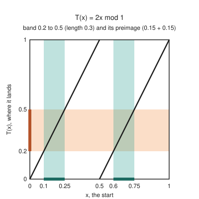

# Measure-preserving maps and Poincare recurrence: a map that keeps sizes brings almost every point back near where it started, again and again

[Syllabus](../../../SYLLABUS.md) → [Measure and integration](../README.md) → [Ergodic Theory](../README.md#s12) → Measure-preserving maps and Poincare recurrence

---

## General Overview

A raisin sits somewhere on a strip of dough 1 m long. Each round, stretch the strip to 2 m, cut it at the 1 m mark and lay the right piece over the left. A raisin at x m moves to 2x m, minus 1 m if that passes the end. This is the **doubling map** T from [The doubling map](../../08-Differential%20equations%20and%20dynamics/11-Discrete%20Dynamics%20and%20Chaos/05-the-doubling-map-and-symbolic-dynamics.md): 0.7 goes to 0.4, then 0.8, then 0.6.

Now ask a question about sizes. Which raisins land between 0.2 m and 0.5 m after one round? Those that started between 0.1 and 0.25, and those that started between 0.6 and 0.75. That is two stretches of 0.15 m, 0.3 m in all: exactly the length of the target. The same happens for every target. The map shuffles the strip hard, but it never thins out or packs any part of it. Such a map **preserves the measure**: here, it keeps length.

That one property forces a surprising return. Take the left half of the strip, A, from 0 up to 0.5 m. Almost every raisin in A comes back into A, and not just once but again and again. The raisin at 1/3 m goes to 2/3 m and back to 1/3 m every two rounds. A wheel turned by the same amount every round obeys the same law. Turned by √2 − 1 of a full turn, an amount that is not a fraction, a mark first comes back within 0.01 turn of its start at round 70.

Henri Poincaré found this in 1890 while studying three bodies moving under gravity. The argument uses nothing but sizes.

**If the points that a map sends into any set always take up as much room as that set, and the whole space has finite size, then almost every point of any set A comes back to A, and does so infinitely often.**

**What kind of fact this is:** a definition (a measure-preserving map) and a theorem (Poincaré's recurrence theorem), both proved on this card in Why it works.

### The picture: one target, two half-length sources

<p align="center"></p>

Drawn to scale, 1 m = 280 drawing units. The horizontal band is the target, from 0.2 to 0.5. The two vertical bands are its preimage: every start that lands in the target. Each line of the graph is twice as steep as the diagonal, so each vertical band is half as wide as the target, and there are two of them.

---

## The formula

Notation first, in words.

- A measure space $`(X, \mathcal{F}, \mu)`$ is a set of points X, the collection $`\mathcal{F}`$ of sets we allow ourselves to measure, and a measure $`\mu`$ giving each of them a size ([Measures](../01-Sets%20You%20Can%20Measure/04-measures.md)). Here X is the strip [0, 1) and $`\mu`$ is length.
- A map $`T`$ sends each point of X to a point of X. $`T^n`$ means T applied n times.
- The **preimage** $`T^{-1}(B)`$ is every point that T sends into the set B. It is a set of starts, and it exists whether or not T can be undone ([The law of a random variable](../03-Measurable%20Functions/05-pushforward-and-the-law.md)).

The definition:

```math
\mu\big(T^{-1}(B)\big) = \mu(B) \quad \text{for every set } B \text{ in } \mathcal{F}
```

**Read it aloud:** the starts that land in B after one step take up as much room as B itself.

In the language of the law card, $`\mu \circ T^{-1} = \mu`$: if x is drawn at random with law $`\mu`$, then T(x) has law $`\mu`$ too. A uniform raisin stays uniform after any number of rounds.

For the doubling map the preimage of an interval [a, b) splits in two:

```math
T^{-1}\big([a, b)\big) = \Big[\frac{a}{2}, \frac{b}{2}\Big) \cup \Big[\frac{a+1}{2}, \frac{b+1}{2}\Big)
```

**Read it aloud:** the starts landing between a and b are the half-size copy of [a, b) in the left half of the strip, plus its copy in the right half.

Each piece has length (b − a)/2, so together they have length b − a. With a = 0.2 and b = 0.5 this is [0.1, 0.25) and [0.6, 0.75), lengths 0.15 + 0.15 = 0.3.

Poincaré's recurrence theorem:

```math
\mu(X) < \infty \;\Longrightarrow\; \mu\big(\{\, x \in A : T^n(x) \in A \text{ for only finitely many } n \,\}\big) = 0 \quad \text{for every set } A \text{ in } \mathcal{F}
```

**Read it aloud:** when the whole space has finite size, the points of A that come back to A only finitely often make up a set of size zero.

A set of size zero is a **null set**, and "almost every point" means "every point outside a null set" ([Null sets and almost everywhere](../01-Sets%20You%20Can%20Measure/07-null-sets-and-almost-everywhere.md)).

### Three standard examples

| Map | Space and its measure | Rule | Starts that land in a block |
| --- | --- | --- | --- |
| Rotation $`R_\alpha`$ | a circle of length 1, written [0, 1); length | x goes to x + α, minus 1 if that passes 1 | the block slid back by α, in one or two pieces |
| Doubling map T | the strip [0, 1); length | x goes to 2x, minus 1 if that passes 1 | two half-length copies of the block |
| Shift σ | endless coin-toss sequences; each toss a 1 with chance p | delete the first toss | "any first toss, then the block" |

| Symbol | Plain meaning | In our example | Push it up and the answer… |
| --- | --- | --- | --- |
| $`X`$, $`\mathcal{F}`$, $`\mu`$ | the space, its measurable sets, and their sizes | the strip [0, 1), Borel sets, length | a bigger total leaves more room for copies that never meet |
| $`T`$, $`T^n`$ | the map, and the map applied n times | the doubling map | — |
| $`B`$, $`T^{-1}(B)`$ | a target set, and the starts that land in it | [0.2, 0.5), and [0.1, 0.25) with [0.6, 0.75) | — |
| $`a`$, $`b`$ | the ends of a target interval [a, b) | 0.2 and 0.5 | a wider target has a wider preimage, by the same amount |
| $`A`$ | the set whose returns we watch | [0, 0.5), and later [0, 0.25) | a smaller A: longer waits to return |
| $`n`$, $`m`$, $`N`$ | round counts | 1/3 is back in A at n = 2, 4, 6 | — |
| $`x`$, $`y`$ | one point, a raisin's place; y is x after some rounds | 1/3 | — |
| $`E`$, $`F`$ | the points of A that never come back to A; that come back only finitely often | 1/6 is in E for A = [0, 0.25) | — |
| $`\alpha`$, $`R_\alpha`$ | the turn of the rotation, and the rotation | √2 − 1 = 0.414214 of a turn | — |
| $`\sigma`$, $`p`$ | the shift, and the chance of a 1 on each toss | p = 0.3 | — |
| $`i`$, $`j`$, $`k`$ | labels for two copies or two rounds, as in $`T^{-i}(E)`$ | — | — |

### When it holds

- **T is measurable.** Every preimage of a measurable set must be measurable, or its size is not defined.
- **Preimages, not images.** The doubling map sends [0, 0.5) onto all of [0, 1), length 1. Images would say "length doubles"; the preimage test says length is kept.
- **The total size is finite.** Sliding the whole real line one unit to the right keeps length, but the stretch [0, 1) moves to [1, 2), [2, 3), … and never comes back.
- **Almost every point, not every point.** For A = [0, 0.25), the point 1/6 goes to 1/3, then 2/3, 1/3, 2/3 forever, and never returns. The theorem only says such points form a null set.
- **Intervals are enough to test, because each has finite size.** Step 1 relies on Dynkin's theorem, whose proof subtracts sizes; an infinite size minus an infinite size has no value. On the strip the total is finite. On the whole line, bounded intervals still settle every set, because each has finite length and together they fill the line.

---

## Why it works

### Step 0: copies of a set that never returns cannot overlap

Collect the points of A that never come back: call that set E. Pull E back one round, two rounds, three rounds. These copies never overlap, and the map keeps sizes, so each copy has the size of E. Infinitely many non-overlapping sets of equal size fit into a space of finite size only if that size is zero.

### Step 1: checking intervals is enough

There are far too many Borel sets to check one by one. Two measures are in play: $`\mu`$, and $`\mu \circ T^{-1}`$, which gives each set B the size of its preimage. The second is a measure because preimages keep unions, complements and disjointness ([The law of a random variable](../03-Measurable%20Functions/05-pushforward-and-the-law.md)).

Both give X the same total, 1 here, since every point lands somewhere in X. The intervals $`[a, b)`$ inside the strip, together with the empty set, form a pi-system: two of them overlap in another interval or in nothing. They generate the Borel sets. So by Dynkin's theorem, two finite measures with the same total that agree on the intervals agree everywhere ([Pi-systems and Dynkin's theorem](../01-Sets%20You%20Can%20Measure/06-pi-systems-and-uniqueness.md)).

The test becomes: for every interval, the preimage has the interval's length.

### Step 2: the three examples pass the test

- **Rotation.** The starts that land in [a, b) are [a − α, b − α), wrapped round the circle. For [0.2, 0.5) and α = 0.414214 this is [0.785786, 1) together with [0, 0.085786): 0.214214 + 0.085786 = 0.3.
- **Doubling map.** Two half-length copies, as in The formula: 0.15 + 0.15 = 0.3.
- **Shift.** A **block** is the set of sequences that start with a given word, such as 10. With p = 0.3 the block 10 has chance 0.3 × 0.7 = 0.21. The sequences that the shift sends into it start 010 or 110: chance 0.7 × 0.21 + 0.3 × 0.21 = 0.147 + 0.063 = 0.21. The first toss is free, and its two outcomes add to chance 1.

Blocks form a pi-system that generates the coin-toss sets, and the coin-toss measure has total 1 ([Infinitely many coin tosses](../06-Product%20Measures%20and%20Fubini/07-infinite-sequences-and-kolmogorov-extension.md)). So the shift preserves the coin-toss measure for every p. With p = 0.5, reading a point's binary digits as tosses turns the doubling map into the shift: one system in two languages.

### Step 3: the points that never return make a null set

Let E be the points of A that never come back:

```math
E = A \setminus \big(T^{-1}(A) \cup T^{-2}(A) \cup T^{-3}(A) \cup \cdots\big)
```

**Read it aloud:** E is A with every point removed that lies in A again after some round.

E is measurable, built from A by countably many preimages, unions and one difference. Its copies E, $`T^{-1}(E)`$, $`T^{-2}(E)`$, … never overlap. Suppose a point x lay in $`T^{-i}(E)`$ and $`T^{-j}(E)`$ with i < j. Then $`y = T^i(x)`$ is in E, so y is in A. After j − i more rounds y reaches $`T^j(x)`$, which is in E, so in A. Then y came back to A, which E forbids.

Each copy has size $`\mu(E)`$, because the map keeps sizes. N copies that never overlap fit inside X:

```math
N \cdot \mu(E) \le \mu(X) \quad \text{for every } N
```

**Read it aloud:** N copies the size of E, side by side, take up no more room than the whole space.

The right side is finite and N can be as large as we like, so $`\mu(E) = 0`$.

### Step 4: from "comes back once" to "comes back infinitely often"

A point of A that comes back only finitely often has a last visit to A, say at round m. At round m it sits in A and never returns, so $`T^m(x)`$ is in E, and x is in $`T^{-m}(E)`$. Every such point lies in one of the sets $`T^{-m}(E)`$ for m = 0, 1, 2, …. Each has size $`\mu(E) = 0`$, and countably many null sets together are still null. That proves the theorem.

<details>
<summary>Detailed proof: the theorem from the definition, line by line</summary>

Fix A in $`\mathcal{F}`$ and write $`E = A \setminus \bigcup_{n \ge 1} T^{-n}(A)`$. Each $`T^{-n}(A)`$ is in $`\mathcal{F}`$ because T is measurable, so E is in $`\mathcal{F}`$.

Disjointness. If $`x \in T^{-i}(E) \cap T^{-j}(E)`$ with $`0 \le i < j`$, put $`y = T^i(x)`$. Then $`y \in E \subseteq A`$ and $`T^{j-i}(y) = T^j(x) \in E \subseteq A`$, so $`y \in T^{-(j-i)}(A)`$ with $`j - i \ge 1`$, contradicting $`y \in E`$.

Sizes. Preimages compose, $`T^{-n}(E) = (T^n)^{-1}(E)`$, and applying the definition n times gives $`\mu(T^{-n}(E)) = \mu(E)`$. By countable additivity,

$`\displaystyle \sum_{n=0}^{\infty} \mu(E) = \mu\Big(\bigcup_{n \ge 0} T^{-n}(E)\Big) \le \mu(X) < \infty,`$

and a sum of infinitely many copies of one number is finite only when the number is 0.

Infinitely often. Let $`F = \{x \in A : T^n(x) \in A \text{ for only finitely many } n \ge 1\}`$. For x in F, let m be the largest $`n \ge 0`$ with $`T^n(x) \in A`$; it exists because $`T^0(x) = x \in A`$ and the visits are finite. Then $`T^m(x) \in E`$, so

$`\displaystyle F \subseteq \bigcup_{m \ge 0} T^{-m}(E), \qquad \mu(F) \le \sum_{m \ge 0} \mu\big(T^{-m}(E)\big) = 0.`$

</details>

### Step 5: watching it happen on the strip

For A = [0, 0.5), a point is in A when its first binary digit is 0, and $`T^n(x)`$ is in A when digit n + 1 is 0. A point of A first comes back at round n when digits 2 to n are 1 and digit n + 1 is 0. That is a share $`2^{-n}`$ of A: a half come back at round 1, a quarter at round 2, an eighth at round 3. The shares add up to 1.

For A = [0, 0.25) the start must read 00, and a return needs 00 again further on. The share of A not yet back by round n is the share of digit strings with no two 0s in a row. Those strings are counted by the Fibonacci numbers 1, 1, 2, 3, 5, 8, …, each the sum of the two before. The share is 2/4 = 0.5 at round 2, 5/16 = 0.3125 at round 4, 34/256 = 0.132812 at round 8 and 1597/65536 = 0.024368 at round 16. It falls to 0. The point 1/6 = 0.0010101… in binary never sees 00 again: it is one point of the null set E, which is not empty.

### Step 6: the rotation, and the argument as pigeonholes

Turn a wheel by α = √2 − 1 of a turn each round. Around each of the positions at rounds 0 to 100 draw an arc 0.01 turn wide. That is 101 arcs of total width 1.01, more than the whole circle, so two of them overlap. Two positions, at rounds i < j, are then within 0.01 of each other. Rotation keeps distances, so turning back i rounds puts the mark at round j − i within 0.01 of its start. A return within 0.01 must come by round 100.

It comes at round 70. The record-close returns fall at rounds 1, 2, 5, 12, 29 and 70, the denominators of the best fractions for √2 ([Continued fractions](../../02-Number%20theory/07-For%20the%20Curious/05-continued-fractions-and-leap-years.md)). Since 99² − 2 × 70² = 1, the distance at round 70 is exactly 1/(99 + 70√2) = 0.005051 ([Pell's equation](../../03-Algebra/10-For%20the%20Curious/04-pell-equation-and-root-two.md)). The mark never returns exactly, because α is not a fraction. It returns as close as we like: that is recurrence for sets, here the arcs.

---

## Worked numbers, by hand

| Step | Arithmetic | Value |
| --- | --- | --- |
| left piece of the preimage | 0.2 ÷ 2 to 0.5 ÷ 2 | [0.1, 0.25) |
| right piece | 1.2 ÷ 2 to 1.5 ÷ 2 | [0.6, 0.75) |
| preimage length | 0.15 + 0.15 | **0.3**, the length of [0.2, 0.5) |
| shift, block 10, p = 0.3 | 0.3 × 0.7 | 0.21 |
| its preimage, blocks 010 and 110 | 0.7 × 0.21 + 0.3 × 0.21 = 0.147 + 0.063 | **0.21** |
| orbit of 1/3 | 2 × 1/3 = 2/3; 2 × 2/3 − 1 = 1/3 | in A at rounds 0, 2, 4, 6, 8 |
| first returns to [0, 0.5) | 1/2 + 1/4 + 1/8 + … | all of A |
| rotation, round 70 | 70 × (√2 − 1) = 28.994949; 29 − 28.994949 | **0.005051** of a turn |
| first-return shares, rounds 1 to 6 | 2^−n | 0.5, 0.25, 0.125, 0.0625, 0.03125, 0.015625 |

Length goes in and length comes out: every test interval has a preimage of its own length, and a set of starts that never returns would need room the strip does not have.

### What breaks if you drop a piece

| Mistake | Comes out at | What went wrong |
| --- | --- | --- |
| Testing the image, not the preimage | [0, 0.5) lands on all of [0, 1), length 1.000000 | Images of a two-to-one map overstate sizes; the definition counts starts |
| A map that squeezes, x to x/2 | preimage of [0, 0.5) has length 1.000000, not 0.5; 0 of 500 starts in [0.5, 1) come back within 20 rounds | Length is not kept: no start lands in E = [0.5, 1), so its copies are empty and the size argument gives nothing; every orbit slides toward 0 |
| A space of infinite size, x to x + 1 on the line | the start 0.5 is back in [0, 1) 0 times in 1000 rounds | Infinitely many copies of length 1 fit side by side |
| "Every point returns" | 1/6 never comes back to [0, 0.25) | The theorem is about almost every point |

---

## Code, from first principles, and it actually runs

The code checks each claim by two roads that share no arithmetic. Preimage lengths come from the formula, in exact fractions, and from counting where 2^20 grid points land. The shift's preimages come from multiplying toss chances, and from adding every string of 8 tosses. First returns come from the 2^−n formula, and from following each of 2,048 binary cells. The rotation's round 70 comes from a search, and from Pell's equation.

### Python

```python
# Measure-preserving maps and Poincare recurrence -- the check behind the card.
# Standard library only.  Exact fractions where the card claims exact values;
# every claim is reached by two roads that share no arithmetic.
from fractions import Fraction as Fr
import math

def doubling_preimage(a, b):        # road one: the formula, two half-length pieces
    return [(a / 2, b / 2), ((a + 1) / 2, (b + 1) / 2)]

def grid_share(step, a, b, bits=20):   # road two: count grid points j / 2^bits
    m = 1 << bits
    return sum(1 for j in range(m) if a <= step(j, m) / m < b) / m

def doubling_grid(j, m):
    return 2 * j % m

def first_return(k, level, cut, steps):   # cell k of width 2^-level; A = cells below cut
    m = 1 << level                          # steps: how far the cell's digits decide
    for n in range(1, steps + 1):
        k = 2 * k % m
        if k < cut:
            return n
    return None                     # not back within the steps the cell decides

a, b = Fr(1, 5), Fr(1, 2)
pieces = doubling_preimage(a, b)
total = sum(hi - lo for lo, hi in pieces)
print("doubling map T(x) = 2x mod 1 on [0, 1), sizes measured by length")
print(f"preimage of [0.2, 0.5): [{float(pieces[0][0])}, {float(pieces[0][1])}) and "
      f"[{float(pieces[1][0])}, {float(pieces[1][1])}); lengths "
      f"{float(pieces[0][1] - pieces[0][0])} + {float(pieces[1][1] - pieces[1][0])} = {float(total)}")
tests = [(Fr(0), Fr(1, 2)), (Fr(1, 5), Fr(1, 2)), (Fr(1, 3), Fr(3, 4)), (Fr(1, 10), Fr(9, 10)), (Fr(2, 7), Fr(5, 7))]
exact_ok = all(sum(h - l for l, h in doubling_preimage(x, y)) == y - x for x, y in tests)
print(f"5 test intervals, exact fractions: preimage length = own length: {'yes' if exact_ok else 'no'}")
g_double = grid_share(doubling_grid, 0.2, 0.5)
print(f"grid of 2^20 points: share that T sends into [0.2, 0.5) = {g_double:.6f}")
image_len = len({doubling_grid(j, 1 << 20) >> 10 for j in range(1 << 19)}) / 1024   # cells of width 2^-10 hit from [0, 0.5)
print(f"forward image of [0, 0.5) under T, by landing cells of width 2^-10: length {image_len:.6f}, twice the length")

alpha = math.sqrt(2) - 1
lo, hi = (0.2 - alpha) % 1, (0.5 - alpha) % 1
print(f"rotation by sqrt 2 - 1 = {alpha:.6f}: preimage of [0.2, 0.5) is [{lo:.6f}, 1) and "
      f"[0, {hi:.6f}); lengths {1 - lo:.6f} + {hi:.6f} = {1 - lo + hi:.6f}")
g_rot = grid_share(lambda j, m: (j + round(alpha * m)) % m, 0.2, 0.5)
print(f"grid of 2^20 points: share that the rotation sends into [0.2, 0.5) = {g_rot:.6f}")

p = 0.3                                     # chance of a 1 on each toss
def chance(word):                           # road one: product of toss chances
    return math.prod(p if s == "1" else 1 - p for s in word)
def preimage_brute(word, n=8):              # road two: add up every string of 8 tosses
    tot = 0.0
    for k in range(1 << n):
        s = format(k, f"0{n}b")
        if s[1:1 + len(word)] == word:      # the shift deletes toss 1
            tot += chance(s)
    return tot
words = [format(k, f"0{L}b") for L in (1, 2, 3) for k in range(1 << L)]
shift_ok = all(abs(preimage_brute(w) - chance(w)) < 1e-12 for w in words)
print(f"coin-toss shift, chance of a 1 = {p}: block 10 has chance {chance('10'):.3f}; "
      f"preimage 010 + 110 = {chance('010'):.3f} + {chance('110'):.3f} = {chance('010') + chance('110'):.3f}")
print(f"all {len(words)} blocks of 1 to 3 tosses, brute force over 2^8 strings: "
      f"preimage chance = own chance: {'yes' if shift_ok else 'no'}")

x, visits = Fr(1, 3), []
for n in range(9):
    if x < Fr(1, 2):
        visits.append(n)
    x = 2 * x % 1
print(f"1/3 -> 2/3 -> 1/3: in A = [0, 0.5) at steps {' '.join(map(str, visits))}")
L = 12
counts = [0] * L
for k in range(1 << (L - 1)):               # the cells of A at level 12
    n = first_return(k, L, 1 << (L - 1), L - 1)
    if n is not None:
        counts[n] += 1
shares = [counts[n] / (1 << (L - 1)) for n in range(1, 7)]
print("first return to A at step n = 1..6, share of A, by cells: " + " ".join(f"{s:.6f}" for s in shares))
print("the same, formula 2^-n: " + " ".join(f"{2.0 ** -n:.6f}" for n in range(1, 7)))
mean_ret = sum(n * c for n, c in enumerate(counts)) / sum(counts)   # cells, steps 1 to 11
print(f"mean first return, by cells {mean_ret:.6f}; formula sum of n 2^-n = {sum(n * 2.0 ** -n for n in range(1, 61)):.6f} = 1/length of A")
print(f"share of A back by step 11, by cells: {sum(counts) / (1 << (L - 1)):.6f}; formula 1 - 2^-11 = {1 - 2.0 ** -11:.6f}")

y, orbit6 = Fr(1, 6), []
for n in range(6):
    orbit6.append(str(y))
    y = 2 * y % 1
start = orbit6[0]
never = all(Fr(s) >= Fr(1, 4) for s in orbit6[1:]) and orbit6[3] == orbit6[5]   # a 2-cycle above 0.25
print(f"A = [0, 0.25): {start} is in A, orbit {' -> '.join(orbit6)}; ever back below 0.25: {'no' if never else 'yes'}")
fib = [0, 1, 1]
while len(fib) < 20:
    fib.append(fib[-1] + fib[-2])
for n in (2, 4, 8, 16):
    lev = n + 2
    stay = sum(1 for k in range(1 << n) if first_return(k, lev, 1 << n, n) is None)
    by_cells, by_fib = stay / (1 << n), fib[n + 1] / 2 ** n
    assert abs(by_cells - by_fib) < 1e-12           # cells against Fibonacci count
    print(f"share of [0, 0.25) not back by step {n}: cells {by_cells:.6f}, Fibonacci {fib[n + 1]}/2^{n} = {by_fib:.6f}")

def dist(n):                                # distance from n * alpha to 0 on the circle
    f = (n * alpha) % 1
    return min(f, 1 - f)
best, records = 1.0, []
for n in range(1, 101):
    if dist(n) < best:
        best = dist(n)
        records.append((n, best))
print("closer than ever before, rotation by sqrt 2 - 1: " + " ".join(f"{n}:{d:.6f}" for n, d in records))
EPS = 0.01
first = next(n for n in range(1, 101) if dist(n) < EPS)
pell, (pp, qq) = [], (1, 1)
while qq <= 100:
    pell.append((qq, 1 / (pp + qq * math.sqrt(2))))     # p^2 - 2 q^2 = +-1
    pp, qq = pp + 2 * qq, pp + qq
print(f"first step back within {EPS} of 0: {first}; {first} x alpha = {first * alpha:.6f}, distance {dist(first):.6f}")
print(f"Pell road: 99^2 - 2 x 70^2 = {99 ** 2 - 2 * 70 ** 2}; distance 1/(99 + 70 sqrt 2) = {1 / (99 + 70 * math.sqrt(2)):.6f}")
print(f"pigeonhole: 101 arcs of width {EPS} around steps 0..100 total {101 * EPS:.2f} > 1, so a return by step 100")

pre_half = grid_share(lambda j, m: j // 2, 0, 0.5)   # grid road: the starts that x -> x/2 sends into [0, 0.5)
back = sum(1 for j in range(500, 1000) if any(Fr(1, 2) <= Fr(j, 1000) / 2 ** n for n in range(1, 21)))
line_back = sum(1 for n in range(1, 1001) if 0 <= 0.5 + n < 1)   # start 0.5, step +1
print(f"mistake 1, forward image: [0, 0.5) lands on a set of length {image_len:.6f}, so 'T doubles length'")
print(f"mistake 2, x -> x/2: preimage of [0, 0.5), by the 2^20 grid, has length {pre_half:.6f} not 0.5; "
      f"of 500 grid starts in [0.5, 1), back within 20 steps: {back}")
print(f"mistake 3, x -> x + 1 on the whole line keeps length; 0.5 back in A = [0, 1) within 1000 steps: {line_back} times")
fx = [round(60 + 280 * v) for v in (0.1, 0.25, 0.6, 0.75)]     # drawing units, origin (60, 360)
fy = [round(360 - 280 * v) for v in (0.2, 0.5)]
print(f"figure, 1 = 280 units, x at 0.1 0.25 0.6 0.75: {' '.join(map(str, fx))}; y at 0.2 0.5: {' '.join(map(str, fy))}")

assert exact_ok and total == b - a and shift_ok                      # formula, exactly
assert abs(g_double - 0.3) < 1e-5 and abs(g_rot - 0.3) < 1e-5        # grid road agrees
assert abs((1 - lo + hi) - 0.3) < 1e-12 and abs(mean_ret - 2) < 0.01
assert all(abs(s - 2.0 ** -n) < 1e-12 for n, s in enumerate(shares, 1))
assert visits == [0, 2, 4, 6, 8] and never
assert first == 70 and [n for n, _ in records] == [q for q, _ in pell]
assert all(abs(d - e) < 1e-9 for (_, d), (_, e) in zip(records, pell))
assert image_len == 1 and pre_half == 1     # both lengths by the grid: the image doubles, x/2 is not kept
print("ALL CHECKS PASS")
```

**Ran 2026-11-23 on macOS, Python 3.14.10, standard library only. All checks passed. Output, pasted from the run:**

```
doubling map T(x) = 2x mod 1 on [0, 1), sizes measured by length
preimage of [0.2, 0.5): [0.1, 0.25) and [0.6, 0.75); lengths 0.15 + 0.15 = 0.3
5 test intervals, exact fractions: preimage length = own length: yes
grid of 2^20 points: share that T sends into [0.2, 0.5) = 0.299999
forward image of [0, 0.5) under T, by landing cells of width 2^-10: length 1.000000, twice the length
rotation by sqrt 2 - 1 = 0.414214: preimage of [0.2, 0.5) is [0.785786, 1) and [0, 0.085786); lengths 0.214214 + 0.085786 = 0.300000
grid of 2^20 points: share that the rotation sends into [0.2, 0.5) = 0.299999
coin-toss shift, chance of a 1 = 0.3: block 10 has chance 0.210; preimage 010 + 110 = 0.147 + 0.063 = 0.210
all 14 blocks of 1 to 3 tosses, brute force over 2^8 strings: preimage chance = own chance: yes
1/3 -> 2/3 -> 1/3: in A = [0, 0.5) at steps 0 2 4 6 8
first return to A at step n = 1..6, share of A, by cells: 0.500000 0.250000 0.125000 0.062500 0.031250 0.015625
the same, formula 2^-n: 0.500000 0.250000 0.125000 0.062500 0.031250 0.015625
mean first return, by cells 1.994626; formula sum of n 2^-n = 2.000000 = 1/length of A
share of A back by step 11, by cells: 0.999512; formula 1 - 2^-11 = 0.999512
A = [0, 0.25): 1/6 is in A, orbit 1/6 -> 1/3 -> 2/3 -> 1/3 -> 2/3 -> 1/3; ever back below 0.25: no
share of [0, 0.25) not back by step 2: cells 0.500000, Fibonacci 2/2^2 = 0.500000
share of [0, 0.25) not back by step 4: cells 0.312500, Fibonacci 5/2^4 = 0.312500
share of [0, 0.25) not back by step 8: cells 0.132812, Fibonacci 34/2^8 = 0.132812
share of [0, 0.25) not back by step 16: cells 0.024368, Fibonacci 1597/2^16 = 0.024368
closer than ever before, rotation by sqrt 2 - 1: 1:0.414214 2:0.171573 5:0.071068 12:0.029437 29:0.012193 70:0.005051
first step back within 0.01 of 0: 70; 70 x alpha = 28.994949, distance 0.005051
Pell road: 99^2 - 2 x 70^2 = 1; distance 1/(99 + 70 sqrt 2) = 0.005051
pigeonhole: 101 arcs of width 0.01 around steps 0..100 total 1.01 > 1, so a return by step 100
mistake 1, forward image: [0, 0.5) lands on a set of length 1.000000, so 'T doubles length'
mistake 2, x -> x/2: preimage of [0, 0.5), by the 2^20 grid, has length 1.000000 not 0.5; of 500 grid starts in [0.5, 1), back within 20 steps: 0
mistake 3, x -> x + 1 on the whole line keeps length; 0.5 back in A = [0, 1) within 1000 steps: 0 times
figure, 1 = 280 units, x at 0.1 0.25 0.6 0.75: 88 130 228 270; y at 0.2 0.5: 304 220
ALL CHECKS PASS
```

### Rust

Same numbers, same labels, built with `rustc --edition 2021 -O`.

```rust
// Measure-preserving maps and Poincare recurrence -- the same check as the
// Python, in Rust.  No crates.  Exact fractions where the card claims exact
// values; every claim is reached by two roads that share no arithmetic.

#[derive(Clone, Copy, PartialEq)]
struct Fr { n: i64, d: i64 }                       // a fraction n/d in lowest terms

fn gcd(a: i64, b: i64) -> i64 { if b == 0 { a.abs() } else { gcd(b, a % b) } }
fn fr(n: i64, d: i64) -> Fr { let g = gcd(n, d); Fr { n: n / g, d: d / g } }
fn add(x: Fr, y: Fr) -> Fr { fr(x.n * y.d + y.n * x.d, x.d * y.d) }
fn sub(x: Fr, y: Fr) -> Fr { fr(x.n * y.d - y.n * x.d, x.d * y.d) }
fn half_of(x: Fr) -> Fr { fr(x.n, 2 * x.d) }
fn val(x: Fr) -> f64 { x.n as f64 / x.d as f64 }
fn show(x: Fr) -> String { format!("{}/{}", x.n, x.d) }
fn double_mod1(x: Fr) -> Fr { fr((2 * x.n).rem_euclid(x.d), x.d) }

fn doubling_preimage(a: Fr, b: Fr) -> [(Fr, Fr); 2] {   // road one: two half-length pieces
    let one = fr(1, 1);
    [(half_of(a), half_of(b)), (half_of(add(a, one)), half_of(add(b, one)))]
}

fn grid_share(step: &dyn Fn(u64, u64) -> u64, a: f64, b: f64) -> f64 {   // road two
    let m: u64 = 1 << 20;
    let mut c = 0u64;
    for j in 0..m {
        let y = step(j, m) as f64 / m as f64;
        if a <= y && y < b { c += 1 }
    }
    c as f64 / m as f64
}

fn first_return(mut k: u64, level: u32, cut: u64, steps: u32) -> Option<u32> {
    let m: u64 = 1 << level;                       // cell k of width 2^-level
    for n in 1..=steps {
        k = 2 * k % m;
        if k < cut { return Some(n) }
    }
    None
}

const P: f64 = 0.3;                                // chance of a 1 on each toss
fn chance(word: &str) -> f64 {                     // road one: product of toss chances
    word.chars().fold(1.0, |acc, s| acc * if s == '1' { P } else { 1.0 - P })
}
fn preimage_brute(word: &str) -> f64 {             // road two: every string of 8 tosses
    let mut tot = 0.0;
    for k in 0..(1u32 << 8) {
        let s = format!("{:08b}", k);
        if &s[1..1 + word.len()] == word { tot += chance(&s) }
    }
    tot
}

fn main() {
    let (a, b) = (fr(1, 5), fr(1, 2));
    let pieces = doubling_preimage(a, b);
    let total = add(sub(pieces[0].1, pieces[0].0), sub(pieces[1].1, pieces[1].0));
    println!("doubling map T(x) = 2x mod 1 on [0, 1), sizes measured by length");
    println!("preimage of [0.2, 0.5): [{}, {}) and [{}, {}); lengths {} + {} = {}",
             val(pieces[0].0), val(pieces[0].1), val(pieces[1].0), val(pieces[1].1),
             val(sub(pieces[0].1, pieces[0].0)), val(sub(pieces[1].1, pieces[1].0)), val(total));
    let tests = [(fr(0, 1), fr(1, 2)), (fr(1, 5), fr(1, 2)), (fr(1, 3), fr(3, 4)), (fr(1, 10), fr(9, 10)), (fr(2, 7), fr(5, 7))];
    let exact_ok = tests.iter().all(|&(x, y)| {
        let p = doubling_preimage(x, y);
        add(sub(p[0].1, p[0].0), sub(p[1].1, p[1].0)) == sub(y, x)
    });
    println!("5 test intervals, exact fractions: preimage length = own length: {}", if exact_ok { "yes" } else { "no" });
    let g_double = grid_share(&|j, m| 2 * j % m, 0.2, 0.5);
    println!("grid of 2^20 points: share that T sends into [0.2, 0.5) = {:.6}", g_double);
    let image_len = (0..1u64 << 19).map(|j| (2 * j % (1u64 << 20)) >> 10)       // cells of width 2^-10 hit from [0, 0.5)
        .collect::<std::collections::HashSet<u64>>().len() as f64 / 1024.0;
    println!("forward image of [0, 0.5) under T, by landing cells of width 2^-10: length {:.6}, twice the length", image_len);

    let alpha = 2f64.sqrt() - 1.0;
    let (lo, hi) = ((0.2 - alpha).rem_euclid(1.0), (0.5 - alpha).rem_euclid(1.0));
    println!("rotation by sqrt 2 - 1 = {:.6}: preimage of [0.2, 0.5) is [{:.6}, 1) and [0, {:.6}); lengths {:.6} + {:.6} = {:.6}",
             alpha, lo, hi, 1.0 - lo, hi, 1.0 - lo + hi);
    let shift = (alpha * (1u64 << 20) as f64).round() as u64;
    let g_rot = grid_share(&|j, m| (j + shift) % m, 0.2, 0.5);
    println!("grid of 2^20 points: share that the rotation sends into [0.2, 0.5) = {:.6}", g_rot);

    let mut words: Vec<String> = Vec::new();
    for l in 1..=3usize { for k in 0..(1u32 << l) { words.push(format!("{:0w$b}", k, w = l)) } }
    let shift_ok = words.iter().all(|w| (preimage_brute(w) - chance(w)).abs() < 1e-12);
    println!("coin-toss shift, chance of a 1 = {}: block 10 has chance {:.3}; preimage 010 + 110 = {:.3} + {:.3} = {:.3}",
             P, chance("10"), chance("010"), chance("110"), chance("010") + chance("110"));
    println!("all {} blocks of 1 to 3 tosses, brute force over 2^8 strings: preimage chance = own chance: {}",
             words.len(), if shift_ok { "yes" } else { "no" });

    let (mut x, mut visits) = (fr(1, 3), Vec::new());
    for n in 0..9 { if val(x) < 0.5 { visits.push(n) } x = double_mod1(x) }
    println!("1/3 -> 2/3 -> 1/3: in A = [0, 0.5) at steps {}",
             visits.iter().map(|v| v.to_string()).collect::<Vec<_>>().join(" "));
    let l: u32 = 12;
    let mut counts = vec![0u64; l as usize];
    for k in 0..(1u64 << (l - 1)) {
        if let Some(n) = first_return(k, l, 1 << (l - 1), l - 1) { counts[n as usize] += 1 }
    }
    let size_a = (1u64 << (l - 1)) as f64;
    let shares: Vec<f64> = (1..7).map(|n| counts[n] as f64 / size_a).collect();
    println!("first return to A at step n = 1..6, share of A, by cells: {}",
             shares.iter().map(|s| format!("{:.6}", s)).collect::<Vec<_>>().join(" "));
    println!("the same, formula 2^-n: {}",
             (1..7).map(|n| format!("{:.6}", 2f64.powi(-n))).collect::<Vec<_>>().join(" "));
    let mean_ret = counts.iter().enumerate().map(|(n, &c)| n as f64 * c as f64).sum::<f64>() / counts.iter().sum::<u64>() as f64;
    println!("mean first return, by cells {:.6}; formula sum of n 2^-n = {:.6} = 1/length of A", mean_ret, (1..61).map(|n| n as f64 * 2f64.powi(-n)).sum::<f64>());
    println!("share of A back by step 11, by cells: {:.6}; formula 1 - 2^-11 = {:.6}",
             counts.iter().sum::<u64>() as f64 / size_a, 1.0 - 2f64.powi(-11));

    let (mut y, mut orbit6) = (fr(1, 6), Vec::new());
    for _ in 0..6 { orbit6.push(show(y)); y = double_mod1(y) }
    let quarter = |s: &String| { let v: Vec<i64> = s.split('/').map(|z| z.parse().unwrap()).collect(); 4 * v[0] >= v[1] };
    let never = orbit6[1..].iter().all(quarter) && orbit6[3] == orbit6[5];     // a 2-cycle above 0.25
    println!("A = [0, 0.25): {} is in A, orbit {}; ever back below 0.25: {}", orbit6[0], orbit6.join(" -> "), if never { "no" } else { "yes" });
    let mut fib: Vec<u64> = vec![0, 1, 1];
    while fib.len() < 20 { let k = fib.len(); fib.push(fib[k - 1] + fib[k - 2]) }
    for n in [2u32, 4, 8, 16] {
        let stay = (0..(1u64 << n)).filter(|&k| first_return(k, n + 2, 1 << n, n).is_none()).count();
        let by_cells = stay as f64 / (1u64 << n) as f64;
        let by_fib = fib[n as usize + 1] as f64 / 2f64.powi(n as i32);
        assert!((by_cells - by_fib).abs() < 1e-12);            // cells against Fibonacci count
        println!("share of [0, 0.25) not back by step {}: cells {:.6}, Fibonacci {}/2^{} = {:.6}",
                 n, by_cells, fib[n as usize + 1], n, by_fib);
    }

    let dist = |n: u64| { let f = (n as f64 * alpha).rem_euclid(1.0); f.min(1.0 - f) };
    let (mut best, mut records) = (1.0f64, Vec::new());
    for n in 1..=100u64 { if dist(n) < best { best = dist(n); records.push((n, best)) } }
    println!("closer than ever before, rotation by sqrt 2 - 1: {}",
             records.iter().map(|(n, d)| format!("{}:{:.6}", n, d)).collect::<Vec<_>>().join(" "));
    const EPS: f64 = 0.01;
    let first = (1..=100u64).find(|&n| dist(n) < EPS).unwrap();
    let (mut pell, mut pp, mut qq) = (Vec::new(), 1u64, 1u64);
    while qq <= 100 {
        pell.push((qq, 1.0 / (pp as f64 + qq as f64 * 2f64.sqrt())));   // p^2 - 2 q^2 = +-1
        let t = pp + 2 * qq; qq += pp; pp = t;
    }
    println!("first step back within {} of 0: {}; {} x alpha = {:.6}, distance {:.6}", EPS, first, first, first as f64 * alpha, dist(first));
    println!("Pell road: 99^2 - 2 x 70^2 = {}; distance 1/(99 + 70 sqrt 2) = {:.6}",
             99i64 * 99 - 2 * 70 * 70, 1.0 / (99.0 + 70.0 * 2f64.sqrt()));
    println!("pigeonhole: 101 arcs of width {} around steps 0..100 total {:.2} > 1, so a return by step 100", EPS, 101.0 * EPS);

    let pre_half = grid_share(&|j, _m| j / 2, 0.0, 0.5);       // grid road: the starts that x -> x/2 sends into [0, 0.5)
    let back = (500u64..1000).filter(|&j| (1..=20u32).any(|n| 2 * j >= 1000 * (1u64 << n))).count();
    let line_back = (1..=1000).filter(|&n| { let p = 0.5 + n as f64; 0.0 <= p && p < 1.0 }).count();
    println!("mistake 1, forward image: [0, 0.5) lands on a set of length {:.6}, so 'T doubles length'", image_len);
    println!("mistake 2, x -> x/2: preimage of [0, 0.5), by the 2^20 grid, has length {:.6} not 0.5; of 500 grid starts in [0.5, 1), back within 20 steps: {}",
             pre_half, back);
    println!("mistake 3, x -> x + 1 on the whole line keeps length; 0.5 back in A = [0, 1) within 1000 steps: {} times", line_back);
    let fx: Vec<String> = [0.1, 0.25, 0.6, 0.75].iter().map(|v: &f64| format!("{}", (60.0 + 280.0 * v).round())).collect();
    let fy: Vec<String> = [0.2, 0.5].iter().map(|v: &f64| format!("{}", (360.0 - 280.0 * v).round())).collect();
    println!("figure, 1 = 280 units, x at 0.1 0.25 0.6 0.75: {}; y at 0.2 0.5: {}", fx.join(" "), fy.join(" "));

    assert!(exact_ok && total == sub(b, a) && shift_ok);                    // formula, exactly
    assert!((g_double - 0.3).abs() < 1e-5 && (g_rot - 0.3).abs() < 1e-5);  // grid road agrees
    assert!(((1.0 - lo + hi) - 0.3).abs() < 1e-12 && (mean_ret - 2.0).abs() < 0.01);
    assert!(shares.iter().enumerate().all(|(i, s)| (s - 2f64.powi(-(i as i32) - 1)).abs() < 1e-12));
    assert!(visits == vec![0, 2, 4, 6, 8] && never);
    assert!(first == 70 && records.iter().map(|r| r.0).collect::<Vec<_>>() == pell.iter().map(|r| r.0).collect::<Vec<_>>());
    assert!(records.iter().zip(pell.iter()).all(|(r, q)| (r.1 - q.1).abs() < 1e-9));
    assert!(image_len == 1.0 && pre_half == 1.0);     // both lengths by the grid: the image doubles, x/2 is not kept
    println!("ALL CHECKS PASS");
}
```

**Ran 2026-11-23 on macOS, rustc 1.98.1, no crates. All checks passed. Output, pasted from the run:**

```
doubling map T(x) = 2x mod 1 on [0, 1), sizes measured by length
preimage of [0.2, 0.5): [0.1, 0.25) and [0.6, 0.75); lengths 0.15 + 0.15 = 0.3
5 test intervals, exact fractions: preimage length = own length: yes
grid of 2^20 points: share that T sends into [0.2, 0.5) = 0.299999
forward image of [0, 0.5) under T, by landing cells of width 2^-10: length 1.000000, twice the length
rotation by sqrt 2 - 1 = 0.414214: preimage of [0.2, 0.5) is [0.785786, 1) and [0, 0.085786); lengths 0.214214 + 0.085786 = 0.300000
grid of 2^20 points: share that the rotation sends into [0.2, 0.5) = 0.299999
coin-toss shift, chance of a 1 = 0.3: block 10 has chance 0.210; preimage 010 + 110 = 0.147 + 0.063 = 0.210
all 14 blocks of 1 to 3 tosses, brute force over 2^8 strings: preimage chance = own chance: yes
1/3 -> 2/3 -> 1/3: in A = [0, 0.5) at steps 0 2 4 6 8
first return to A at step n = 1..6, share of A, by cells: 0.500000 0.250000 0.125000 0.062500 0.031250 0.015625
the same, formula 2^-n: 0.500000 0.250000 0.125000 0.062500 0.031250 0.015625
mean first return, by cells 1.994626; formula sum of n 2^-n = 2.000000 = 1/length of A
share of A back by step 11, by cells: 0.999512; formula 1 - 2^-11 = 0.999512
A = [0, 0.25): 1/6 is in A, orbit 1/6 -> 1/3 -> 2/3 -> 1/3 -> 2/3 -> 1/3; ever back below 0.25: no
share of [0, 0.25) not back by step 2: cells 0.500000, Fibonacci 2/2^2 = 0.500000
share of [0, 0.25) not back by step 4: cells 0.312500, Fibonacci 5/2^4 = 0.312500
share of [0, 0.25) not back by step 8: cells 0.132812, Fibonacci 34/2^8 = 0.132812
share of [0, 0.25) not back by step 16: cells 0.024368, Fibonacci 1597/2^16 = 0.024368
closer than ever before, rotation by sqrt 2 - 1: 1:0.414214 2:0.171573 5:0.071068 12:0.029437 29:0.012193 70:0.005051
first step back within 0.01 of 0: 70; 70 x alpha = 28.994949, distance 0.005051
Pell road: 99^2 - 2 x 70^2 = 1; distance 1/(99 + 70 sqrt 2) = 0.005051
pigeonhole: 101 arcs of width 0.01 around steps 0..100 total 1.01 > 1, so a return by step 100
mistake 1, forward image: [0, 0.5) lands on a set of length 1.000000, so 'T doubles length'
mistake 2, x -> x/2: preimage of [0, 0.5), by the 2^20 grid, has length 1.000000 not 0.5; of 500 grid starts in [0.5, 1), back within 20 steps: 0
mistake 3, x -> x + 1 on the whole line keeps length; 0.5 back in A = [0, 1) within 1000 steps: 0 times
figure, 1 = 280 units, x at 0.1 0.25 0.6 0.75: 88 130 228 270; y at 0.2 0.5: 304 220
ALL CHECKS PASS
```

The two outputs match line for line.

### Lean

Lean proves the definition test, Poincaré's recurrence theorem on every space of finite size, and the doubling map facts.

- Take a map T on a measure space X. Then T keeps the measure exactly when T is measurable and each measurable set B has a preimage $`T^{-1}(B)`$ of the same size.
- Suppose T keeps the measure, the whole space has finite size, and A is a measurable set. Then the points of A that come back to A only finitely often form a null set.
- Take $`0 \le a`$ and $`b \le 1`$, and look at the starts in [0, 1) that the doubling map sends into [a, b). Then those starts are the two pieces $`[a/2, b/2)`$ and $`[(a+1)/2, (b+1)/2)`$.
- The doubling map keeps length on the strip [0, 1).
- The hand arithmetic holds exactly as fractions: the preimage lengths, the shift chances, the return shares and the Fibonacci counts.
- So do 99² − 2 × 70² = 1 and the pigeonhole total 1.01 > 1.

The rotation and shift examples, the grids, the record-close returns and the three mistakes are left to the Python and Rust checks.

```lean
-- Measure-preserving maps and Poincare recurrence: a map that keeps the size of every preimage on a space of finite size brings almost every point of any measurable set A back to A infinitely often, and the doubling map x ↦ 2x mod 1 keeps length on [0, 1).
import Mathlib.Dynamics.Ergodic.MeasurePreserving
import Mathlib.Dynamics.Ergodic.Conservative
import Mathlib.MeasureTheory.Function.Floor
import Mathlib.MeasureTheory.Measure.Lebesgue.Basic
import Mathlib.Algebra.Order.Floor.Ring
import Mathlib.Data.Nat.Fib.Basic

open MeasureTheory Set

/-- Helper: preimage of [a, b) under the doubling map, inside [0, 1). -/
theorem doubling_preimage_Ico (a b : ℝ) (ha : 0 ≤ a) (hb : b ≤ 1) :
      Ico (0 : ℝ) 1 ∩ (fun x : ℝ => Int.fract (2 * x)) ⁻¹' Ico a b =
        Ico (a / 2) (b / 2) ∪ Ico ((a + 1) / 2) ((b + 1) / 2) := by
  ext x
  simp only [mem_inter_iff, mem_Ico, mem_preimage, mem_union]
  by_cases hx : x < 1 / 2
  · by_cases h0 : 0 ≤ x
    · have hf : Int.fract (2 * x) = 2 * x := Int.fract_eq_self.2 ⟨by linarith, by linarith⟩
      rw [hf]
      constructor
      · rintro ⟨-, h1, h2⟩; left; constructor <;> linarith
      · rintro (⟨h1, h2⟩ | ⟨h1, h2⟩)
        · refine ⟨⟨h0, by linarith⟩, by linarith, by linarith⟩
        · exfalso; linarith
    · constructor
      · rintro ⟨⟨h, _⟩, _⟩; exact absurd h h0
      · rintro (⟨h1, h2⟩ | ⟨h1, h2⟩) <;> exfalso <;> linarith
  · push Not at hx
    by_cases h1 : x < 1
    · have hf : Int.fract (2 * x) = 2 * x - 1 :=
        Int.fract_eq_iff.2 ⟨by linarith, by linarith, 1, by push_cast; ring⟩
      rw [hf]
      constructor
      · rintro ⟨-, h3, h4⟩; right; constructor <;> linarith
      · rintro (⟨h3, h4⟩ | ⟨h3, h4⟩)
        · exfalso; linarith
        · refine ⟨⟨by linarith, by linarith⟩, by linarith, by linarith⟩
    · push Not at h1
      constructor
      · rintro ⟨⟨_, h⟩, _⟩; exact absurd h (not_lt.2 h1)
      · rintro (⟨h3, h4⟩ | ⟨h3, h4⟩) <;> exfalso <;> linarith

#print axioms doubling_preimage_Ico

/-- Poincaré's recurrence theorem. Let T map a measure space X to itself, keep sizes
(T is measurable and every measurable set B has a preimage T⁻¹(B) of the same size as B),
and let the whole space have finite size. Then for every measurable set A, the points of A
that come back to A only finitely often make up a set of size zero:
μ({x ∈ A : Tⁿ(x) ∈ A for only finitely many n}) = 0. -/
theorem poincare_recurrence {X : Type*} [MeasurableSpace X] {μ : Measure X} [IsFiniteMeasure μ]
    {T : X → X} (hT : MeasurePreserving T μ μ) {A : Set X} (hA : MeasurableSet A) :
    μ {x | x ∈ A ∧ {n : ℕ | T^[n] x ∈ A}.Finite} = 0 := by
  rw [measure_eq_zero_iff_ae_notMem]
  filter_upwards [hT.conservative.ae_mem_imp_frequently_image_mem hA.nullMeasurableSet] with x hx
  rintro ⟨hxA, hfin⟩
  exact (Nat.frequently_atTop_iff_infinite.1 (hx hxA)) hfin

/-- The definition of a measure-preserving map, in the card's words: T keeps the measure μ
exactly when T is measurable and, for every measurable set B, the starts that land in B take
up as much room as B itself: μ(T⁻¹(B)) = μ(B). -/
theorem measurePreserving_iff_preimage {X : Type*} [MeasurableSpace X] {μ : Measure X}
    {T : X → X} :
    MeasurePreserving T μ μ ↔
      Measurable T ∧ ∀ B : Set X, MeasurableSet B → μ (T ⁻¹' B) = μ B := by
  constructor
  · intro h
    exact ⟨h.measurable, fun B hB => h.measure_preimage hB.nullMeasurableSet⟩
  · rintro ⟨hm, h⟩
    refine ⟨hm, ?_⟩
    ext B hB
    rw [Measure.map_apply hm hB, h B hB]

/-- The doubling map T(x) = 2x mod 1 on the strip [0, 1). For 0 ≤ a and b ≤ 1, the starts in
[0, 1) that land in [a, b) are the two half-length pieces [a/2, b/2) and [(a+1)/2, (b+1)/2);
and T keeps length on [0, 1). -/
theorem doubling_map_preimage_and_measurePreserving :
    (∀ a b : ℝ, 0 ≤ a → b ≤ 1 →
      Ico (0 : ℝ) 1 ∩ (fun x : ℝ => Int.fract (2 * x)) ⁻¹' Ico a b =
        Ico (a / 2) (b / 2) ∪ Ico ((a + 1) / 2) ((b + 1) / 2)) ∧
    MeasurePreserving (fun x : ℝ => Int.fract (2 * x))
      (volume.restrict (Ico (0 : ℝ) 1)) (volume.restrict (Ico (0 : ℝ) 1)) := by
  refine ⟨doubling_preimage_Ico, ?_⟩
  have hm : Measurable (fun x : ℝ => Int.fract (2 * x)) :=
    measurable_fract.comp (measurable_const_mul 2)
  refine ⟨hm, ?_⟩
  have : IsFiniteMeasure (volume.restrict (Ico (0 : ℝ) 1)) := by
    rw [isFiniteMeasure_restrict]; simp
  have key : ∀ a b : ℝ, (volume.restrict (Ico (0 : ℝ) 1)).map (fun x : ℝ => Int.fract (2 * x))
      (Ico a b) = volume.restrict (Ico (0 : ℝ) 1) (Ico a b) := by
    intro a b
    have hrange : (fun x : ℝ => Int.fract (2 * x)) ⁻¹' Ico a b =
        (fun x : ℝ => Int.fract (2 * x)) ⁻¹' Ico (max a 0) (min b 1) := by
      ext x
      simp only [mem_preimage, mem_Ico, max_le_iff, lt_min_iff]
      have h0 := Int.fract_nonneg (2 * x)
      have h1 := Int.fract_lt_one (2 * x)
      tauto
    rw [Measure.map_apply hm measurableSet_Ico, Measure.restrict_apply measurableSet_Ico,
      Measure.restrict_apply (hm measurableSet_Ico), hrange, inter_comm,
      doubling_preimage_Ico _ _ (le_max_right _ _) (min_le_right _ _), Ico_inter_Ico]
    set a' := max a 0
    set b' := min b 1
    have ha' : 0 ≤ a' := le_max_right _ _
    have hb' : b' ≤ 1 := min_le_right _ _
    rcases le_total a' b' with h | h
    · rw [measure_union (Ico_disjoint_Ico.2 (by
          rw [min_eq_left (by linarith), max_eq_right (by linarith)]; linarith)) measurableSet_Ico]
      simp only [Real.volume_Ico]
      rw [← ENNReal.ofReal_add (by linarith) (by linarith)]
      congr 1
      ring
    · rw [Ico_eq_empty_of_le (by linarith : b' / 2 ≤ a' / 2),
        Ico_eq_empty_of_le (by linarith : (b' + 1) / 2 ≤ (a' + 1) / 2), Ico_eq_empty_of_le h]
      simp
  refine Measure.ext_of_Ico_finite _ _ ?_ (fun a b _ => key a b)
  rw [Measure.map_apply hm MeasurableSet.univ, preimage_univ]

-- Preimage of [0.2, 0.5) under the doubling map: [0.1, 0.25) and [0.6, 0.75), lengths 0.15 + 0.15 = 0.3.
example : ((1 : ℚ) / 5) / 2 = 1 / 10 ∧ ((1 : ℚ) / 2) / 2 = 1 / 4 ∧
    ((1 : ℚ) / 5 + 1) / 2 = 3 / 5 ∧ ((1 : ℚ) / 2 + 1) / 2 = 3 / 4 := by norm_num
example : ((1 : ℚ) / 4 - 1 / 10) + (3 / 4 - 3 / 5) = 1 / 2 - 1 / 5 := by norm_num

-- The orbit of 1/3: 2 × 1/3 = 2/3, then 2 × 2/3 − 1 = 1/3.
example : 2 * ((1 : ℚ) / 3) = 2 / 3 ∧ 2 * ((2 : ℚ) / 3) - 1 = 1 / 3 := by norm_num

-- Shift with p = 0.3: block 10 has chance 0.3 × 0.7 = 0.21; blocks 010 and 110 give 0.147 + 0.063 = 0.21.
example : (3 : ℚ) / 10 * (7 / 10) = 21 / 100 := by norm_num
example : (7 : ℚ) / 10 * (21 / 100) + 3 / 10 * (21 / 100) = 21 / 100 := by norm_num
example : (7 : ℚ) / 10 * (21 / 100) = 147 / 1000 ∧ (3 : ℚ) / 10 * (21 / 100) = 63 / 1000 := by
  norm_num

-- First returns to [0, 0.5): shares 2^-n for n = 1..6, and 1 − 2^-11 back by round 11.
example : ∑ n ∈ Finset.Icc 1 6, ((1 : ℚ) / 2) ^ n = 63 / 64 := by
  simp [Finset.sum_Icc_succ_top]; norm_num
example : ∑ n ∈ Finset.Icc 1 11, ((1 : ℚ) / 2) ^ n = 1 - (1 / 2) ^ 11 := by
  simp [Finset.sum_Icc_succ_top]; norm_num

-- Share of [0, 0.25) not back by round n is Fib(n+1)/2^n: 2/4, 5/16, 34/256, 1597/65536.
example : Nat.fib 3 = 2 ∧ Nat.fib 5 = 5 ∧ Nat.fib 9 = 34 ∧ Nat.fib 17 = 1597 := by decide

-- The rotation by √2 − 1 at round 70: 99² − 2 × 70² = 1.
example : (99 : ℤ) ^ 2 - 2 * 70 ^ 2 = 1 := by norm_num

-- Pigeonhole: 101 arcs of width 0.01 have total width 1.01 > 1.
example : (101 : ℚ) * (1 / 100) = 101 / 100 ∧ (1 : ℚ) < 101 / 100 := by norm_num

#print axioms poincare_recurrence
#print axioms measurePreserving_iff_preimage
#print axioms doubling_map_preimage_and_measurePreserving
```

**Checked 2026-11-23 on macOS, Lean 4.36.0-rc2, Mathlib v4.36.0-rc2. Every proof is complete and uses only Lean's standard axioms. Output, pasted from the run:**

```
'doubling_preimage_Ico' depends on axioms: [propext, Classical.choice, Quot.sound]
'poincare_recurrence' depends on axioms: [propext, Classical.choice, Quot.sound]
'measurePreserving_iff_preimage' depends on axioms: [propext, Classical.choice, Quot.sound]
'doubling_map_preimage_and_measurePreserving' depends on axioms: [propext, Classical.choice, Quot.sound]
```

> [!TIP]
> **Try changing**
> Guess first, then run the Python.
> - **A fair coin.** Set `p = 0.3` to `p = 0.5`. Does the shift still keep chances? Answer: yes. Block 10 has chance 0.250, and its preimage gives 0.125 + 0.125. Every assert passes, because the free first toss adds to 1 for any p.
> - **Triple instead of double.** In `doubling_grid`, change `2 * j` to `3 * j`. Does x to 3x, minus whole metres, keep length? Answer: yes. The share stays 0.299999, from three pieces of a third of the length each.
> - **A looser target.** Change `EPS = 0.01` to `EPS = 0.02`. Answer: the first return comes at round 29, distance 0.012193, and the assert pinned to 70 stops the run.
> - **Another start in [0, 0.25).** Change `Fr(1, 6)` to `Fr(1, 5)`. Does it come back? Answer: yes, 1/5 → 2/5 → 4/5 → 3/5 → 1/5 at round 4, and the assert that 1/6 never returns stops the run.

---

## The usual mistake

> [!warning]
> **Testing images instead of preimages.** The doubling map sends [0, 0.5) onto all of [0, 1), so images suggest it doubles length. But every landing place is reached from two starts, one in each half. An image counts each landing place once; the measure must count starts. [0.2, 0.5) is reached from 0.3 m of starts, its own length.
>
> - **"Every point comes back."** Only almost every point does. The point 1/6 never returns to [0, 0.25).
> - **"Comes back" read as "comes back exactly".** The wheel turned by √2 − 1 never returns exactly to its start. It returns within 0.01 at round 70, closer at later rounds, never to 0.
> - **Forgetting that the space must be finite.** Shifting the line by 1 keeps length, yet the start 0.5 is back in [0, 1) 0 times in 1000 rounds.
> - **Forgetting the map must keep sizes.** x to x/2 sends every start toward 0: 0 of 500 starts in [0.5, 1) come back within 20 rounds.

---

## Where you meet it in real life

- **The motion of planets.** Positions and speeds together form a space, and Newton's equations move it without changing its volume (Liouville's theorem). A bounded region of fixed energy has finite volume. Poincaré's theorem then says almost every state of such a system comes back arbitrarily close to where it was.
- **Gas in a box and the second law.** In 1896 Ernst Zermelo used recurrence against Ludwig Boltzmann: a gas in a closed box must come back near its first state, so disorder cannot grow forever. Boltzmann's answer was that the waiting time is far longer than the age of the universe, which is why nobody sees it.
- **Steady random records.** A sequence of measurements whose statistics do not change with time, such as daily rainfall in a stable climate, is a shift that keeps its probability. Recurrence then says any pattern with positive chance, such as a week of heavy rain, comes back again and again.

> **Say it back**
> A map preserves a measure when the starts that land in any set take up as much room as the set. Checking intervals is enough, by Dynkin's theorem; the doubling map passes, since [0.2, 0.5) is reached from two pieces of 0.15. Rotations and the coin-toss shift pass too. In a space of finite size, the copies of the set of never-returning points cannot overlap, so that set has size zero. So almost every point of A comes back to A infinitely often, though some points, such as 1/6 for [0, 0.25), never do.

---

## What this builds on

- [Measures](../01-Sets%20You%20Can%20Measure/04-measures.md): countable additivity, which turns copies that never overlap into a sum bounded by the total.
- [The law of a random variable](../03-Measurable%20Functions/05-pushforward-and-the-law.md): preimages and the pushforward $`\mu \circ T^{-1}`$, the measure the definition compares with $`\mu`$.
- [Pi-systems and Dynkin's theorem](../01-Sets%20You%20Can%20Measure/06-pi-systems-and-uniqueness.md): why checking intervals, or blocks of tosses, settles every set.
- [Infinitely many coin tosses](../06-Product%20Measures%20and%20Fubini/07-infinite-sequences-and-kolmogorov-extension.md): the measure on endless toss sequences that the shift keeps, and the binary digits that link it to the strip.
- [The doubling map](../../08-Differential%20equations%20and%20dynamics/11-Discrete%20Dynamics%20and%20Chaos/05-the-doubling-map-and-symbolic-dynamics.md): the map itself, as the deletion of the first binary digit.

## Where this goes next

- [Ergodicity and mixing](02-ergodicity-and-mixing.md): maps that cannot be split into two separate pieces of positive size, and Kac's lemma, which puts the average return time to A at 1/μ(A). For [0, 0.5) that is 2 rounds: the sum of n × 2^−n. The cells, cut off at round 11, give 1.994626.
- [Von Neumann's mean ergodic theorem](03-von-neumann-mean-ergodic-theorem.md): averages along an orbit settle down on average, in the sense of square-integrable functions.
- [Birkhoff's ergodic theorem](04-birkhoff-pointwise-ergodic-theorem.md): averages along almost every single orbit settle down, so for almost every start the binary digit 1 appears half the time.

Recurrence says almost every point comes back, but not how often: does the share of time an orbit spends in A match the size of A?

---

## Sources

Verified 2026-11-23: every link below resolves to the publisher's page.

- Walters, Peter. *An Introduction to Ergodic Theory*. Graduate Texts in Mathematics 79, Springer, 1982. [DOI](https://doi.org/10.1007/978-1-4612-5775-2). Chapter 1: measure-preserving maps, checking them on a generating family, rotations, the doubling map, shifts, and the recurrence theorem.
- Einsiedler, Manfred, and Thomas Ward. *Ergodic Theory with a view towards Number Theory*. Graduate Texts in Mathematics 259, Springer, 2011. [DOI](https://doi.org/10.1007/978-0-85729-021-2). Chapter 2: the same definitions and Poincaré recurrence, with the circle rotation and the doubling map as running examples.
- Billingsley, Patrick. *Probability and Measure*, Anniversary Edition. Wiley, 2012. [Publisher page](https://www.wiley.com/en-us/Probability+and+Measure%2C+Anniversary+Edition-p-9781118122372). Section 24, The Ergodic Theorem: measure-preserving transformations on a probability space, ergodicity of rotations, and the ergodic theorem.
