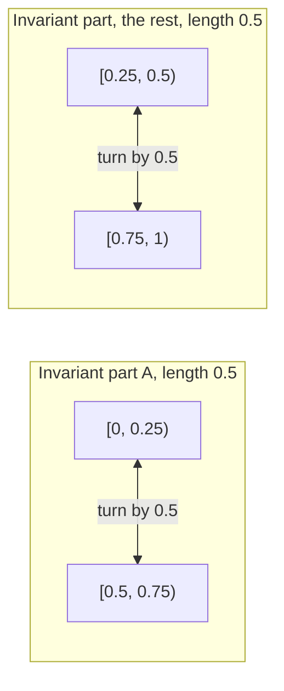
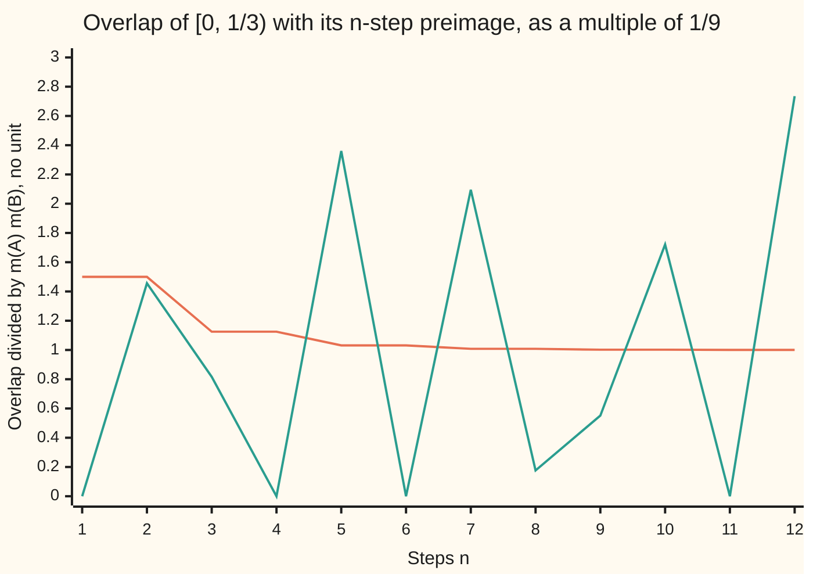

# Ergodicity and mixing: a map that cannot be split into two invariant parts, and one that stirs every set evenly

[Syllabus](../../../SYLLABUS.md) → [Measure and integration](../README.md) → [Ergodic Theory](../README.md#s12) → Ergodicity and mixing

---

## General Overview

Take a strip 1 metre long, the points 0 to 1, and two machines that move its points. The **turner** slides every point the same distance along and wraps it round at the end, like a wheel turning. The **doubler** stretches the strip to 2 metres and lays the second metre back over the first: x goes to 2x, minus 1 if that passes the end. Both keep length: the points that land in any set always fill the same total length as the set ([Measure-preserving maps and Poincare recurrence](01-measure-preserving-maps-and-poincare-recurrence.md)).

Turn by half a metre. The quarters [0, 0.25) and [0.5, 0.75) trade places with each other and never meet the other two quarters. The strip splits into two halves that never exchange a point. A start at 0.1 spends all its time in [0, 0.25) and [0.5, 0.75); a start at 0.3 spends none of it there. One long run says nothing about the whole strip.

Turn by $`\sqrt2 - 1`$ = 0.414214 metres instead, and no such split exists: every set the turner keeps to itself has length 0 or 1. That is **ergodicity**. The doubler does more. Of the points that start in [0, 0.5), exactly half are back in [0, 0.5) after any number of steps, so landing there after n steps tells nothing about the start. That is **mixing**, and the turner never does it. Finally, points that start in [0, 0.5) under the doubler come back to it after 2 steps on average, which is 1 divided by its length 0.5.

Mixing implies ergodic, an irrational turn is ergodic but never mixing, and in an ergodic map the mean return time to a set A is 1 divided by the length of A.

**A map that keeps measure is ergodic when every set it keeps to itself has measure 0 or 1, and mixing when landing in one set after many steps becomes independent of starting in another.**

**What kind of fact this is:** definitions (invariant set, ergodic, mixing) and six theorems, all proved on this card in Why it works.

### The picture: the half-metre turn splits the strip in two



No arrow crosses between the two boxes, so each box is a set the turn keeps to itself, and neither has length 0 or 1.

---

## The formula

Notation first, in words.

- $`X`$ is the strip [0, 1), and $`m`$ is length on it, Lebesgue measure. The whole strip has $`m(X) = 1`$.
- $`T`$ is a map of the strip that keeps measure. $`T^n`$ is $`T`$ applied n times.
- $`T^{-n}A`$ is the set of starts that land in $`A`$ after n steps, $`\{x : T^n x \in A\}`$. "Keeps measure" means $`m(T^{-1}A) = m(A)`$ for every measurable set $`A`$.
- The turner is the **rotation** $`R_\alpha(x) = x + \alpha \bmod 1`$, a turn by $`\alpha`$. The doubler is the **doubling map** $`D(x) = 2x \bmod 1`$; this card calls it D to keep T free for any map. Here "mod 1" drops the whole-number part.

A set is **invariant** when $`T^{-1}A = A`$, up to a set of measure zero: the points that land in A are exactly the points already in A. The three definitions and the return-time theorem:

```math
T \text{ ergodic:} \quad T^{-1}A = A \;\Longrightarrow\; m(A) = 0 \ \text{or}\ m(A) = 1
```

**Read it aloud:** the only sets the map keeps to itself are the empty-in-measure ones and the full-in-measure ones.

```math
T \text{ mixing:} \quad \lim_{n\to\infty} m\big(T^{-n}A \cap B\big) = m(A)\,m(B) \quad \text{for all measurable } A, B
```

**Read it aloud:** in the long run, the share of starts in B that land in A after n steps is the share of the whole strip that A takes up.

That is independence ([Independence as a product](../06-Product%20Measures%20and%20Fubini/04-independence-as-a-product-measure.md)): with a random start, "start in B" and "be in A at step n" become independent events.

```math
r_A(x) = \min\{\, n \ge 1 : T^n x \in A \,\}, \qquad \frac{1}{m(A)} \int_A r_A \, dm = \frac{1}{m(A)} \quad \text{(Kac, for ergodic } T,\ m(A) > 0)
```

**Read it aloud:** the return time is the first step at which a start in A is back in A, and averaged over the starts in A it equals one over the measure of A.

The tool for rotations is the Fourier coefficient. On the strip X the waves $`e^{2\pi i k x}`$, for whole numbers k, carry the cosine and sine of frequency k in one complex number, by [Euler's formula](../../07-Complex%20analysis/01-Complex%20Numbers%20and%20the%20Plane/04-eulers-formula.md). The coefficient $`c_k(f) = \int_0^1 f(x)\, e^{-2\pi i k x}\, dx`$ is how much of wave k a function f holds. Turning shifts every wave by a fixed phase:

```math
c_k(f \circ R_\alpha) = e^{2\pi i k \alpha}\, c_k(f)
```

**Read it aloud:** turning by alpha multiplies the k-th coefficient by the number e to the 2 pi i k alpha, which sits on the unit circle.

| Symbol | Plain meaning | In our example | Push it up and the answer… |
| --- | --- | --- | --- |
| $`X`$, $`m`$ | the strip [0, 1) and length on it | 1 metre | — |
| $`x`$, $`b_1 b_2 \ldots`$ | one point, used as a start, and its binary digits | 0.1; $`\tfrac14 = 0.01`$ in binary | — |
| $`T`$, $`T^n`$ | a map that keeps measure, and n steps of it | $`R_\alpha`$ or $`D`$ | — |
| $`T^{-n}A`$ | starts that land in A after n steps | $`D^{-1}[0, \tfrac12) = [0, \tfrac14) \cup [\tfrac12, \tfrac34)`$ | same measure as A, always |
| $`R_\alpha`$, $`\alpha`$, $`D`$ | the turn and its size; the doubling map | $`\alpha = \tfrac12`$ and $`\alpha = 0.414214`$; $`x \mapsto 2x \bmod 1`$ | a rational $`\alpha`$ splits the strip |
| $`A`$, $`B`$ | measurable sets of starts | $`[0, \tfrac12)`$ | larger sets overlap more |
| $`n`$, $`N`$ | the number of steps; a top step count, as in steps 1 to N | 1 to 12 | doubling overlaps settle |
| $`f`$, $`\mathbf 1_A`$ | a square-integrable function; the indicator of A, 1 on A and 0 off it | $`\mathbf 1_A`$ | — |
| $`k`$, $`c_k(f)`$ | frequency, and the Fourier coefficient | $`\lvert c_2(\mathbf 1_A)\rvert = 0.318310`$ for $`A = [0, \tfrac14) \cup [\tfrac12, \tfrac34)`$ | — |
| $`r_A(x)`$ | return time: first step back in A | mean 2 on $`[0, \tfrac12)`$ | smaller A, longer wait |
| $`F_n`$ | starts that make no visit to A at steps 1 to n | $`m(F_n) \to 0`$ when T is ergodic | — |
| $`\lVert t \rVert`$ | distance from t to the nearest whole number | $`\lVert 70\alpha \rVert = 0.005051`$ | larger means a bigger slide |

### When it holds

- **The map keeps measure.** All three definitions compare sizes before and after a step. Squaring, $`x \mapsto x^2`$, does not keep length: the starts that land in [0, 1/4) fill [0, 1/2), so sizes drift and Kac's count fails.
- **The total measure is 1.** Mixing's product $`m(A)\,m(B)`$ and Kac's $`1/m(A)`$ read m as a probability. Sliding the whole real line by 1 keeps length but never returns any bounded set.
- **Kac needs ergodicity.** Under the half-metre turn, starts in [0, 0.25) all return in exactly 2 steps, not the 4 that $`1/m(A)`$ promises.
- **Kac needs $`m(A) > 0`$.** A set of measure 0 can be missed by almost every orbit, and $`1/m(A)`$ is infinite.
- **Invariant means up to measure zero.** The doubler swaps 1/3 and 2/3: D(1/3) = 0.666667 and D(2/3) = 0.333333. That orbit never leaves the pair, yet the pair has measure 0, and sets of measure 0 never count against ergodicity, so the doubler can still be ergodic.

---

## Why it works

### Step 0: the ideas in words

An invariant set is a room the orbit can never leave or enter. Rule out such rooms and you have ergodicity. For a turn, Fourier coefficients turn the question into arithmetic: an invariant function can only hold waves that the turn multiplies by exactly 1.

The doubler shifts binary digits. Where a point is after n steps depends only on digits n + 1 onwards, which are independent of the first digits. That independence is mixing. A turn moves sets rigidly, so they keep their shape and keep coming back over themselves. Kac's lemma is bookkeeping: the starts that have not yet returned shrink by a measured amount each step, and adding those amounts gives the mean.

### Step 1: invariant sets are invariant functions

If $`A`$ is invariant then its indicator obeys $`\mathbf 1_A \circ T = \mathbf 1_{T^{-1}A} = \mathbf 1_A`$. So if every function with $`f \circ T = f`$ is constant almost everywhere, each indicator of an invariant set is constant: 0 almost everywhere or 1 almost everywhere. Then $`m(A)`$ is 0 or 1, and $`T`$ is ergodic. This turns a question about sets into one about functions, where Fourier series apply.

### Step 2: a rational turn is not ergodic

Turn by 1/2. The set $`A = [0, \tfrac14) \cup [\tfrac12, \tfrac34)`$ is quarters 0 and 2. The starts that land in A are A shifted back by 1/2: quarters 2 and 0, A again. So A is invariant with $`m(A) = 0.5`$, neither 0 nor 1.

The Fourier test shows why. For k = 2 the multiplier is $`e^{2\pi i \cdot 2 \cdot \frac12} = e^{2\pi i} = 1`$, so the wave $`e^{4\pi i x}`$ is invariant and not constant. The indicator of A holds this wave: $`\lvert c_2(\mathbf 1_A)\rvert = 1/\pi = 0.318310`$. Every turn by a fraction splits the strip the same way, through the wave whose k is the fraction's denominator in lowest terms.

### Step 3: an irrational turn is ergodic

Let f be square-integrable with $`f \circ R_\alpha = f`$. Shifting the variable of the coefficient integral by $`\alpha`$, which is allowed because turning keeps length and the waves repeat with period 1, gives $`c_k(f \circ R_\alpha) = e^{2\pi i k \alpha} c_k(f)`$. Invariance makes the left side $`c_k(f)`$, so

```math
\big(e^{2\pi i k\alpha} - 1\big)\, c_k(f) = 0 \quad \text{for every whole number } k.
```

If $`e^{2\pi i k \alpha} = 1`$ for some $`k \ne 0`$, then $`k\alpha`$ is a whole number, and $`\alpha`$, that whole number divided by k, is rational. For $`\alpha = \sqrt2 - 1`$ that never happens, so every $`c_k(f)`$ with $`k \ne 0`$ is 0.

Parseval's identity ([Parseval's identity](../../08-Differential%20equations%20and%20dynamics/09-Fourier%20Series/03-parsevals-identity.md)) in this complex form says $`\int_0^1 \lvert g\rvert^2 = \sum_k \lvert c_k(g)\rvert^2`$. Apply it to $`g = f - c_0(f)`$: every coefficient of g is 0, so $`f = c_0(f)`$ almost everywhere. By Step 1 the turn is ergodic.

The multipliers come close to 1 without reaching it. The point at angle $`2\pi k\alpha`$ on the unit circle sits $`2\lvert\sin(\pi k\alpha)\rvert`$ from 1, and that is the gap at k: for k = 1, $`\lvert e^{2\pi i \alpha} - 1\rvert = 1.927805`$, and the smallest value for k up to 1000 is 0.002255, at k = 985. The proof needs only "not 0".

### Step 4: the doubling map is mixing

Write a start in binary, $`x = 0.b_1 b_2 b_3 \ldots`$. Doubling drops the first digit: $`D(x) = 0.b_2 b_3 \ldots`$. So "$`D^n x \in [0, \tfrac12)`$" says digit n + 1 is 0, and "$`x \in [0, \tfrac12)`$" says digit 1 is 0.

Under length the binary digits are independent fair coin flips. For $`n \ge 1`$ the two events concern different digits, so

```math
m\big(D^{-n}[0, \tfrac12) \cap [0, \tfrac12)\big) = \tfrac12 \cdot \tfrac12 = \tfrac14 \quad \text{for every } n \ge 1.
```

The same holds exactly for any two **dyadic intervals**, sets fixed by their first few binary digits, once n reaches the number of digits that B fixes. Every measurable set is close in measure to a finite union of dyadic intervals, which gives the limit for all sets.

<details>
<summary>Detailed proof: from dyadic intervals to every measurable set</summary>

Let I fix digits 1 to p and J fix digits 1 to q. Then $`D^{-n}I`$ fixes digits n + 1 to n + p. For $`n \ge q`$ these digit ranges do not overlap, and independence of the digits gives $`m(D^{-n}I \cap J) = 2^{-p}\,2^{-q} = m(I)\,m(J)`$. Finite unions of such intervals follow by adding.

Now take measurable sets A and B and $`\varepsilon > 0`$. Lebesgue measure is outer regular, so A sits inside an open set of measure less than $`m(A) + \varepsilon`$. An open set is a countable union of dyadic intervals, and finitely many of them come within $`\varepsilon`$. So there is a finite union of dyadic intervals A′ with $`m(A \,\triangle\, A') < 2\varepsilon`$, where $`\triangle`$ is the symmetric difference, the points in exactly one of the two sets. Choose B′ the same way.

Because D keeps measure, $`m(D^{-n}A \,\triangle\, D^{-n}A') = m(A \,\triangle\, A') < 2\varepsilon`$. Changing a set by a set of measure less than $`\delta`$ changes any overlap by less than $`\delta`$, so

$`\displaystyle \big\lvert m(D^{-n}A \cap B) - m(D^{-n}A' \cap B') \big\rvert < 4\varepsilon .`$

For n large the second overlap, $`m(D^{-n}A' \cap B')`$, equals $`m(A')\,m(B')`$, which is within $`4\varepsilon`$ of $`m(A)\,m(B)`$. So the overlap ends up within $`8\varepsilon`$ of $`m(A)\,m(B)`$ for every $`\varepsilon`$, which is the limit.

</details>

### Step 5: mixing implies ergodic

Let A be invariant under a mixing map. Then $`T^{-n}A = A`$ for every n, so taking B = A in the mixing limit gives

```math
m(A) = m(T^{-n}A \cap A) \longrightarrow m(A)^2 .
```

A number equal to its own square is 0 or 1. So the doubling map is ergodic. Its house fact, that binary digit 1 appears half the time for almost every start, is ergodicity plus the time-average theorem on [Birkhoff's ergodic theorem](04-birkhoff-pointwise-ergodic-theorem.md).

### Step 6: a turn is never mixing

Take $`A = B = [0, \tfrac12)`$. The set $`R_\alpha^{-n}A`$ is the half-strip slid by $`n\alpha`$, and two half-strips slid apart by t overlap in $`\tfrac12 - \lVert t \rVert`$. So

```math
m\big(R_\alpha^{-n}A \cap A\big) = \tfrac12 - \lVert n\alpha \rVert .
```

Mixing would need this to settle at $`\tfrac14`$. But among the N + 1 points $`0, \alpha, 2\alpha, \ldots, N\alpha`$, taken mod 1, two lie within 1/N of each other. That is the pigeonhole principle: N + 1 points in N boxes of width 1/N. Their difference is some $`n\alpha`$ with $`n \le N`$ and $`\lVert n\alpha \rVert \le 1/N`$, so the overlap climbs back towards $`\tfrac12`$ again and again.

For $`\alpha = \sqrt2 - 1`$: $`\lVert 70\alpha \rVert = 0.005051`$ gives overlap 0.494949, and $`\lVert 985\alpha \rVert = 0.000359`$ gives 0.499641. The argument works for every turn, rational or not.

### Step 7: Kac's lemma, the mean return time

Let $`F_n`$ be the starts that make no visit to A at steps 1 to n, with $`F_0 = X`$. Two facts:

1. A start in A that is in $`F_n`$ has not returned by step n: $`A \cap F_n = \{x \in A : r_A(x) > n\}`$.
2. A start is in $`F_{n+1}`$ exactly when its next point lies in $`F_n`$ but outside A: $`F_{n+1} = T^{-1}(F_n \setminus A)`$.

Fact 2 and measure keeping give $`m(F_{n+1}) = m(F_n) - m(A \cap F_n)`$. Add these up for n = 0 to N − 1:

```math
\sum_{n=0}^{N-1} m\big(\{x \in A : r_A(x) > n\}\big) = 1 - m(F_N).
```

Ergodicity sends $`m(F_N)`$ to 0, because the starts that never visit A form a set of measure 0 (fold below). Adding the tail chances of a whole-number function gives its integral, so $`\int_A r_A\, dm = 1`$. Divide by $`m(A)`$.

<details>
<summary>Detailed proof: almost every start visits A</summary>

Let G be the starts that visit A at some step $`j \ge 1`$, the union of the sets $`T^{-j}A`$. Then $`T^{-1}G`$ is the union over $`j \ge 2`$, which sits inside G. Both have the same measure, because T keeps measure, so they differ by a set of measure 0, and G is invariant.

G contains $`T^{-1}A`$, whose measure is $`m(A) > 0`$. Ergodicity then forces $`m(G) = 1`$. The sets $`F_N`$ shrink to the complement of G, so $`m(F_N) \to 0`$ by continuity of measure.

Without ergodicity the same sum gives $`\int_A r_A\, dm = m(G)`$, which can be less than 1. Under the half-metre turn with A = [0, 0.25), G is A together with [0.5, 0.75), measure 1/2, and every return takes 2 steps.

</details>

For the doubler and $`A = [0, \tfrac12)`$, a return at step n needs digits 2 to n equal to 1 and digit n + 1 equal to 0. That has chance $`2^{-n}`$ among starts in A: 0.5000, 0.2500, 0.1250, 0.0625, and so on. The mean is $`\sum n\, 2^{-n} = 2`$.

---

## Worked numbers, by hand

| Step | Arithmetic | Value |
| --- | --- | --- |
| half-metre turn, A = quarters 0 and 2 | shift each back by 2 quarters | quarters 2 and 0: invariant, m(A) = 0.5 |
| Fourier test at k = 2 | $`\lvert e^{2\pi i \cdot 2 \cdot \frac12} - 1\rvert`$ | 0, so $`e^{4\pi i x}`$ is invariant |
| the wave in A | $`\lvert c_2(\mathbf 1_A)\rvert = 1/\pi`$ | 0.318310 |
| turn by 0.414214, k = 1 | $`2\,\lvert\sin(\pi \cdot 0.414214)\rvert`$ | 1.927805 |
| smallest multiplier gap, k up to 1000 | at k = 985 | 0.002255, never 0 |
| doubler, A = B = [0, 1/2), any n ≥ 1 | digit 1 and digit n + 1 both 0 | 0.250000 = 0.5 × 0.5 |
| turner, same sets, n = 70 | $`\tfrac12 - 0.005051`$ | 0.494949, not 0.25 |
| doubler, mean return to [0, 1/2) | $`1 \cdot 0.5 + 2 \cdot 0.25 + 3 \cdot 0.125 + \ldots`$ | **2** |

The half-metre turn splits the strip, the 0.414214 turn cannot, the doubler forgets where a point started, and a start in [0, 1/2) is back after 2 steps on average, as $`1/m(A) = 1/0.5`$ says.

The turner keeps Kac's lemma too, because it is ergodic. On $`A = [0, \tfrac12)`$ its return time is 1, 2 or 3, on lengths 0.085786, 0.328427 and 0.085786. Then $`(1 \cdot 0.085786 + 2 \cdot 0.328427 + 3 \cdot 0.085786)/0.5 = 2.000000`$.

### What breaks if you drop a piece

| Mistake | Comes out at | What went wrong |
| --- | --- | --- |
| Kac on the half-metre turn, A = [0, 0.25) | every return is 2, not 4 | the turn is not ergodic, so half the strip never visits A |
| Judging mixing at one step: turner, A = [0, 1/2), n = 3 | 0.2574, close to 0.25 | at n = 70 the overlap is 0.4949: it swings, never settles |
| Kac's mean read as the wait from a random start: doubler, A = [0, 1/4) | 5.000000 exact, 5.0180 simulated, not 4 | Kac averages over starts inside A; "00" blocks bunch together |
| Treating the half-metre turn as ergodic, start 0.1 | time share in A 1.0000, not 0.5 | the orbit stays in one invariant part |

---

## How the overlap moves as the map is repeated

The puzzle: the doubler and the turner both keep length, so why does one stir and the other not? Follow one set, $`A = B = [0, \tfrac13)`$, through 12 steps of each map. The table gives $`m(T^{-n}A \cap A)`$ as a multiple of $`m(A)\,m(B) = 1/9`$, so 1 means "fully stirred".

| n | doubler | turner by 0.414214 |
| ---: | ---: | ---: |
| 1 | 1.50000 | 0.00000 |
| 2 | 1.50000 | 1.45584 |
| 3 | 1.12500 | 0.81623 |
| 4 | 1.12500 | 0.00000 |
| 5 | 1.03125 | 2.36039 |
| 6 | 1.03125 | 0.00000 |
| 8 | 1.00781 | 0.17662 |
| 10 | 1.00195 | 1.72078 |
| 12 | 1.00049 | 2.73506 |

The doubler's ratios 1.50000, 1.12500, 1.03125 close in on 1, the gap shrinking fourfold every two steps. The set [0, 1/3) is not a dyadic interval, so the product rule is reached only in the limit, not at a fixed step. The turner's overlap jumps between 0 and almost 3, the most it can be, $`(1/3)/(1/9)`$, with no trend.



Orange line: the doubler, settling onto 1. Green line: the turner by 0.414214, swinging with no trend. The turner is still ergodic: its orbits fill the strip evenly over time, but no set ever spreads out.

---

## Code, from first principles, and it actually runs

The script works the card's examples and takes two independent roads to each key number. The Fourier coefficient comes from a midpoint sum and from the formula 1/π, and Parseval's total is checked against the quarter-cell count. The smallest multiplier gap is found by brute force and predicted by the continued fraction of $`\sqrt2 - 1`$. Doubling overlaps come from interval lengths and from exact integer counts on a grid. Turner overlaps come from the formula $`\tfrac12 - \lVert n\alpha \rVert`$ and from grid counts. Kac's mean comes from the series and from a million binary digits of one orbit, and for the turner from interval lengths and from a grid of 50,000 starts.

### Python

```python
# Ergodicity and mixing -- the check behind the card.  Standard library only:
# math gives pi, sqrt, sin and floor.  Maps on [0, 1), sizes measured by length:
# rotation x -> x + alpha mod 1, and doubling x -> 2x mod 1.
import math

ALPHA, GRID = math.sqrt(2) - 1, 100000           # the irrational turn; grid points

def frac(x):
    return x - math.floor(x)

def dist(t):                                      # distance to the nearest whole number
    return abs(t - math.floor(t + 0.5))

def doubling_overlap(a, b, n):                    # road 1: m(D^-n [0,a) and [0,b)) by intervals
    w = 2.0 ** -n                                 # D^-n [0,a) is 2^n strips [j w, (j + a) w)
    return sum(max(0.0, min(j * w + a * w, b) - j * w) for j in range(2 ** n) if j * w < b)

def doubling_grid(a3, b3, n, bits):               # road 2: count grid points j / 2^bits
    full, hits = 1 << bits, 0                     # a3, b3: set is [0, 1/a3), shifting is exact
    for j in range(full):
        y = (j << n) & (full - 1)
        hits += a3 * y < full and b3 * j < full
    return hits / full

def rotation_overlap(b, n):                       # m(R^-n [0,b) and [0,b)), formula for b <= 1/2
    return max(0.0, b - dist(n * ALPHA))

def rotation_grid(b, n):                          # the same overlap by counting grid midpoints
    pts = ((i + 0.5) / GRID for i in range(GRID))
    return sum(1 for x in pts if x < b and frac(x + n * ALPHA) < b) / GRID

def bits_stream(count, s=88172645463325252):     # xorshift64: the binary digits of one start
    out = []
    for _ in range(count):
        s ^= (s << 13) & 0xFFFFFFFFFFFFFFFF
        s ^= s >> 7
        s ^= (s << 17) & 0xFFFFFFFFFFFFFFFF
        out.append(s >> 63)
    return out

def yn(c):
    return "yes" if c else "no"

print("-- rotation by 1/2; A = [0,1/4) and [1/2,3/4), as quarter cells")
cells = [0, 2]
back = [c for c in range(4) if (c + 2) % 4 in cells]  # x in R^-1 A when x + 1/2 lands in A
print(f"cells of A {cells}; cells of R^-1 A {back}; invariant: {yn(back == cells)}; m(A) = {len(cells) / 4:.6f}")
print("|e^(2 pi i k/2) - 1| for k = 1..4: " + " ".join(f"{2 * abs(math.sin(math.pi * k / 2)):.6f}" for k in range(1, 5)))
def coeff(k, m=40000):                            # road 2: c_k by a midpoint sum, as |re + i im|
    xs = [(i + 0.5) / m for i in range(m) if int(4 * (i + 0.5) / m) in cells]
    return math.hypot(sum(math.cos(2 * math.pi * k * x) for x in xs) / m,
                      sum(math.sin(2 * math.pi * k * x) for x in xs) / m)
ck = [coeff(k) for k in (1, 2, 3)]
print(f"|c_1|, |c_2|, |c_3| of the indicator, by integration: {ck[0]:.6f} {ck[1]:.6f} {ck[2]:.6f}; 1/pi = {1 / math.pi:.6f}")
pars = 0.25 + 2 * sum((1 / (math.pi * j)) ** 2 for j in range(1, 2000, 2))
print(f"Parseval: c_0^2 + sum of |c_k|^2 for 0 < |k| < 4000 = {pars:.6f}, against m(A) = 0.5")
share = [sum(int(4 * frac(x0 + 0.5 * n)) in cells for n in range(10000)) / 10000 for x0 in (0.1, 0.3)]
print(f"share of 10000 orbit points in A: start 0.1 -> {share[0]:.4f}, start 0.3 -> {share[1]:.4f}")

print(f"-- rotation by alpha = sqrt2 - 1 = {ALPHA:.6f}")
gaps = [2 * abs(math.sin(math.pi * k * ALPHA)) for k in range(1, 1001)]
kmin = 1 + gaps.index(min(gaps))
pell = [1, 2]                                     # second road: the continued fraction [0; 2, 2, 2, ...]
while pell[-1] < 1000:
    pell.append(2 * pell[-1] + pell[-2])
print(f"|e^(2 pi i k alpha) - 1|: k = 1 -> {gaps[0]:.6f}, k = 2 -> {gaps[1]:.6f}; smallest for k <= 1000: k = {kmin} -> {min(gaps):.6f}")
print(f"denominators of the continued fraction: {pell[:-1]}")
sh = sum(frac(0.1 + n * ALPHA) < 0.5 for n in range(10000)) / 10000
print(f"share of 10000 orbit points in [0,1/2), start 0.1: {sh:.4f}")

print("-- doubling, A = B = [0,1/2): m(D^-n A and B) by intervals, by a 2^16 grid")
for n in range(1, 6):
    print(f"n = {n}: {doubling_overlap(0.5, 0.5, n):.6f} {doubling_grid(2, 2, n, 16):.6f}")
print(f"doubling swaps 1/3 and 2/3: D(1/3) = {frac(2 / 3):.6f}, D(2/3) = {frac(4 / 3):.6f}")
d_int = [doubling_overlap(0.5, 0.5, n) for n in range(1, 6)]

print("-- the overlap as n grows, A = B = [0,1/3), as a multiple of m(A)m(B) = 1/9")
print(" n  doubling  rotation")
rows = [(n, 9 * doubling_overlap(1 / 3, 1 / 3, n), 9 * rotation_overlap(1 / 3, n)) for n in range(1, 13)]
for n, d, r in rows:
    print(f"{n:2d}  {d:.5f}   {r:.5f}")
grid_gap = max(abs(doubling_grid(3, 3, n, 18) - d / 9) for n, d, _ in rows[:8])
rot_gap = max(abs(rotation_grid(1 / 3, n) - r / 9) for n, _, r in rows)

print("-- rotation by alpha is never mixing: A = B = [0,1/2), target m(A)m(B) = 0.25")
for n in (3, 70, 169, 985):
    print(f"n = {n:3d}: distance of n alpha to a whole number {dist(n * ALPHA):.6f}; overlap {rotation_overlap(0.5, n):.6f}")

print("-- Kac: mean return time to A")
pr = [2.0 ** -n for n in range(1, 61)]            # doubling, A = [0,1/2): return at n is n - 1 ones, then a 0
series = sum(n * p for n, p in zip(range(1, 61), pr))
digits = bits_stream(1000000)
nxt, nxt00 = [None] * (len(digits) + 1), [None] * (len(digits) + 1)
for i in range(len(digits) - 1, -1, -1):         # next 0 digit, and next "00", at or after i
    nxt[i] = i if digits[i] == 0 else nxt[i + 1]
    nxt00[i] = i if digits[i] == 0 and i + 1 < len(digits) and digits[i + 1] == 0 else nxt00[i + 1]
def mean_wait(table, starts):
    w = [table[i + 1] - i for i in starts if table[i + 1] is not None]
    return sum(w) / len(w)
in_a = [i for i in range(len(digits) - 1) if digits[i] == 0]
in_a4 = [i for i in range(len(digits) - 1) if digits[i] == 0 and digits[i + 1] == 0]
ret2, ret4 = mean_wait(nxt, in_a), mean_wait(nxt00, in_a4)
wait4 = mean_wait(nxt00, range(len(digits) - 1))
print(f"doubling, A = [0,1/2): P(r = n) for n = 1..4: " + " ".join(f"{p:.4f}" for p in pr[:4]))
print(f"  mean by the series {series:.6f}; along 10^6 digits of one orbit {ret2:.4f}")
L1, L2 = 0.5 - ALPHA, 2 * ALPHA - 0.5             # rotation by alpha: lengths with r = 1 (and 3), r = 2
def ret_rot(x, turn, b):
    n = 1
    while frac(x + n * turn) >= b:
        n += 1
    return n
gr = [ret_rot((i + 0.5) / GRID, ALPHA, 0.5) for i in range(GRID // 2)]
print(f"rotation by alpha, A = [0,1/2): length with r = 1: {L1:.6f}, r = 2: {L2:.6f}, r = 3: {L1:.6f}")
print(f"  mean by lengths {(L1 + 2 * L2 + 3 * L1) / 0.5:.6f}; by a grid of 50000 starts {sum(gr) / len(gr):.6f}")
half = [ret_rot((i + 0.5) / GRID, 0.5, 0.25) for i in range(GRID // 4)]
e1 = (1 + 0.5) / (1 - 0.75)                       # pattern "00": expected digits to complete it
print(f"mistake 1: rotation by 1/2, A = [0,1/4): every return time is {min(half)} (largest {max(half)}), not 1/m(A) = 4")
print(f"mistake 2: rotation by alpha, A = [0,1/2): n = 3 gives {rotation_overlap(0.5, 3):.4f}, n = 70 gives {rotation_overlap(0.5, 70):.4f}")
print(f"mistake 3: doubling, A = [0,1/4): return {ret4:.4f}; wait from a random start {wait4:.4f}; exact {e1 - 1:.6f}")
print(f"mistake 4: rotation by 1/2 from 0.1 spends {share[0]:.4f} of its time in A, not m(A) = 0.5")
assert back == cells and abs(ck[1] - 1 / math.pi) < 1e-6 and abs(ck[0]) < 1e-9  # A invariant, c_2 = 1/pi
assert abs(pars - 0.5) < 1e-4                     # Parseval's total meets the cell count m(A)
assert kmin == pell[-2] and min(gaps) > 0         # near-returns sit at the continued-fraction q
assert all(abs(d - 0.25) < 1e-12 for d in d_int)  # exact mixing for dyadic sets, by intervals ...
assert all(doubling_grid(2, 2, n, 16) == 0.25 for n in range(1, 16))  # ... and by the grid
assert grid_gap < 2e-3 and rot_gap < 1e-4 and abs(rows[-1][1] - 1) < 1e-3
assert abs(series - 2) < 1e-12 and abs(ret2 - 2) < 0.02 and abs(sum(gr) / len(gr) - 2) < 1e-3
assert abs((L1 + 2 * L2 + 3 * L1) / 0.5 - sum(gr) / len(gr)) < 1e-3   # turner: lengths against the grid
assert abs(ret4 - 4) < 0.05 and abs(wait4 - 5) < 0.05 and min(half) == max(half) == 2
assert abs(sh - 0.5) < 0.01 and rotation_overlap(0.5, 985) > 0.49
print("ALL CHECKS PASS")
```

**Ran 2026-11-23 on macOS, Python 3.14.10, standard library only. All checks passed. Output, pasted from the run:**

```
-- rotation by 1/2; A = [0,1/4) and [1/2,3/4), as quarter cells
cells of A [0, 2]; cells of R^-1 A [0, 2]; invariant: yes; m(A) = 0.500000
|e^(2 pi i k/2) - 1| for k = 1..4: 2.000000 0.000000 2.000000 0.000000
|c_1|, |c_2|, |c_3| of the indicator, by integration: 0.000000 0.318310 0.000000; 1/pi = 0.318310
Parseval: c_0^2 + sum of |c_k|^2 for 0 < |k| < 4000 = 0.499949, against m(A) = 0.5
share of 10000 orbit points in A: start 0.1 -> 1.0000, start 0.3 -> 0.0000
-- rotation by alpha = sqrt2 - 1 = 0.414214
|e^(2 pi i k alpha) - 1|: k = 1 -> 1.927805, k = 2 -> 1.026577; smallest for k <= 1000: k = 985 -> 0.002255
denominators of the continued fraction: [1, 2, 5, 12, 29, 70, 169, 408, 985]
share of 10000 orbit points in [0,1/2), start 0.1: 0.4999
-- doubling, A = B = [0,1/2): m(D^-n A and B) by intervals, by a 2^16 grid
n = 1: 0.250000 0.250000
n = 2: 0.250000 0.250000
n = 3: 0.250000 0.250000
n = 4: 0.250000 0.250000
n = 5: 0.250000 0.250000
doubling swaps 1/3 and 2/3: D(1/3) = 0.666667, D(2/3) = 0.333333
-- the overlap as n grows, A = B = [0,1/3), as a multiple of m(A)m(B) = 1/9
 n  doubling  rotation
 1  1.50000   0.00000
 2  1.50000   1.45584
 3  1.12500   0.81623
 4  1.12500   0.00000
 5  1.03125   2.36039
 6  1.03125   0.00000
 7  1.00781   2.09545
 8  1.00781   0.17662
 9  1.00195   0.55130
10  1.00195   1.72078
11  1.00049   0.00000
12  1.00049   2.73506
-- rotation by alpha is never mixing: A = B = [0,1/2), target m(A)m(B) = 0.25
n =   3: distance of n alpha to a whole number 0.242641; overlap 0.257359
n =  70: distance of n alpha to a whole number 0.005051; overlap 0.494949
n = 169: distance of n alpha to a whole number 0.002092; overlap 0.497908
n = 985: distance of n alpha to a whole number 0.000359; overlap 0.499641
-- Kac: mean return time to A
doubling, A = [0,1/2): P(r = n) for n = 1..4: 0.5000 0.2500 0.1250 0.0625
  mean by the series 2.000000; along 10^6 digits of one orbit 2.0030
rotation by alpha, A = [0,1/2): length with r = 1: 0.085786, r = 2: 0.328427, r = 3: 0.085786
  mean by lengths 2.000000; by a grid of 50000 starts 1.999980
mistake 1: rotation by 1/2, A = [0,1/4): every return time is 2 (largest 2), not 1/m(A) = 4
mistake 2: rotation by alpha, A = [0,1/2): n = 3 gives 0.2574, n = 70 gives 0.4949
mistake 3: doubling, A = [0,1/4): return 4.0092; wait from a random start 5.0180; exact 5.000000
mistake 4: rotation by 1/2 from 0.1 spends 1.0000 of its time in A, not m(A) = 0.5
ALL CHECKS PASS
```

### Rust

Same numbers, same labels, built with `rustc --edition 2021 -O`.

```rust
// Ergodicity and mixing -- the same check as the Python, in Rust.  No crates.
// Maps on [0, 1), sizes measured by length: rotation x -> x + alpha mod 1, and
// doubling x -> 2x mod 1.
use std::f64::consts::PI;

const GRID: usize = 100000;                       // grid points

fn alpha() -> f64 { 2f64.sqrt() - 1.0 }           // the irrational turn

fn frac(x: f64) -> f64 { x - x.floor() }

fn dist(t: f64) -> f64 { (t - (t + 0.5).floor()).abs() } // distance to the nearest whole number

fn doubling_overlap(a: f64, b: f64, n: i32) -> f64 {  // road 1: m(D^-n [0,a) and [0,b)) by intervals
    let w = 2f64.powi(-n);                        // D^-n [0,a) is 2^n strips [j w, (j + a) w)
    let mut s = 0.0;
    for j in 0..(1u64 << n) {
        let lo = j as f64 * w;
        if lo < b { s += (lo + a * w).min(b) - lo }
    }
    s
}

fn doubling_grid(a3: u64, b3: u64, n: u32, bits: u32) -> f64 { // road 2: count grid points j / 2^bits
    let full: u64 = 1 << bits;                    // a3, b3: set is [0, 1/a3), shifting is exact
    let mut hits = 0u64;
    for j in 0..full {
        let y = (j << n) & (full - 1);
        if a3 * y < full && b3 * j < full { hits += 1 }
    }
    hits as f64 / full as f64
}

fn rotation_overlap(b: f64, n: usize) -> f64 { (b - dist(n as f64 * alpha())).max(0.0) }

fn rotation_grid(b: f64, n: usize) -> f64 {       // the same overlap by counting grid midpoints
    let c = (0..GRID).map(|i| (i as f64 + 0.5) / GRID as f64)
        .filter(|&x| x < b && frac(x + n as f64 * alpha()) < b).count();
    c as f64 / GRID as f64
}

fn bits_stream(count: usize) -> Vec<u8> {         // xorshift64: the binary digits of one start
    let mut s: u64 = 88172645463325252;
    let mut out = Vec::with_capacity(count);
    for _ in 0..count {
        s ^= s << 13;
        s ^= s >> 7;
        s ^= s << 17;
        out.push((s >> 63) as u8);
    }
    out
}

fn mean_wait(table: &[Option<usize>], starts: &[usize]) -> f64 {
    let w: Vec<usize> = starts.iter().filter_map(|&i| table[i + 1].map(|t| t - i)).collect();
    w.iter().sum::<usize>() as f64 / w.len() as f64
}

fn ret_rot(x: f64, turn: f64, b: f64) -> usize {
    let mut n = 1;
    while frac(x + n as f64 * turn) >= b { n += 1 }
    n
}

fn yn(c: bool) -> &'static str { if c { "yes" } else { "no" } }

fn main() {
    let al = alpha();
    println!("-- rotation by 1/2; A = [0,1/4) and [1/2,3/4), as quarter cells");
    let cells = vec![0usize, 2];
    let back: Vec<usize> = (0..4).filter(|c| cells.contains(&((c + 2) % 4))).collect();
    println!("cells of A {:?}; cells of R^-1 A {:?}; invariant: {}; m(A) = {:.6}", cells, back, yn(back == cells), cells.len() as f64 / 4.0);
    let e: Vec<String> = (1..5).map(|k| format!("{:.6}", 2.0 * (PI * k as f64 / 2.0).sin().abs())).collect();
    println!("|e^(2 pi i k/2) - 1| for k = 1..4: {}", e.join(" "));
    let m = 40000usize;                           // road 2: c_k by a midpoint sum, as |re + i im|
    let xs: Vec<f64> = (0..m).map(|i| (i as f64 + 0.5) / m as f64)
        .filter(|&x| cells.contains(&((4.0 * x) as usize))).collect();
    let ck: Vec<f64> = [1.0, 2.0, 3.0].iter().map(|&k: &f64| {
        let re: f64 = xs.iter().map(|&x| (2.0 * PI * k * x).cos()).sum::<f64>() / m as f64;
        let im: f64 = xs.iter().map(|&x| (2.0 * PI * k * x).sin()).sum::<f64>() / m as f64;
        re.hypot(im)
    }).collect();
    println!("|c_1|, |c_2|, |c_3| of the indicator, by integration: {:.6} {:.6} {:.6}; 1/pi = {:.6}", ck[0], ck[1], ck[2], 1.0 / PI);
    let pars = 0.25 + 2.0 * (1..2000).step_by(2).map(|j| (1.0 / (PI * j as f64)).powi(2)).sum::<f64>();
    println!("Parseval: c_0^2 + sum of |c_k|^2 for 0 < |k| < 4000 = {:.6}, against m(A) = 0.5", pars);
    let share: Vec<f64> = [0.1, 0.3].iter().map(|&x0: &f64| (0..10000)
        .filter(|&n| cells.contains(&((4.0 * frac(x0 + 0.5 * n as f64)) as usize))).count() as f64 / 10000.0).collect();
    println!("share of 10000 orbit points in A: start 0.1 -> {:.4}, start 0.3 -> {:.4}", share[0], share[1]);

    println!("-- rotation by alpha = sqrt2 - 1 = {:.6}", al);
    let gaps: Vec<f64> = (1..1001).map(|k| 2.0 * (PI * k as f64 * al).sin().abs()).collect();
    let gmin = gaps.iter().cloned().fold(f64::INFINITY, f64::min);
    let kmin = 1 + gaps.iter().position(|&g| g == gmin).unwrap();
    let mut pell: Vec<usize> = vec![1, 2];        // second road: the continued fraction [0; 2, 2, 2, ...]
    while *pell.last().unwrap() < 1000 { let l = pell.len(); pell.push(2 * pell[l - 1] + pell[l - 2]) }
    println!("|e^(2 pi i k alpha) - 1|: k = 1 -> {:.6}, k = 2 -> {:.6}; smallest for k <= 1000: k = {} -> {:.6}", gaps[0], gaps[1], kmin, gmin);
    println!("denominators of the continued fraction: {:?}", &pell[..pell.len() - 1]);
    let sh = (0..10000).filter(|&n| frac(0.1 + n as f64 * al) < 0.5).count() as f64 / 10000.0;
    println!("share of 10000 orbit points in [0,1/2), start 0.1: {:.4}", sh);

    println!("-- doubling, A = B = [0,1/2): m(D^-n A and B) by intervals, by a 2^16 grid");
    for n in 1..6 { println!("n = {}: {:.6} {:.6}", n, doubling_overlap(0.5, 0.5, n), doubling_grid(2, 2, n as u32, 16)) }
    println!("doubling swaps 1/3 and 2/3: D(1/3) = {:.6}, D(2/3) = {:.6}", frac(2.0 / 3.0), frac(4.0 / 3.0));
    let d_int: Vec<f64> = (1..6).map(|n| doubling_overlap(0.5, 0.5, n)).collect();

    println!("-- the overlap as n grows, A = B = [0,1/3), as a multiple of m(A)m(B) = 1/9");
    println!(" n  doubling  rotation");
    let rows: Vec<(usize, f64, f64)> = (1..13usize)
        .map(|n| (n, 9.0 * doubling_overlap(1.0 / 3.0, 1.0 / 3.0, n as i32), 9.0 * rotation_overlap(1.0 / 3.0, n))).collect();
    for &(n, d, r) in &rows { println!("{:2}  {:.5}   {:.5}", n, d, r) }
    let grid_gap = rows[..8].iter().map(|&(n, d, _)| (doubling_grid(3, 3, n as u32, 18) - d / 9.0).abs()).fold(0.0, f64::max);
    let rot_gap = rows.iter().map(|&(n, _, r)| (rotation_grid(1.0 / 3.0, n) - r / 9.0).abs()).fold(0.0, f64::max);

    println!("-- rotation by alpha is never mixing: A = B = [0,1/2), target m(A)m(B) = 0.25");
    for n in [3usize, 70, 169, 985] {
        println!("n = {:3}: distance of n alpha to a whole number {:.6}; overlap {:.6}", n, dist(n as f64 * al), rotation_overlap(0.5, n))
    }

    println!("-- Kac: mean return time to A");
    let pr: Vec<f64> = (1..61).map(|n| 2f64.powi(-n)).collect(); // doubling, A = [0,1/2): return at n is n - 1 ones, then a 0
    let series: f64 = pr.iter().enumerate().map(|(i, p)| (i + 1) as f64 * p).sum();
    let digits = bits_stream(1000000);
    let len = digits.len();
    let (mut nxt, mut nxt00) = (vec![None; len + 1], vec![None; len + 1]);
    for i in (0..len).rev() {                     // next 0 digit, and next "00", at or after i
        nxt[i] = if digits[i] == 0 { Some(i) } else { nxt[i + 1] };
        nxt00[i] = if digits[i] == 0 && i + 1 < len && digits[i + 1] == 0 { Some(i) } else { nxt00[i + 1] };
    }
    let in_a: Vec<usize> = (0..len - 1).filter(|&i| digits[i] == 0).collect();
    let in_a4: Vec<usize> = (0..len - 1).filter(|&i| digits[i] == 0 && digits[i + 1] == 0).collect();
    let all: Vec<usize> = (0..len - 1).collect();
    let (ret2, ret4, wait4) = (mean_wait(&nxt, &in_a), mean_wait(&nxt00, &in_a4), mean_wait(&nxt00, &all));
    let p4: Vec<String> = pr[..4].iter().map(|p| format!("{:.4}", p)).collect();
    println!("doubling, A = [0,1/2): P(r = n) for n = 1..4: {}", p4.join(" "));
    println!("  mean by the series {:.6}; along 10^6 digits of one orbit {:.4}", series, ret2);
    let (l1, l2) = (0.5 - al, 2.0 * al - 0.5);    // rotation by alpha: lengths with r = 1 (and 3), r = 2
    let gr: Vec<usize> = (0..GRID / 2).map(|i| ret_rot((i as f64 + 0.5) / GRID as f64, al, 0.5)).collect();
    let gmean = gr.iter().sum::<usize>() as f64 / gr.len() as f64;
    println!("rotation by alpha, A = [0,1/2): length with r = 1: {:.6}, r = 2: {:.6}, r = 3: {:.6}", l1, l2, l1);
    println!("  mean by lengths {:.6}; by a grid of 50000 starts {:.6}", (l1 + 2.0 * l2 + 3.0 * l1) / 0.5, gmean);
    let half: Vec<usize> = (0..GRID / 4).map(|i| ret_rot((i as f64 + 0.5) / GRID as f64, 0.5, 0.25)).collect();
    let (hmin, hmax) = (*half.iter().min().unwrap(), *half.iter().max().unwrap());
    let e1 = (1.0 + 0.5) / (1.0 - 0.75);          // pattern "00": expected digits to complete it
    println!("mistake 1: rotation by 1/2, A = [0,1/4): every return time is {} (largest {}), not 1/m(A) = 4", hmin, hmax);
    println!("mistake 2: rotation by alpha, A = [0,1/2): n = 3 gives {:.4}, n = 70 gives {:.4}", rotation_overlap(0.5, 3), rotation_overlap(0.5, 70));
    println!("mistake 3: doubling, A = [0,1/4): return {:.4}; wait from a random start {:.4}; exact {:.6}", ret4, wait4, e1 - 1.0);
    println!("mistake 4: rotation by 1/2 from 0.1 spends {:.4} of its time in A, not m(A) = 0.5", share[0]);
    assert!(back == cells && (ck[1] - 1.0 / PI).abs() < 1e-6 && ck[0].abs() < 1e-9); // A invariant, |c_2| = 1/pi
    assert!((pars - 0.5).abs() < 1e-4);           // Parseval's total meets the cell count m(A)
    assert!(kmin == pell[pell.len() - 2] && gmin > 0.0); // near-returns sit at the continued-fraction q
    assert!(d_int.iter().all(|d| (d - 0.25).abs() < 1e-12)); // exact mixing for dyadic sets, by intervals ...
    assert!((1..16).all(|n| doubling_grid(2, 2, n, 16) == 0.25)); // ... and by the grid
    assert!(grid_gap < 2e-3 && rot_gap < 1e-4 && (rows[11].1 - 1.0).abs() < 1e-3);
    assert!((series - 2.0).abs() < 1e-12 && (ret2 - 2.0).abs() < 0.02 && (gmean - 2.0).abs() < 1e-3);
    assert!(((l1 + 2.0 * l2 + 3.0 * l1) / 0.5 - gmean).abs() < 1e-3); // turner: lengths against the grid
    assert!((ret4 - 4.0).abs() < 0.05 && (wait4 - 5.0).abs() < 0.05 && hmin == 2 && hmax == 2);
    assert!((sh - 0.5).abs() < 0.01 && rotation_overlap(0.5, 985) > 0.49);
    println!("ALL CHECKS PASS");
}
```

**Ran 2026-11-23 on macOS, rustc 1.98.1, no crates. All checks passed. Output, pasted from the run:**

```
-- rotation by 1/2; A = [0,1/4) and [1/2,3/4), as quarter cells
cells of A [0, 2]; cells of R^-1 A [0, 2]; invariant: yes; m(A) = 0.500000
|e^(2 pi i k/2) - 1| for k = 1..4: 2.000000 0.000000 2.000000 0.000000
|c_1|, |c_2|, |c_3| of the indicator, by integration: 0.000000 0.318310 0.000000; 1/pi = 0.318310
Parseval: c_0^2 + sum of |c_k|^2 for 0 < |k| < 4000 = 0.499949, against m(A) = 0.5
share of 10000 orbit points in A: start 0.1 -> 1.0000, start 0.3 -> 0.0000
-- rotation by alpha = sqrt2 - 1 = 0.414214
|e^(2 pi i k alpha) - 1|: k = 1 -> 1.927805, k = 2 -> 1.026577; smallest for k <= 1000: k = 985 -> 0.002255
denominators of the continued fraction: [1, 2, 5, 12, 29, 70, 169, 408, 985]
share of 10000 orbit points in [0,1/2), start 0.1: 0.4999
-- doubling, A = B = [0,1/2): m(D^-n A and B) by intervals, by a 2^16 grid
n = 1: 0.250000 0.250000
n = 2: 0.250000 0.250000
n = 3: 0.250000 0.250000
n = 4: 0.250000 0.250000
n = 5: 0.250000 0.250000
doubling swaps 1/3 and 2/3: D(1/3) = 0.666667, D(2/3) = 0.333333
-- the overlap as n grows, A = B = [0,1/3), as a multiple of m(A)m(B) = 1/9
 n  doubling  rotation
 1  1.50000   0.00000
 2  1.50000   1.45584
 3  1.12500   0.81623
 4  1.12500   0.00000
 5  1.03125   2.36039
 6  1.03125   0.00000
 7  1.00781   2.09545
 8  1.00781   0.17662
 9  1.00195   0.55130
10  1.00195   1.72078
11  1.00049   0.00000
12  1.00049   2.73506
-- rotation by alpha is never mixing: A = B = [0,1/2), target m(A)m(B) = 0.25
n =   3: distance of n alpha to a whole number 0.242641; overlap 0.257359
n =  70: distance of n alpha to a whole number 0.005051; overlap 0.494949
n = 169: distance of n alpha to a whole number 0.002092; overlap 0.497908
n = 985: distance of n alpha to a whole number 0.000359; overlap 0.499641
-- Kac: mean return time to A
doubling, A = [0,1/2): P(r = n) for n = 1..4: 0.5000 0.2500 0.1250 0.0625
  mean by the series 2.000000; along 10^6 digits of one orbit 2.0030
rotation by alpha, A = [0,1/2): length with r = 1: 0.085786, r = 2: 0.328427, r = 3: 0.085786
  mean by lengths 2.000000; by a grid of 50000 starts 1.999980
mistake 1: rotation by 1/2, A = [0,1/4): every return time is 2 (largest 2), not 1/m(A) = 4
mistake 2: rotation by alpha, A = [0,1/2): n = 3 gives 0.2574, n = 70 gives 0.4949
mistake 3: doubling, A = [0,1/4): return 4.0092; wait from a random start 5.0180; exact 5.000000
mistake 4: rotation by 1/2 from 0.1 spends 1.0000 of its time in A, not m(A) = 0.5
ALL CHECKS PASS
```

The two outputs match line for line.

### Lean

Lean proves five of the card's six theorems: the turn facts for every size $`\alpha`$, the other two for every map that keeps measure.

- Suppose a map is ergodic on a space of total measure 1, and A is a measurable set with $`m(A) > 0`$. Then the mean return time to A is $`1/m(A)`$, as in Kac's formula above.
- Suppose a map is mixing on a space of total measure 1. Then it is ergodic.
- Take any turn size $`\alpha`$. Then $`R_\alpha`$ is ergodic exactly when $`\alpha`$ is irrational, so a turn by 1/2 is not.
- No turn is mixing, whatever its size $`\alpha`$, rational or not.
- The half-metre turn keeps quarters 0 and 2 together, and the doubler swaps 1/3 and 2/3.
- On the grid of 256 points, the doubler with A = B = [0, 1/2) gives overlap 64/256 = 1/4 for n = 1 to 7.
- For the doubler's mean $`\sum n\, 2^{-n}`$, the terms up to n = 10 add to $`2 - 12/2^{10}`$.
- Take return times 1, 2, 3 on lengths $`\tfrac12 - \alpha`$, $`2\alpha - \tfrac12`$, $`\tfrac12 - \alpha`$. Then the turner's mean is 2, whatever $`\alpha`$.
- For the doubler and A = [0, 1/4), the wait from a random start is exactly 5, not 4.

The doubler's mixing, the Fourier values, the decimals, the simulations and the four breaks are left to the Python and Rust checks.

```lean
-- Ergodicity and mixing: in an ergodic map on a probability space the mean return time to a set A of positive measure is 1/μ(A), every mixing map is ergodic, and a turn of the circle is ergodic exactly when its size is irrational but is never mixing.
import Mathlib.Dynamics.Ergodic.AddCircleAdd
import Mathlib.MeasureTheory.Integral.Lebesgue.Basic
import Mathlib.Data.Rat.Floor
import Mathlib.Tactic.NormNum
import Mathlib.Tactic.Ring
import Mathlib.NumberTheory.DiophantineApproximation.Basic

open MeasureTheory Filter Topology
open scoped ENNReal

variable {X : Type*} [MeasurableSpace X]

/-- The return time to `A`: the first step `n ≥ 1` at which the start `x` is back in `A`,
`r_A(x) = min {n ≥ 1 : Tⁿ x ∈ A}`. It is `∞` for a start that never comes back. -/
noncomputable def returnTime (T : X → X) (A : Set X) (x : X) : ℝ≥0∞ :=
  ⨅ (n : ℕ) (_ : 1 ≤ n ∧ T^[n] x ∈ A), (n : ℝ≥0∞)

/-- `T` is mixing for `μ`: it keeps `μ`, and for all measurable sets `A` and `B` the overlap
`μ(T⁻ⁿA ∩ B)` of the starts in `B` that land in `A` after `n` steps tends to `μ(A) μ(B)`. -/
def IsMixing (T : X → X) (μ : Measure X) : Prop :=
  MeasurePreserving T μ μ ∧
    ∀ A B : Set X, MeasurableSet A → MeasurableSet B →
      Tendsto (fun n : ℕ => μ (T^[n] ⁻¹' A ∩ B)) atTop (𝓝 (μ A * μ B))

/-- Kac's lemma. Let `T` keep the probability measure `μ` (total measure 1) and be ergodic,
and let `A` be a measurable set with `μ(A) > 0`. Then the mean return time to `A`, averaged
over the starts in `A`, is one over the measure of `A`:
`(1/μ(A)) ∫_A r_A dμ = 1/μ(A)`. -/
theorem kac_mean_return_time_eq_inv_measure {μ : Measure X} [IsProbabilityMeasure μ]
    {T : X → X} (hT : Ergodic T μ) {A : Set X} (hA : MeasurableSet A) (hA0 : 0 < μ A) :
    (μ A)⁻¹ * ∫⁻ x in A, returnTime T A x ∂μ = (μ A)⁻¹ := by
  -- `S n`: the starts that stay out of `A` at steps `1, …, n`.
  obtain ⟨S, hSmem, hSmeas⟩ : ∃ S : ℕ → Set X,
      (∀ n x, x ∈ S n ↔ ∀ k : Fin n, T^[(k : ℕ) + 1] x ∉ A) ∧ ∀ n, MeasurableSet (S n) :=
    ⟨fun n => ⋂ k : Fin n, T^[(k : ℕ) + 1] ⁻¹' Aᶜ, fun n x => by simp,
      fun n => MeasurableSet.iInter fun k => (hT.measurable.iterate _) hA.compl⟩
  -- pointwise: the return time is the number of `n` with `x ∈ S n`
  have hpt : ∀ x, returnTime T A x = ∑' n, (S n).indicator 1 x := by
    intro x
    by_cases h : ∃ m, 1 ≤ m ∧ T^[m] x ∈ A
    · classical
      set m := Nat.find h with hm
      have hr : returnTime T A x = m := by
        apply le_antisymm
        · exact iInf₂_le m (Nat.find_spec h)
        · exact le_iInf₂ fun n hn => Nat.cast_le.mpr (Nat.find_min' h hn)
      have hmem : ∀ n, x ∈ S n ↔ n < m := by
        intro n
        rw [hSmem]
        constructor
        · intro hx
          by_contra hle
          push Not at hle
          have hm1 : 1 ≤ m := (Nat.find_spec h).1
          have := hx ⟨m - 1, by omega⟩
          simp only at this
          rw [Nat.sub_add_cancel hm1] at this
          exact this (Nat.find_spec h).2
        · intro hn k hk
          have hlt : (k : ℕ) + 1 < m := by have := k.2; omega
          exact Nat.find_min h hlt ⟨by omega, hk⟩
      rw [hr, tsum_eq_sum (s := Finset.range m)]
      · rw [Finset.sum_congr rfl (g := fun _ => (1 : ℝ≥0∞))]
        · simp
        · intro n hn
          rw [Finset.mem_range] at hn
          simp [(hmem n).2 hn]
      · intro n hn
        rw [Finset.mem_range] at hn
        simp [show x ∉ S n from fun hx => hn ((hmem n).1 hx)]
    · push Not at h
      have hr : returnTime T A x = ⊤ := by
        simp only [returnTime, iInf_eq_top]
        intro n hn
        exact absurd hn.2 (h n hn.1)
      have hmem : ∀ n, x ∈ S n := fun n => (hSmem n x).2 fun k => h _ (by omega)
      rw [hr]
      simp only [hmem, Set.indicator_of_mem, Pi.one_apply]
      exact (ENNReal.tsum_const_eq_top_of_ne_zero one_ne_zero).symm
  -- the integral as a sum
  have hint : ∫⁻ x in A, returnTime T A x ∂μ = ∑' n, μ (S n ∩ A) := by
    simp_rw [hpt]
    rw [lintegral_tsum fun n => (measurable_one.indicator (hSmeas n)).aemeasurable]
    congr 1
    funext n
    rw [lintegral_indicator_one (hSmeas n), Measure.restrict_apply (hSmeas n)]
  -- one step of the telescoping sum
  have hstep : ∀ n, μ (S n) = μ (S n ∩ A) + μ (S (n + 1)) := by
    intro n
    have hset : S (n + 1) = T ⁻¹' (S n \ A) := by
      ext x
      rw [hSmem, Set.mem_preimage, Set.mem_sdiff, hSmem, Fin.forall_fin_succ]
      simp only [Fin.val_zero, zero_add, Fin.val_succ,
        Function.iterate_succ_apply]
      tauto
    rw [hset, hT.measure_preimage ((hSmeas n).diff hA).nullMeasurableSet,
      measure_inter_add_sdiff _ hA]
  have hsum : ∀ N, ∑ n ∈ Finset.range N, μ (S n ∩ A) + μ (S N) = 1 := by
    intro N
    induction N with
    | zero =>
      have : S 0 = Set.univ := by
        ext x; simp [hSmem]
      simp [this]
    | succ N ih =>
      rw [Finset.sum_range_succ, add_assoc, ← hstep, ih]
  -- the starts that never come back to `A` form a null set
  have hanti : Antitone S := by
    intro m n hmn x hx
    rw [hSmem] at hx ⊢
    intro k
    exact hx ⟨k, by omega⟩
  have hnull : μ (⋂ n, S n) = 0 := by
    set C : Set X := {x | ∀ k : ℕ, T^[k + 1] x ∉ A} with hC
    have hCeq : C = ⋂ n, S n := by
      ext x
      simp only [hC, Set.mem_ofPred_eq, Set.mem_iInter, hSmem]
      constructor
      · intro hx n k; exact hx k
      · intro hx k; exact hx (k + 1) ⟨k, by omega⟩
    have hCmeas : MeasurableSet C := by rw [hCeq]; exact MeasurableSet.iInter hSmeas
    have hCsub : C ⊆ T ⁻¹' C := by
      intro x hx k
      have := hx (k + 1)
      rwa [Function.iterate_succ_apply] at this
    rw [← hCeq]
    rcases hT.ae_empty_or_univ_of_ae_le_preimage hCmeas.nullMeasurableSet
        hCsub.eventuallyLE with h | h
    · exact ae_eq_empty.1 h
    · exfalso
      rw [ae_eq_univ] at h
      have hsub : T ⁻¹' A ⊆ Cᶜ := by
        intro x hx hxC
        exact hxC 0 (by simpa using hx)
      have := measure_mono (μ := μ) hsub
      rw [h, hT.measure_preimage hA.nullMeasurableSet] at this
      exact absurd (le_zero_iff.1 this) hA0.ne'
  have htend : Tendsto (fun N => μ (S N)) atTop (𝓝 0) := by
    rw [← hnull]
    exact tendsto_measure_iInter_atTop (fun n => (hSmeas n).nullMeasurableSet) hanti
      ⟨0, measure_ne_top μ _⟩
  have hone : ∑' n, μ (S n ∩ A) = 1 := by
    apply le_antisymm
    · refine ENNReal.tsum_le_of_sum_range_le fun N => ?_
      rw [← hsum N]
      exact le_self_add
    · have h2 : Tendsto (fun N => (∑' n, μ (S n ∩ A)) + μ (S N)) atTop
          (𝓝 ((∑' n, μ (S n ∩ A)) + 0)) := tendsto_const_nhds.add htend
      rw [add_zero] at h2
      refine ge_of_tendsto' h2 fun N => ?_
      rw [← hsum N]
      gcongr
      exact sum_le_tsum _
  rw [hint, hone, mul_one]

/-- Mixing implies ergodic. If `T` keeps the probability measure `μ` and is mixing, then
every set that `T` keeps to itself has measure 0 or 1: `T` is ergodic. -/
theorem ergodic_of_mixing {μ : Measure X} [IsProbabilityMeasure μ] {T : X → X}
    (hT : IsMixing T μ) : Ergodic T μ := by
  refine Ergodic.of_preimage_eq hT.1 fun s hs hinv => ?_
  have hit : ∀ n : ℕ, T^[n] ⁻¹' s = s := by
    intro n
    induction n with
    | zero => rfl
    | succ n ih => rw [Function.iterate_succ, Set.preimage_comp, ih, hinv]
  have h := hT.2 s s hs hs
  simp only [hit, Set.inter_self] at h
  have heq : μ s = μ s * μ s := tendsto_nhds_unique tendsto_const_nhds h
  rw [eventuallyEmptyOrUniv_iff', ae_eq_empty, ae_eq_univ]
  by_cases h0 : μ s = 0
  · exact Or.inl h0
  · right
    have h1 : μ s = 1 := by
      have := (ENNReal.mul_right_inj h0 (measure_ne_top μ s) (b := 1) (c := μ s)).1
        (by rw [mul_one]; exact heq)
      exact this.symm
    rwa [prob_compl_eq_zero_iff hs]


/-- Turns of the strip. On the circle `ℝ/ℤ` (the strip `[0, 1)` with its ends joined) with
length, the turn `x ↦ x + α` is ergodic exactly when `α` is irrational (so a rational turn,
such as by 1/2, is not ergodic), and no turn, rational or not, is mixing. -/
theorem rotation_ergodic_iff_irrational_and_never_mixing (α : ℝ) :
    (Ergodic (fun x : UnitAddCircle => x + (α : UnitAddCircle)) volume ↔ Irrational α) ∧
      ¬ IsMixing (fun x : UnitAddCircle => x + (α : UnitAddCircle)) volume := by
  constructor
  · rw [AddCircle.ergodic_add_right, ← AddCircle.denseRange_zsmul_iff,
      AddCircle.denseRange_zsmul_coe_iff, div_one]
  · rintro ⟨-, hmix⟩
    set A : Set UnitAddCircle := Metric.closedBall 0 (1 / 4) with hAdef
    have hA : MeasurableSet A := measurableSet_closedBall
    have hvol : ∀ r : ℝ, volume (Metric.closedBall (0 : UnitAddCircle) r) =
        ENNReal.ofReal (min 1 (2 * r)) := fun r => AddCircle.volume_closedBall (T := 1) r
    have h := hmix A A hA hA
    rw [hAdef, hvol] at h
    have hlt : ENNReal.ofReal (min 1 (2 * (1 / 4))) * ENNReal.ofReal (min 1 (2 * (1 / 4)))
        < ENNReal.ofReal (3 / 8) := by
      rw [← ENNReal.ofReal_mul (by norm_num)]
      exact (ENNReal.ofReal_lt_ofReal_iff (by norm_num)).2 (by norm_num)
    obtain ⟨N, hN⟩ := eventually_atTop.1 (h.eventually (gt_mem_nhds hlt))
    obtain ⟨k, hk0, -, hk⟩ :=
      Real.exists_nat_abs_mul_sub_round_le α (n := 16 * (N + 1)) (by positivity)
    have hy : ‖((k * α : ℝ) : UnitAddCircle)‖ ≤ 1 / (16 * (N + 1) + 1) := by
      rw [UnitAddCircle.norm_eq]; push_cast at hk; exact hk
    set n := (N + 1) * k with hn
    have hnN : N ≤ n := by
      rw [hn]; nlinarith
    have hsmall : ‖n • (α : UnitAddCircle)‖ ≤ 1 / 16 := by
      have : n • (α : UnitAddCircle) = (N + 1) • ((k * α : ℝ) : UnitAddCircle) := by
        rw [hn, mul_nsmul', ← AddCircle.coe_nsmul (n := k), nsmul_eq_mul]
      rw [this]
      refine norm_nsmul_le.trans ?_
      have hpos : (0 : ℝ) < 16 * (N + 1) + 1 := by positivity
      calc ((N + 1 : ℕ) : ℝ) * ‖((k * α : ℝ) : UnitAddCircle)‖
          ≤ ((N + 1 : ℕ) : ℝ) * (1 / (16 * (N + 1) + 1)) := by gcongr
        _ ≤ 1 / 16 := by
          push_cast
          rw [mul_one_div, div_le_div_iff₀ hpos (by norm_num)]
          nlinarith
    have hsub : Metric.closedBall (0 : UnitAddCircle) (3 / 16) ⊆
        (fun x : UnitAddCircle => x + (α : UnitAddCircle))^[n] ⁻¹'
          Metric.closedBall 0 (1 / 4) ∩ Metric.closedBall 0 (1 / 4) := by
      intro x hx
      rw [mem_closedBall_zero_iff] at hx
      refine ⟨?_, ?_⟩
      · rw [Set.mem_preimage, add_right_iterate_apply, mem_closedBall_zero_iff]
        calc ‖x + n • (α : UnitAddCircle)‖ ≤ ‖x‖ + ‖n • (α : UnitAddCircle)‖ := norm_add_le _ _
          _ ≤ 1 / 4 := by linarith
      · rw [mem_closedBall_zero_iff]; linarith
    have h1 := measure_mono (μ := volume) hsub
    rw [hvol] at h1
    have h2 := hN n hnN
    have h3 : ENNReal.ofReal (min 1 (2 * (3 / 16))) = ENNReal.ofReal (3 / 8) := by
      norm_num
    rw [h3] at h1
    exact absurd (h1.trans_lt h2) (lt_irrefl _)

/-! The card's whole-number worked examples, checked exactly. -/

-- The half-metre turn on quarter cells: the starts that land in quarters {0, 2} after one
-- turn are quarters {0, 2} again, so A = [0, 1/4) ∪ [1/2, 3/4) is invariant, m(A) = 2/4.
example : (List.range 4).filter (fun c => (c + 2) % 4 = 0 ∨ (c + 2) % 4 = 2) = [0, 2] := by
  decide

-- The doubler swaps 1/3 and 2/3: D(1/3) = 2/3 and D(2/3) = 1/3.
example : Int.fract (2 * (1 / 3 : ℚ)) = 2 / 3 ∧ Int.fract (2 * (2 / 3 : ℚ)) = 1 / 3 := by
  norm_num [Int.fract]

-- Doubling with A = B = [0, 1/2), counted on the grid j/256: for every n from 1 to 7,
-- exactly 64 of the 256 grid points start in B and land in A after n steps, so the
-- overlap is 64/256 = 1/4 = m(A) m(B).
example : ∀ n ∈ Finset.Icc 1 7,
    ((Finset.range 256).filter (fun j => (j * 2 ^ n) % 256 < 128 ∧ j < 128)).card = 64 := by
  decide

-- The continued-fraction denominators of √2 − 1 follow q_{n+1} = 2 q_n + q_{n-1}.
example : [1, 2, 5, 12, 29, 70, 169, 408, 985] =
    [1, 2, 2 * 2 + 1, 2 * 5 + 2, 2 * 12 + 5, 2 * 29 + 12, 2 * 70 + 29, 2 * 169 + 70,
      2 * 408 + 169] := by
  decide

-- Kac for the doubler on [0, 1/2): return at step n has chance 1/2ⁿ, and the partial
-- sums of n/2ⁿ head to the mean 2 = 1/m(A); up to n = 10 the sum is 2 − 12/2¹⁰.
example : ∑ n ∈ Finset.Icc (1 : ℕ) 10, (n : ℚ) / 2 ^ n = 2 - 12 / 2 ^ 10 := by
  norm_num [Finset.sum_Icc_succ_top]

-- Kac for the turner on [0, 1/2): return times 1, 2, 3 on lengths 1/2 − α, 2α − 1/2,
-- 1/2 − α give mean 2 for any α (the card uses α = √2 − 1).
example (α : ℝ) :
    (1 * (1 / 2 - α) + 2 * (2 * α - 1 / 2) + 3 * (1 / 2 - α)) / (1 / 2) = 2 := by
  ring

-- Mistake 3: for the doubler and A = [0, 1/4), the wait from a random start is
-- (1 + 1/2)/(1 − 3/4) − 1 = 5, not 1/m(A) = 4.
example : ((1 : ℚ) + 1 / 2) / (1 - 3 / 4) - 1 = 5 ∧ (1 : ℚ) / (1 / 4) = 4 := by
  norm_num

#print axioms kac_mean_return_time_eq_inv_measure
#print axioms ergodic_of_mixing
#print axioms rotation_ergodic_iff_irrational_and_never_mixing
```

**Checked 2026-11-23 on macOS, Lean 4.36.0-rc2, Mathlib v4.36.0-rc2. Every proof is complete and uses only Lean's standard axioms. Output, pasted from the run:**

```
'kac_mean_return_time_eq_inv_measure' depends on axioms: [propext, Classical.choice, Quot.sound]
'ergodic_of_mixing' depends on axioms: [propext, Classical.choice, Quot.sound]
'rotation_ergodic_iff_irrational_and_never_mixing' depends on axioms: [propext, Classical.choice, Quot.sound]
```

> [!TIP]
> **Try changing**
> Guess first, then run the Python. The asserts are pinned to the card's examples, so a change may stop the program at an assert.
> - **A rational turn.** Set `ALPHA` to `0.4`, which is 2/5. Guess first: which k makes the multiplier exactly 1? Answer: k = 5 and every multiple of 5. Rounding makes the search report one of them, k = 145, with gap 0.000000, and the continued-fraction assert stops the run.
> - **A set that is not invariant.** Set `cells` to `[0, 1]`, so A = [0, 1/2). Guess first: is it invariant under the half-metre turn? Answer: no, its preimage is quarters 2 and 3, and the first assert stops the run.
> - **A smaller target for Kac.** In the line that builds `gr`, change the last argument of `ret_rot` from `0.5` to `0.25`, and `GRID // 2` to `GRID // 4`. Guess first: the mean return time. Answer: 3.999960 by the grid, close to 1/0.25 = 4, and the Kac assert stops the run because it expects 2.

---

## The usual mistake

> [!warning]
> **Reading "ergodic" as "stirs well".** Ergodic only forbids invariant parts. The turn by 0.414214 is ergodic, yet the half-strip slid by 70 steps overlaps itself in 0.494949, nearly all of it, against 0.25 for a stirred set. Mixing is the stronger property; ergodic says orbits visit everywhere in the right proportions over time.
>
> - **Kac without ergodicity.** Under the half-metre turn, returns to [0, 0.25) all take 2 steps, not the 4 of $`1/m(A)`$.
> - **Kac's mean as the wait from anywhere.** For the doubler and A = [0, 1/4), the wait from a random start averages 5.000000, not 4; the returns from inside A average 4.0092 in the simulation, as Kac says.
> - **Mixing read off one step.** At n = 3 the turner's overlap is 0.2574, close to 0.25; at n = 70 it is 0.4949.
> - **One orbit standing for the strip.** Under the half-metre turn, the start 0.1 spends 1.0000 of its time in A and the start 0.3 spends 0.0000, though m(A) = 0.5.

---

## Where you meet it in real life

- **Statistical physics.** A gas is measured as a long time average, but theory computes an average over all states with the same energy. Equating the two is Boltzmann's ergodic hypothesis, and ergodicity is exactly the condition that makes it true; whether real gases are ergodic is mostly unproved.
- **Markov chain Monte Carlo.** A sampler estimates an average from one long run, which works only for an ergodic chain; how fast it mixes decides how long to run ([MCMC](../../11-Stochastic%20processes%20and%20calculus/03-Markov%20Chains/07-markov-chain-monte-carlo.md)).
- **Kneading, stirring and fluid mixers.** The doubler is the one-dimensional shadow of a baker's stretch, cut and stack. Mixers in chemical plants are designed to stretch and fold like this. Solid-body rotation of a cup only turns, and turning never mixes.
- **Recurrence times and data compression.** For fair binary digits, a block of n digits has measure $`2^{-n}`$, so Kac says it recurs every $`2^n`$ digits on average: 2 for one digit and 4 for two, as the checks find. Compression schemes that point back to an earlier copy of the same block rest on this count.

> **Say it back**
> A set is invariant when the points that land in it are the points already there. A map that keeps measure is ergodic when every invariant set has measure 0 or 1; a turn by 1/2 fails, a turn by $`\sqrt2 - 1`$ passes, because its Fourier multipliers are never 1 away from k = 0. A map is mixing when landing in A after many steps becomes independent of starting in B; doubling mixes because it shifts independent binary digits, and mixing implies ergodic. A turn never mixes, because sets slide rigidly and keep coming back over themselves. In an ergodic map the mean return time to A is 1/m(A): 2 for half the strip.

---

## What this builds on

- [Measure-preserving maps and Poincare recurrence](01-measure-preserving-maps-and-poincare-recurrence.md): maps that keep measure, and the guarantee that almost every start returns, whose mean wait this card computes.
- [L2 as a Hilbert space](../07-Sizes%20of%20Functions/06-l2-as-a-hilbert-space.md): square-integrable functions with an inner product, where invariant functions live.
- [Independence as a product](../06-Product%20Measures%20and%20Fubini/04-independence-as-a-product-measure.md): the product rule that mixing reaches in the limit, and the independence of binary digits.
- [Fourier series](../../08-Differential%20equations%20and%20dynamics/09-Fourier%20Series/01-fourier-series-and-orthogonality.md): the waves and coefficients the rotation proof runs on.
- [Parseval's identity](../../08-Differential%20equations%20and%20dynamics/09-Fourier%20Series/03-parsevals-identity.md): a function with every coefficient 0 is 0, which ends the rotation proof.

## Where this goes next

- [Von Neumann's mean ergodic theorem](03-von-neumann-mean-ergodic-theorem.md): time averages converge in L2 to the projection onto invariant functions, which are constants exactly when the map is ergodic.
- [Birkhoff's ergodic theorem](04-birkhoff-pointwise-ergodic-theorem.md): along almost every orbit of an ergodic map, time averages equal space averages, so the doubler's binary digit 1 appears half the time.
- [Equidistribution](../../21-Algebraic%20and%20analytic%20number%20theory/08-Additive%20Combinatorics%20and%20Probabilistic%20Number%20Theory/03-equidistribution-and-weyls-criterion.md): Weyl's criterion upgrades "almost every start" to every start for an irrational turn, with the same exponential sums.
- [Three distances](../../21-Algebraic%20and%20analytic%20number%20theory/08-Additive%20Combinatorics%20and%20Probabilistic%20Number%20Theory/04-three-distance-theorem.md): the gap-length twin of the fact that the turner's return times took only 1, 2 and 3.

Left open: mixing says overlaps settle, but not how fast or how much disorder a map creates per step, which is the subject of entropy.

---

## Sources

Verified 2026-11-23: every link below resolves to the publisher's page.

- Walters, Peter. *An Introduction to Ergodic Theory*. Springer, Graduate Texts in Mathematics 79, 1982. [DOI 10.1007/978-1-4612-5775-2](https://doi.org/10.1007/978-1-4612-5775-2). Chapter 1 defines invariant sets, ergodicity and mixing, and uses Fourier series to decide which rotations and circle maps are ergodic.
- Einsiedler, Manfred, and Thomas Ward. *Ergodic Theory with a view towards Number Theory*. Springer, Graduate Texts in Mathematics 259, 2011. [DOI 10.1007/978-0-85729-021-2](https://doi.org/10.1007/978-0-85729-021-2). Chapter 2, "Ergodicity, Recurrence and Mixing": the three ideas side by side, with rotations and the circle-doubling map as examples.
- Durrett, Rick. *Probability: Theory and Examples*, 5th ed. Cambridge University Press, 2019. [DOI 10.1017/9781108591034](https://doi.org/10.1017/9781108591034). The ergodic-theorems chapter: definitions, examples and Kac's recurrence theorem in probability language.
- Kac, M. "On the notion of recurrence in discrete stochastic processes." *Bulletin of the American Mathematical Society* 53 (1947), 1002–1010. [DOI 10.1090/S0002-9904-1947-08927-8](https://doi.org/10.1090/S0002-9904-1947-08927-8). The original mean-return-time theorem.
