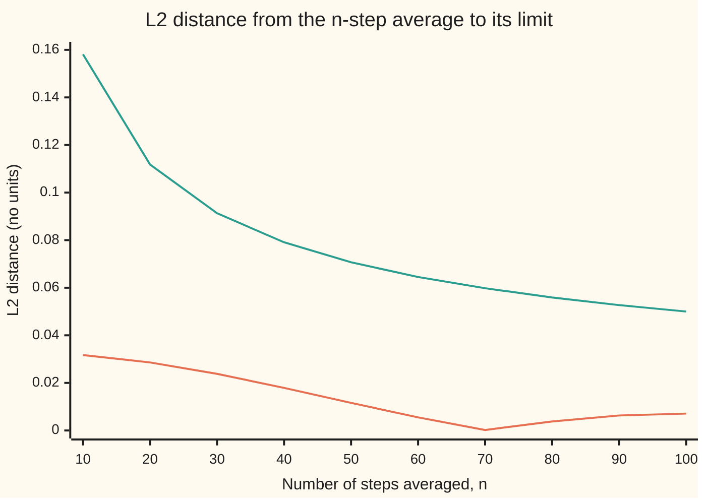

# Von Neumann's mean ergodic theorem: time averages converge in L2 to the projection onto the invariant functions

[Syllabus](../../../SYLLABUS.md) → [Measure and integration](../README.md) → [Ergodic Theory](../README.md#s12) → Von Neumann's mean ergodic theorem

---

## General Overview

A wheel carries one mark on its rim, and a sensor covers a quarter of the circle the mark travels. Each tick the wheel turns half a revolution, and the sensor reads 1 when the mark is in front of it, 0 when not. In numbers: take the circle of circumference 1, written as the interval [0, 1) with its ends joined, and measure sets by length. Turn it by half a turn: the point x moves to x + 1/2, wrapping past 1. Watch one quantity f, the sensor: it reads 1 on the arc [0, 1/4) and 0 everywhere else.

Start at a point and record f at each step. Average the first n readings. A start in [0, 1/4) reads 1, 0, 1, 0, … and its averages settle at 1/2. So does a start in [1/2, 3/4). Every other start reads 0 for ever. The long-run average is 1/2 on half the circle and 0 on the other half. It is not the space average of f, which is 1/4, because half a turn never mixes the two halves.

Now turn by $`\alpha = \sqrt2 - 1 \approx 0.4142`$ of a turn instead, and watch $`f(x) = \cos(2\pi x)`$. This turn never repeats. Its averages shrink to 0, the space average of the cosine, and by step 100 every one is within 0.01037 of it.

Von Neumann's theorem says what the limit is in every such case, for every map that keeps length. Swap the map for an operator on functions, $`Uf = f \circ T`$ (read "f after T"). It keeps the length of functions too. The functions that $`U`$ leaves alone are the possible limits. The averages converge to the closest of them, in the square-mean length of L2, the space of functions whose square has a finite integral. Here "closest" is the perpendicular drop of [L2 as a Hilbert space](../07-Sizes%20of%20Functions/06-l2-as-a-hilbert-space.md). That drop is also the conditional expectation on the sets the map leaves in place.

**For a map that keeps measure, the averages of $`f, f\circ T, \dots, f\circ T^{n-1}`$ converge in L2 to the orthogonal projection of $`f`$ onto the functions that $`T`$ leaves unchanged, and that projection is the conditional expectation of $`f`$ given the invariant sets.**

**What kind of fact this is:** a theorem, proved on this card in Why it works.

### The picture: two speeds of convergence



Caption: the first line is the turn by $`\sqrt2 - 1`$ with $`f = \cos(2\pi x)`$; it stays under a curve shaped like 1/n. The second line is the shelf's house example, the doubling map $`x \mapsto 2x \bmod 1`$ with f the first binary digit; it falls like $`1/(2\sqrt n)`$. The theorem promises that both reach 0. It promises no speed.

---

## The formula

Notation first, in words. The space is $`[0, 1)`$ with length $`m`$. A map $`T`$ **keeps measure** when the set of points that land in a set $`A`$ has the same length as $`A`$: $`m(T^{-1}A) = m(A)`$ ([Measure-preserving maps and Poincare recurrence](01-measure-preserving-maps-and-poincare-recurrence.md)).

The **Koopman operator** $`U`$ turns a function into a function: $`Uf = f \circ T`$, so $`(Uf)(x) = f(T(x))`$. The **time average** over n steps is

```math
A_n f = \frac{1}{n}\left(f + Uf + U^2 f + \dots + U^{n-1} f\right).
```

**Read it aloud:** at each start x, read f at x, at T(x), at T(T(x)) and so on for n steps, add the readings, and divide by n.

A function $`h`$ is **invariant** when $`Uh = h`$. The invariant functions in L2 form the subspace $`H_{\mathrm{inv}}`$. A set $`A`$ is invariant when $`T^{-1}A = A`$, up to a set of length zero, and the invariant sets form the sigma-algebra $`\mathcal I`$. The theorem:

```math
\lim_{n\to\infty} \left\| A_n f - Pf \right\|_2 = 0, \qquad Pf = E[f \mid \mathcal I], \qquad L^2 = H_{\mathrm{inv}} \oplus \overline{\{\, g - Ug : g \in L^2 \,\}}.
```

**Read it aloud:** the L2 distance between the n-step average and Pf goes to zero; Pf is the conditional expectation of f given the invariant sets; and L2 splits into invariant functions plus limits of differences g minus Ug, at right angles.

Here $`\|v\|_2 = \sqrt{\int v^2 \, dm}`$ is the L2 length, and $`\oplus`$ means every function is one piece from each side, the two pieces perpendicular. The bar over a set means its closure: the set together with all L2 limits of its members.

| Symbol | Plain meaning | In our example | Push it up and the answer… |
| --- | --- | --- | --- |
| $`m`$, $`T`$ | length on [0, 1); a map of [0, 1) that keeps length | $`m([0, 1/4)) = 1/4`$; $`x \mapsto x + 1/2`$, wrapped at 1 | — |
| $`\alpha`$ | the size of a turn, in whole turns | 1/2, or $`\sqrt2 - 1 = 0.414214`$ | near a whole number, convergence slows |
| $`U`$, $`U^*`$ | $`Uf = f\circ T`$; its adjoint, the operator with $`\langle Uf, g\rangle = \langle f, U^* g\rangle`$ | $`U`$ sends the indicator of [0, 1/4) to that of [1/2, 3/4) | — |
| $`x`$, $`f`$, $`g`$, $`h`$, $`r`$ | a point of [0, 1); functions in L2; r is the part of f outside $`H_{\mathrm{inv}}`$ | f = indicator of [0, 1/4); g = f/2; r = f − Pf | — |
| $`\langle u, v\rangle`$, $`\Vert v\Vert_2`$ | the inner product $`\int uv\,dm`$ and the length $`\sqrt{\langle v, v\rangle}`$ | $`\Vert \cos 2\pi x\Vert_2 = 0.7071`$ | — |
| $`n`$, $`k`$ | the number of steps averaged; a step count inside the sum | n = 1, 2, 3, 10, 101, 1000 | the average gets closer to Pf |
| $`A_n f`$, $`S_n f`$ | the n-step time average; the same sum before dividing by n | $`A_3 f`$ = 0.6667 on [0, 1/4), 0.3333 on [1/2, 3/4) | $`S_n f`$ grows without limit |
| $`H_{\mathrm{inv}}`$, $`C`$, $`\overline C`$ | functions with $`Uh = h`$; all differences $`g - Ug`$; their closure | equal values at x and x + 1/2; $`f - Pf = g - Ug`$ | a bigger $`H_{\mathrm{inv}}`$ keeps more of f |
| $`\mathcal I`$, $`\mathbf 1_A`$ | the invariant sets; the indicator of a set A, 1 on A and 0 off it | sets with $`A + 1/2 = A`$, such as $`[0,1/4)\cup[1/2,3/4)`$ | — |
| $`Pf`$, $`E[f\mid\mathcal I]`$ | the limit: the projection onto $`H_{\mathrm{inv}}`$, equal to the conditional expectation on $`\mathcal I`$ | 1/2 on $`[0,1/4)\cup[1/2,3/4)`$, 0 elsewhere | — |
| $`\varepsilon`$, $`c`$ | in the proof: an allowed error above 0; the complex number that builds the cosine's g | $`\lvert c\rvert = 0.5187`$ | — |

### When it holds

- **T keeps measure.** Then $`U`$ keeps L2 length. The map $`x \mapsto x/2`$ squeezes everything towards 0 and does not keep length. For a function with a spike at 0, such as $`x^{-1/3}`$, each step multiplies it by the cube root of 2, so the averages grow without limit.
- **f is in L2.** The theorem is about square-integrable functions. It extends to integrable functions in the L1 length by approximation, but the proof below uses right angles, which only L2 has.
- **The limit is in the L2 length, not at every point.** L2 convergence allows the averages to misbehave on small sets. The statement that almost every start converges is [Birkhoff's ergodic theorem](04-birkhoff-pointwise-ergodic-theorem.md), a harder proof.
- **The limit is the space average for every f only when T is ergodic.** Ergodic means every invariant set has length 0 or 1 ([Ergodicity and mixing](02-ergodicity-and-mixing.md)). Then $`H_{\mathrm{inv}}`$ holds only constants and $`Pf = \int f\,dm`$. Half a turn is not ergodic, so the limit for the indicator of [0, 1/4) is not 1/4. A lucky f can still land on its space average: the indicator of [0, 1/2) does.
- **No rate is promised.** The distance goes to 0, but how fast depends on f and T. Turning by a tiny $`\alpha`$ makes it as slow as one likes. Not every function with $`Pf = 0`$ is a difference $`g - Ug`$; many are only limits of differences, and for those Step 4 gives no rate at all.

---

## Why it works

### Step 0: two kinds of function, and every function is a mix

Some functions are not moved by $`U`$. Their averages equal them at every n, so they are already at the limit.

Other functions are differences $`g - Ug`$. Their sums telescope: $`(g - Ug) + (Ug - U^2 g) + \dots = g - U^n g`$. Divide by n and the average shrinks like 1/n.

The proof shows that these two kinds sit at right angles and together fill L2. Then each piece of f does its own thing, and the average keeps only the invariant piece.

### Step 1: U keeps length

Because $`T`$ keeps measure, the values of $`f\circ T`$ are spread over [0, 1) exactly as the values of $`f`$ are. So the two have the same integral of squares:

```math
\|Uf\|_2^2 = \int (f\circ T)^2 \, dm = \int f^2 \, d(m\circ T^{-1}) = \int f^2 \, dm = \|f\|_2^2 .
```

**Read it aloud:** the square length of f after T equals the square length of f, because T moves length to length. Here $`m\circ T^{-1}`$ gives a set A the length $`m(T^{-1}A)`$, which is $`m(A)`$.

For the cosine and the turn by $`\sqrt2 - 1`$, both lengths are 0.7071. An operator that keeps length is an **isometry**. It never makes a function longer, so the average $`A_n f`$ is never longer than f.

### Step 2: invariant for U means invariant for its adjoint

The **adjoint** $`U^*`$ is the operator with $`\langle Uf, g\rangle = \langle f, U^* g\rangle`$ for all $`f`$ and $`g`$. It exists by the Riesz representation theorem on [L2 as a Hilbert space](../07-Sizes%20of%20Functions/06-l2-as-a-hilbert-space.md). For a turn, $`U^*`$ turns the other way: $`(U^*g)(x) = g(x - \alpha)`$. For the doubling map it averages the two points that land on x: $`(U^*g)(x) = \tfrac12\big(g(x/2) + g((x+1)/2)\big)`$.

**Lemma.** For an isometry, $`Uh = h`$ exactly when $`U^*h = h`$. The proof is the square expansion used twice; it is in the fold.

<details>
<summary>Proof of the lemma: expand two squared lengths</summary>

Since $`U`$ keeps length, $`\langle Uf, Ug\rangle = \langle f, g\rangle`$ for all f and g, and $`U^*`$ is no longer than $`U`$, so $`\|U^* h\|_2 \le \|h\|_2`$.

If $`U^* h = h`$, expand:

$`\displaystyle \|Uh - h\|_2^2 = \|Uh\|_2^2 - 2\langle Uh, h\rangle + \|h\|_2^2 = 2\|h\|_2^2 - 2\langle h, U^*h\rangle = 0.`$

If $`Uh = h`$, then $`\langle U^*h, h\rangle = \langle h, Uh\rangle = \|h\|_2^2`$, and

$`\displaystyle \|U^*h - h\|_2^2 = \|U^*h\|_2^2 - 2\|h\|_2^2 + \|h\|_2^2 \le \|h\|_2^2 - \|h\|_2^2 = 0.`$

A length that is at most 0 is 0, so $`U^*h = h`$.

</details>

### Step 3: the invariant functions are exactly what is perpendicular to the differences

Let $`C`$ be the set of all differences $`g - Ug`$. A function $`h`$ is perpendicular to all of them when

```math
\langle h, g - Ug\rangle = \langle h - U^* h, \; g\rangle = 0 \quad \text{for every } g .
```

**Read it aloud:** h is at right angles to every difference exactly when h minus its adjoint image is at right angles to everything, which forces $`U^*h = h`$.

By the lemma, that means $`Uh = h`$. So the functions perpendicular to $`C`$ are exactly $`H_{\mathrm{inv}}`$. The projection theorem on [L2 as a Hilbert space](../07-Sizes%20of%20Functions/06-l2-as-a-hilbert-space.md) splits L2 into a closed subspace and everything perpendicular to it. Applied to the closure $`\overline C`$, it gives $`L^2 = H_{\mathrm{inv}} \oplus \overline C`$. The closure matters because the proof needs a limit of differences to stay in the family; L2 is complete by [Riesz-Fischer](../07-Sizes%20of%20Functions/05-completeness-of-lp.md), so those limits exist.

In the half-turn example, $`f - Pf`$ is 1/2 on [0, 1/4) and −1/2 on [1/2, 3/4). That is exactly $`g - Ug`$ with $`g = f/2`$, and it has zero inner product with both invariant indicators.

### Step 4: the average fixes one piece and kills the other

Write $`f = Pf + r`$, with $`Pf`$ in $`H_{\mathrm{inv}}`$ and $`r`$ in $`\overline C`$.

- **The invariant piece.** $`U^k Pf = Pf`$ for every k, so $`A_n Pf = Pf`$ for every n.
- **A difference.** If $`r = g - Ug`$, the sum telescopes, and $`\|A_n r\|_2 = \|g - U^n g\|_2 / n \le 2\|g\|_2/n`$.
- **A limit of differences.** Pick a difference within $`\varepsilon`$ of $`r`$. The average never lengthens anything (Step 1), so $`\|A_n r\|_2 \le \varepsilon + 2\|g\|_2/n`$, which is below $`2\varepsilon`$ once n is large.

So $`\|A_n f - Pf\|_2 = \|A_n r\|_2 \to 0`$. For the cosine and the turn by $`\sqrt2 - 1`$, f is itself a difference, with $`\|g\|_2 = 0.3668`$. The proof's bound at n = 100 is 0.00734; the true distance is 0.00711.

<details>
<summary>Where the cosine's g comes from</summary>

Write $`\cos 2\pi x`$ as the real part of $`e^{2\pi i x}`$, where $`e^{i\theta} = \cos\theta + i\sin\theta`$. Turning by $`\alpha`$ multiplies $`e^{2\pi i x}`$ by $`e^{2\pi i \alpha}`$. So $`g = \mathrm{Re}\big(c\, e^{2\pi i x}\big)`$ has $`g - Ug = \mathrm{Re}\big(c(1 - e^{2\pi i\alpha}) e^{2\pi i x}\big)`$. Choosing

$`\displaystyle c = \frac{1}{1 - e^{2\pi i \alpha}}, \qquad |c| = \frac{1}{2\sin \pi\alpha} = 0.5187`$

makes $`g - Ug = \cos 2\pi x`$, and $`\|g\|_2 = |c|/\sqrt2 = 0.3668`$. The same geometric sum gives the average exactly:

$`\displaystyle \|A_n f\|_2 = \frac{|\sin \pi n\alpha|}{\sqrt2\, n \sin\pi\alpha} \le \frac{1}{\sqrt2\, n\sin\pi\alpha}, \qquad |A_n f(x)| \le \frac{1}{n \sin \pi\alpha}.`$

When $`\alpha`$ is a whole number of turns, $`\sin\pi\alpha = 0`$ and no such g exists: the cosine is then invariant, not a difference.

</details>

### Step 5: the projection is the conditional expectation on the invariant sets

An invariant set $`A`$ has an invariant indicator, since $`U\mathbf 1_A = \mathbf 1_{T^{-1}A} = \mathbf 1_A`$. Here $`\mathbf 1_A`$ is 1 on A and 0 off it.

Conversely, if $`Uh = h`$, each level set $`\{h > a\}`$, for a number a, is invariant: $`T^{-1}\{h > a\} = \{h\circ T > a\} = \{h > a\}`$, up to length zero. So an invariant function is computed from invariant sets alone, and $`H_{\mathrm{inv}}`$ is exactly the L2 functions measurable for $`\mathcal I`$.

The projection onto those functions is the conditional expectation $`E[f\mid\mathcal I]`$, by [Conditional expectation as a projection](../09-Conditional%20Expectation/03-conditional-expectation-as-projection.md). It is the function that is measurable for $`\mathcal I`$ and has the same integral as f over every invariant set ([Conditional expectation on a sigma-algebra](../09-Conditional%20Expectation/02-conditional-expectation-on-a-sigma-algebra.md)).

For the half turn, every invariant set pairs each x with x + 1/2, so $`E[f\mid\mathcal I](x) = \tfrac12\big(f(x) + f(x + 1/2)\big)`$. Among the functions constant on quarters, the invariant ones are built from two indicators, and the check finds the same answer as a projection onto them, the indicators of $`[0,1/4)\cup[1/2,3/4)`$ and $`[1/4,1/2)\cup[3/4,1)`$.

---

## Worked numbers, by hand

The half turn, with f the indicator of [0, 1/4). Every function here is constant on the four quarters of [0, 1), so it is a list of four values, each quarter of length 1/4.

| Step | Arithmetic | Value |
| --- | --- | --- |
| U moves f | $`f(x + 1/2)`$ is 1 when x is in [1/2, 3/4) | Uf = indicator of [1/2, 3/4) |
| two steps | $`(f + Uf)/2`$ | 1/2 on [0, 1/4) and [1/2, 3/4) |
| three steps | $`(f + Uf + f)/3`$ | 0.6667 and 0.3333 |
| its distance to the limit | $`\sqrt{\tfrac14 (1/6)^2 + \tfrac14 (1/6)^2}`$ | 0.1179 |
| 101 steps | $`(51 f + 50\, Uf)/101`$ | 0.5050 and 0.4950, distance 0.0035 |
| any even n | the readings come in pairs | exactly the limit |
| the limit | $`E[f\mid\mathcal I] = \tfrac12(f + Uf)`$ | **1/2 on [0, 1/4) and [1/2, 3/4), 0 elsewhere** |
| total kept | integral of the limit | 1/4, the same as f |

The limit is the long-run fraction of time each start spends in [0, 1/4): half the time for the two quarters that swap, never for the other two.

The turn by $`\alpha = \sqrt2 - 1`$, with $`f = \cos 2\pi x`$:

| Step | Arithmetic | Value |
| --- | --- | --- |
| the turn's size factor | $`\sin(\pi \times 0.414214)`$ | 0.9639 |
| the pointwise bound at n = 100 | $`1/(100 \times 0.9639)`$ | 0.01037 |
| the L2 bound from Step 4 | $`2 \times 0.3668/100`$ | 0.00734 |
| the true L2 distance at n = 100 | $`\lvert\sin(100\pi\alpha)\rvert/(\sqrt2 \times 100 \times 0.9639)`$ | **0.00711** |

The doubling map, with f the first binary digit: its digits behave like fair coin tosses, so the distance after n steps is $`1/(2\sqrt n)`$. That is 0.1581 at n = 10 and 0.0500 at n = 100.

### What breaks if you drop a piece

| Mistake | Comes out at | What went wrong |
| --- | --- | --- |
| Take the space average 1/4 as the half turn's limit | off by 0.2500 at n = 1000 | Half a turn is not ergodic; the limit is $`E[f\mid\mathcal I]`$, not a constant |
| Add the readings without dividing by n | $`\Vert S_{100} f\Vert_2`$ = 35.36, growing with n | The invariant piece adds up; only the average settles |
| Assume a 1/n rate for the doubling map | predicts 0.0158 at n = 100; truth 0.0500 | The theorem gives no rate; here it is $`1/(2\sqrt n)`$ |
| Read the answer at one start | x = 0 never moves under doubling: average 0.0000, not 1/2 | The theorem is about L2, and one point has length 0 |

---

## Code, from first principles, and it actually runs

The script works all three examples and takes at least two independent roads to each answer. For the half turn it applies $`U`$ step by step, then compares with the pair average $`\tfrac12(f(x) + f(x + 1/2))`$ and with a projection computed from inner products. For the turn by $`\sqrt2 - 1`$ it sums cosines at 64 points and compares with the closed form, and it checks that the cosine equals $`g - Ug`$. Sixty-four equal samples integrate these low waves exactly, so the sums are true integrals. For the doubling map it runs the map on 1,024 binary starting points in whole-number arithmetic, and compares with a binomial sum and with $`1/(2\sqrt n)`$.

### Python

```python
# Von Neumann's mean ergodic theorem -- the check behind the card.  Standard
# library only.  Three maps of [0, 1) that keep length, one function on each,
# and the time averages A_n f = (f + Uf + ... + U^(n-1) f) / n, with U f = f o T.
# Each limit is reached by roads that share no arithmetic.
from math import cos, sin, pi, sqrt, comb

def inner(u, v):                  # integral of u v over [0, 1), for functions
    return sum(a * b for a, b in zip(u, v)) / len(u)   # stored as equal cells

def norm(v):                      # the L2 length: square root of the integral of v^2
    return sqrt(inner(v, v))

def average(v, n, U):             # road one: apply U again and again, add, divide
    total, w = [0.0] * len(v), v
    for _ in range(n):
        total = [t + a for t, a in zip(total, w)]
        w = U(w)
    return [t / n for t in total]

# ---- 1. rotation by 1/2, f = indicator of [0, 1/4): exact on the four quarters ----
def U_half(v):                    # (f o T)(x) = f(x + 1/2): quarter q reads quarter q + 2
    return [v[(q + 2) % 4] for q in range(4)]
f = [1.0, 0.0, 0.0, 0.0]
cond = [(f[q] + f[(q + 2) % 4]) / 2 for q in range(4)]   # road two: average over {x, x + 1/2}
e1, e2 = [1, 0, 1, 0], [0, 1, 0, 1]                      # road three: drop f onto the invariant
proj = [inner(f, e1) / inner(e1, e1) * a + inner(f, e2) / inner(e2, e2) * b for a, b in zip(e1, e2)]
print("rotation by 1/2, f = indicator of [0, 1/4), values on the quarters [0,1/4) [1/4,1/2) [1/2,3/4) [3/4,1)")
print(f"  f = {f}, Uf = {U_half(f)}")
print(f"  limit as conditional expectation (f + f o T)/2 = {cond}")
print(f"  limit as projection onto the invariant functions = {proj}")
print(f"  integral of f = {sum(f) / 4}; integral of the limit = {sum(cond) / 4}")
for n in [1, 2, 3, 10, 101, 1000]:
    a = average(f, n, U_half)
    err = norm([x - y for x, y in zip(a, cond)])
    print(f"  n = {n:4d}: A_n f = [{', '.join(f'{x:.4f}' for x in a)}], distance to limit {err:.4f}")
rest = [x - y for x, y in zip(f, cond)]
g = [x / 2 for x in f]
cob = [x - y for x, y in zip(g, U_half(g))]
print(f"  f - Pf = {rest} = g - Ug with g = f/2: {"yes" if rest == cob else "no"}; inner products with e1, e2: {inner(rest, e1)}, {inner(rest, e2)}")
assert cond == proj == [0.5, 0.0, 0.5, 0.0]                      # two roads, one projection
assert norm([x - y for x, y in zip(average(f, 1000, U_half), cond)]) < 1e-12
assert abs(norm([x - y for x, y in zip(average(f, 101, U_half), cond)]) - sqrt(0.5) / 202) < 1e-12
assert rest == cob and inner(rest, e1) == 0 == inner(rest, e2)

# ---- 2. rotation by alpha = sqrt 2 - 1, f = cos(2 pi x): sampled on 64 midpoints ----
# Squares of these functions are waves of frequency at most 2, which 64 equal samples
# integrate exactly, so the cell sums are exact integrals, not approximations.
M, alpha = 64, sqrt(2) - 1
xs = [(j + 0.5) / M for j in range(M)]
fc = [cos(2 * pi * x) for x in xs]
def U_alpha_of(func):             # U applied to a known formula: x -> func(x + alpha)
    return [func((x + alpha) % 1.0) for x in xs]
def A_alpha(n):                   # road one: sum cos(2 pi (x + k alpha)) directly
    return [sum(cos(2 * pi * ((x + k * alpha) % 1.0)) for k in range(n)) / n for x in xs]
def closed(n):                    # road two: geometric sum of e^(2 pi i k alpha)
    return abs(sin(pi * n * alpha)) / (sqrt(2) * n * sin(pi * alpha))
s = sin(pi * alpha)
c = 1 / (1 - complex(cos(2 * pi * alpha), sin(2 * pi * alpha)))  # g = Re(c e^(2 pi i x))
gfun = lambda x: (c * complex(cos(2 * pi * x), sin(2 * pi * x))).real
gc = [gfun(x) for x in xs]
cob2 = [a - b for a, b in zip(gc, U_alpha_of(gfun))]
print(f"rotation by alpha = {alpha:.6f}, f = cos(2 pi x); sin(pi alpha) = {s:.4f}")
print(f"  |f| = {norm(fc):.4f}, |Uf| = {norm(U_alpha_of(lambda x: cos(2 * pi * x))):.4f} (U keeps length)")
print(f"  f = g - Ug with |c| = {abs(c):.4f}, |g| = {norm(gc):.4f}: every gap below 1e-12: {
      "yes" if max(abs(a - b) for a, b in zip(fc, cob2)) < 1e-12 else "no"}")
print("  n, |A_n f| summed, |A_n f| closed form, proof bound 2|g|/n, sup bound 1/(n sin pi alpha)")
for n in [1, 10, 100, 1000]:
    a = A_alpha(n)
    print(f"  {n:4d}  {norm(a):.5f}  {closed(n):.5f}  {2 * norm(gc) / n:.5f}  {1 / (n * s):.5f}")
    assert abs(norm(a) - closed(n)) < 1e-9                     # two roads agree
    assert norm(a) <= 2 * norm(gc) / n + 1e-12 and max(map(abs, a)) <= 1 / (n * s) + 1e-12
assert max(abs(a - b) for a, b in zip(fc, cob2)) < 1e-12        # cos is a difference g - Ug
assert abs(abs(c) - 1 / (2 * s)) < 1e-12                        # |c| two ways: complex division, 1/(2 sin pi alpha)

# ---- 3. the house example: doubling map, f = first binary digit ----
def by_enumeration(n):            # road one: run T x = 2x mod 1 on each dyadic midpoint,
    size, tot = 2 ** (n + 1), 0.0 # in whole numbers: x = num / 2^(n+1)
    for j in range(2 ** n):
        num, ones = 2 * j + 1, 0
        for _ in range(n):
            ones += num >= size // 2
            num = 2 * num % size
        tot += (ones / n - 0.5) ** 2
    return sqrt(tot / 2 ** n)
def by_binomial(n):               # road two: digits are fair coins; sum over the count of 1s
    return sqrt(sum(comb(n, k) * (k / n - 0.5) ** 2 for k in range(n + 1)) / 2 ** n)
print("doubling map, f = first binary digit, limit 1/2 (the map is mixing, hence ergodic)")
print(f"  n = 10: distance by enumerating 1024 starts {by_enumeration(10):.4f}, "
      f"by binomial sum {by_binomial(10):.4f}, by 1/(2 sqrt n) {1 / (2 * sqrt(10)):.4f}")
assert abs(by_enumeration(10) - by_binomial(10)) < 1e-12 and abs(by_binomial(10) - 1 / (2 * sqrt(10))) < 1e-12

print("chart, n = 10..100: rotation |A_n f| then doubling distance")
ns = list(range(10, 101, 10))
print("  " + ", ".join(f"{closed(n):.4f}" for n in ns))
print("  " + ", ".join(f"{by_binomial(n):.4f}" for n in ns))
for n in ns:
    assert abs(by_binomial(n) - 1 / (2 * sqrt(n))) < 1e-12

print(f"mistake 1, space average 1/4 as the limit for rotation by 1/2: off by "
      f"{norm([x - 0.25 for x in average(f, 1000, U_half)]):.4f} at n = 1000")
print(f"mistake 2, sums without the 1/n: |S_100 f| = {100 * norm(average(f, 100, U_half)):.2f}, growing with n")
print(f"mistake 3, a 1/n rate for the doubling map: predicts {by_binomial(10) / 10:.4f} at n = 100, "
      f"truth {by_binomial(100):.4f}")
x, ones = 0.0, 0                  # the start 0 is a fixed point of the doubling map
for _ in range(1000):
    ones, x = ones + (x >= 0.5), 2 * x % 1.0
print(f"mistake 4, one start read as almost every start: x = 0 never moves, its average stays {ones / 1000:.4f}")
print("ALL CHECKS PASS")
```

**Ran 2026-11-23 on macOS, Python 3.14.10, standard library only. All checks passed. Output, pasted from the run:**

```
rotation by 1/2, f = indicator of [0, 1/4), values on the quarters [0,1/4) [1/4,1/2) [1/2,3/4) [3/4,1)
  f = [1.0, 0.0, 0.0, 0.0], Uf = [0.0, 0.0, 1.0, 0.0]
  limit as conditional expectation (f + f o T)/2 = [0.5, 0.0, 0.5, 0.0]
  limit as projection onto the invariant functions = [0.5, 0.0, 0.5, 0.0]
  integral of f = 0.25; integral of the limit = 0.25
  n =    1: A_n f = [1.0000, 0.0000, 0.0000, 0.0000], distance to limit 0.3536
  n =    2: A_n f = [0.5000, 0.0000, 0.5000, 0.0000], distance to limit 0.0000
  n =    3: A_n f = [0.6667, 0.0000, 0.3333, 0.0000], distance to limit 0.1179
  n =   10: A_n f = [0.5000, 0.0000, 0.5000, 0.0000], distance to limit 0.0000
  n =  101: A_n f = [0.5050, 0.0000, 0.4950, 0.0000], distance to limit 0.0035
  n = 1000: A_n f = [0.5000, 0.0000, 0.5000, 0.0000], distance to limit 0.0000
  f - Pf = [0.5, 0.0, -0.5, 0.0] = g - Ug with g = f/2: yes; inner products with e1, e2: 0.0, 0.0
rotation by alpha = 0.414214, f = cos(2 pi x); sin(pi alpha) = 0.9639
  |f| = 0.7071, |Uf| = 0.7071 (U keeps length)
  f = g - Ug with |c| = 0.5187, |g| = 0.3668: every gap below 1e-12: yes
  n, |A_n f| summed, |A_n f| closed form, proof bound 2|g|/n, sup bound 1/(n sin pi alpha)
     1  0.70711  0.70711  0.73359  1.03745
    10  0.03168  0.03168  0.07336  0.10374
   100  0.00711  0.00711  0.00734  0.01037
  1000  0.00046  0.00046  0.00073  0.00104
doubling map, f = first binary digit, limit 1/2 (the map is mixing, hence ergodic)
  n = 10: distance by enumerating 1024 starts 0.1581, by binomial sum 0.1581, by 1/(2 sqrt n) 0.1581
chart, n = 10..100: rotation |A_n f| then doubling distance
  0.0317, 0.0286, 0.0238, 0.0179, 0.0116, 0.0055, 0.0002, 0.0038, 0.0063, 0.0071
  0.1581, 0.1118, 0.0913, 0.0791, 0.0707, 0.0645, 0.0598, 0.0559, 0.0527, 0.0500
mistake 1, space average 1/4 as the limit for rotation by 1/2: off by 0.2500 at n = 1000
mistake 2, sums without the 1/n: |S_100 f| = 35.36, growing with n
mistake 3, a 1/n rate for the doubling map: predicts 0.0158 at n = 100, truth 0.0500
mistake 4, one start read as almost every start: x = 0 never moves, its average stays 0.0000
ALL CHECKS PASS
```

### Rust

Same numbers, same labels, built with `rustc --edition 2021 -O`.

```rust
// Von Neumann's mean ergodic theorem -- the same check as the Python, in Rust.
// No crates.  Three maps of [0, 1) that keep length, one function on each, and
// the time averages A_n f = (f + Uf + ... + U^(n-1) f) / n, with U f = f o T.
// Each limit is reached by roads that share no arithmetic.
use std::f64::consts::PI;

fn inner(u: &[f64], v: &[f64]) -> f64 {        // integral of u v over [0, 1), for functions
    u.iter().zip(v).map(|(a, b)| a * b).sum::<f64>() / u.len() as f64   // stored as equal cells
}
fn norm(v: &[f64]) -> f64 { inner(v, v).sqrt() } // the L2 length
fn diff(u: &[f64], v: &[f64]) -> Vec<f64> { u.iter().zip(v).map(|(a, b)| a - b).collect() }
fn average(v: &[f64], n: usize, u: fn(&[f64]) -> Vec<f64>) -> Vec<f64> { // road one: apply U, add, divide
    let (mut total, mut w) = (vec![0.0; v.len()], v.to_vec());
    for _ in 0..n {
        for (t, a) in total.iter_mut().zip(&w) { *t += a }
        w = u(&w);
    }
    total.iter().map(|t| t / n as f64).collect()
}
fn u_half(v: &[f64]) -> Vec<f64> { (0..4).map(|q| v[(q + 2) % 4]).collect() } // quarter q reads q + 2
fn yn(b: bool) -> &'static str { if b { "yes" } else { "no" } }
fn fmt4(v: &[f64]) -> String { v.iter().map(|x| format!("{:.4}", x)).collect::<Vec<_>>().join(", ") }

fn binom(n: u64, k: u64) -> f64 {              // n choose k, built up as a product
    let mut r = 1.0;
    for i in 0..k { r = r * (n - i) as f64 / (i + 1) as f64 }
    r
}
fn by_enumeration(n: u32) -> f64 {             // road one: run T x = 2x mod 1 on dyadic midpoints
    let (size, mut tot) = (1u64 << (n + 1), 0.0);
    for j in 0..(1u64 << n) {
        let (mut num, mut ones) = (2 * j + 1, 0u32);
        for _ in 0..n {
            if num >= size / 2 { ones += 1 }
            num = 2 * num % size;
        }
        tot += (ones as f64 / n as f64 - 0.5).powi(2);
    }
    (tot / (1u64 << n) as f64).sqrt()
}
fn by_binomial(n: u64) -> f64 {                // road two: digits are fair coins
    let s: f64 = (0..=n).map(|k| binom(n, k) * (k as f64 / n as f64 - 0.5).powi(2)).sum();
    (s / 2f64.powi(n as i32)).sqrt()
}

fn main() {
    // ---- 1. rotation by 1/2, f = indicator of [0, 1/4): exact on the four quarters ----
    let f = vec![1.0, 0.0, 0.0, 0.0];
    let cond: Vec<f64> = (0..4).map(|q| (f[q] + f[(q + 2) % 4]) / 2.0).collect(); // road two
    let (e1, e2) = (vec![1.0, 0.0, 1.0, 0.0], vec![0.0, 1.0, 0.0, 1.0]);          // road three
    let (c1, c2) = (inner(&f, &e1) / inner(&e1, &e1), inner(&f, &e2) / inner(&e2, &e2));
    let proj: Vec<f64> = e1.iter().zip(&e2).map(|(a, b)| c1 * a + c2 * b).collect();
    println!("rotation by 1/2, f = indicator of [0, 1/4), values on the quarters [0,1/4) [1/4,1/2) [1/2,3/4) [3/4,1)");
    println!("  f = {:?}, Uf = {:?}", f, u_half(&f));
    println!("  limit as conditional expectation (f + f o T)/2 = {:?}", cond);
    println!("  limit as projection onto the invariant functions = {:?}", proj);
    println!("  integral of f = {:?}; integral of the limit = {:?}", f.iter().sum::<f64>() / 4.0, cond.iter().sum::<f64>() / 4.0);
    for n in [1, 2, 3, 10, 101, 1000] {
        let a = average(&f, n, u_half);
        println!("  n = {:4}: A_n f = [{}], distance to limit {:.4}", n, fmt4(&a), norm(&diff(&a, &cond)));
    }
    let rest = diff(&f, &cond);
    let g: Vec<f64> = f.iter().map(|x| x / 2.0).collect();
    let cob = diff(&g, &u_half(&g));
    println!("  f - Pf = {:?} = g - Ug with g = f/2: {}; inner products with e1, e2: {:?}, {:?}",
             rest, yn(rest == cob), inner(&rest, &e1), inner(&rest, &e2));
    assert!(cond == proj && proj == vec![0.5, 0.0, 0.5, 0.0]);
    assert!(norm(&diff(&average(&f, 1000, u_half), &cond)) < 1e-12);
    assert!((norm(&diff(&average(&f, 101, u_half), &cond)) - 0.5f64.sqrt() / 202.0).abs() < 1e-12);
    assert!(rest == cob && inner(&rest, &e1) == 0.0 && inner(&rest, &e2) == 0.0);

    // ---- 2. rotation by alpha = sqrt 2 - 1, f = cos(2 pi x): 64 midpoints, exact for these waves ----
    let (m, alpha) = (64usize, 2f64.sqrt() - 1.0);
    let xs: Vec<f64> = (0..m).map(|j| (j as f64 + 0.5) / m as f64).collect();
    let fc: Vec<f64> = xs.iter().map(|x| (2.0 * PI * x).cos()).collect();
    let ufc: Vec<f64> = xs.iter().map(|x| (2.0 * PI * ((x + alpha) % 1.0)).cos()).collect();
    let a_alpha = |n: usize| -> Vec<f64> {      // road one: sum cos(2 pi (x + k alpha)) directly
        xs.iter().map(|x| (0..n).map(|k| (2.0 * PI * ((x + k as f64 * alpha) % 1.0)).cos()).sum::<f64>() / n as f64).collect()
    };
    let s = (PI * alpha).sin();
    let closed = |n: usize| (PI * n as f64 * alpha).sin().abs() / (2f64.sqrt() * n as f64 * s); // road two
    let (dr, di) = (1.0 - (2.0 * PI * alpha).cos(), -(2.0 * PI * alpha).sin());   // c = 1 / (dr + i di)
    let (cr, ci) = (dr / (dr * dr + di * di), -di / (dr * dr + di * di));
    let gfun = |x: f64| cr * (2.0 * PI * x).cos() - ci * (2.0 * PI * x).sin();   // Re(c e^(2 pi i x))
    let gc: Vec<f64> = xs.iter().map(|&x| gfun(x)).collect();
    let cob2: Vec<f64> = xs.iter().map(|&x| gfun(x) - gfun((x + alpha) % 1.0)).collect();
    let gap = fc.iter().zip(&cob2).map(|(a, b)| (a - b).abs()).fold(0.0, f64::max);
    println!("rotation by alpha = {:.6}, f = cos(2 pi x); sin(pi alpha) = {:.4}", alpha, s);
    println!("  |f| = {:.4}, |Uf| = {:.4} (U keeps length)", norm(&fc), norm(&ufc));
    println!("  f = g - Ug with |c| = {:.4}, |g| = {:.4}: every gap below 1e-12: {}", cr.hypot(ci), norm(&gc), yn(gap < 1e-12));
    println!("  n, |A_n f| summed, |A_n f| closed form, proof bound 2|g|/n, sup bound 1/(n sin pi alpha)");
    for n in [1usize, 10, 100, 1000] {
        let a = a_alpha(n);
        let nf = n as f64;
        println!("  {:4}  {:.5}  {:.5}  {:.5}  {:.5}", n, norm(&a), closed(n), 2.0 * norm(&gc) / nf, 1.0 / (nf * s));
        assert!((norm(&a) - closed(n)).abs() < 1e-9);
        assert!(norm(&a) <= 2.0 * norm(&gc) / nf + 1e-12 && a.iter().all(|v| v.abs() <= 1.0 / (nf * s) + 1e-12));
    }
    assert!(gap < 1e-12);
    assert!((cr.hypot(ci) - 1.0 / (2.0 * s)).abs() < 1e-12);  // |c| two ways: complex division, 1/(2 sin pi alpha)

    // ---- 3. the house example: doubling map, f = first binary digit ----
    println!("doubling map, f = first binary digit, limit 1/2 (the map is mixing, hence ergodic)");
    println!("  n = 10: distance by enumerating 1024 starts {:.4}, by binomial sum {:.4}, by 1/(2 sqrt n) {:.4}",
             by_enumeration(10), by_binomial(10), 1.0 / (2.0 * 10f64.sqrt()));
    assert!((by_enumeration(10) - by_binomial(10)).abs() < 1e-12 && (by_binomial(10) - 1.0 / (2.0 * 10f64.sqrt())).abs() < 1e-12);

    println!("chart, n = 10..100: rotation |A_n f| then doubling distance");
    let ns: Vec<u64> = (1..=10).map(|i| 10 * i).collect();
    println!("  {}", ns.iter().map(|&n| format!("{:.4}", closed(n as usize))).collect::<Vec<_>>().join(", "));
    println!("  {}", ns.iter().map(|&n| format!("{:.4}", by_binomial(n))).collect::<Vec<_>>().join(", "));
    for &n in &ns { assert!((by_binomial(n) - 1.0 / (2.0 * (n as f64).sqrt())).abs() < 1e-12) }

    let quarter: Vec<f64> = average(&f, 1000, u_half).iter().map(|x| x - 0.25).collect();
    println!("mistake 1, space average 1/4 as the limit for rotation by 1/2: off by {:.4} at n = 1000", norm(&quarter));
    println!("mistake 2, sums without the 1/n: |S_100 f| = {:.2}, growing with n", 100.0 * norm(&average(&f, 100, u_half)));
    println!("mistake 3, a 1/n rate for the doubling map: predicts {:.4} at n = 100, truth {:.4}", by_binomial(10) / 10.0, by_binomial(100));
    let (mut x, mut ones) = (0.0f64, 0u32);      // the start 0 is a fixed point of the doubling map
    for _ in 0..1000 {
        if x >= 0.5 { ones += 1 }
        x = 2.0 * x % 1.0;
    }
    println!("mistake 4, one start read as almost every start: x = 0 never moves, its average stays {:.4}", ones as f64 / 1000.0);
    println!("ALL CHECKS PASS");
}
```

**Ran 2026-11-23 on macOS, rustc 1.98.1, no crates. All checks passed. Output, pasted from the run:**

```
rotation by 1/2, f = indicator of [0, 1/4), values on the quarters [0,1/4) [1/4,1/2) [1/2,3/4) [3/4,1)
  f = [1.0, 0.0, 0.0, 0.0], Uf = [0.0, 0.0, 1.0, 0.0]
  limit as conditional expectation (f + f o T)/2 = [0.5, 0.0, 0.5, 0.0]
  limit as projection onto the invariant functions = [0.5, 0.0, 0.5, 0.0]
  integral of f = 0.25; integral of the limit = 0.25
  n =    1: A_n f = [1.0000, 0.0000, 0.0000, 0.0000], distance to limit 0.3536
  n =    2: A_n f = [0.5000, 0.0000, 0.5000, 0.0000], distance to limit 0.0000
  n =    3: A_n f = [0.6667, 0.0000, 0.3333, 0.0000], distance to limit 0.1179
  n =   10: A_n f = [0.5000, 0.0000, 0.5000, 0.0000], distance to limit 0.0000
  n =  101: A_n f = [0.5050, 0.0000, 0.4950, 0.0000], distance to limit 0.0035
  n = 1000: A_n f = [0.5000, 0.0000, 0.5000, 0.0000], distance to limit 0.0000
  f - Pf = [0.5, 0.0, -0.5, 0.0] = g - Ug with g = f/2: yes; inner products with e1, e2: 0.0, 0.0
rotation by alpha = 0.414214, f = cos(2 pi x); sin(pi alpha) = 0.9639
  |f| = 0.7071, |Uf| = 0.7071 (U keeps length)
  f = g - Ug with |c| = 0.5187, |g| = 0.3668: every gap below 1e-12: yes
  n, |A_n f| summed, |A_n f| closed form, proof bound 2|g|/n, sup bound 1/(n sin pi alpha)
     1  0.70711  0.70711  0.73359  1.03745
    10  0.03168  0.03168  0.07336  0.10374
   100  0.00711  0.00711  0.00734  0.01037
  1000  0.00046  0.00046  0.00073  0.00104
doubling map, f = first binary digit, limit 1/2 (the map is mixing, hence ergodic)
  n = 10: distance by enumerating 1024 starts 0.1581, by binomial sum 0.1581, by 1/(2 sqrt n) 0.1581
chart, n = 10..100: rotation |A_n f| then doubling distance
  0.0317, 0.0286, 0.0238, 0.0179, 0.0116, 0.0055, 0.0002, 0.0038, 0.0063, 0.0071
  0.1581, 0.1118, 0.0913, 0.0791, 0.0707, 0.0645, 0.0598, 0.0559, 0.0527, 0.0500
mistake 1, space average 1/4 as the limit for rotation by 1/2: off by 0.2500 at n = 1000
mistake 2, sums without the 1/n: |S_100 f| = 35.36, growing with n
mistake 3, a 1/n rate for the doubling map: predicts 0.0158 at n = 100, truth 0.0500
mistake 4, one start read as almost every start: x = 0 never moves, its average stays 0.0000
ALL CHECKS PASS
```

The two outputs match line for line.

### Lean

Lean proves the three parts of the theorem for every map that keeps measure, and checks the half turn and doubling map numbers.

- Take a map $`T`$ that keeps measure, and any $`f`$ in L2. Then $`A_n f`$ converges in L2 to $`Pf`$, the projection of $`f`$ onto $`H_{\mathrm{inv}}`$.
- Suppose also the space has finite measure, like [0, 1) with length. Then $`Pf = E[f\mid\mathcal I]`$ outside a set of length 0. Here $`\mathcal I`$ holds the sets with $`T^{-1}A = A`$ exactly.
- Take a map $`T`$ that keeps measure. Then the functions perpendicular to $`H_{\mathrm{inv}}`$ are exactly $`\overline C`$, the limits of differences $`g - Ug`$.
- On the half turn, take $`f`$ the indicator of [0, 1/4). Then $`A_2 f`$ is 1/2 on [0, 1/4) and on [1/2, 3/4).
- For the same $`f`$, $`A_3 f`$ is 2/3 on [0, 1/4) and 1/3 on [1/2, 3/4).
- The half turn's hand arithmetic holds: squared distance 1/72 at n = 3, integral 1/4, and 51/101 off by 1/202.
- The squared length of $`S_{100} f`$ is 1250, whose square root is 35.36.
- For the doubling map at n = 10, the binomial sum of squared errors equals 1/40, the square of $`1/(2\sqrt{10})`$.

The turn by $`\sqrt2 - 1`$, the cosine's g and the enumeration of 1,024 starts are left to the Python and Rust checks.

```lean
-- Von Neumann's mean ergodic theorem: for a map that keeps measure, the time averages of an L2 function converge in L2 to its orthogonal projection onto the invariant functions, which is its conditional expectation given the invariant sets.
import Mathlib.Analysis.InnerProductSpace.MeanErgodic
import Mathlib.MeasureTheory.Function.ConditionalExpectation.Basic
import Mathlib.MeasureTheory.Function.L2Space
import Mathlib.MeasureTheory.MeasurableSpace.Invariants

open MeasureTheory Filter Topology

/-- An `L²` function fixed by the Koopman operator has a version measurable for the invariant
σ-algebra. -/
theorem aestronglyMeasurable_invariants_of_koopman_fixed
    {α : Type*} [MeasurableSpace α] {μ : Measure α} {T : α → α}
    (hT : MeasurePreserving T μ μ) (h : Lp ℝ 2 μ)
    (hh : (Lp.compMeasurePreservingₗᵢ ℝ T hT) h = h) :
    AEStronglyMeasurable[MeasurableSpace.invariants T] (h : α → ℝ) μ := by
  have hm := (Lp.aestronglyMeasurable h).aemeasurable
  set g0 := hm.mk _ with hg0
  have hg0m : Measurable g0 := hm.measurable_mk
  have hhg0 : (h : α → ℝ) =ᵐ[μ] g0 := hm.ae_eq_mk
  have hcomp : (h : α → ℝ) ∘ T =ᵐ[μ] (h : α → ℝ) := by
    have h1 := Lp.coeFn_compMeasurePreserving h hT
    have hh' : Lp.compMeasurePreserving T hT h = h := hh
    rw [hh'] at h1
    exact h1.symm
  have hT1 : g0 ∘ T =ᵐ[μ] g0 :=
    ((hT.quasiMeasurePreserving.ae_eq_comp hhg0).symm.trans hcomp).trans hhg0
  have hiter : ∀ n : ℕ, g0 ∘ T^[n] =ᵐ[μ] g0 := by
    intro n
    induction n with
    | zero => exact Filter.EventuallyEq.rfl
    | succ n ih =>
      rw [Function.iterate_succ, ← Function.comp_assoc]
      exact (hT.quasiMeasurePreserving.ae_eq_comp ih).trans hT1
  set G : α → ℝ := fun x => liminf (fun n => g0 (T^[n] x)) atTop with hG
  have hGm : Measurable G :=
    Measurable.liminf fun n => hg0m.comp (hT.measurable.iterate n)
  have hGT : G ∘ T = G := by
    funext x
    simp only [hG, Function.comp_apply]
    have : (fun n => g0 (T^[n] (T x))) = fun n => g0 (T^[n + 1] x) := by
      funext n; rw [Function.iterate_succ_apply]
    rw [this]
    exact liminf_nat_add (fun n => g0 (T^[n] x)) 1
  have hGinv : Measurable[MeasurableSpace.invariants T] G :=
    MeasurableSpace.measurable_invariants_dom.2 ⟨hGm, fun s _ => by rw [hGT]⟩
  have hGae : g0 =ᵐ[μ] G := by
    filter_upwards [ae_all_iff.2 hiter] with x hx
    have : (fun n => g0 (T^[n] x)) = fun _ => g0 x := funext fun n => hx n
    simp only [hG, this, liminf_const]
  exact ⟨G, hGinv.stronglyMeasurable, hhg0.trans hGae⟩

/-- **Von Neumann's mean ergodic theorem.** Let `T` keep the measure `μ`, and let `U` be the
Koopman operator `U f = f ∘ T` on `L²(μ)`. For every `f` in `L²(μ)`, the time averages
`(1/n)(f + U f + ... + U^(n-1) f)` converge in the L2 length to the orthogonal projection of `f`
onto the subspace of invariant functions `{h | U h = h}`. -/
theorem time_averages_tendsto_projection_onto_invariant
    {α : Type*} [MeasurableSpace α] {μ : Measure α} {T : α → α}
    (hT : MeasurePreserving T μ μ) (f : Lp ℝ 2 μ) :
    let U : Lp ℝ 2 μ →L[ℝ] Lp ℝ 2 μ :=
      (Lp.compMeasurePreservingₗᵢ ℝ T hT).toContinuousLinearMap
    Tendsto (fun n => birkhoffAverage ℝ U id n f) atTop
      (𝓝 ((U.eqLocus (1 : Lp ℝ 2 μ →L[ℝ] Lp ℝ 2 μ)).orthogonalProjectionOnto f : Lp ℝ 2 μ)) := by
  intro U
  exact U.tendsto_birkhoffAverage_orthogonalProjection
    (LinearIsometry.norm_toContinuousLinearMap_le _) f

/-- **The limit is the conditional expectation on the invariant sets.** On a space of finite
measure (such as `[0, 1)` with length), the orthogonal projection of `f` onto the invariant
functions `{h | U h = h}` equals, almost everywhere, the conditional expectation of `f` given the
σ-algebra of measurable sets `A` with `T⁻¹ A = A`. -/
theorem projection_onto_invariant_eq_condExp_invariants
    {α : Type*} [MeasurableSpace α] {μ : Measure α} [IsFiniteMeasure μ] {T : α → α}
    (hT : MeasurePreserving T μ μ) (f : Lp ℝ 2 μ) :
    let U : Lp ℝ 2 μ →L[ℝ] Lp ℝ 2 μ :=
      (Lp.compMeasurePreservingₗᵢ ℝ T hT).toContinuousLinearMap
    (((U.eqLocus (1 : Lp ℝ 2 μ →L[ℝ] Lp ℝ 2 μ)).orthogonalProjectionOnto f : Lp ℝ 2 μ) : α → ℝ)
      =ᵐ[μ] μ[(f : α → ℝ) | MeasurableSpace.invariants T] := by
  intro U
  set K := U.eqLocus (1 : Lp ℝ 2 μ →L[ℝ] Lp ℝ 2 μ)
  set P : Lp ℝ 2 μ := (K.orthogonalProjectionOnto f : Lp ℝ 2 μ)
  have hPK : U P = P := (K.orthogonalProjectionOnto f).2
  have hm := MeasurableSpace.invariants_le T
  refine ae_eq_condExp_of_forall_setIntegral_eq hm ?_ ?_ ?_ ?_
  · exact (Lp.memLp f).integrable one_le_two
  · intro s _ _
    exact ((Lp.memLp P).integrable one_le_two).integrableOn
  · intro s hs hμs
    have hsm : MeasurableSet s := hs.1
    set ind := indicatorConstLp 2 hsm hμs.ne (1 : ℝ)
    have hind : ind ∈ K := by
      show U ind = ind
      apply Lp.ext
      have h1 := Lp.coeFn_compMeasurePreserving ind hT
      have h2 : (ind : α → ℝ) =ᵐ[μ] s.indicator fun _ => (1 : ℝ) := indicatorConstLp_coeFn
      refine h1.trans ?_
      refine (hT.quasiMeasurePreserving.ae_eq_comp h2).trans ?_
      refine Filter.EventuallyEq.trans ?_ h2.symm
      refine Filter.Eventually.of_forall fun x => ?_
      show s.indicator (fun _ => (1 : ℝ)) (T x) = s.indicator (fun _ => (1 : ℝ)) x
      have hTs : T x ∈ s ↔ x ∈ s := by rw [← Set.mem_preimage, hs.2]
      by_cases hxs : x ∈ s
      · simp [Set.indicator, hxs, hTs.2 hxs]
      · simp [Set.indicator, hxs, mt hTs.1 hxs]
    have e1 := L2.inner_indicatorConstLp_one (𝕜 := ℝ) hsm hμs.ne P
    have e2 := L2.inner_indicatorConstLp_one (𝕜 := ℝ) hsm hμs.ne f
    have e3 := Submodule.inner_orthogonalProjectionOnto_eq_of_mem_left (K := K) ⟨ind, hind⟩ f
    rw [← e1, ← e2]
    exact e3
  · exact aestronglyMeasurable_invariants_of_koopman_fixed hT P hPK

/-- **L² splits into invariant functions and limits of differences.** The functions at right
angles to every invariant function are exactly the L2 limits of differences `g - U g`, so
`L² = H_inv ⊕ closure {g - U g}`. -/
theorem orthogonal_invariant_eq_closure_differences
    {α : Type*} [MeasurableSpace α] {μ : Measure α} {T : α → α}
    (hT : MeasurePreserving T μ μ) :
    let U : Lp ℝ 2 μ →L[ℝ] Lp ℝ 2 μ :=
      (Lp.compMeasurePreservingₗᵢ ℝ T hT).toContinuousLinearMap
    (U.eqLocus (1 : Lp ℝ 2 μ →L[ℝ] Lp ℝ 2 μ))ᗮ = (LinearMap.range
      (((1 : Lp ℝ 2 μ →L[ℝ] Lp ℝ 2 μ) - U : Lp ℝ 2 μ →L[ℝ] Lp ℝ 2 μ) : Lp ℝ 2 μ →ₗ[ℝ] Lp ℝ 2 μ)).topologicalClosure := by
  intro U
  set V := Lp.compMeasurePreservingₗᵢ (E := ℝ) (p := 2) ℝ T hT
  have hUV : ∀ x, U x = V x := fun x => rfl
  rw [← Submodule.orthogonal_orthogonal_eq_closure]
  congr 1
  apply le_antisymm
  · intro x hx
    rw [Submodule.mem_orthogonal]
    rintro _ ⟨y, rfl⟩
    have hx' : V x = x := hx
    have hr : (((1 - U : Lp ℝ 2 μ →L[ℝ] Lp ℝ 2 μ) : Lp ℝ 2 μ →ₗ[ℝ] Lp ℝ 2 μ) y) = y - V y := rfl
    have hi := V.inner_map_map y x
    rw [hx'] at hi
    rw [hr, inner_sub_left, hi, sub_self]
  · intro x hx
    rw [Submodule.mem_orthogonal] at hx
    have hy : ∀ y, inner ℝ (U y) x = inner ℝ y x := by
      intro y
      have := hx _ ⟨y, rfl⟩
      have hr : (((1 - U : Lp ℝ 2 μ →L[ℝ] Lp ℝ 2 μ) : Lp ℝ 2 μ →ₗ[ℝ] Lp ℝ 2 μ) y) = y - U y := rfl
      rw [hr, inner_sub_left, sub_eq_zero] at this
      exact this.symm
    show U x = x
    refine eq_of_norm_le_re_inner_eq_norm_sq (𝕜 := ℝ) ?_ ?_
    · rw [hUV, LinearIsometry.norm_map]
    · rw [hy x, RCLike.re_to_real, real_inner_self_eq_norm_sq]

/-! Worked numbers from the card. The half turn acts on functions constant on the four quarters
`[0,1/4), [1/4,1/2), [1/2,3/4), [3/4,1)`, stored as four values; `U v` reads quarter `q + 2`. -/

-- Three steps: the average of f = indicator of [0, 1/4) is 2/3 and 1/3 on the two swapped quarters.
example : birkhoffAverage ℚ (fun (v : Fin 4 → ℚ) (q : Fin 4) => v (q + 2)) id 3 ![1, 0, 0, 0]
    = ![2/3, 0, 1/3, 0] := by
  funext q; fin_cases q <;>
    norm_num [birkhoffAverage, birkhoffSum, Finset.sum_range_succ, Matrix.vecHead, Matrix.vecTail]

-- Two steps already give the limit (f + Uf)/2: 1/2 on [0, 1/4) and on [1/2, 3/4).
example : birkhoffAverage ℚ (fun (v : Fin 4 → ℚ) (q : Fin 4) => v (q + 2)) id 2 ![1, 0, 0, 0]
    = ![1/2, 0, 1/2, 0] := by
  funext q; fin_cases q <;>
    norm_num [birkhoffAverage, birkhoffSum, Finset.sum_range_succ, Matrix.vecHead, Matrix.vecTail]

-- The squared distance at n = 3 is 1/72 (its square root is 0.1179); the limit keeps the integral 1/4.
example : (1/4 : ℚ) * (2/3 - 1/2)^2 + (1/4) * (1/3 - 1/2)^2 = 1/72 := by norm_num
example : ((1/2 : ℚ) + 0 + 1/2 + 0) / 4 = 1/4 := by norm_num

-- 101 steps: 51/101 on [0, 1/4), off from 1/2 by 1/202.
example : (51 : ℚ) / 101 - 1/2 = 1/202 := by norm_num

-- Sums without dividing by n: the squared length of S_100 f is 1250 (its square root is 35.36).
example : (1/4 : ℚ) * (50^2 + 50^2) = 1250 := by norm_num

-- Doubling map, n = 10: the squared L2 distance is 1/40 = (1/(2 sqrt 10))^2, by the binomial sum.
example : (∑ k ∈ Finset.range 11, (Nat.choose 10 k : ℚ) * ((k : ℚ) / 10 - 1/2)^2) / 2^10
    = 1/40 := by
  simp [Finset.sum_range_succ, Nat.choose]; norm_num

#print axioms aestronglyMeasurable_invariants_of_koopman_fixed
#print axioms time_averages_tendsto_projection_onto_invariant
#print axioms projection_onto_invariant_eq_condExp_invariants
#print axioms orthogonal_invariant_eq_closure_differences
```

**Checked 2026-11-23 on macOS, Lean 4.36.0-rc2, Mathlib v4.36.0-rc2. Every proof is complete and uses only Lean's standard axioms. Output, pasted from the run:**

```
'aestronglyMeasurable_invariants_of_koopman_fixed' depends on axioms: [propext, Classical.choice, Quot.sound]
'time_averages_tendsto_projection_onto_invariant' depends on axioms: [propext, Classical.choice, Quot.sound]
'projection_onto_invariant_eq_condExp_invariants' depends on axioms: [propext, Classical.choice, Quot.sound]
'orthogonal_invariant_eq_closure_differences' depends on axioms: [propext, Classical.choice, Quot.sound]
```

> [!TIP]
> **Try changing**
> - Guess first: what is the limit for the half turn if `f = [1.0, 1.0, 0.0, 0.0]`, the indicator of [0, 1/2)? Answer: 1/2 everywhere. Each start spends half its time in [0, 1/2), so the limit equals the space average. The first assert stops the run, because it is pinned to the old limit.
> - Guess first: set `alpha = 0.001`, a tiny turn. How close is the 100-step average to 0? Answer: the L2 distance is 0.69553, almost the full 0.70711. At n = 1000 the turn has gone round exactly once and the distance is 0.00000. The cosine's g now has length 112.5397, so the proof's bound at n = 100 is 2.25079, far above the truth. All asserts still pass.
> - Guess first: add 1001 to the list `[1, 2, 3, 10, 101, 1000]` for the half turn. Is the average exact, as at n = 1000? Answer: no. An odd n leaves one unpaired reading of f, and the distance is 0.0004. All asserts still pass.

---

## The usual mistake

> [!warning]
> **Taking the space average as the limit when the map is not ergodic.** The limit is the projection onto the invariant functions. It equals $`\int f\,dm`$ for every f only when the invariant sets all have length 0 or 1. For the half turn the averages settle at 1/2 on two quarters and 0 on the others, a distance of 0.2500 from the constant 1/4.
>
> - **Forgetting the 1/n.** The sums $`f + Uf + \dots`$ do not settle. For the half turn, $`\Vert S_{100} f\Vert_2`$ is 35.36 and keeps growing.
> - **Expecting a rate.** The theorem says the distance goes to 0, not how fast. The doubling map falls like $`1/(2\sqrt n)`$: a 1/n guess predicts 0.0158 at n = 100, but the truth is 0.0500.
> - **Reading it at one start.** L2 convergence ignores sets of length 0. The doubling map fixes x = 0, whose average stays 0.0000, not 1/2. Statements about almost every start need Birkhoff's theorem.

---

## Where you meet it in real life

- **Statistical physics.** Physicists replace the time average of a measurement along one motion by its average over all states. Von Neumann proved this theorem in 1932 to put that step on firm ground, using the Koopman operator introduced the year before.
- **One long record of data.** A stationary time series is one whose statistics do not change with time ([Stationarity and autocorrelation](../../09-Probability%20and%20statistics/12-Time%20Series/01-stationarity-and-autocorrelation.md)). Its sample mean converges in mean square, and the limit is the true mean whenever the series is ergodic.
- **Markov chain Monte Carlo.** Averages along one simulated chain estimate an integral. For a chain that starts in balance, the theorem gives convergence in mean square. The error usually falls like one over the square root of n, as it does for the doubling map.
- **Data-driven dynamics.** Engineers studying fluid flows fit the Koopman operator $`U`$ from measurements. Its time averages pick out the invariant part of a signal, as this card's projection does.

> **Say it back**
> A map that keeps measure gives an operator $`Uf = f\circ T`$ that keeps L2 length. L2 splits at right angles into functions that $`U`$ leaves alone and limits of differences $`g - Ug`$. Averaging keeps the first piece and shrinks the second, since differences telescope. So the averages converge in L2 to the projection onto the invariant functions, which is the conditional expectation on the invariant sets. For the half turn that limit is 1/2 on two quarters and 0 on the others, not the space average 1/4.

---

## What this builds on

- [Measure-preserving maps and Poincare recurrence](01-measure-preserving-maps-and-poincare-recurrence.md): maps that keep measure, the half turn and the doubling map.
- [Ergodicity and mixing](02-ergodicity-and-mixing.md): invariant sets, and the maps where they are trivial so the limit is the space average.
- [L2 as a Hilbert space](../07-Sizes%20of%20Functions/06-l2-as-a-hilbert-space.md): the inner product, the projection theorem and the Riesz representation behind the adjoint.
- [Conditional expectation as a projection](../09-Conditional%20Expectation/03-conditional-expectation-as-projection.md): projection onto the functions of a sigma-algebra is conditional expectation.
- [Conditional expectation on a sigma-algebra](../09-Conditional%20Expectation/02-conditional-expectation-on-a-sigma-algebra.md): the definition by integrals over known sets, used in Step 5.
- [Riesz-Fischer](../07-Sizes%20of%20Functions/05-completeness-of-lp.md): L2 is complete, so the closure of the differences is a genuine subspace.

## Where this goes next

- [Birkhoff's ergodic theorem](04-birkhoff-pointwise-ergodic-theorem.md): the same limit along almost every single orbit, not just in L2.
- [Adjoints](../../18-Functional%20analysis/03-Bounded%20Operators/03-adjoints-self-adjoint-and-unitary-operators.md): the adjoint of a general operator, and isometries and unitary operators as classes of their own.
- The mean ergodic theorem for operators, a planned card in Functional analysis: the same split for any operator whose powers stay bounded on a reflexive space.

The theorem gives the limit but no speed; when the averages converge at a known rate, and why the doubling map gives exactly $`1/(2\sqrt n)`$, is the question this card leaves open.

---

## Sources

Verified 2026-11-23: every link below resolves to the publisher's page.

- von Neumann, J. "Proof of the Quasi-Ergodic Hypothesis." *Proceedings of the National Academy of Sciences* 18, no. 1 (1932): 70–82. [doi:10.1073/pnas.18.1.70](https://doi.org/10.1073/pnas.18.1.70). The original statement and proof of the mean theorem.
- Einsiedler, Manfred, and Thomas Ward. *Ergodic Theory with a view towards Number Theory*. Springer, 2011. [doi:10.1007/978-0-85729-021-2](https://doi.org/10.1007/978-0-85729-021-2). Chapter 2 proves the mean ergodic theorem by the split into invariant functions and differences.
- Walters, Peter. *An Introduction to Ergodic Theory*. Springer, 1982. [doi:10.1007/978-1-4612-5775-2](https://doi.org/10.1007/978-1-4612-5775-2). Chapter 1 proves the ergodic theorems and gives von Neumann's L2 theorem as a corollary.
