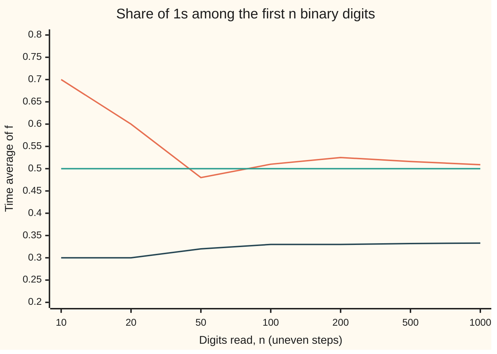

# Birkhoff's ergodic theorem: along almost every orbit, the time average equals the space average

[Syllabus](../../../SYLLABUS.md) → [Measure and integration](../README.md) → [Ergodic Theory](../README.md#s12) → Birkhoff's ergodic theorem

---

## General Overview

Write a number between 0 and 1 in binary and count its digits that are 1. The number 1/3 is 0.010101… in binary, so half its digits are 1. The number 1/7 is 0.001001…, so only a third are. A start drawn at random by a seeded generator gives 509 ones in its first 1,000 digits and 499,860 in its first 1,000,000.

The doubling map $`T x = 2x \bmod 1`$ (double x, drop the whole part) reads these digits one at a time. Doubling moves the binary point one place to the right, so it deletes the first digit. Let $`f(x)`$ be the first binary digit of x. Then $`f(Tx)`$ is the second digit, $`f(T^2x)`$ the third, and so on. The share of 1s in the first n digits is a **time average**: the average of f along the orbit $`x, Tx, T^2x, \dots`$ (the points the start visits).

The **space average** is the integral of f over [0, 1) with length as the measure. The digit is 1 exactly on [1/2, 1), so the space average is 1/2. Birkhoff's theorem says the two averages agree for almost every start: every start outside a set of total length zero. The start 1/7 is one of those exceptions.

The same theorem explains a pattern in the powers of 2. Of 1, 2, 4, …, $`2^{999}`$, exactly 301 begin with the digit 1, against a predicted share $`\log_{10} 2 = 0.30103`$. Here the map is a turn of a circle by $`\log_{10} 2`$.

**For a map that keeps measure and an integrable function, the average of the function along the orbit of almost every start converges, both pointwise and in L1 (the mean distance to the limit shrinks to 0), to the conditional expectation of the function on the invariant sets, which is its plain integral when the map is ergodic.**

**What kind of fact this is:** a theorem, proved on this card in Why it works through Garsia's short proof of the maximal ergodic theorem. The strong law of large numbers and Borel's theorem on normal numbers follow from it as corollaries. That the single start 0 (the powers of 2) also gives the share 0.30103 is a checked fact here; its proof is Weyl's theorem, not Birkhoff's.

### The picture: three starts, three digit counts



Orange: a typical start, its digits drawn by a seeded generator; it reaches 0.499860 at a million digits. Green: the start 1/3, exactly 0.5 at every even n. Dark blue: the start 1/7, which settles at 1/3, one of the null set of exceptions. The code prints every point.

---

## The formula

Notation, from the shelf's earlier cards ([Measure-preserving maps and Poincare recurrence](01-measure-preserving-maps-and-poincare-recurrence.md), [Ergodicity and mixing](02-ergodicity-and-mixing.md)).

- $`X`$ is the space and $`m`$ a probability measure on it: a measure of total size 1. For the house example, X = [0, 1) and m is length.
- $`T`$ is a map of X that **keeps measure**: the starts that land in a set A have the same measure as A, $`m(T^{-1}A) = m(A)`$.
- $`f`$ is **integrable**, in $`L^1`$: the integral $`\int \lvert f \rvert \, dm`$ is finite. Its size there is $`\lVert f \rVert_1 = \int \lvert f \rvert \, dm`$.
- A set A is **invariant** when $`T^{-1}A = A`$ up to a null set: almost no start leaves it or enters. The invariant sets form a sigma-algebra $`\mathcal I`$.
- $`T`$ is **ergodic** when every invariant set has measure 0 or 1.
- $`E[f \mid \mathcal I]`$ is the conditional expectation of f given $`\mathcal I`$: the $`\mathcal I`$-measurable function with the same integral as f over every invariant set ([The rules of conditional expectation](../09-Conditional%20Expectation/04-rules-of-conditional-expectation.md)).

The sum and the average along the orbit of a start x are

```math
S_n f(x) = f(x) + f(Tx) + \dots + f(T^{n-1}x), \qquad A_n f(x) = \frac{S_n f(x)}{n}.
```

**The maximal ergodic theorem.** Let $`M_N = \max(0, S_1 f, \dots, S_N f)`$, the best running sum up to step N, and $`E_N = \{M_N > 0\}`$, the starts whose running sum is positive at some step up to N. Then

```math
\int_{E_N} f \, dm \;\ge\; 0 \qquad \text{for every } N.
```

**Read it aloud:** over the starts whose running sum turns positive at some step, the function itself has a nonnegative integral.

**Birkhoff's ergodic theorem.** If T keeps the probability measure m and f is integrable, then

```math
A_n f(x) \longrightarrow E[f \mid \mathcal I](x) \ \text{ for almost every } x, \qquad \int \big\lvert A_n f - E[f \mid \mathcal I] \big\rvert \, dm \longrightarrow 0, \qquad \text{and if } T \text{ is ergodic, } E[f \mid \mathcal I] = \int_X f \, dm.
```

**Read it aloud:** along almost every orbit the time average converges, and in mean as well; its limit is the average of f over the invariant piece the start lives in, which is the plain space average when there is only one piece.

| Symbol | Plain meaning | In our example | Push it up and the answer… |
| --- | --- | --- | --- |
| $`X`$, $`m`$ | the space; a probability measure on it | [0, 1) with length | — |
| $`T`$, $`T^k`$ | a map that keeps measure; k steps of it | the doubling map | — |
| $`x`$ | a start | 1/3, 1/7, a typical start | — |
| $`f`$, $`\lVert f \rVert_1`$ | an integrable function; the integral of its size | the first binary digit; 1/2 | a larger integral, a larger limit |
| $`S_n f`$, $`A_n f`$, $`n`$, $`k`$ | the sum and the average of f over the first n points of the orbit; step counts | $`A_{1000} f(1/7) = 0.3330`$ | more steps, closer to the limit |
| $`\mathcal I`$, $`E[f \mid \mathcal I]`$, $`f^*`$ | the invariant sets; the conditional expectation on them; the limit of $`A_n f`$ | for doubling, only measure 0 or 1, so $`f^* = 1/2`$ | — |
| $`M_N`$, $`E_N`$, $`N`$ | the best running sum up to step N; where it is positive; the horizon | for $`f - 3/5`$: $`m(E_{100}) = 0.7471`$ | a later horizon, a larger $`E_N`$ |
| $`\lambda`$, $`E_\lambda`$, $`A`$, $`\mathbf 1_A`$ | a level; the starts with some average above it; an invariant set; the function that is 1 on A and 0 off it | λ = 3/5 | a higher level, a smaller $`E_\lambda`$ |
| $`a`$, $`b`$, $`D`$, $`\underline f`$, $`\overline f`$ | two rational levels, a < b; the starts whose averages swing below a and above b; the lowest and highest values the averages keep returning to | D has measure 0 for every pair | — |
| $`R`$, $`\alpha`$, $`\{k\alpha\}`$, $`d`$ | the turn $`x \mapsto x + \alpha \bmod 1`$; its size; the fractional part of kα; a leading digit | $`\alpha = \log_{10} 2 = 0.30103`$; d = 1 to 9 | the share of leading 1s follows α |
| $`g`$, $`h`$, $`K`$, $`\varepsilon`$ | in the proofs: a bounded function near f, a shifted copy of f, a bound, a small tolerance | g = 5f − 3 in the code | — |
| $`\omega`$, $`X_k`$, $`\sigma`$, $`w`$ | in the corollaries: an infinite sequence, its k-th entry, the shift deleting the first entry, a block of digits | the digits of a start; w = 01 | — |

### When it holds

- **T keeps measure.** The map $`x \mapsto x/2`$ does not. Its orbits fall toward 0, and the start 0.75 has digit-share 0.0010 at n = 1,000, heading to 0, not to 1/2.
- **T is ergodic, for the plain integral as the limit.** The turn by 1/2 splits [0, 1) into invariant pieces. With f = 1 on [0, 1/4), the start 0.1 gives 0.5000 and the start 0.3 gives 0.0000. Neither is the space average 0.2500; each is $`E[f \mid \mathcal I]`$ at its start.
- **Almost every start, not every start.** The start 1/7 gives 0.3330, and the start 0 never moves, giving 0. The theorem allows a set of exceptions of measure zero.
- **f integrable.** For f ≥ 0 with infinite integral and T ergodic, the averages tend to infinity almost everywhere: there is no finite space average to reach.
- **Finite total measure.** On the whole real line, $`x \mapsto x + 1`$ keeps length, but the averages of any integrable f tend to 0, not to a space average.

---

## Why it works

### Step 0: the bad set cannot leave itself

Call D the set of starts whose averages dip below a level a and rise above a level b > a infinitely often. One step of T does not change whether a start swings, so D is invariant: the system never leaves it.

Inside D, the averages climb above b again and again. A maximal theorem turns that into an integral bound: $`\int_D f \, dm \ge b \, m(D)`$. They also dip below a again and again, giving $`\int_D f \, dm \le a \, m(D)`$. Both can hold with a < b only if m(D) = 0. The maximal ergodic theorem is the engine.

### Step 1: the maximal ergodic theorem, Garsia's proof

Fix N and write $`S_0 f = 0`$. For each n from 1 to N, the sum of n values is the first value plus the sum of n − 1 values starting one step later:

```math
S_n f = f + (S_{n-1} f) \circ T \;\le\; f + M_N \circ T .
```

Take the largest over n = 1, …, N. On $`E_N`$ the largest of these sums is $`M_N`$ itself, so there

```math
f \;\ge\; M_N - M_N \circ T .
```

Integrate over $`E_N`$. Off $`E_N`$ the function $`M_N`$ is 0, so its integral over $`E_N`$ is its integral over X. The function $`M_N \circ T`$ is never negative, so its integral over $`E_N`$ is at most its integral over X. Hence

```math
\int_{E_N} f \, dm \;\ge\; \int_X M_N \, dm - \int_X M_N \circ T \, dm \;=\; 0 .
```

The last step is the only place that keeping measure is used: $`M_N \circ T`$ has the same integral as $`M_N`$. Both are integrable, since $`\lvert M_N \rvert \le \lvert f \rvert + \dots + \lvert f \circ T^{N-1} \rvert`$.

The code tests the middle inequality at every start, for g = 5f − 3: the digit function minus 3/5, scaled by 5 to whole numbers. Over all 8,192 strings of 13 digits, the largest value of $`M_N - g - M_N \circ T`$ on $`E_{12}`$ is 0, never positive.

### Step 2: the maximal inequality on an invariant set

Let A be invariant and λ a level, and let $`E_\lambda`$ be the starts at which some average $`A_n f`$, n ≥ 1, exceeds λ. Then

```math
\int_{A \cap E_\lambda} f \, dm \;\ge\; \lambda \, m(A \cap E_\lambda).
```

Apply Step 1 to $`h = (f - \lambda)\mathbf 1_A`$, where $`\mathbf 1_A`$ is 1 on A and 0 off it. A is invariant, so $`\mathbf 1_A \circ T^k = \mathbf 1_A`$ and $`S_n h = \mathbf 1_A (S_n f - n\lambda)`$. Its set $`E_N`$ is A intersected with "some average up to step N exceeds λ".

As N grows these sets rise to $`A \cap E_\lambda`$. Step 1 gives $`\int (f - \lambda) \ge 0`$ over each of them. The integrands are bounded by $`\lvert f \rvert + \lvert \lambda \rvert`$, integrable since m(X) = 1, so dominated convergence carries the inequality to the limit ([Dominated convergence](../05-Swapping%20Limits%20and%20Integrals/02-dominated-convergence-theorem.md)).

With A = X and f ≥ 0, this is the **maximal inequality**: $`m(E_\lambda) \le \frac{1}{\lambda} \int f \, dm`$. For the first digit and λ = 3/5 the bound is (1/2)/(3/5) = 0.8333. The code counts the starts whose digit-share exceeds 3/5 at some n ≤ N exactly:

| Horizon N | $`m(E_N)`$ | $`\int_{E_N} f \, dm`$ | $`\int_{E_N} (f - 3/5) \, dm`$, never negative |
| --- | --- | --- | --- |
| 10 | 0.6836 | 0.5000 | 0.0898 |
| 30 | 0.7322 | 0.5000 | 0.0607 |
| 100 | 0.7471 | 0.5000 | 0.0517 |

The integral of f over $`E_N`$ is always 1/2: every start with first digit 1 lies in $`E_N`$.

### Step 3: the averages converge almost everywhere

Let $`\overline{f} = \limsup A_n f`$ and $`\underline{f} = \liminf A_n f`$, the highest and lowest values the averages keep returning to. Moving the start one step changes the average by a vanishing amount:

```math
A_n f(Tx) = \frac{n+1}{n} A_{n+1} f(x) - \frac{f(x)}{n} .
```

So $`\overline{f} \circ T = \overline{f}`$ and $`\underline{f} \circ T = \underline{f}`$. For rational levels a < b, the swinging set $`D = \{\underline{f} < a,\ \overline{f} > b\}`$ is therefore invariant.

- On D some average exceeds b, so D lies inside $`E_b`$. Step 2 with A = D and λ = b gives $`\int_D f \ge b\, m(D)`$.
- On D some average of −f exceeds −a. Step 2 for −f gives $`\int_D f \le a\, m(D)`$.

So $`(b - a)\, m(D) \le 0`$ and m(D) = 0. There are countably many rational pairs, and a countable union of null sets is null. Off that union $`\underline{f} = \overline{f}`$: the averages converge, to a limit $`f^*`$.

The limit is finite almost everywhere. Each average has $`\int \lvert A_n f \rvert \le \int \lvert f \rvert`$, because each $`f \circ T^k`$ has the same integral of its size as f. Fatou's lemma (the integral of a limit is at most the limit of the integrals, for functions that are never negative) then gives $`\int \lvert f^* \rvert \le \int \lvert f \rvert < \infty`$.

### Step 4: the limit is the conditional expectation, and the convergence is in L1

**Convergence in L1.** If f is bounded by a number K, so is every average, and dominated convergence gives $`\int \lvert A_n f - f^* \rvert \to 0`$. A general f is within ε in L1 of a bounded g, its values cut off at a large K. The averages of f − g stay within ε, and so does the limit of those averages, by Fatou. So $`\lVert A_n f - f^* \rVert_1`$ ends up below 2ε, for every ε.

A second road: the functions $`f \circ T^k`$ all have the same law, so their averages are uniformly integrable, and Vitali's theorem (uniform integrability plus convergence almost everywhere gives convergence in L1) applies ([Uniform integrability](../05-Swapping%20Limits%20and%20Integrals/05-uniform-integrability.md)).

For the doubling map the L1 distance $`\int \lvert A_n f - 1/2 \rvert \, dm`$ is a sum over binomial counts, since the digits are fair coin tosses ([Infinitely many coin tosses](../06-Product%20Measures%20and%20Fubini/07-infinite-sequences-and-kolmogorov-extension.md)). It is 0.123047 at n = 10, 0.039795 at n = 100 and 0.012613 at n = 1,000, close to the bell-curve estimate $`1/\sqrt{2\pi n}`$ (0.012616 at n = 1,000).

**The limit.** The limit $`f^*`$ is invariant, so it is $`\mathcal I`$-measurable. For an invariant set A, $`\int_A f \circ T^k \, dm = \int (\mathbf 1_A f) \circ T^k \, dm = \int_A f \, dm`$, so every average has $`\int_A A_n f = \int_A f`$. Convergence in L1 lets n go to infinity:

```math
\int_A f^* \, dm = \int_A f \, dm \qquad \text{for every invariant set } A .
```

That is the defining identity of $`E[f \mid \mathcal I]`$. When T is ergodic, an $`\mathcal I`$-measurable function is constant almost everywhere (proved in the fold below). Taking A = X shows the constant is $`\int_X f \, dm`$. The doubling map is mixing, hence ergodic, so the limit is 1/2.

For f in L2, von Neumann's theorem gives the same limit in the L2 sense ([Von Neumann's mean ergodic theorem](03-von-neumann-mean-ergodic-theorem.md)). Birkhoff's theorem adds what L2 cannot see: convergence at almost every single start.

<details>
<summary>Detailed proof: measurability, the cut-off, and why the limit is invariant everywhere</summary>

**Setting.** $`(X, \mathcal F, m)`$ is a probability space, $`T : X \to X`$ is measurable with $`m(T^{-1}A) = m(A)`$ for every $`A \in \mathcal F`$, and $`f \in L^1(m)`$ is real-valued. Then $`\int g \circ T \, dm = \int g \, dm`$ for every integrable or nonnegative g: true for indicators by definition, for simple functions by linearity, for nonnegative functions by monotone convergence, and for integrable ones by splitting into positive and negative parts.

**Invariance everywhere.** From $`A_n f(Tx) = \frac{n+1}{n} A_{n+1} f(x) - \frac{f(x)}{n}`$ and the finiteness of f(x), the limsup and liminf over n of the left side equal those of $`A_{n+1} f(x)`$. So $`\overline f(Tx) = \overline f(x)`$ at every x, and $`T^{-1}\{\overline f \in B\} = \{\overline f \in B\}`$ for every Borel set B. Hence $`\overline f`$ is $`\mathcal I`$-measurable, and we take $`f^* = \overline f`$ where it is finite and 0 elsewhere.

**The cut-off.** Let $`g = \max(-K, \min(f, K))`$. Then $`\lvert f - g \rvert \le \lvert f \rvert \mathbf 1_{\{\lvert f \rvert > K\}}`$, whose integral tends to 0 as K grows, by dominated convergence. Apply Step 3 to g and to f − g. Then

$`\displaystyle \lVert A_n f - f^* \rVert_1 \le \lVert A_n (f - g) \rVert_1 + \lVert A_n g - g^* \rVert_1 + \lVert g^* - f^* \rVert_1 \le \lVert f - g \rVert_1 + \lVert A_n g - g^* \rVert_1 + \lVert f - g \rVert_1 .`$

The middle term tends to 0 by bounded convergence. The last bound uses $`f^* - g^* = (f - g)^*`$ and Fatou: $`\int \lvert (f-g)^* \rvert \le \liminf_n \int \lvert A_n (f - g) \rvert \le \lVert f - g \rVert_1`$.

**Ergodic case.** If T is ergodic and $`\varphi`$ is $`\mathcal I`$-measurable, each set $`\{\varphi > q\}`$ for rational q is invariant, so it has measure 0 or 1. Let c be the infimum of the rationals q with $`m(\varphi > q) = 0`$; then $`\varphi = c`$ almost everywhere.

</details>

### Step 5: the strong law of large numbers, as a corollary

Let $`X_1, X_2, \dots`$ be independent draws from one law with $`E\lvert X_1 \rvert < \infty`$. Build them on the space of sequences $`\omega = (\omega_1, \omega_2, \dots)`$ with the product law, so $`X_k(\omega) = \omega_k`$ ([Infinitely many coin tosses](../06-Product%20Measures%20and%20Fubini/07-infinite-sequences-and-kolmogorov-extension.md)). Let σ be the shift, which deletes the first entry.

- **σ keeps measure.** The sequences whose entries 2 to k + 1 fall in given sets have the same probability as those whose entries 1 to k do, by the product rule.
- **σ is ergodic.** If $`\sigma^{-1}A = A`$, then $`A = \sigma^{-n}A`$ for every n, so A is decided by the entries after any n. It is a tail event, of probability 0 or 1 by [Kolmogorov's zero-one law](../10-The%20Limit%20Theorems%2C%20Proved/02-kolmogorov-zero-one-law.md).

With $`f(\omega) = \omega_1`$, the value $`f(\sigma^k \omega)`$ is $`X_{k+1}`$, so Birkhoff's theorem says $`(X_1 + \dots + X_n)/n \to E[X_1]`$ almost surely. That is Kolmogorov's strong law with only a finite mean, the version [The strong law of large numbers](../10-The%20Limit%20Theorems%2C%20Proved/04-strong-law-of-large-numbers.md) reached through Etemadi's truncation. Birkhoff's theorem needs only a stationary ergodic sequence (its law unchanged by the shift), not independence.

The doubling map acts on binary digits exactly as σ acts on coin tosses, so the typical start's 499,860 ones in a million digits is the strong law for a fair coin.

### Step 6: Borel's normal numbers, as a corollary

A number is **normal in base 2** when every block w of k binary digits appears with frequency $`2^{-k}`$ among its digits. Fix w. The starts whose first k digits spell w form an interval of length $`2^{-k}`$. Its indicator, read at $`T^j x`$, is 1 exactly when digits j + 1 to j + k of x spell w. Birkhoff's theorem with ergodicity gives frequency $`2^{-k}`$ for almost every x.

There are countably many blocks, and the exceptions for each are null, so almost every x is normal in base 2. The map $`x \mapsto bx \bmod 1`$ does the same in base b, and countably many bases give Borel's 1909 theorem: almost every number is normal in every base at once.

One digit's share is not enough. Among overlapping pairs of digits:

| Start | 00 | 01 | 10 | 11 |
| --- | --- | --- | --- | --- |
| typical, first 1,000,000 digits | 0.2505 | 0.2497 | 0.2497 | 0.2502 |
| 1/3, first 1,000 digits | 0.0000 | 0.5005 | 0.4995 | 0.0000 |

The start 1/3 passes the single-digit test and fails the pair test: it is not normal.

### Step 7: powers of 2, and the start Birkhoff does not cover

Write $`2^k = 10^{k\alpha}`$ with $`\alpha = \log_{10} 2`$. The whole part of kα sets the number of digits; the fractional part sets the leading digit, which is 1 exactly when $`10^{\{k\alpha\}}`$ lies in [1, 2), that is, when the fractional part of kα lies in [0, α). More generally it is d when that fractional part lies in $`[\log_{10} d, \log_{10}(d+1))`$, an interval of length $`\log_{10}(1 + 1/d)`$.

So the leading digits of $`10^x \cdot 2^k`$ follow the orbit of x under the turn $`R x = x + \alpha \bmod 1`$. α is irrational, so R is ergodic ([Ergodicity and mixing](02-ergodicity-and-mixing.md)). Birkhoff's theorem gives the share α of leading 1s for almost every start x.

The powers of 2 are the single start x = 0, a set of measure zero. Birkhoff's theorem alone says nothing about it. Weyl's 1916 theorem does, by exponential sums: for an irrational turn, every start's orbit spreads evenly ([Equidistribution](../../21-Algebraic%20and%20analytic%20number%20theory/08-Additive%20Combinatorics%20and%20Probabilistic%20Number%20Theory/03-equidistribution-and-weyls-criterion.md)). The code checks the first thousand powers two ways:

```
leading digit of 2^0 .. 2^999   count   Benford 1000 log10(1 + 1/d)
1  ##############################  301   301.0
2  ##################              176   176.1
3  #############                   125   124.9
4  ##########                       97    96.9
5  ########                         79    79.2
6  #######                          69    66.9
7  ######                           56    58.0
8  #####                            52    51.2
9  #####                            45    45.8
```

One `#` per 10 powers, rounded half up. The predicted shares $`\log_{10}(1 + 1/d)`$ are Benford's law.

---

## Worked numbers, by hand

| Step | Arithmetic | Value |
| --- | --- | --- |
| 1/3 in binary | double 1/3 → 2/3, digit 0; double 2/3 → 4/3, digit 1, keep 1/3 | 0.010101… |
| share of 1s, start 1/3, n = 1,000 | 500 / 1,000 | 0.5000 |
| 1/7 in binary | double: 2/7 → 0, 4/7 → 0, 8/7 → 1, keep 1/7 | 0.001001… |
| share of 1s, start 1/7, n = 1,000 | 333 full blocks give 333 ones; 333 / 1,000 | 0.3330 |
| space average of f | m([1/2, 1)) = 1 − 1/2 | 0.5 |
| maximal bound, λ = 3/5 | (1/2) / (3/5) | 0.8333 |
| exact share of starts above 3/5 by step 100 | counted by the code | 0.7471, under 0.8333 |
| the turn | α = log10 2 | 0.30103 |
| predicted leading 1s among $`2^0, \dots, 2^{999}`$ | 1,000 × 0.30103 | 301.03 |
| counted leading 1s | exact powers of 2 | **301** |

Typical digits settle at 1/2, 1/7 is a real exception of measure zero, and the powers of 2 hit the predicted 301 of 1,000.

### What breaks if you drop a piece

| Mistake | Comes out at | What went wrong |
| --- | --- | --- |
| Drop "keeps measure": T x = x/2 | start 0.75: share 0.0010 at n = 1,000, falling to 0 | orbits pile up near 0, where the first digit is 0 |
| Drop ergodicity: turn by 1/2, f = 1 on [0, 1/4) | start 0.1 → 0.5000, start 0.3 → 0.0000, not 0.2500 | the limit is $`E[f \mid \mathcal I]`$, which differs from piece to piece |
| Drop "almost": claim every start | start 1/7 → 0.3330 | the exceptions are null, not absent |

---

## Code, from first principles, and it actually runs

The code checks finite stages; the limits rest on the proof. Five independent roads:

- digit shares of 1/3 and 1/7 by exact long division, against their repeating patterns;
- a million digits from a SplitMix64 generator written out in each language, seed 2026, against the binomial spread $`4 \times 0.5/\sqrt{n}`$;
- the L1 distance by binomial sums against a count over all 1,024 starts at n = 10, and against the bell-curve estimate;
- the maximal theorem by a count of digit strings grouped by their running total, against direct enumeration of all strings at N = 12, with Garsia's pointwise step tested at every start;
- the powers of 2 by exact whole numbers against the orbit of the turn by log10 2.

### Python

```python
# Birkhoff's pointwise ergodic theorem -- the check behind the card.  Standard
# library only.  The doubling map T x = 2x mod 1 shifts binary digits, so with
# f = first digit, f(T^k x) is digit k + 1 and the time average is a share of 1s.
from math import log10, sqrt, pi

MASK = (1 << 64) - 1
def splitmix(seed):               # SplitMix64 written out: the digits of a typical start
    while True:
        seed = (seed + 0x9E3779B97F4A7C15) & MASK
        z = ((seed ^ (seed >> 30)) * 0xBF58476D1CE4E5B9) & MASK
        z = ((z ^ (z >> 27)) * 0x94D049BB133111EB) & MASK
        yield z ^ (z >> 31)

def fraction_digits(p, q, n):     # binary digits of p/q by long division
    out = []
    for _ in range(n):
        p *= 2
        out.append(1 if p >= q else 0)
        p %= q
    return out

def typical_digits(n, seed=2026):
    gen, out = splitmix(seed), []
    while len(out) < n:
        w = next(gen)
        out.extend((w >> (63 - i)) & 1 for i in range(64))
    return out[:n]

BIG = 1000000
third, seventh, typ = fraction_digits(1, 3, 1000), fraction_digits(1, 7, 1000), typical_digits(BIG)
print("-- doubling map, f = first binary digit: share of 1s in the first n digits")
print("n, start 1/3, start 1/7, typical start")
for n in [10, 20, 50, 100, 200, 500, 1000]:
    print(f"{n}, {sum(third[:n]) / n:.4f}, {sum(seventh[:n]) / n:.4f}, {sum(typ[:n]) / n:.4f}")
ones = sum(typ)
print(f"typical start, n = {BIG}: {ones} ones, share {ones / BIG:.6f}")
assert sum(third) == 500 and sum(seventh) == 1000 // 3     # 01 01 ... and 001 001 ...
assert abs(ones / BIG - 0.5) < 4 * 0.5 / sqrt(BIG)           # within 4 binomial sd
blocks = {b: 0 for b in ["00", "01", "10", "11"]}
for i in range(BIG - 1):
    blocks[f"{typ[i]}{typ[i + 1]}"] += 1
tb = {b: 0 for b in blocks}
for i in range(999):
    tb[f"{third[i]}{third[i + 1]}"] += 1
print("pairs of digits 00 01 10 11, typical: " + " ".join(f"{blocks[b] / (BIG - 1):.4f}" for b in blocks)
      + "; start 1/3: " + " ".join(f"{tb[b] / 999:.4f}" for b in tb))
assert all(abs(blocks[b] / (BIG - 1) - 0.25) < 0.003 for b in blocks)

print("-- convergence in L1: distance E|share - 1/2| over all starts")
def l1_binomial(n):               # road 1: digits are fair coins; p_k by the ratio rule
    p, tot = 0.5 ** n, 0.0
    for k in range(n + 1):
        tot += p * abs(k / n - 0.5)
        p = p * (n - k) / (k + 1)
    return tot
def l1_enumerate(n):              # road 2: count the 1s in every n-digit string
    tot = 0
    for j in range(2 ** n):
        tot += abs(2 * bin(j).count("1") - n)
    return tot / (2 * n * 2 ** n)
for n in [10, 100, 1000]:
    print(f"n = {n}: exact {l1_binomial(n):.6f}, bell-curve estimate 1/sqrt(2 pi n) {1 / sqrt(2 * pi * n):.6f}")
print(f"n = 10 by enumerating 1024 starts: {l1_enumerate(10):.6f}")
assert abs(l1_enumerate(10) - l1_binomial(10)) < 1e-12
assert abs(l1_binomial(1000) * sqrt(2 * pi * 1000) - 1) < 0.01

print("-- maximal ergodic theorem: E_N = {share of 1s exceeds 3/5 at some n <= N}")
def maximal_dp(N):                # road 1: count digit strings by (first digit, ones, flag)
    st = {(0, 0, False): 1}
    for n in range(1, N + 1):
        new = {}
        for (f1, o, fl), c in st.items():
            for d in (0, 1):
                key = (d if n == 1 else f1, o + d, fl or 5 * (o + d) > 3 * n)
                new[key] = new.get(key, 0) + c
        st = new
    inE = sum(c for (f1, o, fl), c in st.items() if fl)
    fE = sum(c for (f1, o, fl), c in st.items() if fl and f1 == 1)
    return inE, fE, 2 ** N
def maximal_enumerate(N):         # road 2: every string of N + 1 digits, and Garsia's step
    inE, fE, worst = 0, 0, -10 ** 9
    for j in range(2 ** (N + 1)):
        d = [(j >> (N - i)) & 1 for i in range(N + 1)]
        def M(start):             # M_N = max(0, S_1, ..., S_N) for g = 5 f - 3, from digit start
            s, m = 0, 0
            for i in range(start, start + N):
                s += 5 * d[i] - 3
                m = max(m, s)
            return m
        if M(0) > 0:
            inE, fE = inE + 1, fE + d[0]
            worst = max(worst, M(0) - (5 * d[0] - 3) - M(1))   # Garsia: must be <= 0
    return inE, fE, 2 ** (N + 1), worst
for N in [10, 30, 100]:
    e, fe, tot = maximal_dp(N)
    print(f"N = {N}: m(E_N) = {e / tot:.4f}, integral of f over E_N = {fe / tot:.4f}, "
          f"integral of f - 3/5 over E_N = {(5 * fe - 3 * e) / (5 * tot):.4f}")
    assert 5 * fe - 3 * e >= 0                                # Garsia's inequality
e12, fe12, t12, worst = maximal_enumerate(12)
print(f"N = 12: m(E_N) by counting {e12 / t12:.6f}, by digit strings {maximal_dp(12)[0] / 2 ** 12:.6f}; "
      f"largest M_N - g - M_N(T) on E_N: {worst}")
assert e12 * 2 ** 12 == maximal_dp(12)[0] * t12 and worst <= 0
print(f"maximal inequality bound (1/2)/(3/5) = {0.5 / 0.6:.4f}")

alpha = log10(2)
print(f"-- rotation by alpha = log10 2 = {alpha:.5f}, start 0: leading digit of 2^k for k < n")
p, lead = 1, [0] * 10
for n in range(1000):
    lead[int(str(p)[0])] += 1     # road 1: exact whole numbers
    p *= 2
    if n + 1 in (10, 100, 1000):
        hits = sum(1 for k in range(n + 1) if (k * alpha) % 1.0 < alpha)   # road 2: the orbit
        print(f"n = {n + 1}: leading digit 1 by exact powers {lead[1]}, by orbit in [0, alpha) {hits}, "
              f"alpha n = {alpha * (n + 1):.2f}")
        assert hits == lead[1]
print("digit, count of 1000, Benford 1000 log10(1 + 1/d)")
for dgt in range(1, 10):
    print(f"{dgt}, {lead[dgt]}, {1000 * log10(1 + 1 / dgt):.1f}")
assert all(abs(lead[d] - 1000 * log10(1 + 1 / d)) < 12 for d in range(1, 10))

print("-- what breaks")
q = [sum(1 for k in range(1000) if 4 * ((s + 5 * k) % 10) < 10) / 1000 for s in (1, 3)]
print(f"rotation by 1/2, f = 1 on [0, 1/4): start 0.1 -> {q[0]:.4f}, start 0.3 -> {q[1]:.4f}, space average 0.2500")
x, h = 0.75, 0
for _ in range(1000):
    h, x = h + (x >= 0.5), x / 2
print(f"T x = x/2 keeps no length: start 0.75, share at n = 1000: {h / 1000:.4f}")
print(f"start 1/7: share at n = 1000: {sum(seventh) / 1000:.4f}")
x, h, dead = 0.1, 0, 0
for k in range(1000):
    h, x = h + (x >= 0.5), 2 * x % 1.0
    dead = dead or (k + 1 if x == 0 else 0)
num, den = (0.1).as_integer_ratio()
print(f"doubling 0.1 in floating point: {h} ones in 1000 steps, share {h / 1000:.4f}, zero from step {dead}; "
      f"0.1 is stored as {num}/2^{den.bit_length() - 1}, whose numerator has {bin(num).count('1')} ones")
assert h == bin(num).count("1") and dead == den.bit_length() - 1 and q == [0.5, 0.0]
print("ALL CHECKS PASS")
```

**Ran 2026-11-23 on macOS, Python 3.14.10, standard library only. All checks passed. Output, pasted from the run:**

```
-- doubling map, f = first binary digit: share of 1s in the first n digits
n, start 1/3, start 1/7, typical start
10, 0.5000, 0.3000, 0.7000
20, 0.5000, 0.3000, 0.6000
50, 0.5000, 0.3200, 0.4800
100, 0.5000, 0.3300, 0.5100
200, 0.5000, 0.3300, 0.5250
500, 0.5000, 0.3320, 0.5160
1000, 0.5000, 0.3330, 0.5090
typical start, n = 1000000: 499860 ones, share 0.499860
pairs of digits 00 01 10 11, typical: 0.2505 0.2497 0.2497 0.2502; start 1/3: 0.0000 0.5005 0.4995 0.0000
-- convergence in L1: distance E|share - 1/2| over all starts
n = 10: exact 0.123047, bell-curve estimate 1/sqrt(2 pi n) 0.126157
n = 100: exact 0.039795, bell-curve estimate 1/sqrt(2 pi n) 0.039894
n = 1000: exact 0.012613, bell-curve estimate 1/sqrt(2 pi n) 0.012616
n = 10 by enumerating 1024 starts: 0.123047
-- maximal ergodic theorem: E_N = {share of 1s exceeds 3/5 at some n <= N}
N = 10: m(E_N) = 0.6836, integral of f over E_N = 0.5000, integral of f - 3/5 over E_N = 0.0898
N = 30: m(E_N) = 0.7322, integral of f over E_N = 0.5000, integral of f - 3/5 over E_N = 0.0607
N = 100: m(E_N) = 0.7471, integral of f over E_N = 0.5000, integral of f - 3/5 over E_N = 0.0517
N = 12: m(E_N) by counting 0.694824, by digit strings 0.694824; largest M_N - g - M_N(T) on E_N: 0
maximal inequality bound (1/2)/(3/5) = 0.8333
-- rotation by alpha = log10 2 = 0.30103, start 0: leading digit of 2^k for k < n
n = 10: leading digit 1 by exact powers 3, by orbit in [0, alpha) 3, alpha n = 3.01
n = 100: leading digit 1 by exact powers 30, by orbit in [0, alpha) 30, alpha n = 30.10
n = 1000: leading digit 1 by exact powers 301, by orbit in [0, alpha) 301, alpha n = 301.03
digit, count of 1000, Benford 1000 log10(1 + 1/d)
1, 301, 301.0
2, 176, 176.1
3, 125, 124.9
4, 97, 96.9
5, 79, 79.2
6, 69, 66.9
7, 56, 58.0
8, 52, 51.2
9, 45, 45.8
-- what breaks
rotation by 1/2, f = 1 on [0, 1/4): start 0.1 -> 0.5000, start 0.3 -> 0.0000, space average 0.2500
T x = x/2 keeps no length: start 0.75, share at n = 1000: 0.0010
start 1/7: share at n = 1000: 0.3330
doubling 0.1 in floating point: 27 ones in 1000 steps, share 0.0270, zero from step 55; 0.1 is stored as 3602879701896397/2^55, whose numerator has 27 ones
ALL CHECKS PASS
```

### Rust

```rust
// Birkhoff's pointwise ergodic theorem -- the check behind the card.  std only.
// The doubling map T x = 2x mod 1 shifts binary digits, so with f = first digit,
// f(T^k x) is digit k + 1 and the time average is a share of 1s.
use std::collections::HashMap;

struct SplitMix(u64); // SplitMix64 written out: the digits of a typical start
impl SplitMix {
    fn next(&mut self) -> u64 {
        self.0 = self.0.wrapping_add(0x9E3779B97F4A7C15);
        let z = (self.0 ^ (self.0 >> 30)).wrapping_mul(0xBF58476D1CE4E5B9);
        let z = (z ^ (z >> 27)).wrapping_mul(0x94D049BB133111EB);
        z ^ (z >> 31)
    }
}

fn fraction_digits(mut p: u64, q: u64, n: usize) -> Vec<u64> { // binary digits of p/q by long division
    (0..n).map(|_| { p *= 2; let d = (p >= q) as u64; p %= q; d }).collect()
}

fn typical_digits(n: usize, seed: u64) -> Vec<u64> {
    let (mut g, mut out) = (SplitMix(seed), Vec::with_capacity(n + 64));
    while out.len() < n {
        let w = g.next();
        out.extend((0..64).map(|i| (w >> (63 - i)) & 1));
    }
    out.truncate(n);
    out
}

fn sum(d: &[u64]) -> u64 { d.iter().sum() }

fn l1_binomial(n: usize) -> f64 { // road 1: digits are fair coins; p_k by the ratio rule
    let (mut p, mut tot) = (0.5f64.powi(n as i32), 0.0);
    for k in 0..=n {
        tot += p * (k as f64 / n as f64 - 0.5).abs();
        p = p * (n - k) as f64 / (k + 1) as f64;
    }
    tot
}

fn l1_enumerate(n: u32) -> f64 { // road 2: count the 1s in every n-digit string
    let tot: i64 = (0..1u64 << n).map(|j| (2 * j.count_ones() as i64 - n as i64).abs()).sum();
    tot as f64 / (2 * n as u64 * (1u64 << n)) as f64
}

fn maximal_dp(n_max: usize) -> (u128, u128, u128) { // road 1: count strings by (first digit, ones, flag)
    let mut st: HashMap<(u64, usize, bool), u128> = HashMap::new();
    st.insert((0, 0, false), 1);
    for n in 1..=n_max {
        let mut new = HashMap::new();
        for (&(f1, o, fl), &c) in &st { // the flag records: share above 3/5 at some n so far
            for d in 0..2u64 {
                let key = (if n == 1 { d } else { f1 }, o + d as usize, fl || 5 * (o + d as usize) > 3 * n);
                *new.entry(key).or_insert(0) += c;
            }
        }
        st = new;
    }
    let in_e = st.iter().filter(|(k, _)| k.2).map(|(_, c)| *c).sum();
    let f_e = st.iter().filter(|(k, _)| k.2 && k.0 == 1).map(|(_, c)| *c).sum();
    (in_e, f_e, 1u128 << n_max)
}

fn maximal_enumerate(n: usize) -> (u64, u64, u64, i64) { // road 2: every string of N + 1 digits
    let (mut in_e, mut f_e, mut worst) = (0, 0, i64::MIN);
    for j in 0..1u64 << (n + 1) {
        let d: Vec<i64> = (0..=n).map(|i| ((j >> (n - i)) & 1) as i64).collect();
        let m = |start: usize| { // M_N = max(0, S_1, ..., S_N) for g = 5 f - 3, from digit start
            let (mut s, mut m) = (0i64, 0i64);
            for i in start..start + n { s += 5 * d[i] - 3; m = m.max(s); }
            m
        };
        if m(0) > 0 {
            in_e += 1;
            f_e += d[0] as u64;
            worst = worst.max(m(0) - (5 * d[0] - 3) - m(1)); // Garsia: must be <= 0
        }
    }
    (in_e, f_e, 1u64 << (n + 1), worst)
}

fn main() {
    const BIG: usize = 1000000;
    let (third, seventh, typ) = (fraction_digits(1, 3, 1000), fraction_digits(1, 7, 1000), typical_digits(BIG, 2026));
    println!("-- doubling map, f = first binary digit: share of 1s in the first n digits");
    println!("n, start 1/3, start 1/7, typical start");
    for n in [10, 20, 50, 100, 200, 500, 1000] {
        let s = |d: &[u64]| sum(&d[..n]) as f64 / n as f64;
        println!("{}, {:.4}, {:.4}, {:.4}", n, s(&third), s(&seventh), s(&typ));
    }
    let ones = sum(&typ);
    println!("typical start, n = {}: {} ones, share {:.6}", BIG, ones, ones as f64 / BIG as f64);
    assert!(sum(&third) == 500 && sum(&seventh) == 1000 / 3);
    assert!((ones as f64 / BIG as f64 - 0.5).abs() < 4.0 * 0.5 / (BIG as f64).sqrt());
    let (mut blocks, mut tb) = ([0usize; 4], [0usize; 4]);
    for i in 0..BIG - 1 { blocks[(2 * typ[i] + typ[i + 1]) as usize] += 1; }
    for i in 0..999 { tb[(2 * third[i] + third[i + 1]) as usize] += 1; }
    let fmt = |b: &[usize; 4], t: f64| b.iter().map(|&c| format!("{:.4}", c as f64 / t)).collect::<Vec<_>>().join(" ");
    println!("pairs of digits 00 01 10 11, typical: {}; start 1/3: {}", fmt(&blocks, (BIG - 1) as f64), fmt(&tb, 999.0));
    assert!(blocks.iter().all(|&c| (c as f64 / (BIG - 1) as f64 - 0.25).abs() < 0.003));

    println!("-- convergence in L1: distance E|share - 1/2| over all starts");
    for n in [10, 100, 1000] {
        println!("n = {}: exact {:.6}, bell-curve estimate 1/sqrt(2 pi n) {:.6}", n, l1_binomial(n),
                 1.0 / (2.0 * std::f64::consts::PI * n as f64).sqrt());
    }
    println!("n = 10 by enumerating 1024 starts: {:.6}", l1_enumerate(10));
    assert!((l1_enumerate(10) - l1_binomial(10)).abs() < 1e-12);
    assert!((l1_binomial(1000) * (2.0 * std::f64::consts::PI * 1000.0).sqrt() - 1.0).abs() < 0.01);

    println!("-- maximal ergodic theorem: E_N = {{share of 1s exceeds 3/5 at some n <= N}}");
    for n in [10, 30, 100] {
        let (e, fe, tot) = maximal_dp(n);
        let g = (5 * fe) as f64 - (3 * e) as f64;
        println!("N = {}: m(E_N) = {:.4}, integral of f over E_N = {:.4}, integral of f - 3/5 over E_N = {:.4}",
                 n, e as f64 / tot as f64, fe as f64 / tot as f64, g / (5 * tot) as f64);
        assert!(5 * fe >= 3 * e); // Garsia's inequality
    }
    let (e12, _fe12, t12, worst) = maximal_enumerate(12);
    let dp12 = maximal_dp(12).0;
    println!("N = 12: m(E_N) by counting {:.6}, by digit strings {:.6}; largest M_N - g - M_N(T) on E_N: {}",
             e12 as f64 / t12 as f64, dp12 as f64 / 4096.0, worst);
    assert!(e12 as u128 * 4096 == dp12 * t12 as u128 && worst <= 0);
    println!("maximal inequality bound (1/2)/(3/5) = {:.4}", 0.5 / 0.6);

    let alpha = 2f64.log10();
    println!("-- rotation by alpha = log10 2 = {:.5}, start 0: leading digit of 2^k for k < n", alpha);
    let (mut p, mut lead): (Vec<u64>, [usize; 10]) = (vec![1], [0; 10]); // base 10^9 limbs, low first
    for n in 0..1000usize {
        let top = *p.last().unwrap(); // road 1: exact whole numbers
        lead[top.to_string().as_bytes()[0] as usize - 48] += 1;
        let mut carry = 0;
        for limb in p.iter_mut() { let v = *limb * 2 + carry; *limb = v % 1_000_000_000; carry = v / 1_000_000_000; }
        if carry > 0 { p.push(carry); }
        if [10, 100, 1000].contains(&(n + 1)) {
            let hits = (0..=n).filter(|&k| (k as f64 * alpha) % 1.0 < alpha).count(); // road 2: the orbit
            println!("n = {}: leading digit 1 by exact powers {}, by orbit in [0, alpha) {}, alpha n = {:.2}",
                     n + 1, lead[1], hits, alpha * (n + 1) as f64);
            assert!(hits == lead[1]);
        }
    }
    println!("digit, count of 1000, Benford 1000 log10(1 + 1/d)");
    for d in 1..10 { println!("{}, {}, {:.1}", d, lead[d], 1000.0 * (1.0 + 1.0 / d as f64).log10()); }
    assert!((1..10).all(|d| (lead[d] as f64 - 1000.0 * (1.0 + 1.0 / d as f64).log10()).abs() < 12.0));

    println!("-- what breaks");
    let q: Vec<f64> = [1u64, 3].iter().map(|&s| (0..1000u64).filter(|k| 4 * ((s + 5 * k) % 10) < 10).count() as f64 / 1000.0).collect();
    println!("rotation by 1/2, f = 1 on [0, 1/4): start 0.1 -> {:.4}, start 0.3 -> {:.4}, space average 0.2500", q[0], q[1]);
    let (mut x, mut h) = (0.75f64, 0);
    for _ in 0..1000 { h += (x >= 0.5) as u32; x /= 2.0; }
    println!("T x = x/2 keeps no length: start 0.75, share at n = 1000: {:.4}", h as f64 / 1000.0);
    println!("start 1/7: share at n = 1000: {:.4}", sum(&seventh) as f64 / 1000.0);
    let (mut x, mut h, mut dead) = (0.1f64, 0u32, 0u32);
    for k in 0..1000 {
        h += (x >= 0.5) as u32;
        x = 2.0 * x % 1.0;
        if dead == 0 && x == 0.0 { dead = k + 1; }
    }
    let bits = 0.1f64.to_bits(); // 0.1 as a whole number over a power of 2, read from its bits
    let mant = (bits & ((1u64 << 52) - 1)) | (1u64 << 52);
    let tz = mant.trailing_zeros();
    let (num, e2) = (mant >> tz, 1075 - ((bits >> 52) & 0x7ff) as i64 - tz as i64);
    println!("doubling 0.1 in floating point: {} ones in 1000 steps, share {:.4}, zero from step {}; \
0.1 is stored as {}/2^{}, whose numerator has {} ones", h, h as f64 / 1000.0, dead, num, e2, num.count_ones());
    assert!(h == num.count_ones() && dead as i64 == e2 && q == [0.5, 0.0]);
    println!("ALL CHECKS PASS");
}
```

**Ran 2026-11-23 on macOS, rustc 1.98.1, no crates. All checks passed. Output, pasted from the run:**

```
-- doubling map, f = first binary digit: share of 1s in the first n digits
n, start 1/3, start 1/7, typical start
10, 0.5000, 0.3000, 0.7000
20, 0.5000, 0.3000, 0.6000
50, 0.5000, 0.3200, 0.4800
100, 0.5000, 0.3300, 0.5100
200, 0.5000, 0.3300, 0.5250
500, 0.5000, 0.3320, 0.5160
1000, 0.5000, 0.3330, 0.5090
typical start, n = 1000000: 499860 ones, share 0.499860
pairs of digits 00 01 10 11, typical: 0.2505 0.2497 0.2497 0.2502; start 1/3: 0.0000 0.5005 0.4995 0.0000
-- convergence in L1: distance E|share - 1/2| over all starts
n = 10: exact 0.123047, bell-curve estimate 1/sqrt(2 pi n) 0.126157
n = 100: exact 0.039795, bell-curve estimate 1/sqrt(2 pi n) 0.039894
n = 1000: exact 0.012613, bell-curve estimate 1/sqrt(2 pi n) 0.012616
n = 10 by enumerating 1024 starts: 0.123047
-- maximal ergodic theorem: E_N = {share of 1s exceeds 3/5 at some n <= N}
N = 10: m(E_N) = 0.6836, integral of f over E_N = 0.5000, integral of f - 3/5 over E_N = 0.0898
N = 30: m(E_N) = 0.7322, integral of f over E_N = 0.5000, integral of f - 3/5 over E_N = 0.0607
N = 100: m(E_N) = 0.7471, integral of f over E_N = 0.5000, integral of f - 3/5 over E_N = 0.0517
N = 12: m(E_N) by counting 0.694824, by digit strings 0.694824; largest M_N - g - M_N(T) on E_N: 0
maximal inequality bound (1/2)/(3/5) = 0.8333
-- rotation by alpha = log10 2 = 0.30103, start 0: leading digit of 2^k for k < n
n = 10: leading digit 1 by exact powers 3, by orbit in [0, alpha) 3, alpha n = 3.01
n = 100: leading digit 1 by exact powers 30, by orbit in [0, alpha) 30, alpha n = 30.10
n = 1000: leading digit 1 by exact powers 301, by orbit in [0, alpha) 301, alpha n = 301.03
digit, count of 1000, Benford 1000 log10(1 + 1/d)
1, 301, 301.0
2, 176, 176.1
3, 125, 124.9
4, 97, 96.9
5, 79, 79.2
6, 69, 66.9
7, 56, 58.0
8, 52, 51.2
9, 45, 45.8
-- what breaks
rotation by 1/2, f = 1 on [0, 1/4): start 0.1 -> 0.5000, start 0.3 -> 0.0000, space average 0.2500
T x = x/2 keeps no length: start 0.75, share at n = 1000: 0.0010
start 1/7: share at n = 1000: 0.3330
doubling 0.1 in floating point: 27 ones in 1000 steps, share 0.0270, zero from step 55; 0.1 is stored as 3602879701896397/2^55, whose numerator has 27 ones
ALL CHECKS PASS
```

### Lean

Lean proves both theorems on the card for every map that keeps a probability measure, and the doubling-map example.

- Suppose T keeps the probability measure m and f is integrable. Then $`A_n f(x) \to E[f \mid \mathcal I](x)`$ for almost every x. Lean's $`\mathcal I`$ uses exact invariance, $`T^{-1}A = A`$, which changes the limit only on a null set.
- Take the same T, m and f. Then $`\int \lvert A_n f - E[f \mid \mathcal I] \rvert \, dm \to 0`$.
- Suppose also that T is ergodic. Then $`A_n f(x) \to \int_X f \, dm`$ for almost every x.
- Take the same T, m and f, and any horizon N. Then $`\int_{E_N} f \, dm \ge 0`$: the maximal ergodic theorem.
- Take the doubling map on [0, 1) with length, and f the first binary digit. Then for almost every start the share of 1s in the first n digits tends to 1/2.
- The start 1/3 has 500 ones in its first 1,000 binary digits, and the start 1/7 has 333.
- Exactly 301 of the powers $`2^0, \dots, 2^{999}`$ begin with the digit 1.

The million-digit run, L1 distances, maximal-theorem counts and the turn by log10 2 are left to the Python and Rust checks.

```lean
-- Birkhoff's ergodic theorem: for a map that keeps a probability measure and an integrable f, the orbit averages of f converge almost everywhere and in L1 to the conditional expectation of f on the invariant sets, which is the integral of f when the map is ergodic.
import Mathlib.Dynamics.BirkhoffSum.Average
import Mathlib.Dynamics.Ergodic.Ergodic
import Mathlib.MeasureTheory.MeasurableSpace.Invariants
import Mathlib.MeasureTheory.Function.ConditionalExpectation.Basic
import Mathlib.MeasureTheory.Measure.Lebesgue.Basic
import Mathlib.Algebra.Order.Floor.Ring
import Mathlib.Dynamics.BirkhoffSum.QuasiMeasurePreserving
import Mathlib.Dynamics.Ergodic.Function
import Mathlib.Dynamics.Ergodic.AddCircle
import Mathlib.MeasureTheory.Function.Floor

open MeasureTheory Filter Topology

section BirkhoffHelpers

variable {X : Type*} [MeasurableSpace X] {μ : Measure X} {T : X → X}

theorem bk_measurable_birkhoffSum (hT : Measurable T) {f : X → ℝ} (hf : Measurable f) (n : ℕ) :
    Measurable (birkhoffSum T f n) :=
  Finset.measurable_sum _ fun k _ => hf.comp (hT.iterate k)

theorem bk_integrable_birkhoffSum (hT : MeasurePreserving T μ μ) {f : X → ℝ}
    (hf : Integrable f μ) (n : ℕ) : Integrable (birkhoffSum T f n) μ :=
  integrable_finsetSum _ fun k _ => (hT.iterate k).integrable_comp_of_integrable hf

theorem bk_integral_comp (hT : MeasurePreserving T μ μ) {g : X → ℝ}
    (hg : AEStronglyMeasurable g μ) : ∫ x, g (T x) ∂μ = ∫ x, g x ∂μ := by
  rw [← integral_map hT.measurable.aemeasurable (by rwa [hT.map_eq]), hT.map_eq]

theorem bk_maximal_of_measurable (hT : MeasurePreserving T μ μ) {f : X → ℝ}
    (hfm : Measurable f) (hf : Integrable f μ) (N : ℕ) :
    0 ≤ ∫ x in {x | ∃ n ∈ Finset.Icc 1 N, 0 < birkhoffSum T f n x}, f x ∂μ := by
  set E := {x | ∃ n ∈ Finset.Icc 1 N, 0 < birkhoffSum T f n x} with hE
  have hS : ∀ n, Measurable (birkhoffSum T f n) := bk_measurable_birkhoffSum hT.measurable hfm
  have hEm : MeasurableSet E := by
    have : E = ⋃ n ∈ Finset.Icc 1 N, {x | 0 < birkhoffSum T f n x} := by ext x; simp [E]
    rw [this]
    exact Finset.measurableSet_biUnion _ fun n _ => measurableSet_lt measurable_const (hS n)
  set M : X → ℝ := fun x =>
    (Finset.range (N + 1)).sup' Finset.nonempty_range_add_one (fun n => birkhoffSum T f n x)
    with hM
  have hMm : Measurable M := by
    have := Finset.measurable_range_sup' (f := fun n => birkhoffSum T f n) (n := N)
      (fun k _ => hS k)
    convert this using 1
    ext x
    simp [M, Finset.sup'_apply]
  have hM0 : ∀ x, 0 ≤ M x := fun x => by
    have := Finset.le_sup' (fun n => birkhoffSum T f n x)
      (Finset.mem_range.2 (Nat.succ_pos N))
    simpa [birkhoffSum_zero_apply] using this
  have hMle : ∀ x, M x ≤ ∑ n ∈ Finset.range (N + 1), |birkhoffSum T f n x| := fun x =>
    Finset.sup'_le _ _ fun n hn =>
      (le_abs_self _).trans (Finset.single_le_sum (f := fun i => |birkhoffSum T f i x|) (fun i _ => abs_nonneg _) hn)
  have hMi : Integrable M μ := by
    refine Integrable.mono' (g := fun x => ∑ n ∈ Finset.range (N + 1), |birkhoffSum T f n x|)
      ?_ hMm.aestronglyMeasurable ?_
    · exact integrable_finsetSum _ fun n _ => (bk_integrable_birkhoffSum hT hf n).abs
    · exact Eventually.of_forall fun x => by
        rw [Real.norm_eq_abs, abs_of_nonneg (hM0 x)]; exact hMle x
  have hMTi : Integrable (fun x => M (T x)) μ := hT.integrable_comp_of_integrable hMi
  have key : ∀ x, M x - M (T x) ≤ E.indicator f x := by
    intro x
    by_cases hx : x ∈ E
    · rw [Set.indicator_of_mem hx]
      obtain ⟨m, hm, hmeq⟩ := Finset.exists_mem_eq_sup' Finset.nonempty_range_add_one
        (fun n => birkhoffSum T f n x)
      obtain ⟨n, hn, hpos⟩ := hx
      have hnM : birkhoffSum T f n x ≤ M x :=
        Finset.le_sup' (fun n => birkhoffSum T f n x)
          (by simp only [Finset.mem_Icc] at hn; simp only [Finset.mem_range]; omega)
      have hMx : M x = birkhoffSum T f m x := hmeq
      obtain ⟨k, rfl⟩ : ∃ k, m = k + 1 := by
        rcases m with _ | k
        · rw [hMx, birkhoffSum_zero_apply] at hnM; linarith
        · exact ⟨k, rfl⟩
      have hk : birkhoffSum T f k (T x) ≤ M (T x) :=
        Finset.le_sup' (fun n => birkhoffSum T f n (T x))
          (by simp only [Finset.mem_range] at hm ⊢; omega)
      rw [hMx, birkhoffSum_succ_apply']
      linarith
    · rw [Set.indicator_of_notMem hx]
      have hle : M x ≤ 0 := by
        refine Finset.sup'_le _ _ fun n hn => ?_
        rcases n with _ | n
        · simp [birkhoffSum_zero_apply]
        · by_contra hc
          exact hx ⟨n + 1, by simp only [Finset.mem_range] at hn; simp; omega, by linarith⟩
      linarith [hM0 (T x)]
  have h1 : ∫ x, (M x - M (T x)) ∂μ = 0 := by
    rw [integral_sub hMi hMTi, bk_integral_comp hT hMi.1, sub_self]
  have h2 := integral_mono (hMi.sub hMTi) (hf.indicator hEm) key
  rw [integral_indicator hEm] at h2
  have : ∫ x, (M - fun x => M (T x)) x ∂μ = ∫ x, (M x - M (T x)) ∂μ := rfl
  linarith

theorem bk_maximal (hT : MeasurePreserving T μ μ) {f : X → ℝ} (hf : Integrable f μ) (N : ℕ) :
    0 ≤ ∫ x in {x | ∃ n ∈ Finset.Icc 1 N, 0 < birkhoffSum T f n x}, f x ∂μ := by
  set g := hf.1.mk f
  have hfg : f =ᵐ[μ] g := hf.1.ae_eq_mk
  have hgm : Measurable g := hf.1.stronglyMeasurable_mk.measurable
  have hgi : Integrable g μ := hf.congr hfg
  have hS : ∀ᵐ x ∂μ, ∀ n, birkhoffSum T f n x = birkhoffSum T g n x :=
    ae_all_iff.2 fun n => hT.quasiMeasurePreserving.birkhoffSum_ae_eq_of_ae_eq hfg n
  have hset : {x | ∃ n ∈ Finset.Icc 1 N, 0 < birkhoffSum T f n x} =ᵐ[μ]
      {x | ∃ n ∈ Finset.Icc 1 N, 0 < birkhoffSum T g n x} := by
    refine eventuallyEqSet_iff.2 ?_
    filter_upwards [hS] with x hx
    simp only [hx]
  rw [setIntegral_congr_set hset, integral_congr_ae (ae_restrict_of_ae hfg)]
  exact bk_maximal_of_measurable hT hgm hgi N

theorem bk_invariant_bound [IsFiniteMeasure μ] (hT : MeasurePreserving T μ μ) {f : X → ℝ}
    (hfm : Measurable f) (hf : Integrable f μ) {D : Set X} (hDm : MeasurableSet D)
    (hDT : T ⁻¹' D = D) (c : ℝ)
    (hD : ∀ x ∈ D, ∃ n : ℕ, 1 ≤ n ∧ (n : ℝ) * c < birkhoffSum T f n x) :
    c * μ.real D ≤ ∫ x in D, f x ∂μ := by
  set g : X → ℝ := D.indicator (fun x => f x - c) with hg
  have hgm : Measurable g := (hfm.sub measurable_const).indicator hDm
  have hgi : Integrable g μ := (hf.sub (integrable_const c)).indicator hDm
  have hiter : ∀ k x, T^[k] x ∈ D ↔ x ∈ D := by
    intro k
    induction k with
    | zero => intro x; rfl
    | succ k ih =>
      intro x
      rw [Function.iterate_succ_apply, ih]
      exact Set.ext_iff.1 hDT x
  have hSg : ∀ n x, birkhoffSum T g n x =
      D.indicator (fun x => birkhoffSum T f n x - n * c) x := by
    intro n x
    by_cases hx : x ∈ D
    · rw [Set.indicator_of_mem hx]
      rw [show birkhoffSum T g n x = ∑ k ∈ Finset.range n, (f (T^[k] x) - c) from
        Finset.sum_congr rfl fun k _ => Set.indicator_of_mem ((hiter k x).2 hx) _]
      simp [Finset.sum_sub_distrib, birkhoffSum]
    · rw [Set.indicator_of_notMem hx]
      exact Finset.sum_eq_zero fun k _ =>
        Set.indicator_of_notMem (fun h => hx ((hiter k x).1 h)) _
  set E : ℕ → Set X := fun N => {x | ∃ n ∈ Finset.Icc 1 N, 0 < birkhoffSum T g n x} with hE
  have hEsub : ∀ N, E N ⊆ D := by
    rintro N x ⟨n, _, hn⟩
    by_contra hx
    rw [hSg, Set.indicator_of_notMem hx] at hn
    exact lt_irrefl _ hn
  have hSm := bk_measurable_birkhoffSum hT.measurable hgm
  have hEm : ∀ N, MeasurableSet (E N) := by
    intro N
    have : E N = ⋃ n ∈ Finset.Icc 1 N, {x | 0 < birkhoffSum T g n x} := by ext x; simp [E]
    rw [this]
    exact Finset.measurableSet_biUnion _ fun n _ => measurableSet_lt measurable_const (hSm n)
  have hmono : Monotone E := by
    rintro N M hNM x ⟨n, hn, h⟩
    exact ⟨n, by simp only [Finset.mem_Icc] at hn ⊢; omega, h⟩
  have hU : ⋃ N, E N = D := by
    apply Set.Subset.antisymm (Set.iUnion_subset hEsub)
    intro x hx
    obtain ⟨n, hn1, hn⟩ := hD x hx
    refine Set.mem_iUnion.2 ⟨n, n, by simp only [Finset.mem_Icc]; omega, ?_⟩
    rw [hSg, Set.indicator_of_mem hx]
    linarith
  have h0 : ∀ N, 0 ≤ ∫ x in E N, (f x - c) ∂μ := by
    intro N
    calc 0 ≤ ∫ x in E N, g x ∂μ := bk_maximal_of_measurable hT hgm hgi N
      _ = ∫ x in E N, (f x - c) ∂μ :=
        setIntegral_congr_fun (hEm N) (fun x hx => Set.indicator_of_mem (hEsub N hx) _)
  have hlim := tendsto_setIntegral_of_monotone (μ := μ) (f := fun x => f x - c) hEm hmono
    (by rw [hU]; exact (hf.sub (integrable_const c)).integrableOn)
  rw [hU] at hlim
  have h1 : 0 ≤ ∫ x in D, (f x - c) ∂μ := ge_of_tendsto' hlim h0
  rw [integral_sub hf.integrableOn (integrable_const c), setIntegral_const, smul_eq_mul] at h1
  linarith

theorem bk_upper [IsFiniteMeasure μ] (hT : MeasurePreserving T μ μ) {h : X → ℝ}
    (hm : Measurable h) (hi : Integrable h μ)
    (h0 : ∀ D, MeasurableSet D → T ⁻¹' D = D → ∫ x in D, h x ∂μ = 0) {c : ℝ} (hc : 0 < c) :
    ∀ᵐ x ∂μ, ∃ K : ℕ, ∀ n : ℕ, birkhoffSum T h n x ≤ c * n + K := by
  set D : Set X := {x | ∀ K : ℕ, ∃ n : ℕ, (K : ℝ) < birkhoffSum T h n x - c * n} with hD
  have hS := bk_measurable_birkhoffSum hT.measurable hm
  have hDm : MeasurableSet D := by
    have : D = ⋂ K : ℕ, ⋃ n : ℕ, {x | (K : ℝ) < birkhoffSum T h n x - c * n} := by
      ext x; simp [D]
    rw [this]
    exact MeasurableSet.iInter fun K => MeasurableSet.iUnion fun n =>
      measurableSet_lt measurable_const ((hS n).sub measurable_const)
  have hDT : T ⁻¹' D = D := by
    ext x
    simp only [Set.mem_preimage, D, Set.mem_ofPred_eq]
    constructor
    · intro hx K
      obtain ⟨K', hK'⟩ := exists_nat_ge ((K : ℝ) - (h x - c))
      obtain ⟨n, hn⟩ := hx K'
      refine ⟨n + 1, ?_⟩
      rw [birkhoffSum_succ_apply']
      push_cast
      linarith
    · intro hx K
      obtain ⟨K', hK'⟩ := exists_nat_ge ((K : ℝ) + (h x - c))
      obtain ⟨n, hn⟩ := hx K'
      rcases n with _ | k
      · exfalso
        rw [birkhoffSum_zero_apply, Nat.cast_zero, mul_zero, sub_zero] at hn
        exact absurd hn (not_lt.2 (Nat.cast_nonneg _))
      · refine ⟨k, ?_⟩
        rw [birkhoffSum_succ_apply'] at hn
        push_cast at hn
        linarith
  have hDbound : c * μ.real D ≤ ∫ x in D, h x ∂μ := by
    refine bk_invariant_bound hT hm hi hDm hDT c fun x hx => ?_
    obtain ⟨n, hn⟩ := hx 0
    rcases n with _ | k
    · exfalso
      rw [birkhoffSum_zero_apply] at hn
      simp at hn
    · exact ⟨k + 1, by omega, by push_cast at hn ⊢; linarith⟩
  have hμD : μ D = 0 := by
    rw [h0 D hDm hDT] at hDbound
    have hle : μ.real D ≤ 0 := by
      by_contra hcon
      linarith [mul_pos hc (lt_of_not_ge hcon)]
    exact (measureReal_eq_zero_iff).1 (le_antisymm hle measureReal_nonneg)
  filter_upwards [measure_eq_zero_iff_ae_notMem.1 hμD] with x hx
  simp only [D, Set.mem_ofPred_eq, not_forall, not_exists, not_lt] at hx
  obtain ⟨K, hK⟩ := hx
  exact ⟨K, fun n => by linarith [hK n]⟩

theorem bk_tendsto_zero [IsFiniteMeasure μ] (hT : MeasurePreserving T μ μ) {h : X → ℝ}
    (hm : Measurable h) (hi : Integrable h μ)
    (h0 : ∀ D, MeasurableSet D → T ⁻¹' D = D → ∫ x in D, h x ∂μ = 0) :
    ∀ᵐ x ∂μ, Tendsto (fun n => birkhoffAverage ℝ T h n x) atTop (𝓝 0) := by
  have hup : ∀ j : ℕ, ∀ᵐ x ∂μ, ∃ K : ℕ, ∀ n : ℕ,
      birkhoffSum T h n x ≤ 1 / ((j : ℝ) + 1) * n + K :=
    fun j => bk_upper hT hm hi h0 (by positivity)
  have hlow : ∀ j : ℕ, ∀ᵐ x ∂μ, ∃ K : ℕ, ∀ n : ℕ,
      birkhoffSum T (-h) n x ≤ 1 / ((j : ℝ) + 1) * n + K :=
    fun j => bk_upper hT hm.neg hi.neg
      (fun D hD hDT => by simp [integral_neg, h0 D hD hDT]) (by positivity)
  filter_upwards [ae_all_iff.2 hup, ae_all_iff.2 hlow] with x hxu hxl
  rw [tendsto_order]
  constructor
  · intro a ha
    have ha2 : 0 < -a / 2 := by linarith
    obtain ⟨j, hj⟩ := exists_nat_one_div_lt ha2
    obtain ⟨K, hK⟩ := hxl j
    have hK0 : Tendsto (fun n : ℕ => (K : ℝ) / n) atTop (𝓝 0) :=
      tendsto_const_div_atTop_nhds_zero_nat (K : ℝ)
    filter_upwards [hK0.eventually (gt_mem_nhds ha2), eventually_ge_atTop 1] with n hn hn1
    have hnpos : (0 : ℝ) < n := by exact_mod_cast hn1
    have hS := hK n
    rw [birkhoffSum_neg_apply] at hS
    simp only [birkhoffAverage, smul_eq_mul]
    rw [← div_eq_inv_mul, lt_div_iff₀ hnpos]
    have h1 : (K : ℝ) < -a / 2 * n := by rwa [div_lt_iff₀ hnpos] at hn
    have h2 := mul_lt_mul_of_pos_right hj hnpos
    linarith
  · intro a ha
    have ha2 : 0 < a / 2 := by linarith
    obtain ⟨j, hj⟩ := exists_nat_one_div_lt ha2
    obtain ⟨K, hK⟩ := hxu j
    have hK0 : Tendsto (fun n : ℕ => (K : ℝ) / n) atTop (𝓝 0) :=
      tendsto_const_div_atTop_nhds_zero_nat (K : ℝ)
    filter_upwards [hK0.eventually (gt_mem_nhds ha2), eventually_ge_atTop 1] with n hn hn1
    have hnpos : (0 : ℝ) < n := by exact_mod_cast hn1
    have hS := hK n
    simp only [birkhoffAverage, smul_eq_mul]
    rw [← div_eq_inv_mul, div_lt_iff₀ hnpos]
    have h1 : (K : ℝ) < a / 2 * n := by rwa [div_lt_iff₀ hnpos] at hn
    have h2 := mul_lt_mul_of_pos_right hj hnpos
    linarith

theorem bk_ae_tendsto_of_measurable [IsFiniteMeasure μ] (hT : MeasurePreserving T μ μ)
    {f : X → ℝ} (hfm : Measurable f) (hf : Integrable f μ) :
    ∀ᵐ x ∂μ, Tendsto (fun n => birkhoffAverage ℝ T f n x) atTop
      (𝓝 ((μ[f | MeasurableSpace.invariants T]) x)) := by
  set g := μ[f | MeasurableSpace.invariants T] with hg
  have hgI : Measurable[MeasurableSpace.invariants T] g := stronglyMeasurable_condExp.measurable
  have hgT : g ∘ T = g := MeasurableSpace.comp_eq_of_measurable_invariants hgI
  have hgm : Measurable g := hgI.mono (MeasurableSpace.invariants_le T) le_rfl
  have hgi : Integrable g μ := integrable_condExp
  have hB := bk_tendsto_zero hT (hfm.sub hgm) (hf.sub hgi) (fun D hD hDT => by
    simp only [Pi.sub_apply]
    rw [integral_sub hf.integrableOn hgi.integrableOn,
      setIntegral_condExp (MeasurableSpace.invariants_le T) hf ⟨hD, hDT⟩, sub_self])
  filter_upwards [hB] with x hx
  have := hx.add_const (g x)
  rw [zero_add] at this
  refine this.congr' ?_
  filter_upwards [eventually_ge_atTop 1] with n hn
  have hn' : (n : ℝ) ≠ 0 := by positivity
  rw [birkhoffAverage_sub_apply, birkhoffAverage_apply_of_comp_eq ℝ hgT hn']
  ring

theorem bk_ae_tendsto [IsFiniteMeasure μ] (hT : MeasurePreserving T μ μ) {f : X → ℝ}
    (hf : Integrable f μ) :
    ∀ᵐ x ∂μ, Tendsto (fun n => birkhoffAverage ℝ T f n x) atTop
      (𝓝 ((μ[f | MeasurableSpace.invariants T]) x)) := by
  set g := hf.1.mk f
  have hfg : f =ᵐ[μ] g := hf.1.ae_eq_mk
  have hgm : Measurable g := hf.1.stronglyMeasurable_mk.measurable
  have hgi : Integrable g μ := hf.congr hfg
  have hA : ∀ᵐ x ∂μ, ∀ n, birkhoffAverage ℝ T f n x = birkhoffAverage ℝ T g n x :=
    ae_all_iff.2 fun n => hT.quasiMeasurePreserving.birkhoffAverage_ae_eq_of_ae_eq ℝ hfg n
  filter_upwards [hA, bk_ae_tendsto_of_measurable hT hgm hgi,
    condExp_congr_ae (m := MeasurableSpace.invariants T) hfg] with x hx hlim hce
  rw [hce]
  simp only [hx]
  exact hlim

theorem bk_integrable_birkhoffAverage (hT : MeasurePreserving T μ μ) {f : X → ℝ}
    (hf : Integrable f μ) (n : ℕ) : Integrable (birkhoffAverage ℝ T f n) μ :=
  (bk_integrable_birkhoffSum hT hf n).smul ((n : ℝ)⁻¹)

theorem bk_integral_birkhoffAverage (hT : MeasurePreserving T μ μ) {f : X → ℝ}
    (hf : Integrable f μ) {n : ℕ} (hn : n ≠ 0) :
    ∫ x, birkhoffAverage ℝ T f n x ∂μ = ∫ x, f x ∂μ := by
  simp only [birkhoffAverage, smul_eq_mul]
  rw [integral_const_mul]
  have hk : ∀ k, ∫ x, f (T^[k] x) ∂μ = ∫ x, f x ∂μ := fun k => by
    have h := hT.iterate k
    rw [← integral_map h.measurable.aemeasurable (by rw [h.map_eq]; exact hf.1), h.map_eq]
  have : ∫ x, birkhoffSum T f n x ∂μ = n * ∫ x, f x ∂μ := by
    simp only [birkhoffSum]
    rw [integral_finsetSum (f := fun k x => f (T^[k] x)) _ fun k _ => (hT.iterate k).integrable_comp_of_integrable hf]
    simp [hk]
  rw [this]
  field_simp

theorem bk_scheffe {u : ℕ → X → ℝ} {v : X → ℝ} (hu : ∀ n, Integrable (u n) μ)
    (hv : Integrable v μ) (hu0 : ∀ n x, 0 ≤ u n x)
    (hlim : ∀ᵐ x ∂μ, Tendsto (fun n => u n x) atTop (𝓝 (v x)))
    (hint : ∀ᶠ n in atTop, ∫ x, u n x ∂μ = ∫ x, v x ∂μ) :
    Tendsto (fun n => ∫ x, |u n x - v x| ∂μ) atTop (𝓝 0) := by
  have hdom : Tendsto (fun n => ∫ x, max (v x - u n x) 0 ∂μ) atTop (𝓝 (∫ x, (0 : ℝ) ∂μ)) := by
    refine tendsto_integral_of_dominated_convergence (fun x => |v x|)
      (fun n => (hv.sub (hu n)).pos_part.1) hv.abs (fun n => Eventually.of_forall fun x => ?_) ?_
    · rw [Real.norm_eq_abs, abs_of_nonneg (le_max_right _ _)]
      exact max_le (by linarith [le_abs_self (v x), hu0 n x]) (abs_nonneg _)
    · filter_upwards [hlim] with x hx
      have : Tendsto (fun n => max (v x - u n x) 0) atTop (𝓝 (max (v x - v x) 0)) :=
        (tendsto_const_nhds.sub hx).max tendsto_const_nhds
      simpa using this
  rw [integral_zero] at hdom
  have h2 : Tendsto (fun n => 2 * ∫ x, max (v x - u n x) 0 ∂μ) atTop (𝓝 0) := by
    simpa using hdom.const_mul 2
  refine h2.congr' ?_
  filter_upwards [hint] with n hn
  have hpt : ∀ x, |u n x - v x| = (u n x - v x) + 2 * max (v x - u n x) 0 := by
    intro x
    rcases le_total (u n x) (v x) with h | h
    · rw [abs_of_nonpos (by linarith), max_eq_left (by linarith)]; ring
    · rw [abs_of_nonneg (by linarith), max_eq_right (by linarith)]; ring
  simp_rw [hpt]
  rw [integral_add (f := fun x => u n x - v x) (g := fun x => 2 * max (v x - u n x) 0)
    ((hu n).sub hv) ((hv.sub (hu n)).pos_part.const_mul 2),
    integral_sub (hu n) hv, hn, integral_const_mul]
  ring

end BirkhoffHelpers

theorem bk_doubling_ergodic :
    Ergodic (fun y : ℝ => Int.fract (2 * y)) (volume.restrict (Set.Ico (0 : ℝ) 1)) := by
  have : Fact ((0 : ℝ) < 1) := ⟨one_pos⟩
  set L : AddCircle (1 : ℝ) → ℝ := fun z => (AddCircle.equivIco 1 0 z : ℝ) with hL
  have hLm : Measurable L :=
    measurable_subtype_coe.comp (AddCircle.measurableEquivIco 1 0).measurable
  have hLmk : ∀ y : ℝ, L (y : AddCircle (1 : ℝ)) = Int.fract y := fun y => by
    simp [L, AddCircle.coe_equivIco_mk_apply]
  have hLmp : MeasurePreserving L volume (volume.restrict (Set.Ico (0 : ℝ) 1)) := by
    refine ⟨hLm, ?_⟩
    ext s hs
    rw [Measure.map_apply hLm hs, Measure.restrict_apply hs,
      AddCircle.add_projection_respects_measure 1 0 (hLm hs), zero_add]
    have hpre : (QuotientAddGroup.mk : ℝ → AddCircle (1 : ℝ)) ⁻¹' (L ⁻¹' s) =
        {y : ℝ | Int.fract y ∈ s} := by
      ext y
      simp only [Set.mem_preimage]
      rw [show ((QuotientAddGroup.mk y : AddCircle (1 : ℝ))) = (y : AddCircle (1 : ℝ)) from rfl,
        hLmk]
      rfl
    rw [hpre, measure_congr (EventuallyEqSet.inter EventuallyEqSet.rfl
      ((Ioc_ae_eq_Icc).trans Ico_ae_eq_Icc.symm))]
    congr 1
    ext y
    simp only [Set.mem_inter_iff, Set.mem_Ico]
    constructor
    · rintro ⟨h1, h2⟩
      rw [Set.mem_ofPred_eq, Int.fract_eq_self.2 h2] at h1
      exact ⟨h1, h2⟩
    · rintro ⟨h1, h2⟩
      refine ⟨?_, h2⟩
      show Int.fract y ∈ s
      rwa [Int.fract_eq_self.2 h2]
  have hTm : Measurable (fun y : ℝ => Int.fract (2 * y)) :=
    measurable_fract.comp (measurable_const.mul measurable_id)
  have hsemi : Function.Semiconj L (fun z : AddCircle (1 : ℝ) => 2 • z)
      (fun y : ℝ => Int.fract (2 * y)) := by
    intro z
    induction z using QuotientAddGroup.induction_on with
    | H y =>
      show L (2 • (y : AddCircle (1 : ℝ))) = Int.fract (2 * L (y : AddCircle (1 : ℝ)))
      rw [← AddCircle.coe_nsmul, hLmk, hLmk, nsmul_eq_mul]
      have : (2 : ℝ) * Int.fract y = 2 * y - ((2 * ⌊y⌋ : ℤ) : ℝ) := by
        rw [Int.fract]; push_cast; ring
      rw [this, Int.fract_sub_intCast]
      norm_num
  exact hLmp.ergodic_of_ergodic_semiconj (AddCircle.ergodic_nsmul (n := 2) (by norm_num)) hTm hsemi

/-- Birkhoff's ergodic theorem. Let `T` keep the probability measure `μ` and let `f` be
integrable. Then the average `A_n f(x) = (f(x) + f(T x) + ... + f(T^(n-1) x)) / n` converges,
for almost every start `x`, to the conditional expectation `E[f | I]` of `f` given the
invariant sets `I`; the mean distance `∫ |A_n f - E[f | I]| dμ` tends to 0; and when `T` is
ergodic the limit at almost every start is the plain integral `∫ f dμ`. -/
theorem birkhoff_ergodic_theorem {X : Type*} [MeasurableSpace X] {μ : Measure X}
    [IsProbabilityMeasure μ] {T : X → X} (hT : MeasurePreserving T μ μ) {f : X → ℝ}
    (hf : Integrable f μ) :
    (∀ᵐ x ∂μ, Tendsto (fun n => birkhoffAverage ℝ T f n x) atTop
        (𝓝 ((μ[f | MeasurableSpace.invariants T]) x))) ∧
    Tendsto (fun n => ∫ x, |birkhoffAverage ℝ T f n x - (μ[f | MeasurableSpace.invariants T]) x| ∂μ)
        atTop (𝓝 0) ∧
    (Ergodic T μ →
      ∀ᵐ x ∂μ, Tendsto (fun n => birkhoffAverage ℝ T f n x) atTop (𝓝 (∫ y, f y ∂μ))) := by
  have hI := MeasurableSpace.invariants_le T
  have hpt := bk_ae_tendsto hT hf
  refine ⟨hpt, ?_, ?_⟩
  · set fp : X → ℝ := fun x => max (f x) 0 with hfp_def
    set fn : X → ℝ := fun x => max (-f x) 0 with hfn_def
    have hfp : Integrable fp μ := hf.pos_part
    have hfn : Integrable fn μ := hf.neg_part
    have hfeq : f = fp - fn := by
      funext x; simp only [fp, fn, Pi.sub_apply, max_zero_sub_max_neg_zero_eq_self]
    have hS : ∀ φ : X → ℝ, Integrable φ μ → (∀ x, 0 ≤ φ x) →
        Tendsto (fun n => ∫ x, |birkhoffAverage ℝ T φ n x -
          (μ[φ | MeasurableSpace.invariants T]) x| ∂μ) atTop (𝓝 0) := by
      intro φ hφ hφ0
      refine bk_scheffe (fun n => bk_integrable_birkhoffAverage hT hφ n) integrable_condExp
        ?_ (bk_ae_tendsto hT hφ) ?_
      · intro n x
        simp only [birkhoffAverage, birkhoffSum, smul_eq_mul]
        exact mul_nonneg (by positivity) (Finset.sum_nonneg fun k _ => hφ0 _)
      · filter_upwards [eventually_ge_atTop 1] with n hn
        rw [bk_integral_birkhoffAverage hT hφ (by omega), integral_condExp hI]
    have hp := hS fp hfp (fun x => le_max_right _ _)
    have hn := hS fn hfn (fun x => le_max_right _ _)
    have hce : μ[f | MeasurableSpace.invariants T] =ᵐ[μ]
        μ[fp | MeasurableSpace.invariants T] - μ[fn | MeasurableSpace.invariants T] :=
      (condExp_congr_ae (EventuallyEq.of_eq hfeq)).trans (condExp_sub hfp hfn _)
    refine tendsto_of_tendsto_of_tendsto_of_le_of_le tendsto_const_nhds
      (by simpa using hp.add hn) (fun n => integral_nonneg fun x => abs_nonneg _) (fun n => ?_)
    have i0 : Integrable (fun x => |birkhoffAverage ℝ T f n x -
        (μ[f | MeasurableSpace.invariants T]) x|) μ :=
      ((bk_integrable_birkhoffAverage hT hf n).sub integrable_condExp).abs
    have i1 : Integrable (fun x => |birkhoffAverage ℝ T fp n x -
        (μ[fp | MeasurableSpace.invariants T]) x|) μ :=
      ((bk_integrable_birkhoffAverage hT hfp n).sub integrable_condExp).abs
    have i2 : Integrable (fun x => |birkhoffAverage ℝ T fn n x -
        (μ[fn | MeasurableSpace.invariants T]) x|) μ :=
      ((bk_integrable_birkhoffAverage hT hfn n).sub integrable_condExp).abs
    rw [← integral_add i1 i2]
    refine integral_mono_ae i0 (i1.add i2) ?_
    filter_upwards [hce] with x hx
    have hA : birkhoffAverage ℝ T f n x =
        birkhoffAverage ℝ T fp n x - birkhoffAverage ℝ T fn n x := by
      conv_lhs => rw [hfeq]
      rw [birkhoffAverage_sub_apply]
    simp only [Pi.sub_apply] at hx
    rw [hA, hx]
    calc _ = |(birkhoffAverage ℝ T fp n x - (μ[fp | MeasurableSpace.invariants T]) x) -
          (birkhoffAverage ℝ T fn n x - (μ[fn | MeasurableSpace.invariants T]) x)| := by
          ring_nf
      _ ≤ _ := abs_sub _ _
  · intro hE
    set g := μ[f | MeasurableSpace.invariants T] with hg
    have hgI : Measurable[MeasurableSpace.invariants T] g := stronglyMeasurable_condExp.measurable
    have hgT : g ∘ T = g := MeasurableSpace.comp_eq_of_measurable_invariants hgI
    have hgm : Measurable g := hgI.mono hI le_rfl
    obtain ⟨c, hc⟩ := hE.ae_eq_const_of_ae_eq_comp_ae hgm.aestronglyMeasurable
      (EventuallyEq.of_eq hgT)
    have hcf : c = ∫ y, f y ∂μ := by
      have h1 := integral_congr_ae hc
      rw [hg, integral_condExp hI] at h1
      simp at h1
      exact h1.symm
    filter_upwards [hpt, hc] with x hx hcx
    rw [hcx, hcf] at hx
    exact hx

/-- The maximal ergodic theorem (Garsia's proof). Let `T` keep the probability measure `μ`
and let `f` be integrable. For every horizon `N`, on the set `E_N` of starts whose running sum
`S_n f = f + f ∘ T + ... + f ∘ T^(n-1)` is positive at some step `n` from 1 to `N`, the
function itself has a nonnegative integral: `∫_{E_N} f dμ ≥ 0`. -/
theorem maximal_ergodic_theorem {X : Type*} [MeasurableSpace X] {μ : Measure X}
    [IsProbabilityMeasure μ] {T : X → X} (hT : MeasurePreserving T μ μ) {f : X → ℝ}
    (hf : Integrable f μ) (N : ℕ) :
    0 ≤ ∫ x in {x | ∃ n ∈ Finset.Icc 1 N, 0 < birkhoffSum T f n x}, f x ∂μ := by
  exact bk_maximal hT hf N

/-- The house example. The doubling map `x ↦ 2x mod 1` on `[0, 1)` with length, and `f` the
first binary digit (1 on `[1/2, 1)`, 0 below): for almost every start, the share of 1s among
the first `n` binary digits tends to 1/2. -/
theorem doubling_map_digit_share_tendsto_half :
    ∀ᵐ x ∂(volume.restrict (Set.Ico (0 : ℝ) 1)),
      Tendsto (fun n => birkhoffAverage ℝ (fun y : ℝ => Int.fract (2 * y))
        ((Set.Ici (1 / 2 : ℝ)).indicator fun _ => (1 : ℝ)) n x) atTop (𝓝 (1 / 2)) := by
  have : IsProbabilityMeasure (volume.restrict (Set.Ico (0 : ℝ) 1)) :=
    ⟨by rw [Measure.restrict_apply_univ, Real.volume_Ico]; norm_num⟩
  have hE := bk_doubling_ergodic
  have hf : Integrable ((Set.Ici (1 / 2 : ℝ)).indicator fun _ => (1 : ℝ))
      (volume.restrict (Set.Ico (0 : ℝ) 1)) :=
    (integrable_const (1 : ℝ)).indicator measurableSet_Ici
  have h := (birkhoff_ergodic_theorem hE.toMeasurePreserving hf).2.2 hE
  have hint : ∫ y, (Set.Ici (1 / 2 : ℝ)).indicator (fun _ => (1 : ℝ)) y
      ∂(volume.restrict (Set.Ico (0 : ℝ) 1)) = 1 / 2 := by
    rw [integral_indicator measurableSet_Ici, setIntegral_const, smul_eq_mul, mul_one,
      Measure.real, Measure.restrict_apply measurableSet_Ici]
    have : Set.Ici (1 / 2 : ℝ) ∩ Set.Ico 0 1 = Set.Ico (1 / 2) 1 := by
      ext y; simp only [Set.mem_inter_iff, Set.mem_Ici, Set.mem_Ico]; constructor <;>
        rintro ⟨h1, h2⟩ <;> [exact ⟨h1, h2.2⟩; exact ⟨h1, by linarith, h2⟩]
    rw [this, Real.volume_Ico]
    norm_num
  rwa [hint] at h

-- The start 1/3 = 0.0101... in binary: binary digit k is ⌊2^k / 3⌋ mod 2,
-- and 500 of its first 1,000 digits are 1.
example : ((List.range 1000).map (fun k => (2 ^ (k + 1) / 3) % 2)).sum = 500 := by decide +kernel

-- The start 1/7 = 0.001001... in binary: 333 of its first 1,000 digits are 1.
example : ((List.range 1000).map (fun k => (2 ^ (k + 1) / 7) % 2)).sum = 333 := by decide +kernel

-- Exactly 301 of the powers 2^0, ..., 2^999 begin with the digit 1
-- (2^k begins with 1 when 10^j ≤ 2^k < 2 · 10^j for some j).
example : ((List.range 1000).filter
    (fun k => decide (∃ j < 302, 10 ^ j ≤ 2 ^ k ∧ 2 ^ k < 2 * 10 ^ j))).length = 301 := by
  decide +kernel

#print axioms bk_measurable_birkhoffSum
#print axioms bk_integrable_birkhoffSum
#print axioms bk_integral_comp
#print axioms bk_maximal_of_measurable
#print axioms bk_maximal
#print axioms bk_invariant_bound
#print axioms bk_upper
#print axioms bk_tendsto_zero
#print axioms bk_ae_tendsto_of_measurable
#print axioms bk_ae_tendsto
#print axioms bk_integrable_birkhoffAverage
#print axioms bk_integral_birkhoffAverage
#print axioms bk_scheffe
#print axioms bk_doubling_ergodic
#print axioms birkhoff_ergodic_theorem
#print axioms maximal_ergodic_theorem
#print axioms doubling_map_digit_share_tendsto_half
```

**Checked 2026-11-23 on macOS, Lean 4.36.0-rc2, Mathlib v4.36.0-rc2. Every proof is complete and uses only Lean's standard axioms. Output, pasted from the run:**

```
'bk_measurable_birkhoffSum' depends on axioms: [propext, Classical.choice, Quot.sound]
'bk_integrable_birkhoffSum' depends on axioms: [propext, Classical.choice, Quot.sound]
'bk_integral_comp' depends on axioms: [propext, Classical.choice, Quot.sound]
'bk_maximal_of_measurable' depends on axioms: [propext, Classical.choice, Quot.sound]
'bk_maximal' depends on axioms: [propext, Classical.choice, Quot.sound]
'bk_invariant_bound' depends on axioms: [propext, Classical.choice, Quot.sound]
'bk_upper' depends on axioms: [propext, Classical.choice, Quot.sound]
'bk_tendsto_zero' depends on axioms: [propext, Classical.choice, Quot.sound]
'bk_ae_tendsto_of_measurable' depends on axioms: [propext, Classical.choice, Quot.sound]
'bk_ae_tendsto' depends on axioms: [propext, Classical.choice, Quot.sound]
'bk_integrable_birkhoffAverage' depends on axioms: [propext, Classical.choice, Quot.sound]
'bk_integral_birkhoffAverage' depends on axioms: [propext, Classical.choice, Quot.sound]
'bk_scheffe' depends on axioms: [propext, Classical.choice, Quot.sound]
'bk_doubling_ergodic' depends on axioms: [propext, Classical.choice, Quot.sound]
'birkhoff_ergodic_theorem' depends on axioms: [propext, Classical.choice, Quot.sound]
'maximal_ergodic_theorem' depends on axioms: [propext, Classical.choice, Quot.sound]
'doubling_map_digit_share_tendsto_half' depends on axioms: [propext, Classical.choice, Quot.sound]
```

> [!TIP]
> **Try changing**
> - **The seed.** Guess first: does seed 1 instead of 2026 change the story? The early shares move; the million-digit share, 0.499828, still passes.
> - **The start 1/7.** Guess first: what does 3/7 give? Change `fraction_digits(1, 7, 1000)` to `fraction_digits(3, 7, 1000)`. Its digits are 011 011 …, so 666 ones in 1,000, and the assert for the 1/7 count fails.
> - **The horizon.** Guess first: does $`m(E_N)`$ pass 0.8333 if the horizon runs longer? Change 100 to 300 in the maximal loop: $`m(E_{300})`$ = 0.7481, still under the bound, and Garsia's integral is 0.0511.

---

## The usual mistake

> [!warning]
> **Reading "almost every start" as "every start", or as "this start".** The theorem allows a null set of exceptions, and that set is far from empty: 1/7 gives 0.3330, 0 gives 0, and every number built from the blocks 000 and 001, in any order, has share at most 1/3. There are uncountably many of those. A single named start, such as 0 for the powers of 2, is never covered by Birkhoff's theorem alone; that one needs Weyl's theorem.
>
> - **Simulating the doubling map in floating point.** A computer number has finitely many binary digits. The number stored for 0.1 is $`3602879701896397/2^{55}`$, so doubling reaches 0 at step 55 and stays there. The simulated share is 27 ones in 1,000 steps, 0.0270, not 1/2.
> - **Taking the space average as the limit without ergodicity.** The turn by 1/2 gives 0.5000 or 0.0000 depending on the start, never the space average 0.2500.
> - **Expecting a rate.** Birkhoff's theorem gives no speed. For the digits the L1 distance is near $`1/\sqrt{2\pi n}`$, 0.012613 at n = 1,000, but for other maps and functions convergence can be as slow as one likes.

---

## Where you meet it in real life

- **Statistical physics.** Experiments measure time averages along one history of a gas; theory computes averages over all states. Birkhoff's theorem equates them once the motion is ergodic, which for most realistic models is unproved.
- **Markov chain Monte Carlo.** A long run of one chain estimates an integral by its time average. The ergodic theorem for stationary chains, a case of Birkhoff's theorem on the space of paths, is why one run is enough.
- **One long recording.** The mean power of stationary noise is estimated from one long trace, not many repeats. That works when the process is ergodic ([Stationarity and autocorrelation](../../09-Probability%20and%20statistics/12-Time%20Series/01-stationarity-and-autocorrelation.md)).
- **Benford's law.** Quantities that grow by a steady factor, like $`2^k`$, have leading digits that follow $`\log_{10}(1 + 1/d)`$. Forensic accountants screen ledgers against these shares.
- **Data compression.** Block frequencies in one long message settle to their probabilities, and codes are built on that ([Typical sequences](../../14-Applied%20and%20computational/03-Information%20Theory/04-typical-sequences-and-the-aep.md)).

> **Say it back**
> A map that keeps measure, and an integrable function on its space, give a time average along every orbit. Birkhoff's theorem says that average converges at almost every start, and in L1, to the conditional expectation on the invariant sets. For an ergodic map that limit is the space average, so almost every number has half its binary digits equal to 1. The proof rests on Garsia's three-line proof of the maximal ergodic theorem, which rules out averages that swing forever. The strong law of large numbers and Borel's normal numbers are two of its corollaries.

---

## What this builds on

- [Von Neumann's mean ergodic theorem](03-von-neumann-mean-ergodic-theorem.md): the same limit in L2, as a projection onto the invariant functions; this card upgrades it to almost every start.
- [Ergodicity and mixing](02-ergodicity-and-mixing.md): invariant sets, and the proofs that the doubling map and an irrational turn are ergodic.
- [The strong law of large numbers](../10-The%20Limit%20Theorems%2C%20Proved/04-strong-law-of-large-numbers.md): the independent case, proved there under a fourth moment, with Etemadi's finite-mean proof outlined, recovered here as a corollary.
- [Dominated convergence](../05-Swapping%20Limits%20and%20Integrals/02-dominated-convergence-theorem.md): carries the maximal inequality to the limit and gives L1 convergence for bounded f.
- [The rules of conditional expectation](../09-Conditional%20Expectation/04-rules-of-conditional-expectation.md): the defining identity that names the limit.
- [Uniform integrability](../05-Swapping%20Limits%20and%20Integrals/05-uniform-integrability.md): the second road from almost-everywhere convergence to L1.
- [Infinitely many coin tosses](../06-Product%20Measures%20and%20Fubini/07-infinite-sequences-and-kolmogorov-extension.md): binary digits as independent fair coins, and the sequence space for the strong law.

## Where this goes next

- [Equidistribution](../../21-Algebraic%20and%20analytic%20number%20theory/08-Additive%20Combinatorics%20and%20Probabilistic%20Number%20Theory/03-equidistribution-and-weyls-criterion.md): Weyl's criterion, which covers every start of an irrational turn, including the powers of 2.
- [The maximal function](../../20-Harmonic%20analysis/06-Maximal%20Functions%20and%20Beyond/01-hardy-littlewood-maximal-function.md): the same maximal idea for averages over balls instead of orbits.
- [Typical sequences](../../14-Applied%20and%20computational/03-Information%20Theory/04-typical-sequences-and-the-aep.md): long-run block frequencies as the basis of data compression.
- [Continuous-time chains](../../11-Stochastic%20processes%20and%20calculus/04-Poisson%20and%20Jump%20Processes/05-continuous-time-markov-chains-and-queues.md): the share of time a chain spends in each state, a time average of the same kind.

Birkhoff's theorem says the time average converges but not how fast, and it says nothing about any single named start; which explicit numbers, such as $`\sqrt 2`$ or π, are normal in any base is still open as of 2026-11-23.

---

## Sources

Verified 2026-11-23: every link below resolves to the publisher's page.

- Birkhoff, George D. "Proof of the ergodic theorem." *Proceedings of the National Academy of Sciences* 17, no. 12 (1931): 656–660. [doi:10.1073/pnas.17.2.656](https://doi.org/10.1073/pnas.17.2.656). The original pointwise theorem.
- Durrett, Rick. *Probability: Theory and Examples*, 5th ed. Cambridge University Press, 2019. [doi:10.1017/9781108591034](https://doi.org/10.1017/9781108591034). Chapter 6: stationary sequences, and Birkhoff's theorem in section 6.2 through Garsia's proof of the maximal ergodic lemma.
- Walters, Peter. *An Introduction to Ergodic Theory*. Springer, Graduate Texts in Mathematics 79, 1982. [doi:10.1007/978-1-4612-5775-2](https://doi.org/10.1007/978-1-4612-5775-2). Chapter 1: measure-preserving maps, the maximal ergodic theorem and Birkhoff's theorem.
- Borel, Émile. "Les probabilités dénombrables et leurs applications arithmétiques." *Rendiconti del Circolo Matematico di Palermo* 27 (1909): 247–271. [doi:10.1007/BF03019651](https://doi.org/10.1007/BF03019651). Almost every number is normal.
- Weyl, Hermann. "Über die Gleichverteilung von Zahlen mod. Eins." *Mathematische Annalen* 77 (1916): 313–352. [doi:10.1007/BF01475864](https://doi.org/10.1007/BF01475864). Every orbit of an irrational turn spreads evenly, which covers the powers of 2.
