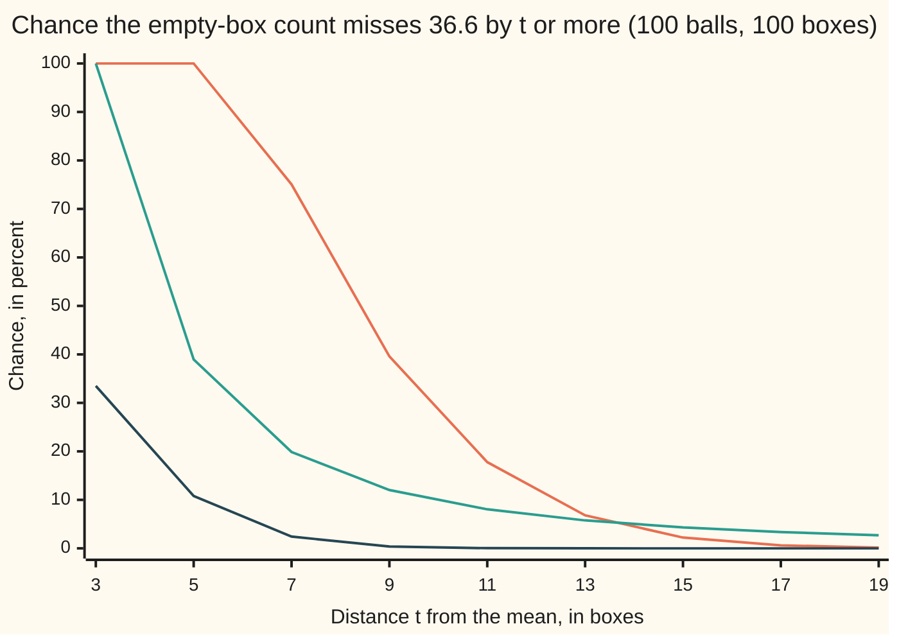
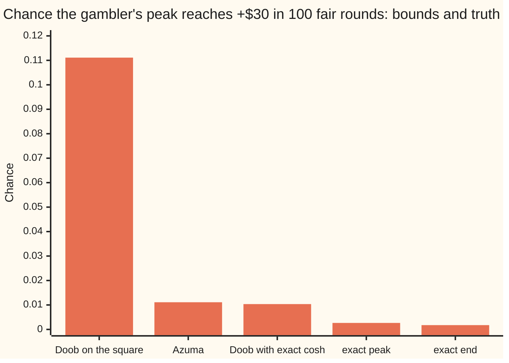

# Azuma-Hoeffding and McDiarmid: a martingale with bounded steps rarely strays far

[Syllabus](../../../SYLLABUS.md) → [Stochastic processes and calculus](../README.md) → [Martingales](../README.md#s02) → Azuma-Hoeffding and McDiarmid

---

## General Overview

A gambler bets $1 on a fair coin, 100 times. Heads wins $1, tails loses $1. What is the chance she ends the 100 rounds at least $30 up? The Azuma-Hoeffding inequality answers with one line of arithmetic: at most $`e^{-900/200} = e^{-4.5}`$, which is 0.011109. The true chance is 0.001759.

The same line works far from casinos. Throw 100 balls at random into 100 boxes and count the boxes left empty. On average 36.6 stay empty. The count depends on all 100 throws at once, in a tangled way. But one fact is simple: moving a single ball changes the count by at most 1. From that fact alone, McDiarmid's inequality says the count misses 36.6 by 15 or more with chance at most $`2e^{-4.5}`$, which is 0.022218. The exact chance is about 1 in a million.

Both results rest on one idea. Reveal the randomness one piece at a time. The best forecast of the final answer, updated after each piece, is a martingale (a fair game: its next value averages to its present value). If no single piece can move that forecast by much, the forecast cannot wander far in total. The chance of a large miss falls like $`e^{-t^2}`$ in the size $`t`$ of the miss.

**A martingale whose steps each lie in a range of known width rises $`t`$ or more above its start with chance at most $`e^{-2t^2/(\text{sum of squared widths})}`$, and falls as far with the same ceiling, so it strays $`t`$ either way with at most twice that; and any function of many independent inputs, where each input alone can move the answer only a little, misses its average by $`t`$ with at most that doubled ceiling.**

**What kind of fact this is:** three theorems (Hoeffding's lemma for one step, the Azuma-Hoeffding inequality and McDiarmid's inequality), all proved on this card in Why it works, with the full argument in a folded Detailed proof.

### The picture: empty boxes, three answers to one question



Orange: McDiarmid's ceiling, $`2e^{-2t^2/100}`$, capped at 100 percent. Green: Chebyshev's ceiling (the chance of missing the average by t or more is at most the variance over $`t^2`$), here the exact variance 9.740089 divided by $`t^2`$. Dark: the exact chance, from the full law of the count. Chebyshev is lower up to about 13 boxes; past that, McDiarmid's ceiling falls much faster. Chebyshev also needs the variance, and McDiarmid needs only the fact that one ball moves the count by at most 1.

---

## The formula

Notation, in words first.

- $`P(\cdot)`$ is a chance and $`E[\cdot]`$ an average. $`\mathcal F_k`$ is what is known after step k, and $`E[\,\cdot \mid \mathcal F_k]`$ is the average given that knowledge ([Conditional expectation](../../09-Probability%20and%20statistics/02-Random%20Variables/05-conditional-expectation-in-tables.md)).
- $`M_0, M_1, \dots, M_n`$ is a martingale: $`E[M_k \mid \mathcal F_{k-1}] = M_{k-1}`$ ([Martingales](01-martingales.md)).
- Its step number k is $`D_k = M_k - M_{k-1}`$, the change at step k.
- Each step has a **width** $`c_k`$: given the past, $`D_k`$ is sure to lie in some interval of length $`c_k`$. The interval may depend on the past. The width may not: it is fixed in advance.

**The Azuma-Hoeffding inequality.** For every distance $`t > 0`$,

```math
P\big(M_n - M_0 \ge t\big) \;\le\; \exp\!\Big(-\frac{2t^2}{c_1^2 + c_2^2 + \dots + c_n^2}\Big)
```

**Read it aloud:** the chance the martingale ends at least t above its start is at most e to the minus two t squared over the sum of the squared step widths.

The same ceiling holds for the peak $`\max_{k \le n}(M_k - M_0)`$, and for the drop below the start. Both sides together cost twice as much. Many books write the steps as $`\lvert D_k\rvert \le d_k`$ instead; then the width is $`c_k = 2d_k`$ and the ceiling reads $`\exp(-t^2/(2\sum d_k^2))`$. For the gambler, $`d_k = 1`$, $`c_k = 2`$, and the sum of squared widths is $`100 \times 2^2 = 400`$:

```math
P(M_{100} \ge 30) \le \exp\!\Big(-\frac{2 \times 30^2}{400}\Big) = e^{-4.5} = 0.011109
```

**McDiarmid's inequality** (the bounded-differences inequality). Let $`X_1, \dots, X_n`$ be independent inputs and $`f`$ a function of all of them. Suppose changing input $`i`$ alone, with every other input held fixed, changes $`f`$ by at most $`c_i`$. Then

```math
P\big(\lvert f(X_1, \dots, X_n) - E[f]\rvert \ge t\big) \;\le\; 2\exp\!\Big(-\frac{2t^2}{c_1^2 + \dots + c_n^2}\Big)
```

**Read it aloud:** the chance the function misses its average by t or more is at most twice e to the minus two t squared over the sum of the squared bounded differences.

For the boxes: $`X_i`$ is the box ball $`i`$ lands in, $`f`$ is the number $`N`$ of empty boxes, every $`c_i = 1`$, and $`2 \times 15^2 / 100 = 4.5`$. So $`P(\lvert N - 36.6\rvert \ge 15) \le 2e^{-4.5} = 0.022218`$.

| Symbol | Plain meaning | In our example | Push it up and the answer… |
| --- | --- | --- | --- |
| $`M_k`$, $`M_0`$, $`M_n`$; $`S_k`$ | the martingale after step k; its start; its end; the gain so far, $`M_k - M_0`$ | gambler: net winnings, starting at $0 | — |
| $`D_k`$ | step k: $`M_k - M_{k-1}`$ | gambler: +1 or −1 | — |
| $`c_k`$ | width of the range step k must lie in, fixed in advance; $`d_k`$ is half of it | gambler 2; one ball 1 | wider steps loosen the ceiling as $`c_k^2`$ |
| $`n`$ | number of steps, or of inputs | 100 rounds; 100 balls | with t fixed, the ceiling rises toward 1 |
| $`t`$ | the distance from the start, or from the average | $30; 15 boxes | the ceiling falls like $`e^{-t^2}`$ |
| $`\mathcal F_k`$, $`\mathcal G`$; $`P`$, $`E`$ | what is known after step k, or just before one step; a chance; an average | the first k tosses, or the first k balls | — |
| $`\theta`$; $`u`$ | the tilt: a free positive number in $`e^{\theta(M_n - M_0)}`$; the tilt times one width, $`\theta c`$ | best at 0.3 for the gambler | too small or too large loosens the bound |
| $`\cosh\theta`$ | hyperbolic cosine: the average of $`e^{\theta}`$ and $`e^{-\theta}`$ | the exact average of $`e^{\theta D_k}`$ for a fair $1 bet | — |
| $`X_i`$, $`f`$ | independent inputs, and the quantity built from them | the box of ball i; the empty-box count | — |
| $`N`$; $`Z_k`$ | number of empty boxes after all 100 balls; after the first k | average 36.603234; 100 at the start | — |
| $`V`$ | the sum of squared widths, $`c_1^2 + \dots + c_n^2`$ | gambler 400; boxes 100 (true widths 43.518609) | the ceiling rises toward 1 |
| $`A`$, $`p`$, $`L`$, $`w`$, $`g`$ | helpers in the Detailed proof: the bottom of one step's range; the weight $`-A/c`$; the log of the two-point average; a weight between 0 and 1; the forecast as a function of the newest input | — | — |

### When it holds

- **A martingale, or fair forecasts.** Each step must average to zero given the past. A game with a house edge drifts; the inequality then bounds the distance from the drifting average, not from the start.
- **Widths fixed in advance, true on every path.** The doubling gambler (stake doubled after each loss, up to $64) plays the same fair coin. Her chance of ending the 100 rounds at least $30 up is 0.663247, against the "ceiling" of 0.011109 that width 2 would give. Her real widths reach 128, and the honest ceiling is 0.998902: true and empty.
- **For McDiarmid, independent inputs.** The proof needs the later inputs to have the same law whatever the earlier ones were. Break that: let ball 1 lead. If its box number is even, every other ball lands in that same box; if odd, the rest are thrown freely. Moving one ball still changes the count by at most 1, yet the count is either 99 or near 36.6. It misses its average, 67.801617, by 15 or more with chance 0.999999922, not at most 0.022218: revealing ball 1 moves the forecast across a range of 62.396766, not at most 1. Dependence inside fixed blocks is cured by making the blocks the inputs. Balls thrown in pairs that share a box are 50 independent pairs; moving a pair empties at most one box and fills at most one, so each still moves the count by at most 1. The ceiling at 15 is then $`2e^{-9}`$ = 0.000247, around the pairs' average $`100 \times 0.99^{50}`$ = 60.500607.
- **Differences measured with all other inputs fixed, in the worst case.** "On average one ball moves the count by less than 1" is not enough; the bound needs "never by more than 1".
- **Useful when $`t`$ is large against $`\sqrt{\sum c_k^2}`$.** At 7 boxes McDiarmid allows 75 percent, against an exact 2.4 percent. The exponential needs room.

---

## Why it works

### Step 0: tilt, then peel off one step at a time

Look at $`e^{\theta(M_n - M_0)}`$ for a positive tilt $`\theta`$. A large total makes it huge, so Markov's inequality on it (a quantity that is never negative passes a level with chance at most its average over that level) gives a sharp ceiling. Its average is a product: the steps multiply it, one factor $`e^{\theta D_k}`$ per step. The steps are not independent, so the average of the product is not the product of the averages. But it does not need to be. Each factor, averaged given the past, is at most a fixed number, whatever the past was. Peel the last step off, bound it, and repeat. That is the whole proof.

### Step 1: Hoeffding's lemma, with the past held fixed

**Hoeffding's lemma** says: a quantity $`D`$ with average zero, trapped in a range of width $`c`$, has $`E[e^{\theta D}] \le e^{\theta^2 c^2/8}`$ for every tilt $`\theta`$. [Concentration](../../09-Probability%20and%20statistics/06-Limit%20Theorems%20in%20Practice/06-concentration-inequalities-hoeffding-and-chernoff.md) proves it for one variable. The reason is a chord: the exponential curve bends upward, so on the range it lies under the straight line joining its two ends. A two-point quantity at the ends is therefore the worst case, and its average exponential grows no faster than $`e^{\theta^2 c^2/8}`$.

Nothing in that argument uses independence. Hold the past fixed, and it applies to the next step of a martingale:

```math
E\big[e^{\theta D_k} \,\big|\, \mathcal F_{k-1}\big] \le e^{\theta^2 c_k^2/8}
```

For the fair $1 bet the left side is exactly $`\cosh\theta`$ and the right side is $`e^{\theta^2/2}`$. Both checks test the lemma at 300 tilts for the coin, and at 30 tilts on every step of the box martingale of Step 5. It holds every time.

### Step 2: peel the steps off by the tower rule

Write $`e^{\theta(M_n - M_0)} = e^{\theta(M_{n-1} - M_0)} \cdot e^{\theta D_n}`$. The first factor is known at step $`n - 1`$. Average the second factor given $`\mathcal F_{n-1}`$ first (the tower rule), and Step 1 caps it by $`e^{\theta^2 c_n^2/8}`$. Repeat for step $`n-1`$, and so on down to step 1:

```math
E\big[e^{\theta(M_n - M_0)}\big] \le \exp\!\Big(\frac{\theta^2}{8}\big(c_1^2 + \dots + c_n^2\big)\Big)
```

The widths are fixed numbers, so each cap comes out of the average as a constant. This is where "fixed in advance" is used.

### Step 3: Markov, then the best tilt

Markov's inequality on $`e^{\theta(M_n - M_0)}`$ gives, with $`V = c_1^2 + \dots + c_n^2`$,

```math
P(M_n - M_0 \ge t) \le e^{-\theta t}\, E\big[e^{\theta(M_n - M_0)}\big] \le \exp\!\Big(-\theta t + \frac{\theta^2 V}{8}\Big)
```

The exponent is a parabola in $`\theta`$, lowest at $`\theta = 4t/V`$, where it equals $`-2t^2/V`$. For the gambler, $`V = 400`$, the best tilt is $`4 \times 30/400 = 0.3`$, and the exponent is $`-9 + 4.5 = -4.5`$.

### Step 4: the peak costs nothing extra

The same ceiling covers the gambler's best moment, not just her last. A convex function (one whose graph bends upward, like the exponential) of a martingale is a submartingale (a game that is fair or favourable), so $`e^{\theta(M_k - M_0)}`$ is one. [Doob's inequalities](05-doob-inequalities.md) then bound the chance its peak passes $`e^{\theta t}`$ by its final average over $`e^{\theta t}`$. That is the same right-hand side as Step 3. So $`P(\max_{k \le 100} M_k \ge 30) \le 0.011109`$. The exact chance of ever touching +$30 is 0.002654.

The Doob card did this, for a $21 gain, with the exact factor $`\cosh\theta`$ in place of $`e^{\theta^2/2}`$. That route needs the law of each step. Azuma needs only its width, and loses little here: 0.010357 against 0.011109.



From left: Doob's inequality on the squared winnings, $`100/30^2`$ (it covers both directions); Azuma; Doob on $`e^{\theta M}`$ with the exact $`\cosh`$ at the best tilt $`\theta = 0.309520`$; the exact chance the peak reaches +$30; the exact chance the end does.

### Step 5: McDiarmid, through the Doob martingale

A function of independent inputs is not a game in time. Make it one. Reveal the inputs one by one, and after each, forecast the answer:

```math
M_k = E\big[f(X_1, \dots, X_n) \,\big|\, X_1, \dots, X_k\big]
```

This is the **Doob martingale** of $`f`$. It starts at $`M_0 = E[f]`$ and ends at $`M_n = f`$. It is a martingale by the tower rule ([Filtrations and martingales](../../10-Measure%20and%20integration/09-Conditional%20Expectation/06-filtrations-and-martingales.md)). Step k is the change in the forecast when input k is revealed.

Why that step lies in a range of width $`c_k`$: given the first $`k - 1`$ inputs, the new forecast is a function of input k alone. Independence means the later inputs have the same law whatever input k is. So two candidate values of input k give forecasts that are averages, over the same later inputs, of $`f`$ at two points differing only in input k. Each such pair differs by at most $`c_k`$, so the averages do too. Apply Azuma with these widths, and add the two sides.

For the boxes the forecast has a closed form. After $`k`$ balls, $`Z_k`$ boxes are still empty, and each stays empty through the remaining $`100 - k`$ balls with chance $`0.99^{100-k}`$. So

```math
M_k = Z_k \times 0.99^{\,100-k}
```

It starts at $`100 \times 0.99^{100} = 36.603234`$ and ends at $`N`$. Ball k either lands in an occupied box (the forecast rises a little) or in an empty one (it falls). The two outcomes differ by exactly $`0.99^{100-k}`$, at most 1. Both checks confirm the forecast is fair at every step and every count, to 12 decimals.

The true widths are smaller than 1 for early balls: the first ball's width is $`0.99^{99}`$, the last ball's is 1. Their squares add to 43.518609, not 100. Azuma with the true widths gives 0.000065 in place of 0.022218.

<details>
<summary>Detailed proof: Hoeffding's lemma given the past, Azuma-Hoeffding, McDiarmid</summary>

**Conditional Hoeffding lemma.** Let $`\mathcal G`$ be what is known just before one step $`D`$. Let $`E[D \mid \mathcal G] = 0`$ and $`A \le D \le A + c`$, where $`A`$ is known given $`\mathcal G`$ and $`c > 0`$ is a constant. For $`x`$ in $`[A, A + c]`$, convexity of the exponential gives

$`\displaystyle e^{\theta x} \le \frac{A + c - x}{c}\, e^{\theta A} + \frac{x - A}{c}\, e^{\theta (A + c)}.`$

Put $`x = D`$ and average given $`\mathcal G`$. The right side is linear in $`D`$, and $`D`$ averages to 0, so with $`p = -A/c`$ (between 0 and 1, because $`A \le 0 \le A + c`$):

$`\displaystyle E[e^{\theta D} \mid \mathcal G] \le (1 - p)e^{-p u} + p\, e^{(1 - p) u} = e^{L(u)}, \qquad u = \theta c.`$

Here $`L(u) = -pu + \ln(1 - p + p e^u)`$ has $`L(0) = 0`$, $`L'(0) = 0`$ and $`L''(u) = w(1 - w) \le 1/4`$ with $`w = pe^u/(1 - p + pe^u)`$. Taylor's theorem with remainder gives $`L(u) \le u^2/8 = \theta^2 c^2/8`$. The [Concentration](../../09-Probability%20and%20statistics/06-Limit%20Theorems%20in%20Practice/06-concentration-inequalities-hoeffding-and-chernoff.md) card does the same algebra without the conditioning.

**Azuma-Hoeffding.** Let $`D_k = M_k - M_{k-1}`$ lie, given $`\mathcal F_{k-1}`$, in an interval of length $`c_k`$, with $`E[D_k \mid \mathcal F_{k-1}] = 0`$. Put $`S_k = M_k - M_0`$ and $`V = \sum c_k^2`$. For $`\theta > 0`$, by the tower rule and taking out what is known,

$`\displaystyle E[e^{\theta S_k}] = E\big[e^{\theta S_{k-1}}\, E[e^{\theta D_k} \mid \mathcal F_{k-1}]\big] \le e^{\theta^2 c_k^2/8}\, E[e^{\theta S_{k-1}}].`$

By induction $`E[e^{\theta S_n}] \le e^{\theta^2 V/8}`$. Markov gives $`P(S_n \ge t) \le e^{-\theta t + \theta^2 V/8}`$; at $`\theta = 4t/V`$ this is $`e^{-2t^2/V}`$. For the peak, $`e^{\theta S_k}`$ is a non-negative submartingale by conditional Jensen, and Doob's maximal inequality gives $`P(\max_{k \le n} S_k \ge t) \le e^{-\theta t} E[e^{\theta S_n}]`$, the same bound. For the drop, apply all of this to $`-M_k`$, whose steps have the same widths.

**McDiarmid.** Let $`X_1, \dots, X_n`$ be independent and $`f`$ have bounded differences $`c_i`$. Let $`M_k = E[f \mid X_1, \dots, X_k]`$. Given $`X_1 = x_1, \dots, X_{k-1} = x_{k-1}`$, independence lets us write

$`\displaystyle M_k = g(X_k), \qquad g(y) = E\big[f(x_1, \dots, x_{k-1}, y, X_{k+1}, \dots, X_n)\big],`$

where the average is over the later inputs only, with their own law. For two values $`y`$ and $`y'`$, $`\lvert g(y) - g(y')\rvert \le c_k`$, since the integrands differ by at most $`c_k`$ at every point. So $`M_k`$ lies in $`[\inf g, \inf g + c_k]`$, an interval fixed by the past, and $`D_k = M_k - M_{k-1}`$ lies in an interval of length $`c_k`$. Azuma, applied on both sides, gives McDiarmid.

</details>

---

## Worked numbers, by hand

The boxes: 100 balls, each thrown into one of 100 boxes at random, independently.

| Step | Arithmetic | Value |
| --- | --- | --- |
| chance one box is missed by all 100 balls | $`0.99^{100}`$, so the average empty count is $`100 \times 0.99^{100}`$ | 36.603234 |
| largest change from moving one ball | old box may empty, new box may fill: at most 1 | 1 |
| sum of squared differences | $`100 \times 1^2`$ | 100 |
| exponent | $`2 \times 15^2 / 100`$ | 4.500000 |
| McDiarmid's ceiling | $`2e^{-4.5}`$ | 0.022218 |
| Chebyshev's ceiling, for comparison | exact variance 9.740089 / 225 | 0.043289 |
| ceiling with the Doob martingale's true widths | $`2e^{-450/43.518609}`$ | 0.000065 |
| exact chance, from the full law of the count | dynamic program over the empty count | 1.175 per million |
| **chance the count misses 36.6 by 15 or more** | **McDiarmid's guarantee** | **at most 0.022218** |

At most 0.022218 of all throws leave 21 or fewer, or 52 or more, empty boxes. That guarantee comes from one fact about one ball. Solving $`2e^{-2t^2/100} = 0.05`$ gives a 95-percent band of $`\pm 13.581015`$ boxes; the exact chance of leaving that band is 13.020 per million.

The gambler, by the same table: sum of squared widths 400, best tilt 0.3, exponent 4.5, ceiling 0.011109; exact chance 0.001759.

### What breaks if you drop a piece

| Mistake | Comes out at | What went wrong |
| --- | --- | --- |
| Use the half-width $`d = 1`$ as the width for the gambler | 0.015 per million (truth 0.001759) | The exponent becomes $`2 \times 900/100 = 18`$; the "ceiling" is below the truth, so it is false. Width is the full length of the range, 2. |
| Add the widths instead of their squares | 0.000123 (truth 0.001759) | $`2 \times 900/200 = 9`$. Widths add as squares, like variances; the sum of widths is too small a charge. |
| Give each ball width 2, because the count moves by −1, 0 or +1 | 0.649305 (honest 0.022218) | McDiarmid's $`c_i`$ is the largest change from moving one ball, which is 1. The Doob martingale's step then lies in a range of width at most 1, not 2. The bound stays true but is wasted. |
| Apply width 2 to the doubling gambler | 0.011109 (truth 0.663247) | Her stakes grow to $64, so her steps have width 128. The width must hold on every path. |

---

## Code, from first principles, and it actually runs

The code reaches each answer by independent roads. For the gambler: exact counting with binomial coefficients, an exact dynamic program over the walk, the reflection principle against an absorbed dynamic program for the peak, and Doob's bound with the exact $`\cosh`$. For the boxes: the formula $`100 \times 0.99^{100}`$ against an exact dynamic program over the empty count, and a seeded simulation of 20,000 throws with its standard error. The program's variance is checked against a count over pairs of boxes: $`100 \times 0.99^{100} + 100 \times 99 \times 0.98^{100}`$, minus the squared mean. It builds the Doob martingale $`Z_k \times 0.99^{100-k}`$, checks that it is fair at every step and count, measures every step's width, sums their squares against the geometric sum $`(1 - 0.99^{200})/(1 - 0.99^2)`$, and tests Hoeffding's lemma on every step. It also prices the doubling gambler exactly, checks her worst path (all losses) by hand, and works the two dependent-ball cases of When it holds. Random numbers come from SplitMix64 with seed 20261123, written out in both languages.

### Python

```python
# Azuma-Hoeffding and McDiarmid -- the check behind the card.  Standard library only.
# Part 1: a gambler bets $1 on a fair coin for 100 rounds; chance of winning $30 or more.
# Part 2: 100 balls thrown into 100 boxes; how far the count of empty boxes strays from its mean.
from math import comb, exp, log, sqrt
N, T = 100, 30                    # gambler: rounds, target gain in dollars
B, Q, TB = 100, 0.99, 15          # balls (= boxes), chance a ball misses a given box, distance

# ---- Part 1: the gambler, steps of width 2 (from -1 to +1)
azuma = exp(-2 * T ** 2 / (N * 2 ** 2))
def heads_at_least(h): return sum(comb(N, k) for k in range(h, N + 1)) / 2 ** N
end_exact = heads_at_least((N + T) // 2)                      # gain 30 means 65 heads or more
peak_reflect = end_exact + heads_at_least((N + T) // 2 + 1)   # reflection: P(S >= 30) + P(S > 30)
def walk(n, level, absorb):  # exact law of the fair walk; absorb=True stops it at the level
    dist, hit = {0: 1.0}, 0.0
    for _ in range(n):
        new = {}
        for x, p in dist.items():
            for y in (x - 1, x + 1):
                if absorb and y >= level: hit += 0.5 * p
                else: new[y] = new.get(y, 0.0) + 0.5 * p
        dist = new
    return hit if absorb else sum(p for x, p in dist.items() if x >= level)
end_dp, peak_dp = walk(N, T, False), walk(N, T, True)
theta = 0.5 * log((1 + T / N) / (1 - T / N))                 # atanh(0.3): best tilt for cosh
cosh_bound = exp(N * log((exp(theta) + exp(-theta)) / 2) - T * theta)
kolmogorov = N / T ** 2                                       # Doob on the square, two-sided
grid = [i / 100 for i in range(1, 301)]
lemma_coin = max(log((exp(t) + exp(-t)) / 2) - t * t / 2 for t in grid)     # must be <= 0

def doubling(n, cap):  # double the stake after a loss, up to cap; back to $1 after a win or a loss at cap
    dist = {(0, 1): 1.0}
    for _ in range(n):
        new = {}
        for (x, s), p in dist.items():
            for key in ((x + s, 1), (x - s, 2 * s if s < cap else 1)):
                new[key] = new.get(key, 0.0) + 0.5 * p
        dist = new
    return sum(p for (x, s), p in dist.items() if x >= T), sum(p * x for (x, s), p in dist.items()), min(x for x, s in dist)
(dbl_p, dbl_mean, dbl_low), dbl_azuma = doubling(N, 64), exp(-2 * T ** 2 / (N * 128 ** 2))
# ---- Part 2: balls in boxes; z = empty boxes so far
mean_formula = B * Q ** B
law = [0.0] * (B + 1); law[B] = 1.0            # before any ball, all 100 boxes are empty
for _ in range(B):
    new = [0.0] * (B + 1)
    for z, p in enumerate(law):
        if p == 0.0: continue
        new[z] += p * (B - z) / B               # the ball lands in an occupied box
        if z > 0: new[z - 1] += p * z / B       # the ball lands in an empty box
    law = new
mean_dp = sum(z * p for z, p in enumerate(law)); var_dp = sum((z - mean_dp) ** 2 * p for z, p in enumerate(law))
def tail(t): return sum(p for z, p in enumerate(law) if abs(z - mean_dp) >= t)
mcd = lambda t, w2: 2 * exp(-2 * t * t / w2); exact_tail = tail(TB)
mean_dep = (B - 1 + mean_dp) / 2   # ball 1 leads: in an even box it draws every other ball in (99 empty); odd: free throws
tail_dep = 0.5 * (B - 1 - mean_dep >= TB) + 0.5 * sum(p for z, p in enumerate(law) if abs(z - mean_dep) >= TB)
# The Doob martingale M_k = E[N | first k balls] = z * Q^(B-k). Check fairness, widths, the lemma.
worst_fair, worst_width, worst_lemma, w2_true = 0.0, 0.0, -1.0, 0.0
for k in range(B):
    w = Q ** (B - k - 1); w2_true += w * w
    for z in range(B - k, B + 1):
        m_now = z * Q ** (B - k)
        up, down = z * w - m_now, (z - 1) * w - m_now   # occupied box hit / empty box hit
        pu, pd = (B - z) / B, z / B; worst_width = max(worst_width, up - down)
        worst_fair = max(worst_fair, abs(pu * up + pd * down))
        for t in grid[::10]:
            mgf = pu * exp(t * up) + pd * exp(t * down)
            worst_lemma = max(worst_lemma, log(mgf) - t * t * w * w / 8)
chebyshev, band95 = var_dp / TB ** 2, sqrt(B / 2 * log(2 / 0.05))
M64 = (1 << 64) - 1
def splitmix(state):
    state = (state + 0x9E3779B97F4A7C15) & M64
    z = ((state ^ (state >> 30)) * 0xBF58476D1CE4E5B9) & M64
    z = ((z ^ (z >> 27)) * 0x94D049BB133111EB) & M64
    return state, z ^ (z >> 31)
st, trials, s1, s2, far = 20261123, 20000, 0.0, 0.0, 0
for _ in range(trials):
    hit = [False] * B
    for _ in range(B):
        st, r = splitmix(st); hit[r % B] = True
    e = B - sum(hit); s1 += e; s2 += e * e; far += abs(e - mean_formula) >= 6
sim_mean = s1 / trials; sim_se = sqrt((s2 / trials - sim_mean ** 2) / trials)

rows = [
    ("gambler: rounds N, target gain t", f"{N} {T}"),
    ("Azuma bound  exp(-2t^2/(N*2^2))", f"{azuma:.6f}"),
    ("  sum of squared widths, best tilt, exponent", f"{N * 2 ** 2:.6f} {4 * T / (N * 4):.6f} {2 * T ** 2 / (N * 4):.6f}"),
    ("exact P(gain >= 30): counting, walk DP", f"{end_exact:.6f} {end_dp:.6f}"),
    ("exact P(peak >= 30): reflection, absorbed DP", f"{peak_reflect:.6f} {peak_dp:.6f}"),
    ("tilt atanh(0.3)", f"{theta:.6f}"),
    ("Doob, exact cosh  cosh^100 e^-30theta", f"{cosh_bound:.6f}"),
    ("Doob on the square  100/30^2", f"{kolmogorov:.6f}"),
    ("lemma for the coin, every tilt tested", "holds" if lemma_coin <= 0 else "FAILS"),
    ("doubling to $64: P(gain >= 30), mean gain", f"{dbl_p:.6f} {round(dbl_mean, 6) + 0.0:.6f}"),
    ("  Azuma at width 128", f"{dbl_azuma:.6f}"),
    ("balls B, boxes, distance", f"{B} {B} {TB}"),
    ("E[empty]  100 * 0.99^100", f"{mean_formula:.6f}"),
    ("E[empty]  exact DP", f"{mean_dp:.6f}"),
    ("  simulated (20000 throws)", f"{sim_mean:.4f} +- {sim_se:.4f}"),
    ("Var[empty]  exact DP, and sd", f"{var_dp:.6f} {sqrt(var_dp):.6f}"),
    ("McDiarmid  2 exp(-2*15^2/100)", f"{mcd(TB, B):.6f}"),
    ("exact P(|N - mean| >= 15), per million", f"{1e6 * exact_tail:.3f}"),
    ("Chebyshev  Var/15^2", f"{chebyshev:.6f}"),
    ("Doob martingale fair to 1e-12", "yes" if worst_fair < 1e-12 else "no"),
    ("  widest step", f"{worst_width:.6f}"),
    ("  lemma on every step, every tilt", "holds" if worst_lemma <= 1e-12 else "FAILS"),
    ("  true widths: sum of squares, McDiarmid", f"{w2_true:.6f} {mcd(TB, w2_true):.6f}"),
    ("95% band  sqrt(50 ln 40)", f"{band95:.6f}"),
    ("  exact P(|N - mean| >= band), per million", f"{1e6 * tail(band95):.3f}"),
    ("P(|N - mean| >= 6): simulated, exact", f"{far / trials:.6f} {tail(6):.6f}"),
    ("wrong: width 2 per ball", f"{mcd(TB, 4 * B):.6f}"),
    ("wrong: half-width 1 as width, per million", f"{1e6 * exp(-2 * T ** 2 / N):.3f}"),
    ("wrong: widths not squared  exp(-2t^2/200)", f"{exp(-2 * T ** 2 / (2 * N)):.6f}"),
    ("try: 400 rounds, gain 30", f"{exp(-2 * T ** 2 / (4 * N * 4)):.6f}"),
    ("try: 100 rounds, gain 40", f"{exp(-2 * 40 ** 2 / (N * 4)):.6f}"),
    ("try: 200 balls, mean and McDiarmid at 15", f"{B * Q ** 200:.6f} {mcd(TB, 2 * B):.6f}"),
    ("chromatic, 1000 vertices, t = 50", f"{mcd(50, 1000):.6f}"),
    ("ball 1 leads: mean, P(miss >= 15), step c_1", f"{mean_dep:.6f} {tail_dep:.9f} {B - 1 - mean_formula:.6f}"),
    ("50 pairs: mean and McDiarmid at 15", f"{B * Q ** 50:.6f} {mcd(TB, B / 2):.6f}"),
]
for name, v in rows: print(f"{name:<44} {v}")
print()
print("chart, t   exact %   McDiarmid %   Chebyshev %")
for t in (3, 5, 7, 9, 11, 13, 15, 17, 19):
    print(f"chart, {t:>2}  {100 * tail(t):8.3f}   {100 * min(1, mcd(t, B)):11.3f}   {100 * min(1, var_dp / t / t):11.3f}")

assert abs(end_exact - end_dp) < 1e-12, "counting vs dynamic program"
assert abs(peak_reflect - peak_dp) < 1e-12, "reflection vs absorbed dynamic program"
assert peak_dp < cosh_bound < azuma < kolmogorov, "the ladder of bounds sits above the truth"
assert lemma_coin <= 0 and worst_lemma <= 1e-12, "Hoeffding's lemma on every step tested"
assert abs(mean_formula - mean_dp) < 1e-9, "mean of empty boxes: formula vs dynamic program"
assert abs(sim_mean - mean_dp) < 4 * sim_se, "simulation within 4 standard errors"
assert worst_fair < 1e-12 and worst_width <= 1 + 1e-12, "Doob martingale is fair with steps of width <= 1"
assert exact_tail < mcd(TB, w2_true) < mcd(TB, B) < tail_dep, "McDiarmid holds, true widths sharpen it, dependent inputs break it"
assert dbl_p > azuma and abs(dbl_mean) < 1e-9, "doubling: fair, but big steps break the width-2 bound"
assert dbl_low == -(127 * (N // 7) + 2 ** (N % 7) - 1), "doubling: all losses = 14 busts of $127, then $1 and $2"
assert abs(w2_true - (1 - Q ** (2 * B)) / (1 - Q * Q)) < 1e-9, "true widths: a geometric sum of squares"
assert abs(var_dp - (mean_formula + B * (B - 1) * (1 - 2 / B) ** B - mean_formula ** 2)) < 1e-9, "variance: pairs of boxes"
print("ALL CHECKS PASS")
```

**Ran 2026-11-23 on macOS, Python 3.14.10, standard library only. All checks passed. Output, pasted from the run:**

```
gambler: rounds N, target gain t             100 30
Azuma bound  exp(-2t^2/(N*2^2))              0.011109
  sum of squared widths, best tilt, exponent 400.000000 0.300000 4.500000
exact P(gain >= 30): counting, walk DP       0.001759 0.001759
exact P(peak >= 30): reflection, absorbed DP 0.002654 0.002654
tilt atanh(0.3)                              0.309520
Doob, exact cosh  cosh^100 e^-30theta        0.010357
Doob on the square  100/30^2                 0.111111
lemma for the coin, every tilt tested        holds
doubling to $64: P(gain >= 30), mean gain    0.663247 0.000000
  Azuma at width 128                         0.998902
balls B, boxes, distance                     100 100 15
E[empty]  100 * 0.99^100                     36.603234
E[empty]  exact DP                           36.603234
  simulated (20000 throws)                   36.5891 +- 0.0220
Var[empty]  exact DP, and sd                 9.740089 3.120912
McDiarmid  2 exp(-2*15^2/100)                0.022218
exact P(|N - mean| >= 15), per million       1.175
Chebyshev  Var/15^2                          0.043289
Doob martingale fair to 1e-12                yes
  widest step                                1.000000
  lemma on every step, every tilt            holds
  true widths: sum of squares, McDiarmid     43.518609 0.000065
95% band  sqrt(50 ln 40)                     13.581015
  exact P(|N - mean| >= band), per million   13.020
P(|N - mean| >= 6): simulated, exact         0.053300 0.053567
wrong: width 2 per ball                      0.649305
wrong: half-width 1 as width, per million    0.015
wrong: widths not squared  exp(-2t^2/200)    0.000123
try: 400 rounds, gain 30                     0.324652
try: 100 rounds, gain 40                     0.000335
try: 200 balls, mean and McDiarmid at 15     13.397967 0.210798
chromatic, 1000 vertices, t = 50             0.013476
ball 1 leads: mean, P(miss >= 15), step c_1  67.801617 0.999999922 62.396766
50 pairs: mean and McDiarmid at 15           60.500607 0.000247

chart, t   exact %   McDiarmid %   Chebyshev %
chart,  3    33.501       100.000       100.000
chart,  5    10.787       100.000        38.960
chart,  7     2.424        75.062        19.878
chart,  9     0.372        39.580        12.025
chart, 11     0.038        17.784         8.050
chart, 13     0.003         6.809         5.763
chart, 15     0.000         2.222         4.329
chart, 17     0.000         0.618         3.370
chart, 19     0.000         0.146         2.698
ALL CHECKS PASS
```

The exact roads agree within the asserts' tolerances: twelve decimals for the gambler, nine for the mean, the variance and the sum of squared true widths. The simulated mean sits within one standard error of the exact 36.603234.

### Rust

```rust
// Azuma-Hoeffding and McDiarmid -- the same check as azuma_hoeffding_and_mcdiarmid_check.py, in Rust.  std only.
// Part 1: a gambler bets $1 on a fair coin for 100 rounds; chance of winning $30 or more.
// Part 2: 100 balls thrown into 100 boxes; how far the count of empty boxes strays from its mean.
const N: usize = 100; const T: i64 = 30; const B: usize = 100; const Q: f64 = 0.99; const TB: f64 = 15.0;

fn comb(n: u128, k: u128) -> u128 { (0..k).fold(1u128, |c, i| c * (n - i) / (i + 1)) }
fn heads_at_least(h: usize) -> f64 {
    (h..=N).map(|k| comb(N as u128, k as u128)).sum::<u128>() as f64 / 2f64.powi(N as i32)
}

fn walk(n: usize, level: i64, absorb: bool) -> f64 {
    // exact law of the fair walk, stored at offset n; absorb=true stops it at the level
    let off = n as i64; let mut dist = vec![0.0f64; 2 * n + 1]; dist[n] = 1.0; let mut hit = 0.0;
    for _ in 0..n {
        let mut new = vec![0.0f64; 2 * n + 1];
        for (i, &p) in dist.iter().enumerate() {
            if p == 0.0 { continue; } let x = i as i64 - off;
            for y in [x - 1, x + 1] {
                if absorb && y >= level { hit += 0.5 * p; } else { new[(y + off) as usize] += 0.5 * p; }
            }
        }
        dist = new;
    }
    if absorb { hit } else { dist.iter().enumerate().filter(|(i, _)| *i as i64 - off >= level).map(|(_, p)| p).sum() }
}

fn doubling(n: usize, cap: i64) -> (f64, f64, i64) {
    // double the stake after a loss, up to cap; back to $1 after a win or a loss at cap
    let off: i64 = 64 * n as i64; let size = (2 * off + 1) as usize;
    let mut dist = vec![[0.0f64; 7]; size]; dist[off as usize][0] = 1.0;
    for _ in 0..n {
        let mut new = vec![[0.0f64; 7]; size];
        for i in 0..size {
            for j in 0..7 {
                let p = dist[i][j]; if p == 0.0 { continue; }
                let (x, s) = (i as i64 - off, 1i64 << j);
                new[(x + s + off) as usize][0] += 0.5 * p;
                new[(x - s + off) as usize][if s < cap { j + 1 } else { 0 }] += 0.5 * p;
            }
        }
        dist = new;
    }
    let (mut pr, mut mean, mut low) = (0.0, 0.0, 0i64);
    for i in 0..size {
        let (x, p) = (i as i64 - off, dist[i].iter().sum::<f64>());
        if x >= T { pr += p; } mean += p * x as f64;
        if p > 0.0 { low = low.min(x); }
    }
    (pr, mean, low)
}

fn splitmix(state: &mut u64) -> u64 {
    *state = state.wrapping_add(0x9E3779B97F4A7C15); let z = (*state ^ (*state >> 30)).wrapping_mul(0xBF58476D1CE4E5B9);
    let z = (z ^ (z >> 27)).wrapping_mul(0x94D049BB133111EB);
    z ^ (z >> 31)
}

fn main() {
    let (nf, tf) = (N as f64, T as f64);
    // ---- Part 1: the gambler, steps of width 2 (from -1 to +1)
    let azuma = (-2.0 * tf * tf / (nf * 4.0)).exp();
    let h = (N + T as usize) / 2; let end_exact = heads_at_least(h); // gain 30 means 65 heads or more
    let peak_reflect = end_exact + heads_at_least(h + 1); // reflection: P(S >= 30) + P(S > 30)
    let (end_dp, peak_dp) = (walk(N, T, false), walk(N, T, true));
    let theta = 0.5 * ((1.0 + tf / nf) / (1.0 - tf / nf)).ln(); // atanh(0.3)
    let cosh_bound = (nf * ((theta.exp() + (-theta).exp()) / 2.0).ln() - tf * theta).exp();
    let kolmogorov = nf / (tf * tf); // Doob on the square, two-sided
    let grid: Vec<f64> = (1..=300).map(|i| i as f64 / 100.0).collect();
    let lemma_coin = grid.iter().map(|&t| ((t.exp() + (-t).exp()) / 2.0).ln() - t * t / 2.0).fold(f64::MIN, f64::max);
    let (dbl_p, dbl_mean, dbl_low) = doubling(N, 64); let dbl_azuma = (-2.0 * tf * tf / (nf * 128.0 * 128.0)).exp();
    // ---- Part 2: balls in boxes; z = empty boxes so far
    let bf = B as f64; let mean_formula = bf * Q.powi(B as i32);
    let mut law = vec![0.0f64; B + 1]; law[B] = 1.0;
    for _ in 0..B {
        let mut new = vec![0.0f64; B + 1];
        for z in 0..=B {
            let p = law[z]; if p == 0.0 { continue; }
            new[z] += p * (B - z) as f64 / bf;
            if z > 0 { new[z - 1] += p * z as f64 / bf; }
        }
        law = new;
    }
    let mean_dp: f64 = law.iter().enumerate().map(|(z, p)| z as f64 * p).sum(); let var_dp: f64 = law.iter().enumerate().map(|(z, p)| (z as f64 - mean_dp).powi(2) * p).sum();
    let tail = |t: f64| -> f64 { law.iter().enumerate().filter(|(z, _)| (*z as f64 - mean_dp).abs() >= t).map(|(_, p)| p).sum() };
    let mcd = |t: f64, w2: f64| 2.0 * (-2.0 * t * t / w2).exp(); let exact_tail = tail(TB);
    let mean_dep = (bf - 1.0 + mean_dp) / 2.0; // ball 1 leads: in an even box it draws every other ball in (99 empty); odd: free throws
    let free_far: f64 = law.iter().enumerate().filter(|(z, _)| (*z as f64 - mean_dep).abs() >= TB).map(|(_, p)| p).sum();
    let tail_dep = 0.5 * (if bf - 1.0 - mean_dep >= TB { 1.0 } else { 0.0 }) + 0.5 * free_far;
    // The Doob martingale M_k = E[N | first k balls] = z * Q^(B-k). Check fairness, widths, the lemma.
    let (mut worst_fair, mut worst_width, mut worst_lemma, mut w2_true) = (0.0f64, 0.0f64, -1.0f64, 0.0f64);
    for k in 0..B {
        let w = Q.powi((B - k - 1) as i32); w2_true += w * w;
        for z in (B - k)..=B {
            let zf = z as f64; let m_now = zf * Q.powi((B - k) as i32);
            let (up, down) = (zf * w - m_now, (zf - 1.0) * w - m_now);
            let (pu, pd) = ((bf - zf) / bf, zf / bf); worst_width = worst_width.max(up - down);
            worst_fair = worst_fair.max((pu * up + pd * down).abs());
            for t in grid.iter().step_by(10) {
                let mgf = pu * (t * up).exp() + pd * (t * down).exp();
                worst_lemma = worst_lemma.max(mgf.ln() - t * t * w * w / 8.0);
            }
        }
    }
    let (chebyshev, band95) = (var_dp / (TB * TB), (bf / 2.0 * (2.0f64 / 0.05).ln()).sqrt());
    let (mut st, trials, mut s1, mut s2, mut far) = (20261123u64, 20000usize, 0.0f64, 0.0f64, 0usize);
    for _ in 0..trials {
        let mut hit = [false; B];
        for _ in 0..B { let r = splitmix(&mut st); hit[(r % B as u64) as usize] = true; }
        let e = (B - hit.iter().filter(|&&x| x).count()) as f64;
        s1 += e; s2 += e * e; if (e - mean_formula).abs() >= 6.0 { far += 1; }
    }
    let (tr, f6) = (trials as f64, |x: f64| format!("{:.6}", x));
    let sim_mean = s1 / tr; let sim_se = ((s2 / tr - sim_mean * sim_mean) / tr).sqrt();
    let rows: Vec<(&str, String)> = vec![
        ("gambler: rounds N, target gain t", format!("{} {}", N, T)),
        ("Azuma bound  exp(-2t^2/(N*2^2))", f6(azuma)),
        ("  sum of squared widths, best tilt, exponent", format!("{:.6} {:.6} {:.6}", nf * 4.0, 4.0 * tf / (nf * 4.0), 2.0 * tf * tf / (nf * 4.0))),
        ("exact P(gain >= 30): counting, walk DP", format!("{:.6} {:.6}", end_exact, end_dp)),
        ("exact P(peak >= 30): reflection, absorbed DP", format!("{:.6} {:.6}", peak_reflect, peak_dp)),
        ("tilt atanh(0.3)", f6(theta)),
        ("Doob, exact cosh  cosh^100 e^-30theta", f6(cosh_bound)),
        ("Doob on the square  100/30^2", f6(kolmogorov)),
        ("lemma for the coin, every tilt tested", (if lemma_coin <= 0.0 { "holds" } else { "FAILS" }).to_string()),
        ("doubling to $64: P(gain >= 30), mean gain", format!("{:.6} {:.6}", dbl_p, (dbl_mean * 1e6).round() / 1e6 + 0.0)),
        ("  Azuma at width 128", f6(dbl_azuma)),
        ("balls B, boxes, distance", format!("{} {} {}", B, B, TB)),
        ("E[empty]  100 * 0.99^100", f6(mean_formula)),
        ("E[empty]  exact DP", f6(mean_dp)),
        ("  simulated (20000 throws)", format!("{:.4} +- {:.4}", sim_mean, sim_se)),
        ("Var[empty]  exact DP, and sd", format!("{:.6} {:.6}", var_dp, var_dp.sqrt())),
        ("McDiarmid  2 exp(-2*15^2/100)", f6(mcd(TB, bf))),
        ("exact P(|N - mean| >= 15), per million", format!("{:.3}", 1e6 * exact_tail)),
        ("Chebyshev  Var/15^2", f6(chebyshev)),
        ("Doob martingale fair to 1e-12", (if worst_fair < 1e-12 { "yes" } else { "no" }).to_string()),
        ("  widest step", f6(worst_width)),
        ("  lemma on every step, every tilt", (if worst_lemma <= 1e-12 { "holds" } else { "FAILS" }).to_string()),
        ("  true widths: sum of squares, McDiarmid", format!("{:.6} {:.6}", w2_true, mcd(TB, w2_true))),
        ("95% band  sqrt(50 ln 40)", f6(band95)),
        ("  exact P(|N - mean| >= band), per million", format!("{:.3}", 1e6 * tail(band95))),
        ("P(|N - mean| >= 6): simulated, exact", format!("{:.6} {:.6}", far as f64 / tr, tail(6.0))),
        ("wrong: width 2 per ball", f6(mcd(TB, 4.0 * bf))),
        ("wrong: half-width 1 as width, per million", format!("{:.3}", 1e6 * (-2.0 * tf * tf / nf).exp())),
        ("wrong: widths not squared  exp(-2t^2/200)", f6((-2.0 * tf * tf / (2.0 * nf)).exp())),
        ("try: 400 rounds, gain 30", f6((-2.0 * tf * tf / (4.0 * nf * 4.0)).exp())),
        ("try: 100 rounds, gain 40", f6((-2.0 * 1600.0 / (nf * 4.0)).exp())),
        ("try: 200 balls, mean and McDiarmid at 15", format!("{:.6} {:.6}", bf * Q.powi(200), mcd(TB, 2.0 * bf))),
        ("chromatic, 1000 vertices, t = 50", f6(mcd(50.0, 1000.0))),
        ("ball 1 leads: mean, P(miss >= 15), step c_1", format!("{:.6} {:.9} {:.6}", mean_dep, tail_dep, bf - 1.0 - mean_formula)),
        ("50 pairs: mean and McDiarmid at 15", format!("{:.6} {:.6}", bf * Q.powi(50), mcd(TB, bf / 2.0))),
    ];
    for (name, v) in &rows { println!("{:<44} {}", name, v); }
    println!("\nchart, t   exact %   McDiarmid %   Chebyshev %");
    for t in [3.0f64, 5.0, 7.0, 9.0, 11.0, 13.0, 15.0, 17.0, 19.0] {
        println!("chart, {:>2}  {:8.3}   {:11.3}   {:11.3}", t, 100.0 * tail(t), 100.0 * mcd(t, bf).min(1.0), 100.0 * (var_dp / t / t).min(1.0));
    }

    assert!((end_exact - end_dp).abs() < 1e-12, "counting vs dynamic program");
    assert!((peak_reflect - peak_dp).abs() < 1e-12, "reflection vs absorbed dynamic program");
    assert!(peak_dp < cosh_bound && cosh_bound < azuma && azuma < kolmogorov, "the ladder of bounds");
    assert!(lemma_coin <= 0.0 && worst_lemma <= 1e-12, "Hoeffding's lemma on every step tested");
    assert!((mean_formula - mean_dp).abs() < 1e-9, "mean of empty boxes: formula vs dynamic program");
    assert!((sim_mean - mean_dp).abs() < 4.0 * sim_se, "simulation within 4 standard errors");
    assert!(worst_fair < 1e-12 && worst_width <= 1.0 + 1e-12, "Doob martingale is fair with steps of width <= 1");
    assert!(exact_tail < mcd(TB, w2_true) && mcd(TB, w2_true) < mcd(TB, bf) && mcd(TB, bf) < tail_dep, "McDiarmid holds, true widths sharpen it, dependent inputs break it");
    assert!(dbl_p > azuma && dbl_mean.abs() < 1e-9, "doubling: fair, but big steps break the width-2 bound");
    assert!(dbl_low == -(127 * (N as i64 / 7) + (1i64 << (N % 7)) - 1), "doubling: all losses = 14 busts of $127, then $1 and $2");
    assert!((w2_true - (1.0 - Q.powi(2 * B as i32)) / (1.0 - Q * Q)).abs() < 1e-9, "true widths: a geometric sum of squares");
    assert!((var_dp - (mean_formula + bf * (bf - 1.0) * (1.0 - 2.0 / bf).powi(B as i32) - mean_formula * mean_formula)).abs() < 1e-9, "variance: pairs of boxes");
    println!("ALL CHECKS PASS");
}
```

**Ran 2026-11-23 on macOS, rustc 1.98.1, no crates. All checks passed. Output, pasted from the run:**

```
gambler: rounds N, target gain t             100 30
Azuma bound  exp(-2t^2/(N*2^2))              0.011109
  sum of squared widths, best tilt, exponent 400.000000 0.300000 4.500000
exact P(gain >= 30): counting, walk DP       0.001759 0.001759
exact P(peak >= 30): reflection, absorbed DP 0.002654 0.002654
tilt atanh(0.3)                              0.309520
Doob, exact cosh  cosh^100 e^-30theta        0.010357
Doob on the square  100/30^2                 0.111111
lemma for the coin, every tilt tested        holds
doubling to $64: P(gain >= 30), mean gain    0.663247 0.000000
  Azuma at width 128                         0.998902
balls B, boxes, distance                     100 100 15
E[empty]  100 * 0.99^100                     36.603234
E[empty]  exact DP                           36.603234
  simulated (20000 throws)                   36.5891 +- 0.0220
Var[empty]  exact DP, and sd                 9.740089 3.120912
McDiarmid  2 exp(-2*15^2/100)                0.022218
exact P(|N - mean| >= 15), per million       1.175
Chebyshev  Var/15^2                          0.043289
Doob martingale fair to 1e-12                yes
  widest step                                1.000000
  lemma on every step, every tilt            holds
  true widths: sum of squares, McDiarmid     43.518609 0.000065
95% band  sqrt(50 ln 40)                     13.581015
  exact P(|N - mean| >= band), per million   13.020
P(|N - mean| >= 6): simulated, exact         0.053300 0.053567
wrong: width 2 per ball                      0.649305
wrong: half-width 1 as width, per million    0.015
wrong: widths not squared  exp(-2t^2/200)    0.000123
try: 400 rounds, gain 30                     0.324652
try: 100 rounds, gain 40                     0.000335
try: 200 balls, mean and McDiarmid at 15     13.397967 0.210798
chromatic, 1000 vertices, t = 50             0.013476
ball 1 leads: mean, P(miss >= 15), step c_1  67.801617 0.999999922 62.396766
50 pairs: mean and McDiarmid at 15           60.500607 0.000247

chart, t   exact %   McDiarmid %   Chebyshev %
chart,  3    33.501       100.000       100.000
chart,  5    10.787       100.000        38.960
chart,  7     2.424        75.062        19.878
chart,  9     0.372        39.580        12.025
chart, 11     0.038        17.784         8.050
chart, 13     0.003         6.809         5.763
chart, 15     0.000         2.222         4.329
chart, 17     0.000         0.618         3.370
chart, 19     0.000         0.146         2.698
ALL CHECKS PASS
```

The two outputs agree line for line. Rust stores the walks in arrays where Python uses dictionaries, so sums run in a different order; they differ only far below the printed digits.

### Lean

Lean proves both inequalities for any martingale or any independent inputs, plus the one-ball fact and the worked arithmetic.

- Suppose each step $`D_k`$ of a martingale lies, given the past, in a range of width $`c_k`$ fixed in advance. Then for any $`t > 0`$, it rises $`t`$ or more above its start with chance at most $`e^{-2t^2/V}`$.
- The same ceiling holds for falling $`t`$ or more below the start. Straying $`t`$ either way has chance at most twice that.
- Suppose changing input $`X_i`$ alone moves $`f`$ by at most $`c_i`$, with independent inputs, and take $`t > 0`$. Then $`f`$ misses its average by $`t`$ or more with chance at most $`2e^{-2t^2/V}`$.
- Moving one ball changes the count of empty boxes by at most 1, for any numbers of balls and boxes.
- The exponents check: 4.5 for the gambler and the boxes, 9 for the 50 pairs, and 18 and 9 for the two mistakes.
- The exact chance the gambler ends at least $30 up rounds to 0.001759.

The peak bound, every ceiling's decimals, the boxes' average and the exact laws are left to the Python and Rust checks.

```lean
-- Azuma-Hoeffding and McDiarmid: a martingale whose steps each lie in a range of fixed width strays t from its start with chance at most e^(-2t^2/(sum of squared widths)) each way, a function of independent inputs with bounded differences misses its average by t with at most twice that, and moving one ball changes the count of empty boxes by at most 1.
import Mathlib.Probability.Martingale.Basic
import Mathlib.Probability.Independence.Basic
import Mathlib.Analysis.SpecialFunctions.Exp
import Mathlib.Data.Nat.Choose.Basic
import Mathlib.Algebra.BigOperators.Intervals
import Mathlib.Tactic.NormNum
import Mathlib.Probability.Moments.SubGaussian
import Mathlib.Probability.Distributions.Bernoulli
import Mathlib.MeasureTheory.Constructions.Pi
import Mathlib.MeasureTheory.Integral.Prod

open MeasureTheory ProbabilityTheory Finset

lemma hoeffding_two_point {a c θ : ℝ} (hc : 0 < c) (ha0 : a ≤ 0) (hac : -c ≤ a) :
    ((a + c) * Real.exp (θ * a) - a * Real.exp (θ * (a + c))) / c ≤
      Real.exp (θ ^ 2 * c ^ 2 / 8) := by
  have hp0 : 0 ≤ (a + c) / c := div_nonneg (by linarith) hc.le
  have hp1 : (a + c) / c ≤ 1 := (div_le_one hc).2 (by linarith)
  set p : unitInterval := ⟨(a + c) / c, hp0, hp1⟩
  have hint : ∫ x, id x ∂(bernoulliMeasure a (a + c) p) = 0 := by
    rw [integral_bernoulliMeasure]
    simp only [id, smul_eq_mul, p]
    field_simp
    ring
  have hae : ∀ᵐ x ∂(bernoulliMeasure a (a + c) p), id x ∈ Set.Icc a (a + c) := by
    rw [bernoulliMeasure_def, ae_add_measure_iff]
    constructor <;> apply Measure.ae_smul_measure <;> rw [ae_dirac_eq] <;>
      simp only [Filter.eventually_pure, id, Set.mem_Icc] <;> constructor <;> linarith
  have h := (hasSubgaussianMGF_of_mem_Icc_of_integral_eq_zero aemeasurable_id hae hint).mgf_le θ
  have hmgf : mgf id (bernoulliMeasure a (a + c) p) θ =
      ((a + c) * Real.exp (θ * a) - a * Real.exp (θ * (a + c))) / c := by
    rw [mgf, integral_bernoulliMeasure]
    simp only [id, smul_eq_mul, p]
    field_simp
    ring
  rw [hmgf] at h
  refine h.trans (le_of_eq ?_)
  congr 1
  simp only [NNReal.coe_pow, NNReal.coe_div, coe_nnnorm, Real.norm_eq_abs, add_sub_cancel_left,
    abs_of_pos hc]
  push_cast
  ring

lemma pos_on_null {Ω : Type*} [MeasurableSpace Ω] {μ : Measure Ω} {S : Set Ω} {F : Ω → ℝ}
    (hS : MeasurableSet S) (hF : Integrable F μ) (h0 : ∫ ω in S, F ω ∂μ = 0)
    (hpos : ∀ᵐ ω ∂μ, ω ∈ S → 0 < F ω) : ∀ᵐ ω ∂μ, ω ∉ S := by
  have hnn : 0 ≤ᵐ[μ.restrict S] F := by
    rw [Filter.EventuallyLE, ae_restrict_iff' hS]
    filter_upwards [hpos] with ω h hω using (h hω).le
  have hz := (setIntegral_eq_zero_iff_of_nonneg_ae hnn hF.integrableOn).1 h0
  have hz' : ∀ᵐ ω ∂μ, ω ∈ S → F ω = 0 := (ae_restrict_iff' hS).1 hz
  filter_upwards [hz', hpos] with ω h1 h2 hω
  have := h1 hω
  have := h2 hω
  linarith

lemma step_range {Ω : Type*} {m mΩ : MeasurableSpace Ω} {μ : Measure Ω} [IsFiniteMeasure μ]
    (hm : m ≤ mΩ) {A D : Ω → ℝ} {c : ℝ} (hAm : Measurable[m] A) (hD : Integrable D μ)
    (hDc : μ[D | m] =ᵐ[μ] 0) (hDA : ∀ᵐ ω ∂μ, D ω ∈ Set.Icc (A ω) (A ω + c)) :
    ∀ᵐ ω ∂μ, A ω ∈ Set.Icc (-c) 0 := by
  have hset : ∀ S, MeasurableSet[m] S → ∫ ω in S, D ω ∂μ = 0 := by
    intro S hS
    calc ∫ ω in S, D ω ∂μ = ∫ ω in S, (μ[D | m]) ω ∂μ := (setIntegral_condExp hm hD hS).symm
      _ = ∫ ω in S, (0 : ℝ) ∂μ :=
          setIntegral_congr_ae (hm S hS) (by filter_upwards [hDc] with ω h _ using h)
      _ = 0 := by simp
  have h1 := pos_on_null (hm _ (hAm (measurableSet_Ioi (a := (0:ℝ))))) hD (hset _ (hAm (measurableSet_Ioi (a := (0:ℝ)))))
    (by filter_upwards [hDA] with ω h hω; simp only [Set.mem_preimage, Set.mem_Ioi] at hω; linarith [h.1])
  have h2 := pos_on_null (F := fun ω => -D ω) (hm _ ((hAm.add_const c) (measurableSet_Iio (a := (0:ℝ))))) hD.neg
    (by rw [integral_neg, hset _ ((hAm.add_const c) (measurableSet_Iio (a := (0:ℝ)))), neg_zero])
    (by filter_upwards [hDA] with ω h hω; simp only [Set.mem_preimage, Set.mem_Iio] at hω; linarith [h.2])
  filter_upwards [h1, h2] with ω h1 h2
  simp only [Set.mem_preimage, Set.mem_Ioi, Set.mem_Iio, not_lt] at h1 h2
  constructor <;> linarith

lemma step_mgf {Ω : Type*} {m mΩ : MeasurableSpace Ω} {μ : Measure Ω} [IsProbabilityMeasure μ]
    (hm : m ≤ mΩ) {Z A D : Ω → ℝ} {c θ B : ℝ} (hc : 0 < c)
    (hZm : Measurable[m] Z) (hZ0 : ∀ ω, 0 ≤ Z ω) (hZB : ∀ᵐ ω ∂μ, Z ω ≤ B)
    (hAm : Measurable[m] A) (hA : ∀ᵐ ω ∂μ, A ω ∈ Set.Icc (-c) 0)
    (hD : Integrable D μ) (hDc : μ[D | m] =ᵐ[μ] 0)
    (hDA : ∀ᵐ ω ∂μ, D ω ∈ Set.Icc (A ω) (A ω + c)) :
    ∫ ω, Z ω * Real.exp (θ * D ω) ∂μ ≤ Real.exp (θ ^ 2 * c ^ 2 / 8) * ∫ ω, Z ω ∂μ := by
  set K := Real.exp (θ ^ 2 * c ^ 2 / 8)
  set E := Real.exp (|θ| * c)
  set h : Ω → ℝ := fun ω =>
    ((A ω + c) * Real.exp (θ * A ω) - A ω * Real.exp (θ * (A ω + c))) / c with hh
  set W : Ω → ℝ := fun ω =>
    Z ω * ((Real.exp (θ * (A ω + c)) - Real.exp (θ * A ω)) / c) with hW
  have hexp : ∀ x, |x| ≤ c → Real.exp (θ * x) ≤ E := fun x hx => Real.exp_le_exp.2 (by
      calc θ * x ≤ |θ * x| := le_abs_self _
      _ = |θ| * |x| := abs_mul _ _
      _ ≤ |θ| * c := mul_le_mul_of_nonneg_left hx (abs_nonneg _))
  have hDb : ∀ᵐ ω ∂μ, D ω ∈ Set.Icc (-c) c := by
    filter_upwards [hA, hDA] with ω h1 h2
    constructor <;> linarith [h1.1, h1.2, h2.1, h2.2]
  have hZmΩ : Measurable Z := hZm.mono hm le_rfl
  have hAmΩ : Measurable A := hAm.mono hm le_rfl
  have hpt : ∀ᵐ ω ∂μ, Z ω * Real.exp (θ * D ω) ≤ Z ω * h ω + W ω * D ω := by
    filter_upwards [hDA] with ω hω
    have hw1 : 0 ≤ (A ω + c - D ω) / c := div_nonneg (by linarith [hω.2]) hc.le
    have hw2 : 0 ≤ (D ω - A ω) / c := div_nonneg (by linarith [hω.1]) hc.le
    have hsum : (A ω + c - D ω) / c + (D ω - A ω) / c = 1 := by field_simp; ring
    have hcv := convexOn_exp.2 (Set.mem_univ (θ * A ω)) (Set.mem_univ (θ * (A ω + c))) hw1 hw2 hsum
    simp only [smul_eq_mul] at hcv
    have harg : (A ω + c - D ω) / c * (θ * A ω) + (D ω - A ω) / c * (θ * (A ω + c)) =
        θ * D ω := by
      field_simp; ring
    rw [harg] at hcv
    have : Real.exp (θ * D ω) ≤
        h ω + ((Real.exp (θ * (A ω + c)) - Real.exp (θ * A ω)) / c) * D ω := by
      refine hcv.trans (le_of_eq ?_)
      simp only [hh]; field_simp; ring
    calc Z ω * Real.exp (θ * D ω) ≤
          Z ω * (h ω + ((Real.exp (θ * (A ω + c)) - Real.exp (θ * A ω)) / c) * D ω) :=
          mul_le_mul_of_nonneg_left this (hZ0 ω)
      _ = Z ω * h ω + W ω * D ω := by simp only [hW]; ring
  have hhb : ∀ᵐ ω ∂μ, 0 ≤ h ω ∧ h ω ≤ K := by
    filter_upwards [hA] with ω hω
    refine ⟨div_nonneg ?_ hc.le, hoeffding_two_point hc hω.2 hω.1⟩
    have := Real.exp_pos (θ * A ω)
    have := Real.exp_pos (θ * (A ω + c))
    nlinarith [hω.1, hω.2]
  have hZi : Integrable Z μ := Integrable.of_mem_Icc 0 B hZmΩ.aemeasurable
    (by filter_upwards [hZB] with ω h using ⟨hZ0 ω, h⟩)
  have hZnorm : ∀ᵐ ω ∂μ, ‖Z ω‖ ≤ B := by
    filter_upwards [hZB] with ω h
    rw [Real.norm_eq_abs, abs_of_nonneg (hZ0 ω)]; exact h
  have hexpD : Integrable (fun ω => Real.exp (θ * D ω)) μ :=
    integrable_exp_mul_of_mem_Icc hD.aemeasurable hDb
  have hI1 : Integrable (fun ω => Z ω * Real.exp (θ * D ω)) μ :=
    hexpD.bdd_mul hZmΩ.aestronglyMeasurable hZnorm
  have hhm : Measurable h := by simp only [hh]; fun_prop
  have hI2 : Integrable (fun ω => Z ω * h ω) μ := by
    refine (hZi.bdd_mul (f := h) hhm.aestronglyMeasurable (c := K) ?_).congr
      (ae_of_all _ fun ω => mul_comm _ _)
    filter_upwards [hhb] with ω hω
    rw [Real.norm_eq_abs, abs_of_nonneg hω.1]; exact hω.2
  have hWm' : Measurable[m] W := by
    simp only [hW]
    exact hZm.mul ((((hAm.add_const c).const_mul θ).exp.sub (hAm.const_mul θ).exp).div_const c)
  have hWm : Measurable W := hWm'.mono hm le_rfl
  have hWb : ∀ᵐ ω ∂μ, ‖W ω‖ ≤ B * (2 * E / c) := by
    filter_upwards [hZB, hA] with ω hZ hAω
    have h1 := hexp (A ω) (abs_le.2 ⟨by linarith [hAω.1], by linarith [hAω.2, hc]⟩)
    have h2 := hexp (A ω + c) (abs_le.2 ⟨by linarith [hAω.1], by linarith [hAω.2]⟩)
    have h3 := Real.exp_pos (θ * A ω)
    have h4 := Real.exp_pos (θ * (A ω + c))
    rw [Real.norm_eq_abs, hW, abs_mul, abs_div, abs_of_pos hc, abs_of_nonneg (hZ0 ω)]
    apply mul_le_mul hZ _ (by positivity) (le_trans (hZ0 ω) hZ)
    apply div_le_div_of_nonneg_right _ hc.le
    rw [abs_le]; constructor <;> linarith
  have hI3 : Integrable (fun ω => W ω * D ω) μ := hD.bdd_mul hWm.aestronglyMeasurable hWb
  have hWD : ∫ ω, W ω * D ω ∂μ = 0 := by
    calc ∫ ω, W ω * D ω ∂μ = ∫ ω, (μ[W * D | m]) ω ∂μ := (integral_condExp hm).symm
      _ = ∫ ω, (W * μ[D | m]) ω ∂μ :=
          integral_congr_ae (condExp_mul_of_stronglyMeasurable_left hWm'.stronglyMeasurable hI3 hD)
      _ = ∫ ω, (0 : ℝ) ∂μ := integral_congr_ae (by filter_upwards [hDc] with ω h; simp [h])
      _ = 0 := by simp
  calc ∫ ω, Z ω * Real.exp (θ * D ω) ∂μ ≤ ∫ ω, (Z ω * h ω + W ω * D ω) ∂μ :=
        integral_mono_ae hI1 (hI2.add hI3) hpt
    _ = ∫ ω, Z ω * h ω ∂μ + ∫ ω, W ω * D ω ∂μ := integral_add hI2 hI3
    _ = ∫ ω, Z ω * h ω ∂μ := by rw [hWD, add_zero]
    _ ≤ ∫ ω, Z ω * K ∂μ := integral_mono_ae hI2 (hZi.mul_const K)
        (by filter_upwards [hhb] with ω hω using mul_le_mul_of_nonneg_left hω.2 (hZ0 ω))
    _ = K * ∫ ω, Z ω ∂μ := by rw [integral_mul_const, mul_comm]

lemma azuma_mgf {Ω : Type*} [mΩ : MeasurableSpace Ω] {μ : Measure Ω}
    [IsProbabilityMeasure μ] {ℱ : Filtration ℕ mΩ} {M : ℕ → Ω → ℝ}
    (hM : Martingale M ℱ μ) (A : ℕ → Ω → ℝ) (c : ℕ → ℝ)
    (hA : ∀ k, Measurable[ℱ k] (A (k + 1))) (θ : ℝ) (n : ℕ)
    (hstep : ∀ k < n, ∀ᵐ ω ∂μ,
      M (k + 1) ω - M k ω ∈ Set.Icc (A (k + 1) ω) (A (k + 1) ω + c (k + 1))) :
    (∀ᵐ ω ∂μ, |M n ω - M 0 ω| ≤ ∑ k ∈ range n, c (k + 1)) ∧
      ∫ ω, Real.exp (θ * (M n ω - M 0 ω)) ∂μ ≤
        Real.exp (θ ^ 2 * (∑ k ∈ range n, c (k + 1) ^ 2) / 8) := by
  induction n with
  | zero => simp
  | succ n ih =>
    obtain ⟨ihb, ihm⟩ := ih (fun k hk => hstep k (by omega))
    have hmn : ℱ n ≤ mΩ := ℱ.le n
    set D : Ω → ℝ := M (n + 1) - M n with hDdef
    have hD : Integrable D μ := (hM.integrable (n + 1)).sub (hM.integrable n)
    have hMn : StronglyMeasurable[ℱ n] (M n) := hM.1 n
    have hDc : μ[D | ℱ n] =ᵐ[μ] 0 := by
      have h1 := condExp_sub (hM.integrable (n + 1)) (hM.integrable n) (ℱ n) (μ := μ)
      have h2 := hM.condExp_ae_eq (Nat.le_succ n)
      have h3 : μ[M n | ℱ n] = M n := condExp_of_stronglyMeasurable hmn hMn (hM.integrable n)
      filter_upwards [h1, h2] with ω h1 h2
      rw [h1, Pi.sub_apply, h2, h3, Pi.zero_apply, sub_self]
    have hDA : ∀ᵐ ω ∂μ, D ω ∈ Set.Icc (A (n + 1) ω) (A (n + 1) ω + c (n + 1)) :=
      hstep n (Nat.lt_succ_self n)
    have hAr := step_range hmn (hA n) hD hDc hDA
    have hc0 : 0 ≤ c (n + 1) := by
      obtain ⟨ω, hω⟩ := hAr.exists
      linarith [hω.1, hω.2]
    have hDb : ∀ᵐ ω ∂μ, |D ω| ≤ c (n + 1) := by
      filter_upwards [hAr, hDA] with ω h1 h2
      rw [abs_le]; constructor <;> linarith [h1.1, h1.2, h2.1, h2.2]
    have hsplit : ∀ ω, M (n + 1) ω - M 0 ω = (M n ω - M 0 ω) + D ω := by
      intro ω; simp only [hDdef, Pi.sub_apply]; ring
    refine ⟨?_, ?_⟩
    · filter_upwards [ihb, hDb] with ω h1 h2
      rw [sum_range_succ, hsplit]
      exact (abs_add_le _ _).trans (add_le_add h1 h2)
    · rcases hc0.eq_or_lt with h0 | hpos
      · have hD0 : ∀ᵐ ω ∂μ, D ω = 0 := by
          filter_upwards [hDb] with ω h
          rw [← h0] at h; exact abs_nonpos_iff.1 h
        rw [sum_range_succ, ← h0]
        calc ∫ ω, Real.exp (θ * (M (n + 1) ω - M 0 ω)) ∂μ
            = ∫ ω, Real.exp (θ * (M n ω - M 0 ω)) ∂μ :=
              integral_congr_ae (by filter_upwards [hD0] with ω h; rw [hsplit, h, add_zero])
          _ ≤ _ := by simpa using ihm
      · set Z : Ω → ℝ := fun ω => Real.exp (θ * (M n ω - M 0 ω)) with hZ
        have hM0 : StronglyMeasurable[ℱ n] (M 0) := (hM.1 0).mono (ℱ.mono (Nat.zero_le n))
        have hZm : Measurable[ℱ n] Z :=
          ((hMn.measurable.sub hM0.measurable).const_mul θ).exp
        have hZB : ∀ᵐ ω ∂μ, Z ω ≤ Real.exp (|θ| * ∑ k ∈ range n, c (k + 1)) := by
          filter_upwards [ihb] with ω h
          apply Real.exp_le_exp.2
          calc θ * (M n ω - M 0 ω) ≤ |θ * (M n ω - M 0 ω)| := le_abs_self _
            _ = |θ| * |M n ω - M 0 ω| := abs_mul _ _
            _ ≤ _ := mul_le_mul_of_nonneg_left h (abs_nonneg _)
        have hstepb := step_mgf hmn (θ := θ) hpos hZm (fun ω => (Real.exp_pos _).le) hZB (hA n)
          hAr hD hDc hDA
        calc ∫ ω, Real.exp (θ * (M (n + 1) ω - M 0 ω)) ∂μ
            = ∫ ω, Z ω * Real.exp (θ * D ω) ∂μ := by
              congr 1; ext ω; rw [hZ, hsplit, ← Real.exp_add]; ring_nf
          _ ≤ Real.exp (θ ^ 2 * c (n + 1) ^ 2 / 8) * ∫ ω, Z ω ∂μ := hstepb
          _ ≤ Real.exp (θ ^ 2 * c (n + 1) ^ 2 / 8) *
                Real.exp (θ ^ 2 * (∑ k ∈ range n, c (k + 1) ^ 2) / 8) :=
              mul_le_mul_of_nonneg_left ihm (Real.exp_pos _).le
          _ = _ := by rw [← Real.exp_add, sum_range_succ]; ring_nf

lemma tails_of_subgaussian {Ω : Type*} [MeasurableSpace Ω] {μ : Measure Ω}
    [IsProbabilityMeasure μ] {Y : Ω → ℝ} {V : ℝ} (hV : 0 ≤ V)
    (h : HasSubgaussianMGF Y ⟨V / 4, div_nonneg hV (by norm_num)⟩ μ) {t : ℝ} (ht : 0 < t) :
    μ.real {ω | t ≤ Y ω} ≤ Real.exp (-2 * t ^ 2 / V) ∧
      μ.real {ω | Y ω ≤ -t} ≤ Real.exp (-2 * t ^ 2 / V) ∧
      μ.real {ω | t ≤ |Y ω|} ≤ 2 * Real.exp (-2 * t ^ 2 / V) := by
  have hexpeq : Real.exp (-t ^ 2 / (2 * ((⟨V / 4, div_nonneg hV (by norm_num)⟩ : NNReal) : ℝ))) =
      Real.exp (-2 * t ^ 2 / V) := by
    congr 1
    show -t ^ 2 / (2 * (V / 4)) = -2 * t ^ 2 / V
    rcases hV.eq_or_lt with h0 | hpos
    · rw [← h0]; simp
    · field_simp; ring
  have h1 : μ.real {ω | t ≤ Y ω} ≤ Real.exp (-2 * t ^ 2 / V) := by
    rw [← hexpeq]; exact h.measure_ge_le ht.le
  have hset : {ω | Y ω ≤ -t} = {ω | t ≤ (-Y) ω} := by
    ext ω; simp only [Set.mem_ofPred_eq, Pi.neg_apply]; constructor <;> intro h <;> linarith
  have h2 : μ.real {ω | Y ω ≤ -t} ≤ Real.exp (-2 * t ^ 2 / V) := by
    rw [hset, ← hexpeq]; exact h.neg.measure_ge_le ht.le
  refine ⟨h1, h2, ?_⟩
  calc μ.real {ω | t ≤ |Y ω|} ≤ μ.real ({ω | t ≤ Y ω} ∪ {ω | Y ω ≤ -t}) := by
        refine measureReal_mono ?_ (measure_ne_top _ _)
        intro ω hω
        simp only [Set.mem_ofPred_eq] at hω
        simp only [Set.mem_union, Set.mem_ofPred_eq]
        rcases le_abs'.1 hω with h | h
        · right; exact h
        · left; exact h
    _ ≤ μ.real {ω | t ≤ Y ω} + μ.real {ω | Y ω ≤ -t} := measureReal_union_le _ _
    _ ≤ _ := by linarith


universe u

lemma bdd_of_bdd_diff {ι : Type*} [Fintype ι] [DecidableEq ι] {β : ι → Type*}
    (f : ((i : ι) → β i) → ℝ) (c : ι → ℝ)
    (hc : ∀ i (x y : (j : ι) → β j), (∀ j, j ≠ i → x j = y j) → |f x - f y| ≤ c i)
    (x y : (j : ι) → β j) : |f x - f y| ≤ ∑ i, c i := by
  have key : ∀ s : Finset ι, ∀ x y : (j : ι) → β j, (∀ j, j ∉ s → x j = y j) →
      |f x - f y| ≤ ∑ i ∈ s, c i := by
    intro s
    induction s using Finset.induction_on with
    | empty =>
      intro x y h
      have : x = y := funext fun j => h j (Finset.notMem_empty j)
      simp [this]
    | insert i s hi ih =>
      intro x y h
      rw [sum_insert hi]
      set z := Function.update x i (y i) with hz
      have h1 : |f x - f z| ≤ c i :=
        hc i x z (fun j hj => by rw [hz, Function.update_of_ne hj])
      have h2 : |f z - f y| ≤ ∑ i ∈ s, c i := ih z y (fun j hj => by
        by_cases hji : j = i
        · subst hji; simp [hz]
        · rw [hz, Function.update_of_ne hji]; exact h j (by simp [hji, hj]))
      calc |f x - f y| = |(f x - f z) + (f z - f y)| := by ring_nf
        _ ≤ |f x - f z| + |f z - f y| := abs_add_le _ _
        _ ≤ _ := add_le_add h1 h2
  simpa using key univ x y (fun j hj => absurd (mem_univ j) hj)

lemma mcd_pi_mgf (θ : ℝ) : ∀ (n : ℕ) {β : Fin n → Type u} [∀ i, MeasurableSpace (β i)]
    (ν : (i : Fin n) → Measure (β i)) [∀ i, IsProbabilityMeasure (ν i)]
    (f : ((i : Fin n) → β i) → ℝ), Measurable f → ∀ (c : Fin n → ℝ),
    (∀ i (x y : (j : Fin n) → β j), (∀ j, j ≠ i → x j = y j) → |f x - f y| ≤ c i) →
    ∫ x, Real.exp (θ * (f x - ∫ y, f y ∂Measure.pi ν)) ∂Measure.pi ν ≤
      Real.exp (θ ^ 2 * (∑ i, c i ^ 2) / 8) := by
  intro n
  induction n with
  | zero =>
    intro β _ ν _ f hf c hc
    have h1 : ∀ x, f x - ∫ y, f y ∂Measure.pi ν = 0 := by
      intro x
      have : ∀ y, f y = f x := fun y => congrArg f (Subsingleton.elim y x)
      simp [this]
    simp [h1]
  | succ n ih =>
    intro β _ ν _ f hf c hc
    set e := MeasurableEquiv.piFinSuccAbove β 0 with he
    have hmp := measurePreserving_piFinSuccAbove ν 0
    set P := Measure.pi (fun j : Fin n => ν (Fin.succAbove 0 j)) with hP
    set F : β 0 × ((j : Fin n) → β (Fin.succAbove 0 j)) → ℝ := fun z => f (e.symm z) with hFdef
    have hF : Measurable F := hf.comp e.symm.measurable
    have htrans : ∀ G : ((i : Fin (n + 1)) → β i) → ℝ,
        ∫ x, G x ∂Measure.pi ν = ∫ z, G (e.symm z) ∂((ν 0).prod P) :=
      fun G => ((hmp.symm e).integral_comp' G).symm
    have : ∀ i, Nonempty (β i) := fun i => nonempty_of_isProbabilityMeasure (ν i)
    obtain ⟨x0⟩ : Nonempty ((i : Fin (n + 1)) → β i) := inferInstance
    set S := ∑ i, c i with hS
    have hFb : ∀ z, F z ∈ Set.Icc (f x0 - S) (f x0 + S) := fun z => by
      have := bdd_of_bdd_diff f c hc (e.symm z) x0
      rw [abs_le] at this; constructor <;> linarith [this.1, this.2]
    have hsymm : ∀ x y, e.symm (x, y) = Fin.insertNth 0 x y := fun _ _ => rfl
    have hF0 : ∀ x x' y, |F (x, y) - F (x', y)| ≤ c 0 := by
      intro x x' y
      apply hc 0
      intro i hi
      rcases Fin.eq_self_or_eq_succAbove 0 i with h | ⟨j, rfl⟩
      · exact absurd h hi
      · rw [hsymm, hsymm, Fin.insertNth_apply_succAbove, Fin.insertNth_apply_succAbove]
    have hF1 : ∀ j x (y y' : (j : Fin n) → β (Fin.succAbove 0 j)),
        (∀ j', j' ≠ j → y j' = y' j') → |F (x, y) - F (x, y')| ≤ c (Fin.succAbove 0 j) := by
      intro j x y y' hyy
      apply hc
      intro i hi
      rcases Fin.eq_self_or_eq_succAbove 0 i with rfl | ⟨j', rfl⟩
      · rw [hsymm, hsymm, Fin.insertNth_apply_same, Fin.insertNth_apply_same]
      · rw [hsymm, hsymm, Fin.insertNth_apply_succAbove, Fin.insertNth_apply_succAbove]
        exact hyy j' (fun h => hi (by rw [h]))
    set g : ((j : Fin n) → β (Fin.succAbove 0 j)) → ℝ := fun y => ∫ x, F (x, y) ∂(ν 0)
      with hgdef
    have hg : Measurable g := (hF.stronglyMeasurable.integral_prod_left' (μ := ν 0)).measurable
    have hFi : ∀ y, Integrable (fun x => F (x, y)) (ν 0) := fun y =>
      Integrable.of_mem_Icc (f x0 - S) (f x0 + S) (hF.comp measurable_prodMk_right).aemeasurable
        (ae_of_all _ fun x => hFb (x, y))
    have hgc : ∀ j (y y' : (j : Fin n) → β (Fin.succAbove 0 j)), (∀ j', j' ≠ j → y j' = y' j') →
        |g y - g y'| ≤ c (Fin.succAbove 0 j) := by
      intro j y y' hyy
      simp only [hgdef]
      rw [← integral_sub (hFi y) (hFi y')]
      have := norm_integral_le_of_norm_le_const (μ := ν 0) (C := c (Fin.succAbove 0 j))
        (f := fun x => F (x, y) - F (x, y'))
        (ae_of_all _ fun x => by rw [Real.norm_eq_abs]; exact hF1 j x y y' hyy)
      simpa using this
    have hIH := ih (fun j => ν (Fin.succAbove 0 j)) g hg (fun j => c (Fin.succAbove 0 j)) hgc
    set m := ∫ x, f x ∂Measure.pi ν with hm
    have hFint : Integrable F ((ν 0).prod P) :=
      Integrable.of_mem_Icc _ _ hF.aemeasurable (ae_of_all _ hFb)
    have hmg : m = ∫ y, g y ∂P := by
      rw [hm, htrans f]
      exact integral_prod_symm F hFint
    set K0 := Real.exp (θ ^ 2 * c 0 ^ 2 / 8) with hK0
    have hinner : ∀ y, ∫ x, Real.exp (θ * (F (x, y) - m)) ∂(ν 0) ≤
        Real.exp (θ * (g y - m)) * K0 := by
      intro y
      have hbdd : BddBelow (Set.range fun x => F (x, y)) :=
        ⟨f x0 - S, by rintro _ ⟨x, rfl⟩; exact (hFb _).1⟩
      set a := ⨅ x, F (x, y) with ha
      have hIcc : ∀ x, F (x, y) ∈ Set.Icc a (a + c 0) := by
        intro x
        refine ⟨ciInf_le hbdd x, ?_⟩
        have : F (x, y) - c 0 ≤ a := le_ciInf fun x' => by
          have := hF0 x x' y; rw [abs_le] at this; linarith [this.2]
        linarith
      have hH := (hasSubgaussianMGF_of_mem_Icc (μ := ν 0) (X := fun x => F (x, y))
        (hF.comp measurable_prodMk_right).aemeasurable (ae_of_all _ hIcc)).mgf_le θ
      have hK : Real.exp (((‖a + c 0 - a‖₊ / 2) ^ 2 : NNReal) * θ ^ 2 / 2) = K0 := by
        rw [hK0]
        congr 1
        simp only [NNReal.coe_pow, NNReal.coe_div, coe_nnnorm, Real.norm_eq_abs,
          add_sub_cancel_left]
        push_cast
        rw [div_pow, sq_abs]; ring
      rw [hK] at hH
      calc ∫ x, Real.exp (θ * (F (x, y) - m)) ∂(ν 0)
          = ∫ x, Real.exp (θ * (g y - m)) * Real.exp (θ * (F (x, y) - g y)) ∂(ν 0) := by
            congr 1; ext x; rw [← Real.exp_add]; ring_nf
        _ = Real.exp (θ * (g y - m)) * ∫ x, Real.exp (θ * (F (x, y) - g y)) ∂(ν 0) :=
            integral_const_mul _ _
        _ ≤ Real.exp (θ * (g y - m)) * K0 := mul_le_mul_of_nonneg_left hH (Real.exp_pos _).le
    set y0 : (j : Fin n) → β (Fin.succAbove 0 j) := fun j => x0 (Fin.succAbove 0 j)
    set S' := ∑ j : Fin n, c (Fin.succAbove 0 j)
    have hgi : Integrable (fun y => Real.exp (θ * (g y - m))) P := by
      refine integrable_exp_mul_of_mem_Icc (a := g y0 - S' - m) (b := g y0 + S' - m)
        (hg.sub_const m).aemeasurable (ae_of_all _ fun y => ?_)
      have := bdd_of_bdd_diff g (fun j => c (Fin.succAbove 0 j)) hgc y y0
      rw [abs_le] at this; constructor <;> linarith [this.1, this.2]
    have hexpi : Integrable (fun z => Real.exp (θ * (F z - m))) ((ν 0).prod P) :=
      integrable_exp_mul_of_mem_Icc (a := f x0 - S - m) (b := f x0 + S - m)
        (hF.sub_const m).aemeasurable
        (ae_of_all _ fun z => ⟨by linarith [(hFb z).1], by linarith [(hFb z).2]⟩)
    calc ∫ x, Real.exp (θ * (f x - m)) ∂Measure.pi ν
        = ∫ z, Real.exp (θ * (F z - m)) ∂((ν 0).prod P) :=
          htrans (fun x => Real.exp (θ * (f x - m)))
      _ = ∫ y, ∫ x, Real.exp (θ * (F (x, y) - m)) ∂(ν 0) ∂P := integral_prod_symm _ hexpi
      _ ≤ ∫ y, Real.exp (θ * (g y - m)) * K0 ∂P :=
          integral_mono_of_nonneg
            (ae_of_all _ fun y => integral_nonneg fun x => (Real.exp_pos _).le)
            (hgi.mul_const K0) (ae_of_all _ hinner)
      _ = (∫ y, Real.exp (θ * (g y - m)) ∂P) * K0 := integral_mul_const _ _
      _ ≤ Real.exp (θ ^ 2 * (∑ j : Fin n, c (Fin.succAbove 0 j) ^ 2) / 8) * K0 := by
          apply mul_le_mul_of_nonneg_right _ (Real.exp_pos _).le
          rw [hmg]; exact hIH
      _ = Real.exp (θ ^ 2 * (∑ i, c i ^ 2) / 8) := by
          rw [hK0, ← Real.exp_add, Fin.sum_univ_succAbove _ 0]; ring_nf

#print axioms hoeffding_two_point
#print axioms pos_on_null
#print axioms step_range
#print axioms step_mgf
#print axioms azuma_mgf
#print axioms tails_of_subgaussian
#print axioms bdd_of_bdd_diff
#print axioms mcd_pi_mgf

/-- **The Azuma-Hoeffding inequality.** Let `M 0, M 1, …, M n` be a martingale for the filtration
`ℱ` (`ℱ k` is what is known after step `k`). Suppose each step `M (k+1) - M k` is sure to lie in an
interval `[A (k+1), A (k+1) + c (k+1)]` whose bottom `A (k+1)` may depend on the past (it is known
at step `k`) but whose width `c (k+1)` is a number fixed in advance. Then for every distance
`t > 0`, with `V = c 1 ^ 2 + … + c n ^ 2` the sum of squared widths:
the martingale ends at least `t` above its start with chance at most `exp (-2 t² / V)`,
ends at least `t` below its start with the same ceiling, and strays `t` or more either way with
chance at most twice that. -/
theorem azuma_hoeffding {Ω : Type*} [mΩ : MeasurableSpace Ω] {μ : Measure Ω}
    [IsProbabilityMeasure μ] {ℱ : Filtration ℕ mΩ} {M : ℕ → Ω → ℝ}
    (hM : Martingale M ℱ μ) (n : ℕ) (A : ℕ → Ω → ℝ) (c : ℕ → ℝ)
    (hA : ∀ k, Measurable[ℱ k] (A (k + 1)))
    (hstep : ∀ k < n, ∀ᵐ ω ∂μ,
      M (k + 1) ω - M k ω ∈ Set.Icc (A (k + 1) ω) (A (k + 1) ω + c (k + 1)))
    {t : ℝ} (ht : 0 < t) :
    μ.real {ω | t ≤ M n ω - M 0 ω} ≤
        Real.exp (-2 * t ^ 2 / ∑ k ∈ range n, c (k + 1) ^ 2) ∧
      μ.real {ω | M n ω - M 0 ω ≤ -t} ≤
        Real.exp (-2 * t ^ 2 / ∑ k ∈ range n, c (k + 1) ^ 2) ∧
      μ.real {ω | t ≤ |M n ω - M 0 ω|} ≤
        2 * Real.exp (-2 * t ^ 2 / ∑ k ∈ range n, c (k + 1) ^ 2) := by
  have hV : 0 ≤ ∑ k ∈ range n, c (k + 1) ^ 2 := sum_nonneg (fun _ _ => sq_nonneg _)
  apply tails_of_subgaussian hV _ ht
  have hb := (azuma_mgf hM A c hA 0 n hstep).1
  refine ⟨fun θ => ?_, fun θ => ?_⟩
  · refine integrable_exp_mul_of_mem_Icc
      (a := -∑ k ∈ range n, c (k + 1)) (b := ∑ k ∈ range n, c (k + 1))
      ((hM.integrable n).aemeasurable.sub (hM.integrable 0).aemeasurable) ?_
    filter_upwards [hb] with ω h
    exact abs_le.1 h
  · refine (azuma_mgf hM A c hA θ n hstep).2.trans (le_of_eq ?_)
    congr 1
    show _ = (∑ k ∈ range n, c (k + 1) ^ 2) / 4 * θ ^ 2 / 2
    ring

/-- **McDiarmid's inequality** (the bounded-differences inequality). Let `X 0, …, X (n-1)` be
independent inputs and `f` a function of all of them. Suppose changing input `i` alone, with every
other input held fixed, changes `f` by at most `c i`. Then for every distance `t > 0`, the chance
that `f (X 0, …, X (n-1))` misses its average by `t` or more is at most
`2 exp (-2 t² / (c 0 ^ 2 + … + c (n-1) ^ 2))`. -/
theorem mcdiarmid_bounded_differences {Ω : Type*} [MeasurableSpace Ω] {μ : Measure Ω}
    [IsProbabilityMeasure μ] {n : ℕ} {β : Fin n → Type*} [∀ i, MeasurableSpace (β i)]
    {X : (i : Fin n) → Ω → β i} (hX : ∀ i, Measurable (X i)) (hind : iIndepFun X μ)
    {f : ((i : Fin n) → β i) → ℝ} (hf : Measurable f) (c : Fin n → ℝ)
    (hc : ∀ i (x y : (j : Fin n) → β j), (∀ j, j ≠ i → x j = y j) → |f x - f y| ≤ c i)
    {t : ℝ} (ht : 0 < t) :
    μ.real {ω | t ≤ |f (fun i => X i ω) - ∫ ω', f (fun i => X i ω') ∂μ|} ≤
      2 * Real.exp (-2 * t ^ 2 / ∑ i, c i ^ 2) := by
  set Xv : Ω → ((i : Fin n) → β i) := fun ω i => X i ω with hXvdef
  have hXv : Measurable Xv := Measurable.of_eval hX
  have hlaw : μ.map Xv = Measure.pi (fun i => μ.map (X i)) :=
    hind.map_fun_eq_pi_map (fun i => (hX i).aemeasurable)
  set π := Measure.pi (fun i => μ.map (X i)) with hπ
  have hmean : ∫ ω', f (Xv ω') ∂μ = ∫ x, f x ∂π := by
    rw [← hlaw, integral_map hXv.aemeasurable hf.aestronglyMeasurable]
  set m := ∫ x, f x ∂π with hm
  have hV : 0 ≤ ∑ i, c i ^ 2 := sum_nonneg (fun _ _ => sq_nonneg _)
  obtain ⟨ω0⟩ : Nonempty Ω := nonempty_of_isProbabilityMeasure μ
  have hsgπ : HasSubgaussianMGF (fun x => f x - m)
      ⟨(∑ i, c i ^ 2) / 4, div_nonneg hV (by norm_num)⟩ π := by
    refine ⟨fun θ => ?_, fun θ => ?_⟩
    · refine integrable_exp_mul_of_mem_Icc (a := f (Xv ω0) - (∑ i, c i) - m)
        (b := f (Xv ω0) + (∑ i, c i) - m) (hf.sub_const m).aemeasurable (ae_of_all _ fun x => ?_)
      have := bdd_of_bdd_diff f c hc x (Xv ω0)
      rw [abs_le] at this; constructor <;> linarith [this.1, this.2]
    · refine (mcd_pi_mgf θ n _ f hf c hc).trans (le_of_eq ?_)
      congr 1
      show _ = (∑ i, c i ^ 2) / 4 * θ ^ 2 / 2
      ring
  have hsgμ : HasSubgaussianMGF ((fun x => f x - m) ∘ Xv)
      ⟨(∑ i, c i ^ 2) / 4, div_nonneg hV (by norm_num)⟩ μ :=
    HasSubgaussianMGF.of_map hXv.aemeasurable (by rw [hlaw]; exact hsgπ)
  rw [hmean]
  exact (tails_of_subgaussian hV hsgμ ht).2.2

/-- **One ball moves the empty-box count by at most 1.** Throw `n` balls into `m` boxes: ball `j`
lands in box `x j`. If two throws `x` and `y` differ only in where ball `i` lands, then the numbers
of empty boxes (boxes no ball lands in) differ by at most 1: the old box may empty, the new box may
fill. This is the bounded difference `c i = 1` that McDiarmid's inequality uses for the boxes. -/
theorem empty_boxes_change_by_at_most_one {n m : ℕ} (x y : Fin n → Fin m) (i : Fin n)
    (h : ∀ j, j ≠ i → x j = y j) :
    |((univ.image x)ᶜ.card : ℝ) - ((univ.image y)ᶜ.card : ℝ)| ≤ 1 := by
  have key : ∀ (x y : Fin n → Fin m), (∀ j, j ≠ i → x j = y j) →
      (univ.image x).card ≤ (univ.image y).card + 1 := by
    intro x y h
    calc (univ.image x).card ≤ (insert (x i) (univ.image y)).card := by
          apply card_le_card
          intro b hb
          simp only [mem_image, mem_univ, true_and] at hb
          obtain ⟨j, rfl⟩ := hb
          rw [mem_insert]
          by_cases hj : j = i
          · left; rw [hj]
          · right; rw [h j hj]; exact mem_image_of_mem _ (mem_univ _)
      _ ≤ _ := card_insert_le _ _
  have h1 : ((univ.image x).card : ℝ) ≤ (univ.image y).card + 1 := by exact_mod_cast key x y h
  have h2 : ((univ.image y).card : ℝ) ≤ (univ.image x).card + 1 := by
    exact_mod_cast key y x (fun j hj => (h j hj).symm)
  rw [card_compl, card_compl]
  have hx : (univ.image x).card ≤ Fintype.card (Fin m) := card_le_univ _
  have hy : (univ.image y).card ≤ Fintype.card (Fin m) := card_le_univ _
  rw [Nat.cast_sub hx, Nat.cast_sub hy, abs_le]
  constructor <;> linarith

-- The gambler: 100 rounds, steps of width 2, target 30. Sum of squared widths and the exponent.
example : ∑ _k ∈ range 100, (2 : ℚ) ^ 2 = 400 := by norm_num
example : (2 * 30 ^ 2 : ℚ) / 400 = 9 / 2 := by norm_num
-- The best tilt 4t/V = 0.3 makes the exponent -θt + θ²V/8 equal to -9 + 4.5 = -4.5.
example : (4 * 30 : ℚ) / 400 = 3 / 10 := by norm_num
example : -(3 / 10 : ℚ) * 30 + (3 / 10) ^ 2 * 400 / 8 = -9 / 2 := by norm_num
-- A gain of 30 in 100 rounds means 65 heads or more; the exact chance rounds to 0.001759.
example : (100 + 30) / 2 = 65 := by decide
example : 17585 * 2 ^ 100 ≤ (∑ k ∈ Icc 65 100, Nat.choose 100 k) * 10 ^ 7 ∧
    (∑ k ∈ Icc 65 100, Nat.choose 100 k) * 10 ^ 7 < 17595 * 2 ^ 100 := by
  simp only [Nat.choose_eq_descFactorial_div_factorial]
  decide
-- The boxes: 100 balls, each moving the count by at most 1, distance 15: exponent 2·15²/100 = 4.5.
example : ∑ _i ∈ range 100, (1 : ℚ) ^ 2 = 100 := by norm_num
example : (2 * 15 ^ 2 : ℚ) / 100 = 9 / 2 := by norm_num
-- The 50 independent pairs: exponent 2·15²/50 = 9, so the ceiling is 2e^(-9).
example : (2 * 15 ^ 2 : ℚ) / 50 = 9 := by norm_num
-- Mistakes: the half-width as width gives exponent 2·900/100 = 18; widths not squared, 2·900/200 = 9.
example : (2 * 30 ^ 2 : ℚ) / 100 = 18 := by norm_num
example : (2 * 30 ^ 2 : ℚ) / 200 = 9 := by norm_num
-- The doubling gambler: stakes 1, 2, …, 64 lose 127 in one bust; her worst path over 100 rounds is
-- 14 busts and then losses of 1 and 2, so her steps reach width 128.
example : ∑ k ∈ range 7, 2 ^ k = 127 := by decide
example : 127 * (100 / 7) + 2 ^ (100 % 7) - 1 = 1781 := by decide
example : 2 * 64 = 128 := by decide
-- Try changing: 400 rounds at target 30 gives exponent 1.125; target 40 in 100 rounds gives 8.
example : (2 * 30 ^ 2 : ℚ) / (400 * 2 ^ 2) = 9 / 8 := by norm_num
example : (2 * 40 ^ 2 : ℚ) / (100 * 2 ^ 2) = 8 := by norm_num

#print axioms azuma_hoeffding
#print axioms mcdiarmid_bounded_differences
#print axioms empty_boxes_change_by_at_most_one
```

**Checked 2026-11-23 on macOS, Lean 4.36.0-rc2, Mathlib v4.36.0-rc2. Every proof is complete and uses only Lean's standard axioms. Output, pasted from the run:**

```
'hoeffding_two_point' depends on axioms: [propext, Classical.choice, Quot.sound]
'pos_on_null' depends on axioms: [propext, Classical.choice, Quot.sound]
'step_range' depends on axioms: [propext, Classical.choice, Quot.sound]
'step_mgf' depends on axioms: [propext, Classical.choice, Quot.sound]
'azuma_mgf' depends on axioms: [propext, Classical.choice, Quot.sound]
'tails_of_subgaussian' depends on axioms: [propext, Classical.choice, Quot.sound]
'bdd_of_bdd_diff' depends on axioms: [propext, Classical.choice, Quot.sound]
'mcd_pi_mgf' depends on axioms: [propext, Classical.choice, Quot.sound]
'azuma_hoeffding' depends on axioms: [propext, Classical.choice, Quot.sound]
'mcdiarmid_bounded_differences' depends on axioms: [propext, Classical.choice, Quot.sound]
'empty_boxes_change_by_at_most_one' depends on axioms: [propext, Classical.choice, Quot.sound]
```

> [!TIP]
> **Try changing**
> - Guess first: give the gambler 400 rounds and keep the target at $30. Set `N = 400`. The ceiling rises to $`e^{-1.125}`$ = 0.324652: four times the rounds cuts the exponent by four.
> - Guess first: raise the target to $40 in 100 rounds. Set `T = 40`. The ceiling falls to $`e^{-8}`$ = 0.000335: the exponent grows as the square of the target, $`4.5 \times 16/9 = 8`$.
> - Guess first: throw 200 balls into the same 100 boxes. The output's `try: 200 balls` row does this. The average empty count falls to 13.397967, and McDiarmid's ceiling at 15 rises to 0.210798, since the sum of squared differences doubles to 200.
> - Guess first: ask about a miss of 19 boxes. Set `TB = 19`. McDiarmid's ceiling falls to 0.146 percent, below Chebyshev's 2.698 percent; the chart's last column shows both.

---

## The usual mistake

> [!warning]
> **Using a typical step size instead of a guaranteed one.** Azuma charges each step its worst-case width, fixed before the game starts. The doubling gambler bets $1 most rounds, but her stake can reach $64. With width 2 the "ceiling" says 0.011109; her real chance of ending the 100 rounds at least $30 up is 0.663247.
>
> - **Width or half-width.** Books state the bound both ways. Mixing them for the gambler gives 0.015 per million, below the true 0.001759.
> - **Forgetting the square.** Charging the sum of widths, 200, in place of the sum of squares, 400, gives 0.000123, also below the truth.
> - **Thinking the exponential always wins.** At 9 boxes McDiarmid allows 39.580 percent and Chebyshev 12.025 percent. McDiarmid wins only from somewhere between 13 and 15 boxes onward, where its faster decay takes over.
> - **Reading the ceiling as an estimate.** 0.022218 against an exact 1.175 per million. The bound rules a risk out; it does not price it.

---

## Where you meet it in real life

- **Random graphs.** Toss each edge among 1,000 people with chance one half ([Random graphs](../../09-Probability%20and%20statistics/14-Random%20Graphs%20and%20the%20Probabilistic%20Method/01-random-graphs-erdos-renyi.md)). The chromatic number (the fewest colours that give every two linked people different colours) is hard to compute. But reveal people one at a time with their links to earlier people: changing one person's links changes the answer by at most 1, since that person can take a new colour. McDiarmid with at most 1,000 inputs puts the chromatic number within 50 of its unknown average with chance at least $`1 - 0.013476`$.
- **Hash tables and load balancing.** Keys hashed into buckets are balls in boxes. The number of empty buckets, or of servers left idle, is concentrated by exactly this card's argument.
- **Machine learning.** For one fixed model, the error rate on $`m`$ test examples is an average of independent terms, and plain Hoeffding already bounds it. McDiarmid is needed for the worst case over a whole class of models: the largest gap between training error and true error. That gap moves by at most $`1/m`$ when one of the $`m`$ training examples changes, so it stays near its average with no model of the data's law. This is the first step of standard generalisation bounds.
- **Adaptive bets and sequential tests.** A trader or an experiment may change its stakes based on the past, so steps are dependent. As long as each stake has a fixed cap, Azuma still bounds the total.

> **Say it back**
> Reveal the randomness one piece at a time and track the best forecast of the answer: that forecast is a martingale. If each piece can move the forecast only within a range of known width, Hoeffding's lemma caps each step's exponential at $`e^{\theta^2 c^2/8}`$, whatever happened before. Multiplying the caps and choosing the best tilt gives a tail of $`e^{-2t^2/(\text{sum of squared widths})}`$. The gambler reaches +$30 in 100 fair rounds with chance at most 0.011109. The empty-box count misses 36.6 by 15 with chance at most 0.022218, from the single fact that one ball moves it by at most 1.

---

## What this builds on

- [Martingales](01-martingales.md): the fair game, and the gambler's net winnings as one.
- [Doob's inequalities](05-doob-inequalities.md): the maximal inequality that extends the tail bound from the end to the peak at no cost.
- [Concentration](../../09-Probability%20and%20statistics/06-Limit%20Theorems%20in%20Practice/06-concentration-inequalities-hoeffding-and-chernoff.md): Hoeffding's lemma and inequality for independent sums; this card removes the independence.
- [Conditional expectation](../../09-Probability%20and%20statistics/02-Random%20Variables/05-conditional-expectation-in-tables.md): averaging given the past, and the tower rule that peels off one step at a time.
- [Filtrations and martingales](../../10-Measure%20and%20integration/09-Conditional%20Expectation/06-filtrations-and-martingales.md): why a forecast updated with growing information is a martingale.

## Where this goes next

- [Branching processes](09-galton-watson-branching-processes.md): a martingale with unbounded steps, where a family's size divided by its expected size settles down.
- [Brownian martingales](../05-Brownian%20Motion/06-brownian-martingales-and-exponential-martingale.md): the exponential martingale of Brownian motion, the continuous version of Step 2's product of caps.

Azuma charges every step its worst case; when most steps are small and only a few are large, a bound that uses the steps' variances instead, such as Freedman's inequality, is the next question.

---

## Sources

Verified 2026-11-23: every link below resolves to the publisher's page.

- Hoeffding, Wassily. "Probability inequalities for sums of bounded random variables." *Journal of the American Statistical Association* 58 (1963), 13–30. [doi:10.1080/01621459.1963.10500830](https://doi.org/10.1080/01621459.1963.10500830). Hoeffding's lemma of Step 1, and the inequality for independent bounded sums that this card extends.
- Azuma, Kazuoki. "Weighted sums of certain dependent random variables." *Tohoku Mathematical Journal* 19(3) (1967), 357–367. [doi:10.2748/tmj/1178243286](https://doi.org/10.2748/tmj/1178243286). The tail bound for martingales with bounded steps.
- McDiarmid, Colin. "On the method of bounded differences." *Surveys in Combinatorics, 1989*, LMS Lecture Note Series 141, Cambridge University Press, 148–188. [doi:10.1017/CBO9781107359949.008](https://doi.org/10.1017/CBO9781107359949.008). The bounded-differences inequality through the Doob martingale, with applications in combinatorics.
- Alon, Noga, and Joel H. Spencer. *The Probabilistic Method*, 4th ed. Wiley, 2016. [Publisher page](https://www.wiley.com/en-us/The+Probabilistic+Method%2C+4th+Edition-p-9781119061953). Chapter 7, martingales and tight concentration, including the chromatic number of a random graph.
