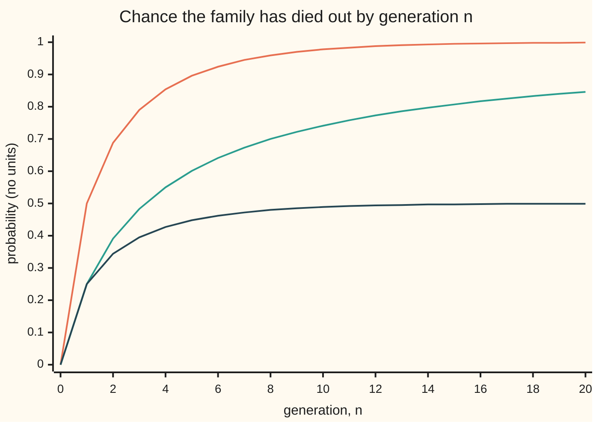
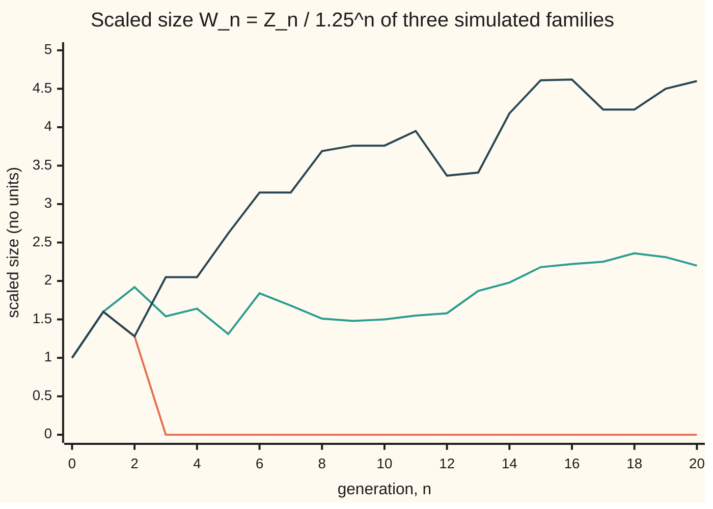

# Branching processes: family trees that die out or explode

[Syllabus](../../../SYLLABUS.md) → [Stochastic processes and calculus](../README.md) → [Martingales](../README.md#s02) → Branching processes

---

## General Overview

In 1873 Francis Galton asked in a London journal why so many old family surnames die out. His question: if each man has a random number of sons, what is the chance that the name survives? Henry Watson set up the right equation in 1875, but took the wrong root of it and concluded that every surname dies out. Picking the right root is the heart of this card. The same question now runs epidemics, nuclear chain reactions and viral posts.

Take one founder. Each person, independently of everyone else, has 0, 1 or 2 children, with chances 1/4, 1/4 and 1/2. On average each person has 1.25 children, so the expected size of each generation grows by a quarter. After 20 generations the expected size is 86.7362 people.

Yet half of all such families die out. The founder is childless with chance 1/4. Later on, a family can still end in any generation in which everyone alive happens to be childless. Of 10,000 simulated families, a share of 0.5017 were gone by generation 20. The exact chance of dying out for ever is 1/2. A family that survives the early generations grows roughly like 1.25 to the power n, times a random size factor that it fixes early.

The machine behind the 1/2 is one function, the family's **offspring generating function** f(s). The chance of dying out is where f's graph first meets the diagonal line y = s. The random size factor comes from a martingale (a fair game: its best forecast of the next value is its current value).

**A family tree in which each person has children independently from one fixed law dies out with probability q, the smallest solution of q = f(q); q = 1 when the average number of children is at most 1, q < 1 when it is above 1, and in the second case the generation size divided by its mean settles to a random limit.**

**What kind of fact this is:** a definition (the Galton-Watson process) and three theorems, all proved on this card in Why it works: the extinction chance is the smallest fixed point, the critical value is an average of 1 child, and the scaled size converges. Two sharper theorems are stated without proof: Kesten-Stigum (1966) on the limit, and Kolmogorov's estimate for the critical case.

### The picture: three laws, three fates



Orange: 0, 1, 2 children with chances 1/2, 1/4, 1/4 (average 0.75): it races to 1. Green: chances 1/4, 1/2, 1/4 (average exactly 1): it creeps to 1, reaching only 0.846 by generation 20. Dark blue: our family, chances 1/4, 1/4, 1/2 (average 1.25): it levels off at 1/2. Exact values, from the iteration in Step 2.

---

## The formula

Notation first, in words.

- $`p_k`$ is the chance that one person has exactly k children. Here $`p_0 = 1/4`$, $`p_1 = 1/4`$, $`p_2 = 1/2`$.
- $`Z_n`$ is the number of people in generation n. The founder is generation 0, so $`Z_0 = 1`$.
- Each of the $`Z_n`$ people has children independently, all from the same law $`p_k`$. Generation n + 1 is the total of their children. This is the **Galton-Watson process**.
- $`m`$ is the average number of children of one person: $`m = \sum_k k\, p_k`$. Here m = 0 × 1/4 + 1 × 1/4 + 2 × 1/2 = 5/4 = 1.25.

The **offspring generating function** is the generating function of the list $`p_0, p_1, p_2, \dots`$ ([Generating functions](../../04-Combinatorics%20and%20graphs/07-Generating%20Functions/01-ordinary-generating-functions.md)). Read as an average, it is $`f(s) = E[s^X]`$, where X is one person's number of children and s is a free number between 0 and 1. It is the moment generating function with $`s`$ in place of $`e^t`$ ([Moment generating functions](../../09-Probability%20and%20statistics/02-Random%20Variables/07-moment-generating-functions.md)).

```math
f(s) = \sum_{k \ge 0} p_k\, s^k = \tfrac14 + \tfrac14 s + \tfrac12 s^2, \qquad q = \min\{\, s \in [0,1] : f(s) = s \,\}
```

**Read it aloud:** f of s is the chance of each number of children times s to that power, added up; the extinction chance q is the smallest s between 0 and 1 that f leaves where it is.

For our family, f(s) = s becomes 2s² − 3s + 1 = 0, which factors as (2s − 1)(s − 1) = 0. The roots are 1/2 and 1. The smallest is q = 1/2.

Two more results complete the card. The first is the threshold:

```math
q = 1 \;\text{ if } m \le 1 \;(\text{and } p_1 < 1), \qquad q < 1 \;\text{ if } m > 1
```

The second is the martingale. Let $`\mathcal F_n`$ be what is known after generation n: the whole tree so far. Then

```math
W_n = \frac{Z_n}{m^n}, \qquad E[W_{n+1} \mid \mathcal F_n] = W_n, \qquad W_n \to W \text{ with probability } 1
```

**Read it aloud:** the generation size divided by its expected size is a fair game, and along almost every family it settles to a limit W.

For our family $`E[W] = 1`$ and $`P(W = 0) = q = 1/2`$. A surviving family has W = 2 on average: it ends up about twice the average size, because the average includes the dead families at size 0.

| Symbol | Plain meaning | In our example | Push it up and the answer… |
| --- | --- | --- | --- |
| $`k`$, $`X`$ | a number of children; one person's random number of children | 0, 1 or 2 | — |
| $`p_k`$ | chance that one person has exactly k children | 1/4, 1/4, 1/2 | more weight on $`p_0`$: q rises |
| $`n`$ | generation number; the founder is generation 0 | 0 to 20 | more time to die out or grow |
| $`Z_n`$ | number of people in generation n | 1 at the start; mean 86.7362 at n = 20 | — |
| $`m`$ | average children per person, $`\sum k p_k`$ | 1.25 | moving weight from $`p_0`$ to $`p_2`$ raises m and can only lower q; above 1, survival is possible |
| $`\sigma^2`$ | variance (average squared spread) of one person's children | 11/16 = 0.6875 | W more spread out |
| $`s`$ | a free number in [0, 1] fed to f | — | — |
| $`f(s)`$, $`f_n(s)`$, $`f'(s)`$ | offspring generating function $`E[s^X]`$; the same for $`Z_n`$, $`E[s^{Z_n}]`$; the slope of f | 1/4 + s/4 + s²/2; f applied n times; 1/4 + s | — |
| $`q`$, $`q_n`$ | chance of dying out for ever; chance of being dead by generation n | 1/2; 0.4994 at n = 20 | — |
| $`\mathcal F_n`$ | what is known after generation n: the tree so far | — | — |
| $`W_n`$, $`W`$, $`D_k`$ | scaled size $`Z_n/m^n`$; its limit; one step $`W_k - W_{k-1}`$ | mean 1 at every n; 0 with chance 1/2 | — |

### When it holds

- **Independence.** Each person's children are independent of everyone else's. If families share one food supply, a bad year hits all branches at once, and q is larger than the formula says.
- **One law for every person and every generation.** The model has no crowding. A real population running out of room stops growing like $`m^n`$; the formula then only describes the early phase.
- **Something must vary.** $`p_1 < 1`$. If every person has exactly one child, $`Z_n = 1`$ for ever and m = 1 gives q = 0, not 1.
- **A finite mean m.** With infinite m the family still dies out with chance q from the fixed-point rule, but $`Z_n/m^n`$ has no meaning.
- **For the limit W to carry real information:** the condition $`E[X \log X] < \infty`$ (Kesten-Stigum). Without it W = 0 on every path, even on families that survive. Any law with at most two children meets it.

---

## Why it works

### Step 0: a family is its founder plus independent copies of itself

The founder has X children. Each child starts a family that is a fresh copy of the whole process, independent of the others. So "the family dies out" means "every one of the X child-families dies out". The chance that all X child lines die is q to the power X; averaging over X gives $`E[q^X]`$, which is f(q). That is why f appears.

### Step 1: the generating function of generation n is f applied n times

Write $`f_n(s) = E[s^{Z_n}]`$. Given $`Z_n = k`$, generation n + 1 is a sum of k independent copies of X. The generating function of a sum of independent pieces is the product of theirs, so

```math
E\big[s^{Z_{n+1}} \mid Z_n = k\big] = f(s)^k, \qquad f_{n+1}(s) = E\big[f(s)^{Z_n}\big] = f_n\big(f(s)\big)
```

Starting from $`f_1 = f`$, this gives $`f_n = f \circ f \circ \dots \circ f`$, n times. Setting s = 0 picks out the constant term, the chance of zero people: $`q_n = P(Z_n = 0) = f_n(0)`$.

The code checks this exactly. It builds the whole law of $`Z_n`$ for n up to 5 by adding up children, family by family, in exact fractions. Each $`P(Z_n = 0)`$ equals the iteration's value. At n = 5 both give 0.447762.

### Step 2: the chance of being dead by generation n climbs to the smallest fixed point

Peel off the first generation instead of the last. The family is dead by generation n + 1 exactly when every child's family is dead within n generations. So $`q_{n+1} = f(q_n)`$, with $`q_0 = 0`$.

The first few steps by hand:

- $`q_1 = f(0) = 1/4`$: the founder is childless.
- $`q_2 = f(1/4) = 1/4 + 1/16 + 1/32 = 11/32 = 0.34375`$.
- $`q_3 = f(11/32) = 809/2048 = 0.39502`$.

The values keep climbing: 0.4268, 0.4478, 0.4622, and so on. Being dead by generation n means being dead by n + 1, so the sequence never falls. It is capped at 1, so it settles at a limit q, and by continuity q = f(q).

Why the smallest root? Let r be any root in [0, 1]. f is increasing, because every $`p_k`$ is non-negative. So if $`q_n \le r`$, then $`q_{n+1} = f(q_n) \le f(r) = r`$. Since $`q_0 = 0 \le r`$, every $`q_n \le r`$, and so q ≤ r. The limit is below every root, so it is the smallest one. The same climbing argument appears for friendship networks in [The giant component](../../09-Probability%20and%20statistics/14-Random%20Graphs%20and%20the%20Probabilistic%20Method/02-the-giant-component.md), and the general fact about iterating a function is in [Fixed points](../../06-Calculus%20and%20analysis/03-What%20Derivatives%20Tell%20You/07-fixed-point-iteration-and-the-contraction-principle.md).

Near q the gap shrinks by a factor f′(q) each generation. Here f′(s) = 1/4 + s, so f′(1/2) = 0.75. The code measures the ratio of gaps at generation 40 and gets 0.7500.

### Step 3: the shape of f decides the threshold at m = 1

Three facts fix f's graph on [0, 1]:

- f(1) = 1, because the chances add up to 1. So s = 1 is always a root.
- f′(1) = m. Differentiate term by term: $`f'(s) = \sum k p_k s^{k-1}`$, and at s = 1 that is the mean.
- f bends upward (it is convex), since every term $`p_k s^k`$ does. Unless every person has at most one child, it bends strictly.

Now compare the curve with the diagonal y = s:

- **m ≤ 1.** The curve reaches (1, 1) no steeper than the diagonal. A curve bending upward that arrives this way lies above the diagonal everywhere to the left. So 1 is the only root, and q = 1: the family dies out for certain.
- **m > 1.** The curve arrives at (1, 1) steeper than the diagonal, so just left of 1 it lies below. At s = 0 it is at $`p_0 \ge 0`$, on or above. So it meets the diagonal somewhere in [0, 1), and q < 1.

For at most two children there is a shortcut. The equation f(s) = s is $`p_2 s^2 + (p_1 - 1)s + p_0 = 0`$, and it always factors as $`(s - 1)(p_2 s - p_0) = 0`$, because $`p_0 + p_1 + p_2 = 1`$. So $`q = \min(1, p_0/p_2)`$. For our family, (1/4)/(1/2) = 1/2.

### Step 4: the scaled size is a fair game

Given the tree up to generation n, each of the $`Z_n`$ people has m children on average. So $`E[Z_{n+1} \mid \mathcal F_n] = m Z_n`$. Divide both sides by $`m^{n+1}`$:

```math
E[W_{n+1} \mid \mathcal F_n] = \frac{m Z_n}{m^{n+1}} = W_n
```

So $`W_n`$ is a martingale ([Martingales](01-martingales.md)). Its average stays at $`W_0 = 1`$, which means $`E[Z_n] = m^n`$. The code confirms $`E[W_n] = 1`$ exactly for n up to 5, and gets 0.9861 ± 0.0147 by simulation at n = 20.

### Step 5: the scaled size settles

$`W_n`$ is never negative, so its average size $`E|W_n|`$ is its average, 1, at every n. A martingale whose average size has a ceiling converges with probability 1 ([Martingale convergence](04-martingale-convergence.md)). So every family's $`W_n`$ settles to a limit W.

When the variance $`\sigma^2`$ is finite, more is true. The martingale's steps are uncorrelated, so the variances of the steps add up. The variance of $`W_n`$ is

```math
\mathrm{Var}(W_n) = \frac{\sigma^2}{m(m-1)}\,\big(1 - m^{-n}\big) \;\longrightarrow\; \frac{\sigma^2}{m(m-1)} = \frac{0.6875}{1.25 \times 0.25} = 2.2
```

The variance stays bounded, so $`W_n`$ converges in mean square too. Then the average survives the limit: $`E[W] = 1`$. A family that dies has W = 0, so $`P(W = 0) \ge q = 1/2`$. In fact $`P(W = 0) = 1/2`$ exactly. The founder's W is 1/m times the sum of the limits of the X child families, so it is 0 exactly when each of theirs is 0. By Step 0's argument, the chance that W = 0 is then a fixed point of f, so it is 1/2 or 1, and E[W] = 1 rules out 1. So $`E[W \mid W > 0] = 1/(1/2) = 2`$. Kesten and Stigum (1966) proved the general version: when $`E[X \log X]`$ is finite, even with infinite variance, W = 0 only on families that die.

<details>
<summary>Detailed proof: the variance of the scaled size</summary>

Write $`D_{k} = W_{k} - W_{k-1}`$. Given $`\mathcal F_{k-1}`$, $`Z_k`$ is a sum of $`Z_{k-1}`$ independent copies of X, so its conditional variance is $`\sigma^2 Z_{k-1}`$. Dividing by $`m^{2k}`$:

$`\displaystyle E\big[D_k^2 \mid \mathcal F_{k-1}\big] = \frac{\sigma^2 Z_{k-1}}{m^{2k}} = \frac{\sigma^2}{m^{k+1}}\, W_{k-1}.`$

Taking averages, with $`E[W_{k-1}] = 1`$, gives $`E[D_k^2] = \sigma^2 m^{-(k+1)}`$. For j < k, $`E[D_j D_k] = E[D_j\, E[D_k \mid \mathcal F_{k-1}]] = 0`$, because $`D_j`$ is known at time k − 1 and the martingale step has forecast 0. So

$`\displaystyle \mathrm{Var}(W_n) = \sum_{k=1}^{n} E[D_k^2] = \sigma^2 \sum_{k=1}^{n} m^{-(k+1)} = \frac{\sigma^2}{m(m-1)}\big(1 - m^{-n}\big).`$

Multiplying by $`m^{2n}`$ gives $`\mathrm{Var}(Z_n) = \sigma^2 m^{n-1}(m^n - 1)/(m - 1)`$, which the code checks exactly against the full law of $`Z_n`$ for n up to 5: 0.6875, 1.933594, 4.095459, 7.741928, 13.775229.

For m > 1, $`\sup_n E[W_n^2] = 1 + \sigma^2/(m(m-1)) < \infty`$. Then for n < k, $`E[(W_k - W_n)^2] = \mathrm{Var}(W_k) - \mathrm{Var}(W_n)`$, which tends to 0 as n grows. So $`W_n`$ is a Cauchy sequence in mean square, its almost-sure limit W is also its mean-square limit, and $`E[W] = \lim E[W_n] = 1`$.

</details>

### Step 6: a second martingale gives q a second way

$`q^{Z_n}`$ is also a martingale. Given $`Z_n = k`$, the forecast of $`q^{Z_{n+1}}`$ is $`f(q)^k = q^k`$, because f(q) = q. So $`E[q^{Z_n}] = q^{Z_0} = q`$ at every n. The code checks this exactly: $`E[(1/2)^{Z_n}] = 1/2`$ for n = 1 to 5.

This martingale is trapped between 0 and 1. On a family that dies, it ends at $`q^0 = 1`$. On a family that survives, $`Z_n`$ grows without bound, and it ends at 0. (A family of k ≥ 1 people is wiped out in one step with chance $`p_0^k > 0`$, so a surviving family cannot keep returning to size k. When $`p_0 = 0`$, q = 0 and there is nothing to prove.) Bounded martingales keep their average in the limit, so q = P(dies out) × 1 + P(survives) × 0. The same argument with $`Z_0 = k`$ founders gives $`q^k`$: three founders all die out with chance 1/8.

### Step 7: the critical case, a fair game that always goes broke

At m = 1 the size $`Z_n`$ is itself a martingale. Its average is 1 in every generation. It is a non-negative whole number, so by Step 5 it settles. A whole number that settles must stop moving. But a living family of k people stays the same size with chance $`P(\text{total children} = k) < 1`$ each generation, so it cannot stay put for ever. The only place to stop is 0.

So the family dies out for certain while its average size stays at 1. The average is held up by rare large families, exactly as for the gambler who plays until broke ([Stopping without a bound](06-uniform-integrability-and-unbounded-stopping.md)). For the law 1/4, 1/2, 1/4 the chance of being alive at generation 100 is 0.0372. Kolmogorov's estimate says that n times this chance tends to 2 divided by the law's variance. This law's variance is 1/2, not our family's 11/16, so the limit is 4; the code gets 3.962 at n = 1000.

### The picture: three families, scaled



Orange: family 1 of the simulation, the first to die; it is gone at generation 3. Green and dark blue: families 4 and 7, the first two alive at generation 20. Each is one sample path. The two survivors hold their early luck: one wanders near 2, the other near 4.5. Their sizes at generation 20 are 2.20 and 4.60 times the mean 86.7362.

---

## Worked numbers, by hand

| Step | Arithmetic | Value |
| --- | --- | --- |
| average children m | 0 × 1/4 + 1 × 1/4 + 2 × 1/2 | 1.25 |
| variance σ² | (0 + 1/4 + 4 × 1/2) − 1.25² = 2.25 − 1.5625 | 0.6875 |
| fixed points | 1/4 + s/4 + s²/2 = s, times 4: 2s² − 3s + 1 = 0 = (2s − 1)(s − 1) | 1/2 and 1 |
| dead by generation 1 | f(0) | 1/4 |
| dead by generation 2 | f(1/4) = 1/4 + 1/16 + 1/32 | 11/32 = 0.34375 |
| dead by generation 3 | f(11/32) = 1/4 + 11/128 + 121/2048 | 809/2048 = 0.39502 |
| shortcut | p₀ / p₂ = (1/4) / (1/2) | **q = 1/2** |
| three founders | (1/2)³ | 1/8 |
| spread of the limit | 0.6875 / (1.25 × 0.25) | Var(W) = 2.2 |
| surviving family's size factor | E[W] / P(survives) = 1 / (1/2) | 2 |

The family dies out with chance 1/2. If it survives, it grows like $`1.25^n`$ times a random factor that averages 2.

### What breaks if you drop a piece

| Mistake | Comes out at | What went wrong |
| --- | --- | --- |
| Read the mean as the fate | E[Z₂₀] = 86.7362, yet 0.4994 of families are dead by generation 20 | the mean averages a huge family with a dead one |
| Take the larger root | q = 1, "sure death" | the iteration from 0 stops at the first root it meets, 1/2 |
| Judge by m alone | same m = 1.25: law 3/8, 0, 5/8 gives q = 0.6000; law 0, 3/4, 1/4 gives q = 0 | q depends on the whole law, through $`p_0`$ and the spread |
| Call m = 1 "stays the same size" | E[Z₁₀₀] = 1, yet only 0.0372 of families are alive at 100 | a fair game that can hit 0 eventually does |

The code prints every number in this table.

---

## Code, from first principles, and it actually runs

The code reaches the extinction chance by four independent roads. The first factors the fixed-point equation as $`(s - 1)(p_2 s - p_0)`$, so q is the smaller of 1 and $`p_0/p_2`$; the `try:` lines test both cases. The second iterates $`q_{n+1} = f(q_n)`$, exactly for five steps and in floating point to 200. The third builds the whole law of $`Z_n`$ for n up to 5 in exact fractions by adding up children, and checks $`P(Z_n = 0)`$, the mean $`m^n`$, the variance formula and both martingales against it. The fourth simulates 10,000 families for 20 generations with a SplitMix64 generator written out, seed 20261123. Each simulated average is asserted within four standard errors of its exact value.

### Python

```python
# Galton-Watson branching -- the check behind the card.  Standard library only.
# Each person has 0, 1 or 2 children with chances 1/4, 1/4, 1/2; Z_n people in
# generation n, Z_0 = 1.  f(s) = 1/4 + s/4 + s^2/2.  Roads: the factorised fixed-
# point equation, the iteration q_n = f(q_{n-1}), the exact law of Z_n by
# convolution, and a seeded SplitMix64 simulation of 10,000 families.
from fractions import Fraction as F
from math import sqrt
LAW = (F(1, 4), F(1, 4), F(1, 2))
m = sum(k * p for k, p in enumerate(LAW))
var = sum(k * k * p for k, p in enumerate(LAW)) - m * m
def f(p, s): return p[0] + p[1] * s + p[2] * s * s
def q_iter(p, n, s=0.0):                 # road 2: P(Z_n = 0) = f(f(...f(0)))
    for _ in range(n): s = f(p, s)
    return s
def q_closed(p):                         # road 1: p2 s^2 + (p1-1) s + p0 = (s-1)(p2 s - p0)
    return min(F(1), p[0] / p[2]) if p[2] else F(1)
q = q_closed(LAW)
assert 2 * q * q - 3 * q + 1 == 0 and f(LAW, q) == q and f(LAW, F(1)) == 1
print(f"offspring law P(0), P(1), P(2) = 1/4 1/4 1/2; mean m = {m} = {float(m)}; variance sigma^2 = {var} = {float(var)}")
print(f"fixed points of f(s) = s: 2s^2 - 3s + 1 = (2s - 1)(s - 1) = 0, roots 1/2 and 1; smallest q = p0/p2 = {q}")
h = [q_iter(LAW, n, F(0)) for n in range(4)]
print(f"by hand: P(Z_1=0) = {h[1]}, P(Z_2=0) = f(1/4) = {h[2]} = {float(h[2]):.5f}, P(Z_3=0) = f(11/32) = {h[3]} = {float(h[3]):.5f}")
dist = {1: F(1)}                         # road 3: the whole law of Z_n
for n in range(1, 6):
    new = {}
    for k, pk in dist.items():           # k parents: children law is LAW convolved k times
        kids = {0: F(1)}
        for _ in range(k):
            nk = {}
            for a, pa in kids.items():
                for c, pc in enumerate(LAW): nk[a + c] = nk.get(a + c, 0) + pa * pc
            kids = nk
        for j, pj in kids.items(): new[j] = new.get(j, 0) + pk * pj
    dist = new
    ez = sum(k * p for k, p in dist.items()); vz = sum(k * k * p for k, p in dist.items()) - ez * ez
    eh = sum(p * F(1, 2) ** k for k, p in dist.items())
    assert dist[0] == q_iter(LAW, n, F(0)) and ez == m ** n and eh == q
    assert vz == var * m ** (n - 1) * (m ** n - 1) / (m - 1)
    print(f"exact law, n={n}: P(Z=0) {float(dist[0]):.6f} = iteration; E[Z] {float(ez):.6f} = m^n; Var(Z) {float(vz):.6f} = formula; E[W] = {ez / m ** n}; E[(1/2)^Z] = {eh}")
qs = [q_iter((0.25, 0.25, 0.5), n) for n in range(201)]
print("q_n = P(dead by generation n), n = 0..10: " + " ".join(f"{x:.4f}" for x in qs[:11]))
ratio = (qs[41] - 0.5) / (qs[40] - 0.5)
assert abs(qs[200] - 0.5) < 1e-12 and abs(ratio - 0.75) < 1e-6
print(f"q_200 = {qs[200]:.12f}; gap ratio (q_41 - q)/(q_40 - q) = {ratio:.4f} = f'(1/2) = 1/4 + 1/2 = 0.75")
print(f"three founders: all three lines die with chance q^3 = {q ** 3}")
for tl in ((F(1, 8), F(3, 8), F(1, 2)), (F(1, 2), F(1, 4), F(1, 4))):   # edit the first law to try another
    tq, ti = q_closed(tl), q_iter(tuple(map(float, tl)), 400)
    assert abs(ti - float(tq)) < 1e-12, "shortcut vs iteration (a law with mean exactly 1 converges too slowly)"
    print(f"try: law {' '.join(map(str, tl))} (mean {float(sum(k * x for k, x in enumerate(tl)))}): q = min(1, p0/p2) = {tq}, iteration {ti:.4f}")
for p in ((F(1, 4), F(1, 4), F(1, 2)), (F(3, 8), F(0), F(5, 8)), (F(0), F(3, 4), F(1, 4))):
    mp, qc, qi = sum(k * x for k, x in enumerate(p)), q_closed(p), q_iter(tuple(map(float, p)), 400)
    assert mp == m and abs(qi - qc) < 1e-12
    print(f"same mean {float(mp)}: law {' '.join(str(x) for x in p)}: q = p0/p2 = {float(qc):.4f}, iteration {qi:.4f}")
laws = {"subcritical 1/2 1/4 1/4 (m 0.75)": (0.5, 0.25, 0.25), "critical 1/4 1/2 1/4 (m 1)": (0.25, 0.5, 0.25),
        "supercritical 1/4 1/4 1/2 (m 1.25)": (0.25, 0.25, 0.5)}
for name, p in laws.items():
    print(f"chart, P(dead by n), n = 0..20, {name}: " + " ".join(f"{q_iter(p, n):.3f}" for n in range(21)))
CL = (0.25, 0.5, 0.25)                   # the critical law: mean mc = 1, variance vc
mc = sum(k * p for k, p in enumerate(CL))
vc = sum(k * k * p for k, p in enumerate(CL)) - mc * mc
crit = [(n, 1 - q_iter(CL, n)) for n in (10, 100, 1000)]
assert abs(crit[-1][0] * crit[-1][1] - 2 / vc) < 0.05 and all(a > b for (_, a), (_, b) in zip(crit, crit[1:]))
print(f"critical, P(alive at n) and n x P (Kolmogorov: tends to 2/variance = 2/{vc} = {2 / vc:.0f}): " + "  ".join(f"n={n} {a:.4f} {n * a:.3f}" for n, a in crit))
sub = [(n, 1 - q_iter((0.5, 0.25, 0.25), n)) for n in (10, 20)]
print("subcritical, P(alive at n) and P / 0.75^n: " + "  ".join(f"n={n} {a:.6f} {a / 0.75 ** n:.4f}" for n, a in sub))
vw = var / (m * (m - 1))
print(f"Var(W) = sigma^2/(m(m-1)) = {float(vw)}; E[W_n^2] rises to 1 + {float(vw)} = {float(1 + vw)}; P(W = 0) = q = {q}, so E[W | W > 0] = {1 / (1 - q)}")
state = 20261123
def u():                                 # SplitMix64, a uniform number in [0, 1)
    global state
    state = (state + 0x9E3779B97F4A7C15) & (2**64 - 1)
    z = state
    z = ((z ^ (z >> 30)) * 0xBF58476D1CE4E5B9) & (2**64 - 1)
    z = ((z ^ (z >> 27)) * 0x94D049BB133111EB) & (2**64 - 1)
    return ((z ^ (z >> 31)) >> 11) * 2.0**-53
N, G, mf = 10000, 20, 1.25
dead = sw = sw2 = sd = salive = 0.0
paths, kept = [], [0, 0]
for fam in range(N):                     # road 4: simulate generation by generation
    z, w = 1, [1.0]
    for g in range(G):
        z = sum(0 if r < 0.25 else 1 if r < 0.5 else 2 for r in (u() for _ in range(z)))
        w.append(z / mf ** (g + 1))
    dead += z == 0; sw += w[G]; sw2 += w[G] ** 2; sd += (w[G] - w[10]) ** 2; salive += w[G] if z else 0
    i = 0 if z else 1
    if kept[i] < (2 if z else 1): kept[i] += 1; paths.append((fam + 1, w))
def show(label, mean, msq, exact):      # msq: the mean of the squares
    se = sqrt((msq - mean * mean) / N)
    assert abs(mean - exact) < 4 * se, label
    print(f"simulated {label}: {mean:.4f} +- {se:.4f} (exact {exact:.4f})")
q20 = qs[G]
show("share dead by generation 20", dead / N, dead / N, q20)
show("mean W_20", sw / N, sw2 / N, 1.0)
vw20, vw10 = float(vw) * (1 - 1 / mf ** 20), float(vw) * (1 - 1 / mf ** 10)
print(f"simulated mean W_20^2: {sw2 / N:.4f} (exact 1 + Var(W_20) = {1 + vw20:.4f}); mean (W_20 - W_10)^2: {sd / N:.4f} (exact {vw20 - vw10:.4f})")
print(f"simulated mean W_20 among the {N - int(dead)} families alive: {salive / (N - dead):.4f} (exact 1/(1 - q_20) = {1 / (1 - q20):.4f})")
assert abs(sd / N - (vw20 - vw10)) < 0.15 and abs(salive / (N - dead) - 1 / (1 - q20)) < 0.1
for fam, w in sorted(paths):
    print(f"path, family {fam}, W_n for n = 0..20: " + " ".join(f"{x:.2f}" for x in w))
print(f"wrong: E[Z_20] = m^20 = {mf ** 20:.4f}, yet P(dead by 20) = {q20:.4f}; wrong: larger root 1 says sure death, true {float(q):.4f}")
print(f"wrong: critical E[Z_100] = mc^100 = {mc ** 100:.4f}, yet P(alive at 100) = {crit[1][1]:.4f}")
print("ALL CHECKS PASS")
```

**Ran 2026-11-23 on macOS, Python 3.14.10, standard library only. All checks passed. Output, pasted from the run:**

```
offspring law P(0), P(1), P(2) = 1/4 1/4 1/2; mean m = 5/4 = 1.25; variance sigma^2 = 11/16 = 0.6875
fixed points of f(s) = s: 2s^2 - 3s + 1 = (2s - 1)(s - 1) = 0, roots 1/2 and 1; smallest q = p0/p2 = 1/2
by hand: P(Z_1=0) = 1/4, P(Z_2=0) = f(1/4) = 11/32 = 0.34375, P(Z_3=0) = f(11/32) = 809/2048 = 0.39502
exact law, n=1: P(Z=0) 0.250000 = iteration; E[Z] 1.250000 = m^n; Var(Z) 0.687500 = formula; E[W] = 1; E[(1/2)^Z] = 1/2
exact law, n=2: P(Z=0) 0.343750 = iteration; E[Z] 1.562500 = m^n; Var(Z) 1.933594 = formula; E[W] = 1; E[(1/2)^Z] = 1/2
exact law, n=3: P(Z=0) 0.395020 = iteration; E[Z] 1.953125 = m^n; Var(Z) 4.095459 = formula; E[W] = 1; E[(1/2)^Z] = 1/2
exact law, n=4: P(Z=0) 0.426775 = iteration; E[Z] 2.441406 = m^n; Var(Z) 7.741928 = formula; E[W] = 1; E[(1/2)^Z] = 1/2
exact law, n=5: P(Z=0) 0.447762 = iteration; E[Z] 3.051758 = m^n; Var(Z) 13.775229 = formula; E[W] = 1; E[(1/2)^Z] = 1/2
q_n = P(dead by generation n), n = 0..10: 0.0000 0.2500 0.3438 0.3950 0.4268 0.4478 0.4622 0.4724 0.4796 0.4849 0.4888
q_200 = 0.500000000000; gap ratio (q_41 - q)/(q_40 - q) = 0.7500 = f'(1/2) = 1/4 + 1/2 = 0.75
three founders: all three lines die with chance q^3 = 1/8
try: law 1/8 3/8 1/2 (mean 1.375): q = min(1, p0/p2) = 1/4, iteration 0.2500
try: law 1/2 1/4 1/4 (mean 0.75): q = min(1, p0/p2) = 1, iteration 1.0000
same mean 1.25: law 1/4 1/4 1/2: q = p0/p2 = 0.5000, iteration 0.5000
same mean 1.25: law 3/8 0 5/8: q = p0/p2 = 0.6000, iteration 0.6000
same mean 1.25: law 0 3/4 1/4: q = p0/p2 = 0.0000, iteration 0.0000
chart, P(dead by n), n = 0..20, subcritical 1/2 1/4 1/4 (m 0.75): 0.000 0.500 0.688 0.790 0.854 0.896 0.924 0.945 0.959 0.970 0.978 0.983 0.988 0.991 0.993 0.995 0.996 0.997 0.998 0.998 0.999
chart, P(dead by n), n = 0..20, critical 1/4 1/2 1/4 (m 1): 0.000 0.250 0.391 0.483 0.550 0.601 0.641 0.673 0.700 0.722 0.741 0.758 0.773 0.786 0.797 0.807 0.817 0.825 0.833 0.840 0.846
chart, P(dead by n), n = 0..20, supercritical 1/4 1/4 1/2 (m 1.25): 0.000 0.250 0.344 0.395 0.427 0.448 0.462 0.472 0.480 0.485 0.489 0.492 0.494 0.495 0.497 0.497 0.498 0.499 0.499 0.499 0.499
critical, P(alive at n) and n x P (Kolmogorov: tends to 2/variance = 2/0.5 = 4): n=10 0.2585 2.585  n=100 0.0372 3.723  n=1000 0.0040 3.962
subcritical, P(alive at n) and P / 0.75^n: n=10 0.022359 0.3970  n=20 0.001224 0.3861
Var(W) = sigma^2/(m(m-1)) = 2.2; E[W_n^2] rises to 1 + 2.2 = 3.2; P(W = 0) = q = 1/2, so E[W | W > 0] = 2
simulated share dead by generation 20: 0.5017 +- 0.0050 (exact 0.4994)
simulated mean W_20: 0.9861 +- 0.0147 (exact 1.0000)
simulated mean W_20^2: 3.1460 (exact 1 + Var(W_20) = 3.1746); mean (W_20 - W_10)^2: 0.2111 (exact 0.2109)
simulated mean W_20 among the 4983 families alive: 1.9790 (exact 1/(1 - q_20) = 1.9976)
path, family 1, W_n for n = 0..20: 1.00 1.60 1.28 0.00 0.00 0.00 0.00 0.00 0.00 0.00 0.00 0.00 0.00 0.00 0.00 0.00 0.00 0.00 0.00 0.00 0.00
path, family 4, W_n for n = 0..20: 1.00 1.60 1.92 1.54 1.64 1.31 1.84 1.68 1.51 1.48 1.50 1.55 1.58 1.87 1.98 2.18 2.22 2.25 2.36 2.31 2.20
path, family 7, W_n for n = 0..20: 1.00 1.60 1.28 2.05 2.05 2.62 3.15 3.15 3.69 3.76 3.76 3.95 3.37 3.41 4.18 4.61 4.62 4.23 4.23 4.50 4.60
wrong: E[Z_20] = m^20 = 86.7362, yet P(dead by 20) = 0.4994; wrong: larger root 1 says sure death, true 0.5000
wrong: critical E[Z_100] = mc^100 = 1.0000, yet P(alive at 100) = 0.0372
ALL CHECKS PASS
```

### Rust

```rust
// Galton-Watson branching -- the check behind the card.  Rust std only.
// Each person has 0, 1 or 2 children with chances 1/4, 1/4, 1/2; Z_n people in
// generation n, Z_0 = 1.  f(s) = 1/4 + s/4 + s^2/2.  Roads: the factorised fixed-
// point equation, the iteration q_n = f(q_{n-1}), the exact law of Z_n by
// convolution, and a seeded SplitMix64 simulation of 10,000 families.
use std::collections::BTreeMap;
#[derive(Clone, Copy, PartialEq, Debug)]
struct Q(i128, i128); // an exact fraction, kept reduced
fn gcd(a: i128, b: i128) -> i128 { if b == 0 { a.abs() } else { gcd(b, a % b) } }
fn q(a: i128, b: i128) -> Q { let g = gcd(a, b).max(1); Q(a / g, b / g) }
fn add(x: Q, y: Q) -> Q { let l = x.1 / gcd(x.1, y.1) * y.1; q(x.0 * (l / x.1) + y.0 * (l / y.1), l) }
fn sub(x: Q, y: Q) -> Q { add(x, Q(-y.0, y.1)) }
fn mul(x: Q, y: Q) -> Q {
    let (g1, g2) = (gcd(x.0, y.1).max(1), gcd(y.0, x.1).max(1));
    q((x.0 / g1) * (y.0 / g2), (x.1 / g2) * (y.1 / g1))
}
fn div(x: Q, y: Q) -> Q { if y.0 < 0 { mul(x, Q(-y.1, -y.0)) } else { mul(x, Q(y.1, y.0)) } }
fn pw(x: Q, n: i32) -> Q { (0..n).fold(Q(1, 1), |a, _| mul(a, x)) }
fn fl(x: Q) -> f64 { x.0 as f64 / x.1 as f64 }
fn st(x: Q) -> String { if x.1 == 1 { format!("{}", x.0) } else { format!("{}/{}", x.0, x.1) } }
fn fq(p: &[Q; 3], s: Q) -> Q { add(add(p[0], mul(p[1], s)), mul(mul(p[2], s), s)) }
fn ff(p: &[f64; 3], s: f64) -> f64 { p[0] + p[1] * s + p[2] * s * s }
fn q_iter_q(p: &[Q; 3], n: usize) -> Q { (0..n).fold(Q(0, 1), |s, _| fq(p, s)) } // road 2, exact
fn q_iter(p: &[f64; 3], n: usize) -> f64 { (0..n).fold(0.0, |s, _| ff(p, s)) }
fn q_closed(p: &[Q; 3]) -> Q { // road 1: p2 s^2 + (p1-1) s + p0 = (s-1)(p2 s - p0)
    if p[2].0 == 0 { return Q(1, 1); }
    let r = div(p[0], p[2]);
    if r.0 >= r.1 { Q(1, 1) } else { r }
}
fn mean_q(p: &[Q; 3]) -> Q { add(p[1], mul(Q(2, 1), p[2])) }
fn fx(xs: &[f64], d: usize) -> String { xs.iter().map(|x| format!("{:.*}", d, x)).collect::<Vec<_>>().join(" ") }
struct Rng(u64);
impl Rng {
    fn u(&mut self) -> f64 { // SplitMix64, a uniform number in [0, 1)
        self.0 = self.0.wrapping_add(0x9E3779B97F4A7C15);
        let mut z = self.0;
        z = (z ^ (z >> 30)).wrapping_mul(0xBF58476D1CE4E5B9);
        z = (z ^ (z >> 27)).wrapping_mul(0x94D049BB133111EB);
        ((z ^ (z >> 31)) >> 11) as f64 * (2.0f64).powi(-53)
    }
}
fn main() {
    let law = [Q(1, 4), Q(1, 4), Q(1, 2)];
    let m = mean_q(&law);
    let var = sub(add(law[1], mul(Q(4, 1), law[2])), mul(m, m));
    let qq = q_closed(&law);
    assert!(add(sub(mul(Q(2, 1), mul(qq, qq)), mul(Q(3, 1), qq)), Q(1, 1)) == Q(0, 1) && fq(&law, qq) == qq && fq(&law, Q(1, 1)) == Q(1, 1));
    println!("offspring law P(0), P(1), P(2) = 1/4 1/4 1/2; mean m = {} = {}; variance sigma^2 = {} = {}", st(m), fl(m), st(var), fl(var));
    println!("fixed points of f(s) = s: 2s^2 - 3s + 1 = (2s - 1)(s - 1) = 0, roots 1/2 and 1; smallest q = p0/p2 = {}", st(qq));
    let h: Vec<Q> = (0..4).map(|n| q_iter_q(&law, n)).collect();
    println!("by hand: P(Z_1=0) = {}, P(Z_2=0) = f(1/4) = {} = {:.5}, P(Z_3=0) = f(11/32) = {} = {:.5}", st(h[1]), st(h[2]), fl(h[2]), st(h[3]), fl(h[3]));
    let mut dist: BTreeMap<i32, Q> = BTreeMap::new(); // road 3: the whole law of Z_n
    dist.insert(1, Q(1, 1));
    for n in 1..6i32 {
        let mut new: BTreeMap<i32, Q> = BTreeMap::new();
        for (&k, &pk) in &dist {
            let mut kids: BTreeMap<i32, Q> = BTreeMap::new();
            kids.insert(0, Q(1, 1));
            for _ in 0..k {
                let mut nk: BTreeMap<i32, Q> = BTreeMap::new();
                for (&a, &pa) in &kids { for c in 0..3 { let e = nk.entry(a + c as i32).or_insert(Q(0, 1)); *e = add(*e, mul(pa, law[c])); } }
                kids = nk;
            }
            for (&j, &pj) in &kids { let e = new.entry(j).or_insert(Q(0, 1)); *e = add(*e, mul(pk, pj)); }
        }
        dist = new;
        let (mut ez, mut ez2, mut eh) = (Q(0, 1), Q(0, 1), Q(0, 1));
        for (&k, &p) in &dist {
            ez = add(ez, mul(Q(k as i128, 1), p));
            ez2 = add(ez2, mul(Q((k * k) as i128, 1), p));
            eh = add(eh, mul(p, pw(Q(1, 2), k)));
        }
        let vz = sub(ez2, mul(ez, ez));
        assert!(dist[&0] == q_iter_q(&law, n as usize) && ez == pw(m, n) && eh == qq);
        assert!(vz == div(mul(mul(var, pw(m, n - 1)), sub(pw(m, n), Q(1, 1))), sub(m, Q(1, 1))));
        println!("exact law, n={}: P(Z=0) {:.6} = iteration; E[Z] {:.6} = m^n; Var(Z) {:.6} = formula; E[W] = {}; E[(1/2)^Z] = {}", n, fl(dist[&0]), fl(ez), fl(vz), st(div(ez, pw(m, n))), st(eh));
    }
    let sup = [0.25, 0.25, 0.5];
    let qs: Vec<f64> = (0..201).map(|n| q_iter(&sup, n)).collect();
    println!("q_n = P(dead by generation n), n = 0..10: {}", fx(&qs[..11], 4));
    let ratio = (qs[41] - 0.5) / (qs[40] - 0.5);
    assert!((qs[200] - 0.5).abs() < 1e-12 && (ratio - 0.75).abs() < 1e-6);
    println!("q_200 = {:.12}; gap ratio (q_41 - q)/(q_40 - q) = {:.4} = f'(1/2) = 1/4 + 1/2 = 0.75", qs[200], ratio);
    println!("three founders: all three lines die with chance q^3 = {}", st(pw(qq, 3)));
    for tl in [[Q(1, 8), Q(3, 8), Q(1, 2)], [Q(1, 2), Q(1, 4), Q(1, 4)]] { // edit the first law to try another
        let (tq, ti) = (q_closed(&tl), q_iter(&[fl(tl[0]), fl(tl[1]), fl(tl[2])], 400));
        assert!((ti - fl(tq)).abs() < 1e-12, "shortcut vs iteration (a law with mean exactly 1 converges too slowly)");
        println!("try: law {} {} {} (mean {}): q = min(1, p0/p2) = {}, iteration {:.4}", st(tl[0]), st(tl[1]), st(tl[2]), fl(mean_q(&tl)), st(tq), ti);
    }
    for p in [[Q(1, 4), Q(1, 4), Q(1, 2)], [Q(3, 8), Q(0, 1), Q(5, 8)], [Q(0, 1), Q(3, 4), Q(1, 4)]] {
        let (mp, qc) = (mean_q(&p), q_closed(&p));
        let qi = (0..400).fold(0.0, |s, _| ff(&[fl(p[0]), fl(p[1]), fl(p[2])], s));
        assert!(mp == m && (qi - fl(qc)).abs() < 1e-12);
        println!("same mean {}: law {} {} {}: q = p0/p2 = {:.4}, iteration {:.4}", fl(mp), st(p[0]), st(p[1]), st(p[2]), fl(qc), qi);
    }
    let laws = [("subcritical 1/2 1/4 1/4 (m 0.75)", [0.5, 0.25, 0.25]), ("critical 1/4 1/2 1/4 (m 1)", [0.25, 0.5, 0.25]),
        ("supercritical 1/4 1/4 1/2 (m 1.25)", [0.25, 0.25, 0.5])];
    for (name, p) in laws.iter() {
        let row: Vec<f64> = (0..21).map(|n| q_iter(p, n)).collect();
        println!("chart, P(dead by n), n = 0..20, {}: {}", name, fx(&row, 3));
    }
    let cl = [0.25, 0.5, 0.25]; // the critical law: mean mc = 1, variance vc
    let mc: f64 = cl.iter().enumerate().map(|(k, p)| k as f64 * p).sum();
    let vc: f64 = cl.iter().enumerate().map(|(k, p)| (k * k) as f64 * p).sum::<f64>() - mc * mc;
    let crit: Vec<(usize, f64)> = [10, 100, 1000].iter().map(|&n| (n, 1.0 - q_iter(&cl, n))).collect();
    assert!((crit[2].0 as f64 * crit[2].1 - 2.0 / vc).abs() < 0.05 && crit[0].1 > crit[1].1 && crit[1].1 > crit[2].1);
    println!("critical, P(alive at n) and n x P (Kolmogorov: tends to 2/variance = 2/{} = {:.0}): {}", vc, 2.0 / vc, crit.iter().map(|&(n, a)| format!("n={} {:.4} {:.3}", n, a, n as f64 * a)).collect::<Vec<_>>().join("  "));
    let sub_: Vec<String> = [10, 20].iter().map(|&n| { let a = 1.0 - q_iter(&[0.5, 0.25, 0.25], n); format!("n={} {:.6} {:.4}", n, a, a / 0.75f64.powi(n as i32)) }).collect();
    println!("subcritical, P(alive at n) and P / 0.75^n: {}", sub_.join("  "));
    let vw = div(var, mul(m, sub(m, Q(1, 1))));
    println!("Var(W) = sigma^2/(m(m-1)) = {}; E[W_n^2] rises to 1 + {} = {}; P(W = 0) = q = {}, so E[W | W > 0] = {}", fl(vw), fl(vw), fl(add(Q(1, 1), vw)), st(qq), st(div(Q(1, 1), sub(Q(1, 1), qq))));
    let mut rng = Rng(20261123);
    let (n_fam, g_max, mf) = (10000usize, 20usize, 1.25f64);
    let (mut dead, mut sw, mut sw2, mut sd, mut salive) = (0.0f64, 0.0f64, 0.0f64, 0.0f64, 0.0f64);
    let (mut paths, mut kept): (Vec<(usize, Vec<f64>)>, [usize; 2]) = (Vec::new(), [0, 0]);
    for fam in 0..n_fam { // road 4: simulate generation by generation
        let (mut z, mut w) = (1u64, vec![1.0f64]);
        for g in 0..g_max {
            let mut nz = 0u64;
            for _ in 0..z { let r = rng.u(); nz += if r < 0.25 { 0 } else if r < 0.5 { 1 } else { 2 }; }
            z = nz;
            w.push(z as f64 / mf.powi(g as i32 + 1));
        }
        let wg = w[g_max];
        if z == 0 { dead += 1.0; }
        sw += wg; sw2 += wg * wg; sd += (wg - w[10]) * (wg - w[10]); salive += if z > 0 { wg } else { 0.0 };
        let i = if z > 0 { 0 } else { 1 };
        if kept[i] < (if z > 0 { 2 } else { 1 }) { kept[i] += 1; paths.push((fam + 1, w)); }
    }
    let nf = n_fam as f64;
    let show = |label: &str, mean: f64, msq: f64, exact: f64| { // msq: the mean of the squares
        let se = ((msq - mean * mean) / nf).sqrt();
        assert!((mean - exact).abs() < 4.0 * se, "{}", label);
        println!("simulated {}: {:.4} +- {:.4} (exact {:.4})", label, mean, se, exact);
    };
    let q20 = qs[g_max];
    show("share dead by generation 20", dead / nf, dead / nf, q20);
    show("mean W_20", sw / nf, sw2 / nf, 1.0);
    let (vw20, vw10) = (fl(vw) * (1.0 - 1.0 / mf.powi(20)), fl(vw) * (1.0 - 1.0 / mf.powi(10)));
    println!("simulated mean W_20^2: {:.4} (exact 1 + Var(W_20) = {:.4}); mean (W_20 - W_10)^2: {:.4} (exact {:.4})", sw2 / nf, 1.0 + vw20, sd / nf, vw20 - vw10);
    println!("simulated mean W_20 among the {} families alive: {:.4} (exact 1/(1 - q_20) = {:.4})", n_fam - dead as usize, salive / (nf - dead), 1.0 / (1.0 - q20));
    assert!((sd / nf - (vw20 - vw10)).abs() < 0.15 && (salive / (nf - dead) - 1.0 / (1.0 - q20)).abs() < 0.1);
    paths.sort_by_key(|p| p.0);
    for (fam, w) in &paths { println!("path, family {}, W_n for n = 0..20: {}", fam, fx(w, 2)); }
    println!("wrong: E[Z_20] = m^20 = {:.4}, yet P(dead by 20) = {:.4}; wrong: larger root 1 says sure death, true {:.4}", mf.powi(20), q20, fl(qq));
    println!("wrong: critical E[Z_100] = mc^100 = {:.4}, yet P(alive at 100) = {:.4}", mc.powi(100), crit[1].1);
    println!("ALL CHECKS PASS");
}
```

**Ran 2026-11-23 on macOS, rustc 1.98.1, no crates. All checks passed. Output, pasted from the run:**

```
offspring law P(0), P(1), P(2) = 1/4 1/4 1/2; mean m = 5/4 = 1.25; variance sigma^2 = 11/16 = 0.6875
fixed points of f(s) = s: 2s^2 - 3s + 1 = (2s - 1)(s - 1) = 0, roots 1/2 and 1; smallest q = p0/p2 = 1/2
by hand: P(Z_1=0) = 1/4, P(Z_2=0) = f(1/4) = 11/32 = 0.34375, P(Z_3=0) = f(11/32) = 809/2048 = 0.39502
exact law, n=1: P(Z=0) 0.250000 = iteration; E[Z] 1.250000 = m^n; Var(Z) 0.687500 = formula; E[W] = 1; E[(1/2)^Z] = 1/2
exact law, n=2: P(Z=0) 0.343750 = iteration; E[Z] 1.562500 = m^n; Var(Z) 1.933594 = formula; E[W] = 1; E[(1/2)^Z] = 1/2
exact law, n=3: P(Z=0) 0.395020 = iteration; E[Z] 1.953125 = m^n; Var(Z) 4.095459 = formula; E[W] = 1; E[(1/2)^Z] = 1/2
exact law, n=4: P(Z=0) 0.426775 = iteration; E[Z] 2.441406 = m^n; Var(Z) 7.741928 = formula; E[W] = 1; E[(1/2)^Z] = 1/2
exact law, n=5: P(Z=0) 0.447762 = iteration; E[Z] 3.051758 = m^n; Var(Z) 13.775229 = formula; E[W] = 1; E[(1/2)^Z] = 1/2
q_n = P(dead by generation n), n = 0..10: 0.0000 0.2500 0.3438 0.3950 0.4268 0.4478 0.4622 0.4724 0.4796 0.4849 0.4888
q_200 = 0.500000000000; gap ratio (q_41 - q)/(q_40 - q) = 0.7500 = f'(1/2) = 1/4 + 1/2 = 0.75
three founders: all three lines die with chance q^3 = 1/8
try: law 1/8 3/8 1/2 (mean 1.375): q = min(1, p0/p2) = 1/4, iteration 0.2500
try: law 1/2 1/4 1/4 (mean 0.75): q = min(1, p0/p2) = 1, iteration 1.0000
same mean 1.25: law 1/4 1/4 1/2: q = p0/p2 = 0.5000, iteration 0.5000
same mean 1.25: law 3/8 0 5/8: q = p0/p2 = 0.6000, iteration 0.6000
same mean 1.25: law 0 3/4 1/4: q = p0/p2 = 0.0000, iteration 0.0000
chart, P(dead by n), n = 0..20, subcritical 1/2 1/4 1/4 (m 0.75): 0.000 0.500 0.688 0.790 0.854 0.896 0.924 0.945 0.959 0.970 0.978 0.983 0.988 0.991 0.993 0.995 0.996 0.997 0.998 0.998 0.999
chart, P(dead by n), n = 0..20, critical 1/4 1/2 1/4 (m 1): 0.000 0.250 0.391 0.483 0.550 0.601 0.641 0.673 0.700 0.722 0.741 0.758 0.773 0.786 0.797 0.807 0.817 0.825 0.833 0.840 0.846
chart, P(dead by n), n = 0..20, supercritical 1/4 1/4 1/2 (m 1.25): 0.000 0.250 0.344 0.395 0.427 0.448 0.462 0.472 0.480 0.485 0.489 0.492 0.494 0.495 0.497 0.497 0.498 0.499 0.499 0.499 0.499
critical, P(alive at n) and n x P (Kolmogorov: tends to 2/variance = 2/0.5 = 4): n=10 0.2585 2.585  n=100 0.0372 3.723  n=1000 0.0040 3.962
subcritical, P(alive at n) and P / 0.75^n: n=10 0.022359 0.3970  n=20 0.001224 0.3861
Var(W) = sigma^2/(m(m-1)) = 2.2; E[W_n^2] rises to 1 + 2.2 = 3.2; P(W = 0) = q = 1/2, so E[W | W > 0] = 2
simulated share dead by generation 20: 0.5017 +- 0.0050 (exact 0.4994)
simulated mean W_20: 0.9861 +- 0.0147 (exact 1.0000)
simulated mean W_20^2: 3.1460 (exact 1 + Var(W_20) = 3.1746); mean (W_20 - W_10)^2: 0.2111 (exact 0.2109)
simulated mean W_20 among the 4983 families alive: 1.9790 (exact 1/(1 - q_20) = 1.9976)
path, family 1, W_n for n = 0..20: 1.00 1.60 1.28 0.00 0.00 0.00 0.00 0.00 0.00 0.00 0.00 0.00 0.00 0.00 0.00 0.00 0.00 0.00 0.00 0.00 0.00
path, family 4, W_n for n = 0..20: 1.00 1.60 1.92 1.54 1.64 1.31 1.84 1.68 1.51 1.48 1.50 1.55 1.58 1.87 1.98 2.18 2.22 2.25 2.36 2.31 2.20
path, family 7, W_n for n = 0..20: 1.00 1.60 1.28 2.05 2.05 2.62 3.15 3.15 3.69 3.76 3.76 3.95 3.37 3.41 4.18 4.61 4.62 4.23 4.23 4.50 4.60
wrong: E[Z_20] = m^20 = 86.7362, yet P(dead by 20) = 0.4994; wrong: larger root 1 says sure death, true 0.5000
wrong: critical E[Z_100] = mc^100 = 1.0000, yet P(alive at 100) = 0.0372
ALL CHECKS PASS
```

The two outputs agree line for line.

### Lean

Lean proves the smallest-root rule, the threshold at m = 1 and the two-child shortcut for any law of children, plus the hand-worked numbers.

- Take any law $`p_k`$ whose chances add up to 1. Then $`q_n`$, f applied n times to 0, tends to q, the smallest s in [0, 1] with f(s) = s.
- Suppose also $`p_1 < 1`$ and the mean m is finite. Then f(s) = s has a solution below 1, so q < 1, exactly when m > 1.
- Suppose each person has 0, 1 or 2 children, with $`p_2 > 0`$. Then the smallest solution of f(s) = s in [0, 1] is $`\min(1, p_0/p_2)`$.
- For our family, m = 5/4, $`\sigma^2`$ = 11/16, and the fixed points are 1/2 and 1.
- The hand values $`q_1 = 1/4`$, $`q_2 = 11/32`$ and $`q_3 = 809/2048`$ come out exactly.
- The shortcut gives q = 1/2 for our family, so three founders all die out with chance 1/8.
- The shortcut also gives q = 1/4, 1 and 3/5 for both `try:` laws and the law 3/8, 0, 5/8.
- With our numbers, Var(W) = 2.2 and a surviving family's size factor averages 2.

The link $`q_n = P(Z_n = 0)`$, the martingale $`W_n`$ and the simulations are left to the Python and Rust checks.

```lean
-- Branching processes: the chance of being dead by generation n climbs to the smallest fixed point of the offspring generating function, a fixed point below 1 exists exactly when the mean number of children is above 1, and with at most two children that point is min(1, p0/p2).
import Mathlib.Topology.Algebra.InfiniteSum.Real
import Mathlib.Topology.Order.MonotoneConvergence
import Mathlib.Order.Bounds.Basic
import Mathlib.Tactic.NormNum
import Mathlib.Tactic.Linarith
import Mathlib.Tactic.LinearCombination
import Mathlib.Analysis.Normed.Group.FunctionSeries
import Mathlib.Topology.Order.IntermediateValue

open Filter Topology

lemma gw_summable (p : ℕ → ℝ) (hp : ∀ k, 0 ≤ p k) (hs : Summable p) {s : ℝ} (h0 : 0 ≤ s)
    (h1 : s ≤ 1) : Summable (fun k : ℕ => p k * s ^ k) :=
  Summable.of_nonneg_of_le (fun k => mul_nonneg (hp k) (pow_nonneg h0 k))
    (fun k => mul_le_of_le_one_right (hp k) (pow_le_one₀ h0 h1)) hs

lemma gw_mono (p : ℕ → ℝ) (hp : ∀ k, 0 ≤ p k) (hs : Summable p) {s t : ℝ} (h0 : 0 ≤ s)
    (hst : s ≤ t) (ht : t ≤ 1) : ∑' k : ℕ, p k * s ^ k ≤ ∑' k : ℕ, p k * t ^ k :=
  (gw_summable p hp hs h0 (hst.trans ht)).tsum_le_tsum
    (fun k => mul_le_mul_of_nonneg_left (pow_le_pow_left₀ h0 hst k) (hp k))
    (gw_summable p hp hs (h0.trans hst) ht)

lemma gw_cont (p : ℕ → ℝ) (hp : ∀ k, 0 ≤ p k) (hs : Summable p) :
    ContinuousOn (fun s : ℝ => ∑' k : ℕ, p k * s ^ k) (Set.Icc 0 1) :=
  continuousOn_tsum (fun k => (continuous_const.mul (continuous_pow k)).continuousOn) hs
    (fun k s hs' => by
      rw [Real.norm_eq_abs, abs_of_nonneg (mul_nonneg (hp k) (pow_nonneg hs'.1 k))]
      exact mul_le_of_le_one_right (hp k) (pow_le_one₀ hs'.1 hs'.2))

lemma gw_one (p : ℕ → ℝ) (hsum : HasSum p 1) : ∑' k : ℕ, p k * (1 : ℝ) ^ k = 1 := by
  simp [hsum.tsum_eq]

lemma gw_zero (p : ℕ → ℝ) : ∑' k : ℕ, p k * (0 : ℝ) ^ k = p 0 := by
  rw [tsum_eq_single 0]
  · simp
  · intro k hk; simp [hk]

lemma gw_one_sub_pow_le {s : ℝ} (h0 : 0 ≤ s) (h1 : s ≤ 1) (k : ℕ) :
    1 - s ^ k ≤ (k : ℝ) * (1 - s) := by
  induction k with
  | zero => simp
  | succ n ih =>
    have := pow_le_one₀ h0 h1 (n := n)
    push_cast
    rw [pow_succ]
    nlinarith

lemma gw_one_sub_pow_lt {s : ℝ} (h0 : 0 ≤ s) (h1 : s < 1) (n : ℕ) :
    1 - s ^ (n + 2) < ((n + 2 : ℕ) : ℝ) * (1 - s) := by
  have h := gw_one_sub_pow_le h0 h1.le (n + 1)
  have hlt : s ^ (n + 1) < 1 := pow_lt_one₀ h0 h1 (by omega)
  have h1s : 0 < 1 - s := by linarith
  have : s ^ (n + 2) = s ^ (n + 1) * s := pow_succ s (n + 1)
  push_cast at h ⊢
  nlinarith

lemma gw_le_one_sub_pow {s : ℝ} (h0 : 0 ≤ s) (h1 : s ≤ 1) (k : ℕ) :
    (k : ℝ) * s ^ k * (1 - s) ≤ 1 - s ^ k := by
  induction k with
  | zero => simp
  | succ n ih =>
    have hle : s ^ (n + 1) ≤ s ^ n := pow_le_pow_of_le_one h0 h1 (by omega)
    have hpos : 0 ≤ s ^ (n + 1) := pow_nonneg h0 _
    have h1s : 0 ≤ 1 - s := by linarith
    have e : s ^ (n + 1) = s ^ n * s := pow_succ s n
    have hn : (0 : ℝ) ≤ n := Nat.cast_nonneg n
    push_cast
    nlinarith [mul_le_mul_of_nonneg_left hle (mul_nonneg hn h1s)]

/-- Extinction is the smallest fixed point. Let `p k` be the chance that one person has
exactly `k` children (`p k ≥ 0`, the chances add up to 1), and let
`f s = ∑ p k s^k` be the offspring generating function. The chance of being dead by
generation `n` is `q_n = f(f(…f(0)))`, `f` applied `n` times to 0. These chances climb to a
limit `q`, and `q` is the smallest `s` in `[0, 1]` with `f s = s`. -/
theorem extinction_prob_eq_smallest_fixed_point
    (p : ℕ → ℝ) (hp : ∀ k, 0 ≤ p k) (hsum : HasSum p 1) :
    ∃ q : ℝ,
      IsLeast {s : ℝ | s ∈ Set.Icc (0 : ℝ) 1 ∧ ∑' k : ℕ, p k * s ^ k = s} q ∧
      Tendsto (fun n : ℕ => (fun s : ℝ => ∑' k : ℕ, p k * s ^ k)^[n] 0) atTop (𝓝 q) := by
  have hs := hsum.summable
  set f := fun s : ℝ => ∑' k : ℕ, p k * s ^ k with hf
  have hf0 : 0 ≤ f 0 := by
    show 0 ≤ ∑' k : ℕ, p k * (0 : ℝ) ^ k
    rw [gw_zero]; exact hp 0
  have hfm : ∀ x y : ℝ, 0 ≤ x → x ≤ y → y ≤ 1 → f x ≤ f y :=
    fun x y hx hxy hy => gw_mono p hp hs hx hxy hy
  have hf1 : f 1 = 1 := gw_one p hsum
  have hI : ∀ n : ℕ, f^[n] 0 ∈ Set.Icc (0 : ℝ) 1 := by
    intro n
    induction n with
    | zero => simp
    | succ n ih =>
      rw [Function.iterate_succ_apply']
      exact ⟨hf0.trans (hfm 0 _ le_rfl ih.1 ih.2), (hfm _ 1 ih.1 ih.2 le_rfl).trans hf1.le⟩
  have hmono : Monotone (fun n : ℕ => f^[n] 0) := by
    refine monotone_nat_of_le_succ ?_
    intro n
    induction n with
    | zero => simpa using hf0
    | succ n ih =>
      rw [Function.iterate_succ_apply', Function.iterate_succ_apply' f (n + 1)]
      exact hfm _ _ (hI n).1 (by simpa [Function.iterate_succ_apply'] using ih) (hI (n + 1)).2
  have hbdd : BddAbove (Set.range (fun n : ℕ => f^[n] 0)) :=
    ⟨1, by rintro _ ⟨n, rfl⟩; exact (hI n).2⟩
  have hT := tendsto_atTop_ciSup hmono hbdd
  set q := ⨆ n : ℕ, f^[n] 0 with hq
  have hq0 : 0 ≤ q := by
    have := le_ciSup hbdd 0
    simpa using this
  have hq1 : q ≤ 1 := ciSup_le fun n => (hI n).2
  have hqI : q ∈ Set.Icc (0 : ℝ) 1 := ⟨hq0, hq1⟩
  have hbelow : ∀ s ∈ Set.Icc (0 : ℝ) 1, f s = s → ∀ n, f^[n] 0 ≤ s := by
    intro s hsI hfs n
    induction n with
    | zero => simpa using hsI.1
    | succ n ih =>
      rw [Function.iterate_succ_apply', ← hfs]
      exact hfm _ _ (hI n).1 ih hsI.2
  have hfix : f q = q := by
    have h1 : Tendsto (fun n : ℕ => f (f^[n] 0)) atTop (𝓝 (f q)) :=
      ((gw_cont p hp hs) q hqI).tendsto.comp
        (tendsto_nhdsWithin_iff.2 ⟨hT, Eventually.of_forall hI⟩)
    have h2 : Tendsto (fun n : ℕ => f (f^[n] 0)) atTop (𝓝 q) := by
      have := hT.comp (tendsto_add_atTop_nat 1)
      refine this.congr ?_
      intro n
      simp [Function.iterate_succ_apply']
    exact tendsto_nhds_unique h1 h2
  refine ⟨q, ⟨⟨hqI, hfix⟩, ?_⟩, hT⟩
  rintro s ⟨hsI, hfs⟩
  exact ciSup_le (hbelow s hsI hfs)

/-- The threshold at an average of one child. With `p 1 < 1` (something must vary) and a
finite mean `m = ∑ k p k`, the offspring generating function has a fixed point in `[0, 1)`,
so the family survives with positive chance, exactly when `m > 1`. When `m ≤ 1` the only
fixed point in `[0, 1]` is 1 and the family dies out for certain. -/
theorem exists_fixed_point_lt_one_iff_one_lt_mean
    (p : ℕ → ℝ) (hp : ∀ k, 0 ≤ p k) (hsum : HasSum p 1) (hp1 : p 1 < 1)
    (hm : Summable (fun k : ℕ => (k : ℝ) * p k)) :
    (∃ s ∈ Set.Ico (0 : ℝ) 1, ∑' k : ℕ, p k * s ^ k = s) ↔ 1 < ∑' k : ℕ, (k : ℝ) * p k := by
  have hs := hsum.summable
  have hdiff : ∀ s : ℝ, 0 ≤ s → s ≤ 1 →
      HasSum (fun k : ℕ => p k * (1 - s ^ k)) (1 - ∑' k : ℕ, p k * s ^ k) := by
    intro s h0 h1
    have := hsum.sub (gw_summable p hp hs h0 h1).hasSum
    convert this using 1
    funext k; ring
  constructor
  · rintro ⟨s, ⟨hs0, hs1⟩, hfs⟩
    have h1s : 0 < 1 - s := by linarith
    by_cases hk : ∃ k, 2 ≤ k ∧ 0 < p k
    · obtain ⟨k, hk2, hpk⟩ := hk
      have hA : HasSum (fun j : ℕ => p j * (1 - s ^ j)) (1 - s) := by
        have := hdiff s hs0 hs1.le
        rwa [hfs] at this
      have hB := hm.hasSum.mul_right (1 - s)
      have hle : (fun j : ℕ => p j * (1 - s ^ j)) ≤ fun j : ℕ => (j : ℝ) * p j * (1 - s) := by
        intro j
        have := mul_le_mul_of_nonneg_left (gw_one_sub_pow_le hs0 hs1.le j) (hp j)
        simp only
        nlinarith
      have hlt : p k * (1 - s ^ k) < (k : ℝ) * p k * (1 - s) := by
        obtain ⟨n, rfl⟩ : ∃ n, k = n + 2 := ⟨k - 2, by omega⟩
        have := mul_lt_mul_of_pos_left (gw_one_sub_pow_lt hs0 hs1 n) hpk
        nlinarith
      have := hasSum_lt hle hlt hA hB
      by_contra hc
      push Not at hc
      nlinarith
    · push Not at hk
      have hz : ∀ k ∉ Finset.range 2, p k = 0 := by
        intro k hk'
        simp only [Finset.mem_range, not_lt] at hk'
        exact le_antisymm (hk k hk') (hp k)
      have e1 : (1 : ℝ) = p 0 + p 1 := by
        rw [← hsum.tsum_eq, tsum_eq_sum hz]
        simp [Finset.sum_range_succ]
      have e2 : ∑' k : ℕ, p k * s ^ k = p 0 + p 1 * s := by
        rw [tsum_eq_sum (s := Finset.range 2)]
        · simp [Finset.sum_range_succ]
        · intro k hk'; simp [hz k hk']
      rw [e2] at hfs
      nlinarith
  · intro hm1
    set m := ∑' k : ℕ, (k : ℝ) * p k with hmdef
    have hT := hm.hasSum.tendsto_sum_nat
    obtain ⟨N, hN⟩ := (hT.eventually (lt_mem_nhds hm1)).exists
    set A := ∑ i ∈ Finset.range N, (i : ℝ) * p i with hAdef
    have hc : Tendsto (fun s : ℝ => s ^ N * A) (𝓝[<] 1) (𝓝 (1 ^ N * A)) :=
      ((continuous_pow N).mul continuous_const).continuousAt.tendsto.mono_left
        nhdsWithin_le_nhds
    rw [one_pow, one_mul] at hc
    obtain ⟨s, hsA, hsI⟩ :=
      ((hc.eventually (lt_mem_nhds hN)).and (Ioo_mem_nhdsLT (show (0 : ℝ) < 1 by norm_num))).exists
    have hs0 : 0 ≤ s := hsI.1.le
    have hs1 : s < 1 := hsI.2
    have h1s : 0 < 1 - s := by linarith
    -- 1 - f s > 1 - s
    have hlow : s ^ N * A * (1 - s) ≤ 1 - ∑' k : ℕ, p k * s ^ k := by
      rw [← (hdiff s hs0 hs1.le).tsum_eq]
      have hsum2 : Summable (fun k : ℕ => p k * (1 - s ^ k)) := (hdiff s hs0 hs1.le).summable
      have hnn : ∀ k, 0 ≤ p k * (1 - s ^ k) := fun k =>
        mul_nonneg (hp k) (by linarith [pow_le_one₀ hs0 hs1.le (n := k)])
      refine le_trans ?_ (hsum2.sum_le_tsum (Finset.range N) (fun k _ => hnn k))
      rw [hAdef, Finset.mul_sum, Finset.sum_mul]
      refine Finset.sum_le_sum ?_
      intro k hk
      simp only [Finset.mem_range] at hk
      have h1 := gw_le_one_sub_pow hs0 hs1.le k
      have h2 : s ^ N ≤ s ^ k := pow_le_pow_of_le_one hs0 hs1.le hk.le
      have hk0 : (0 : ℝ) ≤ k := Nat.cast_nonneg k
      have h3 := mul_le_mul_of_nonneg_left h1 (hp k)
      have h4 : s ^ N * ((k : ℝ) * p k) * (1 - s) ≤ (k : ℝ) * s ^ k * (1 - s) * p k := by
        have := mul_le_mul_of_nonneg_right h2 (mul_nonneg (mul_nonneg hk0 (hp k)) h1s.le)
        nlinarith
      nlinarith
    have hlt : ∑' k : ℕ, p k * s ^ k < s := by nlinarith
    -- intermediate value theorem on [0, s]
    have hcont : ContinuousOn (fun t : ℝ => ∑' k : ℕ, p k * t ^ k - t) (Set.Icc 0 s) :=
      ((gw_cont p hp hs).mono (Set.Icc_subset_Icc le_rfl hs1.le)).sub continuousOn_id
    have hmem : (0 : ℝ) ∈ Set.Icc (∑' k : ℕ, p k * s ^ k - s) (∑' k : ℕ, p k * (0 : ℝ) ^ k - 0) := by
      rw [gw_zero]
      exact ⟨by linarith, by linarith [hp 0]⟩
    obtain ⟨t, ⟨ht0, hts⟩, hteq⟩ := intermediate_value_Icc' hs0 hcont hmem
    exact ⟨t, ⟨ht0, by linarith⟩, by simp only at hteq; linarith⟩

/-- The shortcut for at most two children: with chances `p0, p1, p2` of 0, 1, 2 children
(`p2 > 0`), `f s = s` factors as `(s - 1)(p2 s - p0) = 0`, so the smallest fixed point in
`[0, 1]`, the extinction chance, is `min 1 (p0 / p2)`. -/
theorem smallest_fixed_point_two_children
    (p0 p1 p2 : ℝ) (h0 : 0 ≤ p0) (h1 : 0 ≤ p1) (h2 : 0 < p2) (hs : p0 + p1 + p2 = 1) :
    IsLeast {s : ℝ | s ∈ Set.Icc (0 : ℝ) 1 ∧ p0 + p1 * s + p2 * s ^ 2 = s} (min 1 (p0 / p2)) := by
  have hp1 : p1 = 1 - p0 - p2 := by linarith
  have key : ∀ s : ℝ, p0 + p1 * s + p2 * s ^ 2 - s = (1 - s) * (p0 - p2 * s) := by
    intro s; rw [hp1]; ring
  have hq0 : 0 ≤ p0 / p2 := div_nonneg h0 h2.le
  refine ⟨⟨⟨le_min zero_le_one hq0, min_le_left _ _⟩, ?_⟩, ?_⟩
  · rcases min_choice 1 (p0 / p2) with h | h <;> rw [h]
    · linear_combination hs
    · have hx : p2 * (p0 / p2) = p0 := mul_div_cancel₀ p0 h2.ne'
      linear_combination key (p0 / p2) - (1 - p0 / p2) * hx
  · rintro s ⟨⟨hs0, hs1⟩, hfs⟩
    have := key s
    have hz : (1 - s) * (p0 - p2 * s) = 0 := by linarith
    rcases mul_eq_zero.1 hz with h | h
    · exact (min_le_left _ _).trans (by linarith)
    · refine (min_le_right _ _).trans ?_
      rw [div_le_iff₀ h2]; linarith

-- Our family: chances 1/4, 1/4, 1/2 of 0, 1, 2 children; mean m = 5/4 and variance 11/16.
example : (0 : ℚ) * (1/4) + 1 * (1/4) + 2 * (1/2) = 5/4 := by norm_num
example : ((0 : ℚ) * (1/4) + 1 * (1/4) + 4 * (1/2)) - (5/4) ^ 2 = 11/16 := by norm_num

-- f(s) = s times 4 is 2s^2 - 3s + 1 = (2s - 1)(s - 1): the fixed points 1/2 and 1.
example : ∀ s : ℚ, 4 * ((1/4) + (1/4) * s + (1/2) * s ^ 2 - s) = (2 * s - 1) * (s - 1) := by
  intro s; ring
example : (1/4 : ℚ) + (1/4) * (1/2) + (1/2) * (1/2) ^ 2 = 1/2 := by norm_num
example : (1/4 : ℚ) + (1/4) * 1 + (1/2) * 1 ^ 2 = 1 := by norm_num

-- Dead by generation 1, 2, 3: f(0) = 1/4, f(1/4) = 11/32, f(11/32) = 809/2048.
example : (1/4 : ℚ) + (1/4) * 0 + (1/2) * 0 ^ 2 = 1/4 := by norm_num
example : (1/4 : ℚ) + (1/4) * (1/4) + (1/2) * (1/4) ^ 2 = 11/32 := by norm_num
example : (1/4 : ℚ) + (1/4) * (11/32) + (1/2) * (11/32) ^ 2 = 809/2048 := by norm_num

-- The shortcut: q = min(1, p0/p2) = (1/4)/(1/2) = 1/2; three founders all die with chance 1/8.
example : min (1 : ℚ) ((1/4) / (1/2)) = 1/2 := by norm_num
example : (1/2 : ℚ) ^ 3 = 1/8 := by norm_num

-- Other laws: 1/8, 3/8, 1/2 gives q = 1/4; 1/2, 1/4, 1/4 gives q = 1; 3/8, 0, 5/8 gives 3/5.
example : min (1 : ℚ) ((1/8) / (1/2)) = 1/4 := by norm_num
example : min (1 : ℚ) ((1/2) / (1/4)) = 1 := by norm_num
example : min (1 : ℚ) ((3/8) / (5/8)) = 3/5 := by norm_num

-- Spread of the limit: Var(W) = sigma^2 / (m (m - 1)) = (11/16) / ((5/4)(1/4)) = 11/5 = 2.2,
-- and a surviving family's size factor averages E[W] / P(survives) = 1 / (1/2) = 2.
example : (11/16 : ℚ) / ((5/4) * (5/4 - 1)) = 11/5 := by norm_num
example : (1 : ℚ) / (1 - 1/2) = 2 := by norm_num

#print axioms extinction_prob_eq_smallest_fixed_point
#print axioms exists_fixed_point_lt_one_iff_one_lt_mean
#print axioms smallest_fixed_point_two_children
#print axioms gw_summable
#print axioms gw_mono
#print axioms gw_cont
#print axioms gw_one
#print axioms gw_zero
#print axioms gw_one_sub_pow_le
#print axioms gw_one_sub_pow_lt
#print axioms gw_le_one_sub_pow
```

**Checked 2026-11-23 on macOS, Lean 4.36.0-rc2, Mathlib v4.36.0-rc2. Every proof is complete and uses only Lean's standard axioms. Output, pasted from the run:**

```
'extinction_prob_eq_smallest_fixed_point' depends on axioms: [propext, Classical.choice, Quot.sound]
'exists_fixed_point_lt_one_iff_one_lt_mean' depends on axioms: [propext, Classical.choice, Quot.sound]
'smallest_fixed_point_two_children' depends on axioms: [propext, Classical.choice, Quot.sound]
'gw_summable' depends on axioms: [propext, Classical.choice, Quot.sound]
'gw_mono' depends on axioms: [propext, Classical.choice, Quot.sound]
'gw_cont' depends on axioms: [propext, Classical.choice, Quot.sound]
'gw_one' depends on axioms: [propext, Classical.choice, Quot.sound]
'gw_zero' depends on axioms: [propext, Classical.choice, Quot.sound]
'gw_one_sub_pow_le' depends on axioms: [propext, Classical.choice, Quot.sound]
'gw_one_sub_pow_lt' depends on axioms: [propext, Classical.choice, Quot.sound]
'gw_le_one_sub_pow' depends on axioms: [propext, Classical.choice, Quot.sound]
```

> [!TIP]
> **Try changing**
> - **Guess first:** what happens to q if $`p_0`$ drops to 1/8 and $`p_1`$ rises to 3/8? The first `try:` line runs this law. By the shortcut, q = (1/8)/(1/2) = 1/4: half the childlessness halves the extinction chance, and the iteration agrees. Edit the first law in the `try:` loop to test another; the second line shows a law with mean 0.75, where the shortcut gives q = 1.
> - **Guess first:** does a law with mean exactly 1 survive? Use the critical law 1/4, 1/2, 1/4. The chance of being alive is 0.2585 at generation 10, 0.0372 at 100 and 0.0040 at 1000: always dying, never quickly.
> - **Guess first:** with three founders instead of one, is extinction three times rarer? No: each line dies with chance 1/2, independently, so all three die with chance $`(1/2)^3`$ = 1/8, printed as `three founders`.
> - **Guess first:** can a family averaging 1.25 children be safe from extinction? Yes: with chances 0, 3/4, 1/4 nobody is childless, and the `same mean` line prints q = 0.0000.

---

## The usual mistake

> [!warning]
> **"The average number of children is above 1, so the family grows."** Our family averages 1.25 children per person and its expected size at generation 20 is 86.7362. Yet half of all such families die out. The average mixes families of hundreds with families of zero. Whether a family survives is decided by the whole law through f, not by m alone; m only says whether survival is possible at all.
>
> - **Taking q = 1 because 1 solves q = f(q).** s = 1 is always a root. The extinction chance is the smallest root, 1/2 here, because the chance of being dead by generation n climbs from 0 and stops at the first root.
> - **Thinking m = 1 keeps the family steady.** The average size stays at 1, but the family dies with certainty: only 0.0372 of families are alive at generation 100.
> - **Thinking the limit W is a fixed number.** W is random. It is 0 on half the families, and on survivors it averages 2 with variance large enough that one survivor can be twice the size of another (2.20 against 4.60 in the picture).
> - **Using the mean to predict a single family.** $`E[Z_n] = m^n`$ is a statement about an average over families. One family's size is $`W m^n`$, and W varies.

---

## Where you meet it in real life

- **Epidemics.** The basic reproduction number R₀ is m: the average number of people one case infects early on. An outbreak seeded by one case can fizzle out even when R₀ > 1. Its fizzle chance is the smallest root of q = f(q), where f comes from the spread of infections per case, not just their average.
- **Nuclear chain reactions.** Each fission releases neutrons that can cause more fissions. Engineers call the mean number of new fissions per fission the multiplication factor k. A reactor runs at k = 1, the critical case; a bomb needs k > 1.
- **New mutations.** A new gene variant starts in one individual. Even if it gives an advantage, its line usually dies out by bad luck in the first generations. The survival chance 1 − q is small, roughly twice the advantage for a small advantage.
- **Surnames and family lines.** Galton's original question. In an isolated population many names vanish, while a few founders end up with most of the descendants.
- **Networks.** Exploring a random network friend by friend is a branching process while few people have been reached. This is how [The giant component](../../09-Probability%20and%20statistics/14-Random%20Graphs%20and%20the%20Probabilistic%20Method/02-the-giant-component.md) appears at one friend per person.

> **Say it back**
> A Galton-Watson process is a family tree where each person has children independently from one fixed law. The chance of being dead by generation n follows $`q_{n+1} = f(q_n)`$ from 0, so it climbs to the smallest solution of q = f(q). Because f is curved upward and has slope m at 1, that solution is 1 when m ≤ 1 and below 1 when m > 1. The generation size divided by $`m^n`$ is a non-negative martingale, so it settles to a random limit W. For 0, 1 or 2 children with chances 1/4, 1/4, 1/2, the family dies out with chance 1/2, and survivors grow like $`1.25^n`$ times a factor that averages 2.

---

## What this builds on

- [Martingales](01-martingales.md): the fair-game property that the scaled size $`Z_n/m^n`$ and $`q^{Z_n}`$ both have.
- [Martingale convergence](04-martingale-convergence.md): a martingale with a ceiling on its average size settles, which makes $`W_n`$ converge.
- [The giant component](../../09-Probability%20and%20statistics/14-Random%20Graphs%20and%20the%20Probabilistic%20Method/02-the-giant-component.md): the same smallest-root argument for Poisson offspring, where it decides the size of the giant.
- [Moment generating functions](../../09-Probability%20and%20statistics/02-Random%20Variables/07-moment-generating-functions.md): the product rule for sums of independent variables, used here with s in place of $`e^t`$.
- [Generating functions](../../04-Combinatorics%20and%20graphs/07-Generating%20Functions/01-ordinary-generating-functions.md): a list of chances hung on powers of s, so that a sum of independent counts becomes a product.

## Where this goes next

- [Epidemics on a network](../../14-Applied%20and%20computational/07-Network%20Science%20and%20Spectral%20Graphs/05-epidemics-on-networks.md): the branching-process threshold applied to infections spreading over a network, where people with many contacts change the average.
- [Percolation](../../25-Frontier/05-Analysis%20and%20Dynamics/06-dying-percolation-and-critical-phenomena.md): the same switch at a critical value on grids, where the family-tree picture breaks because branches meet again.
- [The stochastic block model](../../14-Applied%20and%20computational/07-Network%20Science%20and%20Spectral%20Graphs/10-stochastic-block-model-and-detectability.md): planted groups, and the point below which no method can find them.

This card treats one type of individual and a law that never changes; what happens when there are several types, or when the law depends on how crowded the population is, is the question that multi-type branching processes and population models with crowding take up.

---

## Sources

Verified 2026-11-23: every link below resolves to the publisher's page or to the DOI record.

- Watson, H. W., and Francis Galton. "On the Probability of the Extinction of Families." *Journal of the Anthropological Institute of Great Britain and Ireland* 4 (1875): 138–144. [DOI](https://doi.org/10.2307/2841222). The original question and the generating-function method.
- Williams, David. *Probability with Martingales*. Cambridge University Press, 1991. Chapter 0, "A branching-process example". [DOI](https://doi.org/10.1017/CBO9780511813658). The smallest-fixed-point proof and $`Z_n/m^n`$ as a martingale that converges.
- Athreya, K. B., and P. E. Ney. *Branching Processes*. Springer, 1972. Chapter I. [DOI](https://doi.org/10.1007/978-3-642-65371-1). The standard reference: extinction, the critical case and the limit W.
- Durrett, Rick. *Probability: Theory and Examples*, 5th ed. Cambridge University Press, 2019. Section 4.3, "Examples". [DOI](https://doi.org/10.1017/9781108591034). The branching process as a worked martingale example.
- Kesten, H., and B. P. Stigum. "A Limit Theorem for Multidimensional Galton-Watson Processes." *Annals of Mathematical Statistics* 37 (1966): 1211–1223. [DOI](https://doi.org/10.1214/aoms/1177699266). The condition $`E[X \log X] < \infty`$ for W to be positive on surviving families.
