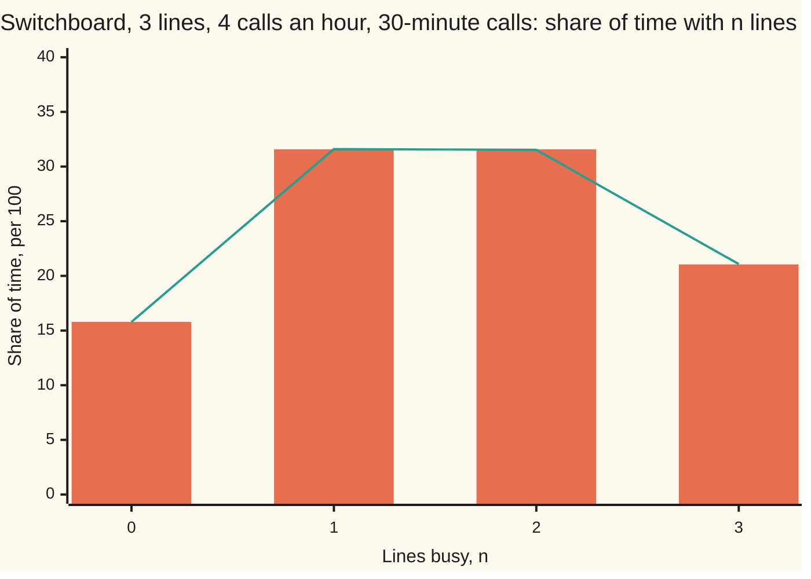
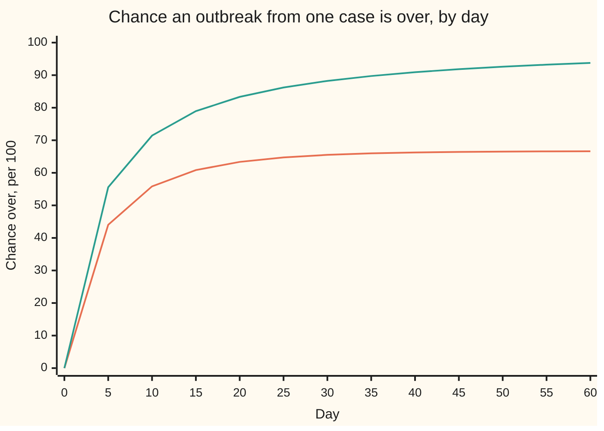

# Birth-and-death processes: populations and queues that move one step at a time

[Syllabus](../../../SYLLABUS.md) → [Stochastic processes and calculus](../README.md) → [Poisson and Jump Processes](../README.md#s04) → Birth-and-death processes

---

## General Overview

A small office switchboard has 3 outside lines and no waiting room. Calls arrive at random, 4 an hour on average. A call lasts 30 minutes on average. A caller who finds all 3 lines busy hears a busy tone and is lost. The owner wants one number: what share of callers are turned away?

The answer is 4/19, about **21 percent**. That is 0.84 lost calls an hour. On average 1.58 of the 3 lines are in use.

The number of busy lines only moves by one: a new call adds a line, a finished call frees one. A chain that moves one step up or down at random times is a **birth-and-death process**, the term used from here on. "Birth" is a step up and "death" a step down, whatever is counted.

The same shape covers a population of animals, cells or infected people. This card finds the long-run law of any birth-and-death chain from one product and says when that law exists. Then it answers two questions that only populations raise. Does an outbreak die out? Can a population reach infinity in finite time?

**A birth-and-death chain balances each up-step against the down-step that undoes it, so its long-run chances follow products of birth rates over death rates and exist exactly when those products have a finite total; a population with per-member rates dies out for sure unless births are faster; and births that speed up fast enough reach infinity in finite time.**

**What kind of fact this is:** a definition (the birth-and-death rate matrix) and a model (exponential call lengths, or members acting on their own), with theorems about it, proved on this card in Why it works. Two exact formulas are checked by the code: the chance an outbreak is over by a given day, from Karlin and Taylor, and the law of the explosion time, derived in the fold.

### The picture: how many lines are busy



Bars: the exact long-run shares 3/19, 6/19, 6/19 and 4/19, per 100. Line: what callers saw in 100,000 simulated hours (SplitMix64 generator, seed 20261123).

---

## The formula

Notation first, in words. $`X_t`$ is the count at time $`t`$: busy lines, or people in a population. Time is in hours for the switchboard and in days for the outbreak below. The chain is a continuous-time Markov chain with rate matrix $`G`$, also called its generator ([Continuous-time chains](05-continuous-time-markov-chains-and-queues.md)). Its entry $`g_{ij}`$ is the rate of jumping from state $`i`$ to state $`j`$.

In a birth-and-death chain the only jumps are one step up or one step down. From state $`n`$ the chain steps up at the **birth rate** $`\lambda_n`$ and down at the **death rate** $`\mu_n`$, with $`\mu_0 = 0`$. So the rate matrix has three non-zero bands:

```math
g_{n,n+1} = \lambda_n, \qquad g_{n,n-1} = \mu_n, \qquad g_{nn} = -(\lambda_n + \mu_n), \qquad \text{every other } g_{ij} = 0.
```

**Read it aloud:** up at the birth rate, down at the death rate, and minus the total rate of leaving on the diagonal.

**The long-run law.** Multiply the up-rate over the down-rate along the path from 0 to $`n`$:

```math
\theta_0 = 1, \qquad \theta_n = \frac{\lambda_0\,\lambda_1 \cdots \lambda_{n-1}}{\mu_1\,\mu_2 \cdots \mu_n}, \qquad S = \sum_{n \ge 0} \theta_n, \qquad \pi_n = \frac{\theta_n}{S} \quad \text{when } S < \infty.
```

**Read it aloud:** the long-run chance of state n is its path product divided by the total of all path products; when that total is endless there is no long-run law.

**The switchboard: Erlang's loss formula.** Calls arrive at $`\lambda`$ = 4 an hour whatever the state, so $`\lambda_n = \lambda`$ for $`n < c`$, with $`c`$ = 3 lines. Each busy line frees up at $`\mu`$ = 2 an hour, so with $`n`$ lines busy the death rate is $`\mu_n = n\,\mu`$. Write $`a = \lambda/\mu`$ = 2, the **offered load**: the average number of lines the calls would fill if no call were lost. Then $`\theta_n = a^n/n!`$, and the chance all lines are busy is

```math
B(c) = \frac{a^c / c!}{\sum_{k=0}^{c} a^k / k!} = \frac{4/3}{19/3} = \frac{4}{19} = 0.2105.
```

**Read it aloud:** the loss chance is the last path product over the total of all of them.

Calls arrive at a rate that ignores the state, so callers see the time shares ("Poisson arrivals see time averages"). So $`B(c)`$ is both the share of time all lines are busy and the share of callers lost.

**Linear populations.** Each member gives birth at rate $`b`$ and dies at rate $`d`$, independently, so $`\lambda_n = n\,b`$ and $`\mu_n = n\,d`$. State 0 is absorbing: once empty, the chain stays empty. From $`i`$ members the chance of dying out is

```math
P(\text{extinct}) = \left(\frac{d}{b}\right)^{i} \ \text{ if } b > d, \qquad P(\text{extinct}) = 1 \ \text{ if } b \le d.
```

**Read it aloud:** if births outpace deaths, the chance of dying out is the death-to-birth ratio, once for each starting member; otherwise it is certain.

**Explosion.** A pure birth chain has $`\mu_n = 0`$ for every $`n`$. Let $`T`$ be the time it takes to pass every finite count. Then

```math
\sum_{n} \frac{1}{\lambda_n} < \infty \ \Rightarrow\ T < \infty \text{ with chance 1}, \qquad \sum_{n} \frac{1}{\lambda_n} = \infty \ \Rightarrow\ T = \infty \text{ with chance 1}.
```

**Read it aloud:** if the average waits for each birth add to a finite time, the count reaches infinity by then; if they add to forever, it never does.

| Symbol | Plain meaning | In our example | Push it up and the answer… |
| --- | --- | --- | --- |
| $`X_t`$, $`t`$, $`n`$, $`k`$ | the count at time $`t`$; $`n`$ and $`k`$ are counts | busy lines, 0 to 3 | — |
| $`G`$, $`g_{ij}`$ | rate matrix; rate of jumping from $`i`$ to $`j`$ | switchboard rows below | faster jumps, faster settling |
| $`\lambda_n`$ | birth rate in state $`n`$: rate of stepping up | 4 an hour for $`n`$ < 3, 0 at 3 | more weight on high states |
| $`\mu_n`$ | death rate in state $`n`$: rate of stepping down | $`2n`$ an hour | more weight on low states |
| $`\theta_n`$, $`S`$ | path product, births over deaths from 0 to $`n`$; the total of all path products | 1, 2, 2, 4/3; 19/3 | endless total: no long-run law |
| $`\pi_n`$, $`f_m`$ | stationary distribution: long-run share of time in $`n`$; in the proof, the net flow across the cut above $`m`$ | 3/19, 6/19, 6/19, 4/19; every $`f_m`$ = 0 | — |
| $`\lambda`$, $`\mu`$, $`a`$ | call rate; rate one call ends; offered load $`\lambda/\mu`$, counted in lines | 4 an hour; 2 an hour; 2 | more calls lost |
| $`c`$, $`B(c)`$, $`E_c`$, $`t_c`$ | number of lines; chance all are busy, which is the loss chance; the running total $`\sum_{k \le c} a^k/k!`$; its last term $`a^c/c!`$ | 3; 0.2105; 19/3; 4/3 | more lines, fewer losses |
| $`r`$, $`L_q`$ | with a waiting room: load per line $`\lambda/(c\mu)`$; mean number waiting | 2/3; 8/9 | the queue $`L_q`$ grows like $`1/(1-r)`$ |
| $`b`$, $`d`$, $`i`$, $`P_0(t)`$, $`x`$ | birth and death rate per member; members at the start; chance of extinction by time $`t`$; chance one family dies out | 0.3 and 0.2 a day; 1 case; 0.5584 by day 10; 2/3 | larger $`b`$: more outbreaks survive |
| $`p`$, $`q`$, $`L`$, $`A_L`$ | between events: chance of a birth, chance of a death; a target height; the event of hitting 0 before $`L`$ | $`b/(b+d)`$, $`d/(b+d)`$ | — |
| $`T`$, $`H_n`$, $`s`$, $`E[\cdot]`$ | time to pass every count (explosion time); the stay at $`n`$; in the proof, a number $`s \ge 0`$; the mean of what is inside | mean 1.6449 hours for births at $`n^2`$ an hour | — |

### The picture: the switchboard chain


Arrows right are new calls; arrows left are calls ending. With 2 lines busy either call may end, so the down-rate is 4 an hour; with 3 busy it is 6. At 3 busy a new call is lost, so no arrow leaves to the right. The rate matrix, rows and columns 0 to 3 busy, is `[[-4, 4, 0, 0], [2, -6, 4, 0], [0, 4, -8, 4], [0, 0, 6, -6]]`.

### When it holds

- **Memoryless gaps between arrivals.** Calls must arrive as a [Poisson process](01-poisson-process.md). Calls that come in bursts are lost more often.
- **Call lengths.** The chain needs exponential call lengths to be Markov. Erlang's loss formula itself is known to survive any call-length law with the same mean (a result called insensitivity, not proved here). The code runs fixed 30-minute calls and gets a lost share of 0.2114 ± 0.0006, matching 0.2105.
- **Lost callers do not try again.** Callers who redial make the arrival rate depend on the state, and $`\lambda_n = \lambda`$ fails.
- **A finite total, for the long-run law.** If $`S`$ is endless the chain never settles: for example a waiting room with $`\lambda \ge c\,\mu`$ = 6 calls an hour.
- **Members act on their own, for populations.** The extinction formula needs independent members with fixed rates. Crowding breaks it.

---

## Why it works

### Step 0: the chain cannot jump over a gap

Draw a cut between state $`n`$ and state $`n + 1`$. The chain crosses it upward only from $`n`$, by a birth, and downward only from $`n + 1`$, by a death. Up-crossings and down-crossings must alternate, so in the long run they happen equally often. That one fact gives the whole long-run law.

### Step 1: detailed balance and the product law

The long-run rate of up-crossings is $`\pi_n\,\lambda_n`$: the share of time in $`n`$ times the rate of stepping up from there. The rate of down-crossings is $`\pi_{n+1}\,\mu_{n+1}`$. Setting them equal at every cut is **detailed balance**, the version of [Stationary distributions](../03-Markov%20Chains/04-stationary-distributions.md) in which each step is matched by its reverse:

```math
\pi_n\,\lambda_n = \pi_{n+1}\,\mu_{n+1}, \quad \text{so} \quad \pi_{n+1} = \pi_n\,\frac{\lambda_n}{\mu_{n+1}} \quad \text{and} \quad \pi_n = \pi_0\,\theta_n.
```

Detailed balance gives "rate out equals rate in" at each state, $`\pi G = 0`$: add the cuts on either side of $`n`$. Going back, adding the equations of $`\pi G = 0`$ for the states $`0, 1, \dots, n`$ cancels every flow inside that block and leaves the cut equation at $`n`$. So on a line, $`\pi G = 0`$ and detailed balance are the same equations. A general chain lacks this property.

For the switchboard: $`\theta_1 = 4/2 = 2`$, $`\theta_2 = 2 \times 4/4 = 2`$, $`\theta_3 = 2 \times 4/6 = 4/3`$. The total is 19/3, so $`\pi`$ = (3/19, 6/19, 6/19, 4/19).

### Step 2: when a long-run law exists

The shares must add to 1, so $`\pi_0\,S = 1`$. If $`S`$ is finite, $`\pi_0 = 1/S`$ and the law is $`\theta_n/S`$. If $`S`$ is endless, the only solution is $`\pi_0 = 0`$ and then every $`\pi_n = 0`$: no stationary distribution exists.

The precise statement: take a chain whose states all reach each other (every $`\lambda_n > 0`$ and every $`\mu_n > 0`$ for $`n \ge 1`$) and whose birth rates stay below some ceiling. Then a stationary distribution exists exactly when $`S < \infty`$, and it is $`\theta_n/S`$. The ceiling on births rules out explosion: births come at most at the ceiling rate, so only finitely many come in finite time. It is used to connect $`\pi G = 0`$ with "starting from $`\pi`$ keeps $`\pi`$", which is stated here from Norris, Section 3.5.

**M/M/3: the same lines with a waiting room.** Suppose callers who find 3 lines busy wait on hold instead of being lost. Now $`\lambda_n = 4`$ in every state and $`\mu_n = 2\min(n, 3)`$. The first path products are again 1, 2, 2, 4/3. After that each one is the last times $`r = \lambda/(3\mu) = 2/3`$. So

```math
S = 1 + 2 + 2 + \frac{4}{3}\left(1 + r + r^2 + \cdots\right) = 5 + \frac{4/3}{1 - r} = 9.
```

The law exists because $`r < 1`$: the 3 lines clear 6 calls an hour, more than the 4 that arrive. A caller waits with chance $`\pi_3 + \pi_4 + \dots = 4/9`$, the **Erlang C** formula. The mean number on hold is $`L_q = 8/9`$. M/M/1, on [Continuous-time chains](05-continuous-time-markov-chains-and-queues.md), is the one-line case.

### Step 3: Erlang's recursion

Adding one line changes the total in a simple way. Write $`E_c = \sum_{k \le c} a^k/k!`$, so $`B(c) = (a^c/c!)/E_c`$. Then $`E_c = E_{c-1} + a^c/c!`$. Dividing through gives

```math
B(c) = \frac{a\,B(c-1)}{c + a\,B(c-1)}, \qquad B(0) = 1.
```

With $`a`$ = 2: $`B(1) = 2/3`$, $`B(2) = (4/3)/(10/3) = 0.4`$, $`B(3) = 0.8/3.8 = 4/19`$. The recursion is stable and needs no factorials, so planners use it to size line groups.

### Step 4: extinction is gambler's ruin

Look only at the steps of a linear population, ignoring the times between them. From $`n \ge 1`$ members the next event is a birth with chance $`n\,b / (n\,b + n\,d) = b/(b + d)`$. The count $`n`$ cancels. So between events, the count is a simple random walk: up with chance $`p = b/(b+d)`$, down with chance $`q = d/(b+d)`$, the same at every level.

That is [Gambler's ruin](../01-Random%20Walks%20and%20Filtrations/04-gamblers-ruin.md) with the floor at 0 and a target $`L`$ as high as we like. Its ratio $`q/p`$ is $`d/b`$. The chance of hitting 0 before $`L`$, starting from $`i`$, is

```math
\frac{(d/b)^{i} - (d/b)^{L}}{1 - (d/b)^{L}} \ \longrightarrow\ \left(\frac{d}{b}\right)^{i} \ \text{ as } L \to \infty, \text{ when } d < b.
```

Every path that dies out does so before reaching some finite height, so the chance of dying out at all is the limit. When $`b = d`$ the chance of hitting 0 first is $`1 - i/L`$, which tends to 1. When $`d > b`$ it tends to 1 as well. So dying out is certain unless $`b > d`$.

**A second road: branching.** Every member acts on its own, so the family of each member dies out independently, each with the same chance $`x`$. Follow the first member. Its first event is a death, with chance $`d/(b+d)`$, and its line ends. Or it is a birth, with chance $`b/(b+d)`$, and now two independent lines must both die out. So

```math
x = \frac{d}{b+d} + \frac{b}{b+d}\,x^2, \qquad \text{with roots } x = 1 \text{ and } x = \frac{d}{b}.
```

The extinction chance is the smaller root, $`d/b`$ when $`b > d`$, as on [Branching processes](../02-Martingales/09-galton-watson-branching-processes.md): the chance of dying out within $`k`$ rounds climbs from 0 and stops at the first root. From $`i`$ members, $`i`$ independent families must all die: $`(d/b)^i`$.

**The outbreak.** Each case passes the infection on at $`b`$ = 0.3 a day and recovers at $`d`$ = 0.2 a day. One case dies out with chance 0.2/0.3 = 2/3. Three cases die out with chance $`(2/3)^3`$ = 8/27 = 0.2963.

**Over time.** The chance $`P_0(t)`$ that the outbreak is over by day $`t`$, from one case, solves the forward equations. Their solution, found with a generating function (Karlin and Taylor, Chapter 4), is

```math
P_0(t) = \frac{d\,\left(e^{(b-d)t} - 1\right)}{b\,e^{(b-d)t} - d} \quad (b \ne d), \qquad P_0(t) = \frac{b\,t}{1 + b\,t} \quad (b = d).
```

The code checks it against Euler steps of the forward equations: by day 10, 0.5584 both ways. The mean number of cases is $`e^{(b-d)t}`$.

### Step 5: explosion

In a pure birth chain, state $`n`$ lasts an exponential time with rate $`\lambda_n`$, so mean $`1/\lambda_n`$. The time to pass every count is the sum of all these stays, $`T = H_1 + H_2 + \cdots`$, with $`H_n`$ the stay at $`n`$.

- **If $`\sum 1/\lambda_n`$ is finite**, so is the mean of $`T`$, so $`T`$ is finite with chance 1: the chain **explodes**.
- **If $`\sum 1/\lambda_n`$ is endless**, look at $`E[e^{-T}]`$. The stays are independent, so it is the product of $`E[e^{-H_n}] = \lambda_n/(1 + \lambda_n)`$. That product is 0 exactly when $`\sum \log(1 + 1/\lambda_n)`$ is endless, which holds here. And $`E[e^{-T}] = 0`$ forces $`T = \infty`$ on every path except a set of chance zero.

**Births at $`n^2`$ an hour.** Picture a group whose members breed faster as it grows, at $`n^2`$ an hour in total. From 1 member, the mean explosion time is $`1 + 1/4 + 1/9 + \cdots = \pi^2/6`$ = 1.6449 hours (here $`\pi`$ is the circle number, not a long-run law). By 1 hour the count has passed every number with chance 0.3006. After an explosion the model says nothing: the chances of the finite counts add up to less than 1.

**Births at $`n`$ an hour** (the Yule process) do not explode: $`1 + 1/2 + 1/3 + \cdots`$ grows without limit. Reaching a million takes 14.39 hours on average. The linear population of Step 4 has births at $`n\,b`$, so it never explodes either.

<details>
<summary>Detailed proof</summary>

**What is proved here, and what is cited.** Parts 1 to 4 are complete. Part 5 completes Step 5. The step from $`\pi G = 0`$ to stationarity on an endless list of states, and the formula for $`P_0(t)`$, are cited (Norris, Section 3.5; Karlin and Taylor, Chapter 4).

**1. Global balance is detailed balance.** Row $`\pi`$ solves $`\pi G = 0`$ when, for each state $`m`$, $`\pi_{m-1}\lambda_{m-1} + \pi_{m+1}\mu_{m+1} = \pi_m(\lambda_m + \mu_m)`$, with $`\pi_{-1} = 0`$. Write $`f_m = \pi_m\lambda_m - \pi_{m+1}\mu_{m+1}`$, the net flow across the cut above $`m`$. The equation at $`m`$ reads $`f_{m-1} = f_m`$, with $`f_{-1} = 0`$. By induction every $`f_m = 0`$, which is detailed balance. Conversely, all $`f_m = 0`$ gives every balance equation.

**2. The product law.** From $`f_m = 0`$, $`\pi_{m+1} = \pi_m\lambda_m/\mu_{m+1}`$ (each $`\mu_{m+1} > 0`$), so $`\pi_n = \pi_0\theta_n`$ by induction. A row of non-negative entries adding to 1 then needs $`\pi_0 S = 1`$, possible exactly when $`S < \infty`$.

**3. Erlang's recursion.** With $`t_c = a^c/c!`$ and $`E_c = E_{c-1} + t_c`$:

$`\displaystyle \frac{1}{B(c)} = \frac{E_{c-1} + t_c}{t_c} = 1 + \frac{c}{a}\cdot\frac{E_{c-1}}{t_{c-1}} = 1 + \frac{c}{a\,B(c-1)}`$

Inverting gives $`B(c) = a\,B(c-1)/(c + a\,B(c-1))`$.

**4. Extinction.** Let $`A_L`$ be the event of hitting 0 before $`L`$. These events grow with $`L`$, and their union is the event of hitting 0. So $`P(\text{extinct}) = \lim_L P(A_L)`$, the limits of Step 4. Holding times do not enter.

**5. Explosion.** If $`\sum 1/\lambda_n < \infty`$ then $`E[T] = \sum 1/\lambda_n`$ by monotone convergence, so $`T < \infty`$ with chance 1. If $`\sum 1/\lambda_n = \infty`$, independence and monotone convergence give

$`\displaystyle E\left[e^{-T}\right] = \prod_{n} \frac{\lambda_n}{1 + \lambda_n} = \exp\left(-\sum_n \log\left(1 + \frac{1}{\lambda_n}\right)\right).`$

If $`1/\lambda_n`$ does not tend to 0, the sum of logs is endless at once. If it does, $`\log(1 + x) \ge x/2`$ for small $`x`$, so the sum of logs is endless with $`\sum 1/\lambda_n`$. Either way $`E[e^{-T}] = 0`$, and since $`e^{-T} \ge 0`$ this means $`e^{-T} = 0`$, that is $`T = \infty`$, with chance 1. This is Theorem 2.3.2 in Norris. For $`\lambda_n = n^2`$, the same product is $`\prod n^2/(n^2 + 1) = \pi/\sinh \pi`$ = 0.2720, from Euler's product for $`\sinh`$. Splitting $`E[e^{-sT}] = \prod n^2/(n^2 + s)`$ into partial fractions gives the exact tail used by the code:

$`\displaystyle P(T > t) = 2\sum_{k \ge 1} (-1)^{k+1} e^{-k^2 t}.`$

</details>

---

## Worked numbers, by hand

The switchboard: 3 lines, 4 calls an hour, 30-minute calls, no waiting room.

| Step | Arithmetic | Value |
| --- | --- | --- |
| rate one call ends | 60 minutes / 30 minutes | $`\mu`$ = 2 an hour |
| offered load | $`a = \lambda/\mu`$ = 4/2 | 2 |
| path products | 1, 2/1, 2 × 2/2, 2 × 2/3 | 1, 2, 2, 4/3 |
| total | 1 + 2 + 2 + 4/3 | 19/3 |
| all idle | 1 / (19/3) | 3/19 = 0.1579 |
| all busy, the loss chance | (4/3) / (19/3) | **4/19 = 0.2105** |
| lost calls per hour | 4 × 4/19 | 0.8421 |
| mean lines busy | (0 × 3 + 1 × 6 + 2 × 6 + 3 × 4) / 19 | 30/19 = 1.5789 |
| check: carried load | $`a\,(1 - B)`$ = 2 × 15/19 | 1.5789 |

About one caller in five gets a busy tone. Fewer than 2 of the 3 lines are in use on average, yet a fifth of callers are lost, because calls bunch up and fill all three lines at once.

**How many lines for under 1 percent lost?** Run Erlang's recursion on: $`B`$ is 0.0952 with 4 lines, 0.0367 with 5, 0.0121 with 6 and 0.0034 with 7. So 7 lines, more than three times the offered load of 2.

**With a waiting room instead** (M/M/3): a caller waits with chance 4/9 = 0.4444. The mean number on hold is 8/9 = 0.8889. A caller who finds $`n \ge 3`$ calls waits for $`n - 2 = (n - 3) + 1`$ of them to end, at 6 an hour. Averaged over callers, with 0 for those who find a free line, that is 8/9 + 4/9: the mean on hold plus the chance to wait. So the mean wait is (12/9)/6 hours = 13.33 minutes. Those who wait at all wait 30.00 minutes on average.

### What breaks if you drop a piece

| Mistake | Comes out at | What went wrong |
| --- | --- | --- |
| One death rate of 2 an hour in every state, as if one line served all calls | 8/15 = 0.5333 | With $`n`$ lines busy, any of $`n`$ calls can end: the death rate is $`n\,\mu`$ |
| Read the loss chance as "at least 3 calls under way" with endless lines, a Poisson count with mean 2 | 0.3233 | Lost calls never occupy a line; the true law is that Poisson count cut off at 3 and rescaled |
| Read Erlang C's chance to wait as the loss chance | 0.4444 | Callers on hold stay and keep the lines full, so more callers meet busy lines |
| Extinction from 3 cases taken as $`d/b`$ | 0.6667, against 0.2963 | Three independent families must all die out: $`(d/b)^3`$ |

The code prints every row.

---

## How it moves: an outbreak dies early or not at all

The outbreak from one case, with $`b`$ = 0.3 and $`d`$ = 0.2 a day, dies out with chance 2/3. The puzzle is *when*. The mean number of cases grows every day, like $`e^{0.1t}`$. Yet two outbreaks in three end.

Extinction happens early, while there are only a few cases. Once there are many cases, each with its own two-in-three chance of a dead-end family, all of them failing is very unlikely.

| Day | Over by this day, per 100: $`b`$ = 0.3, $`d`$ = 0.2 | Over by this day, per 100: $`b = d`$ = 0.25 |
| ---: | ---: | ---: |
| 5 | 44.04 | 55.56 |
| 10 | 55.84 | 71.43 |
| 20 | 63.36 | 83.33 |
| 40 | 66.25 | 90.91 |
| 60 | 66.61 | 93.75 |
| forever | 66.67 | 100 |

By day 10 the growing outbreak is over with chance 55.84 in 100, most of its final 66.67. From day 10 to day 60 it climbs only to 66.61.

```
extinct by day 5   |######################             44.04
extinct by day 10  |############################       55.84
extinct by day 20  |################################   63.36
extinct by day 60  |#################################  66.61
final, d/b         |#################################  66.67
```

The balanced outbreak, with births and deaths both at 0.25 a day, behaves differently. Its mean stays at exactly 1 case forever, yet it is over by day 100 with chance 0.9615 and by day 1000 with chance 0.9960. The few that survive grow large, which keeps the mean at 1.



Orange: infections at 0.3 a day and recoveries at 0.2 a day; it levels off at 66.67. Green: both at 0.25 a day; it creeps toward 100 without levelling off.

---

## Code, from first principles, and it actually runs

The code takes at least two independent roads to every answer. Switchboard: path products in exact fractions, a generic Gaussian-elimination solve of $`\pi G = 0`$, Erlang's recursion, and 100,000 simulated hours with exponential and with fixed call lengths. M/M/3: the closed form against a generic solve on 121 states. Outbreak: $`d/b`$, the branching fixed point, 20,000 simulated outbreaks, and Euler steps against $`P_0(t)`$. Explosion: $`\sum 1/n^2`$ against $`\pi^2/6`$, and the exact series against 20,000 simulated runs. Random numbers come from SplitMix64, written out, seeds 20261123 to 20261126. Each simulation must land within 4 standard errors.

### Python

```python
# Birth-and-death processes -- the check behind the card.  Standard library only.
# Switchboard: 3 lines, no waiting room, calls at 4 an hour, each lasting 30 minutes on average.
# Outbreak: each case infects others at 0.3 a day and recovers at 0.2 a day.  Runaway: births at n^2 an hour.
# Roads: detailed balance; a generic solve of pi G = 0; Erlang's recursion; seeded simulations;
# the branching fixed point; Euler steps of the forward equations; an exact series for explosion.
from fractions import Fraction as F
from math import exp, log, sqrt, sinh, pi as PI
LAM, MU, C, MASK = 4, 2, 3, (1 << 64) - 1
class SplitMix64:
    def __init__(self, seed): self.s = seed & MASK
    def uniform(self):
        self.s = (self.s + 0x9E3779B97F4A7C15) & MASK
        z = self.s
        z = ((z ^ (z >> 30)) * 0xBF58476D1CE4E5B9) & MASK
        z = ((z ^ (z >> 27)) * 0x94D049BB133111EB) & MASK
        return ((z ^ (z >> 31)) >> 11) / 9007199254740992.0
    def expo(self, rate): return -log(1.0 - self.uniform()) / rate
def gen(birth, death, cap):             # birth-and-death generator on 0..cap: tridiagonal, rows add to 0
    G = [[0.0] * (cap + 1) for _ in range(cap + 1)]
    for n in range(cap + 1):
        if n < cap: G[n][n + 1] = float(birth(n))
        if n > 0: G[n][n - 1] = float(death(n))
        G[n][n] = -sum(G[n])
    return G
def solve(A, b):                        # Gaussian elimination with partial pivoting
    n = len(A)
    M = [A[i][:] + [b[i]] for i in range(n)]
    for c in range(n):
        piv = max(range(c, n), key=lambda r: abs(M[r][c]))
        M[c], M[piv] = M[piv], M[c]
        for r in range(c + 1, n):
            f = M[r][c] / M[c][c]
            if f != 0.0:
                for k in range(c, n + 1): M[r][k] -= f * M[c][k]
    x = [0.0] * n
    for i in range(n - 1, -1, -1):
        x[i] = (M[i][n] - sum(M[i][k] * x[k] for k in range(i + 1, n))) / M[i][i]
    return x
def stationary(G):                      # pi G = 0 with the last equation swapped for "shares add to 1"
    n = len(G)
    A = [[G[i][j] for i in range(n)] for j in range(n)]
    A[-1] = [1.0] * n
    return solve(A, [0.0] * (n - 1) + [1.0])
def mse(xs):
    m = sum(xs) / len(xs)
    return m, sqrt(sum((x - m) * (x - m) for x in xs) / (len(xs) - 1) / len(xs))
fr = lambda xs: ", ".join(str(x) for x in xs)
G = gen(lambda n: LAM, lambda n: n * MU, C)
print("switchboard G, rows 0..3 lines busy: " + "; ".join(", ".join(f"{x:.0f}" for x in r) for r in G))
def thetas(death, top):                 # theta_n = product of birth rate / death rate along the path 0 -> n
    th = [F(1)]
    for n in range(1, top + 1): th.append(th[-1] * F(LAM, death(n)))
    return th
theta = thetas(lambda n: n * MU, C)
S = sum(theta); pi = [t / S for t in theta]
print(f"road 1, detailed balance: theta = {fr(theta)}, total {S}; pi = {fr(pi)}")
print("figure, pi per 100, n = 0..3: " + ", ".join(f"{100 * float(p):.2f}" for p in pi))
pi2 = stationary(G)
print("road 2, generic solve of pi G = 0: " + ", ".join(f"{x:.6f}" for x in pi2))
assert max(abs(x - float(p)) for x, p in zip(pi2, pi)) < 1e-12
B = [F(1)]
for c in range(1, 8): B.append(F(LAM, MU) * B[-1] / (c + F(LAM, MU) * B[-1]))
print("road 3, Erlang recursion B(c), c = 0..7: " + ", ".join(f"{float(b):.4f}" for b in B))
assert B[C] == pi[C]
print(f"all lines busy: {pi[C]} = {float(pi[C]):.4f}; lost calls per hour {float(LAM * pi[C]):.4f}; "
      f"mean lines busy {float(sum(n * p for n, p in enumerate(pi))):.4f} = a (1 - B) {float(F(LAM, MU) * (1 - B[C])):.4f}")
assert sum(n * p for n, p in enumerate(pi)) == F(LAM, MU) * (1 - B[C])
print(f"fewest lines with B under 1 percent: {min(c for c in range(8) if B[c] < F(1, 100))}")
def board(seed, fixed, hours=100000.0, nb=100):   # simulate calls; a call finding 3 lines busy is lost
    g, t, ends, seen, blk = SplitMix64(seed), 0.0, [], [0] * (C + 1), [[0, 0] for _ in range(nb)]
    while True:
        t += g.expo(LAM)
        if t >= hours: break
        ends = [e for e in ends if e > t]
        k = int(t * nb / hours)
        seen[len(ends)] += 1; blk[k][0] += 1
        if len(ends) == C: blk[k][1] += 1
        else: ends.append(t + (0.5 if fixed else g.expo(MU)))
    m, se = mse([b[1] / b[0] for b in blk])
    return [s / sum(seen) for s in seen], m, se
for seed, fixed, name in ((20261123, False, "exponential"), (20261124, True, "fixed 30-minute")):
    sh, m, se = board(seed, fixed)
    print(f"road 4, {name} calls, 100000 hours: lost share {m:.4f} +- {se:.4f}; lines busy as seen by callers, per 100: "
          + ", ".join(f"{100 * x:.2f}" for x in sh))
    assert abs(m - float(pi[C])) < 4 * se
r = F(LAM, C * MU)                      # M/M/3: the same lines, now with a waiting room; theta_n = theta_3 r^(n-3)
Z = sum(theta[:C]) + theta[C] / (1 - r)
pw, lq = theta[C] / (1 - r) / Z, theta[C] / Z * r / (1 - r) ** 2
print(f"M/M/3 with a waiting room, road 1: pi_0 = {1 / Z}, chance to wait {pw} = {float(pw):.4f}, mean queue {lq} = {float(lq):.4f}, "
      f"mean wait {float((lq + pw) / (C * MU) * 60):.2f} min, mean wait of those who wait {float((lq + pw) / (C * MU) / pw * 60):.2f} min")
Gf = [[float(x) for x in row] for row in gen(lambda n: LAM, lambda n: MU * min(n, C), 120)]
pf = solve([[Gf[i][j] for i in range(121)] for j in range(120)] + [[1.0] * 121], [0.0] * 120 + [1.0])
print(f"M/M/3, road 2, generic solve on 121 states: chance to wait {sum(pf[3:]):.4f}, mean queue {sum((n - 3) * pf[n] for n in range(3, 121)):.4f}")
assert abs(sum(pf[3:]) - float(pw)) < 1e-9 and abs(sum((n - 3) * pf[n] for n in range(3, 121)) - float(lq)) < 1e-9
b, d = 0.3, 0.2                          # the outbreak: per-case rates, per day
q = 0.0
for _ in range(500): q = (d + b * q * q) / (b + d)
print(f"outbreak, extinction from 1 case: road 1 (d/b) = {d / b:.4f}; road 2 branching fixed point {q:.4f}; from 3 cases {(d / b) ** 3:.4f}, {q ** 3:.4f}")
assert abs(q - d / b) < 1e-12
g, R, dead = SplitMix64(20261125), 20000, 0
for _ in range(R):
    n = 1
    while 0 < n < 60: n += 1 if g.uniform() < b / (b + d) else -1
    dead += n == 0
print(f"road 3, {R} simulated outbreaks from 1 case (jump chain, stop at 0 or 60): extinct {dead / R:.4f} +- {sqrt(dead / R * (1 - dead / R) / R):.4f}")
assert abs(dead / R - d / b) < 4 * sqrt(dead / R * (1 - dead / R) / R)
def p0(t, b, d): return b * t / (1 + b * t) if b == d else d * (exp((b - d) * t) - 1) / (b * exp((b - d) * t) - d)
def euler(b, d, t, N=300, h=0.002):     # forward equations p_n' = b(n-1)p_(n-1) + d(n+1)p_(n+1) - (b+d) n p_n
    p = [0.0, 1.0] + [0.0] * (N - 1)
    for _ in range(round(t / h)):
        p = [p[n] + h * ((b * (n - 1) * p[n - 1] if n > 1 else 0.0) + (d * (n + 1) * p[n + 1] if n < N else 0.0)
             - ((b + d) * n * p[n] if n < N else d * n * p[n])) for n in range(N + 1)]
    return p
for bb, dd in ((b, d), (0.25, 0.25)):
    e = euler(bb, dd, 10.0)
    print(f"road 4, Euler steps 0.002 day, b {bb:.2f}, d {dd:.2f}: extinct by day 10 {e[0]:.4f} (formula {p0(10.0, bb, dd):.4f}); "
          f"mean cases {sum(n * x for n, x in enumerate(e)):.4f} (formula e^((b-d)t) = {exp((bb - dd) * 10):.4f})")
    assert abs(e[0] - p0(10.0, bb, dd)) < 2e-3 and abs(sum(n * x for n, x in enumerate(e)) - exp((bb - dd) * 10)) < 1e-2
days = list(range(0, 61, 5))
print("figure, extinct by day 0, 5, ..., 60, per 100, b 0.3 d 0.2: " + ", ".join(f"{100 * p0(t, b, d):.2f}" for t in days))
print("figure, same days, b = d = 0.25: " + ", ".join(f"{100 * p0(t, 0.25, 0.25):.2f}" for t in days))
print(f"critical outbreak: mean stays 1, but extinct by day 100 {p0(100.0, 0.25, 0.25):.4f}, by day 1000 {p0(1000.0, 0.25, 0.25):.4f}")
ET = sum(1.0 / n ** 2 for n in range(1, 10 ** 6))
cdf = lambda t: 1 - sum(2 * (-1) ** (k + 1) * exp(-k * k * t) for k in range(1, 60))
print(f"runaway births at n^2 an hour: road 1, mean time to infinity, sum 1/n^2 = {ET:.4f}, pi^2/6 = {PI ** 2 / 6:.4f}")
assert abs(ET - PI ** 2 / 6) < 1e-5
print(f"road 2, exact series: P(T <= 0.5 h) {cdf(0.5):.4f}, P(T <= 1 h) {cdf(1.0):.4f}, P(T <= 2 h) {cdf(2.0):.4f}; E e^-T = pi / sinh pi = {PI / sinh(PI):.4f}")
g, tail, Ts = SplitMix64(20261126), sum(1.0 / n ** 2 for n in range(201, 10 ** 6)), []
for _ in range(R): Ts.append(sum(g.expo(n * n) for n in range(1, 201)) + tail)
(mT, sT), c1 = mse(Ts), sum(t <= 1.0 for t in Ts) / R
eT = mse([exp(-t) for t in Ts])
print(f"road 3, {R} simulated runs: mean T {mT:.4f} +- {sT:.4f}, P(T <= 1 h) {c1:.4f} +- {sqrt(c1 * (1 - c1) / R):.4f}, E e^-T {eT[0]:.4f} +- {eT[1]:.4f}")
assert abs(mT - PI ** 2 / 6) < 4 * sT and abs(c1 - cdf(1.0)) < 4 * sqrt(c1 * (1 - c1) / R) and abs(eT[0] - PI / sinh(PI)) < 4 * eT[1]
yp = exp(sum(log(n / (n + 1)) for n in range(1, 10 ** 6)))
print(f"Yule births at n an hour: mean hours to reach a million {sum(1.0 / n for n in range(1, 10 ** 6)):.4f}; E e^-T, product n/(n+1), to a million {yp:.6f}")
assert abs(yp - 1e-6) < 1e-10
w = thetas(lambda n: MU, C)
print(f"mistake, one death rate for all lines: B = {w[C] / sum(w)} = {float(w[C] / sum(w)):.4f}; Poisson tail P(N >= 3), mean 2: {1 - 5 * exp(-2):.4f}")
print(f"mistake, extinction from 3 cases read as d/b: {d / b:.4f}; true {(d / b) ** 3:.4f}")
print("ALL CHECKS PASS")
```

**Ran 2026-11-23 on macOS, Python 3.14.10, standard library only. All checks passed. Output, pasted from the run:**

```
switchboard G, rows 0..3 lines busy: -4, 4, 0, 0; 2, -6, 4, 0; 0, 4, -8, 4; 0, 0, 6, -6
road 1, detailed balance: theta = 1, 2, 2, 4/3, total 19/3; pi = 3/19, 6/19, 6/19, 4/19
figure, pi per 100, n = 0..3: 15.79, 31.58, 31.58, 21.05
road 2, generic solve of pi G = 0: 0.157895, 0.315789, 0.315789, 0.210526
road 3, Erlang recursion B(c), c = 0..7: 1.0000, 0.6667, 0.4000, 0.2105, 0.0952, 0.0367, 0.0121, 0.0034
all lines busy: 4/19 = 0.2105; lost calls per hour 0.8421; mean lines busy 1.5789 = a (1 - B) 1.5789
fewest lines with B under 1 percent: 7
road 4, exponential calls, 100000 hours: lost share 0.2108 +- 0.0008; lines busy as seen by callers, per 100: 15.79, 31.60, 31.53, 21.08
road 4, fixed 30-minute calls, 100000 hours: lost share 0.2114 +- 0.0006; lines busy as seen by callers, per 100: 15.78, 31.59, 31.48, 21.15
M/M/3 with a waiting room, road 1: pi_0 = 1/9, chance to wait 4/9 = 0.4444, mean queue 8/9 = 0.8889, mean wait 13.33 min, mean wait of those who wait 30.00 min
M/M/3, road 2, generic solve on 121 states: chance to wait 0.4444, mean queue 0.8889
outbreak, extinction from 1 case: road 1 (d/b) = 0.6667; road 2 branching fixed point 0.6667; from 3 cases 0.2963, 0.2963
road 3, 20000 simulated outbreaks from 1 case (jump chain, stop at 0 or 60): extinct 0.6622 +- 0.0033
road 4, Euler steps 0.002 day, b 0.30, d 0.20: extinct by day 10 0.5584 (formula 0.5584); mean cases 2.7180 (formula e^((b-d)t) = 2.7183)
road 4, Euler steps 0.002 day, b 0.25, d 0.25: extinct by day 10 0.7143 (formula 0.7143); mean cases 1.0000 (formula e^((b-d)t) = 1.0000)
figure, extinct by day 0, 5, ..., 60, per 100, b 0.3 d 0.2: 0.00, 44.04, 55.84, 60.84, 63.36, 64.74, 65.52, 65.98, 66.25, 66.42, 66.52, 66.58, 66.61
figure, same days, b = d = 0.25: 0.00, 55.56, 71.43, 78.95, 83.33, 86.21, 88.24, 89.74, 90.91, 91.84, 92.59, 93.22, 93.75
critical outbreak: mean stays 1, but extinct by day 100 0.9615, by day 1000 0.9960
runaway births at n^2 an hour: road 1, mean time to infinity, sum 1/n^2 = 1.6449, pi^2/6 = 1.6449
road 2, exact series: P(T <= 0.5 h) 0.0361, P(T <= 1 h) 0.3006, P(T <= 2 h) 0.7300; E e^-T = pi / sinh pi = 0.2720
road 3, 20000 simulated runs: mean T 1.6410 +- 0.0073, P(T <= 1 h) 0.3029 +- 0.0032, E e^-T 0.2727 +- 0.0012
Yule births at n an hour: mean hours to reach a million 14.3927; E e^-T, product n/(n+1), to a million 0.000001
mistake, one death rate for all lines: B = 8/15 = 0.5333; Poisson tail P(N >= 3), mean 2: 0.3233
mistake, extinction from 3 cases read as d/b: 0.6667; true 0.2963
ALL CHECKS PASS
```

### Rust

```rust
// Birth-and-death processes -- the check behind the card.  std only.
// Switchboard: 3 lines, no waiting room, calls at 4 an hour, each lasting 30 minutes on average.
// Outbreak: each case infects others at 0.3 a day and recovers at 0.2 a day.  Runaway: births at n^2 an hour.
// Roads: detailed balance; a generic solve of pi G = 0; Erlang's recursion; seeded simulations; the branching fixed point; Euler steps; an exact series.
use std::f64::consts::PI;
use std::ops::{Add, Div, Mul, Sub};
const LAM: i64 = 4; const MU: i64 = 2; const C: usize = 3;
type M = Vec<Vec<f64>>;
#[derive(Clone, Copy, PartialEq, Debug)]
struct Q(i64, i64); // an exact fraction, kept in lowest terms with a positive denominator
fn gcd(a: i64, b: i64) -> i64 { if b == 0 { a.abs() } else { gcd(b, a % b) } }
fn q(n: i64, d: i64) -> Q { let g = gcd(n, d) * d.signum(); Q(n / g, d / g) }
impl Add for Q { type Output = Q; fn add(self, o: Q) -> Q { q(self.0 * o.1 + o.0 * self.1, self.1 * o.1) } }
impl Sub for Q { type Output = Q; fn sub(self, o: Q) -> Q { q(self.0 * o.1 - o.0 * self.1, self.1 * o.1) } }
impl Mul for Q { type Output = Q; fn mul(self, o: Q) -> Q { q(self.0 * o.0, self.1 * o.1) } }
impl Div for Q { type Output = Q; fn div(self, o: Q) -> Q { q(self.0 * o.1, self.1 * o.0) } }
impl Q { fn f(self) -> f64 { self.0 as f64 / self.1 as f64 } fn s(self) -> String { if self.1 == 1 { format!("{}", self.0) } else { format!("{}/{}", self.0, self.1) } } }
fn qsum(v: &[Q]) -> Q { v.iter().fold(q(0, 1), |s, &x| s + x) }
fn fsum<I: Iterator<Item = f64>>(it: I) -> f64 { // compensated sum, as Python's sum() does for floats
    let (mut s, mut c) = (0.0f64, 0.0f64);
    for x in it { let t = s + x; c += if s.abs() >= x.abs() { (s - t) + x } else { (x - t) + s }; s = t; }
    if c != 0.0 && c.is_finite() { s + c } else { s }
}
struct SplitMix64(u64);
impl SplitMix64 {
    fn uniform(&mut self) -> f64 {
        self.0 = self.0.wrapping_add(0x9E3779B97F4A7C15);
        let mut z = self.0;
        z = (z ^ (z >> 30)).wrapping_mul(0xBF58476D1CE4E5B9); z = (z ^ (z >> 27)).wrapping_mul(0x94D049BB133111EB);
        ((z ^ (z >> 31)) >> 11) as f64 / 9007199254740992.0
    }
    fn expo(&mut self, rate: f64) -> f64 { -(1.0 - self.uniform()).ln() / rate }
}
fn gen(birth: &dyn Fn(usize) -> f64, death: &dyn Fn(usize) -> f64, cap: usize) -> M { // tridiagonal, rows add to 0
    let mut g = vec![vec![0.0; cap + 1]; cap + 1];
    for n in 0..=cap {
        if n < cap { g[n][n + 1] = birth(n); } if n > 0 { g[n][n - 1] = death(n); }
        g[n][n] = -fsum(g[n].iter().cloned());
    }
    g
}
fn solve(a: &M, b: &[f64]) -> Vec<f64> { // Gaussian elimination with partial pivoting
    let n = a.len();
    let mut m: M = (0..n).map(|i| { let mut r = a[i].clone(); r.push(b[i]); r }).collect();
    for c in 0..n {
        let piv = (c..n).fold(c, |p, r| if m[r][c].abs() > m[p][c].abs() { r } else { p });
        m.swap(c, piv);
        for r in c + 1..n {
            let f = m[r][c] / m[c][c];
            if f != 0.0 { for k in c..=n { m[r][k] -= f * m[c][k]; } }
        }
    }
    let mut x = vec![0.0; n];
    for i in (0..n).rev() { x[i] = (m[i][n] - fsum((i + 1..n).map(|k| m[i][k] * x[k]))) / m[i][i]; }
    x
}
fn stationary(g: &M) -> Vec<f64> { // pi G = 0 with the last equation swapped for "shares add to 1"
    let n = g.len();
    let mut a: M = (0..n).map(|j| (0..n).map(|i| g[i][j]).collect()).collect();
    a[n - 1] = vec![1.0; n];
    solve(&a, &(0..n).map(|i| if i == n - 1 { 1.0 } else { 0.0 }).collect::<Vec<_>>())
}
fn mse(xs: &[f64]) -> (f64, f64) {
    let (n, m) = (xs.len() as f64, fsum(xs.iter().cloned()) / xs.len() as f64);
    (m, (fsum(xs.iter().map(|x| (x - m) * (x - m))) / (n - 1.0) / n).sqrt())
}
fn thetas(death: &dyn Fn(i64) -> i64, top: usize) -> Vec<Q> { // product of birth rate / death rate along 0 -> n
    (1..=top).fold(vec![q(1, 1)], |mut th, n| { let last = th[n - 1]; th.push(last * q(LAM, death(n as i64))); th })
}
fn js(v: &[String]) -> String { v.join(", ") }
fn board(seed: u64, fixed: bool) -> (Vec<f64>, f64, f64) { // a call finding 3 lines busy is lost
    let (hours, nb, mut g, mut t, mut ends, mut seen) = (100000.0, 100usize, SplitMix64(seed), 0.0, Vec::<f64>::new(), vec![0usize; C + 1]);
    let mut blk = vec![[0usize; 2]; nb];
    loop {
        t += g.expo(LAM as f64);
        if t >= hours { break; }
        ends.retain(|&e| e > t);
        let k = (t * nb as f64 / hours) as usize;
        seen[ends.len()] += 1; blk[k][0] += 1;
        if ends.len() == C { blk[k][1] += 1; } else { let e = t + if fixed { 0.5 } else { g.expo(MU as f64) }; ends.push(e); }
    }
    let (tot, (m, se)) = (seen.iter().sum::<usize>(), mse(&blk.iter().map(|b| b[1] as f64 / b[0] as f64).collect::<Vec<_>>()));
    (seen.iter().map(|&s| s as f64 / tot as f64).collect(), m, se)
}
fn p0(t: f64, b: f64, d: f64) -> f64 { if b == d { b * t / (1.0 + b * t) } else { d * (((b - d) * t).exp() - 1.0) / (b * ((b - d) * t).exp() - d) } }
fn euler(b: f64, d: f64, t: f64) -> Vec<f64> { // forward equations on 0..300, step 0.002 day
    let (nn, h, mut p) = (300usize, 0.002, (0..301).map(|n| if n == 1 { 1.0 } else { 0.0 }).collect::<Vec<f64>>());
    for _ in 0..(t / h).round() as usize {
        p = (0..=nn).map(|n| { let nf = n as f64;
            p[n] + h * ((if n > 1 { b * (nf - 1.0) * p[n - 1] } else { 0.0 }) + (if n < nn { d * (nf + 1.0) * p[n + 1] } else { 0.0 })
                - (if n < nn { (b + d) * nf * p[n] } else { d * nf * p[n] })) }).collect();
    }
    p
}
fn main() {
    let gm = gen(&|_| LAM as f64, &|n| (n as i64 * MU) as f64, C);
    println!("switchboard G, rows 0..3 lines busy: {}", gm.iter().map(|r| js(&r.iter().map(|x| format!("{:.0}", x)).collect::<Vec<_>>())).collect::<Vec<_>>().join("; "));
    let theta = thetas(&|n| n * MU, C);
    let s = qsum(&theta); let pi: Vec<Q> = theta.iter().map(|&t| t / s).collect();
    println!("road 1, detailed balance: theta = {}, total {}; pi = {}", js(&theta.iter().map(|x| x.s()).collect::<Vec<_>>()), s.s(), js(&pi.iter().map(|x| x.s()).collect::<Vec<_>>()));
    println!("figure, pi per 100, n = 0..3: {}", js(&pi.iter().map(|p| format!("{:.2}", 100.0 * p.f())).collect::<Vec<_>>()));
    let pi2 = stationary(&gm);
    println!("road 2, generic solve of pi G = 0: {}", js(&pi2.iter().map(|x| format!("{:.6}", x)).collect::<Vec<_>>()));
    assert!((0..=C).fold(0.0f64, |m, n| m.max((pi2[n] - pi[n].f()).abs())) < 1e-12);
    let a = q(LAM, MU);
    let bl = (1..8).fold(vec![q(1, 1)], |mut v, c| { let last = v[c - 1]; v.push(a * last / (q(c as i64, 1) + a * last)); v });
    println!("road 3, Erlang recursion B(c), c = 0..7: {}", js(&bl.iter().map(|b| format!("{:.4}", b.f())).collect::<Vec<_>>()));
    assert_eq!(bl[C], pi[C]);
    let busy = qsum(&pi.iter().enumerate().map(|(n, &p)| q(n as i64, 1) * p).collect::<Vec<_>>());
    println!("all lines busy: {} = {:.4}; lost calls per hour {:.4}; mean lines busy {:.4} = a (1 - B) {:.4}", pi[C].s(), pi[C].f(), (q(LAM, 1) * pi[C]).f(), busy.f(), (a * (q(1, 1) - bl[C])).f());
    assert_eq!(busy, a * (q(1, 1) - bl[C]));
    println!("fewest lines with B under 1 percent: {}", (0..8).find(|&c| bl[c].f() < 0.01 && (bl[c] - q(1, 100)).0 < 0).unwrap());
    for (seed, fixed, name) in [(20261123u64, false, "exponential"), (20261124, true, "fixed 30-minute")] {
        let (sh, m, se) = board(seed, fixed);
        println!("road 4, {} calls, 100000 hours: lost share {:.4} +- {:.4}; lines busy as seen by callers, per 100: {}", name, m, se, js(&sh.iter().map(|x| format!("{:.2}", 100.0 * x)).collect::<Vec<_>>()));
        assert!((m - pi[C].f()).abs() < 4.0 * se);
    }
    let (r, one) = (q(LAM, C as i64 * MU), q(1, 1)); // M/M/3: the same lines, now with a waiting room; theta_n = theta_3 r^(n-3)
    let z = qsum(&theta[..C]) + theta[C] / (one - r);
    let (pw, lq) = (theta[C] / (one - r) / z, theta[C] / z * r / ((one - r) * (one - r)));
    println!("M/M/3 with a waiting room, road 1: pi_0 = {}, chance to wait {} = {:.4}, mean queue {} = {:.4}, mean wait {:.2} min, mean wait of those who wait {:.2} min",
        (one / z).s(), pw.s(), pw.f(), lq.s(), lq.f(), ((lq + pw) / q(C as i64 * MU, 1) * q(60, 1)).f(), ((lq + pw) / q(C as i64 * MU, 1) / pw * q(60, 1)).f());
    let gf = gen(&|_| LAM as f64, &|n| (MU * n.min(C) as i64) as f64, 120);
    let mut am: M = (0..120).map(|j| (0..121).map(|i| gf[i][j]).collect()).collect();
    am.push(vec![1.0; 121]);
    let pf = solve(&am, &(0..121).map(|i| if i == 120 { 1.0 } else { 0.0 }).collect::<Vec<_>>());
    let (w3, l3) = (fsum(pf[3..].iter().cloned()), fsum((3..121).map(|n| (n - 3) as f64 * pf[n])));
    println!("M/M/3, road 2, generic solve on 121 states: chance to wait {:.4}, mean queue {:.4}", w3, l3);
    assert!((w3 - pw.f()).abs() < 1e-9 && (l3 - lq.f()).abs() < 1e-9);
    let (b, d) = (0.3f64, 0.2f64);
    let mut qq = 0.0f64;
    for _ in 0..500 { qq = (d + b * qq * qq) / (b + d); }
    println!("outbreak, extinction from 1 case: road 1 (d/b) = {:.4}; road 2 branching fixed point {:.4}; from 3 cases {:.4}, {:.4}", d / b, qq, (d / b).powf(3.0), qq.powf(3.0));
    assert!((qq - d / b).abs() < 1e-12);
    let (mut g, rr, mut dead) = (SplitMix64(20261125), 20000usize, 0usize);
    for _ in 0..rr {
        let mut n = 1i64;
        while 0 < n && n < 60 { n += if g.uniform() < b / (b + d) { 1 } else { -1 }; }
        if n == 0 { dead += 1; }
    }
    let (ph, se) = (dead as f64 / rr as f64, (dead as f64 / rr as f64 * (1.0 - dead as f64 / rr as f64) / rr as f64).sqrt());
    println!("road 3, {} simulated outbreaks from 1 case (jump chain, stop at 0 or 60): extinct {:.4} +- {:.4}", rr, ph, se);
    assert!((ph - d / b).abs() < 4.0 * se);
    for (bb, dd) in [(b, d), (0.25, 0.25)] {
        let e = euler(bb, dd, 10.0);
        let me = fsum(e.iter().enumerate().map(|(n, x)| n as f64 * x));
        println!("road 4, Euler steps 0.002 day, b {:.2}, d {:.2}: extinct by day 10 {:.4} (formula {:.4}); mean cases {:.4} (formula e^((b-d)t) = {:.4})", bb, dd, e[0], p0(10.0, bb, dd), me, ((bb - dd) * 10.0).exp());
        assert!((e[0] - p0(10.0, bb, dd)).abs() < 2e-3 && (me - ((bb - dd) * 10.0).exp()).abs() < 1e-2);
    }
    println!("figure, extinct by day 0, 5, ..., 60, per 100, b 0.3 d 0.2: {}", js(&(0..13).map(|k| format!("{:.2}", 100.0 * p0((5 * k) as f64, b, d))).collect::<Vec<_>>()));
    println!("figure, same days, b = d = 0.25: {}", js(&(0..13).map(|k| format!("{:.2}", 100.0 * p0((5 * k) as f64, 0.25, 0.25))).collect::<Vec<_>>()));
    println!("critical outbreak: mean stays 1, but extinct by day 100 {:.4}, by day 1000 {:.4}", p0(100.0, 0.25, 0.25), p0(1000.0, 0.25, 0.25));
    let et = fsum((1..1000000u64).map(|n| 1.0 / (n * n) as f64));
    let cdf = |t: f64| 1.0 - fsum((1..60i64).map(|k| (2 * if k % 2 == 1 { 1 } else { -1 }) as f64 * (-(k * k) as f64 * t).exp()));
    println!("runaway births at n^2 an hour: road 1, mean time to infinity, sum 1/n^2 = {:.4}, pi^2/6 = {:.4}", et, PI.powf(2.0) / 6.0); assert!((et - PI.powf(2.0) / 6.0).abs() < 1e-5);
    println!("road 2, exact series: P(T <= 0.5 h) {:.4}, P(T <= 1 h) {:.4}, P(T <= 2 h) {:.4}; E e^-T = pi / sinh pi = {:.4}", cdf(0.5), cdf(1.0), cdf(2.0), PI / PI.sinh());
    let tail = fsum((201..1000000u64).map(|n| 1.0 / (n * n) as f64));
    let mut g = SplitMix64(20261126); let ts: Vec<f64> = (0..rr).map(|_| fsum((1..201u64).map(|n| g.expo((n * n) as f64))) + tail).collect();
    let ((mt, st), c1) = (mse(&ts), ts.iter().filter(|&&t| t <= 1.0).count() as f64 / rr as f64);
    let (et2, s1) = (mse(&ts.iter().map(|t| (-t).exp()).collect::<Vec<_>>()), (c1 * (1.0 - c1) / rr as f64).sqrt());
    println!("road 3, {} simulated runs: mean T {:.4} +- {:.4}, P(T <= 1 h) {:.4} +- {:.4}, E e^-T {:.4} +- {:.4}", rr, mt, st, c1, s1, et2.0, et2.1);
    assert!((mt - PI.powf(2.0) / 6.0).abs() < 4.0 * st && (c1 - cdf(1.0)).abs() < 4.0 * s1 && (et2.0 - PI / PI.sinh()).abs() < 4.0 * et2.1);
    let yp = fsum((1..1000000u64).map(|n| (n as f64 / (n + 1) as f64).ln())).exp();
    println!("Yule births at n an hour: mean hours to reach a million {:.4}; E e^-T, product n/(n+1), to a million {:.6}", fsum((1..1000000u64).map(|n| 1.0 / n as f64)), yp);
    assert!((yp - 1e-6).abs() < 1e-10);
    let w = thetas(&|_| MU, C); let wb = w[C] / qsum(&w);
    println!("mistake, one death rate for all lines: B = {} = {:.4}; Poisson tail P(N >= 3), mean 2: {:.4}", wb.s(), wb.f(), 1.0 - 5.0 * (-2.0f64).exp());
    println!("mistake, extinction from 3 cases read as d/b: {:.4}; true {:.4}", d / b, (d / b).powf(3.0));
    println!("ALL CHECKS PASS");
}
```

**Ran 2026-11-23 on macOS, rustc 1.98.1, no crates. All checks passed. Output, pasted from the run:**

```
switchboard G, rows 0..3 lines busy: -4, 4, 0, 0; 2, -6, 4, 0; 0, 4, -8, 4; 0, 0, 6, -6
road 1, detailed balance: theta = 1, 2, 2, 4/3, total 19/3; pi = 3/19, 6/19, 6/19, 4/19
figure, pi per 100, n = 0..3: 15.79, 31.58, 31.58, 21.05
road 2, generic solve of pi G = 0: 0.157895, 0.315789, 0.315789, 0.210526
road 3, Erlang recursion B(c), c = 0..7: 1.0000, 0.6667, 0.4000, 0.2105, 0.0952, 0.0367, 0.0121, 0.0034
all lines busy: 4/19 = 0.2105; lost calls per hour 0.8421; mean lines busy 1.5789 = a (1 - B) 1.5789
fewest lines with B under 1 percent: 7
road 4, exponential calls, 100000 hours: lost share 0.2108 +- 0.0008; lines busy as seen by callers, per 100: 15.79, 31.60, 31.53, 21.08
road 4, fixed 30-minute calls, 100000 hours: lost share 0.2114 +- 0.0006; lines busy as seen by callers, per 100: 15.78, 31.59, 31.48, 21.15
M/M/3 with a waiting room, road 1: pi_0 = 1/9, chance to wait 4/9 = 0.4444, mean queue 8/9 = 0.8889, mean wait 13.33 min, mean wait of those who wait 30.00 min
M/M/3, road 2, generic solve on 121 states: chance to wait 0.4444, mean queue 0.8889
outbreak, extinction from 1 case: road 1 (d/b) = 0.6667; road 2 branching fixed point 0.6667; from 3 cases 0.2963, 0.2963
road 3, 20000 simulated outbreaks from 1 case (jump chain, stop at 0 or 60): extinct 0.6622 +- 0.0033
road 4, Euler steps 0.002 day, b 0.30, d 0.20: extinct by day 10 0.5584 (formula 0.5584); mean cases 2.7180 (formula e^((b-d)t) = 2.7183)
road 4, Euler steps 0.002 day, b 0.25, d 0.25: extinct by day 10 0.7143 (formula 0.7143); mean cases 1.0000 (formula e^((b-d)t) = 1.0000)
figure, extinct by day 0, 5, ..., 60, per 100, b 0.3 d 0.2: 0.00, 44.04, 55.84, 60.84, 63.36, 64.74, 65.52, 65.98, 66.25, 66.42, 66.52, 66.58, 66.61
figure, same days, b = d = 0.25: 0.00, 55.56, 71.43, 78.95, 83.33, 86.21, 88.24, 89.74, 90.91, 91.84, 92.59, 93.22, 93.75
critical outbreak: mean stays 1, but extinct by day 100 0.9615, by day 1000 0.9960
runaway births at n^2 an hour: road 1, mean time to infinity, sum 1/n^2 = 1.6449, pi^2/6 = 1.6449
road 2, exact series: P(T <= 0.5 h) 0.0361, P(T <= 1 h) 0.3006, P(T <= 2 h) 0.7300; E e^-T = pi / sinh pi = 0.2720
road 3, 20000 simulated runs: mean T 1.6410 +- 0.0073, P(T <= 1 h) 0.3029 +- 0.0032, E e^-T 0.2727 +- 0.0012
Yule births at n an hour: mean hours to reach a million 14.3927; E e^-T, product n/(n+1), to a million 0.000001
mistake, one death rate for all lines: B = 8/15 = 0.5333; Poisson tail P(N >= 3), mean 2: 0.3233
mistake, extinction from 3 cases read as d/b: 0.6667; true 0.2963
ALL CHECKS PASS
```

The two outputs agree line for line.

### Lean

Lean proves the long-run law, the extinction limits and the explosion test for every choice of rates, and the worked numbers exactly.

- Suppose every $`\lambda_n > 0`$, every $`\mu_n > 0`$ for $`n \ge 1`$, and $`\mu_0 = 0`$. Then non-negative shares adding to 1 solve $`\pi G = 0`$ exactly when $`S`$ is finite and $`\pi_n = \theta_n/S`$.
- Suppose $`b > 0`$ and $`d > 0`$, with $`i`$ members at the start. Then the chance of hitting 0 before $`L`$ tends to $`(d/b)^i`$ if $`b > d`$, and to 1 if not.
- Suppose the stays $`H_n`$ are independent and exponential, with rates $`\lambda_n > 0`$. Then $`T`$ is finite with chance 1 when $`\sum 1/\lambda_n`$ is finite, and endless with chance 1 otherwise.
- The switchboard's path products 1, 2, 2 and 4/3 and its loss chance 4/19 are exact.
- Erlang's recursion gives 2/3, 2/5 and 4/19, and on average 30/19 lines are busy.
- With a waiting room, a caller waits with chance 4/9, and the mean wait is 40/3 minutes.
- The one-rate mistake gives 8/15. The outbreak dies out with chance 2/3 from one case, and 8/27 from three.

Linking $`\pi G = 0`$ to a long-run law, the ruin formula, $`P_0(t)`$ and the simulations are left to Python and Rust.

```lean
-- Birth-and-death processes: a row of shares solves the balance equations of a birth-and-death chain and adds to 1 exactly when the path products have a finite total, and then it is the path product over the total; a linear population dies out for sure unless births are faster; and a pure birth chain reaches infinity in finite time exactly when its mean stays add to a finite total.
import Mathlib.Topology.Algebra.InfiniteSum.Real
import Mathlib.Analysis.SpecificLimits.Basic
import Mathlib.Probability.Distributions.Exponential
import Mathlib.Probability.Independence.Basic
import Mathlib.Probability.Independence.Integration
import Mathlib.MeasureTheory.Constructions.Polish.Basic
import Mathlib.Tactic.NormNum
import Mathlib.Tactic.FieldSimp

open Finset Filter Topology MeasureTheory ProbabilityTheory

/-! States are the counts `0, 1, 2, …`. `lam n` is the birth rate `λ_n` (step up from `n`) and
`mu n` the death rate `μ_n` (step down from `n`), with `μ_0 = 0`.

`bdGenerator lam mu i j` is the card's rate matrix entry `g_{ij}`:
`g_{n,n+1} = λ_n`, `g_{n,n-1} = μ_n`, `g_{nn} = -(λ_n + μ_n)`, every other entry 0.

`pathProduct lam mu n` is the card's `θ_n = λ_0 ⋯ λ_{n-1} / (μ_1 ⋯ μ_n)`, with `θ_0 = 1`.

A row `π` solves `π G = 0` when `∑_i π_i g_{ij} = 0` for every state `j`; each of these sums has
at most three non-zero terms. -/

/-- The birth-and-death rate matrix `G`: up at `λ_n`, down at `μ_n`, minus the total rate of
leaving on the diagonal, and 0 everywhere else. -/
noncomputable def bdGenerator (lam mu : ℕ → ℝ) (i j : ℕ) : ℝ :=
  if j = i + 1 then lam i
  else if j + 1 = i then mu i
  else if j = i then -(lam i + mu i)
  else 0

/-- The path product `θ_n = ∏_{k < n} λ_k / μ_{k+1}`: up-rates over down-rates along the path
from 0 to `n`. -/
noncomputable def pathProduct (lam mu : ℕ → ℝ) (n : ℕ) : ℝ :=
  ∏ k ∈ range n, lam k / mu (k + 1)

lemma bd_tsum_zero (lam mu : ℕ → ℝ) (hmu0 : mu 0 = 0) (π : ℕ → ℝ) :
    ∑' i, π i * bdGenerator lam mu i 0 = π 1 * mu 1 - π 0 * lam 0 := by
  rw [tsum_eq_sum (s := range 2)]
  · simp [sum_range_succ, bdGenerator, hmu0]
    ring
  · intro i hi
    simp only [mem_range, not_lt] at hi
    simp only [bdGenerator]
    split_ifs <;> first | omega | contradiction | simp

lemma bd_tsum_succ (lam mu : ℕ → ℝ) (π : ℕ → ℝ) (j : ℕ) :
    ∑' i, π i * bdGenerator lam mu i (j + 1)
      = (π (j + 2) * mu (j + 2) - π (j + 1) * lam (j + 1))
        - (π (j + 1) * mu (j + 1) - π j * lam j) := by
  rw [tsum_eq_sum (s := range (j + 3))]
  · rw [sum_range_succ, sum_range_succ, sum_range_succ, sum_eq_zero]
    · simp [bdGenerator]
      ring
    · intro i hi
      simp only [mem_range] at hi
      simp only [bdGenerator]
      split_ifs <;> first | omega | simp
  · intro i hi
    simp only [mem_range, not_lt] at hi
    simp only [bdGenerator]
    split_ifs <;> first | omega | simp

lemma bd_balance_iff (lam mu : ℕ → ℝ) (hmu0 : mu 0 = 0) (π : ℕ → ℝ) :
    (∀ j, ∑' i, π i * bdGenerator lam mu i j = 0) ↔
      ∀ n, π (n + 1) * mu (n + 1) = π n * lam n := by
  constructor
  · intro h n
    induction n with
    | zero => have := h 0; rw [bd_tsum_zero lam mu hmu0] at this; linarith
    | succ n ih => have := h (n + 1); rw [bd_tsum_succ] at this; linarith
  · intro h j
    cases j with
    | zero => rw [bd_tsum_zero lam mu hmu0]; linarith [h 0]
    | succ j => rw [bd_tsum_succ]; linarith [h j, h (j + 1)]

lemma bd_pathProduct_succ (lam mu : ℕ → ℝ) (n : ℕ) :
    pathProduct lam mu (n + 1) = pathProduct lam mu n * (lam n / mu (n + 1)) := by
  rw [pathProduct, pathProduct, prod_range_succ]

lemma bd_pathProduct_pos (lam mu : ℕ → ℝ) (hlam : ∀ n, 0 < lam n) (hmu : ∀ n, 0 < mu (n + 1))
    (n : ℕ) : 0 < pathProduct lam mu n :=
  prod_pos (fun k _ => div_pos (hlam k) (hmu k))

lemma bd_balance_iff_multiple (lam mu : ℕ → ℝ) (hmu : ∀ n, 0 < mu (n + 1)) (π : ℕ → ℝ) :
    (∀ n, π (n + 1) * mu (n + 1) = π n * lam n) ↔
      ∀ n, π n = π 0 * pathProduct lam mu n := by
  constructor
  · intro h n
    induction n with
    | zero => simp [pathProduct]
    | succ n ih =>
      have hm := (hmu n).ne'
      rw [bd_pathProduct_succ, ← mul_assoc, ← ih]
      field_simp
      linarith [h n]
  · intro h n
    have hm := (hmu n).ne'
    rw [h (n + 1), h n, bd_pathProduct_succ]
    field_simp

lemma bd_lintegral_expMeasure {r : ℝ} (f : ℝ → ENNReal) (hf : Measurable f) :
    ∫⁻ x, f x ∂ expMeasure r
      = ∫⁻ x in Set.Ioi 0, ENNReal.ofReal (r * Real.exp (-(r * x))) * f x := by
  rw [expMeasure, gammaMeasure,
    lintegral_withDensity_eq_lintegral_mul _
      (show Measurable (gammaPDF 1 r) from (measurable_gammaPDFReal 1 r).ennreal_ofReal) hf,
    ← lintegral_add_compl _ (measurableSet_Ici (a := (0:ℝ))), Set.compl_Ici,
    setLIntegral_congr_fun measurableSet_Iio
      (fun x (hx : x < 0) => by rw [Pi.mul_apply, gammaPDF_of_neg hx, zero_mul]),
    lintegral_zero, add_zero, setLIntegral_congr Ioi_ae_eq_Ici.symm]
  refine setLIntegral_congr_fun measurableSet_Ioi (fun x (hx : 0 < x) => ?_)
  rw [Pi.mul_apply, gammaPDF_of_nonneg hx.le]
  simp

lemma bd_expMeasure_Iio {r : ℝ} : expMeasure r (Set.Iio 0) = 0 := by
  rw [expMeasure, gammaMeasure, withDensity_apply _ measurableSet_Iio]
  exact lintegral_gammaPDF_of_nonpos le_rfl

lemma bd_lintegral_expMeasure_id {r : ℝ} (hr : 0 < r) :
    ∫⁻ x, ENNReal.ofReal x ∂ expMeasure r = ENNReal.ofReal (1 / r) := by
  rw [bd_lintegral_expMeasure _ ENNReal.measurable_ofReal]
  have hG2 : Real.Gamma 2 = 1 := by
    rw [show (2:ℝ) = 1 + 1 by norm_num, Real.Gamma_add_one one_ne_zero, Real.Gamma_one, one_mul]
  have hint : ∫ x in Set.Ioi 0, x ^ ((2:ℝ) - 1) * Real.exp (-(r * x))
      = (1 / r) ^ (2:ℝ) * Real.Gamma 2 := Real.integral_rpow_mul_exp_neg_mul_Ioi two_pos hr
  rw [setLIntegral_congr_fun measurableSet_Ioi
    (g := fun x => ENNReal.ofReal (r * (x ^ ((2:ℝ) - 1) * Real.exp (-(r * x)))))
    (fun x (hx : 0 < x) => by
      rw [← ENNReal.ofReal_mul (by positivity)]
      congr 1
      norm_num
      ring)]
  rw [← ofReal_integral_eq_lintegral_ofReal, integral_const_mul, hint, hG2,
    Real.rpow_two]
  · congr 1
    field_simp
  · refine Integrable.const_mul (Integrable.of_integral_ne_zero ?_) r
    rw [hint]; positivity
  · refine (ae_restrict_iff' measurableSet_Ioi).2 (ae_of_all _ (fun x (hx : 0 < x) => ?_))
    positivity

lemma bd_lintegral_expMeasure_exp {r : ℝ} (hr : 0 < r) :
    ∫⁻ x, ENNReal.ofReal (Real.exp (-x)) ∂ expMeasure r = ENNReal.ofReal (r / (r + 1)) := by
  rw [bd_lintegral_expMeasure _ (by fun_prop)]
  have hint : ∫ x in Set.Ioi 0, x ^ ((1:ℝ) - 1) * Real.exp (-((r + 1) * x))
      = (1 / (r + 1)) ^ (1:ℝ) * Real.Gamma 1 :=
    Real.integral_rpow_mul_exp_neg_mul_Ioi one_pos (by positivity)
  rw [setLIntegral_congr_fun measurableSet_Ioi
    (g := fun x => ENNReal.ofReal (r * (x ^ ((1:ℝ) - 1) * Real.exp (-((r + 1) * x)))))
    (fun x (hx : 0 < x) => by
      rw [← ENNReal.ofReal_mul (by positivity)]
      congr 1
      rw [sub_self, Real.rpow_zero, one_mul, mul_assoc, ← Real.exp_add]
      ring_nf)]
  rw [← ofReal_integral_eq_lintegral_ofReal, integral_const_mul, hint, Real.Gamma_one,
    Real.rpow_one]
  · congr 1
    field_simp
  · refine Integrable.const_mul (Integrable.of_integral_ne_zero ?_) r
    rw [hint]; positivity
  · refine (ae_restrict_iff' measurableSet_Ioi).2 (ae_of_all _ (fun x (hx : 0 < x) => ?_))
    positivity

lemma bd_prod_le (lam : ℕ → ℝ) (hlam : ∀ n, 0 < lam n) (N : ℕ) :
    ∏ n ∈ range N, lam n / (lam n + 1) ≤ 1 / (1 + ∑ n ∈ range N, 1 / lam n) := by
  induction N with
  | zero => simp
  | succ N ih =>
    rw [prod_range_succ, sum_range_succ]
    have hl := hlam N
    have hs : 0 ≤ ∑ n ∈ range N, 1 / lam n := sum_nonneg fun n _ => (one_div_pos.2 (hlam n)).le
    calc (∏ n ∈ range N, lam n / (lam n + 1)) * (lam N / (lam N + 1))
        ≤ 1 / (1 + ∑ n ∈ range N, 1 / lam n) * (lam N / (lam N + 1)) :=
          mul_le_mul_of_nonneg_right ih (by positivity)
      _ ≤ 1 / (1 + (∑ n ∈ range N, 1 / lam n + 1 / lam N)) := by
          rw [div_mul_div_comm, one_mul, div_le_div_iff₀ (by positivity) (by positivity)]
          field_simp
          nlinarith

#print axioms bd_tsum_zero
#print axioms bd_tsum_succ
#print axioms bd_balance_iff
#print axioms bd_pathProduct_succ
#print axioms bd_pathProduct_pos
#print axioms bd_balance_iff_multiple
#print axioms bd_lintegral_expMeasure
#print axioms bd_expMeasure_Iio
#print axioms bd_lintegral_expMeasure_id
#print axioms bd_lintegral_expMeasure_exp
#print axioms bd_prod_le

/-- The long-run law of a birth-and-death chain. Take a chain whose states all reach each other:
every birth rate `λ_n > 0`, every death rate `μ_n > 0` for `n ≥ 1`, and `μ_0 = 0`. A row `π` of
non-negative shares adding to 1 solves the balance equations `π G = 0` exactly when the path
products `θ_n` have a finite total `S = ∑ θ_n`, and then `π_n = θ_n / S` for every `n`.
So a long-run law exists exactly when `S < ∞`, and it is the path product over the total. -/
theorem stationary_law_iff_finite_total (lam mu : ℕ → ℝ)
    (hlam : ∀ n, 0 < lam n) (hmu0 : mu 0 = 0) (hmu : ∀ n, 0 < mu (n + 1)) (π : ℕ → ℝ) :
    ((∀ n, 0 ≤ π n) ∧ HasSum π 1 ∧ ∀ j, ∑' i, π i * bdGenerator lam mu i j = 0) ↔
      (Summable (pathProduct lam mu) ∧
        ∀ n, π n = pathProduct lam mu n / ∑' k, pathProduct lam mu k) := by
  rw [bd_balance_iff lam mu hmu0, bd_balance_iff_multiple lam mu hmu]
  constructor
  · rintro ⟨-, hsum, hmul⟩
    have h0 : π 0 ≠ 0 := by
      intro h0
      have : π = 0 := funext fun n => by rw [hmul n, h0, zero_mul]; rfl
      rw [this] at hsum
      exact one_ne_zero (hasSum_zero.unique hsum).symm
    have hθ : pathProduct lam mu = fun n => (π 0)⁻¹ * π n := funext fun n => by
      rw [hmul n]; field_simp
    have hS : HasSum (pathProduct lam mu) (π 0)⁻¹ := by
      rw [hθ]; simpa using hsum.mul_left (π 0)⁻¹
    refine ⟨hS.summable, fun n => ?_⟩
    rw [hS.tsum_eq, hmul n]
    field_simp
  · rintro ⟨hs, hπ⟩
    set S := ∑' k, pathProduct lam mu k with hSdef
    have hpos := bd_pathProduct_pos lam mu hlam hmu
    have hS : 0 < S := hs.tsum_pos (fun n => (hpos n).le) 0 (hpos 0)
    refine ⟨fun n => by rw [hπ n]; exact div_nonneg (hpos n).le hS.le, ?_, fun n => ?_⟩
    · have := hs.hasSum.div_const S
      rw [div_self hS.ne'] at this
      convert this using 1
      exact funext hπ
    · rw [hπ n, hπ 0]
      simp [pathProduct]
      ring

/-- Extinction of a linear population is gambler's ruin. Each member gives birth at rate `b > 0`
and dies at rate `d > 0`. Between events the count is a walk with ratio `d/b`, and the chance of
hitting 0 before a height `L`, from `i` members, is `((d/b)^i - (d/b)^L) / (1 - (d/b)^L)`, or
`1 - i/L` when `b = d`. As `L` grows this tends to `(d/b)^i` if `b > d` and to 1 if `b ≤ d`:
dying out is certain unless births are faster. -/
theorem linear_population_extinction_chance (b d : ℝ) (hb : 0 < b) (hd : 0 < d) (i : ℕ) :
    Tendsto
      (fun L : ℕ => if b = d then 1 - (i : ℝ) / L
        else ((d / b) ^ i - (d / b) ^ L) / (1 - (d / b) ^ L))
      atTop (𝓝 (if d < b then (d / b) ^ i else 1)) := by
  by_cases hbd : b = d
  · subst hbd
    simp only [ite_true, lt_irrefl, ite_false]
    simpa using (tendsto_const_div_atTop_nhds_zero_nat (i : ℝ)).const_sub 1
  · simp only [hbd, ite_false]
    rcases lt_or_gt_of_ne hbd with hlt | hgt
    · -- b < d: ratio above 1
      have hnot : ¬ d < b := not_lt.2 hlt.le
      simp only [hnot, ite_false]
      have hs0 : 0 ≤ b / d := by positivity
      have hs1 : b / d < 1 := (div_lt_one hd).2 hlt
      have hkey : ∀ L : ℕ, (d / b) ^ L * (b / d) ^ L = 1 := fun L => by
        rw [← mul_pow, div_mul_div_comm, mul_comm d b, div_self (by positivity), one_pow]
      have heq : ∀ L : ℕ, ((d / b) ^ i - (d / b) ^ L) / (1 - (d / b) ^ L)
          = ((d / b) ^ i * (b / d) ^ L - 1) / ((b / d) ^ L - 1) := fun L => by
        rw [← mul_div_mul_right _ _ (pow_ne_zero L (by positivity : b / d ≠ 0)), sub_mul,
          sub_mul, one_mul, hkey]
      simp_rw [heq]
      have ht := tendsto_pow_atTop_nhds_zero_of_lt_one hs0 hs1
      have := ((ht.const_mul ((d / b) ^ i)).sub_const 1).div (ht.sub_const 1) (by norm_num)
      simpa [Pi.div_def] using this
    · -- d < b: ratio below 1
      simp only [hgt, ite_true]
      have ht := tendsto_pow_atTop_nhds_zero_of_lt_one (by positivity : 0 ≤ d / b)
        ((div_lt_one hb).2 hgt)
      have := (ht.const_sub ((d / b) ^ i)).div (ht.const_sub 1) (by norm_num)
      simpa [Pi.div_def] using this

/-- Explosion of a pure birth chain. The chain stays at its `n`-th state for an exponential time
`H n` with rate `λ_n > 0`, the stays independent, and `T = H 0 + H 1 + ⋯` is the time to pass
every count. If `∑ 1/λ_n` is finite, then `T` is finite with chance 1 (the chain explodes);
if `∑ 1/λ_n` is endless, then `T` is endless with chance 1. -/
theorem pure_birth_explodes_iff_finite_mean_stays
    {Ω : Type*} [MeasurableSpace Ω] {P : Measure Ω} [IsProbabilityMeasure P]
    (lam : ℕ → ℝ) (hlam : ∀ n, 0 < lam n) (H : ℕ → Ω → ℝ)
    (hmeas : ∀ n, Measurable (H n)) (hind : iIndepFun H P)
    (hlaw : ∀ n, P.map (H n) = expMeasure (lam n)) :
    (Summable (fun n => 1 / lam n) → ∀ᵐ ω ∂P, Summable (fun n => H n ω)) ∧
      (¬ Summable (fun n => 1 / lam n) → ∀ᵐ ω ∂P, ¬ Summable (fun n => H n ω)) := by
  have hnn : ∀ᵐ ω ∂P, ∀ n, 0 ≤ H n ω := by
    refine ae_all_iff.2 fun n => ?_
    rw [ae_iff]
    have h := (Measure.map_apply (hmeas n) measurableSet_Iio).symm.trans
      (by rw [hlaw n]; exact bd_expMeasure_Iio : P.map (H n) (Set.Iio 0) = 0)
    simp only [not_le]
    exact h
  have hinv : ∀ n, 0 ≤ 1 / lam n := fun n => (one_div_pos.2 (hlam n)).le
  constructor
  · intro hs
    have hmean : ∀ n, ∫⁻ ω, ENNReal.ofReal (H n ω) ∂P = ENNReal.ofReal (1 / lam n) := fun n => by
      rw [← lintegral_map ENNReal.measurable_ofReal (hmeas n), hlaw n,
        bd_lintegral_expMeasure_id (hlam n)]
    have hfin : ∫⁻ ω, ∑' n, ENNReal.ofReal (H n ω) ∂P ≠ ⊤ := by
      rw [lintegral_tsum (fun n => (hmeas n).ennreal_ofReal.aemeasurable)]
      simp_rw [hmean]
      rw [← ENNReal.ofReal_tsum_of_nonneg hinv hs]
      exact ENNReal.ofReal_ne_top
    filter_upwards [hnn, ae_lt_top (Measurable.tsum fun n => (hmeas n).ennreal_ofReal) hfin]
      with ω h1 h2
    exact (ENNReal.summable_toReal h2.ne).congr fun n => ENNReal.toReal_ofReal (h1 n)
  · intro hns
    set Y : ℕ → Ω → ENNReal := fun N ω => ∏ n ∈ range N, ENNReal.ofReal (Real.exp (-H n ω))
      with hYdef
    have hindY : iIndepFun (fun n ω => ENNReal.ofReal (Real.exp (-H n ω))) P :=
      hind.comp (fun _ x => ENNReal.ofReal (Real.exp (-x))) (fun _ => by fun_prop)
    have hYint : ∀ N, ∫⁻ ω, Y N ω ∂P
        = ENNReal.ofReal (∏ n ∈ range N, lam n / (lam n + 1)) := fun N => by
      rw [hYdef, lintegral_prod_eq_prod_lintegral_of_indepFun _ _ hindY
        (fun n => by fun_prop), ENNReal.ofReal_prod_of_nonneg
          (fun n _ => (div_pos (hlam n) (by linarith [hlam n])).le)]
      refine prod_congr rfl fun n _ => ?_
      rw [← lintegral_map (f := fun x => ENNReal.ofReal (Real.exp (-x))) (by fun_prop) (hmeas n),
        hlaw n, bd_lintegral_expMeasure_exp (hlam n)]
    have hlim : Tendsto (fun N => ENNReal.ofReal (1 / (1 + ∑ n ∈ range N, 1 / lam n)))
        atTop (𝓝 0) := by
      have h1 := (not_summable_iff_tendsto_nat_atTop_of_nonneg hinv).1 hns
      have h2 := (tendsto_atTop_add_const_left atTop 1 h1).inv_tendsto_atTop
      rw [← ENNReal.ofReal_zero]
      exact ENNReal.tendsto_ofReal (h2.congr fun N => by rw [Pi.inv_apply, one_div])
    have hZmeas : Measurable (fun ω => ⨅ N, Y N ω) :=
      Measurable.iInf fun N => Finset.measurable_prod _ fun n _ => by fun_prop
    have hZ : ∫⁻ ω, ⨅ N, Y N ω ∂P = 0 := by
      refine le_antisymm (ge_of_tendsto' hlim fun N => ?_) bot_le
      calc ∫⁻ ω, ⨅ N, Y N ω ∂P ≤ ∫⁻ ω, Y N ω ∂P := lintegral_mono fun ω => iInf_le _ N
        _ = _ := hYint N
        _ ≤ _ := ENNReal.ofReal_le_ofReal (bd_prod_le lam hlam N)
    filter_upwards [hnn, (lintegral_eq_zero_iff hZmeas).1 hZ] with ω h1 h2 hsum
    have hle : ENNReal.ofReal (Real.exp (-∑' n, H n ω)) ≤ ⨅ N, Y N ω := le_iInf fun N => by
      rw [hYdef]
      simp only
      rw [← ENNReal.ofReal_prod_of_nonneg (fun n _ => (Real.exp_pos _).le), ← Real.exp_sum,
        sum_neg_distrib]
      exact ENNReal.ofReal_le_ofReal (Real.exp_le_exp.2 (neg_le_neg
        (hsum.sum_le_tsum _ (fun i _ => h1 i))))
    have hpos : 0 < ENNReal.ofReal (Real.exp (-∑' n, H n ω)) := ENNReal.ofReal_pos.2 (Real.exp_pos _)
    have h2' : (⨅ N, Y N ω) = 0 := h2
    rw [h2'] at hle
    exact absurd (lt_of_lt_of_le hpos hle) (lt_irrefl 0)

/-! The switchboard: 3 lines, calls at `λ = 4` an hour, each line freed at `μ = 2` an hour,
so `λ_n = 4` and `μ_n = 2n`, offered load `a = 2`. -/

-- The path products are 1, 2, 2, 4/3.
example : pathProduct (fun _ => 4) (fun n => 2 * n) 0 = 1 := by
  norm_num [pathProduct]
example : pathProduct (fun _ => 4) (fun n => 2 * n) 1 = 2 := by
  norm_num [pathProduct]
example : pathProduct (fun _ => 4) (fun n => 2 * n) 2 = 2 := by
  norm_num [pathProduct, prod_range_succ]
example : pathProduct (fun _ => 4) (fun n => 2 * n) 3 = 4 / 3 := by
  norm_num [pathProduct, prod_range_succ]

-- Their total is 19/3, and the long-run shares are 3/19, 6/19, 6/19, 4/19.
example : (1 : ℚ) + 2 + 2 + 4 / 3 = 19 / 3 := by norm_num
example : ((1 : ℚ) / (19 / 3), (2 : ℚ) / (19 / 3), (2 : ℚ) / (19 / 3), (4 / 3 : ℚ) / (19 / 3))
    = (3 / 19, 6 / 19, 6 / 19, 4 / 19) := by norm_num

-- Erlang's loss formula: B(3) = (a^3/3!) / (1 + a + a^2/2! + a^3/3!) = 4/19 with a = 2.
example : ((2 : ℚ) ^ 3 / 6) / (1 + 2 + 2 ^ 2 / 2 + 2 ^ 3 / 6) = 4 / 19 := by norm_num

-- Erlang's recursion B(c) = a B(c-1) / (c + a B(c-1)) from B(0) = 1: 2/3, 2/5, 4/19.
example : (2 * 1 : ℚ) / (1 + 2 * 1) = 2 / 3 := by norm_num
example : (2 * (2 / 3) : ℚ) / (2 + 2 * (2 / 3)) = 2 / 5 := by norm_num
example : (2 * (2 / 5) : ℚ) / (3 + 2 * (2 / 5)) = 4 / 19 := by norm_num

-- Lost calls 4 × 4/19 = 16/19 an hour; mean lines busy (6 + 12 + 12)/19 = 30/19 = a (1 - B).
example : (4 : ℚ) * (4 / 19) = 16 / 19 := by norm_num
example : ((0 : ℚ) * 3 + 1 * 6 + 2 * 6 + 3 * 4) / 19 = 30 / 19 := by norm_num
example : (2 : ℚ) * (1 - 4 / 19) = 30 / 19 := by norm_num

-- M/M/3 with a waiting room, r = 4/6 = 2/3: total S = 5 + (4/3)/(1 - r) = 9,
-- chance to wait (4/3)/(1 - r)/9 = 4/9, mean on hold (4/3)/9 × r/(1 - r)^2 = 8/9,
-- mean wait (8/9 + 4/9)/6 hours = 40/3 minutes; those who wait wait 30 minutes on average.
example : (5 : ℚ) + (4 / 3) / (1 - 2 / 3) = 9 := by norm_num
example : (4 / 3 : ℚ) / (1 - 2 / 3) / 9 = 4 / 9 := by norm_num
example : (4 / 3 : ℚ) / 9 * (2 / 3) / (1 - 2 / 3) ^ 2 = 8 / 9 := by norm_num
example : ((8 / 9 : ℚ) + 4 / 9) / 6 * 60 = 40 / 3 := by norm_num
example : ((8 / 9 : ℚ) + 4 / 9) / 6 / (4 / 9) * 60 = 30 := by norm_num

-- The usual mistake: one death rate of 2 in every state gives path products 1, 2, 4, 8
-- and a loss chance of 8/15.
example : pathProduct (fun _ => 4) (fun _ => 2) 3 = 8 := by
  norm_num [pathProduct, prod_range_succ]
example : (8 : ℚ) / (1 + 2 + 4 + 8) = 8 / 15 := by norm_num

-- The outbreak: b = 3/10, d = 1/5 a day. One case dies out with chance d/b = 2/3,
-- which solves the branching equation x = d/(b+d) + b/(b+d) x^2; three cases with chance 8/27.
example : ((1 / 5 : ℚ) / (3 / 10)) = 2 / 3 := by norm_num
example : (2 / 3 : ℚ) = (1 / 5) / (3 / 10 + 1 / 5) + (3 / 10) / (3 / 10 + 1 / 5) * (2 / 3) ^ 2 := by
  norm_num
example : ((2 : ℚ) / 3) ^ 3 = 8 / 27 := by norm_num

#print axioms stationary_law_iff_finite_total
#print axioms linear_population_extinction_chance
#print axioms pure_birth_explodes_iff_finite_mean_stays
```

**Checked 2026-11-23 on macOS, Lean 4.36.0-rc2, Mathlib v4.36.0-rc2. Every proof is complete and uses only Lean's standard axioms. Output, pasted from the run:**

```
'bd_tsum_zero' depends on axioms: [propext, Classical.choice, Quot.sound]
'bd_tsum_succ' depends on axioms: [propext, Classical.choice, Quot.sound]
'bd_balance_iff' depends on axioms: [propext, Classical.choice, Quot.sound]
'bd_pathProduct_succ' depends on axioms: [propext, Classical.choice, Quot.sound]
'bd_pathProduct_pos' depends on axioms: [propext, Classical.choice, Quot.sound]
'bd_balance_iff_multiple' depends on axioms: [propext, Classical.choice, Quot.sound]
'bd_lintegral_expMeasure' depends on axioms: [propext, Classical.choice, Quot.sound]
'bd_expMeasure_Iio' depends on axioms: [propext, Classical.choice, Quot.sound]
'bd_lintegral_expMeasure_id' depends on axioms: [propext, Classical.choice, Quot.sound]
'bd_lintegral_expMeasure_exp' depends on axioms: [propext, Classical.choice, Quot.sound]
'bd_prod_le' depends on axioms: [propext, Classical.choice, Quot.sound]
'stationary_law_iff_finite_total' depends on axioms: [propext, Classical.choice, Quot.sound]
'linear_population_extinction_chance' depends on axioms: [propext, Classical.choice, Quot.sound]
'pure_birth_explodes_iff_finite_mean_stays' depends on axioms: [propext, Classical.choice, Quot.sound]
```

> [!TIP]
> **Try changing**
> - **Add a line.** Guess first: does a fourth line cut the loss chance by a quarter, to about 0.16? The `Erlang recursion` line says it drops to 0.0952, by more than half.
> - **Fix the call length.** Guess first: do calls of exactly 30 minutes, with less spread, lose fewer callers? The `fixed 30-minute calls` line says 0.2114 ± 0.0006, the same 4/19 within the noise.
> - **Balance the outbreak.** Guess first: with births and deaths both at 0.25 a day, the mean stays at 1 case, so does the outbreak usually last? The `critical outbreak` line says it is over by day 100 with chance 0.9615.
> - **Slow the runaway.** Guess first: with births at $`n`$ an hour instead of $`n^2`$, does the count still reach infinity in finite time? The `Yule births` line says a million takes 14.39 hours on average, and $`E[e^{-T}]`$ is already 0.000001, sinking to 0.

---

## The usual mistake

> [!warning]
> **Giving every state the same death rate.** With 2 calls under way, either one may end, so the switchboard steps down at 2 × 2 = 4 an hour, not 2. Using one rate for all states treats the lines as a single server. It gives a loss chance of 8/15 = 0.5333 instead of 4/19 = 0.2105. The death rate belongs to the state, not to the line.
>
> - **Loss as an overflow count.** "At least 3 calls under way" with unlimited lines has chance 0.3233. Lost calls never take a line, so the true loss chance is 0.2105.
> - **One family for three.** An outbreak from 3 cases dies out with chance 0.2963, not 0.6667.
> - **A steady mean as survival.** The balanced outbreak has mean 1 case on every day, yet it is over by day 100 with chance 0.9615.

---

## Where you meet it in real life

- **Telephone exchanges and call centres.** Erlang's loss formula, from 1917, still sizes trunk lines and mobile-phone cells. Call centres with a hold queue staff by Erlang C.
- **Hospital beds.** A ward that turns patients away when full is a loss system, sized by the same recursion.
- **Epidemics.** Early in an outbreak cases act nearly independently, so $`i`$ imported cases fizzle out with chance about $`(d/b)^i`$.
- **Conservation and cell biology.** A small animal population, or one mutant cell, is a birth-and-death chain that may die out by luck.
- **Chemistry.** A reaction that speeds up faster than its amount grows can run away in finite time; the explosion test says when such a model stops making sense.

> **Say it back**
> A birth-and-death chain steps up at the birth rate and down at the death rate, one step at a time. It cannot jump over a cut, so up-crossings and down-crossings balance, and the long-run chances are proportional to products of birth over death rates. A long-run law exists exactly when those products add to a finite total. For 3 lines, 4 calls an hour and 30-minute calls, the products are 1, 2, 2, 4/3, and a caller is lost with chance 4/19 = 0.2105. A linear population is a gambler's ruin walk between events: it dies out with chance $`(d/b)^i`$ if births are faster, surely otherwise. Births whose average waits add to a finite time reach infinity in finite time.

---

## What this builds on

- [Continuous-time chains](05-continuous-time-markov-chains-and-queues.md): the rate matrix, the forward equations, "rate out equals rate in", and the M/M/1 queue, the simplest birth-and-death chain.
- [Stationary distributions](../03-Markov%20Chains/04-stationary-distributions.md): the balance equations and detailed balance, here solved in one line because the chain lives on a line.
- [Gambler's ruin](../01-Random%20Walks%20and%20Filtrations/04-gamblers-ruin.md): the chance of hitting the floor before the target, which becomes the extinction chance once the target is pushed to infinity.
- [Absorption](../03-Markov%20Chains/06-absorption-and-first-step-analysis.md): first-step analysis, used here to set up the branching equation for the extinction chance.

## Where this goes next

- [Arrivals whose rate changes](08-inhomogeneous-poisson-and-hawkes-processes.md), the next card: arrival rates that change with the clock or with past arrivals.
- [Queues](../../14-Applied%20and%20computational/05-Operations%20Research/07-queueing-theory-and-littles-law.md): Little's law for any queue, and queues whose service times are not exponential, such as M/G/1.

The switchboard loses 4/19 of its callers whether calls last exactly 30 minutes or have exponential lengths with that mean; why the loss chance depends only on the mean call length is a question this card leaves open.

---

## Sources

Verified 2026-11-23: every link below resolves to the publisher's page.

- Norris, J. R. *Markov Chains*. Cambridge University Press, 1997. [Publisher page](https://www.cambridge.org/core/books/markov-chains/A3F966B10633A32C8F06F37158031739). Section 2.3 proves the explosion test for sums of exponential waits; Section 2.5 treats birth processes; Section 3.5 connects invariant distributions with $`\pi G = 0`$.
- Karlin, Samuel, and Howard M. Taylor. *A First Course in Stochastic Processes*, 2nd edition. Academic Press, 1975. [Publisher page](https://shop.elsevier.com/books/a-first-course-in-stochastic-processes/karlin/978-0-08-057041-9). Chapter 4 develops pure birth and birth-and-death processes, including the linear growth model and its extinction chance.
- Kleinrock, Leonard. *Queueing Systems, Volume 1: Theory*. Wiley, 1975. [Publisher page](https://www.wiley.com/en-us/Queueing+Systems%2C+Volume+1%3A+Theory-p-9780471491101). Chapter 3 solves birth-and-death queues in equilibrium, including the many-server queue and Erlang's loss system.
