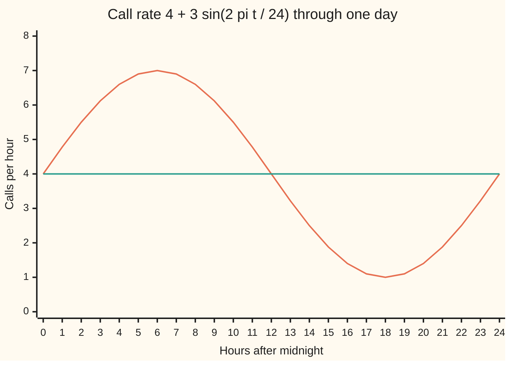
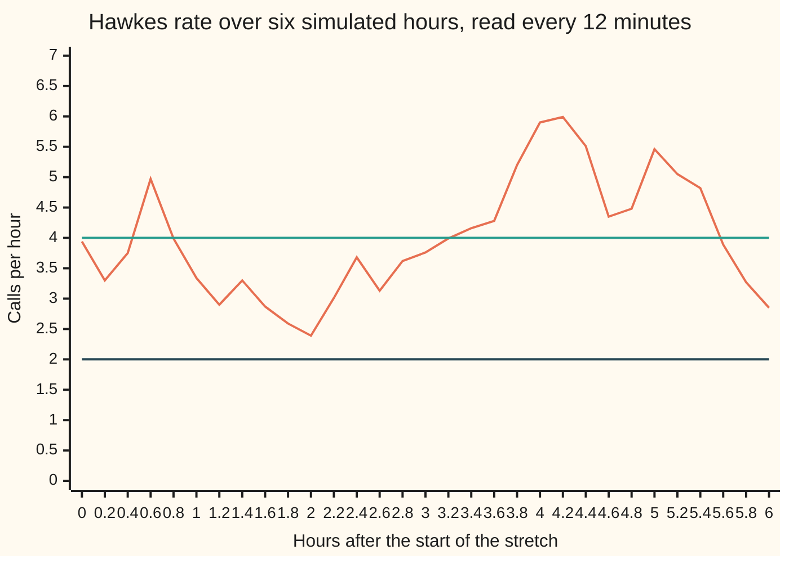

# Arrivals whose rate changes: time-varying Poisson processes and self-exciting Hawkes processes

[Syllabus](../../../SYLLABUS.md) → [Stochastic processes and calculus](../README.md) → [Poisson and Jump Processes](../README.md#s04) → Arrivals whose rate changes

---

## General Overview

A switchboard takes calls at 4 an hour on average. The [Poisson process](01-poisson-process.md) card treated that rate as fixed. Real lines are not like that, in two separate ways.

**The clock moves the rate.** Say the rate swings through the day as 4 + 3 sin(2πt/24) calls an hour, with t in hours after midnight. It peaks at 7 an hour at 6 in the morning and falls to 1 an hour at 6 in the evening. From midnight to noon the line should expect 48 + 22.9 = **70.9 calls**, not 48.

**The calls move the rate.** Say instead that each call stirs up more calls: a caller tells a neighbour, or a fault makes several people ring. The base rate is 2 an hour, and each call triggers 0.5 more calls on average. The long-run rate is then 2/(1 − 0.5) = **4 an hour**. The calls come in clusters (a first call plus every call it sets off), and the average cluster holds **2 calls**.

The first kind is a **time-varying Poisson process**. The second is a **Hawkes process**: a process that excites itself. A computer simulates the first by **thinning**: draw calls at the peak rate, then keep each one with chance (rate now) / (peak rate). The second is a family tree of calls, and its long-run numbers come from a single sum.

**A rate that follows the clock gives Poisson counts with mean equal to the area under the rate; a rate that jumps after each call gives clusters whose average size is 1/(1 − n), where n is the number of calls each call triggers, and a long-run rate of base rate / (1 − n).**

**What kind of fact this is:** theorems. The thinning recipe and the expected count are proved on this card in Why it works. The long-run rate is the fixed point of Step 4, which assumes a steady rate exists. The family-tree picture of Step 5, which gives the cluster size, is proved in the 1974 paper in Sources, and the covariance behind the 12-hour variance comes from the 1971 paper; both are cited, not proved here. Using either process for a real switchboard is a model.

### The picture: one day's rate



Orange: the rate, hour by hour. Green: the flat 4 an hour of the earlier cards. The area under the orange curve from 0 to 12 is the expected count to noon, 70.9. Over the full day the hump and the dip cancel, and the area is 96, the same as at a flat 4 an hour.

---

## The formula

Notation first, in words. Time $`t`$ is in hours. The **rate** (or **intensity**) $`\lambda(t)`$ is the chance per hour of a call at time $`t`$: in a tiny window of length $`h`$, the chance of a call is about $`\lambda(t)\,h`$. $`N(t)`$ counts the calls by time $`t`$. The call times are $`t_1 < t_2 < \dots`$.

One formula covers both processes:

```math
\lambda(t) = \mu(t) + \sum_{t_i < t} g(t - t_i)
```

**Read it aloud:** the rate now is the base rate set by the clock, plus a fading after-effect from every call so far.

**Time-varying Poisson: no after-effect.** Set $`g = 0`$ and $`\mu(t) = 4 + 3\sin(2\pi t/24)`$. The count from $`a`$ to $`b`$ is Poisson, with mean equal to the area under the rate:

```math
\Lambda(t) = \int_0^t \lambda(u)\,du, \qquad N(b) - N(a) \sim \mathrm{Poisson}\big(\Lambda(b) - \Lambda(a)\big)
```

Counts in separate windows are independent. Here $`\sim`$ means "has the law", and $`u`$ is a spare time variable.

**Hawkes: a constant base, and every call adds a fading bump.** Set $`\mu(t) = \mu = 2`$ and

```math
g(s) = n\,\beta\,e^{-\beta s}, \qquad m = \frac{\mu}{1-n}, \qquad \mathbb{E}[S] = 1 + n + n^2 + \dots = \frac{1}{1-n}
```

Here $`s`$ is the time since a call. Each call lifts the rate by $`n\beta`$ = 0.5 × 2 = 1 call an hour, and the lift fades at rate $`\beta`$. The area under $`g`$ is $`n`$: the expected number of calls one call triggers directly. Here $`\mu`$ is a base rate and $`n`$ is this ratio, not the call-ending rate and the count of [Birth-and-death processes](07-birth-and-death-processes.md). $`m`$ is the long-run rate and $`S`$ is the size of a cluster. $`\mathbb{E}`$ means the average.

| Symbol | Plain meaning | In our example | Push it up and the answer… |
| --- | --- | --- | --- |
| $`t`$, $`s`$, $`u`$; $`a`$, $`b`$, $`h`$ | time in hours after midnight; time since a call; a spare time variable; a window's start and end; a tiny window's length | noon is $`t`$ = 12; the morning is $`a`$ = 0 to $`b`$ = 12 | — |
| $`\lambda(t)`$ | the rate now: calls per hour at time $`t`$ | 7 at 6 am, 1 at 6 pm | more calls in that stretch |
| $`\mu(t)`$, $`\mu`$ | the base rate, set by the clock alone | 4 + 3 sin(2πt/24); for Hawkes, 2 | all counts rise in step |
| $`g(s)`$ | the after-effect of one call, $`s`$ hours later | 1 an hour at once, then fading | more triggered calls |
| $`n`$ | the branching ratio: calls each call triggers directly, on average | 0.5 | clusters grow; at 1 the rate has no long-run value |
| $`\beta`$ | how fast the after-effect fades, per hour | 2 | tighter clusters, same averages |
| $`t_i`$ | the time of call $`i`$ | first call in the story at 0.33 hour | — |
| $`N(t)`$ | the number of calls by time $`t`$ | about 70.9 by noon, on average | — |
| $`\Lambda(t)`$ | expected calls by time $`t`$: the area under the rate | 70.9183 at noon, 96 at midnight | — |
| $`\lambda^*`$, $`p`$ | the proposal rate for thinning, at least the peak rate; the share of proposals kept | 7; $`p`$ = 0.8443 | more proposals thrown away |
| $`m`$, $`y(t)`$ | the long-run rate of a Hawkes process; its average rate at time $`t`$ from an empty start | 4 an hour; 3.2642 at $`t`$ = 1 | — |
| $`S`$, $`k`$ | the number of calls in one cluster; a possible value | average 2; $`k`$ = 1 has chance 0.6065 | — |

### When it holds

- **The base rate is known in advance.** Thinning needs $`\lambda(t)`$ as a formula or a table. If the rate is itself random, as on a day with unknown weather, the counts spread more than Poisson.
- **The proposal rate sits at or above the rate everywhere.** Propose at 5 instead of 7 and the hump above 5 is cut off: 58.71 calls to noon, not 70.92.
- **A Poisson process has no memory of its own calls.** If calls trigger calls, the time-varying Poisson model gets the mean right and the spread wrong. Over 12 hours, the Hawkes count has variance 180, not 48.
- **For a long-run rate, $`n < 1`$.** At $`n = 1`$ each cluster has no finite average size, and the rate climbs without limit. Near 1 the numbers blow up fast: at $`n`$ = 0.9 the rate is 20 an hour.
- **Each call's after-effect is the same and adds up.** Real excitement can saturate or depend on the call. The cluster arithmetic still holds if each call triggers $`n`$ more on average, but the timing formulas change.

---

## Why it works

### Step 0: two ideas, a keep-or-drop coin and a family tree

The time-varying process is a fixed-rate process with some calls thrown away. Draw calls at the peak rate 7 an hour. At a moment when the real rate is 5.5, keep a call with chance 5.5/7. This is [Rejection sampling and Box-Muller](../../09-Probability%20and%20statistics/11-Simulation/03-rejection-sampling-and-box-muller.md) done along a time line: the flat rate 7 is the envelope, and the real rate is the curve under it.

The Hawkes process is a family tree. Base calls arrive at a steady 2 an hour; call them **immigrants**. Each call, immigrant or not, has children: the calls it triggers. Each child has children too. Every count on this card comes from counting family members.

### Step 1: thinning gives a time-varying Poisson process

Take a window from $`a`$ to $`b`$. The proposals in it form a Poisson count with mean $`\lambda^*(b - a)`$. Given that there are $`k`$ of them, their times are $`k`$ independent uniform draws in the window ([Given n arrivals, when did they happen](02-arrival-times-and-order-statistics.md), which also states the thinning rule; here is why it works).

So each proposal is kept independently, with the same chance:

```math
p = \frac{1}{b - a}\int_a^b \frac{\lambda(u)}{\lambda^*}\,du = \frac{\Lambda(b) - \Lambda(a)}{\lambda^*(b - a)}
```

A Poisson count where each item is kept by its own independent coin is Poisson again, at mean (old mean) × (chance kept) ([Splitting and merging](03-splitting-and-superposition.md)). The kept count has mean $`\lambda^*(b-a) \times p = \Lambda(b) - \Lambda(a)`$.

Separate windows hold separate proposals and separate coins, so their kept counts are independent. These are exactly the two properties in The formula.

### Step 2: the area under the rate, by hand

The expected count to noon is the area under $`4 + 3\sin(2\pi t/24)`$ from 0 to 12:

```math
\Lambda(12) = 4 \times 12 + 3 \times \frac{24}{2\pi}\Big[1 - \cos\Big(\frac{2\pi \times 12}{24}\Big)\Big] = 48 + \frac{36}{\pi} \times 2 = 48 + \frac{72}{\pi}
```

The bracket is $`1 - \cos\pi = 2`$. So $`\Lambda(12) = 48 + 22.92 = 70.92`$. Over 24 hours the bracket is $`1 - \cos 2\pi = 0`$, and the wave adds nothing: 96 calls.

### Step 3: a second road, stretching the clock

Run a rate-1 Poisson process on a new clock that reads $`\Lambda(t)`$ instead of $`t`$. In the stretch from $`a`$ to $`b`$, the new clock advances by $`\Lambda(b) - \Lambda(a)`$. So that stretch holds a Poisson count with exactly that mean.

In practice: draw rate-1 exponential gaps, add them up, and map each total back through $`\Lambda`$. The code builds $`\Lambda`$ from the rate alone, by Simpson's rule on short steps, and reads each time off that table; a run stops once a time passes noon. This road uses no proposals, no coins and not the formula of Step 2, so it is a separate way to make the same calls. The test is where the calls land. Before 3 am the runs average 15.329 calls, against $`\Lambda(3)`$ = 15.3563; calls spread evenly over the morning would put 17.7296 there.

### Step 4: the Hawkes long-run rate is a fixed point

Suppose the Hawkes process has settled to a steady average rate $`m`$. The rate now is the base, plus the after-effects of past calls. Calls came at average rate $`m`$, and each leaves a total after-effect of area $`n`$. So on average

```math
m = \mu + n\,m \quad\Longrightarrow\quad m = \frac{\mu}{1 - n} = \frac{2}{1 - 0.5} = 4.
```

Iterating $`m \leftarrow 2 + 0.5\,m`$ from 2 lands on 4 as well. This needs $`n < 1`$: at $`n = 1`$ the equation reads $`m = \mu + m`$, which no finite $`m`$ solves.

### Step 5: the same rate, by counting family trees

Given a call, its after-effect is a time-varying Poisson process of children with rate $`g(s)`$. So its number of children is Poisson with mean equal to the area under $`g`$, which is $`n`$ = 0.5. Each child does the same, independently.

That is a [Branching processes](../02-Martingales/09-galton-watson-branching-processes.md) family tree with Poisson(0.5) children per member. Generation 0 is the immigrant. Generation $`k`$ has $`n^k`$ members on average. So the cluster's average size is

```math
\mathbb{E}[S] = 1 + 0.5 + 0.25 + 0.125 + \dots = \frac{1}{1 - 0.5} = 2.
```

Immigrants arrive at 2 an hour, and each heads a cluster of 2 calls on average. That gives 2 × 2 = 4 calls an hour: the fixed point of Step 4, reached by a separate road.

The cluster's chances can be read off the tree too. A lone call has no children: chance $`e^{-0.5}`$ = 0.6065. A cluster of exactly 2 is one child with no children of its own: $`0.5e^{-0.5} \times e^{-0.5}`$ = 0.1839.

<details>
<summary>The whole law of the cluster size, and its variance</summary>

The total size of a family tree with Poisson($`n`$) children per member has the Borel law:

$`\displaystyle P(S = k) = \frac{e^{-nk}\,(nk)^{k-1}}{k!}, \qquad k = 1, 2, 3, \dots`$

At $`n`$ = 0.5 this gives 0.6065, 0.1839, 0.0837 and 0.0451 for $`k`$ = 1 to 4. The code sums it to 4,000 terms: total 1, mean 2, variance 4.

The variance matches $`n/(1-n)^3 = 0.5/0.125 = 4`$. Clusters arrive as a Poisson stream at rate 2, so over a long window the count is a [Compound Poisson](04-compound-poisson.md) sum. Its variance per hour is $`2 \times \mathbb{E}[S^2] = 2 \times (4 + 2^2) = 16`$, four times the Poisson value of 4. The simulation's 12-hour variance is 181.88.

A 12-hour window cuts some clusters at its edges, which lowers the variance a little. For this exponential after-effect, the calls' covariance at time lag $`s`$ is $`6e^{-\lvert s\rvert}`$ per hour squared; it decays at rate $`\beta(1-n) = 1`$ per hour (the spectrum is computed in the 1971 paper in Sources). Adding it up over the window gives

$`\displaystyle \mathrm{Var}\,N(12) = 4 \times 12 + 12\,\big[12 - (1 - e^{-12})\big] = 180.0.`$

</details>

---

## Worked numbers, by hand

| Step | Arithmetic | Value |
| --- | --- | --- |
| base part to noon | 4 × 12 | 48.0000 |
| wave part to noon | 3 × (24/2π) × (1 − cos π) = 72/π | 22.9183 |
| expected calls to noon, $`\Lambda(12)`$ | 48 + 22.9183 | **70.9183** |
| spread of the noon count | Poisson, so the square root of the mean: $`\sqrt{70.9183}`$ | 8.4213 |
| proposals at the peak rate | 7 × 12 | 84.0000 |
| share of proposals kept | 70.9183 / 84 | 0.8443 |
| Hawkes long-run rate $`m`$ | 2 / (1 − 0.5) | **4.0000** |
| mean cluster size | 1 / (1 − 0.5) | **2.0000** |
| series, term by term | 1, 1.5, 1.75, 1.875, 1.9375, 1.9688, … | → 2 |
| chance a cluster is one lone call | $`e^{-0.5}`$ | 0.6065 |
| Hawkes 12-hour count, mean and variance | 4 × 12; the fold above | 48, 180.0 |

So the clock-driven line expects about 71 calls by noon, give or take 8. The self-exciting line averages the same 4 an hour as the house example. But its calls arrive in clusters, and a 12-hour count varies almost four times as much as a Poisson count would.

### What breaks if you drop a piece

| Mistake | Comes out at | What went wrong |
| --- | --- | --- |
| Rate at noon times 12 hours | 48.0000 (right: 70.9183) | One moment's rate stands in for the whole morning; the morning hump is lost |
| Keep every proposal at the peak rate | 84.0000 (right: 70.9183) | Thinning without the coin is a flat rate-7 process |
| Propose at 5, below the peak of 7 | 58.7146 (right: 70.9183) | Wherever the rate tops 5, the keep chance caps at 1 and the excess is never drawn |
| Hawkes: count only the first generation, $`\mu(1 + n)`$ | 3.0000 (right: 4.0000) | Children have children; the series 1 + 0.5 + 0.25 + … has to run to the end |

---

## How a Hawkes rate moves

A time-varying Poisson rate is a curve fixed in advance. A Hawkes rate is random: it jumps at every call and fades between calls. So in a busy spell the rate is high, which makes the spell busier still.

### One story: six hours on the self-exciting line

The simulation ran for 100,800 hours. Take hours 100 to 106. Times below are hours after the start of that stretch. Each call lifts the rate by exactly 1.

| Call | Time (hours) | Rate just before | Rate just after |
| --- | --- | --- | --- |
| 1 | 0.33 | 2.99 | 3.99 |
| 2 | 0.52 | 3.38 | 4.38 |
| 3 | 0.57 | 4.13 | 5.13 |
| 4 | 1.22 | 2.85 | 3.85 |
| 5 | 2.06 | 2.35 | 3.35 |

Call 3 came just after call 2, at 0.57 against 0.52: call 2 raised the rate, which made call 3 more likely. By call 4, more than half an hour later, the lift had faded and the rate was back under 3.

### One force at a time: where the 4 an hour comes from

Split the long-run 4 calls an hour by generation. The formula gives $`2 \times 0.5^k`$ for generation $`k`$. The family-tree simulation, counting each generation separately, prints the second column. Each # is 0.125 calls an hour.

```
generation                    formula   trees
immigrants  ################  2.0000    1.9935
children    ########          1.0000    0.9953
grandchild  ####              0.5000    0.4990
great-gc    ##                0.2500    0.2493
4th gen     #                 0.1250    0.1245
```

Half of all calls are immigrants. The rest are triggered, and each generation adds half as many as the one before.

### The combined picture



Orange: the Hawkes rate, read every 12 minutes, so each jump shows as a short ramp. Green: the long-run rate, 4. Dark: the base rate, 2, the floor the rate falls back to. Between hours 3 and 5 the calls came close together. The 12-minute readings reach 5.99, but just after the call at 4.02 the rate itself was 7.76, above the chart's top.

Started from an empty line, the average rate $`y(t)`$ climbs from 2. The excess over the base fades at rate $`\beta`$, and calls, arriving at rate $`y`$, each add $`n\beta`$, so $`y' = -\beta\,(y - \mu) + n\beta\,y = 4 - y`$. That gives $`y = 4 - 2e^{-t}`$: 3.2642 after one hour, and 46.0 calls over the first 12 hours rather than 48.

---

## Code, from first principles, and it actually runs

The code takes two roads to every main number, plus a formula. For the time-varying process: the closed form 48 + 72/π, Simpson's rule on the rate, 10,000 mornings simulated by thinning, and 10,000 more by stretching the clock. For the Hawkes process: the fixed point, the geometric series, the Borel law summed to 4,000 terms, one 100,800-hour simulation by thinning on the rate, 10,000 12-hour runs from an empty start, and a separate simulation that builds family trees. The random numbers come from SplitMix64, a small generator written out in the code, with seed 20261123. Every simulated mean is printed with its standard error (se): the typical size of the simulation's random error.

Thinning on the Hawkes rate works because between calls the rate only falls. So the rate just after the last event is a valid peak until the next proposal.

### Python

```python
# Time-varying Poisson and Hawkes -- the check behind the card.  Standard library only.
# Part A: calls at rate 4 + 3 sin(2 pi t/24) an hour, t in hours after midnight.  The expected count
# to noon by formula and by Simpson's rule; simulated by thinning and by stretching time.
# Part B: Hawkes calls, base rate 2 an hour, each call adds 1 an hour to the rate, fading at rate 2
# an hour, so each call triggers 0.5 more on average.  Long-run rate and cluster size by a fixed point,
# a geometric series and the Borel law; simulated by thinning the rate and by building family trees.
from math import sin, cos, exp, log, pi, sqrt
from bisect import bisect_right
M64 = (1 << 64) - 1
class Rng:                                        # SplitMix64, written out
    def __init__(self, seed): self.s = seed
    def u(self):
        self.s = (self.s + 0x9E3779B97F4A7C15) & M64
        z = self.s
        z = ((z ^ (z >> 30)) * 0xBF58476D1CE4E5B9) & M64
        z = ((z ^ (z >> 27)) * 0x94D049BB133111EB) & M64
        return ((z ^ (z >> 31)) >> 11) * 2.0 ** -53
    def expo(self, rate): return -log(1.0 - self.u()) / rate
    def poisson(self, mean):                      # inversion: walk up the cumulative chances
        u, k, p = self.u(), 0, exp(-mean)
        c = p
        while u > c: k += 1; p *= mean / k; c += p
        return k
def rate(t): return 4.0 + 3.0 * sin(2.0 * pi * t / 24.0)
def big_lam(t): return 4.0 * t + (36.0 / pi) * (1.0 - cos(pi * t / 12.0))   # expected calls by t
def stats(xs):
    m = sum(xs) / len(xs); v = sum((x - m) ** 2 for x in xs) / (len(xs) - 1)
    return m, v, sqrt(v / len(xs))
T, PEAK, R = 12.0, 7.0, 10000
exact = big_lam(T)
n = 1200; h = T / n; cum = [0.0]                   # Simpson's rule on the rate, step by step: cum[i] = Lambda(i h)
for i in range(n): cum.append(cum[-1] + (rate(i * h) + 4 * rate((i + 0.5) * h) + rate((i + 1) * h)) * h / 6)
print(f"A base part 4 x 12                  {4 * T:10.4f}")
print(f"A wave part 72/pi                   {72 / pi:10.4f}")
print(f"A expected calls to noon, formula   {exact:10.4f}")
print(f"A expected calls to noon, Simpson   {cum[-1]:10.4f}")
print(f"A expected calls in 24 hours        {big_lam(24.0):10.4f}")
print(f"A spread of the noon count sqrt     {sqrt(exact):10.4f}")
print(f"A proposals at peak 7 x 12          {PEAK * T:10.4f}")
print(f"A share of proposals kept           {exact / (PEAK * T):10.4f}")
print("A rate by hour 0..24  " + " ".join(f"{rate(k):.2f}" for k in range(25)))
rng = Rng(20261123)
def thin(prop):                                   # propose at rate prop, keep with chance rate/prop
    t, kept, made = 0.0, 0, 0
    while True:
        t += rng.expo(prop)
        if t > T: return kept, made
        made += 1
        if rng.u() * prop < min(rate(t), prop): kept += 1
runs = [thin(PEAK) for _ in range(R)]
m1, v1, se1 = stats([k for k, _ in runs]); mp, _, _ = stats([d for _, d in runs])
def stretched():                                  # unit-rate gaps, each total mapped back to a time through cum
    s, k = 0.0, [0, 0]
    while True:
        s += rng.expo(1.0)
        i = bisect_right(cum, s)                  # cum[i - 1] <= s < cum[i]
        if i > n: return k                        # the mapped time is past noon
        t = (i - 1 + (s - cum[i - 1]) / (cum[i] - cum[i - 1])) * h   # Lambda(t) = s, straight line between steps
        k[t > 3.0] += 1                           # before 3 am, or from 3 am to noon
st = [stretched() for _ in range(R)]
m2, v2, se2 = stats([a + b for a, b in st]); m3, _, se3 = stats([a for a, _ in st])
print(f"A sim thinning: mean {m1:.3f} se {se1:.3f}  variance {v1:.2f}  proposals {mp:.3f}")
print(f"A sim stretched time: mean {m2:.3f} se {se2:.3f}  variance {v2:.2f}  before 3 am {m3:.3f} se {se3:.3f}  (Lambda(3) {big_lam(3.0):.4f}, even spread {exact / 4:.4f})")
simp_low = sum((min(rate(i * h), 5) + 4 * min(rate((i + 0.5) * h), 5) + min(rate((i + 1) * h), 5)) * h / 6 for i in range(n))  # wrong: 5
print(f"A wrong: rate at noon x 12          {rate(12.0) * T:10.4f}")
print(f"A wrong: keep every peak proposal   {PEAK * T:10.4f}")
print(f"A wrong: propose at 5, not 7        {simp_low:10.4f}")
MU, NB, BETA = 2.0, 0.5, 2.0                      # base rate, branching ratio, fade rate
JUMP = NB * BETA                                  # each call lifts the rate by 1 an hour
lam = MU
for _ in range(60): lam = MU + NB * lam            # fixed point of rate = base + n x rate
series = sum(NB ** k for k in range(60))
print(f"B long-run rate mu/(1-n)            {MU / (1 - NB):10.4f}")
print(f"B fixed-point iteration             {lam:10.4f}")
print(f"B mean cluster 1/(1-n)              {1 / (1 - NB):10.4f}")
print(f"B geometric series 1+n+n^2+...      {series:10.4f}")
print("B series partial sums  " + " ".join(f"{sum(NB ** j for j in range(k + 1)):.4f}" for k in range(6)))
borel, lf = [], 0.0                               # Borel law: P(k) = e^-nk (nk)^(k-1) / k!
for k in range(1, 4001):
    lf += log(k); borel.append(exp(-NB * k + (k - 1) * log(NB * k) - lf))
print("B Borel P(cluster=1..4)  " + " ".join(f"{p:.4f}" for p in borel[:4]))
bmean = sum((k + 1) * p for k, p in enumerate(borel))
bsq = sum((k + 1) ** 2 * p for k, p in enumerate(borel))
print(f"B Borel total {sum(borel):.6f}  mean {bmean:.6f}  variance {bsq - bmean ** 2:.6f}")
print(f"B long-window variance per hour 2 E[S^2]  {MU * bsq:.4f}")
var12 = 4 * T + 12.0 * (T - (1 - exp(-T)))        # stationary 12-hour variance, covariance 6 e^-|s|
empty12 = 4 * T - 2 * (1 - exp(-T))               # mean 12-hour count from an empty start
print(f"B 12-hour count: mean {4 * T:.4f}  variance {var12:.4f}  Poisson would say {4 * T:.4f}")
print(f"B 12-hour mean from an empty start {empty12:.4f};  rate after 1 hour {4 - 2 * exp(-1):.4f}")
def hawkes(hor):                                  # thinning on the rate, which only fades between calls
    t, x, ev = 0.0, 0.0, []
    while True:
        bound = MU + x; w = rng.expo(bound); t += w
        if t > hor: return ev
        x *= exp(-BETA * w)
        if rng.u() * bound < MU + x: ev.append(t); x += JUMP
H = 12.0 * 8400                                   # 8400 half-days
ev = hawkes(H)
wins = [0] * int(H / T)
for e in ev: wins[int(e / T)] += 1
mw, vw, sew = stats(wins)
print(f"B sim thinning, {H:.0f} hours: rate {len(ev) / H:.4f} se {4 / sqrt(H):.4f}  12-hour variance {vw:.2f}")
e12, _, se12 = stats([len(hawkes(T)) for _ in range(R)])
print(f"B sim empty start, 12 hours: mean {e12:.3f} se {se12:.3f}")
sizes, inside, t, bygen = [], 0, 0.0, [0] * 5    # family trees: immigrants, then children
while True:
    t += rng.expo(MU)
    if t > H: break
    gen, size, d = [t], 0, 0
    while gen:
        size += len(gen); inside += sum(1 for g in gen if g <= H)
        if d < 5: bygen[d] += len(gen)
        gen = [g + rng.expo(BETA) for g in gen for _ in range(rng.poisson(NB))]; d += 1
    sizes.append(size)
ms, vs, ses = stats(sizes)
ones = sum(1 for s in sizes if s == 1) / len(sizes)
print(f"B sim trees: {len(sizes)} clusters  mean {ms:.4f} se {ses:.4f}  variance {vs:.3f}")
print(f"B sim trees: lone calls {ones:.4f}  rate {inside / H:.4f}")
print("B rate by generation, formula  " + " ".join(f"{MU * NB ** d:.4f}" for d in range(5)))
print("B rate by generation, trees    " + " ".join(f"{c / H:.4f}" for c in bygen))
near = [e for e in ev if 92 < e < 106]
print("B rate on hours 100-106 every 12 min  " + " ".join(
    f"{MU + sum(JUMP * exp(-BETA * (s - e)) for e in near if e < s):.2f}" for s in [100 + 0.2 * i for i in range(31)]))
for i, c in enumerate([e for e in near if e > 100][:5]):
    before = MU + sum(JUMP * exp(-BETA * (c - e)) for e in near if e < c)
    print(f"B story call {i + 1} at hour 100 + {c - 100:.2f}  rate before {before:.2f}  after {before + JUMP:.2f}")
print("B calls on hours 100-106  " + " ".join(f"{e - 100:.2f}" for e in near if e > 100))
top = max((MU + sum(JUMP * exp(-BETA * (c - e)) for e in near if e <= c), c) for c in near if c > 100)
print(f"B top rate on hours 100-106: {top[0]:.2f}, just after the call at hour 100 + {top[1] - 100:.2f}")
print(f"B wrong: first generation only mu(1+n)  {MU * (1 + NB):.4f}")
print(f"B try: n = 0.9   rate {MU / 0.1:.4f}  cluster {1 / 0.1:.4f}")
assert abs(cum[-1] - exact) < 1e-9, "Simpson against the closed form"
assert abs(m1 - exact) < 4 * se1 and abs(m2 - exact) < 4 * se2, "both simulations hit 70.92"
assert abs(m3 - big_lam(3.0)) < 4 * se3, "stretched clock: calls before 3 am hit Lambda(3)"
assert abs(v1 / m1 - 1) < 0.05, "thinned count is Poisson: variance equals mean"
assert abs(lam - MU / (1 - NB)) < 1e-12 and abs(bmean - 1 / (1 - NB)) < 1e-9, "fixed point, Borel mean"
assert abs(len(ev) / H - 4) < 4 * 4 / sqrt(H) and abs(inside / H - 4) < 0.05, "both Hawkes roads give 4"
assert abs(ms - 2) < 4 * ses and abs(ones - borel[0]) < 0.005, "cluster mean 2, lone share e^-0.5"
assert abs(vw / var12 - 1) < 0.1 and abs(e12 - empty12) < 4 * se12, "12-hour variance and empty start"
print("ALL CHECKS PASS")
```

**Ran 2026-11-23 on macOS, Python 3.14.10, standard library only. All checks passed. Output, pasted from the run:**

```
A base part 4 x 12                     48.0000
A wave part 72/pi                      22.9183
A expected calls to noon, formula      70.9183
A expected calls to noon, Simpson      70.9183
A expected calls in 24 hours           96.0000
A spread of the noon count sqrt         8.4213
A proposals at peak 7 x 12             84.0000
A share of proposals kept               0.8443
A rate by hour 0..24  4.00 4.78 5.50 6.12 6.60 6.90 7.00 6.90 6.60 6.12 5.50 4.78 4.00 3.22 2.50 1.88 1.40 1.10 1.00 1.10 1.40 1.88 2.50 3.22 4.00
A sim thinning: mean 70.912 se 0.084  variance 70.09  proposals 83.986
A sim stretched time: mean 70.921 se 0.085  variance 71.82  before 3 am 15.329 se 0.039  (Lambda(3) 15.3563, even spread 17.7296)
A wrong: rate at noon x 12             48.0000
A wrong: keep every peak proposal      84.0000
A wrong: propose at 5, not 7           58.7146
B long-run rate mu/(1-n)                4.0000
B fixed-point iteration                 4.0000
B mean cluster 1/(1-n)                  2.0000
B geometric series 1+n+n^2+...          2.0000
B series partial sums  1.0000 1.5000 1.7500 1.8750 1.9375 1.9688
B Borel P(cluster=1..4)  0.6065 0.1839 0.0837 0.0451
B Borel total 1.000000  mean 2.000000  variance 4.000000
B long-window variance per hour 2 E[S^2]  16.0000
B 12-hour count: mean 48.0000  variance 180.0001  Poisson would say 48.0000
B 12-hour mean from an empty start 46.0000;  rate after 1 hour 3.2642
B sim thinning, 100800 hours: rate 4.0252 se 0.0126  12-hour variance 181.88
B sim empty start, 12 hours: mean 45.882 se 0.130
B sim trees: 200942 clusters  mean 1.9990 se 0.0045  variance 4.022
B sim trees: lone calls 0.6080  rate 3.9850
B rate by generation, formula  2.0000 1.0000 0.5000 0.2500 0.1250
B rate by generation, trees    1.9935 0.9953 0.4990 0.2493 0.1245
B rate on hours 100-106 every 12 min  3.94 3.30 3.75 4.97 3.99 3.34 2.90 3.30 2.87 2.59 2.39 3.01 3.68 3.13 3.62 3.76 3.99 4.16 4.28 5.20 5.90 5.99 5.51 4.35 4.48 5.46 5.05 4.82 3.89 3.27 2.85
B story call 1 at hour 100 + 0.33  rate before 2.99  after 3.99
B story call 2 at hour 100 + 0.52  rate before 3.38  after 4.38
B story call 3 at hour 100 + 0.57  rate before 4.13  after 5.13
B story call 4 at hour 100 + 1.22  rate before 2.85  after 3.85
B story call 5 at hour 100 + 2.06  rate before 2.35  after 3.35
B calls on hours 100-106  0.33 0.52 0.57 1.22 2.06 2.40 2.73 2.80 3.09 3.31 3.51 3.67 3.75 3.93 3.94 4.01 4.02 4.31 4.75 4.91 4.98 5.04 5.27
B top rate on hours 100-106: 7.76, just after the call at hour 100 + 4.02
B wrong: first generation only mu(1+n)  3.0000
B try: n = 0.9   rate 20.0000  cluster 10.0000
ALL CHECKS PASS
```

The two Hawkes simulations share no code. The thinning run never builds a tree; the tree run never computes a rate. They agree on 4 an hour within their random error, and the trees' lone-call share, 0.6080, sits next to $`e^{-0.5}`$ = 0.6065.

### Rust

```rust
// Time-varying Poisson and Hawkes -- the same check as the Python, in Rust.  Standard library only.
// Part A: calls at rate 4 + 3 sin(2 pi t/24) an hour; Part B: Hawkes calls, base rate 2 an hour,
// each call adds 1 an hour to the rate, fading at rate 2 an hour, so each triggers 0.5 more.
use std::f64::consts::PI;
struct Rng { s: u64 }
impl Rng {                                         // SplitMix64, written out
    fn u(&mut self) -> f64 {
        self.s = self.s.wrapping_add(0x9E3779B97F4A7C15);
        let mut z = self.s;
        z = (z ^ (z >> 30)).wrapping_mul(0xBF58476D1CE4E5B9);
        z = (z ^ (z >> 27)).wrapping_mul(0x94D049BB133111EB);
        ((z ^ (z >> 31)) >> 11) as f64 * 2f64.powi(-53)
    }
    fn expo(&mut self, rate: f64) -> f64 { -(1.0 - self.u()).ln() / rate }
    fn poisson(&mut self, mean: f64) -> usize {   // inversion: walk up the cumulative chances
        let u = self.u();
        let (mut k, mut p) = (0usize, (-mean).exp());
        let mut c = p;
        while u > c { k += 1; p *= mean / k as f64; c += p; }
        k
    }
}
fn rate(t: f64) -> f64 { 4.0 + 3.0 * (2.0 * PI * t / 24.0).sin() }
fn big_lam(t: f64) -> f64 { 4.0 * t + (36.0 / PI) * (1.0 - (PI * t / 12.0).cos()) }
fn stats(xs: &[f64]) -> (f64, f64, f64) {
    let n = xs.len() as f64;
    let m = xs.iter().fold(0.0, |a, x| a + x) / n;
    let v = xs.iter().fold(0.0, |a, x| a + (x - m).powi(2)) / (n - 1.0);
    (m, v, (v / n).sqrt())
}
const T: f64 = 12.0; const PEAK: f64 = 7.0; const R: usize = 10000;
const MU: f64 = 2.0; const NB: f64 = 0.5; const BETA: f64 = 2.0; const JUMP: f64 = NB * BETA;
fn thin(rng: &mut Rng, prop: f64) -> (f64, f64) { // propose at rate prop, keep with chance rate/prop
    let (mut t, mut kept, mut made) = (0.0, 0.0, 0.0);
    loop {
        t += rng.expo(prop);
        if t > T { return (kept, made); }
        made += 1.0;
        if rng.u() * prop < rate(t).min(prop) { kept += 1.0; }
    }
}
fn stretched(rng: &mut Rng, cum: &[f64], h: f64) -> (f64, f64) { // unit-rate gaps, each total mapped back to a time through cum
    let (mut s, mut k) = (0.0, [0.0, 0.0]);
    loop {
        s += rng.expo(1.0);
        let i = cum.partition_point(|&c| c <= s);  // cum[i - 1] <= s < cum[i]
        if i >= cum.len() { return (k[0], k[1]); } // the mapped time is past noon
        let t = ((i - 1) as f64 + (s - cum[i - 1]) / (cum[i] - cum[i - 1])) * h; // Lambda(t) = s, straight line between steps
        k[(t > 3.0) as usize] += 1.0;              // before 3 am, or from 3 am to noon
    }
}
fn hawkes(rng: &mut Rng, hor: f64) -> Vec<f64> {  // thinning on the rate, which only fades between calls
    let (mut t, mut x, mut ev) = (0.0, 0.0, Vec::new());
    loop {
        let bound = MU + x; let w = rng.expo(bound); t += w;
        if t > hor { return ev; }
        x *= (-BETA * w).exp();
        if rng.u() * bound < MU + x { ev.push(t); x += JUMP; }
    }
}
fn main() {
    let exact = big_lam(T);
    let n = 1200; let h = T / n as f64;            // Simpson's rule on the rate, step by step: cum[i] = Lambda(i h)
    let cum = (0..n).fold(vec![0.0], |mut c: Vec<f64>, i| { let l = c[i]; c.push(l + (rate(i as f64 * h) + 4.0 * rate((i as f64 + 0.5) * h) + rate((i + 1) as f64 * h)) * h / 6.0); c });
    println!("A base part 4 x 12                  {:10.4}", 4.0 * T);
    println!("A wave part 72/pi                   {:10.4}", 72.0 / PI);
    println!("A expected calls to noon, formula   {:10.4}", exact);
    println!("A expected calls to noon, Simpson   {:10.4}", cum[n]);
    println!("A expected calls in 24 hours        {:10.4}", big_lam(24.0));
    println!("A spread of the noon count sqrt     {:10.4}", exact.sqrt());
    println!("A proposals at peak 7 x 12          {:10.4}", PEAK * T);
    println!("A share of proposals kept           {:10.4}", exact / (PEAK * T));
    let hours: Vec<String> = (0..25).map(|k| format!("{:.2}", rate(k as f64))).collect();
    println!("A rate by hour 0..24  {}", hours.join(" "));
    let mut rng = Rng { s: 20261123 };
    let runs: Vec<(f64, f64)> = (0..R).map(|_| thin(&mut rng, PEAK)).collect();
    let (m1, v1, se1) = stats(&runs.iter().map(|r| r.0).collect::<Vec<_>>());
    let (mp, _, _) = stats(&runs.iter().map(|r| r.1).collect::<Vec<_>>());
    let st: Vec<(f64, f64)> = (0..R).map(|_| stretched(&mut rng, &cum, h)).collect();
    let (m2, v2, se2) = stats(&st.iter().map(|k| k.0 + k.1).collect::<Vec<_>>()); let (m3, _, se3) = stats(&st.iter().map(|k| k.0).collect::<Vec<_>>());
    println!("A sim thinning: mean {:.3} se {:.3}  variance {:.2}  proposals {:.3}", m1, se1, v1, mp);
    println!("A sim stretched time: mean {:.3} se {:.3}  variance {:.2}  before 3 am {:.3} se {:.3}  (Lambda(3) {:.4}, even spread {:.4})", m2, se2, v2, m3, se3, big_lam(3.0), exact / 4.0);
    let simp_low = (0..n).fold(0.0, |a, i| a + (rate(i as f64 * h).min(5.0) + 4.0 * rate((i as f64 + 0.5) * h).min(5.0) + rate((i + 1) as f64 * h).min(5.0)) * h / 6.0); // wrong: 5
    println!("A wrong: rate at noon x 12          {:10.4}", rate(12.0) * T);
    println!("A wrong: keep every peak proposal   {:10.4}", PEAK * T);
    println!("A wrong: propose at 5, not 7        {:10.4}", simp_low);
    let mut lam = MU;
    for _ in 0..60 { lam = MU + NB * lam; }        // fixed point of rate = base + n x rate
    let series = (0..60).fold(0.0, |a, k| a + NB.powi(k));
    println!("B long-run rate mu/(1-n)            {:10.4}", MU / (1.0 - NB));
    println!("B fixed-point iteration             {:10.4}", lam);
    println!("B mean cluster 1/(1-n)              {:10.4}", 1.0 / (1.0 - NB));
    println!("B geometric series 1+n+n^2+...      {:10.4}", series);
    let parts: Vec<String> = (0..6).map(|k| format!("{:.4}", (0..k + 1).fold(0.0, |a, j| a + NB.powi(j)))).collect();
    println!("B series partial sums  {}", parts.join(" "));
    let (mut borel, mut lf) = (Vec::new(), 0.0f64);  // Borel law: P(k) = e^-nk (nk)^(k-1) / k!
    for k in 1..=4000 {
        let kf = k as f64;
        lf += kf.ln(); borel.push((-NB * kf + (kf - 1.0) * (NB * kf).ln() - lf).exp());
    }
    let b4: Vec<String> = borel[..4].iter().map(|p| format!("{:.4}", p)).collect();
    println!("B Borel P(cluster=1..4)  {}", b4.join(" "));
    let bmean = borel.iter().enumerate().fold(0.0, |a, (k, p)| a + (k as f64 + 1.0) * p);
    let bsq = borel.iter().enumerate().fold(0.0, |a, (k, p)| a + (k as f64 + 1.0).powi(2) * p);
    let btot = borel.iter().fold(0.0, |a, p| a + p);
    println!("B Borel total {:.6}  mean {:.6}  variance {:.6}", btot, bmean, bsq - bmean * bmean);
    println!("B long-window variance per hour 2 E[S^2]  {:.4}", MU * bsq);
    let var12 = 4.0 * T + 12.0 * (T - (1.0 - (-T).exp()));   // stationary 12-hour variance, covariance 6 e^-|s|
    let empty12 = 4.0 * T - 2.0 * (1.0 - (-T).exp());       // mean 12-hour count from an empty start
    println!("B 12-hour count: mean {:.4}  variance {:.4}  Poisson would say {:.4}", 4.0 * T, var12, 4.0 * T);
    println!("B 12-hour mean from an empty start {:.4};  rate after 1 hour {:.4}", empty12, 4.0 - 2.0 * (-1.0f64).exp());
    let hh = 12.0 * 8400.0;                        // 8400 half-days
    let ev = hawkes(&mut rng, hh);
    let mut wins = vec![0.0; (hh / T) as usize];
    for e in &ev { wins[(e / T) as usize] += 1.0; }
    let (_, vw, _) = stats(&wins);
    let evn = ev.len() as f64;
    println!("B sim thinning, {:.0} hours: rate {:.4} se {:.4}  12-hour variance {:.2}", hh, evn / hh, 4.0 / hh.sqrt(), vw);
    let (e12, _, se12) = stats(&(0..R).map(|_| hawkes(&mut rng, T).len() as f64).collect::<Vec<_>>());
    println!("B sim empty start, 12 hours: mean {:.3} se {:.3}", e12, se12);
    let (mut sizes, mut inside, mut t, mut bygen) = (Vec::new(), 0usize, 0.0, [0usize; 5]); // family trees
    loop {
        t += rng.expo(MU);
        if t > hh { break; }
        let (mut gen, mut size, mut d) = (vec![t], 0usize, 0usize);
        while !gen.is_empty() {
            size += gen.len(); inside += gen.iter().filter(|g| **g <= hh).count();
            if d < 5 { bygen[d] += gen.len(); }
            let mut next = Vec::new();
            for g in &gen { for _ in 0..rng.poisson(NB) { next.push(g + rng.expo(BETA)); } }
            gen = next; d += 1;
        }
        sizes.push(size as f64);
    }
    let (ms, vs, ses) = stats(&sizes);
    let ones = sizes.iter().filter(|s| **s == 1.0).count() as f64 / sizes.len() as f64;
    println!("B sim trees: {} clusters  mean {:.4} se {:.4}  variance {:.3}", sizes.len(), ms, ses, vs);
    println!("B sim trees: lone calls {:.4}  rate {:.4}", ones, inside as f64 / hh);
    let gf: Vec<String> = (0..5).map(|d| format!("{:.4}", MU * NB.powi(d))).collect();
    println!("B rate by generation, formula  {}", gf.join(" "));
    let gt: Vec<String> = bygen.iter().map(|c| format!("{:.4}", *c as f64 / hh)).collect();
    println!("B rate by generation, trees    {}", gt.join(" "));
    let near: Vec<f64> = ev.iter().cloned().filter(|e| 92.0 < *e && *e < 106.0).collect();
    let pts: Vec<String> = (0..31).map(|i| 100.0 + 0.2 * i as f64).map(|s| format!("{:.2}",
        MU + near.iter().filter(|e| **e < s).fold(0.0, |a, e| a + JUMP * (-BETA * (s - e)).exp()))).collect();
    println!("B rate on hours 100-106 every 12 min  {}", pts.join(" "));
    for (i, c) in near.iter().filter(|e| **e > 100.0).take(5).enumerate() {
        let before = MU + near.iter().filter(|e| *e < c).fold(0.0, |a, e| a + JUMP * (-BETA * (c - e)).exp());
        println!("B story call {} at hour 100 + {:.2}  rate before {:.2}  after {:.2}", i + 1, c - 100.0, before, before + JUMP);
    }
    let calls: Vec<String> = near.iter().filter(|e| **e > 100.0).map(|e| format!("{:.2}", e - 100.0)).collect();
    println!("B calls on hours 100-106  {}", calls.join(" "));
    let top = near.iter().filter(|e| **e > 100.0).map(|&c| (MU + near.iter().filter(|e| **e <= c).fold(0.0, |a, e| a + JUMP * (-BETA * (c - e)).exp()), c)).fold((0.0, 0.0), |b, x| if x.0 > b.0 { x } else { b });
    println!("B top rate on hours 100-106: {:.2}, just after the call at hour 100 + {:.2}", top.0, top.1 - 100.0);
    println!("B wrong: first generation only mu(1+n)  {:.4}", MU * (1.0 + NB));
    println!("B try: n = 0.9   rate {:.4}  cluster {:.4}", MU / 0.1, 1.0 / 0.1);
    assert!((cum[n] - exact).abs() < 1e-9, "Simpson against the closed form");
    assert!((m1 - exact).abs() < 4.0 * se1 && (m2 - exact).abs() < 4.0 * se2, "both simulations hit 70.92");
    assert!((m3 - big_lam(3.0)).abs() < 4.0 * se3, "stretched clock: calls before 3 am hit Lambda(3)");
    assert!((v1 / m1 - 1.0).abs() < 0.05, "thinned count is Poisson: variance equals mean");
    assert!((lam - MU / (1.0 - NB)).abs() < 1e-12 && (bmean - 1.0 / (1.0 - NB)).abs() < 1e-9, "fixed point, Borel mean");
    assert!((evn / hh - 4.0).abs() < 4.0 * 4.0 / hh.sqrt() && (inside as f64 / hh - 4.0).abs() < 0.05, "both Hawkes roads give 4");
    assert!((ms - 2.0).abs() < 4.0 * ses && (ones - borel[0]).abs() < 0.005, "cluster mean 2, lone share e^-0.5");
    assert!((vw / var12 - 1.0).abs() < 0.1 && (e12 - empty12).abs() < 4.0 * se12, "12-hour variance and empty start");
    println!("ALL CHECKS PASS");
}
```

**Ran 2026-11-23 on macOS, rustc 1.98.1, no crates. All checks passed. Output, pasted from the run:**

```
A base part 4 x 12                     48.0000
A wave part 72/pi                      22.9183
A expected calls to noon, formula      70.9183
A expected calls to noon, Simpson      70.9183
A expected calls in 24 hours           96.0000
A spread of the noon count sqrt         8.4213
A proposals at peak 7 x 12             84.0000
A share of proposals kept               0.8443
A rate by hour 0..24  4.00 4.78 5.50 6.12 6.60 6.90 7.00 6.90 6.60 6.12 5.50 4.78 4.00 3.22 2.50 1.88 1.40 1.10 1.00 1.10 1.40 1.88 2.50 3.22 4.00
A sim thinning: mean 70.912 se 0.084  variance 70.09  proposals 83.986
A sim stretched time: mean 70.921 se 0.085  variance 71.82  before 3 am 15.329 se 0.039  (Lambda(3) 15.3563, even spread 17.7296)
A wrong: rate at noon x 12             48.0000
A wrong: keep every peak proposal      84.0000
A wrong: propose at 5, not 7           58.7146
B long-run rate mu/(1-n)                4.0000
B fixed-point iteration                 4.0000
B mean cluster 1/(1-n)                  2.0000
B geometric series 1+n+n^2+...          2.0000
B series partial sums  1.0000 1.5000 1.7500 1.8750 1.9375 1.9688
B Borel P(cluster=1..4)  0.6065 0.1839 0.0837 0.0451
B Borel total 1.000000  mean 2.000000  variance 4.000000
B long-window variance per hour 2 E[S^2]  16.0000
B 12-hour count: mean 48.0000  variance 180.0001  Poisson would say 48.0000
B 12-hour mean from an empty start 46.0000;  rate after 1 hour 3.2642
B sim thinning, 100800 hours: rate 4.0252 se 0.0126  12-hour variance 181.88
B sim empty start, 12 hours: mean 45.882 se 0.130
B sim trees: 200942 clusters  mean 1.9990 se 0.0045  variance 4.022
B sim trees: lone calls 0.6080  rate 3.9850
B rate by generation, formula  2.0000 1.0000 0.5000 0.2500 0.1250
B rate by generation, trees    1.9935 0.9953 0.4990 0.2493 0.1245
B rate on hours 100-106 every 12 min  3.94 3.30 3.75 4.97 3.99 3.34 2.90 3.30 2.87 2.59 2.39 3.01 3.68 3.13 3.62 3.76 3.99 4.16 4.28 5.20 5.90 5.99 5.51 4.35 4.48 5.46 5.05 4.82 3.89 3.27 2.85
B story call 1 at hour 100 + 0.33  rate before 2.99  after 3.99
B story call 2 at hour 100 + 0.52  rate before 3.38  after 4.38
B story call 3 at hour 100 + 0.57  rate before 4.13  after 5.13
B story call 4 at hour 100 + 1.22  rate before 2.85  after 3.85
B story call 5 at hour 100 + 2.06  rate before 2.35  after 3.35
B calls on hours 100-106  0.33 0.52 0.57 1.22 2.06 2.40 2.73 2.80 3.09 3.31 3.51 3.67 3.75 3.93 3.94 4.01 4.02 4.31 4.75 4.91 4.98 5.04 5.27
B top rate on hours 100-106: 7.76, just after the call at hour 100 + 4.02
B wrong: first generation only mu(1+n)  3.0000
B try: n = 0.9   rate 20.0000  cluster 10.0000
ALL CHECKS PASS
```

The two outputs are identical line for line, from the same seed and the same generator.

### Lean

Lean proves the Hawkes sums and the area under a sine-wave rate in general, and checks the switchboard's numbers.

- Take $`\beta > 0`$. Then the area under $`g(s) = n\,\beta\,e^{-\beta s}`$ over all $`s > 0`$ is $`n`$.
- Take $`0 \le n < 1`$. Then the series $`1 + n + n^2 + \dots`$ for the average cluster size adds up to $`1/(1-n)`$.
- Take $`0 \le n < 1`$ and a base rate $`\mu`$. Then $`\mu + \mu n + \mu n^2 + \dots`$ adds up to $`\mu/(1-n)`$.
- Take $`0 \le n < 1`$. Then $`m = \mu/(1-n)`$ is the only solution of the fixed-point equation $`m = \mu + n\,m`$.
- Take a rate that is a constant plus a multiple of a sine wave with any period. Then the area under it has the closed form of Step 2.
- Take the rate $`4 + 3\sin(2\pi t/24)`$. Then $`\Lambda(12) = 48 + 72/\pi`$, and $`\Lambda(24) = 96`$.
- Plain arithmetic checks the worked numbers: rate 4, cluster 2, the series' partial sums, and 20 an hour at $`n`$ = 0.9.

The Poisson law of the counts, thinning, the family-tree argument, the variances and the simulations are left to the Python and Rust checks.

```lean
-- Arrivals whose rate changes: the area under a sine-wave call rate has a closed form (48 + 72/π calls to noon, 96 over a day), and a Hawkes process with branching ratio n < 1 has after-effect area n, mean cluster size 1/(1 - n) and long-run rate μ/(1 - n), the only solution of m = μ + n m.
import Mathlib.Analysis.SpecialFunctions.Integrals.Basic
import Mathlib.Analysis.SpecialFunctions.ImproperIntegrals
import Mathlib.Analysis.SpecificLimits.Basic
import Mathlib.Tactic.NormNum

/-! Notation as on the card. Time is in hours. `μ` is the Hawkes base rate, `n` the branching
ratio (calls each call triggers directly, on average), `β` the rate at which one call's
after-effect `g(s) = n β e^{-β s}` fades. For the clock-driven line the rate is
`a + b sin(2π u / P)` with period `P`; the card's switchboard has `a = 4`, `b = 3`, `P = 24`,
and the expected count by time `t` is the area `Λ(t) = ∫₀ᵗ λ(u) du`. -/

open Real MeasureTheory Set intervalIntegral

namespace RateChanges

/-- **The Hawkes numbers** (the card's main Hawkes claim, Steps 4 and 5). Take a base rate `μ`,
a branching ratio `n` with `0 ≤ n < 1`, and a fading rate `β > 0`. Then:
the area under one call's after-effect `g(s) = n β e^{-β s}` is `n`, so each call triggers
`n` calls directly on average; generation `k` of a cluster has `n^k` members on average and
the mean cluster size is `1 + n + n² + ⋯ = 1/(1 - n)`; the long-run rate, immigrants at rate
`μ` times the mean cluster, is `μ n⁰ + μ n¹ + ⋯ = μ/(1 - n)`; and this rate is the one and
only solution of the steady-rate equation `m = μ + n m`. -/
theorem hawkes_cluster_size_and_long_run_rate (μ n β : ℝ) (hn0 : 0 ≤ n) (hn1 : n < 1)
    (hβ : 0 < β) :
    (∫ s in Ioi (0 : ℝ), n * β * exp (-β * s)) = n ∧
      HasSum (fun k : ℕ => n ^ k) (1 / (1 - n)) ∧
      HasSum (fun k : ℕ => μ * n ^ k) (μ / (1 - n)) ∧
      ∀ m : ℝ, m = μ + n * m ↔ m = μ / (1 - n) := by
  have hne : (1 - n) ≠ 0 := by linarith
  refine ⟨?_, ?_, ?_, ?_⟩
  · rw [MeasureTheory.integral_const_mul, integral_exp_mul_Ioi (by linarith) 0]
    simp
    field_simp
  · rw [one_div]
    exact hasSum_geometric_of_lt_one hn0 hn1
  · have h := (hasSum_geometric_of_lt_one hn0 hn1).mul_left μ
    simpa [div_eq_mul_inv] using h
  · intro m
    constructor
    · intro h
      field_simp
      linarith
    · intro h
      rw [h]
      field_simp
      ring

/-- **The expected count is the area under the rate, in closed form** (Step 2, in general).
For a rate that swings as `a + b sin(2π u / P)` with period `P > 0`, the area under it from
time 0 to time `t` is `Λ(t) = a t + b (P/(2π)) (1 - cos(2π t / P))`. -/
theorem area_under_sine_rate (a b P t : ℝ) (hP : 0 < P) :
    ∫ u in (0 : ℝ)..t, (a + b * sin (2 * π * u / P)) =
      a * t + b * (P / (2 * π)) * (1 - cos (2 * π * t / P)) := by
  have hc : (2 * π / P) ≠ 0 := by positivity
  have hderiv : ∀ x ∈ uIcc (0 : ℝ) t, HasDerivAt
      (fun u => a * u - b * (P / (2 * π)) * cos (2 * π * u / P))
      (a + b * sin (2 * π * x / P)) x := by
    intro x _
    have h1 : HasDerivAt (fun u : ℝ => 2 * π * u / P) (2 * π / P) x := by
      have := ((hasDerivAt_id x).const_mul (2 * π)).div_const P
      simpa using this
    have h2 := (h1.cos).const_mul (b * (P / (2 * π)))
    have h3 : HasDerivAt (fun u => a * u - b * (P / (2 * π)) * cos (2 * π * u / P))
        (a * 1 - b * (P / (2 * π)) * (-sin (2 * π * x / P) * (2 * π / P))) x :=
      ((hasDerivAt_id' x).const_mul a).sub h2
    convert h3 using 1
    have hπ : π ≠ 0 := pi_ne_zero
    have hP' : P ≠ 0 := hP.ne'
    field_simp
    ring
  rw [integral_eq_sub_of_hasDerivAt hderiv]
  · simp
    ring
  · apply Continuous.intervalIntegrable
    fun_prop

/-- **The switchboard's expected calls** (the card's worked example). For the rate
`4 + 3 sin(2π t/24)` calls an hour, the expected count from midnight to noon is
`48 + 72/π` (about 70.9183), and over the full 24 hours the hump and the dip cancel,
leaving exactly 96, the same as a flat 4 an hour. -/
theorem switchboard_expected_calls :
    (∫ u in (0 : ℝ)..12, (4 + 3 * sin (2 * π * u / 24))) = 48 + 72 / π ∧
      (∫ u in (0 : ℝ)..24, (4 + 3 * sin (2 * π * u / 24))) = 96 := by
  have h1 := area_under_sine_rate 4 3 24 12 (by norm_num)
  have h2 := area_under_sine_rate 4 3 24 24 (by norm_num)
  have e1 : 2 * π * 12 / 24 = π := by ring
  have e2 : 2 * π * 24 / 24 = 2 * π := by ring
  rw [e1, cos_pi] at h1
  rw [e2, cos_two_pi] at h2
  refine ⟨?_, ?_⟩
  · rw [h1]
    field_simp
    ring
  · rw [h2]
    ring

end RateChanges

-- Base part to noon: 4 an hour for 12 hours.
example : (4 : ℕ) * 12 = 48 := by norm_num
-- Proposals at the peak rate: 7 an hour for 12 hours.
example : (7 : ℕ) * 12 = 84 := by norm_num
-- Each call lifts the rate by n β = 0.5 × 2 = 1 call an hour.
example : (1 / 2 : ℚ) * 2 = 1 := by norm_num
-- Hawkes long-run rate: 2/(1 - 0.5) = 4 an hour.
example : (2 : ℚ) / (1 - 1 / 2) = 4 := by norm_num
-- Mean cluster size: 1/(1 - 0.5) = 2 calls; 2 immigrants an hour times 2 calls each is 4.
example : (1 : ℚ) / (1 - 1 / 2) = 2 ∧ (2 : ℚ) * 2 = 4 := by norm_num
-- The fixed point: 4 = 2 + 0.5 × 4.
example : (4 : ℚ) = 2 + 1 / 2 * 4 := by norm_num
-- Partial sums of the series 1 + 0.5 + 0.25 + ...: 1, 1.5, 1.75, 1.875, 1.9375, 1.96875.
example : (1 : ℚ) + 1 / 2 = 3 / 2 ∧ (1 : ℚ) + 1 / 2 + 1 / 4 = 7 / 4 ∧
    (1 : ℚ) + 1 / 2 + 1 / 4 + 1 / 8 = 15 / 8 ∧
    (1 : ℚ) + 1 / 2 + 1 / 4 + 1 / 8 + 1 / 16 = 31 / 16 ∧
    (1 : ℚ) + 1 / 2 + 1 / 4 + 1 / 8 + 1 / 16 + 1 / 32 = 63 / 32 := by norm_num
-- Rate by generation, 2 × 0.5^k: 2, 1, 0.5, 0.25, 0.125 calls an hour, adding to 3.875 of the 4.
example : (2 : ℚ) * (1 / 2) ^ 0 = 2 ∧ (2 : ℚ) * (1 / 2) ^ 1 = 1 ∧ (2 : ℚ) * (1 / 2) ^ 2 = 1 / 2 ∧
    (2 : ℚ) * (1 / 2) ^ 3 = 1 / 4 ∧ (2 : ℚ) * (1 / 2) ^ 4 = 1 / 8 ∧
    (2 : ℚ) + 1 + 1 / 2 + 1 / 4 + 1 / 8 = 31 / 8 := by norm_num
-- Cluster-size variance n/(1 - n)³ = 0.5/0.125 = 4, and the long-window variance per hour
-- 2 × E[S²] = 2 × (4 + 2²) = 16.
example : (1 / 2 : ℚ) / (1 - 1 / 2) ^ 3 = 4 ∧ (2 : ℚ) * (4 + 2 ^ 2) = 16 := by norm_num
-- The mistake of counting only the first generation: 2 × (1 + 0.5) = 3, not 4.
example : (2 : ℚ) * (1 + 1 / 2) = 3 := by norm_num
-- At n = 0.9: the rate is 2/0.1 = 20 an hour and the mean cluster 1/0.1 = 10 calls.
example : (2 : ℚ) / (1 - 9 / 10) = 20 ∧ (1 : ℚ) / (1 - 9 / 10) = 10 := by norm_num

namespace RateChanges

#print axioms hawkes_cluster_size_and_long_run_rate
#print axioms area_under_sine_rate
#print axioms switchboard_expected_calls

end RateChanges
```

**Checked 2026-11-23 on macOS, Lean 4.36.0-rc2, Mathlib v4.36.0-rc2. Every proof is complete and uses only Lean's standard axioms. Output, pasted from the run:**

```
'RateChanges.hawkes_cluster_size_and_long_run_rate' depends on axioms: [propext, Classical.choice, Quot.sound]
'RateChanges.area_under_sine_rate' depends on axioms: [propext, Classical.choice, Quot.sound]
'RateChanges.switchboard_expected_calls' depends on axioms: [propext, Classical.choice, Quot.sound]
```

> [!TIP]
> **Try changing**
> - Guess first: how many calls does the clock-driven line expect over the whole 24 hours? Answer: 96.0000, the same as a flat 4 an hour, because the hump and the dip cancel.
> - Guess first: raise the branching ratio $`n`$ from 0.5 to 0.9. Answer: the long-run rate becomes 2/0.1 = 20.0000 an hour and the mean cluster 10.0000 calls.
> - Guess first: start the Hawkes line empty. What is the average rate one hour later? Answer: 3.2642, on its way up to 4.
> - Guess first: of the 4 Hawkes calls an hour, how many are immigrants? Answer: 2.0000; the family trees print 1.9935.

---

## The usual mistake

> [!warning]
> **The biggest trap: checking only the average rate and calling the calls Poisson.** The Hawkes line averages 4 calls an hour, exactly like the house example. A 12-hour count still averages 48. But its variance is 180.0, not 48, so busy half-days are far more common than a Poisson model predicts. Staff for a Poisson spread and the clusters swamp the desk.
>
> Smaller traps:
> - **One moment's rate times the length.** The rate at noon, 4, times 12 hours gives 48.0000. The right count is the area under the rate, 70.9183.
> - **A proposal rate below the peak.** Thinning from 5 instead of 7 returns 58.7146 calls to noon. The proposal rate must be at least the largest rate in the window.
> - **Stopping the family tree at the children.** Counting immigrants and their children only gives 3.0000 an hour. Grandchildren and later generations bring it to 4.0000.
> - **Forgetting that $`n < 1`$ is needed.** At $`n`$ = 0.9 the rate is already 20 an hour; at $`n`$ = 1 there is no long-run rate at all.

---

## Where you meet it in real life

- **Call centres.** Daily and weekly cycles in call volume are modelled as time-varying Poisson streams. Staffing tables follow the area under the rate, hour by hour.
- **Earthquakes.** Each quake raises the chance of aftershocks, which raise it again. Seismologists fit self-exciting models of this kind to catalogues of quakes.
- **Trading.** Orders on an exchange cluster: one trade prompts others. Hawkes models estimate how much of the activity is triggered rather than spontaneous, which is the branching ratio $`n`$.
- **Online sharing.** A post that is shared prompts further shares. The cluster size, 1/(1 − n), is the expected reach of one original post.
- **Simulation of any varying rate.** Traffic, arrivals at a hospital and requests to a server are simulated by thinning, because it needs only the rate and one upper bound.

> **Say it back**
> A rate can change with the clock or with the process's own history. When the clock sets it, counts are Poisson with mean equal to the area under the rate, and thinning simulates them by keeping each peak-rate proposal with chance (rate now) / (peak rate). When each call adds a fading bump to the rate, calls come in family trees: each call has on average $`n`$ children. The average cluster then has 1/(1 − n) calls, and the long-run rate is the base rate times that, 2 × 2 = 4 an hour here. The mean can match a Poisson stream while the spread is several times larger.

---

## What this builds on

- [Poisson process](01-poisson-process.md): the fixed-rate process that this card lets vary, and the Poisson law of counts in a window.
- [Splitting and merging](03-splitting-and-superposition.md): keeping each call by an independent coin leaves a Poisson stream, the fact that makes thinning work.
- [Given n arrivals, when did they happen](02-arrival-times-and-order-statistics.md): given the count, the times are independent uniform draws, which turns a time-varying keep chance into one average chance.
- [Branching processes](../02-Martingales/09-galton-watson-branching-processes.md): the family-tree model whose mean generation sizes are $`n^k`$, here the calls triggered by calls.
- [Rejection sampling and Box-Muller](../../09-Probability%20and%20statistics/11-Simulation/03-rejection-sampling-and-box-muller.md): drawing from an easy envelope and keeping by a chance ratio, which thinning repeats along a time line.

## Where this goes next

This card closes the shelf. The rate here was either fixed in advance or driven by the process's own calls; the question it leaves open is what happens when the rate is itself a random process from outside, such as the weather or a market, which leads to doubly random (Cox) processes in Financial mathematics.

---

## Sources

Verified 2026-11-23: every link below resolves to the publisher's page.

- P. A. W. Lewis and G. S. Shedler, [Simulation of nonhomogeneous Poisson processes by thinning](https://doi.org/10.1002/nav.3800260304), Naval Research Logistics Quarterly 26(3), 1979, 403–413. The thinning recipe of Step 1 and its proof.
- Y. Ogata, [On Lewis' simulation method for point processes](https://doi.org/10.1109/TIT.1981.1056305), IEEE Transactions on Information Theory 27(1), 1981, 23–31. Thinning extended to rates that depend on the past, as in the Hawkes simulation in the code.
- A. G. Hawkes, [Spectra of some self-exciting and mutually exciting point processes](https://doi.org/10.1093/biomet/58.1.83), Biometrika 58(1), 1971, 83–90. Defines the self-exciting process, its long-run rate and the covariance used for the 12-hour variance.
- A. G. Hawkes and D. Oakes, [A cluster process representation of a self-exciting process](https://doi.org/10.2307/3212693), Journal of Applied Probability 11(3), 1974, 493–503. Proves the immigrant-and-family-tree picture of Step 5.
