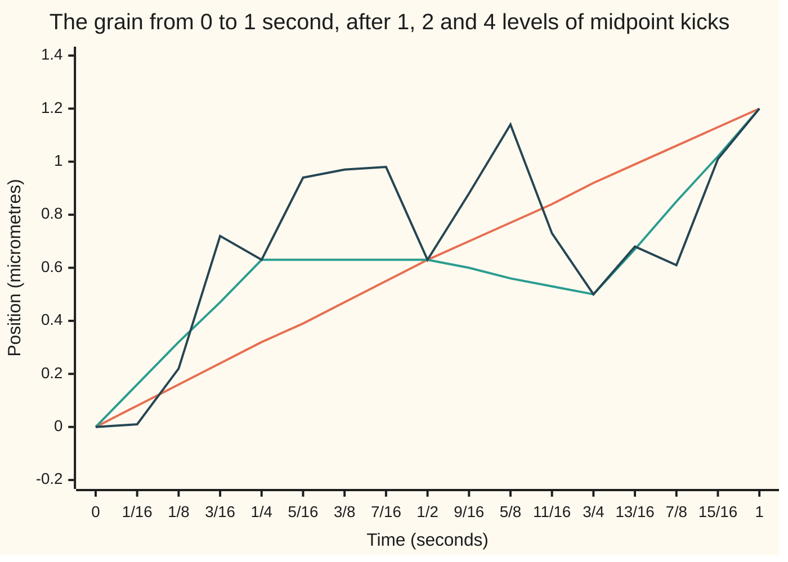

# Building Brownian motion: Levy's midpoint construction and Kolmogorov's continuity test

[Syllabus](../../../SYLLABUS.md) → [Stochastic processes and calculus](../README.md) → [Brownian Motion](../README.md#s05) → Building Brownian motion

---

## General Overview

A camera records a pollen grain's sideways position once a second. At 0 seconds the grain is at 0. At 1 second it is at 1.2 micrometres (μm, millionths of a metre). Where was it in between? Brownian motion, the model of the grain, says the path in between is random. This card draws that random path, one point at a time, and shows that the drawing ends in a real continuous path.

Start halfway, at half a second. The [Brownian bridge](05-brownian-bridge.md) rule says the grain sits on average at the midpoint of the straight line, 0.6 μm, give or take a normal kick with spread (standard deviation) 0.5 μm. So the chance it was already past 1.2 μm at half a second is the chance of a kick above 0.6, which is 1.2 spreads: **0.1151**, about 1 time in 9.

Now repeat in each half. The points at a quarter and three quarters of a second are their neighbours' average plus a kick with spread 0.354 μm. Every new level halves the gaps and halves the kick variance. After 10 levels there are 1,025 points. The question that makes this a theorem, not just a drawing recipe: do infinitely many kicks settle down to a continuous path, or can they pile up into jumps? They settle. After level 10, everything still to come can move the path by at most 0.389 μm anywhere, except on a chance below 5 in 100 million, and that cap shrinks to 0 as the levels go on.

A second, shorter road is Kolmogorov's continuity test. It needs no construction: if the moves of any random process have an average power that shrinks fast enough with the time gap, the process can be taken to have continuous paths.

**Fill in midpoints forever, each the average of its two neighbours plus a normal kick whose variance halves every level, and with probability 1 the pictures converge uniformly (the largest gap over all times shrinks to 0) to a continuous path with exactly Brownian motion's law (its probability distribution); Kolmogorov's test gives the same continuity from one moment bound, for any process.**

**What kind of fact this is:** a theorem, the existence of Brownian motion, proved on this card in Why it works. The midpoint construction and its convergence are proved in full. Kolmogorov's continuity test is stated, used, and proved in a fold.

### The picture: one path, three levels



Orange: after level 1, one kick at half a second (this run drew 0.63 μm), joined by straight lines. Green: after level 2, with points at 1/4 and 3/4 s. Dark blue: after level 4, a point every 1/16 s. A later level never moves an earlier point; it only adds points between them. One seeded run of the code (seed 20261123).

---

## The formula

Notation, as [Brownian motion](01-brownian-motion.md) set it up, written $`W(t)`$ here so fractions of a second read easily. $`W(t)`$ is the grain's position in μm at time $`t`$ seconds, with $`W(0) = 0`$. Its move over a stretch of length $`h`$ is normal with mean 0 and variance $`h`$, written $`N(0, h)`$, and moves over separate stretches are independent.

**The midpoint rule.** If a gap runs from time $`a`$ to time $`b`$ and both ends are already drawn, the midpoint is

```math
W\!\left(\tfrac{a+b}{2}\right) = \frac{W(a) + W(b)}{2} + \sqrt{\frac{b - a}{4}}\; Z
```

with $`Z`$ a fresh standard normal draw (mean 0, variance 1). **Read it aloud:** the midpoint is the average of its two ends plus a normal kick whose variance is a quarter of the gap.

**Levels.** Level $`n`$ fills the midpoints of the $`2^{n-1}`$ gaps of length $`2^{-(n-1)}`$ left by level $`n - 1`$. Its kicks have variance $`2^{-(n+1)}`$: 1/4 at level 1, 1/8 at level 2, halving each time.

**The same thing as one series.** Each kick adds a tent: a function that is 0 outside its gap, rises in a straight line to a peak at the gap's midpoint, and falls back to 0. Write $`\Delta_{n,k}(t)`$ for the tent over gap $`k`$ of level $`n`$ (gaps counted from $`k = 0`$), with peak height $`2^{-(n+1)/2}`$, the kick's spread. These tents are the Schauder functions. Then

```math
W(t) = t\, W(1) + \sum_{n=1}^{\infty} \sum_{k=0}^{2^{n-1}-1} Z_{n,k}\, \Delta_{n,k}(t)
```

**Read it aloud:** the path is the straight line to its end point plus, for every level and every gap, an independent normal number times that gap's tent.

In general $`W(1)`$ is itself a standard normal draw. In the example it is fixed at 1.2, which builds the path given that end point.

**Kolmogorov's continuity test.** Let $`X_t`$ be any random process on $`[0, 1]`$. Suppose there are positive numbers $`\alpha`$, $`\beta`$ and $`C`$ with

```math
E\,|X_t - X_s|^{\alpha} \le C\, |t - s|^{1 + \beta} \quad \text{for all } s, t
```

Then the process has a continuous version: a process with a continuous path that equals $`X_t`$ with probability 1 at each time $`t`$. Its paths are Hölder of every order $`\gamma < \beta/\alpha`$, meaning $`|X_t - X_s| \le K\,|t - s|^{\gamma}`$ for some random number $`K`$. **Read it aloud:** if the average size of a move, raised to some power, shrinks faster than the time gap itself, the process can be taken continuous, with a rate.

For Brownian motion the fourth moment (the average of the fourth power) of a move is $`E\,(W(t) - W(s))^4 = 3\,(t - s)^2`$. That is the test with $`\alpha = 4`$, $`\beta = 1`$, $`C = 3`$, so the paths are continuous and Hölder of every order below 1/4.

| Symbol | Plain meaning | In our example | Push it up and the answer… |
| --- | --- | --- | --- |
| $`W(t)`$, $`W(1)`$, $`W(1/2)`$ | the grain's position at time t, in μm | W(1) = 1.2; W(1/2) has mean 0.6 | a higher W(1) tilts the whole mean line up |
| $`t`$, $`s`$, $`u`$, $`a`$, $`b`$, $`h`$ | times in seconds; a and b the ends of a gap, u a time inside it; h a time step | gap 0 to 1, midpoint 1/2 | a wider gap gives a bigger kick |
| $`n`$, $`k`$ | the level, and which gap within it, counted from 0 | level 1 has 1 gap; level 11 has 1,024 | each level halves the kick variance |
| $`Z`$, $`Z_{n,k}`$ | independent standard normal draws, mean 0, variance 1 | this run drew 0.0627 at level 1 | a bigger draw, a bigger kick |
| $`\Delta_{n,k}(t)`$ | the Schauder tent: 0 outside its gap, peak $`2^{-(n+1)/2}`$ at the midpoint | peak 0.5 at level 1, 0.3536 at level 2 | — |
| $`W_N(t)`$, $`N`$ | the level-N picture: straight lines through the points drawn by level N | $`W_{10}`$ has 1,025 points | more levels, closer to the limit |
| $`M_n`$ | the cap on level n: $`2\sqrt{n}`$ times the kick spread $`2^{-(n+1)/2}`$ | the caps after level 10 sum to 0.3888 | — |
| $`X_t`$ | any random process on [0, 1], in Kolmogorov's test | Brownian motion | — |
| $`\alpha`$, $`\beta`$, $`C`$, $`p`$ | the power, the extra exponent and the constant in Kolmogorov's moment bound; p is half the power used | 4, 1 and 3 for Brownian motion, p = 2 | a larger β over α allows a faster rate |
| $`\gamma`$, $`K`$ | the Hölder order and its random constant | any γ below 1/4 from the fourth moment | — |
| $`E`$, $`P`$, $`\mathrm{Var}`$ | average, chance, variance | P(W(1/2) > 1.2) = 0.1151 | — |
| $`N(0, v)`$ | the normal law with mean 0 and variance v | kick at level 1: N(0, 1/4) | — |

### When it holds

- **Independent normal kicks.** Each midpoint draw must be a fresh normal independent of all others. With correlated kicks the points at the grid times no longer have Brownian motion's law, even if each kick has the right variance.
- **Kick variance exactly a quarter of the gap.** That is the bridge's variance at a midpoint. Using the free variance of half a gap instead, twice too much, makes the sum of squared steps head to 2 instead of 1 (1.999863 at level 12).
- **A moment bound with exponent above 1 in Kolmogorov's test.** The extra $`\beta > 0`$ is essential. A Poisson process (a counter that jumps by 1 at random times, rate 1 per second) has $`E\,N_h^4 / h = 1.006842`$ at $`h = 2^{-10}`$: its moments shrink only like h, never like a power above 1, and its paths do jump. The second moment of Brownian motion, $`E\,(W(t) - W(s))^2 = t - s`$, also has exponent exactly 1, so it proves nothing; the fourth moment is needed.
- **A version, not the original.** Kolmogorov's test changes the process on a set of chance 0 at each time. Without that, a process can have every finite-time law of Brownian motion and still jump (The usual mistake).
- **A bounded time interval.** The construction covers [0, 1]. Longer times glue independent copies end to end: run a second copy from 1 to 2 started at W(1), and so on.

---

## Why it works

### Step 0: refine forever, and check the kicks shrink faster than their number grows

Each new point is drawn from its exact law given the points already drawn, so every finite picture is right at its grid times. Only the limit can go wrong. The kicks of one level sit on separate gaps, so at any time only one kick per level matters. Its spread falls by $`\sqrt{2}`$ per level, while the largest of the level's $`2^{n-1}`$ draws grows only like $`\sqrt{n}`$. Geometric shrinking beats a square root, so the movement still to come is finite and falls to 0.

### Step 1: each midpoint has the right law

Given the path at times $`a`$ and $`b`$, the bridge formula ([Brownian bridge](05-brownian-bridge.md)) puts the time $`u`$ between them at mean $`W(a) + \frac{u-a}{b-a}(W(b) - W(a))`$ and variance $`(u - a)(b - u)/(b - a)`$. At the midpoint that is the average of the ends, with variance $`\frac{(b-a)/2 \cdot (b-a)/2}{b - a} = (b - a)/4`$.

Level 1 has gap 1, so variance 1/4 and spread 0.5. Level 2 has gap 1/2, variance 1/8, spread 0.3536. Level n has gap $`2^{-(n-1)}`$ and variance $`2^{-(n+1)}`$; the code checks this against the bridge formula at levels 1, 2, 3 and 10.

The bridge card also proves that, given all the points so far, a fill-in depends only on its two neighbours, and fill-ins in different gaps are independent. So drawing every midpoint of a level with independent kicks gives the exact joint law of Brownian motion at all the new times. By induction, after level N the $`2^N + 1`$ points have exactly the law of Brownian motion at times $`k/2^N`$ (given the end point W(1) = 1.2, in the example).

### Step 2: a level of kicks is a row of tents

Joining the points of level $`n - 1`$ by straight lines gives the picture $`W_{n-1}`$. Adding a kick at one midpoint and joining again changes the picture only inside that gap, and by a tent: 0 at the gap's ends, the kick itself at the midpoint, straight lines between. So

```math
W_n(t) - W_{n-1}(t) = \sum_{k} Z_{n,k}\, \Delta_{n,k}(t)
```

and summing over levels gives the series in The formula. The tents of one level sit on separate gaps. So at any time the level-n change is a single term, and its largest size over all of [0, 1] is

```math
\max_t\, |W_n(t) - W_{n-1}(t)| = 2^{-(n+1)/2}\, \max_k |Z_{n,k}|
```

The code builds one path both ways, by midpoints and by evaluating the tent series, and at 111 sampled times the two agree to 4.4e-16, rounding error.

### Step 3: Borel-Cantelli caps all but finitely many levels

Call level n good if every one of its draws obeys $`|Z_{n,k}| \le 2\sqrt{n}`$. Markov's inequality (a variable is rarely far above its average), applied to $`e^{xZ}`$, whose average is $`e^{x^2/2}`$, at the level $`e^{x^2}`$ gives $`P(Z > x) \le e^{-x^2/2}`$. Counting both tails, one draw breaks the cap with chance at most $`2e^{-2n}`$. Level n has $`2^{n-1}`$ draws, so

```math
P(\text{level } n \text{ is bad}) \le 2^{n-1} \cdot 2e^{-2n} = (2/e^2)^n
```

Since $`2/e^2 = 0.2707`$ is below 1, these chances add to a finite number. The first of [The Borel-Cantelli lemmas](../../10-Measure%20and%20integration/10-The%20Limit%20Theorems%2C%20Proved/01-borel-cantelli-lemmas.md) then says: with probability 1, only finitely many levels are bad.

The real numbers are smaller than the bound. Level 1 breaks the cap with chance 0.0455; level 2 with at most $`2 \times 0.004678`$; level 11, with 1,024 draws, with at most $`1024 \times 3.284 \times 10^{-11}`$. The sum over all levels is 0.0577, and the sum from level 11 on is about $`4.543 \times 10^{-8}`$.

### Step 4: the M-test turns the caps into uniform convergence

On a good level, Step 2 gives

```math
\max_t\, |W_n(t) - W_{n-1}(t)| \le M_n = 2\sqrt{n}\; 2^{-(n+1)/2}
```

The caps $`M_n`$ form a convergent series: each is about $`1/\sqrt{2}`$ times the last, up to the slowly growing $`\sqrt{n}`$. Past the last bad level, the Weierstrass M-test ([Uniform convergence](../../06-Calculus%20and%20analysis/06-Series/07-uniform-convergence.md)) applies: terms bounded at every time by numbers with a finite sum give uniform convergence. For every time at once, the pictures after level N stay within $`\sum_{n > N} M_n`$ of $`W_N`$. That tail is 2.2888 after level 4, 0.7161 after level 8, 0.3888 after level 10 and 0.0161 after level 20.

So the pictures $`W_N`$ converge uniformly on [0, 1], with probability 1. Each $`W_N`$ is continuous, being straight lines. A uniform limit of continuous functions is continuous. The limit $`W(t)`$ is a continuous path.

The caps are loose. Over 1,000 runs, levels 9 to 12 moved the path by 0.1059 μm on average and 0.1434 at worst, against 0.7161, the cap for all levels after 8. In every run where all levels were good, the move stayed under the cap.

### Step 5: the limit has Brownian motion's law at every time

At the grid times $`k/2^N`$ the limit equals the level-N points, which have the Brownian law by Step 1. Other times are limits of grid times, and the path is continuous. Each value $`W(t)`$ is a limit of jointly normal values, and limits of jointly normal vectors are jointly normal ([Multivariate normal](../../09-Probability%20and%20statistics/05-Transformations%20and%20Joint%20Laws/06-multivariate-normal.md)). Take the general case, with W(1) drawn as a standard normal. The mean is 0. The covariance can be read off the series, because the $`Z_{n,k}`$ are independent with variance 1:

```math
\mathrm{Cov}(W(s), W(t)) = s\,t + \sum_{n,k} \Delta_{n,k}(s)\, \Delta_{n,k}(t) = \min(s, t)
```

The identity holds at grid times by Step 1. Both sides are continuous in s and t, because the tent sum converges uniformly, so it holds everywhere. Summed exactly, at s = 0.3 the variance column runs 0.18, 0.26, 0.29, 0.299375 after levels 1, 2, 4 and 8, and reaches 0.300000 by level 30. The tents alone give the pinned variance $`0.3 \times 0.7 = 0.21`$, the bridge's.

Jointly normal values with mean 0, covariance $`\min(s, t)`$ and continuous paths make a standard Brownian motion, as [Brownian motion](01-brownian-motion.md) notes. That completes the construction.

### Step 6: Kolmogorov's test, a second road to continuity

The midpoint construction uses normal kicks. Kolmogorov's test uses only one moment bound, so it works for any process. Its proof follows the same three moves:

1. **One level at a time.** Markov's inequality turns the moment bound into a small chance for each step at level n to exceed $`2^{-\gamma n}`$.
2. **Borel-Cantelli.** Those chances, added over the $`2^n`$ steps of each level and over all levels, are finite when $`\gamma < \beta/\alpha`$. So past some level, every step obeys the bound.
3. **Chaining.** Any two grid times are joined by at most two steps per level, so their difference is at most a geometric sum, a constant times $`|t - s|^{\gamma}`$. The path is uniformly continuous on the grid times and extends to a continuous path.

For Brownian motion, $`E\,(W(t) - W(s))^{2p} = (2p - 1)!!\,(t - s)^p`$, where $`(2p-1)!! = 1 \times 3 \times \cdots \times (2p - 1)`$. The code finds $`E\,Z^4 = 3`$ and $`E\,Z^8 = 105`$ by integration. This gives $`\alpha = 2p`$ and $`\beta = p - 1`$, so Hölder of every order below $`(p - 1)/(2p)`$: 0.25 from p = 2, 0.375 from p = 4, 0.45 from p = 10, and every order below 1/2 in the limit. Order 1/2 itself fails: Lévy's modulus of continuity puts the largest steps at gap h near $`\sqrt{2h\log(1/h)}`$, beyond any constant times $`\sqrt{h}`$ (Mörters and Peres, chapter 1).

The simulation shows the boundary. Divide the largest step at level n by $`h^{\gamma}`$, with $`h = 2^{-n}`$. For $`\gamma = 0.25`$, the average over 1,000 runs falls: 1.052, 0.763, 0.474 at levels 4, 8, 12. For $`\gamma = 0.6`$, above 1/2, it grows: 2.776, 5.317, 8.711.

<details>
<summary>Detailed proof of Kolmogorov's test</summary>

**Claim.** If $`E\,|X_t - X_s|^{\alpha} \le C\,|t - s|^{1+\beta}`$ on [0, 1] with $`\alpha, \beta, C > 0`$, then for every $`\gamma < \beta/\alpha`$ there is a process $`\tilde X`$ with continuous, γ-Hölder paths and $`P(\tilde X_t = X_t) = 1`$ for every t.

**One level.** Let $`D_n`$ be the times $`k/2^n`$. By Markov's inequality applied to the α-th power,

$`\displaystyle P\big(|X_{(k+1)/2^n} - X_{k/2^n}| \ge 2^{-\gamma n}\big) \le 2^{\gamma n \alpha}\, C\, 2^{-n(1+\beta)}.`$

There are $`2^n`$ such steps, so the chance that any of them breaks the bound is at most $`C\, 2^{-n(\beta - \alpha\gamma)}`$. The exponent $`\beta - \alpha\gamma`$ is positive, so these numbers add to a finite total.

**Borel-Cantelli.** With probability 1 there is a level $`n^*`$ such that for all $`n \ge n^*`$, every step of $`D_n`$ is below $`2^{-\gamma n}`$.

**Chaining.** Take grid times $`s < t`$ in $`D = \bigcup_n D_n`$ with $`2^{-(m+1)} \le t - s < 2^{-m}`$ and $`m \ge n^*`$. Walk from s up to the first point of $`D_{m+1}`$ at or above s using at most one step from each finer level, and the same from t downward; then at most one step of $`D_{m+1}`$ joins the two. Each level $`n > m`$ contributes at most two steps of size below $`2^{-\gamma n}`$, so

$`\displaystyle |X_t - X_s| \le 2 \sum_{n > m} 2^{-\gamma n} = \frac{2\cdot 2^{-\gamma(m+1)}}{1 - 2^{-\gamma}} \le \frac{2}{1 - 2^{-\gamma}}\,|t - s|^{\gamma}.`$

**Extension.** So on D the path is uniformly continuous, with a Hölder bound. Define $`\tilde X_t`$ as its limit along grid times tending to t; this is continuous and keeps the bound. For a fixed t, $`X_{t_j} \to X_t`$ in probability along grid times $`t_j \to t`$, because $`E\,|X_{t_j} - X_t|^{\alpha} \to 0`$. A limit in probability and a sure limit agree with probability 1, so $`\tilde X_t = X_t`$ with probability 1.

</details>

---

## Worked numbers, by hand

The grain is at 0 μm at 0 s and 1.2 μm at 1 s.

| Step | Arithmetic | Value |
| --- | --- | --- |
| mean at 1/2 s | (0 + 1.2) / 2 | 0.6 |
| kick variance, level 1 | gap / 4 = 1/4 | 0.25 |
| kick spread, level 1 | √0.25 | 0.5 |
| past 1.2 μm at 1/2 s, in spreads | (1.2 − 0.6) / 0.5 | 1.2 |
| **chance it was past 1.2 μm at 1/2 s** | P(Z > 1.2) | **0.1151** |
| kick spread, level 2 | √(1/8) | 0.3536 |
| kick spread, level 10 | √(2^−11) | 0.0221 |
| chance one level-11 draw breaks 2√11 | P(\|Z\| > 6.633) | 3.284 × 10^−11 |
| Borel-Cantelli bound on a level after 10 breaking its cap | 1,024 × 3.284 × 10^−11 + later levels | 4.543 × 10^−8 |
| **cap on all moves after level 10** | M_11 + M_12 + … | **0.3888 μm** |

About 1 time in 9 the grain was already past its 1-second position at half a second. After level 10, the rest of the construction can shift the path by at most 0.389 μm, except with a chance below 5 in 100 million.

### What breaks if you drop a piece

The sum of squared steps over the second should be close to 1, the elapsed time ([Quadratic variation](03-quadratic-variation.md)). At level 12 its exact mean is 1.000107, and 1,000 runs gave 1.000674.

| Mistake | Comes out at | What went wrong |
| --- | --- | --- |
| Kick variance a half of the gap, the free value, not a quarter | squared steps sum to 1.999863 at level 12 | The pinned ends cut the variance in half, the mistake shown on [Brownian bridge](05-brownian-bridge.md) |
| Halve the kick's spread each level, not its variance | 0.003281 | Kicks shrink too fast; the limit is too smooth to be Brownian |
| Cap every level at a fixed 4, not 2√n | level 20 breaks it with chance 1.0000; Borel-Cantelli sum 66.4 by level 20 | The draws double each level, so a fixed cap is broken at almost every late level |

---

## Code, from first principles, and it actually runs

The scripts take five roads. Road 1 checks each level's kick variance against the bridge formula. Road 2 sums the Schauder series' covariance exactly, level by level, and watches it reach min(s, t). Road 3 builds one path by midpoints and again by the tent series, and compares. Road 4 draws 1,000 paths to level 12 (4,096 steps each) with a SplitMix64 generator (a small, written-out source of random bits), seed 20261123, and Box-Muller normals, and compares means, variances, a tail chance, squared steps and fourth moments with their exact values within four standard errors. Road 5 computes the exact chance that some level breaks the cap and tests it against the Borel-Cantelli sum and the count in the simulation. Normal tail chances and moments come from Simpson's rule, with no library normal function; Laplace's continued fraction for the tail checks every tail chance, and the ratio test brackets every cap sum.

### Python

```python
# Building Brownian motion on [0, 1] by Levy's midpoint construction -- the check behind the card.
# Standard library only.  The grain: W(0) = 0, W(1) = 1.2 um.  Level n fills the midpoints of the 2^(n-1) gaps,
# each the average of its two ends plus a normal kick of variance 2^-(n+1).
# Road 1: the kick variance against the bridge formula.  Road 2: the Schauder series' covariance, summed exactly.
# Road 3: one path built by midpoints and again by the tent series.  Road 4: 1000 seeded paths to level 12.
from math import cos, exp, log, pi, sqrt

W1, L, M = 1.2, 12, 1000
def tail(x, m=4000):                       # P(Z > x) for a standard normal Z, Simpson's rule on [x, x + 12]
    h = 12 / m
    return h / 3 * sum((1 if i in (0, m) else 4 if i % 2 else 2) * exp(-(x + i * h) ** 2 / 2) for i in range(m + 1)) / sqrt(2 * pi)
def cf(x):                                 # P(Z > x) a second way: Laplace's continued fraction, 200 levels deep
    f = x
    for k in range(200, 0, -1): f = x + k / f
    return exp(-x * x / 2) / sqrt(2 * pi) / f
def moment(p, m=4000):                     # E[Z^p] by Simpson's rule on [-12, 12]
    h = 24 / m
    return h / 3 * sum((1 if i in (0, m) else 4 if i % 2 else 2) * (i * h - 12) ** p * exp(-(i * h - 12) ** 2 / 2) for i in range(m + 1)) / sqrt(2 * pi)
def tent(n, k, t):                         # Schauder tent of level n, gap k: peak 2^-(n+1)/2 at the gap's midpoint
    w = 2.0 ** (1 - n); u = (t - k * w) / w
    return 2 ** (-(n + 1) / 2) * (1 - abs(2 * u - 1)) if 0 <= u <= 1 else 0.0
def gap(n, t): return min(int(t * 2 ** (n - 1)), 2 ** (n - 1) - 1)
def tent_cov(s, t, N): return sum(tent(n, gap(n, s), s) * tent(n, gap(n, s), t) for n in range(1, N + 1))
def qv_exact(var, q=W1 ** 2):              # mean sum of squared steps after each level: q -> q/2 + 2^(n-1) * 2 * var(n)
    for n in range(1, L + 1): q = q / 2 + 2 ** n * var(n)
    return q
MASK, state = (1 << 64) - 1, 20261123
def unif():                                # SplitMix64, top 53 bits, never exactly 0 or 1
    global state
    state = (state + 0x9E3779B97F4A7C15) & MASK
    z = state
    z = ((z ^ (z >> 30)) * 0xBF58476D1CE4E5B9) & MASK
    z = ((z ^ (z >> 27)) * 0x94D049BB133111EB) & MASK
    return (((z ^ (z >> 31)) >> 11) + 0.5) / 2 ** 53
def normal():                              # Box-Muller, one normal from two uniforms
    r = sqrt(-2 * log(unif())); return r * cos(2 * pi * unif())
def build():                               # levels 1..L of midpoint kicks; returns the path at k/2^L and the kicks
    p, Z = [0.0, W1], []
    for n in range(1, L + 1):
        sd, q, zn = 2 ** (-(n + 1) / 2), [0.0], []
        for a, b in zip(p, p[1:]):
            z = normal(); zn.append(z); q += [(a + b) / 2 + sd * z, b]
        p = q; Z.append(zn)
    return p, Z
def coarse(p, N, i):                       # the level-N picture (straight lines between its points) at grid point i
    s = 2 ** (L - N); j = i // s; f = (i - j * s) / s
    return p[j * s] if f == 0 else p[j * s] * (1 - f) + p[(j + 1) * s] * f
def ok(x): return "ok" if x else "FAIL"

print("level | gap      | kick variance | bridge formula | kick spread")
for n in (1, 2, 3, 10):
    g = 2.0 ** (1 - n); v = 2.0 ** -(n + 1); bv = g / 2 * (g / 2) / g
    assert abs(v - bv) < 1e-15
    print(f"{n:5d} | {g:.6f} | {v:.6f}      | {bv:.6f}       | {sqrt(v):.4f}")
pz = tail(1.2)
assert abs(pz - cf(1.2)) < 1e-9
print(f"W(1/2) = 0.6 + 0.5 Z; P(W(1/2) > 1.2) = P(Z > 1.2) = {pz:.4f}")
print("Schauder series at s = 0.3, t = 0.4: levels N | Cov st + tents | Var at 0.3 | pinned Var, tents only")
for N in (1, 2, 4, 8, 16, 30):
    c, v = tent_cov(0.3, 0.4, N), tent_cov(0.3, 0.3, N); print(f"  N = {N:2d} | {0.12 + c:.6f} | {0.09 + v:.6f} | {v:.6f}")
assert abs(0.12 + tent_cov(0.3, 0.4, 30) - 0.3) < 1e-8 and abs(tent_cov(0.3, 0.3, 30) - 0.3 * 0.7) < 1e-8
assert abs(0.09 + tent_cov(0.3, 0.3, 8) - 0.3) > 1e-4
print("  limits: min(s, t) = 0.300000, Var W(0.3) = 0.300000, pinned 0.3 x 0.7 = 0.210000")
m4, m8 = moment(4), moment(8)
assert abs(m4 - 3) < 1e-9 and abs(m8 - 105) < 1e-7
print(f"E[Z^4] = {m4:.6f}, E[Z^8] = {m8:.6f}: E|W(t)-W(s)|^(2p) = (2p-1)!! h^p, Kolmogorov exponent < (p-1)/(2p)")
for p in (2, 4, 10): print(f"  p = {p:2d}: alpha = {2 * p}, beta = {p - 1}, paths Holder of every order below {(p - 1) / (2 * p):.4f}")
h = 2.0 ** -10; pm = sum(k ** 4 * exp(-h) * h ** k / exp(sum(log(j) for j in range(1, k + 1))) for k in range(1, 30))
assert abs(pm - (h + 7 * h ** 2 + 6 * h ** 3 + h ** 4)) < 1e-15
print(f"Poisson rate 1, h = 2^-10: E[N_h^4] / h = {pm / h:.6f}, never below C h^(1+beta)")
fails = [2 * tail(2 * sqrt(n)) for n in range(1, 61)]
assert all(abs(f / (2 * cf(2 * sqrt(n))) - 1) < 1e-6 for n, f in zip(range(1, 61), fails))
union = sum(2 ** (n - 1) * f for n, f in zip(range(1, 61), fails))
pfail = 1 - exp(sum(2 ** (n - 1) * log(1 - f) for n, f in zip(range(1, L + 1), fails)))
for n in (1, 2, 3, 11): print(f"  level {n:2d}: {2 ** (n - 1):4d} kicks, P(|Z| > 2 sqrt n) = {fails[n - 1]:.3e} <= exp(-2n) = {exp(-2 * n):.3e}")
assert all(f <= exp(-2 * n) for n, f in zip(range(1, 61), fails)) and pfail <= union
print(f"Borel-Cantelli sum over all levels {union:.4f}; exact P(some level 1..{L} breaks the cap) {pfail:.4f}")
print(f"P(a level after 10 breaks it) <= {sum(2 ** (n - 1) * f for n, f in zip(range(1, 61), fails) if n > 10):.3e}")
bound = {N: sum(2 * sqrt(n) * 2 ** (-(n + 1) / 2) for n in range(N + 1, 200)) for N in (4, 8, 10, 20)}
for N, b in bound.items():                 # ratio test: after the first cap left, each next one is 1/sqrt 2 to sqrt((N+2)/(N+1)/2) times the last
    first = 2 * sqrt(N + 1) * sqrt(2.0 ** -N / 4)   # 2 sqrt n times the spread of a kick on a gap of 2^-N
    assert first / (1 - sqrt(0.5)) < b < first / (1 - sqrt((N + 2) / (N + 1) / 2))
print(f"2/e^2 = {2 / exp(2):.4f}; 2 sqrt 11 = {2 * sqrt(11):.3f}; points after level 10: {2 ** 10 + 1}")
print("cap on how far levels after N can move the path: " + ", ".join(f"N = {N}: {b:.4f}" for N, b in bound.items()))

S = dict.fromkeys(["half", "half2", "five", "five2", "above", "qv", "q4"], 0.0); brk = 0
sup = {4: [], 8: []}; hol = {(n, g): 0.0 for n in (4, 8, 12) for g in (0.25, 0.6)}
for k in range(M):
    p, Z = build()
    if k == 0:
        diff = max(abs(p[i] - (i / 2 ** L * W1 + sum(Z[n - 1][gap(n, i / 2 ** L)] * tent(n, gap(n, i / 2 ** L), i / 2 ** L)
                   for n in range(1, L + 1)))) for i in range(0, 2 ** L + 1, 37))
        assert diff < 1e-12
        print(f"path 1: kick at 1/2 = {Z[0][0]:.4f}, W(1/2) = {p[2048]:.4f}; midpoints vs tent series at {len(range(0, 2 ** L + 1, 37))} times, largest gap {diff:.1e}")
        for N in (1, 2, 4): print(f"chart, level {N}: " + ", ".join(f"{coarse(p, N, i * 256):.2f}" for i in range(17)))
    bad = any(max(abs(z) for z in Z[n - 1]) > 2 * sqrt(n) for n in range(1, L + 1)); brk += bad
    S["half"] += p[2048]; S["half2"] += p[2048] ** 2; S["five"] += p[1280]; S["five2"] += p[1280] ** 2; S["above"] += p[2048] > 1.2
    d = [y - x for x, y in zip(p, p[1:])]; S["qv"] += sum(x * x for x in d); S["q4"] += sum(x ** 4 for x in d) * 2 ** L
    for N in sup:
        sup[N].append(max(abs(p[i] - coarse(p, N, i)) for i in range(2 ** L + 1)))
        assert bad or sup[N][-1] <= bound[N]
    for (n, g) in hol: s = 2 ** (L - n); hol[(n, g)] += max(abs(p[i + s] - p[i]) for i in range(0, 2 ** L, s)) * 2 ** (n * g) / M
se = lambda m, m2: sqrt((m2 / M - (m / M) ** 2) / M)
mh, vh = S["half"] / M, S["half2"] / M - (S["half"] / M) ** 2; mf, vf = S["five"] / M, S["five2"] / M - (S["five"] / M) ** 2
pa = S["above"] / M; sa = sqrt(pa * (1 - pa) / M)
print(f"{M} paths to level {L} ({2 ** L} steps): W(1/2) mean {mh:.4f} (0.6), variance {vh:.4f} (0.25); W(5/16) mean {mf:.4f} (0.375), variance {vf:.4f} (0.2148)")
print(f"  P(W(1/2) > 1.2) {pa:.4f}, standard error {sa:.4f} (exact {pz:.4f})")
assert abs(mh - 0.6) < 4 * se(S["half"], S["half2"]) and abs(pa - pz) < 4 * sa and abs(vh - 0.25) < 4 * 0.25 * sqrt(2 / M)
hstep = 2.0 ** -L; v = hstep * (1 - hstep); mu = W1 * hstep; q4 = (3 * v * v + 6 * v * mu * mu + mu ** 4) / hstep ** 2
qr = qv_exact(lambda n: 2.0 ** -(n + 1))
print(f"  sum of squared steps {S['qv'] / M:.6f} (exact mean {qr:.6f}); mean step^4 / h^2 {S['q4'] / M:.4f} (exact {q4:.4f})")
assert abs(S["qv"] / M - qr) < 4 * sqrt(2 / 2 ** L / M) and abs(S["q4"] / M - q4) < 4 * sqrt(96 / 2 ** L / M)
sb = sqrt(brk / M * (1 - brk / M) / M)
print(f"  paths where some level broke the cap: {brk} of {M} = {brk / M:.4f}, standard error {sb:.4f} (exact {pfail:.4f})")
assert abs(brk / M - pfail) < 4 * sb
for N in sup: print(f"  level {N} to level {L}: largest move, mean over paths {sum(sup[N]) / M:.4f}, worst {max(sup[N]):.4f}, cap {bound[N]:.4f}")
for g in (0.25, 0.6): print(f"  largest step / h^{g}: " + ", ".join(f"level {n}: {hol[(n, g)]:.3f}" for n in (4, 8, 12)))
assert hol[(12, 0.25)] < hol[(4, 0.25)] and hol[(12, 0.6)] > hol[(4, 0.6)]
wrong = {"free variance h/2 for the kick": lambda n: 2.0 ** -n, "spread halving, not variance": lambda n: 0.25 * 4.0 ** (1 - n)}
for name, f in wrong.items(): print(f"wrong: {name}: sum of squared steps at level {L} = {qv_exact(f):.6f} (right {qr:.6f})")
c4 = 2 * tail(4)                           # a fixed cap of 4 at every level: the draws double, the cap does not grow
print(f"wrong: fixed cap 4: P(|Z| > 4) = {c4:.3e}; level 20 breaks it with chance {1 - (1 - c4) ** 2 ** 19:.4f}; Borel-Cantelli sum to level 20 {c4 * (2 ** 20 - 1):.1f}")
f3 = [2 * tail(3 * sqrt(n)) for n in range(1, L + 1)]
print(f"try: W1 = 0: squared steps {qv_exact(lambda n: 2.0 ** -(n + 1), 0.0):.6f}; W1 drawn N(0, 1): Var W(1/2) = {0.25 + tent_cov(0.5, 0.5, 30):.6f}")
print(f"try: cap 3 sqrt n: level 1 breaks it {f3[0]:.4f}, some level {1 - exp(sum(2 ** (n - 1) * log(1 - f) for n, f in zip(range(1, L + 1), f3))):.4f}, "
      f"caps after level 10 {sum(3 * sqrt(n) * 2 ** (-(n + 1) / 2) for n in range(11, 200)):.4f}")
print("ALL CHECKS PASS")
```

**Ran 2026-11-23 on macOS, Python 3.14.10, standard library only. All checks passed. Output, pasted from the run:**

```
level | gap      | kick variance | bridge formula | kick spread
    1 | 1.000000 | 0.250000      | 0.250000       | 0.5000
    2 | 0.500000 | 0.125000      | 0.125000       | 0.3536
    3 | 0.250000 | 0.062500      | 0.062500       | 0.2500
   10 | 0.001953 | 0.000488      | 0.000488       | 0.0221
W(1/2) = 0.6 + 0.5 Z; P(W(1/2) > 1.2) = P(Z > 1.2) = 0.1151
Schauder series at s = 0.3, t = 0.4: levels N | Cov st + tents | Var at 0.3 | pinned Var, tents only
  N =  1 | 0.240000 | 0.180000 | 0.090000
  N =  2 | 0.280000 | 0.260000 | 0.170000
  N =  4 | 0.300000 | 0.290000 | 0.200000
  N =  8 | 0.300000 | 0.299375 | 0.209375
  N = 16 | 0.300000 | 0.299998 | 0.209998
  N = 30 | 0.300000 | 0.300000 | 0.210000
  limits: min(s, t) = 0.300000, Var W(0.3) = 0.300000, pinned 0.3 x 0.7 = 0.210000
E[Z^4] = 3.000000, E[Z^8] = 105.000000: E|W(t)-W(s)|^(2p) = (2p-1)!! h^p, Kolmogorov exponent < (p-1)/(2p)
  p =  2: alpha = 4, beta = 1, paths Holder of every order below 0.2500
  p =  4: alpha = 8, beta = 3, paths Holder of every order below 0.3750
  p = 10: alpha = 20, beta = 9, paths Holder of every order below 0.4500
Poisson rate 1, h = 2^-10: E[N_h^4] / h = 1.006842, never below C h^(1+beta)
  level  1:    1 kicks, P(|Z| > 2 sqrt n) = 4.550e-02 <= exp(-2n) = 1.353e-01
  level  2:    2 kicks, P(|Z| > 2 sqrt n) = 4.678e-03 <= exp(-2n) = 1.832e-02
  level  3:    4 kicks, P(|Z| > 2 sqrt n) = 5.320e-04 <= exp(-2n) = 2.479e-03
  level 11: 1024 kicks, P(|Z| > 2 sqrt n) = 3.284e-11 <= exp(-2n) = 2.789e-10
Borel-Cantelli sum over all levels 0.0577; exact P(some level 1..12 breaks the cap) 0.0571
P(a level after 10 breaks it) <= 4.543e-08
2/e^2 = 0.2707; 2 sqrt 11 = 6.633; points after level 10: 1025
cap on how far levels after N can move the path: N = 4: 2.2888, N = 8: 0.7161, N = 10: 0.3888, N = 20: 0.0161
path 1: kick at 1/2 = 0.0627, W(1/2) = 0.6313; midpoints vs tent series at 111 times, largest gap 4.4e-16
chart, level 1: 0.00, 0.08, 0.16, 0.24, 0.32, 0.39, 0.47, 0.55, 0.63, 0.70, 0.77, 0.84, 0.92, 0.99, 1.06, 1.13, 1.20
chart, level 2: 0.00, 0.16, 0.32, 0.47, 0.63, 0.63, 0.63, 0.63, 0.63, 0.60, 0.56, 0.53, 0.50, 0.67, 0.85, 1.02, 1.20
chart, level 4: 0.00, 0.01, 0.22, 0.72, 0.63, 0.94, 0.97, 0.98, 0.63, 0.88, 1.14, 0.73, 0.50, 0.68, 0.61, 1.01, 1.20
1000 paths to level 12 (4096 steps): W(1/2) mean 0.6075 (0.6), variance 0.2333 (0.25); W(5/16) mean 0.3888 (0.375), variance 0.2135 (0.2148)
  P(W(1/2) > 1.2) 0.1220, standard error 0.0103 (exact 0.1151)
  sum of squared steps 1.000674 (exact mean 1.000107); mean step^4 / h^2 3.0053 (exact 3.0006)
  paths where some level broke the cap: 50 of 1000 = 0.0500, standard error 0.0069 (exact 0.0571)
  level 4 to level 12: largest move, mean over paths 0.3438, worst 0.5480, cap 2.2888
  level 8 to level 12: largest move, mean over paths 0.1059, worst 0.1434, cap 0.7161
  largest step / h^0.25: level 4: 1.052, level 8: 0.763, level 12: 0.474
  largest step / h^0.6: level 4: 2.776, level 8: 5.317, level 12: 8.711
wrong: free variance h/2 for the kick: sum of squared steps at level 12 = 1.999863 (right 1.000107)
wrong: spread halving, not variance: sum of squared steps at level 12 = 0.003281 (right 1.000107)
wrong: fixed cap 4: P(|Z| > 4) = 6.334e-05; level 20 breaks it with chance 1.0000; Borel-Cantelli sum to level 20 66.4
try: W1 = 0: squared steps 0.999756; W1 drawn N(0, 1): Var W(1/2) = 0.500000
try: cap 3 sqrt n: level 1 breaks it 0.0027, some level 0.0027, caps after level 10 0.5833
ALL CHECKS PASS
```

### Rust

```rust
// Building Brownian motion on [0, 1] by Levy's midpoint construction -- the check behind the card.
// Standard library only.  The grain: W(0) = 0, W(1) = 1.2 um.  Level n fills the midpoints of the 2^(n-1) gaps,
// each the average of its two ends plus a normal kick of variance 2^-(n+1).
// Road 1: the kick variance against the bridge formula.  Road 2: the Schauder series' covariance, summed exactly.
// Road 3: one path built by midpoints and again by the tent series.  Road 4: 1000 seeded paths to level 12.
use std::f64::consts::PI;
const W1: f64 = 1.2; const L: usize = 12; const M: usize = 1000;
fn nsum<I: Iterator<Item = f64>>(it: I) -> f64 { // compensated sum, the rule Python's sum() uses for floats
    let (mut s, mut c) = (0.0f64, 0.0f64);
    for x in it { let t = s + x; if s.abs() >= x.abs() { c += (s - t) + x } else { c += (x - t) + s } s = t; }
    s + c
}
fn wt(i: usize, m: usize) -> f64 { if i == 0 || i == m { 1.0 } else if i % 2 == 1 { 4.0 } else { 2.0 } }
fn tail(x: f64) -> f64 { // P(Z > x) for a standard normal Z, Simpson's rule on [x, x + 12]
    let m = 4000; let h = 12.0 / m as f64;
    h / 3.0 * nsum((0..=m).map(|i| wt(i, m) * (-(x + i as f64 * h).powf(2.0) / 2.0).exp())) / (2.0 * PI).sqrt()
}
fn cf(x: f64) -> f64 { // P(Z > x) a second way: Laplace's continued fraction, 200 levels deep
    let mut f = x; for k in (1..=200).rev() { f = x + k as f64 / f } (-x * x / 2.0).exp() / (2.0 * PI).sqrt() / f
}
fn moment(p: f64) -> f64 { // E[Z^p] by Simpson's rule on [-12, 12]
    let m = 4000; let h = 24.0 / m as f64;
    h / 3.0 * nsum((0..=m).map(|i| { let x = i as f64 * h - 12.0; wt(i, m) * x.powf(p) * (-x.powf(2.0) / 2.0).exp() })) / (2.0 * PI).sqrt()
}
fn tent(n: usize, k: usize, t: f64) -> f64 { // Schauder tent of level n, gap k: peak 2^-(n+1)/2 mid-gap
    let w = 2f64.powf(1.0 - n as f64); let u = (t - k as f64 * w) / w;
    if (0.0..=1.0).contains(&u) { 2f64.powf(-(n as f64 + 1.0) / 2.0) * (1.0 - (2.0 * u - 1.0).abs()) } else { 0.0 }
}
fn gap(n: usize, t: f64) -> usize { ((t * 2f64.powf(n as f64 - 1.0)) as usize).min((1 << (n - 1)) - 1) }
fn tent_cov(s: f64, t: f64, nn: usize) -> f64 { nsum((1..=nn).map(|n| tent(n, gap(n, s), s) * tent(n, gap(n, s), t))) }
fn qv_exact(var: &dyn Fn(usize) -> f64, q0: f64) -> f64 { // mean sum of squared steps: q -> q/2 + 2^(n-1) * 2 * var(n)
    let mut q = q0; for n in 1..=L { q = q / 2.0 + (1u64 << n) as f64 * var(n) } q
}
struct Rng(u64);
impl Rng {
    fn unif(&mut self) -> f64 { // SplitMix64, top 53 bits, never exactly 0 or 1
        self.0 = self.0.wrapping_add(0x9E3779B97F4A7C15);
        let mut z = self.0;
        z = (z ^ (z >> 30)).wrapping_mul(0xBF58476D1CE4E5B9);
        z = (z ^ (z >> 27)).wrapping_mul(0x94D049BB133111EB);
        (((z ^ (z >> 31)) >> 11) as f64 + 0.5) / 2f64.powf(53.0)
    }
    fn normal(&mut self) -> f64 { let r = (-2.0 * self.unif().ln()).sqrt(); r * (2.0 * PI * self.unif()).cos() }
}
fn build(g: &mut Rng) -> (Vec<f64>, Vec<Vec<f64>>) { // levels 1..L of midpoint kicks: path at k/2^L, kicks
    let (mut p, mut zz) = (vec![0.0, W1], Vec::new());
    for n in 1..=L {
        let sd = 2f64.powf(-(n as f64 + 1.0) / 2.0);
        let (mut q, mut zn) = (vec![0.0], Vec::new());
        for w in p.windows(2) { let z = g.normal(); zn.push(z); q.push((w[0] + w[1]) / 2.0 + sd * z); q.push(w[1]); }
        p = q; zz.push(zn);
    }
    (p, zz)
}
fn coarse(p: &[f64], nn: usize, i: usize) -> f64 { // the level-N picture (straight lines) at grid point i
    let s = 1 << (L - nn); let j = i / s; let f = (i - j * s) as f64 / s as f64;
    if f == 0.0 { p[j * s] } else { p[j * s] * (1.0 - f) + p[(j + 1) * s] * f }
}
fn sci(x: f64, d: usize) -> String { // Python's e-format: two-digit exponent with its sign
    let s = format!("{:.*e}", d, x); let (m, e) = s.split_once('e').unwrap(); let e: i32 = e.parse().unwrap();
    format!("{}e{}{:02}", m, if e < 0 { '-' } else { '+' }, e.abs())
}
fn join(v: &[String]) -> String { v.join(", ") }
fn main() {
    println!("level | gap      | kick variance | bridge formula | kick spread");
    for n in [1usize, 2, 3, 10] {
        let g = 2f64.powf(1.0 - n as f64); let v = 2f64.powf(-(n as f64 + 1.0)); let bv = g / 2.0 * (g / 2.0) / g;
        assert!((v - bv).abs() < 1e-15);
        println!("{:5} | {:.6} | {:.6}      | {:.6}       | {:.4}", n, g, v, bv, v.sqrt());
    }
    let pz = tail(1.2); assert!((pz - cf(1.2)).abs() < 1e-9);
    println!("W(1/2) = 0.6 + 0.5 Z; P(W(1/2) > 1.2) = P(Z > 1.2) = {:.4}", pz);
    println!("Schauder series at s = 0.3, t = 0.4: levels N | Cov st + tents | Var at 0.3 | pinned Var, tents only");
    for nn in [1usize, 2, 4, 8, 16, 30] {
        let (c, v) = (tent_cov(0.3, 0.4, nn), tent_cov(0.3, 0.3, nn));
        println!("  N = {:2} | {:.6} | {:.6} | {:.6}", nn, 0.12 + c, 0.09 + v, v);
    }
    assert!((0.12 + tent_cov(0.3, 0.4, 30) - 0.3).abs() < 1e-8 && (tent_cov(0.3, 0.3, 30) - 0.3 * 0.7).abs() < 1e-8);
    assert!((0.09 + tent_cov(0.3, 0.3, 8) - 0.3).abs() > 1e-4);
    println!("  limits: min(s, t) = 0.300000, Var W(0.3) = 0.300000, pinned 0.3 x 0.7 = 0.210000");
    let (m4, m8) = (moment(4.0), moment(8.0));
    assert!((m4 - 3.0).abs() < 1e-9 && (m8 - 105.0).abs() < 1e-7);
    println!("E[Z^4] = {:.6}, E[Z^8] = {:.6}: E|W(t)-W(s)|^(2p) = (2p-1)!! h^p, Kolmogorov exponent < (p-1)/(2p)", m4, m8);
    for p in [2usize, 4, 10] { println!("  p = {:2}: alpha = {}, beta = {}, paths Holder of every order below {:.4}", p, 2 * p, p - 1, (p - 1) as f64 / (2 * p) as f64) }
    let h = 2f64.powf(-10.0);
    let pm = nsum((1..30).map(|k: i32| (k as f64).powf(4.0) * (-h).exp() * h.powf(k as f64) / nsum((1..=k).map(|j| (j as f64).ln())).exp()));
    assert!((pm - (h + 7.0 * h.powf(2.0) + 6.0 * h.powf(3.0) + h.powf(4.0))).abs() < 1e-15);
    println!("Poisson rate 1, h = 2^-10: E[N_h^4] / h = {:.6}, never below C h^(1+beta)", pm / h);
    let fails: Vec<f64> = (1..=60).map(|n| 2.0 * tail(2.0 * (n as f64).sqrt())).collect();
    assert!((1..=60).all(|n| (fails[n - 1] / (2.0 * cf(2.0 * (n as f64).sqrt())) - 1.0).abs() < 1e-6));
    let pw = |n: usize| 2f64.powf(n as f64 - 1.0);
    let union = nsum((1..=60).map(|n| pw(n) * fails[n - 1]));
    let pfail = 1.0 - nsum((1..=L).map(|n| pw(n) * (1.0 - fails[n - 1]).ln())).exp();
    for n in [1usize, 2, 3, 11] { println!("  level {:2}: {:4} kicks, P(|Z| > 2 sqrt n) = {} <= exp(-2n) = {}", n, 1 << (n - 1), sci(fails[n - 1], 3), sci((-2.0 * n as f64).exp(), 3)) }
    assert!((1..=60).all(|n| fails[n - 1] <= (-2.0 * n as f64).exp()) && pfail <= union);
    println!("Borel-Cantelli sum over all levels {:.4}; exact P(some level 1..{} breaks the cap) {:.4}", union, L, pfail);
    println!("P(a level after 10 breaks it) <= {}", sci(nsum((11..=60).map(|n| pw(n) * fails[n - 1])), 3));
    println!("2/e^2 = {:.4}; 2 sqrt 11 = {:.3}; points after level 10: {}", 2.0 / 2f64.exp(), 2.0 * 11f64.sqrt(), (1 << 10) + 1);
    let caps: Vec<(usize, f64)> = [4usize, 8, 10, 20].iter()
        .map(|&nn| (nn, nsum((nn + 1..200).map(|n| 2.0 * (n as f64).sqrt() * 2f64.powf(-(n as f64 + 1.0) / 2.0))))).collect();
    let bound = |nn: usize| caps.iter().find(|c| c.0 == nn).unwrap().1;
    for &(nn, b) in &caps { // ratio test: after the first cap left, each next one is 1/sqrt 2 to sqrt((N+2)/(N+1)/2) times the last
        let first = 2.0 * ((nn + 1) as f64).sqrt() * (2f64.powf(-(nn as f64)) / 4.0).sqrt(); // 2 sqrt n times the kick spread on a gap 2^-N
        assert!(first / (1.0 - 0.5f64.sqrt()) < b && b < first / (1.0 - ((nn + 2) as f64 / (nn + 1) as f64 / 2.0).sqrt()));
    }
    println!("cap on how far levels after N can move the path: {}", join(&caps.iter().map(|(nn, b)| format!("N = {}: {:.4}", nn, b)).collect::<Vec<_>>()));

    let mut g = Rng(20261123);
    let (mut sh, mut sh2, mut sf, mut sf2, mut sab, mut sqv, mut sq4) = (0.0, 0.0, 0.0, 0.0, 0.0, 0.0, 0.0);
    let mut brk = 0usize; let supn = [4usize, 8]; let mut sup: Vec<Vec<f64>> = vec![Vec::new(), Vec::new()];
    let hn = [4usize, 8, 12]; let hg = [0.25f64, 0.6]; let mut hol = [[0.0f64; 2]; 3];
    let npt = 1usize << L;
    for k in 0..M {
        let (p, zz) = build(&mut g);
        if k == 0 {
            let diff = (0..=npt).step_by(37).map(|i| {
                let t = i as f64 / npt as f64;
                (p[i] - (t * W1 + nsum((1..=L).map(|n| zz[n - 1][gap(n, t)] * tent(n, gap(n, t), t))))).abs()
            }).fold(0.0f64, f64::max);
            assert!(diff < 1e-12);
            println!("path 1: kick at 1/2 = {:.4}, W(1/2) = {:.4}; midpoints vs tent series at {} times, largest gap {}", zz[0][0], p[2048], (0..=npt).step_by(37).count(), sci(diff, 1));
            for nn in [1usize, 2, 4] { println!("chart, level {}: {}", nn, join(&(0..17).map(|i| format!("{:.2}", coarse(&p, nn, i * 256))).collect::<Vec<_>>())) }
        }
        let bad = (1..=L).any(|n| zz[n - 1].iter().fold(0.0f64, |a, z| a.max(z.abs())) > 2.0 * (n as f64).sqrt());
        brk += bad as usize;
        sh += p[2048]; sh2 += p[2048].powf(2.0); sf += p[1280]; sf2 += p[1280].powf(2.0); sab += (p[2048] > 1.2) as u8 as f64;
        let d: Vec<f64> = p.windows(2).map(|w| w[1] - w[0]).collect();
        sqv += nsum(d.iter().map(|x| x * x)); sq4 += nsum(d.iter().map(|x| x.powf(4.0))) * npt as f64;
        for (j, &nn) in supn.iter().enumerate() {
            let s = (0..=npt).map(|i| (p[i] - coarse(&p, nn, i)).abs()).fold(0.0f64, f64::max);
            sup[j].push(s); assert!(bad || s <= bound(nn));
        }
        for (a, &n) in hn.iter().enumerate() { for (b, &gm) in hg.iter().enumerate() { let s = 1 << (L - n);
            hol[a][b] += (0..npt).step_by(s).map(|i| (p[i + s] - p[i]).abs()).fold(0.0f64, f64::max) * 2f64.powf(n as f64 * gm) / M as f64;
        } }
    }
    let mf_ = M as f64;
    let se = |m: f64, m2: f64| ((m2 / mf_ - (m / mf_).powf(2.0)) / mf_).sqrt();
    let (mh, vh) = (sh / mf_, sh2 / mf_ - (sh / mf_).powf(2.0)); let (mf, vf) = (sf / mf_, sf2 / mf_ - (sf / mf_).powf(2.0));
    let pa = sab / mf_; let sa = (pa * (1.0 - pa) / mf_).sqrt();
    println!("{} paths to level {} ({} steps): W(1/2) mean {:.4} (0.6), variance {:.4} (0.25); W(5/16) mean {:.4} (0.375), variance {:.4} (0.2148)", M, L, npt, mh, vh, mf, vf);
    println!("  P(W(1/2) > 1.2) {:.4}, standard error {:.4} (exact {:.4})", pa, sa, pz);
    assert!((mh - 0.6).abs() < 4.0 * se(sh, sh2) && (pa - pz).abs() < 4.0 * sa && (vh - 0.25).abs() < 4.0 * 0.25 * (2.0 / mf_).sqrt());
    let hs = 2f64.powf(-(L as f64)); let v = hs * (1.0 - hs); let mu = W1 * hs;
    let q4 = (3.0 * v * v + 6.0 * v * mu * mu + mu.powf(4.0)) / hs.powf(2.0);
    let qr = qv_exact(&|n| 2f64.powf(-(n as f64 + 1.0)), W1.powf(2.0));
    println!("  sum of squared steps {:.6} (exact mean {:.6}); mean step^4 / h^2 {:.4} (exact {:.4})", sqv / mf_, qr, sq4 / mf_, q4);
    assert!((sqv / mf_ - qr).abs() < 4.0 * (2.0 / npt as f64 / mf_).sqrt() && (sq4 / mf_ - q4).abs() < 4.0 * (96.0 / npt as f64 / mf_).sqrt());
    let bf = brk as f64 / mf_; let sb = (bf * (1.0 - bf) / mf_).sqrt();
    println!("  paths where some level broke the cap: {} of {} = {:.4}, standard error {:.4} (exact {:.4})", brk, M, bf, sb, pfail);
    assert!((bf - pfail).abs() < 4.0 * sb);
    for (j, &nn) in supn.iter().enumerate() {
        let mean = nsum(sup[j].iter().copied()) / mf_; let worst = sup[j].iter().fold(0.0f64, |a, &b| a.max(b));
        println!("  level {} to level {}: largest move, mean over paths {:.4}, worst {:.4}, cap {:.4}", nn, L, mean, worst, bound(nn));
    }
    for (b, &gm) in hg.iter().enumerate() { println!("  largest step / h^{}: {}", gm, join(&hn.iter().enumerate().map(|(a, &n)| format!("level {}: {:.3}", n, hol[a][b])).collect::<Vec<_>>())) }
    assert!(hol[2][0] < hol[0][0] && hol[2][1] > hol[0][1]);
    let wrong: [(&str, &dyn Fn(usize) -> f64); 2] = [
        ("free variance h/2 for the kick", &|n| 2f64.powf(-(n as f64))),
        ("spread halving, not variance", &|n| 0.25 * 4f64.powf(1.0 - n as f64)),
    ];
    for (name, f) in wrong.iter() { println!("wrong: {}: sum of squared steps at level {} = {:.6} (right {:.6})", name, L, qv_exact(*f, W1.powf(2.0)), qr) }
    let c4 = 2.0 * tail(4.0); // a fixed cap of 4 at every level: the draws double, the cap does not grow
    println!("wrong: fixed cap 4: P(|Z| > 4) = {}; level 20 breaks it with chance {:.4}; Borel-Cantelli sum to level 20 {:.1}", sci(c4, 3), 1.0 - (1.0 - c4).powf(2f64.powf(19.0)), c4 * (2f64.powf(20.0) - 1.0));
    let f3: Vec<f64> = (1..=L).map(|n| 2.0 * tail(3.0 * (n as f64).sqrt())).collect();
    println!("try: W1 = 0: squared steps {:.6}; W1 drawn N(0, 1): Var W(1/2) = {:.6}", qv_exact(&|n| 2f64.powf(-(n as f64 + 1.0)), 0.0), 0.25 + tent_cov(0.5, 0.5, 30));
    println!("try: cap 3 sqrt n: level 1 breaks it {:.4}, some level {:.4}, caps after level 10 {:.4}", f3[0], 1.0 - nsum((1..=L).map(|n| pw(n) * (1.0 - f3[n - 1]).ln())).exp(),
        nsum((11..200).map(|n| 3.0 * (n as f64).sqrt() * 2f64.powf(-(n as f64 + 1.0) / 2.0))));
    println!("ALL CHECKS PASS");
}
```

**Ran 2026-11-23 on macOS, rustc 1.98.1, no crates. All checks passed. Output, pasted from the run:**

```
level | gap      | kick variance | bridge formula | kick spread
    1 | 1.000000 | 0.250000      | 0.250000       | 0.5000
    2 | 0.500000 | 0.125000      | 0.125000       | 0.3536
    3 | 0.250000 | 0.062500      | 0.062500       | 0.2500
   10 | 0.001953 | 0.000488      | 0.000488       | 0.0221
W(1/2) = 0.6 + 0.5 Z; P(W(1/2) > 1.2) = P(Z > 1.2) = 0.1151
Schauder series at s = 0.3, t = 0.4: levels N | Cov st + tents | Var at 0.3 | pinned Var, tents only
  N =  1 | 0.240000 | 0.180000 | 0.090000
  N =  2 | 0.280000 | 0.260000 | 0.170000
  N =  4 | 0.300000 | 0.290000 | 0.200000
  N =  8 | 0.300000 | 0.299375 | 0.209375
  N = 16 | 0.300000 | 0.299998 | 0.209998
  N = 30 | 0.300000 | 0.300000 | 0.210000
  limits: min(s, t) = 0.300000, Var W(0.3) = 0.300000, pinned 0.3 x 0.7 = 0.210000
E[Z^4] = 3.000000, E[Z^8] = 105.000000: E|W(t)-W(s)|^(2p) = (2p-1)!! h^p, Kolmogorov exponent < (p-1)/(2p)
  p =  2: alpha = 4, beta = 1, paths Holder of every order below 0.2500
  p =  4: alpha = 8, beta = 3, paths Holder of every order below 0.3750
  p = 10: alpha = 20, beta = 9, paths Holder of every order below 0.4500
Poisson rate 1, h = 2^-10: E[N_h^4] / h = 1.006842, never below C h^(1+beta)
  level  1:    1 kicks, P(|Z| > 2 sqrt n) = 4.550e-02 <= exp(-2n) = 1.353e-01
  level  2:    2 kicks, P(|Z| > 2 sqrt n) = 4.678e-03 <= exp(-2n) = 1.832e-02
  level  3:    4 kicks, P(|Z| > 2 sqrt n) = 5.320e-04 <= exp(-2n) = 2.479e-03
  level 11: 1024 kicks, P(|Z| > 2 sqrt n) = 3.284e-11 <= exp(-2n) = 2.789e-10
Borel-Cantelli sum over all levels 0.0577; exact P(some level 1..12 breaks the cap) 0.0571
P(a level after 10 breaks it) <= 4.543e-08
2/e^2 = 0.2707; 2 sqrt 11 = 6.633; points after level 10: 1025
cap on how far levels after N can move the path: N = 4: 2.2888, N = 8: 0.7161, N = 10: 0.3888, N = 20: 0.0161
path 1: kick at 1/2 = 0.0627, W(1/2) = 0.6313; midpoints vs tent series at 111 times, largest gap 4.4e-16
chart, level 1: 0.00, 0.08, 0.16, 0.24, 0.32, 0.39, 0.47, 0.55, 0.63, 0.70, 0.77, 0.84, 0.92, 0.99, 1.06, 1.13, 1.20
chart, level 2: 0.00, 0.16, 0.32, 0.47, 0.63, 0.63, 0.63, 0.63, 0.63, 0.60, 0.56, 0.53, 0.50, 0.67, 0.85, 1.02, 1.20
chart, level 4: 0.00, 0.01, 0.22, 0.72, 0.63, 0.94, 0.97, 0.98, 0.63, 0.88, 1.14, 0.73, 0.50, 0.68, 0.61, 1.01, 1.20
1000 paths to level 12 (4096 steps): W(1/2) mean 0.6075 (0.6), variance 0.2333 (0.25); W(5/16) mean 0.3888 (0.375), variance 0.2135 (0.2148)
  P(W(1/2) > 1.2) 0.1220, standard error 0.0103 (exact 0.1151)
  sum of squared steps 1.000674 (exact mean 1.000107); mean step^4 / h^2 3.0053 (exact 3.0006)
  paths where some level broke the cap: 50 of 1000 = 0.0500, standard error 0.0069 (exact 0.0571)
  level 4 to level 12: largest move, mean over paths 0.3438, worst 0.5480, cap 2.2888
  level 8 to level 12: largest move, mean over paths 0.1059, worst 0.1434, cap 0.7161
  largest step / h^0.25: level 4: 1.052, level 8: 0.763, level 12: 0.474
  largest step / h^0.6: level 4: 2.776, level 8: 5.317, level 12: 8.711
wrong: free variance h/2 for the kick: sum of squared steps at level 12 = 1.999863 (right 1.000107)
wrong: spread halving, not variance: sum of squared steps at level 12 = 0.003281 (right 1.000107)
wrong: fixed cap 4: P(|Z| > 4) = 6.334e-05; level 20 breaks it with chance 1.0000; Borel-Cantelli sum to level 20 66.4
try: W1 = 0: squared steps 0.999756; W1 drawn N(0, 1): Var W(1/2) = 0.500000
try: cap 3 sqrt n: level 1 breaks it 0.0027, some level 0.0027, caps after level 10 0.5833
ALL CHECKS PASS
```

> [!TIP]
> **Try changing**
> - Guess first: if the end point `W1` is 0 instead of 1.2, what happens to the mean sum of squared steps at level 12? It falls from 1.000107 to 0.999756. The end point enters only through its own square, halved at every level.
> - Guess first: if the cap is 3√n instead of 2√n, how often does some level break it? The chance falls from 0.0571 to 0.0027, almost all of it from level 1. The price is a looser cap: the caps after level 10 add to 0.5833 instead of 0.3888.
> - Guess first: if `W1` is drawn as a standard normal instead of fixed at 1.2, what is the variance of W(1/2)? It becomes 0.500000: a quarter from half the end point, plus a quarter from the kick. That is the free Brownian variance at half a second.
> - Guess first: raise `L` to 14. Does the largest step divided by h^0.6 keep growing? It should, because 0.6 is above the boundary 1/2; run it and compare with 8.711 at level 12.

---

## The usual mistake

> [!warning]
> **Thinking the finite-time laws settle continuity.** Every law of W at finitely many times, all the bell curves and covariances, is the same for a process that jumps. Take Brownian motion and add 1 at a single random time U, drawn uniformly on [0, 1]. At any fixed times the chance of hitting U is 0, so the joint laws are unchanged, yet the path has a jump. Continuity is a statement about uncountably many times at once. Kolmogorov's extension theorem ([Infinitely many coin tosses](../../10-Measure%20and%20integration/06-Product%20Measures%20and%20Fubini/07-infinite-sequences-and-kolmogorov-extension.md)) builds a process from its finite-time laws, but cannot make its path continuous. That is why a construction, or Kolmogorov's test with its "version", is needed.
>
> - **A fixed cap for every level.** The draws double each level, so a cap that does not grow is broken infinitely often: a cap of 4 is broken at level 20 with chance 1.0000. The cap must grow like √n.
> - **Halving the spread instead of the variance.** Spreads must fall by √2 per level. Halving them gives squared steps 0.003281, a path far too smooth.
> - **Reading Kolmogorov's test with the second moment.** Its exponent is exactly 1, so β = 0, and the test needs β > 0. The Poisson counter, whose fourth moment is also of order h (1.006842 h), jumps.
> - **Expecting more than order 1/2.** The test with higher moments reaches every Hölder order below 1/2, never 1/2 or above. For order 0.6 the largest step over h^0.6 grows level by level: 2.776, 5.317, 8.711.

---

## Where you meet it in real life

- **Simulation with refinement.** A Monte Carlo pricing or physics code draws a coarse path first and adds midpoints only where needed, without redrawing the rest. Ordering the draws this way also helps quasi-random numbers do their best work: [Quasi-Monte Carlo](../../12-Financial%20mathematics/06-Numerical%20Methods%20for%20Pricing/03-quasi-monte-carlo-and-brownian-bridge.md).
- **Computer graphics.** Fractal terrain is drawn by the same midpoint displacement, a coastline or a mountain ridge refined level by level with random kicks. Changing how fast the kicks shrink sets how rough the landscape looks.
- **Wavelets.** The Schauder tents are running integrals of the Haar wavelet, the simplest wavelet (a step up then a step down). The series on this card is the first wavelet expansion of a random signal, and wavelet methods for noise in signals and images grow from it.
- **Rougher and smoother paths.** Kolmogorov's test is the standard tool for proving that a random curve or surface is continuous: fractional Brownian motion, whose moves have variance $`|t - s|^{2H}`$, comes out Hölder of every order below H ([Rougher than Brownian](../09-Beyond%20Brownian/06-rough-paths-and-fractional-brownian-motion-in-outline.md)), and the same test handles random surfaces in space.

> **Say it back**
> Brownian motion on [0, 1] is built by filling in midpoints forever. Each midpoint is the average of its two neighbours plus an independent normal kick with variance a quarter of the gap, so the variance halves every level. Only one kick per level matters at any time; the largest of a level's draws grows like √n while the kick size shrinks by √2 per level. Borel-Cantelli makes all but finitely many levels obey the cap, the M-test gives uniform convergence, and the limit is continuous with covariance min(s, t). Kolmogorov's test gives continuity for any process whose moves have a moment bounded by a power of the gap above 1; for Brownian motion, higher moments reach every Hölder order below 1/2.

---

## What this builds on

- [Brownian motion](01-brownian-motion.md): the four defining properties, and the statement that a continuous version exists, which this card proves.
- [Brownian bridge](05-brownian-bridge.md): the midpoint law, average of the ends with variance a quarter of the gap, and the independence of fill-ins in different gaps.
- [Brownian paths](02-scaling-and-path-roughness.md): the √h size of a move, which is why Hölder order 1/2 is the boundary.
- [Multivariate normal](../../09-Probability%20and%20statistics/05-Transformations%20and%20Joint%20Laws/06-multivariate-normal.md): jointly normal vectors are fixed by their covariances, and stay jointly normal under limits and linear maps.
- [The Borel-Cantelli lemmas](../../10-Measure%20and%20integration/10-The%20Limit%20Theorems%2C%20Proved/01-borel-cantelli-lemmas.md): summable chances mean only finitely many bad levels, used twice here.
- [Uniform convergence](../../06-Calculus%20and%20analysis/06-Series/07-uniform-convergence.md): the M-test and the fact that a uniform limit of continuous functions is continuous.

---

## Where this goes next

- [Gaussian processes](09-gaussian-processes-and-karhunen-loeve.md): the same idea with sine waves instead of tents, an expansion that works for any Gaussian process with a continuous kernel on a finite interval.
- [Donsker's theorem](10-donskers-invariance-principle.md): the other road to Brownian motion, as the limit of a whole random-walk path, not just its law at fixed times.
- [Brownian paths up close](11-blumenthal-zero-one-law-and-the-brownian-lil.md): the exact size of the path's largest swings near a single time.

Kolmogorov's test shows the path is Hölder of every order below 1/2; why the biggest steps at the boundary sit near √(2h log(1/h)), Lévy's modulus of continuity, is cited here, not proved, and is a finer question this shelf leaves open.

---

## Sources

Verified 2026-11-23: every link below resolves to the publisher's page.

- Mörters, Peter, and Yuval Peres. *Brownian Motion*. Cambridge University Press, 2010. [doi:10.1017/CBO9780511750489](https://doi.org/10.1017/CBO9780511750489). Chapter 1: Lévy's midpoint construction of Brownian motion, the proof that it converges uniformly, and Lévy's modulus of continuity.
- Karatzas, Ioannis, and Steven E. Shreve. *Brownian Motion and Stochastic Calculus*, 2nd ed. Springer, 1998. [doi:10.1007/978-1-4612-0949-2](https://doi.org/10.1007/978-1-4612-0949-2). Sections 2.2 to 2.3: the Kolmogorov–Čentsov continuity theorem with Hölder exponents, and Lévy's construction by the Schauder functions.
- Steele, J. Michael. *Stochastic Calculus and Financial Applications*. Springer, 2001. [doi:10.1007/978-1-4684-9305-4](https://doi.org/10.1007/978-1-4684-9305-4). Chapter 3: the Lévy–Ciesielski construction through the Haar and Schauder functions, written for readers coming from finance.
- Ciesielski, Zbigniew. "Hölder conditions for realizations of Gaussian processes." *Transactions of the American Mathematical Society* 99 (1961): 403–413. [doi:10.1090/S0002-9947-1961-0132591-2](https://doi.org/10.1090/S0002-9947-1961-0132591-2). The Schauder-function series for Brownian motion and the Hölder conditions its paths satisfy.
