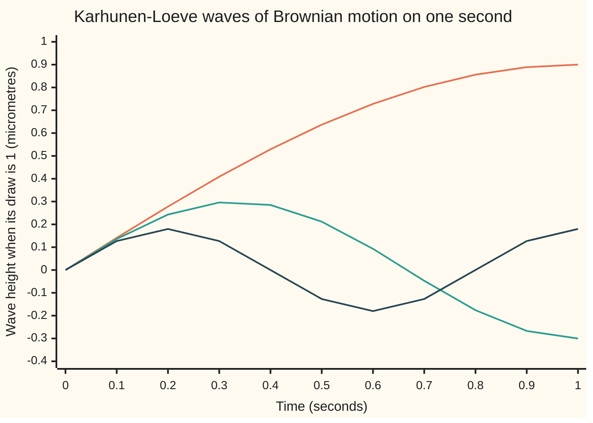

# Gaussian processes: random functions set by a covariance, and the Karhunen-Loeve series

[Syllabus](../../../SYLLABUS.md) → [Stochastic processes and calculus](../README.md) → [Brownian Motion](../README.md#s05) → Gaussian processes

---

## General Overview

A pollen grain drifts in water. Watch it for one second and record its position along one line, in micrometres (μm, millionths of a metre). The record is a jagged random path: [Brownian motion](01-brownian-motion.md). A simulation that stores the path at 1,000 times needs 1,000 numbers per path.

There is a shorter way to write the same path. Write it as a sum of smooth waves, each multiplied by its own independent bell-curve draw. The first wave is a quarter of a sine wave that rises from 0 and levels off at 1 second. Each later wave wiggles faster and is smaller. The first wave alone carries 81% of the path's random variation. Three waves carry 93%, and 21 waves carry 99%.

Two ideas make this work. First, Brownian motion is a **Gaussian process**: a random function whose values at any finite list of times are jointly normal. Such a process is fixed by two functions. The **mean** says where the values sit on average. The **covariance kernel** says how strongly the values at two times move together. For the grain the mean is 0 and the kernel is the smaller of the two times.

Second, the kernel has its own natural shapes, called its eigenfunctions. Expanding the process in those shapes gives independent random amounts, ranked from the largest share of the variation down. That expansion is the **Karhunen-Loeve series**. In mean square (the average squared error), it is the best way to squeeze a random function into a few numbers.

**A Gaussian process is a random function fixed by its mean and its covariance kernel; any symmetric kernel that never gives a negative variance defines one; and the kernel's eigenfunctions write the process as independent normals times fixed waves, with the variance shared out by the eigenvalues, so that for Brownian motion on one second the first wave carries 8/π², about 81%, of it.**

**What kind of fact this is:** "Gaussian process" and "valid kernel" are definitions. That a valid kernel always gives a process, the validity of three of the four example kernels, the sine waves for Brownian motion and the 81% share are theorems proved on this card in Why it works. The fourth kernel, fractional Brownian motion's, is valid by a theorem of Mandelbrot and Van Ness (1968), stated with that source, not proved, and checked here at four times for H = 0.7. Mercer's theorem, which gives the series for every continuous kernel, is stated with a source.

### The picture: the first three waves, each at its typical size



Orange: wave 1, a quarter sine reaching 0.900 at 1 second. Green: wave 2, three quarters of a sine. Dark blue: wave 3, five quarters. Each curve is the wave times the square root of its eigenvalue, so it shows the size the wave takes when its normal draw equals 1. A path is draw 1 times the orange curve, plus draw 2 times the green, plus draw 3 times the blue, and so on. Every wave starts at 0, because the grain starts at 0, and every wave is flat at 1 second, because nothing pins the grain there.

---

## The formula

Notation from earlier cards. $`N(m, K)`$ is the multivariate normal law with mean vector $`m`$ and covariance matrix $`K`$ ([Multivariate normal](../../09-Probability%20and%20statistics/05-Transformations%20and%20Joint%20Laws/06-multivariate-normal.md)). $`\mathrm{Var}`$ is variance and $`\mathrm{Cov}`$ is covariance: how much two quantities move together. $`\sim`$ reads "has the law".

**Definition.** A process $`X_t`$ is Gaussian with mean $`m(t)`$ and kernel $`k(s, t)`$ when, for every list of times $`t_1, \dots, t_n`$,

```math
(X_{t_1}, \dots, X_{t_n}) \sim N(m, K), \qquad m_i = m(t_i), \qquad K_{ij} = k(t_i, t_j)
```

**Read it aloud:** pick any times; the values there are jointly normal, with averages read off the mean function and covariances read off the kernel.

**Valid kernel.** A function $`k(s, t)`$ can be a covariance kernel exactly when it is symmetric, $`k(s, t) = k(t, s)`$, and for all times and all weights $`a_1, \dots, a_n`$

```math
\sum_{i=1}^{n} \sum_{j=1}^{n} a_i\, a_j\, k(t_i, t_j) \;\ge\; 0
```

**Read it aloud:** every weighted mix of the values has a variance that is not negative. A kernel with this property is called positive semidefinite.

**Karhunen-Loeve series** on an interval $`[0, T]`$. Find the kernel's eigenfunctions $`e_j`$ and eigenvalues $`\lambda_j`$, with $`\int_0^T e_j(t)^2\,dt = 1`$:

```math
\int_0^T k(s, t)\, e_j(s)\, ds = \lambda_j\, e_j(t), \qquad X_t = m(t) + \sum_{j=1}^{\infty} \sqrt{\lambda_j}\; Z_j\; e_j(t)
```

**Read it aloud:** feed a wave through the kernel and it comes back the same wave, scaled by its eigenvalue; the process is its mean plus those waves, each times an independent standard normal draw and the square root of its eigenvalue.

**For Brownian motion on one second,** $`k(s, t) = \min(s, t)`$ and $`T = 1`$:

```math
W_t = \sum_{j=1}^{\infty} Z_j\, \frac{\sqrt{2}\,\sin\big((j - \tfrac12)\pi t\big)}{(j - \tfrac12)\pi}, \qquad \lambda_j = \frac{1}{(j - \tfrac12)^2 \pi^2}, \qquad \sum_{j=1}^{\infty} \lambda_j = \int_0^1 t\, dt = \frac12
```

**Read it aloud:** the grain's path is a sum of quarter-sine, three-quarter-sine, five-quarter-sine waves, and so on, the j-th one shrunk by its frequency; the eigenvalues add up to the total variance over the second, which is one half.

The first term's share of that total is $`\lambda_1 / \tfrac12 = 8/\pi^2 = 0.810569`$.

| Symbol | Plain meaning | In our example | Push it up and the answer… |
| --- | --- | --- | --- |
| $`X_t`$ | a Gaussian process: a random value at each time $`t`$ | the grain's position, μm | — |
| $`m(t)`$ | the mean function: the average value at time $`t`$ | 0 | shifts every path, leaves the waves alone |
| $`k(s, t)`$, $`u`$ | the covariance kernel: $`\mathrm{Cov}(X_s, X_t)`$ for two times $`s`$, $`t`$; $`u`$ a time integrated over in Step 2 | $`\min(s, t)`$ | more shared movement, bigger eigenvalues |
| $`t_1, \dots, t_n`$ and $`K`$ | a list of $`n`$ times, and the covariance matrix there, $`K_{ij} = k(t_i, t_j)`$ | 1, 2, 3, 4 s; `[[1,1,1,1],[1,2,2,2],[1,2,3,3],[1,2,3,4]]` | a bigger matrix to check |
| $`a_1, \dots, a_n`$, $`Y`$ | weights for a mix $`Y = \sum a_i X_{t_i}`$ of the values | −1 and 1 at 1 s and 2 s | the mix's variance must stay at least 0 |
| $`L`$ | the Cholesky factor: a lower-triangular matrix with $`K = L L^{\mathsf T}`$ | ones on and below the diagonal | — |
| $`e_j(t)`$, $`\omega`$, $`f`$ | the j-th eigenfunction, a wave of total square 1, for $`j = 1, 2, 3, \dots`$; $`\omega`$ is its frequency; $`f`$ any function fed to the kernel in Step 3 | $`\sqrt{2}\sin(\omega t)`$, $`\omega = (j - \tfrac12)\pi`$ | larger $`j`$, faster wiggle |
| $`\lambda_j`$ | the j-th eigenvalue: the variance the j-th wave carries | 0.405285, 0.045032, 0.016211 | larger $`\lambda_j`$, larger share |
| $`Z_j`$, $`\xi_j`$ | independent standard normal draws, one per wave; $`\xi_j = \sqrt{\lambda_j} Z_j`$ is the wave's actual random amount | $`\mathrm{Var}(\xi_1) = 0.405285`$ | — |
| $`W_t`$ | standard Brownian motion, the grain's path | $`\mathrm{Var}(W_1) = 1`$ μm² | — |
| $`T`$ | the length of the time interval | 1 s | eigenvalues grow like $`T^2`$, shares stay the same |
| $`H`$ | the Hurst index of fractional Brownian motion, between 0 and 1 | 0.7 in the checks | smoother paths, longer memory |

### Four Gaussian processes, one line each

All four have mean 0. Each kernel is checked in Step 2.

| Process | Kernel $`k(s, t)`$ | What it models |
| --- | --- | --- |
| Brownian motion | $`\min(s, t)`$ | the free grain |
| Brownian bridge pinned at time $`T`$ | $`\min(s, t) - st/T`$ | the grain known to be back at 0 at time $`T`$ ([Brownian bridge](05-brownian-bridge.md)) |
| Ornstein-Uhlenbeck, settled, rate 1 | $`\tfrac12 e^{-\lvert t - s\rvert}`$ | a grain held by a spring: memory fades exponentially |
| Fractional Brownian motion | $`\tfrac12\big(s^{2H} + t^{2H} - \lvert t - s\rvert^{2H}\big)`$ | steps that remember earlier steps; $`H = \tfrac12`$ gives back $`\min(s, t)`$ |

### When it holds

- **The kernel must be symmetric and positive semidefinite.** Otherwise some mix of values gets a negative variance. Using $`\max(s, t)`$ gives $`\mathrm{Var}(X_2 - X_1) = -1`$, which no random quantity can have.
- **The values must be jointly normal, not just normal one at a time.** Two quantities can each be normal while their pair is not. Then the mean and kernel no longer fix the law, and uncorrelated no longer means independent.
- **The series needs a finite interval and a continuous kernel.** On all of $`[0, \infty)`$ the total variance $`\int_0^\infty t\,dt`$ is infinite, so there is no ranked list of eigenvalues to share it out.
- **The coefficients are independent only for a Gaussian process.** For any other process with the same kernel the Karhunen-Loeve coefficients are still uncorrelated, but they can depend on each other.
- **The series converges in mean square, not wave by wave.** Every partial sum is smooth. The rough path appears only in the limit, so a short sum is right on average but has none of the path's roughness.

---

## Why it works

### Step 0: a normal vector is fixed by its means and covariances

The [Multivariate normal](../../09-Probability%20and%20statistics/05-Transformations%20and%20Joint%20Laws/06-multivariate-normal.md) card proves that a jointly normal vector's whole law is fixed by its mean vector and its covariance matrix. A Gaussian process is a jointly normal vector at every finite list of times. So two functions, $`m(t)`$ and $`k(s, t)`$, fix every probability about the process at finitely many times.

The lists also agree with each other. Dropping a time from a list just deletes one entry of $`m`$ and one row and column of $`K`$, which is the law of the shorter list. Agreeing finite lists are what the Kolmogorov extension theorem ([Infinitely many coin tosses](../../10-Measure%20and%20integration/06-Product%20Measures%20and%20Fubini/07-infinite-sequences-and-kolmogorov-extension.md)) needs to build one process carrying all of them.

### Step 1: a kernel is valid exactly when no mix has negative variance

**Necessary.** Take weights $`a_i`$ and form the mix $`Y = \sum a_i X_{t_i}`$. Its variance expands into covariances:

```math
\mathrm{Var}(Y) = \sum_{i,j} a_i a_j\, \mathrm{Cov}(X_{t_i}, X_{t_j}) = \sum_{i,j} a_i a_j\, k(t_i, t_j)
```

A variance is never negative, so a kernel must pass the test. Try $`\max(s, t)`$ at 1 s and 2 s with weights −1 and 1: $`1 + 2 - 2 \times 2 = -1`$. It fails, so $`\max(s, t)`$ is the covariance of no process at all.

**Sufficient.** If $`K`$ passes the test, it factors as $`K = L L^{\mathsf T}`$ with $`L`$ lower triangular (the Cholesky factor from the Multivariate normal card; $`^{\mathsf T}`$ is the transpose, rows swapped with columns). Then $`m + LZ`$, with $`Z`$ a vector of independent standard normals, is normal with covariance $`K`$. So every valid kernel is the covariance of a real process.

For the grain at 1, 2, 3 and 4 seconds, the Cholesky factor of $`\min(i, j)`$ is the triangle of ones. Its fourth row is 1, 1, 1, 1: the position at 4 s is the sum of four independent one-second steps. The factor rebuilds the random walk.

### Step 2: the four examples pass

- **Brownian motion.** Write $`\min(s, t) = \int_0^\infty [u \le s]\,[u \le t]\,du`$, where $`[u \le s]`$ is 1 when $`u \le s`$ and 0 otherwise. Then $`\sum a_i a_j \min(t_i, t_j) = \int_0^\infty \big(\sum_i a_i [u \le t_i]\big)^2 du \ge 0`$.
- **Brownian bridge.** Its kernel is the covariance of $`W_t - (t/T) W_T`$. A kernel computed from an actual process always passes.
- **Ornstein-Uhlenbeck.** Set $`X_t = e^{-t} W_{e^{2t}} / \sqrt{2}`$. For $`s \le t`$, $`\mathrm{Cov}(X_s, X_t) = \tfrac12 e^{-s-t} e^{2s} = \tfrac12 e^{-(t-s)}`$. Again a real process, so the kernel is valid.
- **Fractional Brownian motion.** The kernel passes for every $`H`$ between 0 and 1. That is a theorem of Benoit Mandelbrot and John Van Ness (1968), who wrote the process as a weighted integral of Brownian motion. It is stated, not proved, here and on [Rougher than Brownian](../09-Beyond%20Brownian/06-rough-paths-and-fractional-brownian-motion-in-outline.md), which gives the source.

The checks build all four matrices at 1, 2, 3 and 4 seconds and run Cholesky. All four succeed, and each smallest pivot matches a second road, a ratio of determinants of top-left corners; $`\max(s, t)`$ fails at its second step with −2.

### Step 3: the kernel acts on waves, and its eigenfunctions are perpendicular

Use the kernel as a machine on functions: feed in a function $`f`$ of time, get out the new function $`\int_0^T k(s, t) f(s)\,ds`$. An eigenfunction is a wave the machine only rescales.

Because $`k`$ is symmetric, two eigenfunctions with different eigenvalues are perpendicular: $`\int_0^T e_i(t) e_j(t)\,dt = 0`$. The argument is the one on [Sturm-Liouville](../../08-Differential%20equations%20and%20dynamics/07-Series%20Solutions%20and%20Boundary%20Problems/09-sturm-liouville-and-orthogonality.md): move the machine from one side of the integral to the other.

**Mercer's theorem** (stated, see Loeve in Sources): for a continuous valid kernel on a closed interval, the eigenvalues are at least 0, they shrink to 0, and

```math
k(s, t) = \sum_{j=1}^{\infty} \lambda_j\, e_j(s)\, e_j(t)
```

with the sum converging uniformly. The general spectral picture behind it is [Compact and symmetric](../../18-Functional%20analysis/03-Bounded%20Operators/08-spectral-theorem-for-compact-self-adjoint-operators.md). For Brownian motion the checks sum 20,000 terms at $`s = 0.3`$, $`t = 0.7`$ and get 0.300000, which is $`\min(0.3, 0.7)`$.

### Step 4: the random amounts are independent normals

Project the path onto each wave: $`\xi_j = \int_0^T (X_t - m(t))\, e_j(t)\,dt`$. This is a limit of weighted sums of normal values, so the $`\xi_j`$ are jointly normal. Their covariances are

```math
\mathrm{Cov}(\xi_i, \xi_j) = \int_0^T\!\!\int_0^T e_i(s)\, k(s, t)\, e_j(t)\,ds\,dt = \lambda_j \int_0^T e_i(t)\, e_j(t)\,dt
```

which is $`\lambda_j`$ when $`i = j`$ and 0 otherwise. Jointly normal and uncorrelated means independent. Set $`Z_j = \xi_j / \sqrt{\lambda_j}`$: independent standard normals.

The waves form a perpendicular basis, so the path is the sum of its projections, $`\sum \xi_j e_j`$, exactly as a function in [L2 as a Hilbert space](../../10-Measure%20and%20integration/07-Sizes%20of%20Functions/06-l2-as-a-hilbert-space.md) is the sum of its coordinates. Stopping after $`n`$ waves leaves a mean-square error of $`\sum_{j > n} \lambda_j`$.

### Step 5: for Brownian motion, the eigen-equation is a string problem

Write the eigen-equation for $`\min(s, t)`$ on one second and split the integral at $`s = t`$:

```math
\int_0^t s\, e(s)\, ds + t \int_t^1 e(s)\, ds = \lambda\, e(t)
```

Differentiate twice in $`t`$. The integral equation becomes $`\lambda e''(t) = -e(t)`$. Setting $`t = 0`$ and differentiating once give the two end conditions $`e(0) = 0`$ and $`e'(1) = 0`$: fixed at the start, flat at the end.

That is a Sturm-Liouville problem. Its solutions are $`\sin(\omega t)`$ with $`\cos\omega = 0`$, so $`\omega = (j - \tfrac12)\pi`$ and $`\lambda_j = 1/\omega^2`$. Scaling by $`\sqrt{2}`$ makes $`\int_0^1 e_j^2 = 1`$.

<details>
<summary>The two differentiations, line by line</summary>

Differentiate once. The first integral gives $`t\,e(t)`$. The product $`t \int_t^1 e`$ gives $`\int_t^1 e - t\,e(t)`$. The $`t\,e(t)`$ terms cancel:

$`\displaystyle \int_t^1 e(s)\,ds = \lambda\, e'(t).`$

At $`t = 1`$ the left side is 0, so $`e'(1) = 0`$. Differentiate again:

$`\displaystyle -e(t) = \lambda\, e''(t).`$

In the original equation at $`t = 0`$ both integrals carry a factor that vanishes, so $`\lambda e(0) = 0`$, and $`e(0) = 0`$ for any nonzero eigenvalue. A solution of $`e'' = -e/\lambda`$ with $`e(0) = 0`$ is $`\sin(t/\sqrt{\lambda})`$. Flat at 1 needs $`\cos(1/\sqrt{\lambda}) = 0`$, that is $`1/\sqrt{\lambda} = (j - \tfrac12)\pi`$. Finally $`\int_0^1 2\sin^2(\omega t)\,dt = 1 - \sin(2\omega)/(2\omega) = 1`$, because $`\sin 2\omega = 0`$ at these frequencies.

</details>

The checks find the same eigenvalues a second way. They lay the kernel on a grid of 2,000 points and find its top three eigenvalues by repeated multiplication (power iteration). They agree with the formula to six decimals.

### Step 6: the eigenvalues share out the total variance

Set $`s = t`$ in Mercer's formula and integrate over the second. Each $`e_j^2`$ integrates to 1:

```math
\sum_{j=1}^{\infty} \lambda_j = \int_0^1 k(t, t)\,dt = \int_0^1 t\,dt = \frac12
```

So the eigenvalues are the shares of the total variance. Check it with the sum of odd reciprocal squares, $`1 + \tfrac19 + \tfrac1{25} + \cdots = \pi^2/8`$: the eigenvalues are $`4/(\pi^2(2j-1)^2)`$, which add to $`(4/\pi^2)(\pi^2/8) = \tfrac12`$. The first share is $`\lambda_1 / \tfrac12 = 8/\pi^2`$.

### Step 7: no other set of waves does better

Among all choices of $`n`$ perpendicular waves of total square 1, the first $`n`$ eigenfunctions capture the most variance. Any other wave mixes in eigenfunctions with smaller eigenvalues, so it captures a weighted average that is never larger. This is principal component analysis for random functions.

A concrete comparison: a natural first guess for one wave is the straight line $`t\,W_1`$, the first piece of Lévy's construction by tent-shaped corrections. That line carries $`\int_0^1 t^2\,dt = \tfrac13`$ of the variance: a share of 0.666667, against 0.810569 for the first Karhunen-Loeve wave.

Even the best multiple of the line shape loses. Projecting the path onto the unit wave $`\sqrt3\, t`$ captures $`3\int_0^1\!\int_0^1 s\,t\,\min(s, t)\,ds\,dt = \tfrac25`$, a share of 0.800000. The checks compute it on the 2,000-point grid. It is close to 0.810569 because the quarter sine is nearly straight, but it is still below.

---

## Worked numbers, by hand

Brownian motion on one second, kernel $`\min(s, t)`$.

| Step | Arithmetic | Value |
| --- | --- | --- |
| total variance over the second | $`\int_0^1 t\,dt`$ | $`0.5`$ |
| first frequency squared | $`(\pi/2)^2`$ | $`2.467401`$ |
| first eigenvalue $`\lambda_1`$ | $`1 / 2.467401`$ | $`0.405285`$ |
| second frequency squared | $`(3\pi/2)^2`$ | $`22.206610`$ |
| second eigenvalue $`\lambda_2`$ | $`1 / 22.206610`$ | $`0.045032`$ |
| third eigenvalue $`\lambda_3`$ | $`1 / (5\pi/2)^2`$ | $`0.016211`$ |
| share after two waves | $`(0.405285 + 0.045032) / 0.5`$ | $`0.900633`$ |
| share after three waves | $`(0.405285 + 0.045032 + 0.016211) / 0.5`$ | $`0.933056`$ |
| all the eigenvalues together | $`(4/\pi^2) \times (\pi^2/8)`$, with $`\pi^2/8 = 1.233701`$ | $`0.500000`$ |
| **first wave's share** | $`0.405285 / 0.5 = 8/\pi^2`$ | **$`0.810569`$** |

One quarter-sine wave, scaled by a single normal draw, accounts for 81% of everything random about the grain's second of travel.

### The picture: how fast the waves fill up

Share of the total variance after the first $`n`$ waves:

```
waves   share of the variance
  1   ████████████████████████████████████████▌         0.810569
  2   █████████████████████████████████████████████     0.900633
  3   ██████████████████████████████████████████████▋   0.933056
  4   ███████████████████████████████████████████████▍  0.949598
  5   ███████████████████████████████████████████████▉  0.959605
```

The first wave does most of the work. After that each wave adds less, and the last few percent need many more: 21 waves to reach 99%.

### What breaks if you drop a piece

| Mistake | Comes out at | What went wrong |
| --- | --- | --- |
| Use $`\max(s, t)`$ as the kernel | $`\mathrm{Var}(X_2 - X_1) = -1`$; Cholesky fails at step 2 with −2 | $`\max`$ is symmetric but not positive semidefinite: no process has it |
| Use the waves $`\sqrt2 \sin(j\pi t)/(j\pi)`$ | total variance 0.166667, not 0.5 | those are the bridge's waves: they vanish at 1 s, so they describe a grain pinned there |
| Drop the $`\sqrt{2}`$ in $`e_j`$ | total variance 0.25 | the waves no longer have total square 1, so each carries half its share |
| Divide $`\lambda_1`$ by $`\mathrm{Var}(W_1) = 1`$ | share 0.405285 | wrong total: the variance at one time instead of over the whole second |

---

## Code, from first principles, and it actually runs

The script checks five kernels at the grain's sampling times by Cholesky, then reaches the Brownian eigenvalues **three independent ways**. Road 1 is the closed form $`1/((j - \tfrac12)\pi)^2`$, with its sum checked against $`\int_0^1 t\,dt`$ and Mercer's formula checked against $`\min(0.3, 0.7)`$. Road 2 lays the kernel on 2,000 grid points and finds its top eigenvalues by power iteration, with no sines anywhere. Road 3 simulates 10,000 random-walk paths from a hand-written generator and measures the variance of each path's first coefficient directly. The last lines print every "what breaks", "try changing" and chart number.

### Python

```python
# Gaussian processes and the Karhunen-Loeve series -- the check behind the card.
# Standard library only.  The random numbers come from a generator written here.
from math import pi, sqrt, sin, cos, log, exp

def row(name, v): print(f"{name:<46} {v:>10.6f}")

# ---- 1. kernels: a Gaussian process with mean 0 is fixed by its covariance k(s, t) ----
kernels = [("Brownian motion  min(s,t)", lambda s, t: min(s, t)),
           ("bridge pinned at 5  min(s,t) - st/5", lambda s, t: min(s, t) - s * t / 5),
           ("Ornstein-Uhlenbeck  exp(-|t-s|)/2", lambda s, t: 0.5 * exp(-abs(t - s))),
           ("fractional BM, H = 0.7", lambda s, t: 0.5 * (s ** 1.4 + t ** 1.4 - abs(t - s) ** 1.4)),
           ("not a kernel  max(s,t)", lambda s, t: max(s, t))]

def cholesky(K):            # K = L L^T; stops at a pivot <= 0: below 0, K is no covariance; exactly 0, a degenerate one
    n = len(K); L = [[0.0] * n for _ in range(n)]
    for i in range(n):
        for j in range(i + 1):
            s = K[i][j] - sum(L[i][m] * L[j][m] for m in range(j))
            if i == j:
                if s <= 0: return L, i + 1, s      # failed at this pivot
                L[i][i] = sqrt(s)
            else:
                L[i][j] = s / L[j][j]
    return L, 0, min(L[i][i] ** 2 for i in range(n))
def det(A):                 # determinant by expansion along the first row: a second road, pivot i = det_i / det_(i-1)
    return A[0][0] if len(A) == 1 else sum((-1) ** j * A[0][j] * det([r[:j] + r[j + 1:] for r in A[1:]]) for j in range(len(A)))

times = [1.0, 2.0, 3.0, 4.0]                       # the grain, sampled every second
print("kernel on times 1, 2, 3, 4 s        Cholesky: smallest pivot, or failure")
for name, k in kernels:
    K = [[k(s, t) for t in times] for s in times]; L, bad, piv = cholesky(K)
    print(f"  {name:<36} " + (f"valid, pivot {piv:.6f}" if bad == 0 else f"FAILS at pivot {bad}: {piv:.6f}"))
    d = [1.0] + [det([r[:i] for r in K[:i]]) for i in range(1, 5)]   # leading minors
    if not name.startswith("not"):
        assert bad == 0, "the four example kernels must pass Cholesky"
        assert abs(piv - min(d[i] / d[i - 1] for i in range(1, 5))) < 1e-9, "smallest pivot = smallest minor ratio"
    if name.startswith("Brownian"): L_bm = L
    if name.startswith("not"): bad_max = (bad, piv)
print("  Brownian Cholesky row 4:", " ".join(f"{x:.1f}" for x in L_bm[3]))
var_diff_max = 1.0 + 2.0 - 2 * 2.0                 # Var(X_2 - X_1) if k were max(s,t)
row("max kernel: Var(X_2 - X_1) = 1 + 2 - 2*2", var_diff_max)

# ---- 2. Karhunen-Loeve for Brownian motion on [0, 1]: lambda_k = 1/((k - 1/2) pi)^2 ----
lam = lambda k: 1.0 / ((k - 0.5) * pi) ** 2
e = lambda k, t: sqrt(2) * sin((k - 0.5) * pi * t)
total = 0.5                                        # integral of Var W_t = t over [0, 1]
cum = 0.0
row("(pi/2)^2, first frequency squared", (pi / 2) ** 2); row("(3pi/2)^2, second frequency squared", (3 * pi / 2) ** 2)
row("pi^2/8 = 1 + 1/9 + 1/25 + ...", pi ** 2 / 8)
for k in range(1, 6):
    cum += lam(k)
    row(f"lambda_{k} closed form   (cumulative share)", lam(k)); row("    share of 1/2 after this term", cum / total)
n99, c = 0, 0.0
while c < 0.99 * total and n99 < 10 ** 6: n99 += 1; c += lam(n99)
print(f"{'terms needed for 99% of the variance':<46} {n99:>10d}")
series = sum(lam(k) for k in range(1, 1_000_001))
row("sum of 10^6 eigenvalues (should be 1/2)", series)
row("Mercer: sum lambda e(0.3) e(0.7), 20000 terms", sum(lam(k) * e(k, 0.3) * e(k, 0.7) for k in range(1, 20001)))
row("Var W_1 from series: sum 2 lambda sin^2", sum(2 * lam(k) * sin((k - 0.5) * pi) ** 2 for k in range(1, 20001)))

# ---- 3. road two: eigenvalues of the kernel on a grid, by power iteration ----
n = 2000; h = 1.0 / n; tg = [(i + 0.5) * h for i in range(n)]
def apply(v):              # (A v)_i = h * sum_j min(t_i, t_j) v_j, done with running sums
    left, out, acc = 0.0, [0.0] * n, sum(v)
    for i in range(n):
        acc -= v[i]; left += tg[i] * v[i]
        out[i] = h * (left + tg[i] * acc)
    return out
found = []
for k in range(1, 4):
    v = [1.0 + 0.001 * i for i in range(n)]
    for _ in range(60):
        for u in found:                            # deflate: remove earlier modes
            d = sum(a * b for a, b in zip(v, u)); v = [a - d * b for a, b in zip(v, u)]
        w = apply(v); nv = sqrt(sum(x * x for x in w)); v = [x / nv for x in w]
    lam_num = sum(a * b for a, b in zip(v, apply(v)))
    found.append(v)
    row(f"lambda_{k} by power iteration on 2000 points", lam_num)
    assert abs(lam_num - lam(k)) < 1e-6, "grid eigenvalue must match 1/((k - 1/2) pi)^2"
best_line = 3 * h * sum(a * b for a, b in zip(tg, apply(tg))) / total   # best multiple of the wave sqrt(3) t
row("best multiple of the line t, on the grid: share", best_line)
assert abs(best_line - 0.8) < 1e-5 and best_line < lam(1) / total, "line shape: 2/5 of 1/2, below 8/pi^2"

# ---- 4. road three: simulate paths, project on e_1 ----
state = 20261123
def u01():                 # splitmix64, then a uniform in (0, 1)
    global state
    state = (state + 0x9E3779B97F4A7C15) & 0xFFFFFFFFFFFFFFFF
    z = state
    z = ((z ^ (z >> 30)) * 0xBF58476D1CE4E5B9) & 0xFFFFFFFFFFFFFFFF
    z = ((z ^ (z >> 27)) * 0x94D049BB133111EB) & 0xFFFFFFFFFFFFFFFF
    return ((z ^ (z >> 31)) >> 11) * 2.0 ** -53 + 2.0 ** -54
paths, steps = 10000, 200; dt = 1.0 / steps
e1 = [e(1, (j + 1) * dt) for j in range(steps)]
s_c1, s_c1sq, s_int, s_w1 = 0.0, 0.0, 0.0, 0.0
for p in range(paths):
    w, c1, iw2 = 0.0, 0.0, 0.0
    for j in range(0, steps, 2):                   # Box-Muller: two normals per pair of uniforms
        r, a = sqrt(-2 * log(u01())), 2 * pi * u01()
        for z, jj in ((r * cos(a), j), (r * sin(a), j + 1)):
            w += sqrt(dt) * z; c1 += w * e1[jj] * dt; iw2 += w * w * dt
    s_c1 += c1; s_c1sq += c1 * c1; s_int += iw2; s_w1 += w * w
row("simulated mean of first coefficient", s_c1 / paths)
row("simulated variance of first coefficient", s_c1sq / paths)
row("simulated mean of integral of W^2", s_int / paths)
row("simulated Var W_1", s_w1 / paths)
row("simulated share of first term", s_c1sq / s_int)

# ---- 5. what breaks, and try changing ----
row("wrong: bridge modes sin(k pi t), total variance", sum(1 / (k * pi) ** 2 for k in range(1, 1_000_001)))
row("wrong: share measured against Var W_1 = 1", lam(1) / 1.0)
row("wrong: drop the sqrt 2, total variance", sum(lam(k) for k in range(1, 1_000_001)) / 2)
row("straight line t*W_1 as first term: share", (1 / 3) / total)
row("try: three terms, share", (lam(1) + lam(2) + lam(3)) / total)
row("try: bridge on [0,1], first term share 6/pi^2", (1 / pi ** 2) / (1 / 6))
row("try: 10 seconds, lambda_1 = 100 * 4/pi^2", 100 * lam(1))
print("chart, t          " + " ".join(f"{0.1 * i:6.1f}" for i in range(11)))
for k in range(1, 4):
    print(f"chart, mode {k}     " + " ".join(f"{round(sqrt(lam(k)) * e(k, 0.1 * i), 3) + 0.0:6.3f}" for i in range(11)))

assert bad_max == (2, -2.0), "max(s,t) must fail at the second pivot"
assert all(abs(x - 1.0) < 1e-12 for x in L_bm[3]), "Cholesky of min(i, j) is the all-ones triangle"
assert abs(series - 0.5) < 1e-6, "eigenvalues sum to the integral of t"
assert abs(sum(lam(k) * e(k, 0.3) * e(k, 0.7) for k in range(1, 20001)) - 0.3) < 1e-4, "Mercer gives min(0.3, 0.7)"
assert abs(s_c1sq / paths - lam(1)) < 0.02 and abs(s_c1sq / s_int - 8 / pi ** 2) < 0.03, "simulation vs 4/pi^2"
print("ALL CHECKS PASS")
```

**Ran 2026-11-23 on macOS, Python 3.14.10, standard library only. All checks passed. Output, pasted from the run:**

```
kernel on times 1, 2, 3, 4 s        Cholesky: smallest pivot, or failure
  Brownian motion  min(s,t)            valid, pivot 1.000000
  bridge pinned at 5  min(s,t) - st/5  valid, pivot 0.500000
  Ornstein-Uhlenbeck  exp(-|t-s|)/2    valid, pivot 0.432332
  fractional BM, H = 0.7               valid, pivot 0.885387
  not a kernel  max(s,t)               FAILS at pivot 2: -2.000000
  Brownian Cholesky row 4: 1.0 1.0 1.0 1.0
max kernel: Var(X_2 - X_1) = 1 + 2 - 2*2        -1.000000
(pi/2)^2, first frequency squared                2.467401
(3pi/2)^2, second frequency squared             22.206610
pi^2/8 = 1 + 1/9 + 1/25 + ...                    1.233701
lambda_1 closed form   (cumulative share)        0.405285
    share of 1/2 after this term                 0.810569
lambda_2 closed form   (cumulative share)        0.045032
    share of 1/2 after this term                 0.900633
lambda_3 closed form   (cumulative share)        0.016211
    share of 1/2 after this term                 0.933056
lambda_4 closed form   (cumulative share)        0.008271
    share of 1/2 after this term                 0.949598
lambda_5 closed form   (cumulative share)        0.005004
    share of 1/2 after this term                 0.959605
terms needed for 99% of the variance                   21
sum of 10^6 eigenvalues (should be 1/2)          0.500000
Mercer: sum lambda e(0.3) e(0.7), 20000 terms    0.300000
Var W_1 from series: sum 2 lambda sin^2          0.999990
lambda_1 by power iteration on 2000 points       0.405285
lambda_2 by power iteration on 2000 points       0.045032
lambda_3 by power iteration on 2000 points       0.016211
best multiple of the line t, on the grid: share   0.800000
simulated mean of first coefficient             -0.005531
simulated variance of first coefficient          0.411501
simulated mean of integral of W^2                0.505231
simulated Var W_1                                1.010160
simulated share of first term                    0.814481
wrong: bridge modes sin(k pi t), total variance   0.166667
wrong: share measured against Var W_1 = 1        0.405285
wrong: drop the sqrt 2, total variance           0.250000
straight line t*W_1 as first term: share         0.666667
try: three terms, share                          0.933056
try: bridge on [0,1], first term share 6/pi^2    0.607927
try: 10 seconds, lambda_1 = 100 * 4/pi^2        40.528473
chart, t             0.0    0.1    0.2    0.3    0.4    0.5    0.6    0.7    0.8    0.9    1.0
chart, mode 1      0.000  0.141  0.278  0.409  0.529  0.637  0.728  0.802  0.856  0.889  0.900
chart, mode 2      0.000  0.136  0.243  0.296  0.285  0.212  0.093 -0.047 -0.176 -0.267 -0.300
chart, mode 3      0.000  0.127  0.180  0.127  0.000 -0.127 -0.180 -0.127  0.000  0.127  0.180
ALL CHECKS PASS
```

The three roads agree. The grid gives 0.405285, 0.045032 and 0.016211, the formula's digits. The simulation gives 0.411501 for the first coefficient's variance and a share of 0.814481, within its sampling error of 0.405285 and 0.810569.

### Rust

The same checks in Rust, with the same generator and seed, so even the simulated digits match.

```rust
// Gaussian processes and the Karhunen-Loeve series -- the same check in Rust.
// Standard library only, no crates.  Same generator, same seed, same labels.
use std::f64::consts::PI;

fn row(name: &str, v: f64) { println!("{:<46} {:>10.6}", name, v); }

fn cholesky(k: &Vec<Vec<f64>>) -> (Vec<Vec<f64>>, usize, f64) { // K = L L^T; stops at a pivot <= 0: below 0, no covariance; 0, a degenerate one
    let n = k.len();
    let mut l = vec![vec![0.0; n]; n];
    for i in 0..n {
        for j in 0..=i {
            let mut s = k[i][j];
            for m in 0..j { s -= l[i][m] * l[j][m]; }
            if i == j { if s <= 0.0 { return (l, i + 1, s); } l[i][i] = s.sqrt(); } else { l[i][j] = s / l[j][j]; }
        }
    }
    let piv = (0..n).map(|i| l[i][i] * l[i][i]).fold(f64::INFINITY, f64::min);
    (l, 0, piv)
}
fn det(a: &[Vec<f64>]) -> f64 { // determinant by expansion along the first row: a second road, pivot i = det_i / det_(i-1)
    if a.len() == 1 { return a[0][0]; }
    (0..a.len()).map(|j| (if j % 2 == 0 { 1.0 } else { -1.0 }) * a[0][j]
        * det(&a[1..].iter().map(|r| r.iter().enumerate().filter(|&(c, _)| c != j).map(|(_, &x)| x).collect()).collect::<Vec<Vec<f64>>>())).sum()
}

fn lam(k: usize) -> f64 { 1.0 / (((k as f64) - 0.5) * PI).powi(2) }
fn e(k: usize, t: f64) -> f64 { 2f64.sqrt() * (((k as f64) - 0.5) * PI * t).sin() }

struct Rng { state: u64 }
impl Rng {
    fn u01(&mut self) -> f64 {
        self.state = self.state.wrapping_add(0x9E3779B97F4A7C15);
        let mut z = self.state;
        z = (z ^ (z >> 30)).wrapping_mul(0xBF58476D1CE4E5B9);
        z = (z ^ (z >> 27)).wrapping_mul(0x94D049BB133111EB);
        ((z ^ (z >> 31)) >> 11) as f64 * 2f64.powi(-53) + 2f64.powi(-54)
    }
}

fn main() {
    // ---- 1. kernels ----
    let kernels: Vec<(&str, Box<dyn Fn(f64, f64) -> f64>)> = vec![
        ("Brownian motion  min(s,t)", Box::new(|s: f64, t: f64| s.min(t))),
        ("bridge pinned at 5  min(s,t) - st/5", Box::new(|s: f64, t: f64| s.min(t) - s * t / 5.0)),
        ("Ornstein-Uhlenbeck  exp(-|t-s|)/2", Box::new(|s: f64, t: f64| 0.5 * (-(t - s).abs()).exp())),
        ("fractional BM, H = 0.7", Box::new(|s: f64, t: f64| 0.5 * (s.powf(1.4) + t.powf(1.4) - (t - s).abs().powf(1.4)))),
        ("not a kernel  max(s,t)", Box::new(|s: f64, t: f64| s.max(t))),
    ];
    let times = [1.0, 2.0, 3.0, 4.0];
    println!("kernel on times 1, 2, 3, 4 s        Cholesky: smallest pivot, or failure");
    let mut l_bm = vec![];
    let mut bad_max = (0usize, 0.0f64);
    for (name, k) in &kernels {
        let m: Vec<Vec<f64>> = times.iter().map(|&s| times.iter().map(|&t| k(s, t)).collect()).collect();
        let (l, bad, piv) = cholesky(&m);
        if bad == 0 { println!("  {:<36} valid, pivot {:.6}", name, piv); }
        else { println!("  {:<36} FAILS at pivot {}: {:.6}", name, bad, piv); }
        let d: Vec<f64> = (0..5).map(|i| if i == 0 { 1.0 } else { det(&m[..i].iter().map(|r| r[..i].to_vec()).collect::<Vec<_>>()) }).collect();
        if !name.starts_with("not") { assert!(bad == 0, "the four example kernels must pass Cholesky");
            assert!((piv - (1..5).map(|i| d[i] / d[i - 1]).fold(f64::INFINITY, f64::min)).abs() < 1e-9, "smallest pivot = smallest minor ratio"); }
        if name.starts_with("Brownian") { l_bm = l[3].clone(); }
        if name.starts_with("not") { bad_max = (bad, piv); }
    }
    println!("  Brownian Cholesky row 4: {}", l_bm.iter().map(|x| format!("{:.1}", x)).collect::<Vec<_>>().join(" "));
    let var_diff_max = 1.0 + 2.0 - 2.0 * 2.0;
    row("max kernel: Var(X_2 - X_1) = 1 + 2 - 2*2", var_diff_max);

    // ---- 2. Karhunen-Loeve closed form ----
    let total = 0.5;
    let mut cum = 0.0;
    row("(pi/2)^2, first frequency squared", (PI / 2.0).powi(2)); row("(3pi/2)^2, second frequency squared", (3.0 * PI / 2.0).powi(2));
    row("pi^2/8 = 1 + 1/9 + 1/25 + ...", PI * PI / 8.0);
    for k in 1..6 {
        cum += lam(k);
        row(&format!("lambda_{} closed form   (cumulative share)", k), lam(k));
        row("    share of 1/2 after this term", cum / total);
    }
    let (mut n99, mut c) = (0usize, 0.0);
    while c < 0.99 * total && n99 < 1_000_000 { n99 += 1; c += lam(n99); }
    println!("{:<46} {:>10}", "terms needed for 99% of the variance", n99);
    let series: f64 = (1..=1_000_000).map(lam).sum();
    row("sum of 10^6 eigenvalues (should be 1/2)", series);
    let mercer: f64 = (1..=20000).map(|k| lam(k) * e(k, 0.3) * e(k, 0.7)).sum();
    row("Mercer: sum lambda e(0.3) e(0.7), 20000 terms", mercer);
    let var1: f64 = (1..=20000).map(|k| 2.0 * lam(k) * (((k as f64) - 0.5) * PI).sin().powi(2)).sum();
    row("Var W_1 from series: sum 2 lambda sin^2", var1);

    // ---- 3. road two: power iteration on a grid ----
    let n = 2000;
    let h = 1.0 / n as f64;
    let tg: Vec<f64> = (0..n).map(|i| (i as f64 + 0.5) * h).collect();
    let apply = |v: &Vec<f64>| -> Vec<f64> {
        let (mut left, mut acc) = (0.0, v.iter().sum::<f64>());
        let mut out = vec![0.0; n];
        for i in 0..n {
            acc -= v[i]; left += tg[i] * v[i];
            out[i] = h * (left + tg[i] * acc);
        }
        out
    };
    let dot = |a: &Vec<f64>, b: &Vec<f64>| a.iter().zip(b).map(|(x, y)| x * y).sum::<f64>();
    let mut found: Vec<Vec<f64>> = vec![];
    for k in 1..4 {
        let mut v: Vec<f64> = (0..n).map(|i| 1.0 + 0.001 * i as f64).collect();
        for _ in 0..60 {
            for u in &found {
                let d = dot(&v, u);
                v = v.iter().zip(u).map(|(a, b)| a - d * b).collect();
            }
            let w = apply(&v);
            let nv = dot(&w, &w).sqrt();
            v = w.iter().map(|x| x / nv).collect();
        }
        let lam_num = dot(&v, &apply(&v));
        found.push(v);
        row(&format!("lambda_{} by power iteration on 2000 points", k), lam_num);
        assert!((lam_num - lam(k)).abs() < 1e-6, "grid eigenvalue must match 1/((k - 1/2) pi)^2");
    }
    let best_line = 3.0 * h * dot(&tg, &apply(&tg)) / total;
    row("best multiple of the line t, on the grid: share", best_line);
    assert!((best_line - 0.8).abs() < 1e-5 && best_line < lam(1) / total, "line shape: 2/5 of 1/2, below 8/pi^2");

    // ---- 4. road three: simulation ----
    let mut rng = Rng { state: 20261123 };
    let (paths, steps) = (10000, 200);
    let dt = 1.0 / steps as f64;
    let e1: Vec<f64> = (0..steps).map(|j| e(1, (j + 1) as f64 * dt)).collect();
    let (mut s_c1, mut s_c1sq, mut s_int, mut s_w1) = (0.0, 0.0, 0.0, 0.0);
    for _ in 0..paths {
        let (mut w, mut c1, mut iw2) = (0.0f64, 0.0, 0.0);
        for j in (0..steps).step_by(2) {
            let r = (-2.0 * rng.u01().ln()).sqrt();
            let a = 2.0 * PI * rng.u01();
            for (z, jj) in [(r * a.cos(), j), (r * a.sin(), j + 1)] {
                w += dt.sqrt() * z; c1 += w * e1[jj] * dt; iw2 += w * w * dt;
            }
        }
        s_c1 += c1; s_c1sq += c1 * c1; s_int += iw2; s_w1 += w * w;
    }
    let pf = paths as f64;
    row("simulated mean of first coefficient", s_c1 / pf);
    row("simulated variance of first coefficient", s_c1sq / pf);
    row("simulated mean of integral of W^2", s_int / pf);
    row("simulated Var W_1", s_w1 / pf);
    row("simulated share of first term", s_c1sq / s_int);

    // ---- 5. what breaks, and try changing ----
    row("wrong: bridge modes sin(k pi t), total variance", (1..=1_000_000).map(|k| 1.0 / (k as f64 * PI).powi(2)).sum::<f64>());
    row("wrong: share measured against Var W_1 = 1", lam(1) / 1.0);
    row("wrong: drop the sqrt 2, total variance", series / 2.0);
    row("straight line t*W_1 as first term: share", (1.0 / 3.0) / total);
    row("try: three terms, share", (lam(1) + lam(2) + lam(3)) / total);
    row("try: bridge on [0,1], first term share 6/pi^2", (1.0 / (PI * PI)) / (1.0 / 6.0));
    row("try: 10 seconds, lambda_1 = 100 * 4/pi^2", 100.0 * lam(1));
    println!("chart, t          {}", (0..11).map(|i| format!("{:6.1}", 0.1 * i as f64)).collect::<Vec<_>>().join(" "));
    for k in 1..4 {
        let pts: Vec<String> = (0..11).map(|i| {
            let x = lam(k).sqrt() * e(k, 0.1 * i as f64);
            format!("{:6.3}", (x * 1000.0).round() / 1000.0 + 0.0)
        }).collect();
        println!("chart, mode {}     {}", k, pts.join(" "));
    }

    assert!(bad_max.0 == 2 && bad_max.1 == -2.0, "max(s,t) must fail at the second pivot");
    assert!(l_bm.iter().all(|x| (x - 1.0).abs() < 1e-12), "Cholesky of min(i, j) is the all-ones triangle");
    assert!((series - 0.5).abs() < 1e-6, "eigenvalues sum to the integral of t");
    assert!((mercer - 0.3).abs() < 1e-4, "Mercer gives min(0.3, 0.7)");
    assert!((s_c1sq / pf - lam(1)).abs() < 0.02 && (s_c1sq / s_int - 8.0 / (PI * PI)).abs() < 0.03, "simulation vs 4/pi^2");
    println!("ALL CHECKS PASS");
}
```

**Ran 2026-11-23 on macOS, rustc 1.98.1, no crates. All checks passed. Output, pasted from the run:**

```
kernel on times 1, 2, 3, 4 s        Cholesky: smallest pivot, or failure
  Brownian motion  min(s,t)            valid, pivot 1.000000
  bridge pinned at 5  min(s,t) - st/5  valid, pivot 0.500000
  Ornstein-Uhlenbeck  exp(-|t-s|)/2    valid, pivot 0.432332
  fractional BM, H = 0.7               valid, pivot 0.885387
  not a kernel  max(s,t)               FAILS at pivot 2: -2.000000
  Brownian Cholesky row 4: 1.0 1.0 1.0 1.0
max kernel: Var(X_2 - X_1) = 1 + 2 - 2*2        -1.000000
(pi/2)^2, first frequency squared                2.467401
(3pi/2)^2, second frequency squared             22.206610
pi^2/8 = 1 + 1/9 + 1/25 + ...                    1.233701
lambda_1 closed form   (cumulative share)        0.405285
    share of 1/2 after this term                 0.810569
lambda_2 closed form   (cumulative share)        0.045032
    share of 1/2 after this term                 0.900633
lambda_3 closed form   (cumulative share)        0.016211
    share of 1/2 after this term                 0.933056
lambda_4 closed form   (cumulative share)        0.008271
    share of 1/2 after this term                 0.949598
lambda_5 closed form   (cumulative share)        0.005004
    share of 1/2 after this term                 0.959605
terms needed for 99% of the variance                   21
sum of 10^6 eigenvalues (should be 1/2)          0.500000
Mercer: sum lambda e(0.3) e(0.7), 20000 terms    0.300000
Var W_1 from series: sum 2 lambda sin^2          0.999990
lambda_1 by power iteration on 2000 points       0.405285
lambda_2 by power iteration on 2000 points       0.045032
lambda_3 by power iteration on 2000 points       0.016211
best multiple of the line t, on the grid: share   0.800000
simulated mean of first coefficient             -0.005531
simulated variance of first coefficient          0.411501
simulated mean of integral of W^2                0.505231
simulated Var W_1                                1.010160
simulated share of first term                    0.814481
wrong: bridge modes sin(k pi t), total variance   0.166667
wrong: share measured against Var W_1 = 1        0.405285
wrong: drop the sqrt 2, total variance           0.250000
straight line t*W_1 as first term: share         0.666667
try: three terms, share                          0.933056
try: bridge on [0,1], first term share 6/pi^2    0.607927
try: 10 seconds, lambda_1 = 100 * 4/pi^2        40.528473
chart, t             0.0    0.1    0.2    0.3    0.4    0.5    0.6    0.7    0.8    0.9    1.0
chart, mode 1      0.000  0.141  0.278  0.409  0.529  0.637  0.728  0.802  0.856  0.889  0.900
chart, mode 2      0.000  0.136  0.243  0.296  0.285  0.212  0.093 -0.047 -0.176 -0.267 -0.300
chart, mode 3      0.000  0.127  0.180  0.127  0.000 -0.127 -0.180 -0.127  0.000  0.127  0.180
ALL CHECKS PASS
```

### Lean

Lean proves the sine waves, the variance shares and the kernel test for Brownian motion on one second, in every case.

- Take a wave number $`j \ge 1`$ and a time $`t`$ between 0 and 1. Then $`\int_0^1 \min(s, t)\, e_j(s)\, ds = \lambda_j\, e_j(t)`$.
- Take any wave number $`j \ge 1`$. Then the wave has total square 1: $`\int_0^1 e_j(s)^2\, ds = 1`$.
- The eigenvalues $`\lambda_1, \lambda_2, \dots`$ add up to $`\int_0^1 t\, dt = \tfrac12`$. The first wave's share is $`8/\pi^2`$.
- Take any times $`t_1, \dots, t_n \ge 0`$. Then the matrix $`K_{ij} = \min(t_i, t_j)`$ is symmetric and positive semidefinite.
- At 1, 2, 3 and 4 seconds, the Cholesky factor of $`\min(i, j)`$ is the triangle of ones.
- Take weights −1 and 1 at 1 s and 2 s. Then $`\max(s, t)`$ gives variance −1, and $`\min(s, t)`$ gives 1.

The other three kernels, Mercer's sum, the power iteration and the simulations are left to the Python and Rust checks.

```lean
-- Gaussian processes: for the Brownian kernel min(s, t) on one second, the waves sqrt 2 sin((j - 1/2) pi t) are unit eigenfunctions with eigenvalues 1/((j - 1/2) pi)^2, these eigenvalues add up to the total variance 1/2 so the first wave's share is 8/pi^2, and min(s, t) is a valid (positive semidefinite) kernel.
import Mathlib.MeasureTheory.Integral.IntervalIntegral.Basic
import Mathlib.Analysis.SpecialFunctions.Trigonometric.Basic
import Mathlib.NumberTheory.ZetaValues
import Mathlib.LinearAlgebra.Matrix.PosDef
import Mathlib.Data.Matrix.Mul
import Mathlib.Tactic.NormNum
import Mathlib.MeasureTheory.Integral.IntervalIntegral.FundThmCalculus
import Mathlib.Analysis.SpecialFunctions.Trigonometric.Deriv
import Mathlib.Analysis.SpecialFunctions.Integrals.Basic

open Real

/-! The card's Karhunen-Loeve waves for Brownian motion on `[0, 1]`, numbered from `j = 1`:
the frequency is `ω_j = (j - 1/2) π`, the wave is `e_j(t) = √2 sin(ω_j t)` and the eigenvalue is
`λ_j = 1 / ω_j ^ 2`. The kernel is `k(s, t) = min s t`. -/

theorem odd_inv_sq_hasSum : HasSum (fun k : ℕ => (1 : ℝ) / ((2 * k + 1 : ℕ) : ℝ) ^ 2) (π ^ 2 / 8) := by
  have hz := hasSum_zeta_two
  have hinj : Function.Injective (fun k : ℕ => 2 * k + 1) := by
    intro a b h
    simp only at h
    omega
  have hs : Summable (fun k : ℕ => (1 : ℝ) / ((2 * k + 1 : ℕ) : ℝ) ^ 2) :=
    hz.summable.comp_injective hinj
  have he : HasSum (fun k : ℕ => (1 : ℝ) / ((2 * k : ℕ) : ℝ) ^ 2) (π ^ 2 / 24) := by
    have h4 := hz.mul_left (1 / 4)
    have hf : (fun k : ℕ => (1 : ℝ) / ((2 * k : ℕ) : ℝ) ^ 2) =
        fun k : ℕ => 1 / 4 * (1 / (k : ℝ) ^ 2) := by
      funext k; push_cast; ring
    rw [hf, show π ^ 2 / 24 = 1 / 4 * (π ^ 2 / 6) by ring]
    exact h4
  have htot := HasSum.even_add_odd (f := fun n : ℕ => (1 : ℝ) / (n : ℝ) ^ 2) he hs.hasSum
  have hu := htot.unique hz
  have hv : ∑' k : ℕ, (1 : ℝ) / ((2 * k + 1 : ℕ) : ℝ) ^ 2 = π ^ 2 / 8 := by linarith
  rw [← hv]
  exact hs.hasSum

#print axioms odd_inv_sq_hasSum

theorem min_quad_nonneg_aux {ι : Type*} [DecidableEq ι] (n : ℕ) :
    ∀ (s : Finset ι), s.card = n → ∀ (t : ι → ℝ), (∀ i ∈ s, 0 ≤ t i) → ∀ x : ι → ℝ,
      0 ≤ ∑ i ∈ s, ∑ j ∈ s, x i * x j * min (t i) (t j) := by
  induction n with
  | zero =>
    intro s hs t ht x
    rw [Finset.card_eq_zero.mp hs]
    simp
  | succ n ih =>
    intro s hs t ht x
    have hne : s.Nonempty := Finset.card_pos.mp (by omega)
    obtain ⟨i0, hi0, hmin⟩ := Finset.exists_min_image s t hne
    set m := t i0 with hm
    have hm0 : 0 ≤ m := ht i0 hi0
    set t' : ι → ℝ := fun i => t i - m with ht'
    have hsplit : ∀ i j, x i * x j * min (t i) (t j) =
        m * (x i * x j) + x i * x j * min (t' i) (t' j) := by
      intro i j
      simp only [ht', min_sub_sub_right]
      ring
    simp_rw [hsplit, Finset.sum_add_distrib]
    have h1 : ∑ i ∈ s, ∑ j ∈ s, m * (x i * x j) = m * (∑ i ∈ s, x i) ^ 2 := by
      rw [sq, Finset.sum_mul_sum, Finset.mul_sum]
      simp_rw [Finset.mul_sum]
    have h2 : ∑ i ∈ s, ∑ j ∈ s, x i * x j * min (t' i) (t' j) =
        ∑ i ∈ s.erase i0, ∑ j ∈ s.erase i0, x i * x j * min (t' i) (t' j) := by
      have hz : ∀ i ∈ s, min (t' i) (t' i0) = 0 ∧ min (t' i0) (t' i) = 0 := by
        intro i hi
        have : 0 ≤ t' i := by simp only [ht']; linarith [hmin i hi]
        have h0 : t' i0 = 0 := by simp [ht', hm]
        rw [h0]
        exact ⟨min_eq_right this, min_eq_left this⟩
      rw [← Finset.sum_erase s (a := i0)]
      · apply Finset.sum_congr rfl
        intro i hi
        rw [← Finset.sum_erase s (a := i0)]
        rw [(hz i (Finset.mem_of_mem_erase hi)).1, mul_zero]
      · apply Finset.sum_eq_zero
        intro j hj
        rw [(hz j hj).2, mul_zero]
    rw [h1, h2]
    have hcard : (s.erase i0).card = n := by
      rw [Finset.card_erase_of_mem hi0]; omega
    have := ih (s.erase i0) hcard t' (by
      intro i hi
      simp only [ht']
      linarith [hmin i (Finset.mem_of_mem_erase hi)]) x
    positivity

#print axioms min_quad_nonneg_aux

/-- Karhunen-Loeve waves of Brownian motion: for every `j ≥ 1` and every time `t` in `[0, 1]`,
feeding the wave `e_j(s) = √2 sin((j - 1/2) π s)` through the kernel `min(s, t)` gives back the
same wave scaled by `λ_j = 1 / ((j - 1/2) π)^2`, and the wave has total square 1 over the
second. -/
theorem brownian_karhunen_loeve_eigenfunction (j : ℕ) (hj : 1 ≤ j) (t : ℝ)
    (ht : t ∈ Set.Icc (0 : ℝ) 1) :
    (∫ s in (0 : ℝ)..1, min s t * (√2 * sin (((j : ℝ) - 1 / 2) * π * s))) =
        1 / (((j : ℝ) - 1 / 2) * π) ^ 2 * (√2 * sin (((j : ℝ) - 1 / 2) * π * t)) ∧
      (∫ s in (0 : ℝ)..1, (√2 * sin (((j : ℝ) - 1 / 2) * π * s)) ^ 2) = 1 := by
  set ω : ℝ := ((j : ℝ) - 1 / 2) * π with hω
  have hj' : (1 : ℝ) ≤ j := by exact_mod_cast hj
  have hωpos : 0 < ω := by
    rw [hω]; exact mul_pos (by linarith) Real.pi_pos
  have hω0 : ω ≠ 0 := hωpos.ne'
  have hcos : cos ω = 0 := by
    have : ω = ((j - 1 : ℕ) : ℝ) * π + π / 2 := by
      rw [hω, Nat.cast_sub hj]; push_cast; ring
    rw [this, Real.cos_add_pi_div_two, Real.sin_nat_mul_pi, neg_zero]
  have hsin : ∀ s : ℝ, HasDerivAt (fun x => sin (ω * x)) (cos (ω * s) * ω) s := by
    intro s
    have := ((hasDerivAt_id' s).const_mul ω).sin
    simpa using this
  have hcosd : ∀ s : ℝ, HasDerivAt (fun x => cos (ω * x)) (-sin (ω * s) * ω) s := by
    intro s
    have := ((hasDerivAt_id' s).const_mul ω).cos
    simpa using this
  have hs2 : (√2) ^ 2 = 2 := Real.sq_sqrt (by norm_num)
  refine ⟨?_, ?_⟩
  · obtain ⟨ht0, ht1⟩ := ht
    have hcont : Continuous (fun s => min s t * (√2 * sin (ω * s))) := by fun_prop
    rw [← intervalIntegral.integral_add_adjacent_intervals (b := t)
      (hcont.intervalIntegrable _ _) (hcont.intervalIntegrable _ _)]
    have e1 : (∫ s in (0 : ℝ)..t, min s t * (√2 * sin (ω * s))) =
        ∫ s in (0 : ℝ)..t, s * (√2 * sin (ω * s)) := by
      apply intervalIntegral.integral_congr
      intro s hs
      rw [Set.uIcc_of_le ht0] at hs
      simp only
      rw [min_eq_left hs.2]
    have e2 : (∫ s in t..1, min s t * (√2 * sin (ω * s))) =
        ∫ s in t..1, t * (√2 * sin (ω * s)) := by
      apply intervalIntegral.integral_congr
      intro s hs
      rw [Set.uIcc_of_le ht1] at hs
      simp only
      rw [min_eq_right hs.1]
    rw [e1, e2]
    have F1 : ∀ s : ℝ, HasDerivAt (fun x => √2 * (sin (ω * x) / ω ^ 2 - x * cos (ω * x) / ω))
        (s * (√2 * sin (ω * s))) s := by
      intro s
      have := (((hsin s).div_const (ω ^ 2)).sub (((hasDerivAt_id' s).mul (hcosd s)).div_const ω)).const_mul √2
      convert this using 1
      field_simp
      ring
    have F2 : ∀ s : ℝ, HasDerivAt (fun x => -(t * √2) * (cos (ω * x) / ω))
        (t * (√2 * sin (ω * s))) s := by
      intro s
      have := ((hcosd s).div_const ω).const_mul (-(t * √2))
      convert this using 1
      field_simp
    rw [intervalIntegral.integral_eq_sub_of_hasDerivAt (fun s _ => F1 s) (by
        apply Continuous.intervalIntegrable; fun_prop),
      intervalIntegral.integral_eq_sub_of_hasDerivAt (fun s _ => F2 s) (by
        apply Continuous.intervalIntegrable; fun_prop)]
    simp only [mul_one, mul_zero, sin_zero, cos_zero, hcos]
    field_simp
    ring
  · have F3 : ∀ s : ℝ, HasDerivAt (fun x => x - sin (ω * x) * cos (ω * x) / ω)
        ((√2 * sin (ω * s)) ^ 2) s := by
      intro s
      have := (hasDerivAt_id' s).sub (((hsin s).mul (hcosd s)).div_const ω)
      convert this using 1
      have hpy := sin_sq_add_cos_sq (ω * s)
      rw [mul_pow, hs2]
      field_simp
      linear_combination hpy
    rw [intervalIntegral.integral_eq_sub_of_hasDerivAt (fun s _ => F3 s) (by
        apply Continuous.intervalIntegrable; fun_prop)]
    simp [hcos]

/-- The eigenvalues share out the total variance: `λ_1 + λ_2 + ⋯ = ∫₀¹ t dt = 1/2`, where
`λ_j = 1 / ((j - 1/2) π)^2` (written here with `j + 1` for `j = 0, 1, 2, …`), and the first
wave's share of that total is `λ_1 / (1/2) = 8 / π^2`. -/
theorem brownian_eigenvalues_sum_to_half :
    HasSum (fun j : ℕ => 1 / ((((j + 1 : ℕ) : ℝ) - 1 / 2) * π) ^ 2) (∫ t in (0 : ℝ)..1, t) ∧
      (∫ t in (0 : ℝ)..1, t) = 1 / 2 ∧
      (1 / (((1 : ℝ) - 1 / 2) * π) ^ 2) / (1 / 2) = 8 / π ^ 2 := by
  have hi : (∫ t in (0 : ℝ)..1, t) = 1 / 2 := by
    rw [integral_id]; norm_num
  have hpi : π ≠ 0 := Real.pi_ne_zero
  refine ⟨?_, hi, ?_⟩
  · rw [hi]
    have h := odd_inv_sq_hasSum.mul_left (4 / π ^ 2)
    have hf : (fun j : ℕ => 1 / ((((j + 1 : ℕ) : ℝ) - 1 / 2) * π) ^ 2) =
        fun k : ℕ => 4 / π ^ 2 * (1 / ((2 * k + 1 : ℕ) : ℝ) ^ 2) := by
      funext k
      have hk : (2 * (k : ℝ) + 1) ≠ 0 := by positivity
      have hc : (((k + 1 : ℕ) : ℝ) - 1 / 2) = (2 * (k : ℝ) + 1) / 2 := by push_cast; ring
      rw [hc]
      push_cast
      field_simp
      ring
    rw [hf, show (1 / 2 : ℝ) = 4 / π ^ 2 * (π ^ 2 / 8) by field_simp; ring]
    exact h
  · field_simp; ring

/-- `min(s, t)` is a valid covariance kernel: at any list of times `t_1, …, t_n ≥ 0` the matrix
`K_ij = min(t_i, t_j)` is symmetric and positive semidefinite, so no weighted mix of the values
of Brownian motion gets a negative variance. -/
theorem min_kernel_posSemidef (n : ℕ) (t : Fin n → ℝ) (ht : ∀ i, 0 ≤ t i) :
    (Matrix.of fun i j => min (t i) (t j)).PosSemidef := by
  rw [Matrix.posSemidef_iff_dotProduct_mulVec]
  refine ⟨?_, ?_⟩
  · ext i j
    simp [Matrix.conjTranspose_apply, min_comm]
  · intro x
    have := min_quad_nonneg_aux n Finset.univ (by simp) t (fun i _ => ht i) x
    simp only [star_trivial, dotProduct, Matrix.mulVec, Matrix.of_apply, Finset.mul_sum]
    refine this.trans_eq (Finset.sum_congr rfl fun i _ => Finset.sum_congr rfl fun j _ => ?_)
    ring

/-! Whole-number checks from the card. -/

/-- The Cholesky factor of `min(i, j)` at times 1, 2, 3, 4 s is the triangle of ones. -/
example :
    (Matrix.of fun i j : Fin 4 => if j ≤ i then (1 : ℤ) else 0) *
        (Matrix.of fun i j : Fin 4 => if j ≤ i then (1 : ℤ) else 0).transpose =
      Matrix.of fun i j : Fin 4 => min ((i : ℤ) + 1) ((j : ℤ) + 1) := by
  decide

/-- `max(s, t)` fails: weights −1 and 1 at 1 s and 2 s give `1 + 2 - 2 × 2 = -1`. -/
example :
    (∑ i : Fin 2, ∑ j : Fin 2, ![(-1 : ℤ), 1] i * ![(-1 : ℤ), 1] j * max (![(1 : ℤ), 2] i) (![(1 : ℤ), 2] j)) = -1 := by
  decide

/-- With `min(s, t)` the same mix has variance `1 + 2 - 2 × 1 = 1`, which is fine. -/
example :
    (∑ i : Fin 2, ∑ j : Fin 2, ![(-1 : ℤ), 1] i * ![(-1 : ℤ), 1] j * min (![(1 : ℤ), 2] i) (![(1 : ℤ), 2] j)) = 1 := by
  decide

#print axioms brownian_karhunen_loeve_eigenfunction
#print axioms brownian_eigenvalues_sum_to_half
#print axioms min_kernel_posSemidef
```

**Checked 2026-11-23 on macOS, Lean 4.36.0-rc2, Mathlib v4.36.0-rc2. Every proof is complete and uses only Lean's standard axioms. Output, pasted from the run:**

```
'odd_inv_sq_hasSum' depends on axioms: [propext, Classical.choice, Quot.sound]
'min_quad_nonneg_aux' depends on axioms: [propext, Classical.choice, Quot.sound]
'brownian_karhunen_loeve_eigenfunction' depends on axioms: [propext, Classical.choice, Quot.sound]
'brownian_eigenvalues_sum_to_half' depends on axioms: [propext, Classical.choice, Quot.sound]
'min_kernel_posSemidef' depends on axioms: [propext, Classical.choice, Quot.sound]
```

> [!TIP]
> **Try changing**
> - Guess first: what share do the first three waves carry? Sum `lam(1) + lam(2) + lam(3)` and divide by 0.5. Answer: 0.933056.
> - Guess first: pin the grain back at 0 at 1 second, the Brownian bridge. Its waves are $`\sqrt2\sin(j\pi t)`$ with $`\lambda_j = 1/(j\pi)^2`$ and total 1/6. What does the first wave carry? Answer: $`6/\pi^2 = 0.607927`$, less than 81%, because pinning removes the big slow drift.
> - Guess first: watch for 10 seconds instead of 1. Set $`T = 10`$: every eigenvalue grows by $`T^2 = 100`$, so $`\lambda_1 = 40.528473`$ μm²·s. The share stays 0.810569.
> - Guess first: how many waves for 99% of the variance? Change the target in the `while` loop. Answer: 21.

---

## The usual mistake

> [!warning]
> **Treating any function of two times as a covariance.** A kernel must be symmetric and pass the "no negative variance" test for every list of times. $`\max(s, t)`$ looks as harmless as $`\min(s, t)`$, but it gives $`\mathrm{Var}(X_2 - X_1) = -1`$. Code that draws from such a "kernel" either crashes in the Cholesky step, here with −2 at the second pivot, or silently returns nonsense.
>
> Smaller traps:
> - **Expecting a short sum to look like a Brownian path.** Every partial sum is smooth. Twenty-one waves carry 99% of the variance and none of the roughness: a smooth curve has zero [Quadratic variation](03-quadratic-variation.md), while the grain's path has $`t`$.
> - **Borrowing the bridge's waves for the free grain.** The waves $`\sin(j\pi t)`$ vanish at 1 second. They give a total variance of 0.166667 instead of 0.5.
> - **Measuring the share against the wrong total.** $`\lambda_1`$ is a share of $`\int_0^1 \mathrm{Var}(W_t)\,dt = 0.5`$. Divided by $`\mathrm{Var}(W_1) = 1`$ it reads 0.405285, half the true 0.810569.
> - **Calling the coefficients independent for any process.** They are independent because the process is Gaussian. For a process with jumps and the same kernel they are only uncorrelated.

---

## Where you meet it in real life

- **Pricing simulations.** Banks price path-dependent options by simulating thousands of Brownian paths. Building each path from its Karhunen-Loeve (principal component) coefficients puts 81% of the variance in the first random input, which is where well-spread quasi-random points help most. See [Quasi-Monte Carlo](../../12-Financial%20mathematics/06-Numerical%20Methods%20for%20Pricing/03-quasi-monte-carlo-and-brownian-bridge.md).
- **Machine learning.** Gaussian-process regression puts a kernel on an unknown function, then conditions the multivariate normal on measured points to predict the rest, with error bars. It drives [Bayesian optimisation](../../15-Optimization/07-Dynamic%20Programming%20and%20Learning/08-global-optimisation-and-bayesian-optimisation.md).
- **Mining and weather maps.** Geostatisticians call the same prediction kriging: ore grades or rainfall between boreholes and rain gauges, read off a fitted kernel.
- **Engineering under uncertainty.** A beam's stiffness that varies randomly along its length is modelled as a Gaussian process. A few Karhunen-Loeve terms turn it into a handful of random numbers that a finite element program can handle.
- **Data compression and fluid flow.** Principal component analysis of images and proper orthogonal decomposition of turbulent flows are the Karhunen-Loeve series applied to measured data.

> **Say it back**
> A Gaussian process is a random function whose values at any finite list of times are jointly normal, so its mean and covariance kernel fix it completely. A kernel is valid exactly when it is symmetric and every weighted mix of values gets a variance of at least 0; Brownian motion, the bridge, Ornstein-Uhlenbeck and fractional Brownian motion all pass, and $`\max(s, t)`$ fails. The kernel's eigenfunctions are perpendicular waves, and projecting the process onto them gives independent normals whose variances are the eigenvalues. For Brownian motion on one second the waves are quarter, three-quarter and five-quarter sines, the eigenvalues add to one half, and the first wave carries $`8/\pi^2`$, about 81%. No other choice of waves captures more.

---

## What this builds on

- [Brownian motion](01-brownian-motion.md): the grain's path $`W_t`$ and its covariance $`\min(s, t)`$, the kernel expanded on this card.
- [Brownian bridge](05-brownian-bridge.md): the pinned path whose kernel $`\min(s, t) - st/T`$ is the second example, and whose waves are the wrong ones for a free grain.
- [Building Brownian motion](08-constructing-brownian-motion.md): how the path is built as a limit at all. This card gives a second build, a series of waves, and shows it is the most economical one: a straight-line first piece $`t\,W_1`$ carries 67% of the variance against the first wave's 81%.
- [Multivariate normal](../../09-Probability%20and%20statistics/05-Transformations%20and%20Joint%20Laws/06-multivariate-normal.md): that means and covariances fix a normal vector, the Cholesky factor, and that uncorrelated jointly normal values are independent.
- [Sturm-Liouville](../../08-Differential%20equations%20and%20dynamics/07-Series%20Solutions%20and%20Boundary%20Problems/09-sturm-liouville-and-orthogonality.md): the string problem $`\lambda e'' = -e`$ with end conditions, and why its modes are perpendicular.
- [L2 as a Hilbert space](../../10-Measure%20and%20integration/07-Sizes%20of%20Functions/06-l2-as-a-hilbert-space.md): functions as vectors with lengths and angles, so a path is the sum of its projections onto perpendicular waves.

## Where this goes next

- [Donsker's theorem](10-donskers-invariance-principle.md): why a rescaled coin-flip walk converges to this Gaussian process, not just at each time but as a whole path.
- [Mean reversion](../06-Ito%20Calculus/05-ornstein-uhlenbeck-and-cir-processes.md): the Ornstein-Uhlenbeck process from the examples table, built from a stochastic differential equation.
- [Rougher than Brownian](../09-Beyond%20Brownian/06-rough-paths-and-fractional-brownian-motion-in-outline.md): fractional Brownian motion, the Gaussian process with memory, and why its paths need new calculus.
- [Reproducing kernels](../../18-Functional%20analysis/02-Hilbert%20Spaces/08-reproducing-kernel-hilbert-spaces.md): the space of functions a kernel defines, and why fitting data with a kernel is a projection there.
- [Bayesian optimisation](../../15-Optimization/07-Dynamic%20Programming%20and%20Learning/08-global-optimisation-and-bayesian-optimisation.md): a Gaussian process used as a cheap stand-in for an expensive experiment.
- [Radial basis functions](../../16-Numerical%20analysis/04-Interpolation%20and%20Approximation/11-radial-basis-function-interpolation.md): interpolate scattered points in any dimension with one kernel.

The question this card leaves open: the series fixes the path's law and its variance, but which fine-scale facts about a single path, such as how high it climbs or how rough it is, can a few waves ever capture?

---

## Sources

Verified 2026-11-23: every link below resolves to the publisher's page.

- Le Gall, Jean-François. *Brownian Motion, Martingales, and Stochastic Calculus*. Graduate Texts in Mathematics 274. Springer, 2016. [doi:10.1007/978-3-319-31089-3](https://doi.org/10.1007/978-3-319-31089-3). Chapters 1 and 2: Gaussian processes and valid covariances, then Brownian motion as the Gaussian process with kernel min(s, t).
- Loève, Michel. *Probability Theory II*, 4th ed. Graduate Texts in Mathematics 46. Springer, 1978. [doi:10.1007/978-1-4612-6257-2](https://doi.org/10.1007/978-1-4612-6257-2). Mercer's theorem and the orthogonal expansion of second-order processes that carries Karhunen's and Loève's names.
- Rasmussen, Carl Edward, and Christopher K. I. Williams. *Gaussian Processes for Machine Learning*. MIT Press, 2006. [doi:10.7551/mitpress/3206.001.0001](https://doi.org/10.7551/mitpress/3206.001.0001). Chapters 2 and 4: kernels, positive semidefiniteness, and Gaussian-process regression.
- Acworth, Peter A., Mark Broadie, and Paul Glasserman. "A Comparison of Some Monte Carlo and Quasi Monte Carlo Techniques for Option Pricing." In *Monte Carlo and Quasi-Monte Carlo Methods 1996*, Lecture Notes in Statistics 127. Springer, 1998. [doi:10.1007/978-1-4612-1690-2_1](https://doi.org/10.1007/978-1-4612-1690-2_1). Building Brownian paths from principal components in pricing simulations.
- Ghanem, Roger G., and Pol D. Spanos. *Stochastic Finite Elements: A Spectral Approach*. Springer, 1991. [doi:10.1007/978-1-4612-3094-6](https://doi.org/10.1007/978-1-4612-3094-6). Truncated Karhunen-Loeve series for random material properties in engineering models.
