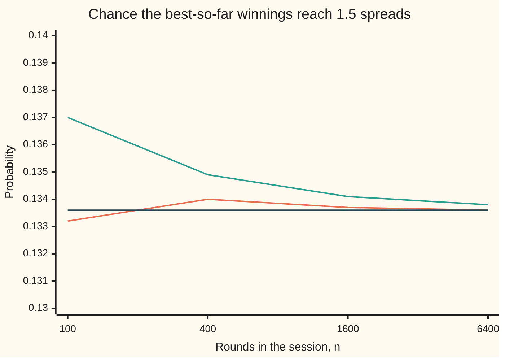

# Donsker's theorem: the whole random-walk path converges to Brownian motion

[Syllabus](../../../SYLLABUS.md) → [Stochastic processes and calculus](../README.md) → [Brownian Motion](../README.md#s05) → Donsker's theorem

---

## General Overview

A gambler plays 100 rounds of a fair coin game: heads wins one chip, tails loses one. What is the chance that the gambler's winnings, at some moment in the session, stand 15 chips or more ahead of the start?

Counting coin paths answers it exactly: 0.1332. Brownian motion answers it with one line of normal tables: 0.1336. The two agree to four parts in ten thousand. That agreement is no accident, and it is not the ordinary central limit theorem at work. The question is about the best moment of the session, not its last round, so it depends on the whole path.

Donsker's theorem is the reason. Shrink the walk: divide its winnings by the square root of the number of rounds, squeeze the rounds into one unit of time, and join the points with straight lines. As the number of rounds grows, this random curve settles, as a whole curve, into Brownian motion. Take any question that reads a number off the whole curve in a continuous way, such as its highest point. In the limit it has the same answer for the walk and for Brownian motion.

The theorem goes further: the step law (the probability distribution of one round's result) does not matter. A long-shot game that pays 2 chips with chance 1/5 and costs half a chip otherwise is also fair, with the same standard deviation per round, 1 chip. No mirror trick works for it, because it jumps over levels. Yet its exact answer, 0.1370 at 100 rounds, closes in on the same 0.1336. This is why the result is also called the **invariance principle**: the limit is invariant (unchanged) under a change of step law.

**Donsker's theorem says that a fair random walk with finite variance, scaled by the square root of the number of steps and joined up into a continuous path, converges in distribution to Brownian motion as a random curve; so any continuous rule that turns a path into a number gives, in the limit, the same answer for every such walk as for Brownian motion.**

**What kind of fact this is:** a theorem. On this card, Why it works proves the convergence at finitely many times, proves the tightness bound for the coin walk, and proves the continuous mapping step. Prokhorov's theorem on $`C[0,1]`$, which joins the two halves, is stated with its source (Billingsley, Section 5); the version for laws on the line is proved on [Tightness and Prokhorov's theorem](../../10-Measure%20and%20integration/10-The%20Limit%20Theorems%2C%20Proved/11-tightness-and-prokhorovs-theorem.md). The general finite-variance case is stated with sources.

### The picture: two games closing in on one Brownian answer



Orange: the coin game, exact. Green: the long-shot game, exact. Dark: Brownian motion's reflection answer, 2(1 − Φ(1.5)) = 0.1336. The level is always 1.5 spreads, 1.5 times the square root of n chips: 15 chips at 100 rounds, 30 at 400, 60 at 1600, 120 at 6400. Both checks compute the coin line two ways, by the mirror count and round by round, and assert that they agree; the long-shot line has only the round-by-round road.

---

## The formula

Notation first.

- The gambler's result in round $`i`$ is $`\xi_i`$ (read "ksi i"), in chips. The rounds are independent, with average 0 and standard deviation $`\sigma`$. In the coin game $`\xi_i`$ is +1 or −1 and $`\sigma = 1`$.
- The winnings after $`k`$ rounds are $`S_k = \xi_1 + \cdots + \xi_k`$, with $`S_0 = 0`$.
- One **spread** is $`\sigma\sqrt{n}`$ chips, the standard deviation of $`S_n`$: 10 chips after 100 coin rounds.
- $`\lfloor nt \rfloor`$ is $`nt`$ rounded down to a whole number: the rounds completed by time $`t`$.

The **scaled, joined-up walk** runs on the time interval from 0 to 1. Round $`k`$ is placed at time $`k/n`$ and the height is measured in spreads. Straight lines join the points:

```math
X^n(t) = \frac{S_{\lfloor nt \rfloor} + (nt - \lfloor nt \rfloor)\,\xi_{\lfloor nt \rfloor + 1}}{\sigma\sqrt{n}}, \qquad 0 \le t \le 1
```

**Read it aloud:** at time t, take the winnings so far, add the fraction of the next round already played, and divide by one spread.

Each $`X^n`$ is a random continuous path. $`C[0,1]`$ is the set of all continuous paths on the interval from 0 to 1. The distance between two paths $`f`$ and $`g`$ is the largest vertical gap between them, $`\lVert f - g \rVert = \max_t \lvert f(t) - g(t) \rvert`$, called the **uniform distance**.

```math
X^n \Rightarrow W \ \text{ in } C[0,1], \qquad\text{so}\qquad h(X^n) \Rightarrow h(W) \ \text{ for every continuous } h : C[0,1] \to \mathbb{R}
```

**Read it aloud:** the scaled walk converges in distribution to Brownian motion as a random path, so every continuous rule h that turns a path into a number gives numbers that converge in distribution too.

Here $`W`$ is Brownian motion on the interval from 0 to 1 ([Brownian motion](01-brownian-motion.md)). The double arrow means **converges in distribution**: the average of every bounded continuous test converges ([Convergence in distribution](../../10-Measure%20and%20integration/10-The%20Limit%20Theorems%2C%20Proved/05-convergence-in-distribution.md)). For paths, a test is a bounded continuous function of the whole path.

The gambler's question uses $`h(f) = \max_t f(t)`$, the highest point of the path. The highest point of $`X^n`$ is $`M_n/(\sigma\sqrt n)`$, where $`M_n`$ is the best winnings so far after $`n`$ rounds. The reflection principle gives the law of Brownian motion's highest point ([Reflection principle](04-reflection-principle-and-running-maximum.md)). Together:

```math
P\big(M_n \ge a\,\sigma\sqrt{n}\big) \;\longrightarrow\; P\Big(\max_{0 \le t \le 1} W_t \ge a\Big) = 2\big(1 - \Phi(a)\big), \qquad a > 0
```

**Read it aloud:** the chance the walk's best so far reaches a spreads tends to twice the normal tail beyond a.

At $`a = 1.5`$ and $`n = 100`$: the walk gives 0.1332 and the limit gives 0.1336.

| Symbol | Plain meaning | In our example | Push it up and the answer… |
| --- | --- | --- | --- |
| $`\xi_i`$, $`\sigma`$, $`\mu`$ | one round's result in chips; its standard deviation; an average gain per round, in When it holds | ±1, $`\sigma = 1`$; long-shot: +2 or −1/2, $`\sigma = 1`$ | — |
| $`S_k`$, $`k`$, $`\mathrm{Bin}`$ | winnings after k rounds; $`\mathrm{Bin}(n, p)`$ the number of wins in n rounds won with chance p | $`P(S_{100} \ge 15)`$ = 0.0666 | — |
| $`n`$ | rounds in the session | 100 | more rounds: walk answer nearer 0.1336 |
| $`X^n(t)`$, $`t`$, $`s`$, $`\lfloor nt \rfloor`$, $`z_n`$ | the scaled, joined-up walk at time t (s an earlier time); rounds completed by time t; $`z_n`$ a spike added in Step 2 | $`X^{100}(k/100) = S_k/10`$ | — |
| $`W`$, $`W_t`$, $`Y`$ | Brownian motion on the interval from 0 to 1; $`Y`$ a limit along a subsequence, in Step 4 | the limit of every $`X^n`$ | — |
| $`M_n`$ | best winnings so far, the largest of $`S_0, \ldots, S_n`$ | at least 15 in 0.1332 of sessions | — |
| $`a`$ | the level, in spreads | 1.5, that is 15 chips | higher: 0.0455 at 2 spreads |
| $`\Phi`$, $`E`$ | standard normal cumulative chance; an average over all sessions | $`\Phi(1.5)`$ = 0.933193 | — |
| $`h`$, $`\psi`$ | a rule turning a whole path into one number; a bounded continuous function of a number | the highest point | — |
| $`C[0,1]`$, $`f`$, $`g`$, $`\lVert f - g \rVert`$ | continuous paths on the interval from 0 to 1; two paths; the largest gap between them | joined-up and step paths differ by at most 0.1000 | — |
| $`\Rightarrow`$ | converges in distribution | — | — |
| $`\delta`$, $`\varepsilon`$, $`w(f, \delta)`$, $`m`$, $`\lambda`$, $`T_r`$, $`b_j`$ | window length; swing size; the largest swing of $`f`$ inside any window of length $`\delta`$; rounds per block; a level in chips; the walk's move r rounds into a block; the start of block j | $`\delta`$ = 0.1, $`\varepsilon`$ = 1 | longer window: bigger swings |

### When it holds

- **Independent rounds with the same law.** The proof splits the path into blocks of rounds that share nothing. Dependent rounds may still converge, but to a Brownian motion with a different spread or to something else; this proof does not cover them.
- **Average 0.** With an average gain of $`\mu`$ per round, the scaled path grows like $`\mu\sqrt n\, t/\sigma`$ and escapes. Subtract the drift first, then scale.
- **Finite variance.** Steps with an infinite spread, such as heavy-tailed jumps, are dominated by their largest jumps. Their scaled sums converge, if at all, to a Lévy process with jumps, not to Brownian motion ([Levy processes](../09-Beyond%20Brownian/01-levy-processes.md)).
- **A continuous rule $`h`$.** The maximum, the end value and the area under the path are continuous. A rule that counts how often the path touches a level can break. A rule continuous at almost every Brownian path still works, such as the time spent above 0 ([Levy's arcsine laws](12-levys-arcsine-laws.md)).
- **Square-root scaling.** Divide by $`n`$ instead of $`\sqrt n`$ and the path shrinks to the flat zero path, by the law of large numbers. Divide by less and it blows up.

---

## Why it works

### Step 0: two halves and a bridge

Convergence of random paths needs two things.

1. **Finite-dimensional convergence.** At any fixed list of times, the walk's values converge in distribution to Brownian motion's values. This is the central limit theorem, used on blocks of rounds.
2. **Tightness.** No probability leaks into wild paths between those times. In plain words: the walk cannot make a large swing in a very short time, with chance bounded uniformly over n.

Prokhorov's theorem is the bridge. Tightness gives limits along subsequences, and finite-dimensional convergence says every such limit is Brownian motion. Then the continuous mapping theorem carries the result to the maximum.

### Step 1: finite-dimensional convergence

Fix times $`0 < t_1 < \cdots < t_k \le 1`$. [Brownian motion](01-brownian-motion.md) proves that the step walk $`S_{\lfloor nt \rfloor}/(\sigma\sqrt n)`$ at those times converges to $`(W_{t_1}, \ldots, W_{t_k})`$. Its proof uses the [Central limit theorem](../../09-Probability%20and%20statistics/06-Limit%20Theorems%20in%20Practice/02-central-limit-theorem.md) on each block of rounds between two times, independence across blocks, and characteristic functions (averages of $`e^{iuX}`$, which pin down a law) to combine them.

The joined-up walk differs from the step walk by the partial round, $`(nt - \lfloor nt \rfloor)\,\xi_{\lfloor nt \rfloor + 1}/(\sigma\sqrt n)`$. That piece is at most $`1/\sqrt{n}`$ for the coin, 0.1000 at 100 rounds, and tends to 0. Adding something that tends to 0 does not change a limit in distribution (Slutsky's lemma, on [Convergence in distribution](../../10-Measure%20and%20integration/10-The%20Limit%20Theorems%2C%20Proved/05-convergence-in-distribution.md)). So the joined-up walk has the same finite-dimensional limits.

### Step 2: why finitely many times are not enough

Finite-dimensional convergence cannot see what happens between the chosen times. Two examples show the gap.

- **A spike.** Add to the walk a thin tent $`z_n`$: height 2 at time $`1/n`$, falling to 0 at times 0 and $`2/n`$. At every fixed time the tent is eventually 0, so the finite-dimensional limits are still Brownian. But at n = 100 the highest point is at least 2 − 0.1, and the chance of reaching 1.5 is 1.0000, not 0.1336; the same holds for every larger n.
- **A coarse record.** Read the coin walk only every 10 rounds. The chance that the record shows 15 or more is 0.0950, against 0.1332 for the full walk. Finitely many times only control a maximum over those times.

So the walk's paths must also be shown to stay smooth enough between any fixed times. That is tightness.

### Step 3: tightness, from a maximal inequality

Write $`w(f, \delta)`$ for the largest swing of a path $`f`$ inside any window of length $`\delta`$, its **modulus of continuity**. A family of random paths that all start at 0 is **tight** when large swings in short windows are uniformly rare. For every swing size $`\varepsilon`$, the chance that $`w(X^n, \delta) \ge \varepsilon`$ goes to 0 as $`\delta`$ shrinks, uniformly in n. (The Arzelà–Ascoli theorem says paths with a common start and a common bound on swings form a compact set; tightness puts almost all the probability on such a set.)

For the coin walk the bound is short:

1. Cut the interval into $`1/\delta`$ blocks of length $`\delta`$, each holding $`m = n\delta`$ rounds.
2. A swing of $`3\varepsilon`$ inside a window of length $`\delta`$ needs some block where the path moves at least $`\varepsilon`$ away from its value at the block's start. A window meets at most two blocks, and the triangle inequality spreads the swing over at most three pieces.
3. Within one block, the walk restarts. Doob's maximal inequality, applied to the fourth power $`S_k^4`$, bounds the chance of a big move by the fourth moment at the block's end ([Doob's inequalities](../02-Martingales/05-doob-inequalities.md)).
4. The fourth moment of a coin walk is $`3m^2 - 2m`$, at most $`3m^2`$.
5. Add over the blocks.

```math
P\big(w(X^n, \delta) \ge 3\varepsilon\big) \;\le\; \frac{1}{\delta}\cdot\frac{3\,(n\delta)^2}{(\varepsilon\sqrt n)^4} \;=\; \frac{3\,\delta}{\varepsilon^4}
```

**Read it aloud:** the chance of a swing of three epsilon within any window of length delta is at most three delta over epsilon to the fourth, whatever the number of rounds.

The right side does not depend on $`n`$ and goes to 0 with $`\delta`$. That is tightness.

<details>
<summary>Detailed proof: the tightness bound for the coin walk</summary>

Assume $`n\delta`$ is a whole number $`m`$, so block edges fall on rounds. The joined-up path is straight between rounds, so its largest move inside a block is attained at a round.

**Three pieces.** Let $`s < t`$ with $`t - s \le \delta`$. Then $`s`$ lies in some block starting at $`b_j`$, and $`t`$ lies in that block or the next, starting at $`b_{j+1}`$. In the second case,

$`\displaystyle \lvert X(t) - X(s) \rvert \le \lvert X(s) - X(b_j) \rvert + \lvert X(b_{j+1}) - X(b_j) \rvert + \lvert X(t) - X(b_{j+1}) \rvert.`$

If the left side is at least $`3\varepsilon`$, one piece is at least $`\varepsilon`$. The first case needs only the first piece and one more. Either way, some block has a move of at least $`\varepsilon`$ from its start.

**One block.** The move within block $`j`$ after $`r`$ rounds is a coin walk $`T_r`$ of r rounds, independent of the past. It is a martingale, so $`T_r^4`$ is a non-negative submartingale (a process whose expected next value is at least its current one), because the fourth power is convex. Doob's maximal inequality with level $`\lambda^4`$ gives

$`\displaystyle P\Big(\max_{r \le m} \lvert T_r \rvert \ge \lambda\Big) = P\Big(\max_{r \le m} T_r^4 \ge \lambda^4\Big) \le \frac{E[T_m^4]}{\lambda^4}.`$

**The fourth moment.** Expand $`(\xi_1 + \cdots + \xi_m)^4`$. Terms with any step to an odd power average 0. The m terms $`\xi_i^4`$ average 1 each. The terms $`\xi_i^2 \xi_j^2`$ with $`i \neq j`$ appear $`3m(m-1)`$ times and average 1. So $`E[T_m^4] = m + 3m(m-1) = 3m^2 - 2m \le 3m^2`$.

**Add up.** Take $`\lambda = \varepsilon\sqrt n`$, which is $`\varepsilon`$ spreads. Over $`1/\delta`$ blocks, the chance is at most $`(1/\delta) \cdot 3(n\delta)^2/(\varepsilon^4 n^2) = 3\delta/\varepsilon^4`$.

**General steps.** With a finite fourth moment, the same argument works, with $`E[T_m^4] = 3m(m-1)\sigma^4 + m\,E[\xi^4]`$. With only a finite variance, the fourth power is replaced by a truncation argument or by the Skorokhod embedding, which places the walk inside one Brownian path (Billingsley, Section 8; Durrett, Section 8.1; Mörters and Peres, Chapter 5).

</details>

The checks compute the middle step of this bound exactly for the coin walk, with $`\varepsilon = 1`$: the number of blocks times the chance that one block moves 1 spread from its start. This sum is at least the chance of a swing of 3 spreads, and at most $`3\delta`$.

| Window $`\delta`$ | n = 100 | n = 400 | n = 1600 | n = 6400 | Brownian limit | Bound $`3\delta`$ |
| --- | --- | --- | --- | --- | --- | --- |
| 0.2 | 0.2660 | 0.2565 | 0.2542 | 0.2537 | 0.2535 | 0.6000 |
| 0.1 | 0.0195 | 0.0290 | 0.0308 | 0.0312 | 0.0313 | 0.3000 |
| 0.05 | — | — | — | — | 0.000310 | — |

Every entry sits under its bound, the numbers settle quickly as n grows, and they collapse as the window shrinks. The Brownian column comes from a different road: mirrors in two walls, the image series of [Reflection principle](04-reflection-principle-and-running-maximum.md).

### Step 4: Prokhorov's theorem and continuous mapping

**Prokhorov's theorem** ([Tightness and Prokhorov's theorem](../../10-Measure%20and%20integration/10-The%20Limit%20Theorems%2C%20Proved/11-tightness-and-prokhorovs-theorem.md)): a tight family of laws on $`C[0,1]`$ has, inside every sequence, a subsequence that converges in distribution. The proof on a general metric space is in Billingsley, Section 5 (Sources); Prokhorov's 1956 paper is the original.

Now take any subsequence of the walks. Tightness gives a further subsequence converging to some random continuous path $`Y`$. Reading values at fixed times is a continuous rule on $`C[0,1]`$, so $`Y`$ has the finite-dimensional laws of Brownian motion, by Step 1. Those laws decide the law of a continuous process, so $`Y`$ is Brownian motion. Every subsequence has a further subsequence with the same limit $`W`$, so the whole sequence converges to $`W`$.

A by-product: this proves that Brownian motion exists, by a route different from [Building Brownian motion](08-constructing-brownian-motion.md).

The **continuous mapping theorem** then moves answers. If $`X^n \Rightarrow W`$ and $`h`$ is continuous, take any bounded continuous function $`\psi`$ of a number. Then $`\psi \circ h`$, first $`h`$ and then $`\psi`$, is a bounded continuous test on paths, so $`E[\psi(h(X^n))] \to E[\psi(h(W))]`$: that is $`h(X^n) \Rightarrow h(W)`$. The same holds if $`h`$ is continuous at every path outside a set that Brownian motion avoids with probability 1.

The maximum is continuous: if two paths are never more than 0.1 apart, their highest points are at most 0.1 apart, and the same for any gap: $`\lvert \max f - \max g \rvert \le \lVert f - g \rVert`$. Brownian motion's maximum has a density, so 1.5 is a continuity point of its law and the chances converge: $`P(M_n \ge 1.5\sqrt n) \to 0.1336`$.

### Step 5: answers move both ways

- **From Brownian motion to walks.** For the long-shot game no mirror exists. Its exact answers, 0.1370, 0.1349, 0.1341 and 0.1338 at 100 to 6400 rounds, approach the Brownian 0.1336. Donsker's theorem says they must.
- **From walks to Brownian motion.** A fact proved by counting coin paths passes to the limit and gives a Brownian fact. The coin walk's mirror count, 0.1332 at 100 rounds and 0.1336 to four places at 6400, is a road to Brownian motion's maximum that never uses the strong Markov property.

---

## Worked numbers, by hand

The coin game, 100 rounds, level 15 chips.

| Step | Arithmetic | Value |
| --- | --- | --- |
| one spread | $`\sqrt{100}`$ chips | 10 |
| level in spreads, $`a`$ | 15 / 10 | 1.5 |
| winnings are even after 100 rounds, so 15 or more means 16 or more | 58 wins and 42 losses give 16 | 58 wins |
| ends at 15 or more | $`P(\mathrm{Bin}(100, 1/2) \ge 58)`$ | 0.0666 |
| touches 15 by the walk's mirror | 2 × 0.0666 | 0.1332 |
| $`\Phi(1.5)`$ | Simpson's rule, or a table | 0.933193 |
| **Brownian answer** | 2 × (1 − 0.933193) | **0.1336** |
| gap, walk minus Brownian | 0.1332 − 0.1336 | −0.0004 |

About 13 sessions in 100 see the gambler 15 chips ahead at some moment, twice as many as finish that far ahead. Brownian motion predicts this from two lines of arithmetic, because the session's whole path is already close to a Brownian path.

$`\mathrm{Bin}(100, 1/2)`$ is the number of wins in 100 fair rounds, a binomial count.

### What breaks if you drop a piece

| Mistake | Comes out at | What went wrong |
| --- | --- | --- |
| Use only the end of the session, the plain central limit theorem | 0.0666 by counting, 0.0668 by $`1 - \Phi(1.5)`$ (right: 0.1332) | The end value forgets the path; half the touching sessions fall back |
| Check the record every 10 rounds only | 0.0950 (right: 0.1332) | Finite-dimensional convergence only controls the chosen times |
| Long-shot game: double the end tail, as for the coin | 0.1750 (right: 0.1370) | The walk jumps over the level, so the mirror pairing fails; only the limit is shared |
| Walk plus the spike $`z_n`$ | 1.0000 at n = 100 and beyond (Brownian: 0.1336) | Finite-dimensional limits are right, but tightness fails |

---

## Code, from first principles, and it actually runs

The programs compute the gambler's chance by four independent roads and compare them.

- Road 1: the Brownian answer $`2(1 - \Phi(1.5))`$, with $`\Phi`$ built by Simpson's rule (an area sum over thin strips) and checked against a Taylor series.
- Road 2: the coin walk's own reflection principle, with binomial tails added term by term from logarithms of factorials.
- Road 3: no mirror at all. The chance of every position is carried forward round by round, and any mass at or above the level is set aside. This is the only road for the long-shot game, which is run in half-chip units: +4 or −1.
- Road 4, for tightness: an exact round-by-round count of the coin walk between two walls, against Brownian motion's two-wall image series.

The asserts compare road 2 with road 3, road 1 with roads 2 and 3 as n grows, and road 4's walk numbers with its Brownian numbers and with the bound $`3\delta`$.

### Python

```python
# Donsker's theorem: the gambler's best-so-far winnings against Brownian motion's reflection answer.
import math

def Phi(x):  # standard normal CDF: 1/2 plus Simpson's rule on the bell curve from 0 to x
    if x < 0:
        return 1.0 - Phi(-x)
    x, m = min(x, 12.0), 2000
    h = x / m
    s = sum((1 if i in (0, m) else 4 if i % 2 else 2) * math.exp(-(i * h) ** 2 / 2) for i in range(m + 1))
    return 0.5 + s * h / 3 / math.sqrt(2 * math.pi)

def Phi_series(x):  # second road: Taylor series of the error function
    z, term, s, k = x / math.sqrt(2), x / math.sqrt(2), 0.0, 0
    while abs(term) > 1e-17:
        s += term / (2 * k + 1)
        k += 1
        term *= -z * z / k
    return 0.5 + s / math.sqrt(math.pi)

LNF = [0.0]
for i in range(1, 6401):
    LNF.append(LNF[-1] + math.log(i))  # ln(i!) as a running sum of logs

def bin_tail(n, p, k):  # P(Bin(n, p) >= k), each term from ln(n choose j)
    return sum(math.exp(LNF[n] - LNF[j] - LNF[n - j] + j * math.log(p) + (n - j) * math.log(1 - p))
               for j in range(k, n + 1))

def touch(n, up, down, p, L, every=1):
    # chance a walk (+up with chance p, -down otherwise, from 0) stands at L or above
    # at some checked round; rounds are checked every `every` rounds. No mirror used.
    base = down * n
    W = base + L + up * every
    old = [0.0] * W
    old[base] = 1.0
    hit = 0.0
    for k in range(1, n + 1):
        new = [0.0] * W
        for i, v in enumerate(old):
            if v:
                if i + up < W:
                    new[i + up] += p * v
                if i - down >= 0:
                    new[i - down] += (1 - p) * v
        if k % every == 0:
            hit += sum(new[base + L:])
            new[base + L:] = [0.0] * (W - base - L)
        old = new
    return hit

def two_sided_walk(m, lam):  # P(coin walk reaches +lam or -lam within m rounds)
    old, hit = {0: 1.0}, 0.0
    for _ in range(m):
        new = {}
        for x, v in old.items():
            for y in (x + 1, x - 1):
                if abs(y) >= lam:
                    hit += v / 2
                else:
                    new[y] = new.get(y, 0.0) + v / 2
        old = new
    return hit

def two_sided_bm(d, e):  # P(max over [0, d] of |W| >= e), mirrors in both walls
    stay = sum((-1) ** k * (Phi((2 * k + 1) * e / math.sqrt(d)) - Phi((2 * k - 1) * e / math.sqrt(d)))
               for k in range(-20, 21))
    return 1.0 - stay

f4 = lambda x: f"{x:.4f}"
bm = 2 * (1 - Phi(1.5))
assert abs(Phi(1.5) - Phi_series(1.5)) < 1e-10
print("Gambler: fair coin, +1 or -1 chip a round, 100 rounds, level 15 chips")
print("1 spread = sqrt(100) = 10 chips, so the level is", 15 / 10, "spreads")
end = bin_tail(100, 0.5, 58)
refl = 2 * end
dp = touch(100, 1, 1, 0.5, 15)
print("P(end >= 15) = P(Bin(100,1/2) >= 58) =", f4(end))
print("walk reflection 2 P(Bin >= 58)       =", f4(refl))
print("step-by-step, no mirror              =", f4(dp))
print("Phi(1.5) by Simpson =", f"{Phi(1.5):.6f}", "by series =", f"{Phi_series(1.5):.6f}")
print("Brownian 2(1 - Phi(1.5))             =", f4(bm))
print("gap walk - Brownian                  =", f"{refl - bm:+.4f}")
assert abs(refl - dp) < 1e-12 and abs(refl - bm) < 0.001
print("joined-up minus step path, at most 1/sqrt(n) =", f4(1 / math.sqrt(100)))
print("convergence, level 1.5 sqrt(n) chips:")
print("n | coin exact | long-shot exact | Brownian")
gaps = []
for n in (100, 400, 1600, 6400):
    r = math.isqrt(n)
    a = 3 * r // 2
    coin = bin_tail(n, 0.5, (n + a) // 2 + 1) * 2 if a % 2 else bin_tail(n, 0.5, (n + a) // 2) + bin_tail(n, 0.5, (n + a) // 2 + 1)
    coin_dp = touch(n, 1, 1, 0.5, a)
    shot = touch(n, 4, 1, 0.2, 3 * r)  # half-chip units: +2 chips = +4, -1/2 chip = -1
    assert abs(coin - coin_dp) < 1e-10
    gaps.append((abs(coin - bm), abs(shot - bm)))
    print(n, "|", f4(coin), "|", f4(shot), "|", f4(bm))
assert gaps[-1][0] < gaps[0][0] and gaps[-1][1] < gaps[0][1] / 3 and gaps[-1][1] < 0.01
print("mistakes, 100 rounds:")
print("end position only, P(end >= 15)      =", f4(end))
print("normal tail only, 1 - Phi(1.5)       =", f4(1 - Phi(1.5)))
chk = touch(100, 1, 1, 0.5, 15, every=10)
print("checked every 10 rounds only         =", f4(chk))
shot_end = bin_tail(100, 0.2, 26)  # 2.5 wins - 50 >= 15 needs 26 wins
shot100 = touch(100, 4, 1, 0.2, 30)
print("long-shot, doubled end tail          =", f4(2 * shot_end))
print("long-shot, exact                     =", f4(shot100))
spike = 0.5 * (0.1 + 2 >= 1.5) + 0.5 * (-0.1 + 2 >= 1.5)
print("walk plus a spike of 2 at t=1/n, P(max >= 1.5) =", f4(spike))
assert chk < dp and abs(2 * shot_end - shot100) > 0.02
print("tightness: P(some block of length d has |swing from its start| >= 1)")
print("d | n | blocks x walk block chance | Brownian limit | bound 3d")
for d in (0.2, 0.1):
    lim = two_sided_bm(d, 1.0) / d
    for n in (100, 400, 1600, 6400):
        m = round(d * n)
        u = two_sided_walk(m, math.isqrt(n)) / d
        assert u <= 3 * d
        print(d, "|", n, "|", f4(u), "|", f4(lim), "|", f4(3 * d))
    assert abs(u - lim) < 0.1 * lim
print("0.05 | Brownian limit only |", f"{two_sided_bm(0.05, 1.0) / 0.05:.6f}")
print("try: level 2 spreads, Brownian =", f4(2 * (1 - Phi(2.0))), "coin n=100 =", f4(bin_tail(100, 0.5, 60) + bin_tail(100, 0.5, 61)))
print("try: 400 rounds, level 15 chips, coin =", f4(2 * bin_tail(400, 0.5, 208)), "Brownian =", f4(2 * (1 - Phi(0.75))))
print("ALL CHECKS PASS")
```

**Ran 2026-11-23 on macOS, Python 3.14.10, standard library only. All checks passed. Output, pasted from the run:**

```
Gambler: fair coin, +1 or -1 chip a round, 100 rounds, level 15 chips
1 spread = sqrt(100) = 10 chips, so the level is 1.5 spreads
P(end >= 15) = P(Bin(100,1/2) >= 58) = 0.0666
walk reflection 2 P(Bin >= 58)       = 0.1332
step-by-step, no mirror              = 0.1332
Phi(1.5) by Simpson = 0.933193 by series = 0.933193
Brownian 2(1 - Phi(1.5))             = 0.1336
gap walk - Brownian                  = -0.0004
joined-up minus step path, at most 1/sqrt(n) = 0.1000
convergence, level 1.5 sqrt(n) chips:
n | coin exact | long-shot exact | Brownian
100 | 0.1332 | 0.1370 | 0.1336
400 | 0.1340 | 0.1349 | 0.1336
1600 | 0.1337 | 0.1341 | 0.1336
6400 | 0.1336 | 0.1338 | 0.1336
mistakes, 100 rounds:
end position only, P(end >= 15)      = 0.0666
normal tail only, 1 - Phi(1.5)       = 0.0668
checked every 10 rounds only         = 0.0950
long-shot, doubled end tail          = 0.1750
long-shot, exact                     = 0.1370
walk plus a spike of 2 at t=1/n, P(max >= 1.5) = 1.0000
tightness: P(some block of length d has |swing from its start| >= 1)
d | n | blocks x walk block chance | Brownian limit | bound 3d
0.2 | 100 | 0.2660 | 0.2535 | 0.6000
0.2 | 400 | 0.2565 | 0.2535 | 0.6000
0.2 | 1600 | 0.2542 | 0.2535 | 0.6000
0.2 | 6400 | 0.2537 | 0.2535 | 0.6000
0.1 | 100 | 0.0195 | 0.0313 | 0.3000
0.1 | 400 | 0.0290 | 0.0313 | 0.3000
0.1 | 1600 | 0.0308 | 0.0313 | 0.3000
0.1 | 6400 | 0.0312 | 0.0313 | 0.3000
0.05 | Brownian limit only | 0.000310
try: level 2 spreads, Brownian = 0.0455 coin n=100 = 0.0460
try: 400 rounds, level 15 chips, coin = 0.4533 Brownian = 0.4533
ALL CHECKS PASS
```

### Rust

```rust
// Donsker's theorem: the gambler's best-so-far winnings against Brownian motion's reflection answer.
use std::f64::consts::PI;

fn phi(x: f64) -> f64 {
    // standard normal CDF: 1/2 plus Simpson's rule on the bell curve from 0 to x
    if x < 0.0 {
        return 1.0 - phi(-x);
    }
    let (x, m) = (x.min(12.0), 2000usize);
    let h = x / m as f64;
    let mut s = 0.0;
    for i in 0..=m {
        let w = if i == 0 || i == m { 1.0 } else if i % 2 == 1 { 4.0 } else { 2.0 };
        s += w * (-(i as f64 * h).powi(2) / 2.0).exp();
    }
    0.5 + s * h / 3.0 / (2.0 * PI).sqrt()
}

fn phi_series(x: f64) -> f64 {
    // second road: Taylor series of the error function
    let z = x / 2f64.sqrt();
    let (mut term, mut s, mut k) = (z, 0.0, 0.0);
    while term.abs() > 1e-17 {
        s += term / (2.0 * k + 1.0);
        k += 1.0;
        term *= -z * z / k;
    }
    0.5 + s / PI.sqrt()
}

fn bin_tail(lnf: &[f64], n: usize, p: f64, k: usize) -> f64 {
    // P(Bin(n, p) >= k), each term from ln(n choose j)
    (k..=n)
        .map(|j| (lnf[n] - lnf[j] - lnf[n - j] + j as f64 * p.ln() + (n - j) as f64 * (1.0 - p).ln()).exp())
        .sum()
}

fn touch(n: usize, up: usize, down: usize, p: f64, l: usize, every: usize) -> f64 {
    // chance a walk (+up with chance p, -down otherwise, from 0) stands at L or above
    // at some checked round; rounds are checked every `every` rounds. No mirror used.
    let base = down * n;
    let w = base + l + up * every;
    let mut old = vec![0.0f64; w];
    old[base] = 1.0;
    let mut hit = 0.0;
    for k in 1..=n {
        let mut new = vec![0.0f64; w];
        for (i, &v) in old.iter().enumerate() {
            if v != 0.0 {
                if i + up < w {
                    new[i + up] += p * v;
                }
                if i >= down {
                    new[i - down] += (1.0 - p) * v;
                }
            }
        }
        if k % every == 0 {
            hit += new[base + l..].iter().sum::<f64>();
            new[base + l..].iter_mut().for_each(|v| *v = 0.0);
        }
        old = new;
    }
    hit
}

fn two_sided_walk(m: usize, lam: usize) -> f64 {
    // P(coin walk reaches +lam or -lam within m rounds); index i is position i - lam
    let mut old = vec![0.0f64; 2 * lam + 1];
    old[lam] = 1.0;
    let mut hit = 0.0;
    for _ in 0..m {
        let mut new = vec![0.0f64; 2 * lam + 1];
        for i in 1..2 * lam {
            for j in [i + 1, i - 1] {
                if j == 0 || j == 2 * lam { hit += old[i] / 2.0; } else { new[j] += old[i] / 2.0; }
            }
        }
        old = new;
    }
    hit
}

fn two_sided_bm(d: f64, e: f64) -> f64 {
    // P(max over [0, d] of |W| >= e), mirrors in both walls
    let mut stay = 0.0;
    for k in -20i32..=20 {
        let sg = if k % 2 == 0 { 1.0 } else { -1.0 };
        let k = k as f64;
        stay += sg * (phi((2.0 * k + 1.0) * e / d.sqrt()) - phi((2.0 * k - 1.0) * e / d.sqrt()));
    }
    1.0 - stay
}

fn isqrt(n: usize) -> usize { (n as f64).sqrt().round() as usize }

fn main() {
    let mut lnf = vec![0.0f64];
    for i in 1..=6400 {
        let last = lnf[lnf.len() - 1];
        lnf.push(last + (i as f64).ln()); // ln(i!) as a running sum of logs
    }
    let bm = 2.0 * (1.0 - phi(1.5));
    assert!((phi(1.5) - phi_series(1.5)).abs() < 1e-10);
    println!("Gambler: fair coin, +1 or -1 chip a round, 100 rounds, level 15 chips");
    println!("1 spread = sqrt(100) = 10 chips, so the level is 1.5 spreads");
    let end = bin_tail(&lnf, 100, 0.5, 58);
    let refl = 2.0 * end;
    let dp = touch(100, 1, 1, 0.5, 15, 1);
    println!("P(end >= 15) = P(Bin(100,1/2) >= 58) = {:.4}", end);
    println!("walk reflection 2 P(Bin >= 58)       = {:.4}", refl);
    println!("step-by-step, no mirror              = {:.4}", dp);
    println!("Phi(1.5) by Simpson = {:.6} by series = {:.6}", phi(1.5), phi_series(1.5));
    println!("Brownian 2(1 - Phi(1.5))             = {:.4}", bm);
    println!("gap walk - Brownian                  = {:+.4}", refl - bm);
    assert!((refl - dp).abs() < 1e-12 && (refl - bm).abs() < 0.001);
    println!("joined-up minus step path, at most 1/sqrt(n) = {:.4}", 1.0 / 10f64);
    println!("convergence, level 1.5 sqrt(n) chips:");
    println!("n | coin exact | long-shot exact | Brownian");
    let mut gaps = Vec::new();
    for n in [100usize, 400, 1600, 6400] {
        let r = isqrt(n);
        let a = 3 * r / 2;
        let coin = if a % 2 == 1 {
            bin_tail(&lnf, n, 0.5, (n + a) / 2 + 1) * 2.0
        } else {
            bin_tail(&lnf, n, 0.5, (n + a) / 2) + bin_tail(&lnf, n, 0.5, (n + a) / 2 + 1)
        };
        let coin_dp = touch(n, 1, 1, 0.5, a, 1);
        let shot = touch(n, 4, 1, 0.2, 3 * r, 1); // half-chip units: +2 chips = +4, -1/2 chip = -1
        assert!((coin - coin_dp).abs() < 1e-10);
        gaps.push(((coin - bm).abs(), (shot - bm).abs()));
        println!("{} | {:.4} | {:.4} | {:.4}", n, coin, shot, bm);
    }
    assert!(gaps[3].0 < gaps[0].0 && gaps[3].1 < gaps[0].1 / 3.0 && gaps[3].1 < 0.01);
    println!("mistakes, 100 rounds:");
    println!("end position only, P(end >= 15)      = {:.4}", end);
    println!("normal tail only, 1 - Phi(1.5)       = {:.4}", 1.0 - phi(1.5));
    let chk = touch(100, 1, 1, 0.5, 15, 10);
    println!("checked every 10 rounds only         = {:.4}", chk);
    let shot_end = bin_tail(&lnf, 100, 0.2, 26); // 2.5 wins - 50 >= 15 needs 26 wins
    let shot100 = touch(100, 4, 1, 0.2, 30, 1);
    println!("long-shot, doubled end tail          = {:.4}", 2.0 * shot_end);
    println!("long-shot, exact                     = {:.4}", shot100);
    let ok = |x: f64| if x >= 1.5 { 1.0 } else { 0.0 };
    let spike = 0.5 * ok(0.1 + 2.0) + 0.5 * ok(-0.1 + 2.0);
    println!("walk plus a spike of 2 at t=1/n, P(max >= 1.5) = {:.4}", spike);
    assert!(chk < dp && (2.0 * shot_end - shot100).abs() > 0.02);
    println!("tightness: P(some block of length d has |swing from its start| >= 1)");
    println!("d | n | blocks x walk block chance | Brownian limit | bound 3d");
    for d in [0.2f64, 0.1] {
        let lim = two_sided_bm(d, 1.0) / d;
        let mut u = 0.0;
        for n in [100usize, 400, 1600, 6400] {
            let m = (d * n as f64).round() as usize;
            u = two_sided_walk(m, isqrt(n)) / d;
            assert!(u <= 3.0 * d);
            println!("{} | {} | {:.4} | {:.4} | {:.4}", d, n, u, lim, 3.0 * d);
        }
        assert!((u - lim).abs() < 0.1 * lim);
    }
    println!("0.05 | Brownian limit only | {:.6}", two_sided_bm(0.05, 1.0) / 0.05);
    println!("try: level 2 spreads, Brownian = {:.4} coin n=100 = {:.4}", 2.0 * (1.0 - phi(2.0)),
             bin_tail(&lnf, 100, 0.5, 60) + bin_tail(&lnf, 100, 0.5, 61));
    println!("try: 400 rounds, level 15 chips, coin = {:.4} Brownian = {:.4}",
             2.0 * bin_tail(&lnf, 400, 0.5, 208), 2.0 * (1.0 - phi(0.75)));
    println!("ALL CHECKS PASS");
}
```

**Ran 2026-11-23 on macOS, rustc 1.98.1, no crates. All checks passed. Output, pasted from the run:**

```
Gambler: fair coin, +1 or -1 chip a round, 100 rounds, level 15 chips
1 spread = sqrt(100) = 10 chips, so the level is 1.5 spreads
P(end >= 15) = P(Bin(100,1/2) >= 58) = 0.0666
walk reflection 2 P(Bin >= 58)       = 0.1332
step-by-step, no mirror              = 0.1332
Phi(1.5) by Simpson = 0.933193 by series = 0.933193
Brownian 2(1 - Phi(1.5))             = 0.1336
gap walk - Brownian                  = -0.0004
joined-up minus step path, at most 1/sqrt(n) = 0.1000
convergence, level 1.5 sqrt(n) chips:
n | coin exact | long-shot exact | Brownian
100 | 0.1332 | 0.1370 | 0.1336
400 | 0.1340 | 0.1349 | 0.1336
1600 | 0.1337 | 0.1341 | 0.1336
6400 | 0.1336 | 0.1338 | 0.1336
mistakes, 100 rounds:
end position only, P(end >= 15)      = 0.0666
normal tail only, 1 - Phi(1.5)       = 0.0668
checked every 10 rounds only         = 0.0950
long-shot, doubled end tail          = 0.1750
long-shot, exact                     = 0.1370
walk plus a spike of 2 at t=1/n, P(max >= 1.5) = 1.0000
tightness: P(some block of length d has |swing from its start| >= 1)
d | n | blocks x walk block chance | Brownian limit | bound 3d
0.2 | 100 | 0.2660 | 0.2535 | 0.6000
0.2 | 400 | 0.2565 | 0.2535 | 0.6000
0.2 | 1600 | 0.2542 | 0.2535 | 0.6000
0.2 | 6400 | 0.2537 | 0.2535 | 0.6000
0.1 | 100 | 0.0195 | 0.0313 | 0.3000
0.1 | 400 | 0.0290 | 0.0313 | 0.3000
0.1 | 1600 | 0.0308 | 0.0313 | 0.3000
0.1 | 6400 | 0.0312 | 0.0313 | 0.3000
0.05 | Brownian limit only | 0.000310
try: level 2 spreads, Brownian = 0.0455 coin n=100 = 0.0460
try: 400 rounds, level 15 chips, coin = 0.4533 Brownian = 0.4533
ALL CHECKS PASS
```

> [!TIP]
> **Try changing**
> Guess first; the `try:` rows and the tightness table hold the answers.
> - **Raise the level to 2 spreads, 20 chips.** Brownian motion gives **0.0455**; the coin walk at 100 rounds gives **0.0460**. A third more distance cuts the chance to about a third.
> - **Keep the level at 15 chips but play 400 rounds.** Now 15 chips is only 0.75 spreads, and the chance jumps to **0.4533** for both the coin and Brownian motion.
> - **Shrink the tightness window to 0.05.** The Brownian block sum falls from 0.0313 to **0.000310**. Halving the window cuts it about a hundredfold, far faster than the bound $`3\delta`$ promises.

---

## The usual mistake

> [!warning]
> **Treating Donsker's theorem as the central limit theorem at a few times.** The central limit theorem, even at many fixed times, says nothing about the best moment of a session. Checking the walk only every 10 rounds gives 0.0950, not 0.1332. Questions about maxima, first touches or time spent above a level need convergence of the whole path, and that needs tightness.
>
> Smaller traps:
> - **Using the walk's mirror for any fair game.** Doubling the end tail works for steps of one chip. For the long-shot game it gives 0.1750 against the true 0.1370. Only the limit, 0.1336, is shared.
> - **Forgetting the square root.** Scale by n and the path flattens to zero; every level of 1.5 is then reached with chance near 0.
> - **Reading the limit as exact at 100 rounds.** At 100 rounds the coin walk gives 0.1332 and the long-shot game 0.1370, against 0.1336. The gap shrinks as n grows, but at any fixed n the Brownian answer is an approximation.
> - **Trusting the finite-dimensional laws of a modified walk.** The walk plus the spike has Brownian finite-dimensional limits, and the maximum is a continuous rule, yet it reaches 1.5 with chance 1.0000, not 0.1336. Without tightness, even a continuous rule gives the wrong limit.

---

## Where you meet it in real life

- **A pollen grain under a microscope.** The grain's displacement is a sum of countless small molecular kicks. Donsker's theorem is why the whole path, not just its position at fixed times, is Brownian, so the chance of touching a line, worked on [Reflection principle](04-reflection-principle-and-running-maximum.md), applies to the real grain.
- **Goodness-of-fit tests.** The Kolmogorov–Smirnov test compares a sample's step-shaped distribution function with a claimed one. Donsker's version for empirical distribution functions says the scaled largest gap behaves like the largest height of a [Brownian bridge](05-brownian-bridge.md), which gives the test's critical values.
- **Option pricing on trees.** A binomial price tree is a random walk on the log price. Path-dependent options, such as those that pay on the running maximum, converge to their continuous-time prices because the whole tree path converges.
- **Simulation.** Monte Carlo code often replaces Brownian motion by a walk with many small steps; the error in path-dependent answers is controlled by this theorem and its rates. The same idea underlies weak convergence of [Euler-Maruyama](../08-Generators%2C%20Densities%20and%20Simulation/04-euler-maruyama-scheme.md).
- **Quality control and change detection.** A running sum of measurement errors is a walk. Alarm rules that fire when the sum crosses a boundary are designed with Brownian boundary-crossing chances.

> **Say it back**
> Scale a fair random walk by the square root of its number of steps, squeeze it into one unit of time and join the points. Donsker's theorem says this random path converges in distribution to Brownian motion as a whole path. The proof joins finite-dimensional convergence, from the central limit theorem, with tightness, a uniform bound on fast swings, through Prokhorov's theorem. Any continuous rule on paths then gives the same limit for every fair finite-variance walk. That is why the gambler's chance of being 15 chips ahead within 100 rounds, 0.1332, matches Brownian motion's 0.1336.

---

## What this builds on

- [Brownian motion](01-brownian-motion.md): the limit object, and the proof that the scaled walk converges to it at any finite set of times.
- [Building Brownian motion](08-constructing-brownian-motion.md): a direct construction of the limit; this card's tightness route gives a second proof that it exists.
- [Reflection principle](../01-Random%20Walks%20and%20Filtrations/05-reflection-principle-for-walks.md): the mirror count of coin paths, which gives the exact 0.1332 here.
- [Doob's inequalities](../02-Martingales/05-doob-inequalities.md): the maximal inequality that bounds a block's largest move by its fourth moment, in Step 3.
- [Reflection principle](04-reflection-principle-and-running-maximum.md): Brownian motion's answer 2(1 − Φ(a)) for the maximum, and the two-wall image series used in the tightness table.
- [Tightness and Prokhorov's theorem](../../10-Measure%20and%20integration/10-The%20Limit%20Theorems%2C%20Proved/11-tightness-and-prokhorovs-theorem.md): tightness, Prokhorov's theorem and the modulus-of-continuity test for curves, the bridge in Step 4.
- [Convergence in distribution](../../10-Measure%20and%20integration/10-The%20Limit%20Theorems%2C%20Proved/05-convergence-in-distribution.md): what the double arrow means, test functions, and Slutsky's lemma.
- [Central limit theorem](../../09-Probability%20and%20statistics/06-Limit%20Theorems%20in%20Practice/02-central-limit-theorem.md): the bell curve for each block of rounds, the engine of finite-dimensional convergence.

## Where this goes next

- [Brownian paths up close](11-blumenthal-zero-one-law-and-the-brownian-lil.md): the law of the iterated logarithm, how far a Brownian path reaches at its extremes. Walks obey the same law, and a stronger, almost-sure form of this card's theorem links the two.
- [Levy's arcsine laws](12-levys-arcsine-laws.md): the time a walk spends ahead, a rule continuous at almost every Brownian path, carried from coin counts to Brownian motion by this card's continuous mapping step.
- [Euler-Maruyama](../08-Generators%2C%20Densities%20and%20Simulation/04-euler-maruyama-scheme.md): stepping a stochastic differential equation with small random steps, where weak convergence of paths is the same question in a new setting.

Donsker's theorem says the walk converges but not how fast. How close is the walk's whole path to a Brownian path, at best, after n steps? Couplings that place both on one probability space answer that, and they are the open thread this card leaves.

---

## Sources

Verified 2026-11-23: every link below resolves to the publisher's page.

- Billingsley, Patrick. *Convergence of Probability Measures*, 2nd ed. Wiley, 1999. [doi:10.1002/9780470316962](https://doi.org/10.1002/9780470316962). Section 5: Prokhorov's theorem; Section 7: tightness in $`C[0,1]`$; Section 8: Wiener measure and Donsker's theorem, by the route this card follows.
- Durrett, Rick. *Probability: Theory and Examples*, 5th ed. Cambridge University Press, 2019. [doi:10.1017/9781108591034](https://doi.org/10.1017/9781108591034). Section 8.1: Donsker's theorem proved through the Skorokhod embedding, with applications to the walk's maximum.
- Mörters, Peter, and Yuval Peres. *Brownian Motion*. Cambridge University Press, 2010. [doi:10.1017/CBO9780511750489](https://doi.org/10.1017/CBO9780511750489). Chapter 5: Brownian motion and random walk, including the embedding theorem and Donsker's invariance principle.
- Prokhorov, Yu. V. "Convergence of Random Processes and Limit Theorems in Probability Theory." *Theory of Probability and Its Applications* 1, no. 2 (1956): 157–214. [doi:10.1137/1101016](https://doi.org/10.1137/1101016). The original compactness theorem for laws on path spaces that joins tightness to convergence.
