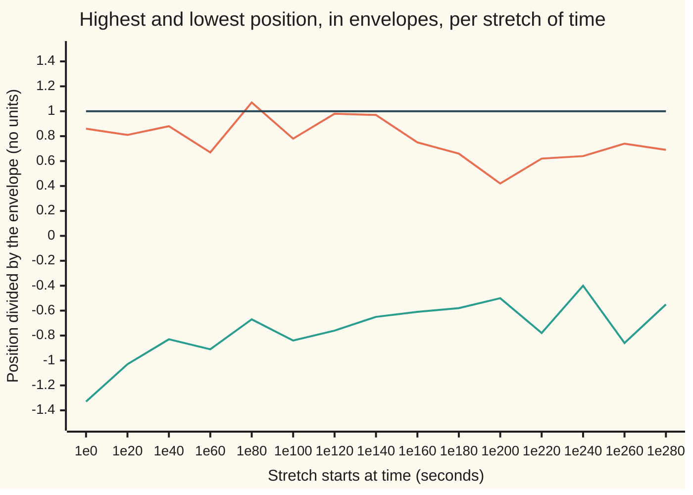

# Brownian paths up close: Blumenthal's zero-one law and the law of the iterated logarithm

[Syllabus](../../../SYLLABUS.md) → [Stochastic processes and calculus](../README.md) → [Brownian Motion](../README.md#s05) → Brownian paths up close

---

## General Overview

A pollen grain floats in a drop of water. A camera records its sideways position once a second, in micrometres (μm, millionths of a metre) to the right of where it was first seen. As on [Brownian motion](01-brownian-motion.md), the position spreads by 1 square micrometre of variance each second.

After a million seconds, 11.5741 days, the typical distance from the start is $`\sqrt{t}`$ = 1,000 μm, one millimetre. How far out does the grain get at its most extreme moments, if the recording never stops?

No fixed multiple of $`\sqrt{t}`$ holds it. The level 3 $`\sqrt{t}`$ is passed with chance only 0.001350 at any one moment, but the grain gets endless tries. The true outer edge grows a little faster:

- at $`t`$ = 1,000,000 seconds it is $`\sqrt{2t \ln\ln t}`$ = $`\sqrt{2{,}000{,}000 \times 2.6258}`$ = 2,291.6 μm, which is 2.2916 typical distances;
- the grain comes back close to this edge again and again, for ever;
- after some last time it never passes 1.1 times the edge, or any factor above 1.

This edge is the **envelope**, and the fact is the **law of the iterated logarithm**. "Iterated logarithm" means $`\ln\ln t`$, the natural logarithm taken twice.

At the other end of time, **Blumenthal's zero-one law** says that any question settled by the path in every short opening stretch has chance 0 or 1. So in the first millisecond the model grain crosses its starting point infinitely often; a real one coasts over such short times. Time inversion turns the far future into the first instant: a million seconds and a millionth of a second share the factor 2.2916.

**Brownian motion has no in-between at its two ends: an event fixed by its first instants has chance 0 or 1, so it crosses its start infinitely often at once; and over long times its largest swings grow exactly like $`\sqrt{2t\ln\ln t}`$, touched again and again and beaten by any larger factor only up to some last time.**

**What kind of fact this is:** theorems, proved on this card in Why it works; the LIL's full steps are in a fold, using the touching chance from [Reflection principle](04-reflection-principle-and-running-maximum.md).

### The picture: one simulated path against its envelope



One simulated grain, recorded at times 1.2 times apart from 10 seconds to $`10^{300}`$ seconds, its position divided by the envelope $`\sqrt{2t\ln\ln t}`$. Each stretch runs from one label to the next, a factor of $`10^{20}`$ in time; the first from 10 seconds. Orange: the highest value in the stretch. Green: the lowest. Dark: the envelope itself, at 1. The highest values sit between 0.42 and 0.98, except one stretch that passes the envelope, at 1.07. The lowest sit between −0.40 and −1.03, the mirror image. Near 10 seconds the envelope is still small, so the first stretch's low of −1.33 says little.

---

## The formula

Notation first, in words.

- $`W_t`$ is the grain's position at time $`t`$ seconds, a standard Brownian motion: it starts at 0, moves continuously, and its moves over separate stretches of time are independent normal numbers with variance equal to the elapsed time ([Brownian motion](01-brownian-motion.md)).
- $`h(t) = \sqrt{2t\ln\ln t}`$ is the envelope. It is defined for $`t > e`$, where $`\ln\ln t > 0`$.
- The **lim sup** (limit superior) of a quantity as $`t`$ grows is the highest level it keeps returning to. For each cut-off time, take the largest value after it; as the cut-off moves out, these largest values shrink to the lim sup.
- $`\mathcal{F}_\varepsilon`$ is the **filtration** at time $`\varepsilon`$: every event the path up to time $`\varepsilon`$ decides ([Filtrations](../01-Random%20Walks%20and%20Filtrations/03-filtrations-and-information.md)).
- The **germ field** $`\mathcal{F}_{0+}`$ keeps the events that every opening stretch decides, however short. It is a sigma-algebra: a family of events closed under complements and countable unions.

**The law of the iterated logarithm** (LIL):

```math
\limsup_{t \to \infty} \frac{W_t}{\sqrt{2t\ln\ln t}} = 1 \qquad \text{with probability one}
```

**Read it aloud:** the position divided by the envelope keeps coming back up to 1, and from some time on it stays below any level above 1. By symmetry the lim inf, the lowest level the ratio keeps returning to, is −1.

**Blumenthal's zero-one law:**

```math
\mathcal{F}_{0+} = \bigcap_{\varepsilon > 0} \mathcal{F}_\varepsilon, \qquad A \in \mathcal{F}_{0+} \implies P(A) = 0 \text{ or } P(A) = 1
```

**Read it aloud:** if an event is decided by the path up to every time ε, however small, then it is certain or impossible.

**The sign changes:**

```math
P\big(\text{for every } \varepsilon > 0 \text{ there are } s, u \le \varepsilon \text{ with } W_s > 0 > W_u\big) = 1
```

**Read it aloud:** with probability one, every opening stretch, however short, holds moments right of the start and moments left of it.

**Time inversion and the small-time law:**

```math
X_0 = 0,\quad X_t = t\,W_{1/t} \text{ is a Brownian motion}; \qquad \limsup_{t \downarrow 0} \frac{W_t}{\sqrt{2t\ln\ln(1/t)}} = 1
```

**Read it aloud:** t times the position at time 1/t is a new Brownian motion; so near time 0 the swings follow the envelope with $`1/t`$ in place of $`t`$.

| Symbol | Plain meaning | In our example | Push it up and the answer… |
| --- | --- | --- | --- |
| $`W_t`$, $`t`$, $`s`$, $`u`$ | the grain's position (μm) at time t (s); s and u other times | $`\sqrt{t}`$ = 1,000 μm at a million seconds | — |
| $`h(t)`$ | the envelope $`\sqrt{2t\ln\ln t}`$ | 2,291.6 μm at $`10^6`$ s | grows like $`\sqrt{t}`$ times a factor that creeps up: 2.5764 at $`10^{12}`$ s |
| $`\ln`$, $`\ln\ln t`$ | natural logarithm; it taken twice | 13.8155, then 2.6258 | — |
| $`\mathcal{F}_\varepsilon`$, $`\mathcal{F}_{0+}`$, $`A`$ | what the path up to ε decides; the germ field; an event in it | "positive somewhere in every opening stretch" | — |
| $`\varepsilon`$ | a short opening time | 1 millisecond in the sign-change count | — |
| $`X_t`$ | the time-inverted path $`t\,W_{1/t}`$ | 1 μs maps to $`10^6`$ s | — |
| $`c`$, $`q`$, $`\lambda`$ | a factor above 1; the ratio between block ends; the decay power $`c^2/q`$ | c = 2, q = 2, λ = 2 | larger q: coarser blocks; λ below 1 ruins the proof |
| $`n`$, $`t_n`$, $`M_t`$ | block number; the block boundary $`q^n`$; the highest position by time t | block 20 starts at 1,048,576 s | — |
| $`A_n`$, $`B_n`$, $`D_n`$ | upper-half event; lower-half event; the move $`W_{t_n} - W_{t_{n-1}}`$ | $`P(B_3)`$ = 0.010963 | — |
| $`Z`$, $`z`$, $`z_n`$, $`Q`$, $`\varphi`$ | standard normal; a level, the level in block n; its tail chance $`Q(z) = P(Z > z)`$; its density | $`Q(2.2916)`$ = 0.010963 | larger z: far smaller Q |
| $`m`$, $`i`$, $`\rho`$, $`\tau`$ | samples in a record; a sample's number; a correlation; the first time right of the start | m = 1,000 samples, one per μs | — |
| $`k`$, $`g`$, $`N`$, $`x`$, $`\mu`$, $`U`$, $`a`$, $`b`$ | helpers: k a count; g a bounded continuous function; N a last block, or $`N(0, v)`$ the normal law with variance v; x an integration variable; μ a drift; U, a, b the random point and two arrows of the sign-change fold; e is 2.71828… | — | — |

### When it holds

- **No drift.** A steady current $`\mu`$ adds $`\mu t`$, which outgrows $`h(t)`$, and the ratio runs off to infinity.
- **Independent moves with variance proportional to time.** Long memory changes the envelope. Sums of independent steps with finite variance obey the same law (Hartman and Wintner, 1941, cited on [The law of the iterated logarithm](../../10-Measure%20and%20integration/10-The%20Limit%20Theorems%2C%20Proved/09-law-of-the-iterated-logarithm.md)).
- **The path's own filtration.** Add a coin tossed at time 0 to the information, and "heads" sits in every opening stretch with chance 1/2.
- **A continuous model path, watched all the time.** A record sampled every microsecond shows only 19.4465 sign changes in the first millisecond on average. A real grain has mass and coasts over very short times ([Brownian paths](02-scaling-and-path-roughness.md)), so the first-instant results describe the model path $`W`$.
- **With probability one, and in the limit.** Nothing a finite record shows can confirm the theorems (The usual mistake).

---

## Why it works

### Step 0: two tools turn "some chance" into "certain"

Zero-one laws turn a positive chance into certainty. If an event has chance at least 1/2 and the law allows only 0 or 1, the chance is 1. That gives the sign changes.

The Borel-Cantelli lemmas turn a list of chances into "finitely often" or "infinitely often" ([The Borel-Cantelli lemmas](../../10-Measure%20and%20integration/10-The%20Limit%20Theorems%2C%20Proved/01-borel-cantelli-lemmas.md)). If the chances add to a finite number, finitely many events happen. If the events are independent and the chances add to infinity, infinitely many happen.

For the LIL, cut time into blocks growing by a fixed ratio q. The chance of passing c envelopes in block n falls roughly like $`n^{-c^2/q}`$. The envelope $`\sqrt{2t\ln\ln t}`$ is exactly where that power crosses 1.

### Step 1: Blumenthal's zero-one law

An event $`A`$ in the germ field is decided by an opening stretch as short as we like, so it is independent of the later path, which also decides it. An event independent of itself has $`P(A) = P(A)^2`$, so $`P(A)`$ is 0 or 1. The steps:

1. Fix times $`0 < t_1 < \dots < t_k`$ and a bounded continuous function $`g`$. Pick ε below $`t_1`$.
2. $`A`$ is decided by the path up to ε. The moves after ε, $`W_{t_i} - W_\varepsilon`$, are independent of that path ([Brownian motion](01-brownian-motion.md)). So the average of $`g`$ of those moves, counted only on $`A`$, is $`P(A)`$ times its plain average.
3. Let ε shrink to 0. By continuity $`W_\varepsilon \to 0`$, so the moves become $`W_{t_i}`$ themselves. Bounded convergence carries the equation to the limit.
4. So $`A`$ is independent of $`(W_{t_1}, \dots, W_{t_k})`$ for every finite set of positive times. Those events form a pi-system, a family closed under intersection, that generates everything the path decides. Independence passes to the whole sigma-algebra ([Pi-systems and Dynkin's theorem](../../10-Measure%20and%20integration/01-Sets%20You%20Can%20Measure/06-pi-systems-and-uniqueness.md)).
5. $`A`$ is itself decided by the path. So $`A`$ is independent of $`A`$, and $`P(A) = P(A)^2`$.

[Kolmogorov's zero-one law](../../10-Measure%20and%20integration/10-The%20Limit%20Theorems%2C%20Proved/02-kolmogorov-zero-one-law.md) is the same idea for the far end of a sequence.

### Step 2: the model grain crosses its start infinitely often at once

Let $`\tau`$ be the first time after 0 at which the model grain is right of the start: the smallest time with $`W_t > 0`$, or the limit of such times.

- **The event is in the germ field.** "$`\tau = 0`$" means: for every n there is a rational time s up to 1/n with $`W_s > 0`$. Each piece is decided by the path up to 1/n, so the whole event is too, for every n.
- **Its chance is at least one half.** For any ε, $`\tau \le \varepsilon`$ whenever $`W_\varepsilon > 0`$, which has chance 1/2. The events "$`\tau \le 1/n`$" shrink to "$`\tau = 0`$", so its chance is the limit of numbers at least 1/2.
- **So its chance is 1.** Blumenthal allows only 0 or 1.

The same holds on the left. The path is continuous, so it passes through 0 between such moments: infinitely many zeros in every opening stretch.

A sampled record shows this as a count that never settles. Record m samples in the first millisecond. The chance two neighbouring samples have opposite signs is exactly $`\arccos(\rho)/\pi`$, where $`\rho = \sqrt{i/(i+1)}`$ is the correlation of samples i and i + 1.

<details>
<summary>Why two correlated normals differ in sign with chance arccos(ρ)/π</summary>

Write the pair as dot products $`(\langle U, a\rangle, \langle U, b\rangle)`$: $`U`$ a standard normal point in the plane, $`a`$ and $`b`$ unit arrows at angle $`\arccos\rho`$. The direction of $`U`$ is uniform. The signs differ when the line at right angles to $`U`$ separates the arrows: two wedges of angle $`\arccos\rho`$, out of $`2\pi`$. For Brownian samples at times $`s < u`$ the correlation is $`\sqrt{s/u}`$.

</details>

| Samples in the first millisecond | Mean sign changes, exact | Simulated, 2,000 paths | Share with a moment right of the start |
| --- | ---: | ---: | ---: |
| 10 (every 100 μs) | 1.3430 | 1.3355 ± 0.0306 | 0.8245 |
| 100 (every 10 μs) | 5.6847 | 5.6065 ± 0.1035 | 0.9495 |
| 1,000 (every 1 μs) | 19.4465 | 19.3440 ± 0.3341 | 0.9785 |
| 1,000,000 (every 1 ns) | 635.9330 | — | — |

The count grows like $`(2/\pi)\sqrt{m}`$, which is 636.6198 at a million samples, and so without bound. The share with a moment right of the start climbs from well above the one-time 1/2 toward 1. A real grain coasts over a nanosecond, so these are the model's counts.

### Step 3: time inversion swaps the first instant and the far future

Set $`X_0 = 0`$ and $`X_t = t\,W_{1/t}`$. Then $`X`$ is again a Brownian motion.

- **Same averages and spreads.** $`X`$ is built linearly from a Gaussian process, so it is Gaussian with mean 0. Its covariance is $`\mathrm{Cov}(X_s, X_t) = st\,\min(1/s, 1/t) = \min(s, t)`$, exactly Brownian motion's; the checks simulate $`\mathrm{Cov}(X_{0.5}, X_4)`$ as 0.4870 ± 0.0106. A Gaussian process is fixed by its mean and covariance, so every finite set of positions has Brownian law ([Gaussian processes](09-gaussian-processes-and-karhunen-loeve.md)).
- **Continuous for $`t > 0`$.** It is a continuous path, rescaled.
- **Continuous at 0.** "$`X_q \to 0`$ as rational q falls to 0" is decided by the values at rational times. Their joint law is the same as for W, for which the event is certain. Between rational times, continuity on $`(0, \infty)`$ fills the gaps.

An event about the far future of W is an event about the first instants of X, so it has chance 0 or 1. So the lim sup in the LIL is a constant before anyone knows which.

The small-time law follows from the large-time one. Put $`u = 1/t`$. Then $`X_u / h(u) = W_t / \sqrt{2t\ln\ln(1/t)}`$. At $`t`$ = 1 μs the small-time envelope is 0.0022916 μm, about 2.29 nanometres, the same 2.2916 typical distances as at $`10^6`$ s. That is the model's figure, not a real grain's.

### Step 4: the upper half, by summable chances

Fix a factor $`c > 1`$ and a block ratio $`q`$ with $`1 < q < c^2`$. Here block n runs from $`t_n = q^n`$ to $`t_{n+1}`$. Let $`A_n`$ be the event that the highest position by $`t_{n+1}`$ passes $`c\,h(t_n)`$.

1. **One block.** By the reflection principle, $`P(A_n) = 2\,Q\big(c\,h(t_n)/\sqrt{t_{n+1}}\big)`$, which is at most a constant times $`n^{-\lambda}`$ with $`\lambda = c^2/q > 1`$.
2. **Finitely many blocks.** A power above 1 is summable, so by the first Borel-Cantelli lemma only finitely many $`A_n`$ happen.
3. **All times.** Inside block n, $`W_t \le M_{t_{n+1}} < c\,h(t_n) \le c\,h(t)`$, since h increases. Doing this for c = 1 + 1/k, k = 1, 2, 3 and so on, gives a lim sup of at most 1.

With c = 2 and q = 2, λ = 2. Block 20 starts at 1,048,576 seconds; its chance is 0.001183. Blocks 20 to 10,000 add to 0.021479, and all later blocks at most 0.000028. That bounds the expected count of such blocks from a million seconds on. For c = 1.1 take q = 1.1: λ = 1.1000, summable but slowly.

### Step 5: the lower half, by independent moves

Now take a large ratio $`q`$; here block n ends at $`t_n`$. The moves $`D_n = W_{t_n} - W_{t_{n-1}}`$ are independent, normal with variance $`t_n(1 - 1/q)`$. Let $`B_n`$ be the event $`D_n \ge \sqrt{1 - 1/q}\;h(t_n)`$.

1. **One block.** $`P(B_n) = Q\big(\sqrt{2\ln(n\ln q)}\big)`$, at least a constant times $`1/(n\sqrt{\ln n})`$. With q = 100, block 3 ends at $`10^6`$ s and $`P(B_3)`$ = 0.010963.
2. **Infinitely many blocks.** Those chances add to infinity, and the $`B_n`$ are independent, so by the second Borel-Cantelli lemma infinitely many happen.
3. **The block's start cannot spoil it.** Step 4 applied to $`-W`$ keeps $`W_{t_{n-1}}`$ above $`-2h(t_{n-1}) \ge -2h(t_n)/\sqrt{q}`$. So infinitely often $`W_{t_n} \ge \big(\sqrt{1 - 1/q} - 2/\sqrt{q}\big)\,h(t_n)`$.
4. **Let q grow.** The bracket is 0.7950 at q = 100, 0.9799 at $`10^4`$ and 0.9980 at $`10^6`$. So the lim sup is at least 1.

With q = 100, counting from block 3, the expected number of blocks with $`B_n`$ grows painfully slowly: 0.0438 by block 10, only 0.2332 by block 100,000, near $`10^{200{,}000}`$ seconds. The last tenfold stretch adds 0.0394; the integral of the tail estimate, growing like $`\sqrt{\ln N}`$, predicts 0.0410. "Infinitely often" holds, on a clock that runs in logs of logs.

<details>
<summary>Detailed proof of the law of the iterated logarithm</summary>

**Normal tails.** For $`z > 0`$: $`\displaystyle \frac{z}{1+z^2}\,\varphi(z) \le Q(z) \le \frac{\varphi(z)}{z}`$. The upper bound: $`Q(z) = \int_z^\infty \varphi(x)\,dx \le \int_z^\infty (x/z)\varphi(x)\,dx = \varphi(z)/z`$. The lower bound: the derivative of $`Q(z) - \frac{z}{1+z^2}\varphi(z)`$ is $`-2\varphi(z)/(1+z^2)^2 < 0`$, and both terms tend to 0, so the difference is positive.

**Upper half.** Fix $`c > 1`$ and $`1 < q < c^2`$, put $`\lambda = c^2/q`$ and $`t_n = q^n`$, and keep n large enough that $`t_n > e^e`$. Let $`M_t = \max_{s \le t} W_s`$. The reflection principle gives

$`\displaystyle P\big(M_{t_{n+1}} \ge c\,h(t_n)\big) = 2Q(z_n), \qquad z_n = \frac{c\,h(t_n)}{\sqrt{q\,t_n}}, \qquad \frac{z_n^2}{2} = \lambda\ln\ln t_n = \lambda\ln(n\ln q).`$

So $`2Q(z_n) \le 2\varphi(z_n)/z_n \le (n\ln q)^{-\lambda}`$ once $`z_n \ge 1`$. The sum over n is finite since $`\lambda > 1`$. By the first Borel-Cantelli lemma there is, with probability one, an $`N`$ with $`M_{t_{n+1}} < c\,h(t_n)`$ for all $`n \ge N`$. The function h increases for $`t > e`$, so for $`t_n \le t \le t_{n+1}`$, $`W_t \le M_{t_{n+1}} < c\,h(t_n) \le c\,h(t)`$. Hence $`\limsup W_t/h(t) \le c`$ with probability one; intersecting over $`c = 1 + 1/k`$ gives $`\limsup \le 1`$.

**Lower half.** Fix $`q > 1`$ and $`t_n = q^n`$. The moves $`D_n = W_{t_n} - W_{t_{n-1}}`$ are independent and $`N(0, t_n(1 - 1/q))`$. With $`B_n = \{D_n \ge \sqrt{1-1/q}\,h(t_n)\}`$,

$`\displaystyle P(B_n) = Q(z_n), \qquad z_n = \frac{h(t_n)}{\sqrt{t_n}} = \sqrt{2\ln(n\ln q)}, \qquad \varphi(z_n) = \frac{1}{\sqrt{2\pi}\,n\ln q}.`$

The lower tail bound gives $`P(B_n) \ge \frac{z_n}{1+z_n^2}\cdot\frac{1}{\sqrt{2\pi}\,n\ln q}`$, which is at least a constant times $`1/(n\sqrt{\ln n})`$. Since $`\sum 1/(n\sqrt{\ln n}) = \infty`$, the second Borel-Cantelli lemma gives $`B_n`$ infinitely often. The upper half applied to the Brownian motion $`-W`$ with c = 2 gives $`W_{t_{n-1}} > -2h(t_{n-1})`$ for all large n. Also $`h(t_{n-1})^2 = 2(t_n/q)\ln\ln t_{n-1} \le h(t_n)^2/q`$. So for infinitely many n,

$`\displaystyle W_{t_n} = D_n + W_{t_{n-1}} \ge \Big(\sqrt{1 - 1/q} - \frac{2}{\sqrt{q}}\Big)\,h(t_n).`$

Letting q grow gives $`\limsup W_t/h(t) \ge 1`$, so with the upper half it equals 1. Applied to $`-W`$ this gives $`\liminf = -1`$; applied to the inverted path X, the small-time law.

</details>

---

## Worked numbers, by hand

The grain at a million seconds.

| Step | Arithmetic | Value |
| --- | --- | --- |
| time in days | 1,000,000 / 86,400 | 11.5741 |
| typical distance $`\sqrt{t}`$ | $`\sqrt{1{,}000{,}000}`$ | 1,000 μm |
| $`\ln t`$ | $`\ln 1{,}000{,}000`$ | 13.8155 |
| $`\ln\ln t`$ | $`\ln 13.8155`$ | 2.6258 |
| envelope $`h(t)`$ | $`\sqrt{2{,}000{,}000 \times 2.6258}`$ | **2,291.6 μm** |
| in typical distances | 2,291.6 / 1,000 | 2.2916 |
| chance of being beyond it at that one moment | $`Q(2.2916)`$, by series, continued fraction and Simpson's rule | 0.010963 |

At any single moment the grain is beyond the envelope, 2.29 millimetres, only about 1.1% of the time, but the moments are endless.

The factor $`\sqrt{2\ln\ln t}`$ creeps up very slowly: 1.9660 at $`10^3`$ s, 2.2916 at $`10^6`$ s, 2.5764 at $`10^{12}`$ s, and only 3.2982 at $`10^{100}`$ s.

### What breaks if you drop a piece

| Mistake | Comes out at | What went wrong |
| --- | --- | --- |
| Use a fixed envelope, 3 $`\sqrt{t}`$ | passed with chance 0.001350 at each moment, and passed infinitely often | $`\sqrt{t}`$ alone grows too slowly; the factor $`\sqrt{2\ln\ln t}`$ must grow without bound |
| Drop the inner logarithm: $`\sqrt{2t\ln t}`$ | 5,256.5 μm at $`10^6`$ s (right: 2,291.6) | Too wide: the grain stops coming near it, and the ratio's lim sup is 0 |
| Upper half for factor 1.1 with blocks of ratio 2 | power λ = 0.6050, a sum that does not converge (right: ratio 1.1, λ = 1.1000) | The block ratio must stay below $`c^2`$ |
| Take the one-moment chance 1/2 as the chance of a positive moment in the first millisecond | 1/2 (right: 1; a 1 μs record already shows 0.9785) | The event is in the germ field, so it is 0 or 1, and it is at least 1/2 |

---

## Code, from first principles, and it actually runs

The scripts compute every number on the card by three independent roads.

- **Normal tails three ways:** a Taylor series, a continued fraction and Simpson's rule (an area sum over thin strips), agreeing to $`10^{-12}`$.
- **Exact sums:** the mean sign-change count from $`\arccos(\rho)/\pi`$, and the two Borel-Cantelli series, each checked against a separate closed-form bound or growth rate.
- **Simulation:** 2,000 paths of the first millisecond at 1 μs; 20,000 runs of the lower-half blocks; 500 paths at times 1.2 apart out to $`10^{300}`$ seconds; 20,000 draws of the inverted path, from its own seed 7. The random numbers come from SplitMix64, a simple generator (seed 20261123), made normal by Box-Muller, both written out.

Simulated numbers carry standard errors, and the asserts allow four.

### Python

```python
# Blumenthal's zero-one law and the Brownian LIL, for a grain spreading 1 um^2 per second.
# Roads: normal tails three ways; exact sign-change and Borel-Cantelli sums; seeded simulation.
import math

M64 = (1 << 64) - 1
class Rng:  # SplitMix64, then Box-Muller for normal draws
    def __init__(self, seed): self.s, self.spare = seed, None
    def u64(self):
        self.s = (self.s + 0x9E3779B97F4A7C15) & M64
        z = self.s
        z = ((z ^ (z >> 30)) * 0xBF58476D1CE4E5B9) & M64
        z = ((z ^ (z >> 27)) * 0x94D049BB133111EB) & M64
        return z ^ (z >> 31)
    def normal(self):
        if self.spare is not None:
            z, self.spare = self.spare, None
            return z
        u1 = ((self.u64() >> 11) + 1) / 2.0**53
        u2 = (self.u64() >> 11) / 2.0**53
        r = math.sqrt(-2.0 * math.log(u1))
        self.spare = r * math.sin(2.0 * math.pi * u2)
        return r * math.cos(2.0 * math.pi * u2)

def phi(z): return math.exp(-z * z / 2.0) / math.sqrt(2.0 * math.pi)
def q_series(z):  # P(Z > z) from the Taylor series of erf
    x, s, term, k = z / math.sqrt(2.0), 0.0, z / math.sqrt(2.0), 0
    while k < 5 or abs(term) > 1e-17:
        s += term / (2 * k + 1); k += 1; term *= -x * x / k
    return 0.5 - s / math.sqrt(math.pi)
def q_cf(z, kmax=400):  # P(Z > z) from the continued fraction of the Mills ratio
    f = z
    for k in range(kmax, 0, -1): f = z + k / f
    return phi(z) / f
def q_simpson(z, n=4000):  # P(Z > z) as the area under phi from z to z + 12
    hh = 12.0 / n
    s = phi(z) + phi(z + 12.0) + sum((4 if i % 2 else 2) * phi(z + i * hh) for i in range(1, n))
    return s * hh / 3.0
def tail(z): return q_cf(z, 100) if z >= 2.0 else q_series(z)
def env(t): return math.sqrt(2.0 * t * math.log(math.log(t)))  # the LIL envelope h(t)

T = 1e6; z = env(T) / math.sqrt(T)
print(f"{'sqrt(t), t = 1e6 s; t in days':42}{math.sqrt(T):12.4f}{T / 86400:10.4f}")
print(f"{'ln t, then ln ln t':42}{math.log(T):12.4f}{math.log(math.log(T)):10.4f}")
print(f"{'envelope h(t) = sqrt(2 t ln ln t), um':42}{env(T):12.4f}")
print(f"{'h(t) / sqrt(t)':42}{z:12.4f}")
print(f"{'P(W_t > h(t)): series, fraction, Simpson':42}{q_series(z):12.6f}{q_cf(z):10.6f}{q_simpson(z):10.6f}")
assert abs(env(T) - 2291.6) < 0.1, "envelope against the hand value sqrt(2e6 x 2.626)"
for zz in (1.0, 1.5, z, 3.0):
    assert abs(q_series(zz) - q_cf(zz)) < 1e-13 and abs(q_simpson(zz) - q_cf(zz)) < 1e-12
facs = [env(t) / math.sqrt(t) for t in (1e3, 1e6, 1e12, 1e100)]
print(f"{'factor at t = 1e3, 1e6, 1e12, 1e100 s':42}" + "".join(f"{f:8.4f}" for f in facs))
print(f"{'wrong: P(W_t > 3 sqrt t); sqrt(2 t ln t)':42}{tail(3.0):12.6f}{math.sqrt(2 * T * math.log(T)):10.1f}")
print(f"{'time inversion: envelope at 1 us, um':42}{math.sqrt(2e-6 * math.log(math.log(1e6))):12.7f}")
ri = Rng(7)  # time inversion simulated: Cov(X_0.5, X_4) = E[0.5 W_2 * 4 W_0.25] must be min(0.5, 4) = 0.5
pr = [(lambda a: 0.5 * (a + math.sqrt(1.75) * ri.normal()) * 4.0 * a)(0.5 * ri.normal()) for _ in range(20000)]
pm = sum(pr) / len(pr); pse = math.sqrt(sum((x - pm) ** 2 for x in pr) / (len(pr) - 1) / len(pr))
print(f"{'time inversion: Cov(X_0.5, X_4), sim; se':42}{pm:12.4f}{pse:10.4f}"); assert abs(pm - 0.5) < 4 * pse

# Blumenthal: the first millisecond, sampled every 1 us, coarsened to 10 and 100 us.
rng = Rng(20261123)
PATHS, M = 2000, 1000
grids = (100, 10, 1)
chg = {g: [] for g in grids}; pos = {g: 0 for g in grids}
for _ in range(PATHS):
    w, path = 0.0, []
    for _ in range(M):
        w += math.sqrt(1e-6) * rng.normal(); path.append(w)
    for g in grids:
        pts = path[g - 1::g]
        chg[g].append(sum(1 for a, b in zip(pts, pts[1:]) if a * b < 0))
        pos[g] += any(p > 0 for p in pts)
def exact_changes(m):  # sum over neighbours of P(opposite signs) = arccos(rho) / pi
    return sum(math.acos(math.sqrt(i / (i + 1))) for i in range(1, m)) / math.pi
print("first ms   samples   exact mean changes   simulated   std err   positive somewhere")
for g in grids:
    m = M // g; ex = exact_changes(m); c = chg[g]
    mean = sum(c) / PATHS; se = math.sqrt(sum((x - mean) ** 2 for x in c) / (PATHS - 1) / PATHS)
    print(f"{'':10}{m:8d}{ex:21.4f}{mean:12.4f}{se:10.4f}{pos[g] / PATHS:16.4f}")
    assert abs(mean - ex) < 4 * se, "simulated sign changes against the exact sum"
assert pos[1] / PATHS > 0.5 + 4 * math.sqrt(0.25 / PATHS), "beats the 1/2 of a single time"
big = exact_changes(10**6)
print(f"{'exact mean changes, 1e6 samples (1 ns)':42}{big:12.4f}{2 / math.pi * 1000:10.4f}")
assert abs(big / (2 / math.pi * 1000) - 1) < 0.01, "changes grow like (2/pi) root m"

# Borel-Cantelli, upper half: blocks [2^n, 2^(n+1)], max passing 2 h(2^n), by reflection.
def a_term(n): return 2 * tail(2 * math.sqrt(math.log(n * math.log(2.0))))  # 2 h(2^n) / sqrt(2^(n+1))
assert abs(2 * env(2.0**30) / math.sqrt(2.0**31) - 2 * math.sqrt(math.log(30 * math.log(2.0)))) < 1e-12
LN2 = math.log(2.0)
def mills_bound(n): L = math.log(n * LN2); return 2 * phi(2 * math.sqrt(L)) / (2 * math.sqrt(L))
sums, acc = [], 0.0
for n in range(20, 10**4 + 1):
    acc += a_term(n)
    if n in (20, 100, 1000, 10**4): sums.append(acc)
rest = 1 / (math.sqrt(2 * math.pi) * LN2**2 * math.sqrt(math.log(1e4 * LN2)) * 1e4)
print(f"{'upper: term 20; sums to 1e2, 1e3, 1e4':42}" + "".join(f"{x:10.6f}" for x in sums))
print(f"{'upper: block 20 starts (s); bound after 1e4':42}{2**20:12d}{rest:10.6f}")
print(f"{'blocks of 2 for factor 1.1: exponent; 1.1':42}{1.1**2 / 2:12.4f}{1.1**2 / 1.1:10.4f}")
assert a_term(500) < mills_bound(500) and sums[3] - sums[2] < 1 / (math.sqrt(2 * math.pi) * LN2**2 * math.sqrt(math.log(1e3 * LN2)) * 1e3)
# Borel-Cantelli, lower half: q = 100, independent jumps D_n beyond sqrt(1 - 1/q) h(t_n).
def b_term(n): return tail(math.sqrt(2 * math.log(n * math.log(100.0))))
bs, acc = [], 0.0
for n in range(3, 10**5 + 1):
    acc += b_term(n)
    if n in (10, 100, 1000, 10**4, 10**5): bs.append(acc)
print(f"{'lower: sums to 1e1 .. 1e5 blocks':42}" + "".join(f"{x:8.4f}" for x in bs))
grow = (math.sqrt(math.log(1e5 * math.log(100.0))) - math.sqrt(math.log(1e4 * math.log(100.0)))) / (math.sqrt(math.pi) * math.log(100.0))
print(f"{'lower: block 3 (1e6 s); last decade, integral':42}{b_term(3):12.6f}{bs[4] - bs[3]:10.4f}{grow:10.4f}")
assert abs((bs[4] - bs[3]) / grow - 1) < 0.1, "lower series grows like root ln N"
NB, NPATH = 150, 20000
expect = sum(b_term(n) for n in range(3, NB + 1))
cnt = [sum(1 for n in range(3, NB + 1) if rng.normal() >= math.sqrt(2 * math.log(n * math.log(100.0)))) for _ in range(NPATH)]
cm = sum(cnt) / NPATH; cse = math.sqrt(sum((x - cm) ** 2 for x in cnt) / (NPATH - 1) / NPATH)
print(f"{'blocks 3..150 hit: expected, simulated, se':42}{expect:12.4f}{cm:10.4f}{cse:10.4f}")
assert abs(cm - expect) < 4 * cse, "simulated count of lower events against the sum"
print(f"{'lower bound, q = 100, 1e4, 1e6':42}" + "".join(f"{math.sqrt(1 - 1 / q) - 2 / math.sqrt(q):8.4f}" for q in (100, 1e4, 1e6)))

# LIL simulation on times 1.2^k from 10 s to 1e300 s.
LP, R, starts = 500, 1.2, (1e6, 1e30, 1e100)
over11 = {s: 0 for s in starts}; over09 = 0; chart_hi, chart_lo = [], []
for p in range(LP):
    t, w = 10.0, math.sqrt(10.0) * rng.normal()
    best = {s: -9.0 for s in starts}; win = {}
    while t < 1e300:
        t2 = t * R; w += math.sqrt(t2 - t) * rng.normal(); t = t2
        r = w / env(t)
        for s in starts:
            if t >= s: best[s] = max(best[s], r)
        if p == 0:
            k = min(int(math.log10(t) // 20), 14); lo, hi = win.get(k, (9.0, -9.0)); win[k] = (min(lo, r), max(hi, r))
    for s in starts: over11[s] += best[s] > 1.1
    over09 += best[1e100] > 0.9
    if p == 0: chart_hi = [win[k][1] for k in range(15)]; chart_lo = [win[k][0] for k in range(15)]
sh = [over11[s] / LP for s in starts]
print(f"{'share over 1.1 h after 1e6, 1e30, 1e100':42}" + "".join(f"{x:8.3f}" for x in sh))
print(f"{'share over 0.9 h after 1e100':42}{over09 / LP:8.3f}")
assert sh[0] > sh[2] + 4 * math.sqrt(sh[0] * (1 - sh[0]) / LP), "overshoots thin out with time"
print("chart, window start 1e(20k), k =  " + " ".join(f"{k:5d}" for k in range(15)))
print("chart, path 1, max W/h          " + " ".join(f"{x:5.2f}" for x in chart_hi))
print("chart, path 1, min W/h          " + " ".join(f"{x:5.2f}" for x in chart_lo))
print("ALL CHECKS PASS")
```

**Ran 2026-11-23 on macOS, Python 3.14.10, standard library only. All checks passed. Output, pasted from the run:**

```
sqrt(t), t = 1e6 s; t in days                1000.0000   11.5741
ln t, then ln ln t                             13.8155    2.6258
envelope h(t) = sqrt(2 t ln ln t), um        2291.6334
h(t) / sqrt(t)                                  2.2916
P(W_t > h(t)): series, fraction, Simpson      0.010963  0.010963  0.010963
factor at t = 1e3, 1e6, 1e12, 1e100 s       1.9660  2.2916  2.5764  3.2982
wrong: P(W_t > 3 sqrt t); sqrt(2 t ln t)      0.001350    5256.5
time inversion: envelope at 1 us, um         0.0022916
time inversion: Cov(X_0.5, X_4), sim; se        0.4870    0.0106
first ms   samples   exact mean changes   simulated   std err   positive somewhere
                10               1.3430      1.3355    0.0306          0.8245
               100               5.6847      5.6065    0.1035          0.9495
              1000              19.4465     19.3440    0.3341          0.9785
exact mean changes, 1e6 samples (1 ns)        635.9330  636.6198
upper: term 20; sums to 1e2, 1e3, 1e4       0.001183  0.018016  0.021211  0.021479
upper: block 20 starts (s); bound after 1e4     1048576  0.000028
blocks of 2 for factor 1.1: exponent; 1.1       0.6050    1.1000
lower: sums to 1e1 .. 1e5 blocks            0.0438  0.1010  0.1503  0.1938  0.2332
lower: block 3 (1e6 s); last decade, integral    0.010963    0.0394    0.0410
blocks 3..150 hit: expected, simulated, se      0.1102    0.1153    0.0024
lower bound, q = 100, 1e4, 1e6              0.7950  0.9799  0.9980
share over 1.1 h after 1e6, 1e30, 1e100      0.334   0.228   0.094
share over 0.9 h after 1e100                 0.626
chart, window start 1e(20k), k =      0     1     2     3     4     5     6     7     8     9    10    11    12    13    14
chart, path 1, max W/h           0.86  0.81  0.88  0.67  1.07  0.78  0.98  0.97  0.75  0.66  0.42  0.62  0.64  0.74  0.69
chart, path 1, min W/h          -1.33 -1.03 -0.83 -0.91 -0.67 -0.84 -0.76 -0.65 -0.61 -0.58 -0.50 -0.78 -0.40 -0.86 -0.55
ALL CHECKS PASS
```

### Rust

```rust
// Blumenthal's zero-one law and the Brownian LIL, for a grain spreading 1 um^2 per second.
// Roads: normal tails three ways; exact sign-change and Borel-Cantelli sums; seeded simulation.
use std::f64::consts::PI;

struct Rng { s: u64, spare: Option<f64> } // SplitMix64, then Box-Muller for normal draws
impl Rng {
    fn u64(&mut self) -> u64 {
        self.s = self.s.wrapping_add(0x9E3779B97F4A7C15);
        let mut z = self.s;
        z = (z ^ (z >> 30)).wrapping_mul(0xBF58476D1CE4E5B9);
        z = (z ^ (z >> 27)).wrapping_mul(0x94D049BB133111EB);
        z ^ (z >> 31)
    }
    fn normal(&mut self) -> f64 {
        if let Some(z) = self.spare.take() { return z; }
        let u1 = ((self.u64() >> 11) + 1) as f64 / 2f64.powi(53);
        let u2 = (self.u64() >> 11) as f64 / 2f64.powi(53);
        let r = (-2.0 * u1.ln()).sqrt();
        self.spare = Some(r * (2.0 * PI * u2).sin());
        r * (2.0 * PI * u2).cos()
    }
}

fn phi(z: f64) -> f64 { (-z * z / 2.0).exp() / (2.0 * PI).sqrt() }
fn q_series(z: f64) -> f64 { // P(Z > z) from the Taylor series of erf
    let x = z / 2f64.sqrt();
    let (mut s, mut term, mut k) = (0.0, x, 0u32);
    while k < 5 || term.abs() > 1e-17 {
        s += term / (2 * k + 1) as f64; k += 1; term *= -x * x / k as f64;
    }
    0.5 - s / PI.sqrt()
}
fn q_cf(z: f64, kmax: u32) -> f64 { // P(Z > z) from the continued fraction of the Mills ratio
    let mut f = z;
    for k in (1..=kmax).rev() { f = z + k as f64 / f; }
    phi(z) / f
}
fn q_simpson(z: f64, n: usize) -> f64 { // P(Z > z) as the area under phi from z to z + 12
    let hh = 12.0 / n as f64;
    let mut s = phi(z) + phi(z + 12.0);
    for i in 1..n { s += (if i % 2 == 1 { 4.0 } else { 2.0 }) * phi(z + i as f64 * hh); }
    s * hh / 3.0
}
fn tail(z: f64) -> f64 { if z >= 2.0 { q_cf(z, 100) } else { q_series(z) } }
fn env(t: f64) -> f64 { (2.0 * t * t.ln().ln()).sqrt() } // the LIL envelope h(t)
fn mean_se(c: &[f64]) -> (f64, f64) {
    let n = c.len() as f64;
    let m = c.iter().sum::<f64>() / n;
    (m, (c.iter().map(|x| (x - m) * (x - m)).sum::<f64>() / (n - 1.0) / n).sqrt())
}
fn exact_changes(m: usize) -> f64 { // sum over neighbours of P(opposite signs) = arccos(rho) / pi
    (1..m).map(|i| (i as f64 / (i + 1) as f64).sqrt().acos()).sum::<f64>() / PI
}
fn row(label: &str, xs: &[f64], w: usize, d: usize) -> String {
    format!("{:<42}{}", label, xs.iter().map(|x| format!("{:w$.d$}", x, w = w, d = d)).collect::<String>())
}

fn main() {
    let t = 1e6;
    let z = env(t) / t.sqrt();
    println!("{:<42}{:12.4}{:10.4}", "sqrt(t), t = 1e6 s; t in days", t.sqrt(), t / 86400.0);
    println!("{:<42}{:12.4}{:10.4}", "ln t, then ln ln t", t.ln(), t.ln().ln());
    println!("{:<42}{:12.4}", "envelope h(t) = sqrt(2 t ln ln t), um", env(t));
    println!("{:<42}{:12.4}", "h(t) / sqrt(t)", z);
    println!("{:<42}{:12.6}{:10.6}{:10.6}", "P(W_t > h(t)): series, fraction, Simpson", q_series(z), q_cf(z, 400), q_simpson(z, 4000));
    assert!((env(t) - 2291.6).abs() < 0.1, "envelope against the hand value sqrt(2e6 x 2.626)");
    for zz in [1.0, 1.5, z, 3.0] {
        assert!((q_series(zz) - q_cf(zz, 400)).abs() < 1e-13 && (q_simpson(zz, 4000) - q_cf(zz, 400)).abs() < 1e-12);
    }
    let facs: Vec<f64> = [1e3, 1e6, 1e12, 1e100].iter().map(|&s| env(s) / s.sqrt()).collect();
    println!("{}", row("factor at t = 1e3, 1e6, 1e12, 1e100 s", &facs, 8, 4));
    println!("{:<42}{:12.6}{:10.1}", "wrong: P(W_t > 3 sqrt t); sqrt(2 t ln t)", tail(3.0), (2.0 * t * t.ln()).sqrt());
    println!("{:<42}{:12.7}", "time inversion: envelope at 1 us, um", (2e-6 * 1e6f64.ln().ln()).sqrt());
    let mut ri = Rng { s: 7, spare: None }; // time inversion simulated: Cov(X_0.5, X_4) = E[0.5 W_2 * 4 W_0.25] must be min(0.5, 4) = 0.5
    let pr: Vec<f64> = (0..20000).map(|_| { let a = 0.5 * ri.normal(); 0.5 * (a + 1.75f64.sqrt() * ri.normal()) * 4.0 * a }).collect();
    let (pm, pse) = mean_se(&pr);
    println!("{:<42}{:12.4}{:10.4}", "time inversion: Cov(X_0.5, X_4), sim; se", pm, pse); assert!((pm - 0.5).abs() < 4.0 * pse);

    // Blumenthal: the first millisecond, sampled every 1 us, coarsened to 10 and 100 us.
    let mut rng = Rng { s: 20261123, spare: None };
    let (paths, m) = (2000usize, 1000usize);
    let grids = [100usize, 10, 1];
    let (mut chg, mut pos) = (vec![Vec::new(); 3], [0usize; 3]);
    for _ in 0..paths {
        let mut w = 0.0;
        let path: Vec<f64> = (0..m).map(|_| { w += 1e-6f64.sqrt() * rng.normal(); w }).collect();
        for (j, &g) in grids.iter().enumerate() {
            let pts: Vec<f64> = path.iter().skip(g - 1).step_by(g).cloned().collect();
            chg[j].push(pts.windows(2).filter(|p| p[0] * p[1] < 0.0).count() as f64);
            if pts.iter().any(|&p| p > 0.0) { pos[j] += 1; }
        }
    }
    println!("first ms   samples   exact mean changes   simulated   std err   positive somewhere");
    for (j, &g) in grids.iter().enumerate() {
        let mm = m / g;
        let ex = exact_changes(mm);
        let (mean, se) = mean_se(&chg[j]);
        println!("{:10}{:8}{:21.4}{:12.4}{:10.4}{:16.4}", "", mm, ex, mean, se, pos[j] as f64 / paths as f64);
        assert!((mean - ex).abs() < 4.0 * se, "simulated sign changes against the exact sum");
    }
    assert!(pos[2] as f64 / paths as f64 > 0.5 + 4.0 * (0.25 / paths as f64).sqrt(), "beats the 1/2 of a single time");
    let big = exact_changes(1_000_000);
    println!("{:<42}{:12.4}{:10.4}", "exact mean changes, 1e6 samples (1 ns)", big, 2.0 / PI * 1000.0);
    assert!((big / (2.0 / PI * 1000.0) - 1.0).abs() < 0.01, "changes grow like (2/pi) root m");

    // Borel-Cantelli, upper half: blocks [2^n, 2^(n+1)], max passing 2 h(2^n), by reflection.
    let ln2 = 2f64.ln();
    let a_term = |n: f64| 2.0 * tail(2.0 * (n * ln2).ln().sqrt()); // 2 h(2^n) / sqrt(2^(n+1))
    assert!((2.0 * env(2f64.powi(30)) / 2f64.powi(31).sqrt() - 2.0 * (30.0 * ln2).ln().sqrt()).abs() < 1e-12);
    let mills_bound = |n: f64| { let l = (n * ln2).ln(); 2.0 * phi(2.0 * l.sqrt()) / (2.0 * l.sqrt()) };
    let (mut sums, mut acc) = (Vec::new(), 0.0);
    for n in 20..=10_000u32 {
        acc += a_term(n as f64);
        if [20, 100, 1000, 10_000].contains(&n) { sums.push(acc); }
    }
    let rest_after = |nn: f64| 1.0 / ((2.0 * PI).sqrt() * ln2 * ln2 * (nn * ln2).ln().sqrt() * nn);
    println!("{}", row("upper: term 20; sums to 1e2, 1e3, 1e4", &sums, 10, 6));
    println!("{:<42}{:12}{:10.6}", "upper: block 20 starts (s); bound after 1e4", 1u64 << 20, rest_after(1e4));
    println!("{:<42}{:12.4}{:10.4}", "blocks of 2 for factor 1.1: exponent; 1.1", 1.1f64.powi(2) / 2.0, 1.1f64.powi(2) / 1.1);
    assert!(a_term(500.0) < mills_bound(500.0) && sums[3] - sums[2] < rest_after(1e3));
    // Borel-Cantelli, lower half: q = 100, independent jumps D_n beyond sqrt(1 - 1/q) h(t_n).
    let ln100 = 100f64.ln(); let b_term = |n: f64| tail((2.0 * (n * ln100).ln()).sqrt());
    let (mut bs, mut acc) = (Vec::new(), 0.0);
    for n in 3..=100_000u32 {
        acc += b_term(n as f64);
        if [10, 100, 1000, 10_000, 100_000].contains(&n) { bs.push(acc); }
    }
    println!("{}", row("lower: sums to 1e1 .. 1e5 blocks", &bs, 8, 4));
    let grow = ((1e5 * ln100).ln().sqrt() - (1e4 * ln100).ln().sqrt()) / (PI.sqrt() * ln100);
    println!("{:<42}{:12.6}{:10.4}{:10.4}", "lower: block 3 (1e6 s); last decade, integral", b_term(3.0), bs[4] - bs[3], grow);
    assert!(((bs[4] - bs[3]) / grow - 1.0).abs() < 0.1, "lower series grows like root ln N");
    let (nb, npath) = (150u32, 20000usize); let expect: f64 = (3..=nb).map(|n| b_term(n as f64)).sum();
    let cnt: Vec<f64> = (0..npath).map(|_| (3..=nb).filter(|&n| rng.normal() >= (2.0 * (n as f64 * ln100).ln()).sqrt()).count() as f64).collect();
    let (cm, cse) = mean_se(&cnt);
    println!("{:<42}{:12.4}{:10.4}{:10.4}", "blocks 3..150 hit: expected, simulated, se", expect, cm, cse);
    assert!((cm - expect).abs() < 4.0 * cse, "simulated count of lower events against the sum");
    let lb: Vec<f64> = [100.0f64, 1e4, 1e6].iter().map(|&q| (1.0 - 1.0 / q).sqrt() - 2.0 / q.sqrt()).collect();
    println!("{}", row("lower bound, q = 100, 1e4, 1e6", &lb, 8, 4));

    // LIL simulation on times 1.2^k from 10 s to 1e300 s.
    let (lp, r) = (500usize, 1.2f64);
    let starts = [1e6f64, 1e30, 1e100];
    let (mut over11, mut over09) = ([0usize; 3], 0usize);
    let (mut hi, mut lo) = (vec![-9.0f64; 15], vec![9.0f64; 15]);
    for p in 0..lp {
        let (mut t, mut w) = (10.0f64, 10f64.sqrt() * rng.normal());
        let mut best = [-9.0f64; 3];
        while t < 1e300 {
            let t2 = t * r;
            w += (t2 - t).sqrt() * rng.normal();
            t = t2;
            let ratio = w / env(t);
            for (j, &s) in starts.iter().enumerate() { if t >= s { best[j] = best[j].max(ratio); } }
            if p == 0 {
                let k = ((t.log10() / 20.0).floor() as usize).min(14);
                lo[k] = lo[k].min(ratio); hi[k] = hi[k].max(ratio);
            }
        }
        for j in 0..3 { if best[j] > 1.1 { over11[j] += 1; } }
        if best[2] > 0.9 { over09 += 1; }
    }
    let sh: Vec<f64> = over11.iter().map(|&c| c as f64 / lp as f64).collect();
    println!("{}", row("share over 1.1 h after 1e6, 1e30, 1e100", &sh, 8, 3));
    println!("{:<42}{:8.3}", "share over 0.9 h after 1e100", over09 as f64 / lp as f64);
    assert!(sh[0] > sh[2] + 4.0 * (sh[0] * (1.0 - sh[0]) / lp as f64).sqrt(), "overshoots thin out with time");
    println!("chart, window start 1e(20k), k =  {}", (0..15).map(|k| format!("{:5}", k)).collect::<Vec<_>>().join(" "));
    println!("chart, path 1, max W/h          {}", hi.iter().map(|x| format!("{:5.2}", x)).collect::<Vec<_>>().join(" "));
    println!("chart, path 1, min W/h          {}", lo.iter().map(|x| format!("{:5.2}", x)).collect::<Vec<_>>().join(" "));
    println!("ALL CHECKS PASS");
}
```

**Ran 2026-11-23 on macOS, rustc 1.98.1, no crates. All checks passed. Output, pasted from the run:**

```
sqrt(t), t = 1e6 s; t in days                1000.0000   11.5741
ln t, then ln ln t                             13.8155    2.6258
envelope h(t) = sqrt(2 t ln ln t), um        2291.6334
h(t) / sqrt(t)                                  2.2916
P(W_t > h(t)): series, fraction, Simpson      0.010963  0.010963  0.010963
factor at t = 1e3, 1e6, 1e12, 1e100 s       1.9660  2.2916  2.5764  3.2982
wrong: P(W_t > 3 sqrt t); sqrt(2 t ln t)      0.001350    5256.5
time inversion: envelope at 1 us, um         0.0022916
time inversion: Cov(X_0.5, X_4), sim; se        0.4870    0.0106
first ms   samples   exact mean changes   simulated   std err   positive somewhere
                10               1.3430      1.3355    0.0306          0.8245
               100               5.6847      5.6065    0.1035          0.9495
              1000              19.4465     19.3440    0.3341          0.9785
exact mean changes, 1e6 samples (1 ns)        635.9330  636.6198
upper: term 20; sums to 1e2, 1e3, 1e4       0.001183  0.018016  0.021211  0.021479
upper: block 20 starts (s); bound after 1e4     1048576  0.000028
blocks of 2 for factor 1.1: exponent; 1.1       0.6050    1.1000
lower: sums to 1e1 .. 1e5 blocks            0.0438  0.1010  0.1503  0.1938  0.2332
lower: block 3 (1e6 s); last decade, integral    0.010963    0.0394    0.0410
blocks 3..150 hit: expected, simulated, se      0.1102    0.1153    0.0024
lower bound, q = 100, 1e4, 1e6              0.7950  0.9799  0.9980
share over 1.1 h after 1e6, 1e30, 1e100      0.334   0.228   0.094
share over 0.9 h after 1e100                 0.626
chart, window start 1e(20k), k =      0     1     2     3     4     5     6     7     8     9    10    11    12    13    14
chart, path 1, max W/h           0.86  0.81  0.88  0.67  1.07  0.78  0.98  0.97  0.75  0.66  0.42  0.62  0.64  0.74  0.69
chart, path 1, min W/h          -1.33 -1.03 -0.83 -0.91 -0.67 -0.84 -0.76 -0.65 -0.61 -0.58 -0.50 -0.78 -0.40 -0.86 -0.55
ALL CHECKS PASS
```

The outputs agree line for line: both run the same generator from the same seed.

### Lean

Lean proves the card's three theorems for every standard Brownian motion $`W`$, and checks the worked block numbers exactly.

- Take the envelope $`h(t) = \sqrt{2t\ln\ln t}`$. Then with probability one, $`\limsup_{t \to \infty} W_t / h(t) = 1`$: the law of the iterated logarithm.
- Take an event $`A`$ in the germ field $`\mathcal{F}_{0+}`$ of the path's own filtration. Then $`P(A) = 0`$ or $`P(A) = 1`$: Blumenthal's zero-one law.
- Take any opening time $`\varepsilon > 0`$. Then with probability one, for every such $`\varepsilon`$, some $`s, u \le \varepsilon`$ have $`W_s > 0 > W_u`$.
- Take a million seconds. Then the typical distance is exactly 1,000 μm, since $`1{,}000^2 = 10^6`$.
- Take c = 2 and q = 2. Then the decay power is $`\lambda = c^2/q = 2`$, above 1.
- Take c = 1.1. Then blocks of ratio 2 give $`\lambda = 0.6050`$, below 1, while ratio q = 1.1 gives $`\lambda = 1.1`$, above 1.
- Take the block ends $`t_n = q^n`$. Then block 20 starts at $`2^{20} = 1{,}048{,}576`$ seconds, and with q = 100, block 3 ends at $`10^6`$ seconds.

Time inversion, the small-time law and every computed chance, count and simulation are left to the Python and Rust checks.

```lean
-- Brownian paths up close: for a Brownian motion, the lim sup of W_t / sqrt(2 t ln ln t) is 1 with probability one, every event decided by every opening stretch of the path has chance 0 or 1, and the path is both above and below its start in every opening stretch.
import Mathlib.Probability.BrownianMotion.Basic
import Mathlib.Analysis.SpecialFunctions.Log.Basic
import Mathlib.Analysis.SpecialFunctions.Sqrt
import Mathlib.Data.EReal.Basic
import Mathlib.Order.LiminfLimsup
import Mathlib.Analysis.PSeries
import Mathlib.Probability.BorelCantelli
import Mathlib.Probability.Moments.Basic
import Mathlib.Analysis.Complex.ExponentialBounds

open MeasureTheory ProbabilityTheory Filter
open scoped NNReal ENNReal

lemma lil_grid_le {t : ℝ≥0} {n k : ℕ} (hk : k ≤ n + 1) : t * k / (n + 1) ≤ t := by
  rw [div_le_iff₀ (by positivity)]
  gcongr
  exact_mod_cast hk

lemma lil_grid_mono {t : ℝ≥0} {n j k : ℕ} (hjk : j ≤ k) : t * j / (n + 1) ≤ t * k / (n + 1) := by
  gcongr

lemma lil_grid_approx {t s : ℝ≥0} (hs : s ≤ t) (n : ℕ) :
    ∃ k ≤ n + 1, t * k / (n + 1) ≤ s ∧ (s : ℝ) ≤ (t * k / (n + 1) : ℝ≥0) + (t : ℝ) / (n + 1) := by
  rcases eq_or_ne t 0 with ht | ht
  · subst ht
    have : s = 0 := le_antisymm hs zero_le
    subst this
    exact ⟨0, by omega, by simp, by simp⟩
  have htr : (0 : ℝ) < t := NNReal.coe_pos.2 (pos_iff_ne_zero.2 ht)
  have hsr : (s : ℝ) ≤ t := hs
  refine ⟨⌊(s : ℝ) * (n + 1) / t⌋₊, ?_, ?_, ?_⟩
  · apply Nat.floor_le_of_le
    rw [div_le_iff₀ htr]
    push_cast
    nlinarith [s.2]
  · rw [← NNReal.coe_le_coe]
    push_cast
    rw [div_le_iff₀ (by positivity)]
    have := Nat.floor_le (a := (s : ℝ) * (n + 1) / t) (by positivity)
    rw [le_div_iff₀ htr] at this
    nlinarith
  · push_cast
    have := Nat.lt_floor_add_one ((s : ℝ) * (n + 1) / t)
    rw [div_lt_iff₀ htr] at this
    rw [← add_div, le_div_iff₀ (by positivity)]
    nlinarith

open Filter in
lemma lil_mesh (t : ℝ≥0) {δ : ℝ} (hδ : 0 < δ) : ∀ᶠ n : ℕ in atTop, (t : ℝ) / (n + 1) < δ := by
  have h := (tendsto_one_div_add_atTop_nhds_zero_nat).const_mul (t : ℝ)
  rw [mul_zero] at h
  filter_upwards [h.eventually (gt_mem_nhds hδ)] with n hn
  have : (t : ℝ) / (n + 1) = t * (1 / ((n : ℝ) + 1)) := by ring
  rw [this]; exact hn

lemma lil_max {f : ℝ≥0 → ℝ} (hf : Continuous f) (t : ℝ≥0) :
    ∃ s ≤ t, (∀ r ≤ t, f r ≤ f s) ∧ ⨆ r : Set.Iic t, f r = f s := by
  have hc : IsCompact (Set.Iic t) := by
    rw [← Set.Icc_bot]; exact isCompact_Icc
  obtain ⟨s, hs, hmax⟩ := hc.exists_isMaxOn Set.nonempty_Iic hf.continuousOn
  refine ⟨s, hs, fun r hr ↦ hmax hr, le_antisymm ?_ ?_⟩
  · exact ciSup_le fun r ↦ hmax r.2
  · refine le_ciSup (f := fun r : Set.Iic t ↦ f r) ⟨f s, ?_⟩ ⟨s, hs⟩
    rintro _ ⟨r, rfl⟩
    exact hmax r.2

lemma lil_le_sup {f : ℝ≥0 → ℝ} (hf : Continuous f) {t r : ℝ≥0} (hr : r ≤ t) :
    f r ≤ ⨆ r : Set.Iic t, f r := by
  obtain ⟨s, -, hmax, heq⟩ := lil_max hf t
  rw [heq]; exact hmax r hr

open Filter in
lemma lil_hit_eventually {f : ℝ≥0 → ℝ} (hf : Continuous f) (t : ℝ≥0) {a δ : ℝ} (hδ : 0 < δ)
    (ha : a ≤ ⨆ r : Set.Iic t, f r) :
    ∀ᶠ n : ℕ in atTop, ∃ k ≤ n + 1, a - δ ≤ f (t * k / (n + 1)) := by
  obtain ⟨s, hs, -, heq⟩ := lil_max hf t
  rw [heq] at ha
  obtain ⟨δ', hδ', hcont⟩ := Metric.continuous_iff.1 hf s δ hδ
  filter_upwards [lil_mesh t hδ'] with n hn
  obtain ⟨k, hk, h1, h2⟩ := lil_grid_approx hs n
  refine ⟨k, hk, ?_⟩
  have hd : dist (t * k / (n + 1)) s < δ' := by
    rw [NNReal.dist_eq, abs_sub_comm, abs_of_nonneg (by rw [sub_nonneg]; exact_mod_cast h1)]
    linarith
  have := hcont _ hd
  rw [Real.dist_eq] at this
  linarith [abs_lt.1 this]

lemma lil_gauss_symm (v : ℝ≥0) (c : ℝ) :
    gaussianReal 0 v {x | x ≤ -c} = gaussianReal 0 v {x | c ≤ x} := by
  have h : (gaussianReal 0 v).map (fun x ↦ -x) = gaussianReal 0 v := by
    simpa using gaussianReal_map_neg (μ := 0) (v := v)
  calc gaussianReal 0 v {x | x ≤ -c} = (gaussianReal 0 v).map (fun x ↦ -x) {x | x ≤ -c} := by
        rw [h]
    _ = gaussianReal 0 v {x | c ≤ x} := by
      rw [Measure.map_apply measurable_neg (show MeasurableSet {x : ℝ | x ≤ -c} from measurableSet_Iic)]
      congr 1
      ext x
      simp

lemma lil_gauss_small {v : ℝ≥0} (hv : v ≠ 0) (x : ℝ) {η : ℝ≥0∞} (hη : 0 < η) :
    ∃ δ > 0, gaussianReal 0 v (Set.Icc (x - δ) (x + δ)) < η := by
  have := nullSingletonClass_gaussianReal (μ := 0) hv
  set s : ℕ → Set ℝ := fun m ↦ Set.Icc (x - 1 / (m + 1)) (x + 1 / (m + 1)) with hs
  have hanti : Antitone s := by
    intro m m' hmm'
    have : (1 : ℝ) / (m' + 1) ≤ 1 / (m + 1) := by gcongr
    exact Set.Icc_subset_Icc (by linarith) (by linarith)
  have hsub : ⋂ m, s m ⊆ {x} := by
    intro y hy
    rw [Set.mem_iInter] at hy
    rw [Set.mem_singleton_iff]
    by_contra hne
    have hpos : 0 < |y - x| := abs_pos.2 (sub_ne_zero.2 hne)
    obtain ⟨m, hm⟩ := exists_nat_one_div_lt hpos
    have := hy m
    simp only [hs, Set.mem_Icc] at this
    have : |y - x| ≤ 1 / (m + 1) := abs_sub_le_iff.2 ⟨by linarith, by linarith⟩
    linarith
  have ht := tendsto_measure_iInter_atTop (μ := gaussianReal 0 v)
    (fun m ↦ measurableSet_Icc.nullMeasurableSet) hanti ⟨0, measure_ne_top _ _⟩
  rw [measure_mono_null hsub (measure_singleton x)] at ht
  obtain ⟨m, hm⟩ := (ht.eventually (gt_mem_nhds hη)).exists
  exact ⟨1 / (m + 1), by positivity, hm⟩

lemma lil_reflect_step {Ω : Type*} {mΩ : MeasurableSpace Ω} {P : Measure Ω}
    {B : ℝ≥0 → Ω → ℝ} (hB : IsPreBrownianReal B P) {u t : ℝ≥0} (hut : u ≤ t)
    (S : Set (Set.Iic u → ℝ)) (hS : MeasurableSet S) (c : ℝ) :
    P ({ω | (fun s : Set.Iic u ↦ B s ω) ∈ S} ∩ {ω | B t ω - B u ω ≤ -c}) =
      P ({ω | (fun s : Set.Iic u ↦ B s ω) ∈ S} ∩ {ω | c ≤ B t ω - B u ω}) := by
  have hind := hB.indepFun_shift u
  have e : u + (t - u) = t := add_tsub_cancel_of_le hut
  have key : ∀ T : Set ℝ, MeasurableSet T →
      P ({ω | (fun s : Set.Iic u ↦ B s ω) ∈ S} ∩ {ω | B t ω - B u ω ∈ T}) =
        P {ω | (fun s : Set.Iic u ↦ B s ω) ∈ S} * gaussianReal 0 (nndist t.1 u.1) T := by
    intro T hT
    have h := hind.measure_inter_preimage_eq_mul {x : ℝ≥0 → ℝ | x (t - u) ∈ T} S
      (measurable_pi_apply (t - u) hT) hS
    simp only [Set.preimage_ofPred_eq, e] at h
    have hlaw := (hB.hasLaw_sub t u).measure_eq (p := fun x ↦ x ∈ T) hT
    simp only [Pi.sub_apply, Set.ofPred_mem_eq] at hlaw
    rw [Set.inter_comm, ← hlaw, mul_comm]
    exact h
  have h1 := key {x | x ≤ -c} (measurableSet_le measurable_id measurable_const)
  have h2 := key {x | c ≤ x} (measurableSet_le measurable_const measurable_id)
  simp only [Set.mem_ofPred_eq] at h1 h2
  rw [h1, h2, lil_gauss_symm]

lemma lil_first_hit (x : ℕ → ℝ) (a : ℝ) {K : ℕ} (h : ∃ k ≤ K, a ≤ x k) :
    ∃ k ≤ K, a ≤ x k ∧ ∀ j < k, x j < a := by
  classical
  refine ⟨Nat.find h, (Nat.find_spec h).1, (Nat.find_spec h).2, fun j hj ↦ ?_⟩
  by_contra hc
  push Not at hc
  exact Nat.find_min h hj ⟨hj.le.trans (Nat.find_spec h).1, hc⟩

lemma lil_E_nm {Ω : Type*} {mΩ : MeasurableSpace Ω} {P : Measure Ω}
    {B : ℝ≥0 → Ω → ℝ} (hB : IsPreBrownianReal B P) (τ : ℕ → ℝ≥0) (a : ℝ) (k : ℕ) :
    NullMeasurableSet {ω | a ≤ B (τ k) ω ∧ ∀ j < k, B (τ j) ω < a} P := by
  have : {ω | a ≤ B (τ k) ω ∧ ∀ j < k, B (τ j) ω < a} =
      {ω | a ≤ B (τ k) ω} ∩ ⋂ j : Fin k, {ω | B (τ j) ω < a} := by
    ext ω; simp [Fin.forall_iff]
  rw [this]
  exact (nullMeasurableSet_le aemeasurable_const (hB.aemeasurable _)).inter
    (NullMeasurableSet.iInter fun j ↦ nullMeasurableSet_lt (hB.aemeasurable _) aemeasurable_const)

lemma lil_E_disj {Ω : Type*} (B : ℝ≥0 → Ω → ℝ) (τ : ℕ → ℝ≥0) (a : ℝ) {i j : ℕ} (hij : i ≠ j)
    (X Y : Set Ω) :
    Disjoint ({ω | a ≤ B (τ i) ω ∧ ∀ l < i, B (τ l) ω < a} ∩ X)
      ({ω | a ≤ B (τ j) ω ∧ ∀ l < j, B (τ l) ω < a} ∩ Y) := by
  rw [Set.disjoint_left]
  rintro ω ⟨⟨hi1, hi2⟩, -⟩ ⟨⟨hj1, hj2⟩, -⟩
  rcases lt_or_gt_of_ne hij with h | h
  · linarith [hj2 i h]
  · linarith [hi2 j h]

lemma lil_sum_reflect {Ω : Type*} {mΩ : MeasurableSpace Ω} {P : Measure Ω}
    {B : ℝ≥0 → Ω → ℝ} (hB : IsPreBrownianReal B P) {τ : ℕ → ℝ≥0} (hmono : Monotone τ)
    {t : ℝ≥0} {K : ℕ} (hτ : τ K ≤ t) (a c : ℝ) :
    P (⋃ k ∈ Finset.range (K + 1), {ω | a ≤ B (τ k) ω ∧ ∀ j < k, B (τ j) ω < a} ∩
        {ω | B t ω - B (τ k) ω ≤ -c}) =
      P (⋃ k ∈ Finset.range (K + 1), {ω | a ≤ B (τ k) ω ∧ ∀ j < k, B (τ j) ω < a} ∩
        {ω | c ≤ B t ω - B (τ k) ω}) := by
  have hm := hB.aemeasurable
  rw [measure_biUnion_finset₀, measure_biUnion_finset₀]
  · refine Finset.sum_congr rfl fun k hk ↦ ?_
    have hkK : k ≤ K := Nat.lt_succ_iff.1 (Finset.mem_range.1 hk)
    let S : Set (Set.Iic (τ k) → ℝ) := {x | a ≤ x ⟨τ k, Set.mem_Iic.2 le_rfl⟩} ∩
      ⋂ j : Fin k, {x | x ⟨τ j, Set.mem_Iic.2 (hmono j.2.le)⟩ < a}
    have hS : MeasurableSet S := (measurableSet_le measurable_const (measurable_pi_apply _)).inter
      (MeasurableSet.iInter fun j ↦ measurableSet_lt (measurable_pi_apply _) measurable_const)
    have hE : {ω | a ≤ B (τ k) ω ∧ ∀ j < k, B (τ j) ω < a} =
        {ω | (fun s : Set.Iic (τ k) ↦ B s ω) ∈ S} := by
      ext ω; simp [S, Fin.forall_iff]
    rw [hE]
    exact lil_reflect_step hB ((hmono hkK).trans hτ) S hS c
  · intro i _ j _ hij
    exact (lil_E_disj B τ a hij _ _).aedisjoint
  · intro k _
    exact (lil_E_nm hB τ a k).inter (nullMeasurableSet_le aemeasurable_const (by fun_prop))
  · intro i _ j _ hij
    exact (lil_E_disj B τ a hij _ _).aedisjoint
  · intro k _
    exact (lil_E_nm hB τ a k).inter (nullMeasurableSet_le (by fun_prop) aemeasurable_const)

lemma lil_disc_upper {Ω : Type*} {mΩ : MeasurableSpace Ω} {P : Measure Ω}
    {B : ℝ≥0 → Ω → ℝ} (hB : IsPreBrownianReal B P) {τ : ℕ → ℝ≥0} (hmono : Monotone τ)
    {t : ℝ≥0} {K : ℕ} (hτ : τ K ≤ t) (a b : ℝ) :
    P ({ω | ∃ k ≤ K, a ≤ B (τ k) ω} ∩ {ω | B t ω ≤ b}) ≤ P {ω | 2 * a - b ≤ B t ω} := by
  calc P ({ω | ∃ k ≤ K, a ≤ B (τ k) ω} ∩ {ω | B t ω ≤ b})
      ≤ P (⋃ k ∈ Finset.range (K + 1), {ω | a ≤ B (τ k) ω ∧ ∀ j < k, B (τ j) ω < a} ∩
        {ω | B t ω - B (τ k) ω ≤ -(a - b)}) := by
        apply measure_mono
        rintro ω ⟨hex, hb⟩
        obtain ⟨k, hk, h1, h2⟩ := lil_first_hit (fun k ↦ B (τ k) ω) a hex
        simp only [Set.mem_iUnion, Finset.mem_range, Set.mem_inter_iff, Set.mem_ofPred_eq]
        refine ⟨k, by omega, ⟨h1, h2⟩, ?_⟩
        simp only [Set.mem_ofPred_eq] at hb
        linarith
    _ = P (⋃ k ∈ Finset.range (K + 1), {ω | a ≤ B (τ k) ω ∧ ∀ j < k, B (τ j) ω < a} ∩
        {ω | a - b ≤ B t ω - B (τ k) ω}) := lil_sum_reflect hB hmono hτ a (a - b)
    _ ≤ P {ω | 2 * a - b ≤ B t ω} := by
        apply measure_mono
        intro ω hω
        simp only [Set.mem_iUnion, Finset.mem_range, Set.mem_inter_iff, Set.mem_ofPred_eq] at hω
        obtain ⟨k, -, ⟨h1, -⟩, h3⟩ := hω
        simp only [Set.mem_ofPred_eq]
        linarith

lemma lil_grid_monotone (t : ℝ≥0) (n : ℕ) : Monotone (fun k : ℕ ↦ t * k / (n + 1)) :=
  fun _ _ h ↦ lil_grid_mono h

lemma lil_upper {Ω : Type*} {mΩ : MeasurableSpace Ω} {P : Measure Ω}
    {B : ℝ≥0 → Ω → ℝ} (hB : IsBrownianReal B P) {t : ℝ≥0} (ht : t ≠ 0) (a b : ℝ) :
    P {ω | a ≤ (⨆ s : Set.Iic t, B s ω) ∧ B t ω ≤ b} ≤ P {ω | 2 * a - b ≤ B t ω} := by
  refine ENNReal.le_of_forall_pos_le_add fun η hη _ ↦ ?_
  obtain ⟨δ, hδ, hν⟩ := lil_gauss_small ht (2 * a - b) (η := η) (by exact_mod_cast hη)
  have hlaw := hB.hasLaw_eval t
  let A : ℕ → Set Ω := fun N ↦
    {ω | ∀ n ≥ N, ∃ k ≤ n + 1, a - δ / 2 ≤ B (t * k / (n + 1)) ω} ∩ {ω | B t ω ≤ b}
  have hA : Monotone A := by
    intro N N' h ω hω
    exact ⟨fun n hn ↦ hω.1 n (h.trans hn), hω.2⟩
  calc P {ω | a ≤ (⨆ s : Set.Iic t, B s ω) ∧ B t ω ≤ b} ≤ P (⋃ N, A N) := by
        apply measure_mono_ae
        filter_upwards [hB.cont] with ω hω hmem
        obtain ⟨N, hN⟩ := (lil_hit_eventually hω t (half_pos hδ) hmem.1).exists_forall_of_atTop
        exact Set.mem_iUnion.2 ⟨N, fun n hn ↦ hN n hn, hmem.2⟩
    _ = ⨆ N, P (A N) := hA.measure_iUnion
    _ ≤ P {ω | 2 * a - b ≤ B t ω} + η := by
        refine iSup_le fun N ↦ ?_
        calc P (A N) ≤ P ({ω | ∃ k ≤ N + 1, a - δ / 2 ≤ B (t * k / (N + 1)) ω} ∩
              {ω | B t ω ≤ b}) := measure_mono fun ω hω ↦ ⟨hω.1 N le_rfl, hω.2⟩
          _ ≤ P {ω | 2 * (a - δ / 2) - b ≤ B t ω} :=
              lil_disc_upper hB.toIsPreBrownianReal (lil_grid_monotone t N)
                (lil_grid_le le_rfl) _ _
          _ ≤ P ({ω | 2 * a - b ≤ B t ω} ∪
              {ω | B t ω ∈ Set.Icc (2 * a - b - δ) (2 * a - b + δ)}) := by
              apply measure_mono
              intro ω hω
              simp only [Set.mem_ofPred_eq, Set.mem_union, Set.mem_Icc] at hω ⊢
              by_cases hc : 2 * a - b ≤ B t ω
              · exact Or.inl hc
              · right; constructor <;> linarith
          _ ≤ P {ω | 2 * a - b ≤ B t ω} +
              P {ω | B t ω ∈ Set.Icc (2 * a - b - δ) (2 * a - b + δ)} := measure_union_le _ _
          _ ≤ P {ω | 2 * a - b ≤ B t ω} + η := by
              gcongr
              rw [hlaw.measure_eq (p := fun x ↦ x ∈ Set.Icc (2 * a - b - δ) (2 * a - b + δ))
                measurableSet_Icc, Set.ofPred_mem_eq]
              exact hν.le

lemma lil_max_tail_le {Ω : Type*} {mΩ : MeasurableSpace Ω} {P : Measure Ω}
    {B : ℝ≥0 → Ω → ℝ} (hB : IsBrownianReal B P) {t : ℝ≥0} (ht : t ≠ 0) (a : ℝ) :
    P {ω | a ≤ ⨆ s : Set.Iic t, B s ω} ≤ 2 * P {ω | a ≤ B t ω} := by
  calc P {ω | a ≤ ⨆ s : Set.Iic t, B s ω}
      ≤ P ({ω | a ≤ (⨆ s : Set.Iic t, B s ω) ∧ B t ω ≤ a} ∪ {ω | a ≤ B t ω}) := by
        apply measure_mono
        intro ω hω
        simp only [Set.mem_ofPred_eq, Set.mem_union] at hω ⊢
        by_cases h : B t ω ≤ a
        · exact Or.inl ⟨hω, h⟩
        · exact Or.inr (le_of_lt (lt_of_not_ge h))
    _ ≤ P {ω | a ≤ (⨆ s : Set.Iic t, B s ω) ∧ B t ω ≤ a} + P {ω | a ≤ B t ω} :=
        measure_union_le _ _
    _ ≤ P {ω | 2 * a - a ≤ B t ω} + P {ω | a ≤ B t ω} := by
        exact add_le_add_left (lil_upper hB ht a a) _
    _ = 2 * P {ω | a ≤ B t ω} := by
        rw [show 2 * a - a = a by ring, two_mul]

lemma lil_gauss_upper {v : ℝ≥0} (hv : v ≠ 0) {a : ℝ} (ha : 0 ≤ a) :
    gaussianReal 0 v {x | a ≤ x} ≤ ENNReal.ofReal (Real.exp (-a ^ 2 / (2 * v))) := by
  have hv' : (0 : ℝ) < v := NNReal.coe_pos.2 (pos_iff_ne_zero.2 hv)
  have h := measure_ge_le_exp_mul_mgf (μ := gaussianReal 0 v) (X := id) a (t := a / v)
    (div_nonneg ha hv'.le) (integrable_exp_mul_gaussianReal (μ := 0) (v := v) (a / v))
  rw [mgf_id_gaussianReal] at h
  simp only [id] at h
  rw [← ofReal_measureReal]
  apply ENNReal.ofReal_le_ofReal
  refine h.trans (le_of_eq ?_)
  rw [← Real.exp_add]
  congr 1
  field_simp
  ring

lemma lil_gauss_lower {v : ℝ≥0} (hv : v ≠ 0) {a : ℝ} (ha : 0 ≤ a) :
    ENNReal.ofReal ((Real.sqrt (2 * Real.pi))⁻¹ * Real.exp (-(a / Real.sqrt v + 1) ^ 2 / 2)) ≤
      gaussianReal 0 v {x | a ≤ x} := by
  have hv' : (0 : ℝ) < v := NNReal.coe_pos.2 (pos_iff_ne_zero.2 hv)
  set sv := Real.sqrt v with hsv
  have hsv0 : 0 < sv := Real.sqrt_pos.2 hv'
  have hsv2 : sv ^ 2 = v := Real.sq_sqrt hv'.le
  set m : ℝ := (Real.sqrt (2 * Real.pi * v))⁻¹ * Real.exp (-(a + sv) ^ 2 / (2 * v)) with hm
  have hmeq : m * sv = (Real.sqrt (2 * Real.pi))⁻¹ * Real.exp (-(a / sv + 1) ^ 2 / 2) := by
    have h1 : Real.sqrt (2 * Real.pi * v) = Real.sqrt (2 * Real.pi) * sv := by
      rw [Real.sqrt_mul (by positivity)]
    have h2 : -(a + sv) ^ 2 / (2 * v) = -(a / sv + 1) ^ 2 / 2 := by
      rw [← hsv2]; field_simp
    rw [hm, h1, h2]
    field_simp
  rw [gaussianReal_of_var_ne_zero 0 hv,
    withDensity_apply _ (by exact measurableSet_Ici : MeasurableSet {x : ℝ | a ≤ x})]
  calc ENNReal.ofReal ((Real.sqrt (2 * Real.pi))⁻¹ * Real.exp (-(a / sv + 1) ^ 2 / 2))
      = ENNReal.ofReal m * volume (Set.Icc a (a + sv)) := by
        rw [Real.volume_Icc, ← ENNReal.ofReal_mul (by positivity), ← hmeq]
        congr 2; ring
    _ = ∫⁻ x in Set.Icc a (a + sv), ENNReal.ofReal m := (setLIntegral_const _ _).symm
    _ ≤ ∫⁻ x in Set.Icc a (a + sv), gaussianPDF 0 v x := by
        refine setLIntegral_mono (measurable_gaussianPDF 0 v) fun x hx ↦ ?_
        show ENNReal.ofReal m ≤ ENNReal.ofReal
          ((Real.sqrt (2 * Real.pi * v))⁻¹ * Real.exp (-(x - 0) ^ 2 / (2 * v)))
        apply ENNReal.ofReal_le_ofReal
        rw [hm]
        have hx2 : (x - 0) ^ 2 ≤ (a + sv) ^ 2 := by nlinarith [hx.1, hx.2]
        have h3 : -(a + sv) ^ 2 / (2 * v) ≤ -(x - 0) ^ 2 / (2 * v) := by
          apply div_le_div_of_nonneg_right _ (by positivity)
          linarith
        gcongr
    _ ≤ ∫⁻ x in {x | a ≤ x}, gaussianPDF 0 v x :=
        lintegral_mono_set fun x hx ↦ hx.1

lemma lil_h_mono {x y : ℝ} (hx0 : 0 < x) (hx : 1 ≤ Real.log x) (hxy : x ≤ y) :
    Real.sqrt (2 * x * Real.log (Real.log x)) ≤ Real.sqrt (2 * y * Real.log (Real.log y)) := by
  have hy0 : 0 < y := hx0.trans_le hxy
  have hl : Real.log x ≤ Real.log y := Real.log_le_log hx0 hxy
  have hll0 : 0 ≤ Real.log (Real.log x) := Real.log_nonneg hx
  have hll : Real.log (Real.log x) ≤ Real.log (Real.log y) :=
    Real.log_le_log (by linarith) hl
  apply Real.sqrt_le_sqrt
  have := mul_le_mul hxy hll hll0 hy0.le
  nlinarith

lemma lil_h_step {x q : ℝ} (hx : 1 ≤ x) (hq : 1 ≤ q) :
    Real.sqrt (2 * x * Real.log (Real.log x)) ≤
      Real.sqrt (2 * (q * x) * Real.log (Real.log (q * x))) / Real.sqrt q := by
  have hx0 : 0 < x := by linarith
  have hq0 : 0 < q := by linarith
  by_cases hpos : 0 < Real.log (Real.log x)
  · have hlx0 : 0 ≤ Real.log x := Real.log_nonneg hx
    have hlx : 1 < Real.log x := by
      by_contra h
      push Not at h
      have : Real.log (Real.log x) ≤ 0 := Real.log_nonpos hlx0 h
      linarith
    have hl : Real.log x ≤ Real.log (q * x) := Real.log_le_log hx0 (by nlinarith)
    have hll : Real.log (Real.log x) ≤ Real.log (Real.log (q * x)) :=
      Real.log_le_log (by linarith) hl
    rw [← Real.sqrt_div' _ hq0.le]
    apply Real.sqrt_le_sqrt
    have e : 2 * (q * x) * Real.log (Real.log (q * x)) / q =
        2 * x * Real.log (Real.log (q * x)) := by
      field_simp
    rw [e]
    have := mul_le_mul_of_nonneg_left hll (by positivity : (0 : ℝ) ≤ 2 * x)
    linarith
  · push Not at hpos
    have h0 : Real.sqrt (2 * x * Real.log (Real.log x)) = 0 := by
      apply Real.sqrt_eq_zero'.2
      have := mul_nonpos_of_nonneg_of_nonpos (by positivity : (0 : ℝ) ≤ 2 * x) hpos
      linarith
    rw [h0]
    positivity

lemma lil_upper_bound {Ω : Type*} {mΩ : MeasurableSpace Ω} {P : Measure Ω}
    {B : ℝ≥0 → Ω → ℝ} (hB : IsBrownianReal B P) {c : ℝ} (hc : 1 < c) :
    ∀ᵐ ω ∂P, ∀ᶠ t : ℝ≥0 in atTop,
      B t ω ≤ c * Real.sqrt (2 * (t : ℝ) * Real.log (Real.log t)) := by
  have hprob : IsProbabilityMeasure P := hB.isGaussianProcess.isProbabilityMeasure
  have hc0 : 0 < c := by linarith
  set cN : ℝ≥0 := ⟨c, hc0.le⟩ with hcN
  have hcN1 : 1 < cN := by rw [← NNReal.coe_lt_coe]; exact hc
  have hlogc : 0 < Real.log c := Real.log_pos hc
  obtain ⟨N0, hN0⟩ := exists_nat_ge (1 / Real.log c)
  have hmN : ∀ m : ℕ, N0 ≤ m → 1 ≤ (m : ℝ) * Real.log c := by
    intro m hm
    have : (N0 : ℝ) ≤ m := by exact_mod_cast hm
    rw [div_le_iff₀ hlogc] at hN0
    nlinarith
  set T : ℕ → ℝ≥0 := fun m ↦ cN ^ m with hT
  have hTcoe : ∀ m, ((T m : ℝ≥0) : ℝ) = c ^ m := fun m ↦ by
    simp only [hT, hcN]; rfl
  set a : ℕ → ℝ := fun m ↦ c * Real.sqrt (2 * (T m : ℝ) * Real.log (Real.log (T m))) with ha
  set E : ℕ → Set Ω := fun n ↦ {ω | a (n + N0) ≤ ⨆ s : Set.Iic (T (n + N0 + 1)), B s ω}
    with hE
  set f : ℕ → ℝ := fun n ↦ 2 * (((n + N0 : ℕ) : ℝ) * Real.log c) ^ (-c) with hf
  have hf_nonneg : ∀ n, 0 ≤ f n := fun n ↦ by positivity
  have hPE : ∀ n, P (E n) ≤ ENNReal.ofReal (f n) := by
    intro n
    set m := n + N0 with hmdef
    have hm1 : 1 ≤ (m : ℝ) * Real.log c := hmN m (by omega)
    have hlogT : Real.log (T m) = m * Real.log c := by rw [hTcoe, Real.log_pow]
    have hLL : 0 ≤ Real.log (Real.log (T m)) := by rw [hlogT]; exact Real.log_nonneg hm1
    have hT0 : T (m + 1) ≠ 0 := by
      simp only [hT]; exact pow_ne_zero _ (ne_of_gt (zero_lt_one.trans hcN1))
    have ha0 : 0 ≤ a m := by simp only [ha]; positivity
    have hsq : (a m) ^ 2 = c ^ 2 * (2 * c ^ m * Real.log (m * Real.log c)) := by
      simp only [ha]
      rw [mul_pow, Real.sq_sqrt (mul_nonneg (by positivity) hLL), hlogT, hTcoe]
    have hexp : -(a m) ^ 2 / (2 * ((T (m + 1) : ℝ≥0) : ℝ)) =
        Real.log (m * Real.log c) * (-c) := by
      rw [hsq, hTcoe, pow_succ]
      field_simp
      ring
    calc P (E n) ≤ 2 * P {ω | a m ≤ B (T (m + 1)) ω} := lil_max_tail_le hB hT0 (a m)
      _ = 2 * gaussianReal 0 (T (m + 1)) {x | a m ≤ x} := by
          rw [(hB.hasLaw_eval _).measure_eq (p := fun x ↦ a m ≤ x) measurableSet_Ici]
      _ ≤ 2 * ENNReal.ofReal (Real.exp (-(a m) ^ 2 / (2 * ((T (m + 1) : ℝ≥0) : ℝ)))) := by
          gcongr
          exact lil_gauss_upper hT0 ha0
      _ = ENNReal.ofReal (f n) := by
          rw [hexp, ← Real.rpow_def_of_pos (by positivity), hf]
          simp only
          rw [ENNReal.ofReal_mul (by norm_num), ENNReal.ofReal_ofNat]
  have hfs : Summable f := by
    have e : f = fun n ↦ (2 * Real.log c ^ (-c)) * (((n + N0 : ℕ) : ℝ) ^ c)⁻¹ := by
      ext n
      simp only [hf]
      rw [Real.mul_rpow (by positivity) hlogc.le, Real.rpow_neg (by positivity),
        Real.rpow_neg hlogc.le]
      ring
    rw [e]
    exact ((summable_nat_add_iff N0).2 (Real.summable_nat_rpow_inv.2 hc)).mul_left _
  have hsum : ∑' n, P (E n) ≠ ⊤ := by
    refine ne_top_of_le_ne_top ?_ (tsum_le_tsum hPE)
    rw [← ENNReal.ofReal_tsum_of_nonneg hf_nonneg hfs]
    exact ENNReal.ofReal_ne_top
  filter_upwards [ae_eventually_notMem hsum, hB.cont] with ω hω hcont
  obtain ⟨n1, hn1⟩ := eventually_atTop.1 hω
  rw [eventually_atTop]
  refine ⟨T (n1 + N0), fun t ht ↦ ?_⟩
  have h1t : 1 ≤ t := (one_le_pow₀ hcN1.le).trans ht
  obtain ⟨m, hm1, hm2⟩ := exists_nat_pow_near h1t hcN1
  have hmge : n1 + N0 ≤ m := by
    by_contra h
    push Not at h
    have h1 : cN ^ (m + 1) ≤ cN ^ (n1 + N0) := pow_le_pow_right₀ hcN1.le (by omega)
    have : t < t := lt_of_lt_of_le hm2 (h1.trans ht)
    exact lt_irrefl _ this
  obtain ⟨n, rfl⟩ : ∃ n, m = n + N0 := ⟨m - N0, by omega⟩
  have hnot := hn1 n (by omega)
  simp only [hE, Set.mem_ofPred_eq, not_le] at hnot
  have hBt : B t ω ≤ ⨆ s : Set.Iic (T (n + N0 + 1)), B s ω := lil_le_sup hcont (le_of_lt hm2)
  have hTm0 : (0 : ℝ) < (T (n + N0) : ℝ) := by rw [hTcoe]; positivity
  have hlogTm : 1 ≤ Real.log (T (n + N0)) := by
    rw [hTcoe, Real.log_pow]; exact hmN _ (by omega)
  have hmono := lil_h_mono hTm0 hlogTm
    (show ((T (n + N0) : ℝ≥0) : ℝ) ≤ t from by exact_mod_cast hm1)
  calc B t ω ≤ ⨆ s : Set.Iic (T (n + N0 + 1)), B s ω := hBt
    _ ≤ a (n + N0) := hnot.le
    _ ≤ c * Real.sqrt (2 * (t : ℝ) * Real.log (Real.log t)) := by
        simp only [ha]
        exact mul_le_mul_of_nonneg_left hmono hc0.le

lemma lil_one_lt_log_three : 1 < Real.log 3 := by
  rw [Real.lt_log_iff_exp_lt (by norm_num)]
  exact Real.exp_one_lt_three

lemma lil_quad {x d : ℝ} (hd : 0 < d) : (x + 1) ^ 2 ≤ (1 + d) * x ^ 2 + (1 + 1 / d) := by
  have h1 : d * (1 / d) = 1 := by field_simp
  have h2 : 0 ≤ (d * x - 1) ^ 2 := sq_nonneg _
  have h3 : 2 * x ≤ d * x ^ 2 + 1 / d := by
    have : 2 * x * d ≤ (d * x ^ 2 + 1 / d) * d := by nlinarith
    exact le_of_mul_le_mul_right this hd
  nlinarith

lemma lil_not_summable {K : ℝ} (hK : 0 < K) :
    ∑' n : ℕ, ENNReal.ofReal (K / ((n : ℝ) + 1)) = ⊤ := by
  have e : ∀ n : ℕ, ENNReal.ofReal (K / ((n : ℝ) + 1)) =
      ((Real.toNNReal (K / ((n : ℝ) + 1)) : ℝ≥0) : ℝ≥0∞) := fun n ↦ rfl
  simp_rw [e]
  rw [ENNReal.tsum_coe_eq_top_iff_not_summable_coe]
  intro hs
  have hs' : Summable fun n : ℕ ↦ K / ((n : ℝ) + 1) := by
    refine hs.congr fun n ↦ ?_
    rw [Real.coe_toNNReal _ (by positivity)]
  have h2 : Summable fun n : ℕ ↦ 1 / (((n + 1 : ℕ) : ℝ)) := by
    have := hs'.mul_left (1 / K)
    refine this.congr fun n ↦ ?_
    push_cast
    field_simp
  exact Real.not_summable_one_div_natCast ((summable_nat_add_iff 1).1 h2)

lemma lil_lower_bound {Ω : Type*} {mΩ : MeasurableSpace Ω} {P : Measure Ω}
    {B : ℝ≥0 → Ω → ℝ} (hB : IsBrownianReal B P) {r : ℝ} (hr0 : 0 < r) (hr1 : r < 1) :
    ∀ᵐ ω ∂P, ∃ᶠ t : ℝ≥0 in atTop,
      r * Real.sqrt (2 * (t : ℝ) * Real.log (Real.log t)) ≤ B t ω := by
  have hprob : IsProbabilityMeasure P := hB.isGaussianProcess.isProbabilityMeasure
  set α : ℝ := (1 + r) / 2 with hα
  have hα0 : 0 < α := by rw [hα]; linarith
  have hα1 : α < 1 := by rw [hα]; linarith
  have hα2 : 0 < 1 - α ^ 2 := by nlinarith
  obtain ⟨q, hq⟩ := exists_nat_ge (max 3 (max (16 / (1 - r) ^ 2) (2 / (1 - α ^ 2))))
  have hq3 : (3 : ℝ) ≤ q := le_trans (le_max_left _ _) hq
  have hq16 : 16 / (1 - r) ^ 2 ≤ q :=
    le_trans (le_trans (le_max_left _ _) (le_max_right _ _)) hq
  have hq2 : 2 / (1 - α ^ 2) ≤ q :=
    le_trans (le_trans (le_max_right _ _) (le_max_right _ _)) hq
  have hqpos : (0 : ℝ) < q := by linarith
  have h1r : 0 < 1 - r := by linarith
  have hsqq : 2 / Real.sqrt q ≤ α - r := by
    have h4 : 4 / (1 - r) ≤ Real.sqrt q := by
      rw [Real.le_sqrt (by positivity) hqpos.le, div_pow]
      norm_num
      linarith
    rw [div_le_iff₀ h1r] at h4
    rw [div_le_iff₀ (Real.sqrt_pos.2 hqpos), hα]
    nlinarith
  have hq2' : 2 ≤ q * (1 - α ^ 2) := by rwa [div_le_iff₀ hα2] at hq2
  set κ : ℝ := (q - 1) / (α ^ 2 * q) with hκ
  have hκ1 : 0 < κ - 1 := by
    rw [hκ, sub_pos, one_lt_div (by positivity)]
    nlinarith
  set C : ℝ := 1 + 1 / (κ - 1) with hC
  have hlogq : 1 < Real.log q :=
    lil_one_lt_log_three.trans_le (Real.log_le_log (by norm_num) hq3)
  set K : ℝ := (Real.sqrt (2 * Real.pi))⁻¹ * Real.exp (-C / 2) / Real.log q with hK
  have hK0 : 0 < K := by rw [hK]; positivity
  -- the times and the increments
  set qN : ℝ≥0 := (q : ℝ≥0) with hqN
  have hqN1 : 1 ≤ qN := by
    rw [hqN]; exact_mod_cast (show 1 ≤ q by exact_mod_cast (by linarith : (1 : ℝ) ≤ q))
  set τ : ℕ → ℝ≥0 := fun n ↦ qN ^ n with hτ
  have hτcoe : ∀ n, ((τ n : ℝ≥0) : ℝ) = (q : ℝ) ^ n := fun n ↦ by simp [hτ, hqN]
  have hτmono : Monotone τ := fun i j hij ↦ pow_le_pow_right₀ hqN1 hij
  set Z : ℕ → Ω → ℝ := fun n ω ↦ B (τ (n + 1)) ω - B (τ n) ω with hZ
  have hind : iIndepFun Z P := hB.toIsPreBrownianReal.hasIndepIncrements.nat hτmono
  set a : ℕ → ℝ := fun n ↦
    α * Real.sqrt (2 * (τ (n + 1) : ℝ) * Real.log (Real.log (τ (n + 1)))) with ha
  -- the lower bound on each probability
  have hPF : ∀ n : ℕ, ENNReal.ofReal (K / ((n : ℝ) + 1)) ≤ P {ω | a n ≤ Z n ω} := by
    intro n
    set v : ℝ≥0 := nndist (τ (n + 1)).1 (τ n).1 with hv
    have hvcoe : (v : ℝ) = (q : ℝ) ^ n * (q - 1) := by
      rw [hv, coe_nndist, Real.dist_eq]
      simp only [NNReal.val_eq_coe, hτcoe]
      rw [abs_of_nonneg (sub_nonneg.2 (pow_le_pow_right₀ (by linarith) (Nat.le_add_right n 1)))]
      ring
    have hvpos : (0 : ℝ) < v := by rw [hvcoe]; nlinarith [pow_pos hqpos n]
    have hv0 : v ≠ 0 := by
      intro h; rw [h] at hvpos; simp at hvpos
    have hlaw := hB.hasLaw_sub (τ (n + 1)) (τ n)
    have hlogτ : Real.log (τ (n + 1)) = ((n : ℝ) + 1) * Real.log q := by
      rw [hτcoe, Real.log_pow]; push_cast; ring
    have hL1 : 1 ≤ ((n : ℝ) + 1) * Real.log q := by nlinarith
    set L := Real.log (((n : ℝ) + 1) * Real.log q) with hL
    have hL0 : 0 ≤ L := Real.log_nonneg hL1
    have ha0 : 0 ≤ a n := by
      simp only [ha]; positivity
    have hasq : (a n) ^ 2 = α ^ 2 * (2 * (q : ℝ) ^ (n + 1) * L) := by
      simp only [ha]
      rw [mul_pow, Real.sq_sqrt (mul_nonneg (by positivity) (by rw [hlogτ]; exact hL0)),
        hlogτ, hτcoe]
    set x := a n / Real.sqrt v with hx
    have hx0 : 0 ≤ x := by positivity
    have hxsq : κ * x ^ 2 = 2 * L := by
      rw [hx, div_pow, Real.sq_sqrt hvpos.le, hasq, hvcoe, hκ, pow_succ]
      have : (q : ℝ) - 1 ≠ 0 := by linarith
      field_simp
      ring
    have hquad := lil_quad (x := x) hκ1
    rw [show 1 + (κ - 1) = κ by ring, hxsq] at hquad
    have hexp : Real.exp (-C / 2) / (((n : ℝ) + 1) * Real.log q) ≤
        Real.exp (-(x + 1) ^ 2 / 2) := by
      have e1 : Real.exp (-C / 2) / (((n : ℝ) + 1) * Real.log q) = Real.exp (-L - C / 2) := by
        rw [sub_eq_add_neg, Real.exp_add, Real.exp_neg, Real.exp_log (by positivity)]
        ring_nf
      rw [e1]
      apply Real.exp_le_exp.2
      linarith [hC]
    calc ENNReal.ofReal (K / ((n : ℝ) + 1))
        ≤ ENNReal.ofReal ((Real.sqrt (2 * Real.pi))⁻¹ * Real.exp (-(x + 1) ^ 2 / 2)) := by
          apply ENNReal.ofReal_le_ofReal
          have e2 : K / ((n : ℝ) + 1) = (Real.sqrt (2 * Real.pi))⁻¹ *
              (Real.exp (-C / 2) / (((n : ℝ) + 1) * Real.log q)) := by
            rw [hK]; field_simp
          rw [e2]
          gcongr
      _ ≤ gaussianReal 0 v {y | a n ≤ y} := lil_gauss_lower hv0 ha0
      _ = P {ω | a n ≤ Z n ω} := by
          exact (hlaw.measure_eq (p := fun y ↦ a n ≤ y) measurableSet_Ici).symm
  -- measurable versions
  have hZm : ∀ n, AEMeasurable (Z n) P := fun n ↦
    (hB.aemeasurable _).sub (hB.aemeasurable _)
  set Z' : ℕ → Ω → ℝ := fun n ↦ (hZm n).mk (Z n) with hZ'
  have hZ'm : ∀ n, Measurable (Z' n) := fun n ↦ (hZm n).measurable_mk
  have hind' : iIndepFun Z' P := hind.congr fun n ↦ (hZm n).ae_eq_mk
  set F : ℕ → Set Ω := fun n ↦ {ω | a n ≤ Z' n ω} with hF
  have hFm : ∀ n, MeasurableSet (F n) := fun n ↦ measurableSet_le measurable_const (hZ'm n)
  have hFind : iIndepSet F P := by
    rw [iIndepSet_iff_meas_biInter hFm]
    intro S
    exact hind'.measure_inter_preimage_eq_mul S (sets := fun n ↦ Set.Ici (a n))
      (fun _ _ ↦ measurableSet_Ici)
  have hFP : ∀ n, P (F n) = P {ω | a n ≤ Z n ω} := by
    intro n
    apply measure_congr
    filter_upwards [(hZm n).ae_eq_mk] with ω hω
    show (a n ≤ (hZm n).mk (Z n) ω) = (a n ≤ Z n ω)
    rw [← hω]
  have hsum : ∑' n, P (F n) = ⊤ := by
    refine top_le_iff.1 ?_
    rw [← lil_not_summable hK0]
    exact tsum_le_tsum fun n ↦ (hPF n).trans (hFP n).ge
  have hlim := measure_limsup_eq_one hFm hFind hsum
  have hFae : ∀ᵐ ω ∂P, ω ∈ limsup F atTop := by
    rw [ae_iff]
    exact (prob_compl_eq_zero_iff (MeasurableSet.measurableSet_limsup hFm)).2 hlim
  have hUp := lil_upper_bound hB.neg (c := 2) one_lt_two
  have hτtend : Tendsto τ atTop atTop := by
    refine tendsto_pow_atTop_atTop_of_one_lt ?_
    rw [hqN]; exact_mod_cast (show 1 < q by exact_mod_cast (by linarith : (1 : ℝ) < q))
  have hτtend' : Tendsto (fun n ↦ τ (n + 1)) atTop atTop :=
    hτtend.comp (tendsto_add_atTop_nat 1)
  filter_upwards [hFae, ae_all_iff.2 fun n ↦ (hZm n).ae_eq_mk, hUp] with ω h1 h2 h3
  have hfreq : ∃ᶠ n in atTop, a n ≤ Z n ω := by
    refine (mem_limsup_iff_frequently_mem.1 h1).mono fun n hn ↦ ?_
    simp only [hF, Set.mem_ofPred_eq] at hn
    rw [h2 n]; exact hn
  have hev : ∀ᶠ n in atTop, -B (τ n) ω ≤
      2 * Real.sqrt (2 * (τ n : ℝ) * Real.log (Real.log (τ n))) := by
    have := hτtend.eventually h3
    simpa using this
  refine hτtend'.frequently ((hfreq.and_eventually hev).mono fun n hn ↦ ?_)
  obtain ⟨hn1, hn2⟩ := hn
  set h1 := Real.sqrt (2 * (τ (n + 1) : ℝ) * Real.log (Real.log (τ (n + 1)))) with hh1
  set h0 := Real.sqrt (2 * (τ n : ℝ) * Real.log (Real.log (τ n))) with hh0
  have hstep : h0 ≤ h1 / Real.sqrt q := by
    have hτ1 : 1 ≤ ((τ n : ℝ≥0) : ℝ) := by
      rw [hτcoe]; exact one_le_pow₀ (by linarith)
    have := lil_h_step hτ1 (show (1 : ℝ) ≤ q by linarith)
    have e : (q : ℝ) * (τ n : ℝ) = (τ (n + 1) : ℝ) := by
      rw [hτcoe, hτcoe, pow_succ]; ring
    rw [e] at this
    exact this
  have hh1nn : 0 ≤ h1 := Real.sqrt_nonneg _
  have hsq0 : 0 < Real.sqrt q := Real.sqrt_pos.2 hqpos
  have h3' : 2 * h0 ≤ (2 / Real.sqrt q) * h1 := by
    rw [div_mul_eq_mul_div, le_div_iff₀ hsq0]
    rw [le_div_iff₀ hsq0] at hstep
    linarith
  have h4 : (2 / Real.sqrt q) * h1 ≤ (α - r) * h1 := mul_le_mul_of_nonneg_right hsqq hh1nn
  have hZn : Z n ω = B (τ (n + 1)) ω - B (τ n) ω := rfl
  simp only [ha] at hn1
  rw [hZn] at hn1
  rw [← hh1] at hn1
  nlinarith

lemma bzl_approx {Ω ι : Type*} {mΩ : MeasurableSpace Ω} {P : Measure Ω}
    (m' : MeasurableSpace Ω) (m : ι → MeasurableSpace Ω)
    (hm : ∀ i S, MeasurableSet[m i] S → ∃ S', MeasurableSet[m'] S' ∧ S =ᵐ[P] S')
    {S : Set Ω} (hS : MeasurableSet[⨆ i, m i] S) :
    ∃ S', MeasurableSet[m'] S' ∧ S =ᵐ[P] S' := by
  rw [MeasurableSpace.measurableSet_iSup] at hS
  induction hS with
  | basic s hs => obtain ⟨i, hi⟩ := hs; exact hm i s hi
  | empty => exact ⟨∅, @MeasurableSet.empty _ m', EventuallyEq.rfl⟩
  | compl s _ ih =>
    obtain ⟨S', h1, h2⟩ := ih
    exact ⟨S'ᶜ, h1.compl, h2.compl⟩
  | iUnion f _ ih =>
    choose S' h1 h2 using ih
    exact ⟨⋃ n, S' n, MeasurableSet.iUnion h1, EventuallyEqSet.countable_iUnion h2⟩

lemma bzl_approx_comap {Ω ι : Type*} {mΩ : MeasurableSpace Ω} {P : Measure Ω}
    (m' : MeasurableSpace Ω) (f g : ι → Ω → ℝ) (hg : ∀ i, Measurable[m'] (g i))
    (hfg : ∀ i, f i =ᵐ[P] g i) :
    ∀ i S, MeasurableSet[MeasurableSpace.comap (f i) inferInstance] S →
      ∃ S', MeasurableSet[m'] S' ∧ S =ᵐ[P] S' := by
  rintro i S ⟨B, hB, rfl⟩
  refine ⟨g i ⁻¹' B, hg i hB, ?_⟩
  filter_upwards [hfg i] with ω hω
  change (f i ω ∈ B) = (g i ω ∈ B)
  rw [hω]

lemma bzl_comap_pi_le {Ω ι : Type*} (f : ι → Ω → ℝ) :
    MeasurableSpace.comap (fun ω i ↦ f i ω) MeasurableSpace.pi ≤
      ⨆ i, MeasurableSpace.comap (f i) inferInstance := by
  rw [MeasurableSpace.pi, MeasurableSpace.comap_iSup]
  refine iSup_mono fun i ↦ ?_
  rw [MeasurableSpace.comap_comp]
  rfl

lemma bzl_limsup_meas {Ω : Type*} (m : MeasurableSpace Ω) (S : ℕ → Set Ω) (k : ℕ)
    (h : ∀ n, k ≤ n → MeasurableSet[m] (S n)) : MeasurableSet[m] (limsup S atTop) := by
  rw [← Filter.limsup_nat_add S k]
  exact @MeasurableSet.measurableSet_limsup _ m _ fun n ↦ h (n + k) (by omega)

lemma bzl_eps_anti {i j : ℕ} (h : i ≤ j) : (1 : ℝ≥0) / (j + 1) ≤ 1 / (i + 1) := by
  gcongr

lemma bzl_zero_one {Ω : Type*} {mΩ : MeasurableSpace Ω}
    {P : Measure Ω} {W : ℝ≥0 → Ω → ℝ} (hW : IsBrownianReal W P) (A : Set Ω)
    (hA : MeasurableSet[⨅ ε : ℝ≥0, ⨅ (_ : 0 < ε), ⨆ s : ℝ≥0, ⨆ (_ : s ≤ ε),
      MeasurableSpace.comap (W s) (inferInstance : MeasurableSpace ℝ)] A) :
    P A = 0 ∨ P A = 1 := by
  have hprob : IsProbabilityMeasure P := hW.isGaussianProcess.isProbabilityMeasure
  set ε : ℕ → ℝ≥0 := fun n ↦ 1 / (n + 1) with hε
  have hεpos : ∀ n, 0 < ε n := fun n ↦ by positivity
  let V : ℝ≥0 → Ω → ℝ := fun t ↦ (hW.aemeasurable t).mk (W t)
  have hVm : ∀ t, Measurable (V t) := fun t ↦ (hW.aemeasurable t).measurable_mk
  have hWV : ∀ t, W t =ᵐ[P] V t := fun t ↦ (hW.aemeasurable t).ae_eq_mk
  have hV : IsPreBrownianReal V P := hW.toIsPreBrownianReal.congr hWV
  let Fv : ℝ≥0 → MeasurableSpace Ω := fun e ↦
    MeasurableSpace.comap (fun ω (t : Set.Iic e) ↦ V t ω) MeasurableSpace.pi
  have hFv_meas : ∀ e (s : Set.Iic e), Measurable[Fv e] (V s) := fun e s ↦ by
    have := (measurable_pi_apply s).comp
      (comap_measurable (m := MeasurableSpace.pi) (fun ω (t : Set.Iic e) ↦ V t ω))
    exact this
  have hFv_mono : ∀ e e', e ≤ e' → Fv e ≤ Fv e' := by
    intro e e' hee'
    let R : (Set.Iic e' → ℝ) → (Set.Iic e → ℝ) := fun x t ↦ x ⟨t, t.2.trans hee'⟩
    have hR : Measurable R := measurable_pi_iff.2 fun t ↦ measurable_pi_apply _
    have e1 : (fun ω (t : Set.Iic e) ↦ V t ω) = R ∘ (fun ω (t : Set.Iic e') ↦ V t ω) := rfl
    change MeasurableSpace.comap (fun ω (t : Set.Iic e) ↦ V t ω) MeasurableSpace.pi ≤ _
    rw [e1, ← MeasurableSpace.comap_comp]
    exact MeasurableSpace.comap_mono hR.comap_le
  have hFv_le : ∀ e, Fv e ≤ mΩ := fun e ↦
    Measurable.comap_le (measurable_pi_iff.2 fun t ↦ hVm t)
  -- approximate `A` inside each past σ-algebra of `V`
  have hAn : ∀ n, ∃ S, MeasurableSet[Fv (ε n)] S ∧ A =ᵐ[P] S := by
    intro n
    have h1 := MeasurableSpace.measurableSet_iInf.1 hA (ε n)
    have h2 := MeasurableSpace.measurableSet_iInf.1 h1 (hεpos n)
    have h3 : MeasurableSet[⨆ s : Set.Iic (ε n),
        MeasurableSpace.comap (W s) (inferInstance : MeasurableSpace ℝ)] A := by
      refine (iSup₂_le fun s hs ↦ ?_ : (⨆ s : ℝ≥0, ⨆ (_ : s ≤ ε n),
        MeasurableSpace.comap (W s) (inferInstance : MeasurableSpace ℝ)) ≤ _) A h2
      exact le_iSup (fun s : Set.Iic (ε n) ↦
        MeasurableSpace.comap (W s) (inferInstance : MeasurableSpace ℝ)) ⟨s, hs⟩
    exact bzl_approx _ _ (bzl_approx_comap (Fv (ε n)) (fun s : Set.Iic (ε n) ↦ W s)
      (fun s : Set.Iic (ε n) ↦ V s) (hFv_meas (ε n)) (fun s ↦ hWV s)) h3
  choose S hSm hAS using hAn
  set Astar := limsup S atTop with hAstar
  have hA_ae : A =ᵐ[P] Astar := by
    filter_upwards [ae_all_iff.2 hAS] with ω hω
    rw [hAstar]
    apply propext
    rw [Filter.mem_limsup_iff_frequently_mem]
    have : ∀ n, (ω ∈ S n ↔ ω ∈ A) := fun n ↦ by rw [hω n]
    simp_rw [this]
    exact frequently_const.symm
  have hAstarF : ∀ k, MeasurableSet[Fv (ε k)] Astar := fun k ↦
    bzl_limsup_meas _ S k fun n hn ↦ hFv_mono _ _ (bzl_eps_anti hn) _ (hSm n)
  -- the future σ-algebras
  let H : ℕ → MeasurableSpace Ω := fun n ↦
    MeasurableSpace.comap (fun ω (t : ℝ≥0) ↦ V (ε n + t) ω - V (ε n) ω) MeasurableSpace.pi
  have hH_meas : ∀ n t, Measurable[H n] (fun ω ↦ V (ε n + t) ω - V (ε n) ω) := fun n t ↦ by
    have := (measurable_pi_apply t).comp (comap_measurable (m := MeasurableSpace.pi)
      (fun ω (t : ℝ≥0) ↦ V (ε n + t) ω - V (ε n) ω))
    exact this
  have hH_le : ∀ n, H n ≤ mΩ := fun n ↦
    Measurable.comap_le (measurable_pi_iff.2 fun t ↦ (hVm _).sub (hVm _))
  have hH_mono : Monotone H := by
    intro n m hnm
    have hle : ε m ≤ ε n := bzl_eps_anti hnm
    let T : (ℝ≥0 → ℝ) → (ℝ≥0 → ℝ) := fun x t ↦ x (ε n - ε m + t) - x (ε n - ε m)
    have hT : Measurable T := measurable_pi_iff.2 fun t ↦
      (measurable_pi_apply _).sub (measurable_pi_apply _)
    have e1 : (fun ω (t : ℝ≥0) ↦ V (ε n + t) ω - V (ε n) ω) =
        T ∘ (fun ω (t : ℝ≥0) ↦ V (ε m + t) ω - V (ε m) ω) := by
      have h1 : ∀ t, ε m + (ε n - ε m + t) = ε n + t := fun t ↦ by
        rw [← add_assoc, add_tsub_cancel_of_le hle]
      have h2 : ε m + (ε n - ε m) = ε n := add_tsub_cancel_of_le hle
      ext ω t
      simp only [Function.comp_apply, T, h1, h2]
      ring
    change MeasurableSpace.comap (fun ω (t : ℝ≥0) ↦ V (ε n + t) ω - V (ε n) ω)
      MeasurableSpace.pi ≤ _
    rw [e1, ← MeasurableSpace.comap_comp]
    exact MeasurableSpace.comap_mono hT.comap_le
  let G : MeasurableSpace Ω := MeasurableSpace.generateFrom {Astar}
  have hG_le : ∀ n, G ≤ Fv (ε n) := fun n ↦
    MeasurableSpace.generateFrom_le fun s hs ↦ by
      rw [Set.mem_singleton_iff] at hs; rw [hs]; exact hAstarF n
  have hind : ∀ n, Indep (H n) G P := by
    intro n
    have h := hV.indepFun_shift (ε n)
    rw [IndepFun_iff_Indep] at h
    exact indep_of_indep_of_le_right h (hG_le n)
  have hI : Indep (⨆ n, H n) G P :=
    indep_iSup_of_directed_le hind hH_le ((hG_le 0).trans (hFv_le _)) hH_mono.directed_le
  -- `V t` is a.e. a limit of `H`-measurable variables
  let Y : ℝ≥0 → Ω → ℝ := fun t ω ↦ limsup (fun n ↦ V t ω - V (min (ε n) t) ω) atTop
  have hY_meas : ∀ t, Measurable[⨆ n, H n] (Y t) := by
    intro t
    refine Measurable.limsup fun n ↦ ?_
    refine Measurable.mono ?_ (le_iSup H n) le_rfl
    by_cases h : ε n ≤ t
    · have e1 : (fun ω ↦ V t ω - V (min (ε n) t) ω) =
          fun ω ↦ V (ε n + (t - ε n)) ω - V (ε n) ω := by
        rw [min_eq_left h, add_tsub_cancel_of_le h]
      rw [e1]
      exact hH_meas n _
    · have e1 : (fun ω ↦ V t ω - V (min (ε n) t) ω) = fun _ ↦ 0 := by
        rw [min_eq_right (le_of_not_ge h)]
        ext ω; ring
      rw [e1]
      exact measurable_const
  have hεlim : Tendsto ε atTop (nhds 0) := by
    have h : Tendsto (fun n : ℕ ↦ ((ε n : ℝ≥0) : ℝ)) atTop (nhds 0) := by
      refine (tendsto_one_div_add_atTop_nhds_zero_nat).congr fun n ↦ ?_
      simp [hε]
    exact NNReal.tendsto_coe.1 (by simpa using h)
  have hVY : ∀ t, V t =ᵐ[P] Y t := by
    intro t
    have hall : ∀ᵐ ω ∂P, ∀ n, W (min (ε n) t) ω = V (min (ε n) t) ω :=
      ae_all_iff.2 fun n ↦ hWV _
    filter_upwards [hall, hW.cont, hW.eval_zero_ae_eq_zero] with ω hω hc h0
    have hmin : Tendsto (fun n ↦ min (ε n) t) atTop (nhds 0) := by
      have := hεlim.min (tendsto_const_nhds (x := t))
      simpa using this
    have hconv : Tendsto (fun n ↦ V t ω - V (min (ε n) t) ω) atTop (nhds (V t ω)) := by
      have h1 : Tendsto (fun n ↦ W (min (ε n) t) ω) atTop (nhds 0) := by
        have := (hc.tendsto 0).comp hmin
        rw [h0] at this
        exact this
      simp_rw [← hω]
      simpa using (tendsto_const_nhds (x := V t ω)).sub h1
    exact hconv.limsup_eq.symm
  -- approximate `Astar` inside the future σ-algebra
  have hAstar_pi : MeasurableSet[⨆ s : Set.Iic (ε 0),
      MeasurableSpace.comap (V s) (inferInstance : MeasurableSpace ℝ)] Astar :=
    bzl_comap_pi_le (fun s : Set.Iic (ε 0) ↦ V s) _ (hAstarF 0)
  obtain ⟨B, hBm, hB⟩ := bzl_approx _ _ (bzl_approx_comap (⨆ n, H n)
    (fun s : Set.Iic (ε 0) ↦ V s) (fun s ↦ Y s) (fun s ↦ hY_meas s) (fun s ↦ hVY s)) hAstar_pi
  have hmul := (Indep_iff _ _ _).1 hI B Astar hBm
    (MeasurableSpace.measurableSet_generateFrom (Set.mem_singleton _))
  have hBA : P (B ∩ Astar) = P Astar := by
    apply measure_congr
    have := hB.symm.inter (EventuallyEq.rfl : Astar =ᵐ[P] Astar)
    rwa [Set.inter_self] at this
  rw [hBA, measure_congr hB.symm] at hmul
  rw [measure_congr hA_ae]
  rcases eq_or_ne (P Astar) 0 with h | h
  · exact Or.inl h
  · right
    have hfin : P Astar ≠ ⊤ := measure_ne_top _ _
    have := (ENNReal.mul_eq_left h hfin).1 hmul.symm
    exact this

lemma bzl_half {v : ℝ≥0} (hv : v ≠ 0) : gaussianReal 0 v (Set.Ioi 0) = 2⁻¹ := by
  have := nullSingletonClass_gaussianReal (μ := 0) hv
  have hsym : gaussianReal 0 v (Set.Iio 0) = gaussianReal 0 v (Set.Ioi 0) := by
    have h : (gaussianReal 0 v).map (fun x ↦ -x) = gaussianReal 0 v := by
      simpa using gaussianReal_map_neg (μ := 0) (v := v)
    calc gaussianReal 0 v (Set.Iio 0) = (gaussianReal 0 v).map (fun x ↦ -x) (Set.Iio 0) := by
          rw [h]
      _ = gaussianReal 0 v (Set.Ioi 0) := by
        rw [Measure.map_apply measurable_neg measurableSet_Iio]
        congr 1
        ext x
        simp
  have hc := prob_compl_eq_one_sub (μ := gaussianReal 0 v) (measurableSet_Ioi (a := (0 : ℝ)))
  rw [Set.compl_Ioi, ← measure_congr Iio_ae_eq_Iic, hsym] at hc
  have hfin : gaussianReal 0 v (Set.Ioi 0) ≠ ⊤ := measure_ne_top _ _
  apply ENNReal.eq_inv_of_mul_eq_one_left
  have h1 : gaussianReal 0 v (Set.Ioi 0) ≤ 1 := prob_le_one
  rw [mul_two]
  nth_rw 1 [hc]
  exact tsub_add_cancel_of_le h1

lemma bzl_pos {Ω : Type*} {mΩ : MeasurableSpace Ω}
    {P : Measure Ω} {B : ℝ≥0 → Ω → ℝ} (hB : IsBrownianReal B P) :
    ∀ᵐ ω ∂P, ∀ ε : ℝ≥0, 0 < ε → ∃ s ≤ ε, 0 < B s ω := by
  have hprob : IsProbabilityMeasure P := hB.isGaussianProcess.isProbabilityMeasure
  set e : ℕ → ℝ≥0 := fun n ↦ 1 / (n + 1) with he
  have hepos : ∀ n, 0 < e n := fun n ↦ by positivity
  let E : ℕ → Set Ω := fun n ↦ {ω | 0 < B (e n) ω}
  have hEnm : ∀ n, NullMeasurableSet (E n) P := fun n ↦
    nullMeasurableSet_lt aemeasurable_const (hB.aemeasurable _)
  have hEP : ∀ n, P (E n) = 2⁻¹ := fun n ↦ by
    rw [(hB.hasLaw_eval (e n)).measure_eq (p := fun x ↦ 0 < x) measurableSet_Ioi]
    exact bzl_half (hepos n).ne'
  set A := limsup E atTop with hAdef
  have hAgerm : MeasurableSet[⨅ ε : ℝ≥0, ⨅ (_ : 0 < ε), ⨆ s : ℝ≥0, ⨆ (_ : s ≤ ε),
      MeasurableSpace.comap (B s) (inferInstance : MeasurableSpace ℝ)] A := by
    refine MeasurableSpace.measurableSet_iInf.2 fun ε ↦ MeasurableSpace.measurableSet_iInf.2
      fun hε ↦ ?_
    obtain ⟨k, hk⟩ := exists_nat_one_div_lt (NNReal.coe_pos.2 hε)
    refine bzl_limsup_meas _ E k fun n hn ↦ ?_
    have hle : e n ≤ ε := by
      rw [← NNReal.coe_le_coe]
      have : (e n : ℝ) ≤ 1 / ((k : ℝ) + 1) := by
        simp only [he, one_div, NNReal.coe_inv, NNReal.coe_add, NNReal.coe_natCast,
          NNReal.coe_one]
        rw [← one_div, ← one_div]
        gcongr
      linarith
    have h1 : MeasurableSet[MeasurableSpace.comap (B (e n)) (inferInstance : MeasurableSpace ℝ)]
        (E n) := ⟨Set.Ioi 0, measurableSet_Ioi, rfl⟩
    exact (le_iSup₂ (f := fun s (_ : s ≤ ε) ↦
      MeasurableSpace.comap (B s) (inferInstance : MeasurableSpace ℝ)) (e n) hle) _ h1
  have hU : A = ⋂ n, ⋃ i ≥ n, E i := by
    rw [hAdef, Filter.limsup_eq_iInf_iSup_of_nat]
    simp only [Set.iSup_eq_iUnion, Set.iInf_eq_iInter]
  have hUanti : Antitone (fun n ↦ ⋃ i ≥ n, E i) := by
    intro n m hnm ω hω
    simp only [Set.mem_iUnion] at hω ⊢
    obtain ⟨i, hi, h⟩ := hω
    exact ⟨i, hnm.trans hi, h⟩
  have hUnm : ∀ n, NullMeasurableSet (⋃ i ≥ n, E i) P := fun n ↦
    NullMeasurableSet.iUnion fun i ↦ NullMeasurableSet.iUnion fun _ ↦ hEnm i
  have hAnm : NullMeasurableSet A P := by
    rw [hU]; exact NullMeasurableSet.iInter hUnm
  have hApos : P A ≠ 0 := by
    have h1 : P A = ⨅ n, P (⋃ i ≥ n, E i) := by
      rw [hU]; exact hUanti.measure_iInter hUnm ⟨0, measure_ne_top _ _⟩
    have h2 : (2⁻¹ : ℝ≥0∞) ≤ P A := by
      rw [h1]
      refine le_iInf fun n ↦ ?_
      rw [← hEP n]
      refine measure_mono fun ω hω ↦ ?_
      simp only [Set.mem_iUnion]
      exact ⟨n, le_rfl, hω⟩
    intro h0
    rw [h0] at h2
    simp at h2
  have hA1 : P A = 1 := (bzl_zero_one hB A hAgerm).resolve_left hApos
  have hAae : ∀ᵐ ω ∂P, ω ∈ A := by
    rw [ae_iff]
    exact (prob_compl_eq_zero_iff₀ hAnm).2 hA1
  filter_upwards [hAae] with ω hω ε hε
  rw [hU] at hω
  obtain ⟨k, hk⟩ := exists_nat_one_div_lt (NNReal.coe_pos.2 hε)
  have := Set.mem_iInter.1 hω k
  simp only [Set.mem_iUnion] at this
  obtain ⟨i, hi, h⟩ := this
  refine ⟨e i, ?_, h⟩
  rw [← NNReal.coe_le_coe]
  have : (e i : ℝ) ≤ 1 / ((k : ℝ) + 1) := by
    simp only [he, one_div, NNReal.coe_inv, NNReal.coe_add, NNReal.coe_natCast, NNReal.coe_one]
    rw [← one_div, ← one_div]
    gcongr
  linarith

/-- **The law of the iterated logarithm.** For a standard Brownian motion `W` (no drift,
independent normal moves with variance equal to the elapsed time, continuous paths), with
probability one the lim sup, as `t → ∞`, of the position divided by the envelope
`h(t) = √(2 t ln ln t)` is exactly 1:
`limsup_{t → ∞} W_t / √(2 t ln ln t) = 1`.
The lim sup is taken in the extended reals, so it is the true lim sup of the ratio. -/
theorem limsup_brownian_div_sqrt_two_mul_log_log_eq_one {Ω : Type*} {mΩ : MeasurableSpace Ω}
    {P : Measure Ω} {W : ℝ≥0 → Ω → ℝ} (hW : IsBrownianReal W P) :
    ∀ᵐ ω ∂P, limsup (fun t : ℝ≥0 ↦
      ((W t ω / Real.sqrt (2 * (t : ℝ) * Real.log (Real.log t)) : ℝ) : EReal)) atTop = 1 := by
  have hU : ∀ᵐ ω ∂P, ∀ k : ℕ, ∀ᶠ t : ℝ≥0 in atTop,
      W t ω ≤ (1 + 1 / ((k : ℝ) + 1)) * Real.sqrt (2 * (t : ℝ) * Real.log (Real.log t)) :=
    ae_all_iff.2 fun k ↦ lil_upper_bound hW (by
      have : (0 : ℝ) < 1 / ((k : ℝ) + 1) := by positivity
      linarith)
  have hL : ∀ᵐ ω ∂P, ∀ k : ℕ, ∃ᶠ t : ℝ≥0 in atTop,
      (1 - 1 / ((k : ℝ) + 2)) * Real.sqrt (2 * (t : ℝ) * Real.log (Real.log t)) ≤ W t ω :=
    ae_all_iff.2 fun k ↦ lil_lower_bound hW
      (by
        have : 1 / ((k : ℝ) + 2) < 1 := by
          rw [div_lt_one (by positivity)]; linarith [(Nat.cast_nonneg k : (0 : ℝ) ≤ k)]
        linarith)
      (by
        have : (0 : ℝ) < 1 / ((k : ℝ) + 2) := by positivity
        linarith)
  filter_upwards [hU, hL] with ω hU hL
  have hpos : ∀ᶠ t : ℝ≥0 in atTop, 0 < Real.sqrt (2 * (t : ℝ) * Real.log (Real.log t)) := by
    rw [eventually_atTop]
    refine ⟨3, fun t ht ↦ ?_⟩
    have ht3 : (3 : ℝ) ≤ t := by exact_mod_cast ht
    have hlog : 1 < Real.log t :=
      lil_one_lt_log_three.trans_le (Real.log_le_log (by norm_num) ht3)
    have : 0 < Real.log (Real.log t) := Real.log_pos hlog
    have ht0 : (0 : ℝ) < t := by linarith
    exact Real.sqrt_pos.2 (by positivity)
  apply le_antisymm
  · rw [← EReal.le_of_forall_lt_iff_le]
    intro z hz
    have hz' : (1 : ℝ) < z := by exact_mod_cast hz
    obtain ⟨k, hk⟩ := exists_nat_one_div_lt (sub_pos.2 hz')
    refine Filter.limsup_le_of_le (by isBoundedDefault) ?_
    filter_upwards [hU k, hpos] with t h1 h2
    rw [EReal.coe_le_coe_iff, div_le_iff₀ h2]
    calc W t ω ≤ (1 + 1 / ((k : ℝ) + 1)) * Real.sqrt (2 * (t : ℝ) * Real.log (Real.log t)) := h1
      _ ≤ z * Real.sqrt (2 * (t : ℝ) * Real.log (Real.log t)) := by
          gcongr
          linarith
  · rw [← EReal.ge_of_forall_gt_iff_ge]
    intro z hz
    have hz' : z < 1 := by exact_mod_cast hz
    obtain ⟨k, hk⟩ := exists_nat_one_div_lt (sub_pos.2 hz')
    refine Filter.le_limsup_of_frequently_le ?_ (by isBoundedDefault)
    refine ((hL k).and_eventually hpos).mono fun t ht ↦ ?_
    obtain ⟨h1, h2⟩ := ht
    rw [EReal.coe_le_coe_iff, le_div_iff₀ h2]
    have hk2 : 1 / ((k : ℝ) + 2) ≤ 1 / ((k : ℝ) + 1) := by
      gcongr; linarith
    calc z * Real.sqrt (2 * (t : ℝ) * Real.log (Real.log t))
        ≤ (1 - 1 / ((k : ℝ) + 2)) * Real.sqrt (2 * (t : ℝ) * Real.log (Real.log t)) := by
          gcongr
          linarith
      _ ≤ W t ω := h1

/-- **Blumenthal's zero-one law.** Let `𝓕_ε` be the sigma-algebra of events the path of the
Brownian motion `W` up to time `ε` decides, generated by the positions `W_s`, `s ≤ ε`, and let
the germ field be `𝓕_{0+} = ⋂_{ε > 0} 𝓕_ε`. Every event `A` in the germ field has
`P(A) = 0` or `P(A) = 1`. -/
theorem blumenthal_zero_one_law {Ω : Type*} {mΩ : MeasurableSpace Ω}
    {P : Measure Ω} {W : ℝ≥0 → Ω → ℝ} (hW : IsBrownianReal W P) (A : Set Ω)
    (hA : MeasurableSet[⨅ ε : ℝ≥0, ⨅ (_ : 0 < ε), ⨆ s : ℝ≥0, ⨆ (_ : s ≤ ε),
      MeasurableSpace.comap (W s) (inferInstance : MeasurableSpace ℝ)] A) :
    P A = 0 ∨ P A = 1 := by
  exact bzl_zero_one hW A hA

/-- **The sign changes at time 0.** With probability one, every opening stretch `[0, ε]` of a
Brownian path, however short, holds a time `s` with `W_s > 0` and a time `u` with `W_u < 0`. -/
theorem brownian_pos_and_neg_in_every_opening_stretch {Ω : Type*} {mΩ : MeasurableSpace Ω}
    {P : Measure Ω} {W : ℝ≥0 → Ω → ℝ} (hW : IsBrownianReal W P) :
    ∀ᵐ ω ∂P, ∀ ε : ℝ≥0, 0 < ε → (∃ s ≤ ε, 0 < W s ω) ∧ (∃ u ≤ ε, W u ω < 0) := by
  filter_upwards [bzl_pos hW, bzl_pos hW.neg] with ω h1 h2 ε hε
  refine ⟨h1 ε hε, ?_⟩
  obtain ⟨u, hu, h⟩ := h2 ε hε
  exact ⟨u, hu, by simpa using h⟩

-- The typical distance at a million seconds: √1,000,000 = 1,000, since 1,000² = 1,000,000.
example : (1000 : ℕ) ^ 2 = 1000000 := by norm_num

-- Upper half with c = 2 and q = 2: the power λ = c² / q is 2, above 1.
example : ((2 : ℚ) ^ 2 / 2 = 2) ∧ (1 : ℚ) < 2 ^ 2 / 2 := by norm_num

-- Block 20 starts at 2^20 = 1,048,576 seconds.
example : (2 : ℕ) ^ 20 = 1048576 := by norm_num

-- Factor c = 1.1 with blocks of ratio 2: λ = 1.1² / 2 = 0.6050 is below 1, since 2 is not below
-- c² = 1.21; with ratio q = 1.1 it is λ = 1.1² / 1.1 = 1.1, above 1.
example : ((11 / 10 : ℚ) ^ 2 / 2 = 121 / 200) ∧ (121 / 200 : ℚ) < 1 ∧ ¬ ((2 : ℚ) < (11 / 10) ^ 2) := by
  norm_num
example : ((11 / 10 : ℚ) ^ 2 / (11 / 10) = 11 / 10) ∧ (1 : ℚ) < 11 / 10 ∧ (11 / 10 : ℚ) < (11 / 10) ^ 2 := by
  norm_num

-- Lower half with q = 100: block 3 ends at 100^3 = 10^6 seconds.
example : (100 : ℕ) ^ 3 = 10 ^ 6 := by norm_num

#print axioms limsup_brownian_div_sqrt_two_mul_log_log_eq_one
#print axioms blumenthal_zero_one_law
#print axioms brownian_pos_and_neg_in_every_opening_stretch
#print axioms lil_grid_le
#print axioms lil_grid_mono
#print axioms lil_grid_approx
#print axioms lil_mesh
#print axioms lil_max
#print axioms lil_le_sup
#print axioms lil_hit_eventually
#print axioms lil_gauss_symm
#print axioms lil_gauss_small
#print axioms lil_reflect_step
#print axioms lil_first_hit
#print axioms lil_E_nm
#print axioms lil_E_disj
#print axioms lil_sum_reflect
#print axioms lil_disc_upper
#print axioms lil_grid_monotone
#print axioms lil_upper
#print axioms lil_max_tail_le
#print axioms lil_gauss_upper
#print axioms lil_gauss_lower
#print axioms lil_h_mono
#print axioms lil_h_step
#print axioms lil_upper_bound
#print axioms lil_one_lt_log_three
#print axioms lil_quad
#print axioms lil_not_summable
#print axioms lil_lower_bound
#print axioms bzl_approx
#print axioms bzl_approx_comap
#print axioms bzl_comap_pi_le
#print axioms bzl_limsup_meas
#print axioms bzl_eps_anti
#print axioms bzl_zero_one
#print axioms bzl_half
#print axioms bzl_pos
```

**Checked 2026-11-23 on macOS, Lean 4.36.0-rc2, Mathlib v4.36.0-rc2. Every proof is complete and uses only Lean's standard axioms. Output, pasted from the run:**

```
'limsup_brownian_div_sqrt_two_mul_log_log_eq_one' depends on axioms: [propext, Classical.choice, Quot.sound]
'blumenthal_zero_one_law' depends on axioms: [propext, Classical.choice, Quot.sound]
'brownian_pos_and_neg_in_every_opening_stretch' depends on axioms: [propext, Classical.choice, Quot.sound]
'lil_grid_le' depends on axioms: [propext, Classical.choice, Quot.sound]
'lil_grid_mono' depends on axioms: [propext, Classical.choice, Quot.sound]
'lil_grid_approx' depends on axioms: [propext, Classical.choice, Quot.sound]
'lil_mesh' depends on axioms: [propext, Classical.choice, Quot.sound]
'lil_max' depends on axioms: [propext, Classical.choice, Quot.sound]
'lil_le_sup' depends on axioms: [propext, Classical.choice, Quot.sound]
'lil_hit_eventually' depends on axioms: [propext, Classical.choice, Quot.sound]
'lil_gauss_symm' depends on axioms: [propext, Classical.choice, Quot.sound]
'lil_gauss_small' depends on axioms: [propext, Classical.choice, Quot.sound]
'lil_reflect_step' depends on axioms: [propext, Classical.choice, Quot.sound]
'lil_first_hit' depends on axioms: [propext, Classical.choice, Quot.sound]
'lil_E_nm' depends on axioms: [propext, Classical.choice, Quot.sound]
'lil_E_disj' depends on axioms: [propext, Classical.choice, Quot.sound]
'lil_sum_reflect' depends on axioms: [propext, Classical.choice, Quot.sound]
'lil_disc_upper' depends on axioms: [propext, Classical.choice, Quot.sound]
'lil_grid_monotone' depends on axioms: [propext, Classical.choice, Quot.sound]
'lil_upper' depends on axioms: [propext, Classical.choice, Quot.sound]
'lil_max_tail_le' depends on axioms: [propext, Classical.choice, Quot.sound]
'lil_gauss_upper' depends on axioms: [propext, Classical.choice, Quot.sound]
'lil_gauss_lower' depends on axioms: [propext, Classical.choice, Quot.sound]
'lil_h_mono' depends on axioms: [propext, Classical.choice, Quot.sound]
'lil_h_step' depends on axioms: [propext, Classical.choice, Quot.sound]
'lil_upper_bound' depends on axioms: [propext, Classical.choice, Quot.sound]
'lil_one_lt_log_three' depends on axioms: [propext, Classical.choice, Quot.sound]
'lil_quad' depends on axioms: [propext, Classical.choice, Quot.sound]
'lil_not_summable' depends on axioms: [propext, Classical.choice, Quot.sound]
'lil_lower_bound' depends on axioms: [propext, Classical.choice, Quot.sound]
'bzl_approx' depends on axioms: [propext, Classical.choice, Quot.sound]
'bzl_approx_comap' depends on axioms: [propext, Classical.choice, Quot.sound]
'bzl_comap_pi_le' depends on axioms: [propext, Classical.choice, Quot.sound]
'bzl_limsup_meas' depends on axioms: [propext, Classical.choice, Quot.sound]
'bzl_eps_anti' depends on axioms: [propext, Classical.choice, Quot.sound]
'bzl_zero_one' depends on axioms: [propext, Classical.choice, Quot.sound]
'bzl_half' depends on axioms: [propext, Classical.choice, Quot.sound]
'bzl_pos' depends on axioms: [propext, Classical.choice, Quot.sound]
```

> [!TIP]
> **Try changing**
> - **Guess first: how many typical distances is the envelope at $`10^{12}`$ seconds?** The `facs` list computes it. Answer: 2.5764, up from 2.2916. A million times longer adds less than a third of a typical distance.
> - **Guess first: how close does the lower half get with q = $`10^4`$?** Change the q list on the `lower bound` line. Answer: 0.9799, and 0.9980 at $`10^6`$.
> - **Guess first: how many sign changes does the model path make in the first millisecond, sampled every nanosecond?** Read `exact_changes(10**6)`. Answer: 635.9330 on average, against 19.4465 at 1 μs. The count grows like the square root of the number of samples, not in proportion.
> - **Guess first: what share of paths passes 1.1 envelopes if the count starts at $`10^{100}`$ seconds instead of $`10^6`$?** Read the `starts` row. Answer: 0.094, against 0.334. The overshoots thin out, but slowly.

---

## The usual mistake

> [!warning]
> **Reading the LIL as a rule about a finite record.** The law is about the limit, which lives on a $`\ln\ln t`$ clock. In the simulation, 0.334 of paths pass 1.1 envelopes somewhere between $`10^6`$ and $`10^{300}`$ seconds, and 0.626 pass 0.9 envelopes after $`10^{100}`$ seconds. No finite record can confirm or refute the LIL.
>
> Smaller traps:
> - **Using a multiple of $`\sqrt{t}`$ as a safe bound.** The level 3 $`\sqrt{t}`$ is passed with chance 0.001350 at each moment, yet infinitely often.
> - **Dropping the double logarithm.** $`\sqrt{2t\ln t}`$ is 5,256.5 μm at $`10^6`$ s, far too wide; the grain stops coming near it.
> - **Reading "positive at a given moment with chance 1/2" as "half the paths start out negative".** A 1 μs record already shows a positive moment in 0.9785 of paths.
> - **Trusting $`\ln\ln t`$ at small t.** For t up to e it is undefined or not positive, so the envelope fails; at $`10^3`$ seconds the factor is only 1.9660.

---

## Where you meet it in real life

- **Watching an A/B test (comparing two versions of a web page) continuously.** A running total of pure noise passes any boundary of the form c $`\sqrt{t}`$ eventually, so checking it after every visitor guarantees a false alarm in the end. Any fixed factor above 1 times $`\sqrt{2t\ln\ln t}`$, such as 1.1, gives a boundary crossed only up to some last time; some tests that stay valid under constant watching use this LIL shape.
- **Stop orders in price models.** In a Brownian price model, a stop order at exactly today's price triggers at once: the price crosses its starting value infinitely often in the first instant.
- **Testing a simulator.** Sampled Brownian paths should show sign changes growing like $`(2/\pi)\sqrt{m}`$ in the number of samples m: 19.4465 at 1,000.
- **Random walks and coin tosses.** The excess of heads over tails in n fair tosses reaches about $`\sqrt{2n\ln\ln n}`$ again and again; [Donsker's theorem](10-donskers-invariance-principle.md) shows walks share Brownian laws in distribution; the path-by-path law is [The law of the iterated logarithm](../../10-Measure%20and%20integration/10-The%20Limit%20Theorems%2C%20Proved/09-law-of-the-iterated-logarithm.md).

> **Say it back**
> An event decided by every opening stretch of a Brownian path has chance 0 or 1: Blumenthal's zero-one law. Since being right of the start somewhere in the first ε has chance at least 1/2, it is certain, so the path crosses its start infinitely often at once. Time inversion, t times the position at 1/t, is again Brownian motion and swaps the first instant with the far future. Over long times the largest swings follow $`\sqrt{2t\ln\ln t}`$, 2,291.6 μm at a million seconds against a typical 1,000. Borel-Cantelli on geometric blocks proves it: passing any factor above 1 has summable chances, while independent moves reach just under 1 infinitely often.

---

## What this builds on

- [Brownian motion](01-brownian-motion.md): the grain's motion itself, independent normal moves whose variance is the elapsed time.
- [Reflection principle](04-reflection-principle-and-running-maximum.md): the chance that the highest position passes a level is twice the chance of ending beyond it, the bound behind the upper half.
- [Brownian paths](02-scaling-and-path-roughness.md): scaling by root t and the path's roughness; this card shows the roughness at time 0 as infinitely many sign changes.
- [Kolmogorov's zero-one law](../../10-Measure%20and%20integration/10-The%20Limit%20Theorems%2C%20Proved/02-kolmogorov-zero-one-law.md): the far-future zero-one law for sequences, whose proof Blumenthal's law copies for the first instant of a path.
- [The Borel-Cantelli lemmas](../../10-Measure%20and%20integration/10-The%20Limit%20Theorems%2C%20Proved/01-borel-cantelli-lemmas.md): summable chances mean finitely often, and independent divergent chances mean infinitely often, the two halves of the LIL.
- [The law of the iterated logarithm](../../10-Measure%20and%20integration/10-The%20Limit%20Theorems%2C%20Proved/09-law-of-the-iterated-logarithm.md): the same two-halves proof for coin tosses, run here on the continuous path.

## Where this goes next

- [Levy's arcsine laws](12-levys-arcsine-laws.md): the zeros found here, piled up at time 0, have a law of their own; the last zero before time t follows the arcsine law.

The LIL says how high the path reaches infinitely often; how much time it spends near the envelope, and how rare each visit is, is the question it leaves open.

---

## Sources

Verified 2026-11-23: every link below resolves to the publisher's page.

- Karatzas, Ioannis, and Steven E. Shreve. *Brownian Motion and Stochastic Calculus*, 2nd ed. Graduate Texts in Mathematics 113. Springer, 1991; corrected printing 1998. [doi:10.1007/978-1-4612-0949-2](https://doi.org/10.1007/978-1-4612-0949-2). Sections 2.7 and 2.9: Blumenthal's law, time inversion, and the LIL by geometric blocks.
- Mörters, Peter, and Yuval Peres. *Brownian Motion*. Cambridge University Press, 2010. [doi:10.1017/CBO9780511750489](https://doi.org/10.1017/CBO9780511750489). Chapter 2: Blumenthal's law and the sign changes at time 0. Chapter 5: the LIL.
- Le Gall, Jean-François. *Brownian Motion, Martingales, and Stochastic Calculus*. Graduate Texts in Mathematics 274. Springer, 2016. [doi:10.1007/978-3-319-31089-3](https://doi.org/10.1007/978-3-319-31089-3). Chapter 2: Blumenthal's law and the path near time 0.
- Blumenthal, R. M. "An Extended Markov Property." *Transactions of the American Mathematical Society* 85, no. 1 (1957): 52–72. [doi:10.1090/S0002-9947-1957-0088102-2](https://doi.org/10.1090/S0002-9947-1957-0088102-2). The original zero-one law for the first instant of a Markov process.
