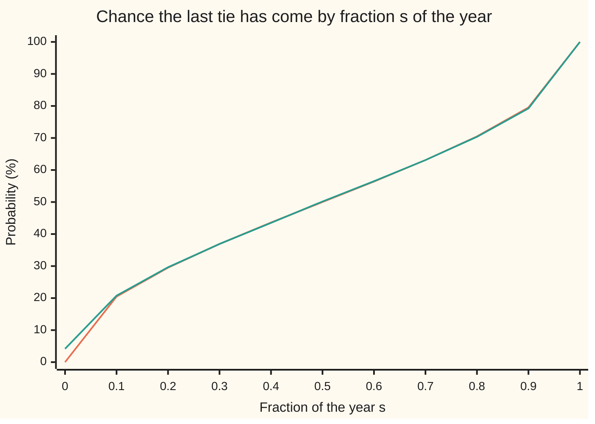

# Levy's arcsine laws: why a fair game's lead rarely changes hands

[Syllabus](../../../SYLLABUS.md) → [Stochastic processes and calculus](../README.md) → [Brownian Motion](../README.md#s05) → Levy's arcsine laws

---

## General Overview

Ana and Ben toss a fair coin once a day for a year of 364 days. Whoever wins a toss takes $1 from the other. The score is Ana's total winnings. A **tie** is a day on which the score is back at $0.

Most people expect the lead to swap often, and the last tie to fall somewhere in the middle of the year. It does not. The last tie falls in the first 10% of the year with chance about 0.2048 (exactly 0.2077 for 364 tosses), one year in five. It falls in the last 10% just as often. The six middle tenths each hold only about 6.4% to 7.4%.

The same shape governs the time in the lead. One player leads for at least 90% of the year with chance about 0.4097 (exactly 0.4155 for 364 tosses), two years in five. Nobody is better at tossing coins. The lead changes hands only at a tie, and ties are rare once the score has drifted away from zero.

Paul Lévy published both laws in 1940 for Brownian motion, the continuous limit of the coin game. The name comes from the formula: an arcsine, the inverse of the sine function.

**In a fair game watched for a fixed time, the moment of the last tie and the share of time one side spends in the lead both follow the arcsine law, whose chance piles up near the start and the end; so long one-sided leads are the rule, not the exception.**

**What kind of fact this is:** two theorems. The law of the last tie is proved on this card in Why it works, from the reflection principle. The law of the time in the lead is stated, checked exactly on the coin game, and its proof is outlined with a named source.

### The picture: where in the year the last tie falls

```
P(last tie in each tenth of the year), %
 0-10%  ████████████████████ 20.48
10-20%  █████████            9.03
20-30%  ███████              7.38
30-40%  ███████              6.69
40-50%  ██████               6.41
50-60%  ██████               6.41
60-70%  ███████              6.69
70-80%  ███████              7.38
80-90%  █████████            9.03
90-100% ████████████████████ 20.48
```

One bar per tenth of the year, one block per percentage point, from the arcsine law. The two end tenths together hold 41% of the chance. A last tie spread evenly would give every bar 10%.

---

## The formula

Notation first, in words.

- $`W_t`$ is a Brownian motion: the coin score seen from far away, with time $`t`$ measured in years, so the year runs from $`t = 0`$ to $`t = 1`$, and $`W_0 = 0`$ ([Brownian motion](01-brownian-motion.md)).
- $`L`$ is the **last zero**: the latest time in the year at which $`W_t = 0`$. It is the last tie.
- $`A`$ is the **time positive**: the fraction of the year during which $`W_t > 0`$, the share of time Ana leads.
- $`s`$ is a fraction of the year, between 0 and 1. In the example $`s = 0.1`$.

```math
P(L \le s) \;=\; P(A \le s) \;=\; \frac{2}{\pi}\arcsin\sqrt{s}, \qquad 0 \le s \le 1
```

**Read it aloud:** the chance the last tie comes by fraction s of the year, and the chance Ana leads for at most fraction s of it, are both two over pi times the arcsine of the square root of s.

Its density, the chance per unit of time, comes from differentiating:

```math
f(s) \;=\; \frac{1}{\pi\sqrt{s(1-s)}}, \qquad 0 < s < 1
```

**Read it aloud:** the density is one over pi times the root of s times one minus s. It is lowest in the middle of the year, at $`2/\pi`$ = 0.6366, and grows without limit at both ends.

The coin game has an exact version. Write $`u_{2k}`$ for the chance the score is tied on day $`2k`$: $`u_{2k} = \binom{2k}{k}/4^k`$, the number of ways to win half of $`2k`$ tosses over the number of possible matches ([Hitting times](../01-Random%20Walks%20and%20Filtrations/06-first-passage-and-hitting-times.md)). For a game of $`2n`$ tosses, counting a day for Ana when the score is positive at its start or its end (Step 5):

```math
P(\text{last tie on day } 2k) \;=\; P(\text{Ana leads for } 2k \text{ of the } 2n \text{ days}) \;=\; u_{2k}\,u_{2n-2k}
```

**Read it aloud:** the chance of a last tie on day 2k is the chance of a tie that day times the chance of no tie in the days left; Ana's days in the lead have exactly the same law.

| Symbol | Plain meaning | In our example | Push it up and the answer… |
| --- | --- | --- | --- |
| $`W_t`$ | the score as a Brownian motion, at time t in years | starts at 0 | — |
| $`L`$ | the last zero: last tie of the year, as a fraction of the year | by 0.1 with chance 0.2048 | — |
| $`A`$ | time positive: fraction of the year Ana leads | at least 0.9 with chance 0.2048 | — |
| $`s`$ | a fraction of the year | 0.1 | larger: chance rises, 0.5 at s = 0.5 |
| $`f(s)`$ | density of $`L`$ and of $`A`$ | 0.6366 at mid-year | — |
| $`u_{2k}`$ | chance of a tie on day 2k of the coin game | $`u_{364}`$ = 0.0418 | larger k: smaller, about $`1/\sqrt{\pi k}`$ |
| $`n`$, $`k`$ | the game has 2n tosses; k counts pairs of days | n = 182; ties by day 36 mean k ≤ 18 | more tosses: closer to the formula |
| $`x`$ | the score at time s | spread like a bell, variance s | farther from 0: a later tie less likely |
| $`Z_1`$, $`Z_2`$ | two independent standard normal draws (bell curve, mean 0, variance 1) | $`\lvert Z_2 \rvert < \lvert Z_1 \rvert / 3`$ at s = 0.1 | — |
| $`\theta`$ | the angle of the point $`(Z_1, Z_2)`$ | within 0.3218 radians of the horizontal | — |
| $`p`$ | chance Ana wins a toss | 0.5; 0.52 in When it holds | away from 0.5: early last ties |
| $`W'`$, $`B_v`$, $`m`$, $`\alpha`$, $`r`$, $`y`$ | helpers: the fresh motion after time s (written $`B_v`$ in the proof, v its elapsed time); m a number of pairs of days; α each wedge's angle; r the distance of $`(Z_1, Z_2)`$ from the centre; $`z_1`$, $`z_2`$ values taken by $`Z_1`$, $`Z_2`$; y the input of arcsin | α = 0.3218 at s = 0.1 | — |

### When it holds

- **A fair game.** With a tilted coin the score drifts away and stops coming back. At 364 days with Ana winning each toss with chance 0.52, the last tie comes by day 36 with chance 0.2611, against 0.2077 for a fair coin; as the year lengthens the tilted chance tends to 1.
- **A start at a tie.** The year must begin at 0. A game that starts with Ana $5 ahead has no tie at all with positive chance, and the formula no longer applies.
- **An end fixed in advance.** The year ends on day 364 whatever happens. A game stopped when Ana first leads by $10 has a different last tie, because the end depends on the path.
- **A long game.** The formula is the limit as the number of tosses grows. At 364 tosses the exact chance is 0.2077; at 3640 it is 0.2052; at 36400 it is 0.2049.
- **Independent steps with a finite variance.** That is what [Donsker's theorem](10-donskers-invariance-principle.md) needs to turn a walk into Brownian motion; the law then holds for any such fair walk, not only coin tosses.

---

## Why it works

### Step 0: an early last tie means no tie afterwards

"The last tie comes by time s" is the same event as "no tie in the time from s to 1". Split that event in two. First, where is the score at time s? Second, starting from there, does a fair motion reach 0 in the time left? The reflection principle answers the second question exactly, and a symmetry of the bell curve finishes the job.

### Step 1: the reflection principle gives the chance of no return

Suppose the score at time s is $`x`$. From there it moves as a fresh Brownian motion for the remaining $`1 - s`$ years: Brownian increments are independent of the past. Reaching 0 means moving a distance $`\lvert x \rvert`$ toward it.

[Reflection principle](04-reflection-principle-and-running-maximum.md) says the chance of touching a level at distance $`\lvert x \rvert`$ within time $`1 - s`$ is twice the chance of ending beyond it. By symmetry, that equals the chance a fresh motion ends at least $`\lvert x \rvert`$ from its start, in either direction. So, writing $`W'`$ for the fresh motion:

```math
P(\text{no zero in } (s, 1] \mid W_s = x) \;=\; P\big(\lvert W'_{1-s} \rvert < \lvert x \rvert\big)
```

**Read it aloud:** given the score x at time s, no tie later is as likely as a fresh motion over the time left ending closer to its start than x is to zero.

### Step 2: the question becomes one about two bell curves

The score at time s is $`\sqrt{s}\,Z_1`$, and the fresh motion at the end is $`\sqrt{1-s}\,Z_2`$, with $`Z_1`$ and $`Z_2`$ independent standard normals. Averaging Step 1 over $`x`$:

```math
P(L \le s) \;=\; P\big(\sqrt{1-s}\,\lvert Z_2 \rvert < \sqrt{s}\,\lvert Z_1 \rvert\big)
```

At $`s = 0.1`$ this reads $`\sqrt{0.9}\,\lvert Z_2 \rvert < \sqrt{0.1}\,\lvert Z_1 \rvert`$, which is $`\lvert Z_2 \rvert < \lvert Z_1 \rvert / 3`$.

### Step 3: a round bell has a uniform direction

Plot $`(Z_1, Z_2)`$ as a point in the plane. Its density depends only on the distance from the centre, so every direction is equally likely: the angle $`\theta`$ is uniform on a full turn.

The condition $`\lvert Z_2 \rvert < \lvert Z_1 \rvert / 3`$ says the point lies within angle $`\arctan(1/3)`$ = 0.3218 radians of the horizontal axis. There are four such wedges, two on each side, so the chance is $`4 \times 0.3218 / (2\pi)`$ = 0.2048.

For a general s each wedge's angle is $`\arctan\sqrt{s/(1-s)}`$. A right triangle with legs $`\sqrt{s}`$ and $`\sqrt{1-s}`$ has hypotenuse 1, so the same angle is $`\arcsin\sqrt{s}`$. That gives the formula:

```math
P(L \le s) \;=\; \frac{4}{2\pi}\arctan\sqrt{\frac{s}{1-s}} \;=\; \frac{2}{\pi}\arcsin\sqrt{s}
```

**Read it aloud:** the chance is the share of a full turn taken by four wedges, each of angle arcsine root s.

Differentiating gives the density $`f(s)`$, by the CDF route (CDF, cumulative distribution function: the chance of a value at most s) of [Transforming a variable](../../09-Probability%20and%20statistics/05-Transformations%20and%20Joint%20Laws/01-transforming-a-random-variable.md).

<details>
<summary>Detailed proof: the last zero, step by step</summary>

Fix $`0 < s < 1`$. The event $`\{L \le s\}`$ equals $`\{W_t \ne 0 \text{ for all } t \in (s, 1]\}`$. The time s is fixed, so the ordinary Markov property applies: $`B_v = W_{s+v} - W_s`$ is a Brownian motion independent of the path up to s. No strong Markov property is needed here; the reflection card used it once, to prove its own result.

Given $`W_s = x \ne 0`$, a zero in $`(s, 1]`$ means $`x + B_v = 0`$ for some $`v \le 1 - s`$, so the motion $`-\mathrm{sign}(x) B`$ touches the level $`\lvert x \rvert`$ by time $`1 - s`$. By the reflection principle and the symmetry of $`B`$, that has chance

$`\displaystyle 2\,P(B_{1-s} \ge \lvert x \rvert) = P(\lvert B_{1-s} \rvert \ge \lvert x \rvert).`$

The event $`W_s = 0`$ has chance 0. Averaging over x with the independence of $`W_s`$ and $`B`$:

$`\displaystyle P(L \le s) = P(\lvert B_{1-s} \rvert < \lvert W_s \rvert) = P(\sqrt{1-s}\,\lvert Z_2 \rvert < \sqrt{s}\,\lvert Z_1 \rvert).`$

The pair $`(Z_1, Z_2)`$ has density $`e^{-(z_1^2 + z_2^2)/2} / (2\pi)`$. In polar coordinates $`z_1 = r\cos\theta`$, $`z_2 = r\sin\theta`$, it becomes $`r e^{-r^2/2}\,dr \cdot d\theta / (2\pi)`$, a product, so $`\theta`$ is uniform on $`[0, 2\pi)`$ and independent of r. The condition is $`\lvert\tan\theta\rvert < \sqrt{s/(1-s)}`$, which holds on four arcs of length $`\alpha = \arctan\sqrt{s/(1-s)}`$ each. Since $`\tan\alpha = \sqrt{s}/\sqrt{1-s}`$ and $`\sin^2\alpha + \cos^2\alpha = 1`$, $`\sin\alpha = \sqrt{s}`$. So

$`\displaystyle P(L \le s) = \frac{4\alpha}{2\pi} = \frac{2}{\pi}\arcsin\sqrt{s}.`$

The derivative of $`\arcsin y`$ is $`1/\sqrt{1 - y^2}`$, and the derivative of $`\sqrt{s}`$ is $`1/(2\sqrt{s})`$. The chain rule gives

$`\displaystyle f(s) = \frac{2}{\pi} \cdot \frac{1}{\sqrt{1-s}} \cdot \frac{1}{2\sqrt{s}} = \frac{1}{\pi\sqrt{s(1-s)}}.`$

The law is symmetric about one half, since $`\arcsin\sqrt{s} + \arcsin\sqrt{1-s} = \pi/2`$; so the median and the average of $`L`$ are both 0.5. Full treatment: Mörters and Peres, Chapter 5 (Sources).

</details>

### Step 4: the coin game, counted exactly

The same split works on the coin game, with counting in place of bell curves. A last tie on day $`2k`$ needs a tie on day $`2k`$, chance $`u_{2k}`$, and then no tie in the remaining $`2n - 2k`$ days. The game restarts at the tie, and [Hitting times](../01-Random%20Walks%20and%20Filtrations/06-first-passage-and-hitting-times.md) proves that the chance of no return in $`2m`$ days equals $`u_{2m}`$. Multiplying gives $`u_{2k}\,u_{2n-2k}`$.

By [Stirling's approximation](../../06-Calculus%20and%20analysis/06-Series/09-stirlings-approximation.md), $`u_{2k}`$ is close to $`1/\sqrt{\pi k}`$. So the product is close to $`1/(\pi\sqrt{k(n-k)})`$, which is $`f(k/n)/n`$: the arcsine density, sampled once per pair of days. Adding the exact products for k from 0 to 18 gives 0.2077 at 364 days, already close to 0.2048. [Donsker's theorem](10-donskers-invariance-principle.md) is the general reason the walk's answer tends to the Brownian one.

### Step 5: the time in the lead has the same law (stated)

The second law, $`P(A \le s) = (2/\pi)\arcsin\sqrt{s}`$, is stated here, not proved. Its proof has two parts.

1. **The walk.** In a game of $`2n`$ tosses, count a day for Ana when the score is positive at its start or its end. Ana's days in the lead then have exactly the law $`u_{2k}\,u_{2n-2k}`$, the same as the last tie. Feller proves this by cutting paths at their first return and induction (Chapter III). Sparre Andersen found a deeper reason: shuffling the order of a walk's steps turns the count of positive days into the position of the walk's maximum, for independent steps drawn from any symmetric law that never gives two partial sums the same value.
2. **The limit.** Erdős and Kac showed in 1947 that the share of positive days tends to the arcsine law for any fair walk with finite variance: Donsker's theorem in action.

The code checks part 1 by brute force. Over all 65,536 matches of 16 tosses, the counts of last ties on day $`2k`$ and of matches with $`2k`$ days in Ana's lead are the same nine numbers, 12870, 6864, 5544, 5040, 4900, 5040, 5544, 6864, 12870, each equal to $`\binom{2k}{k}\binom{16-2k}{8-k}`$.

### Why the lead rarely changes hands

The lead can only change hands at a tie. Over 364 days the expected number of ties is only 14.25, by the identity $`u_2 + u_4 + \dots + u_{2n} = (2n+1)\,u_{2n} - 1`$. Ties cluster near the start, while the score is still close to zero. Once the score has wandered a distance of order $`\sqrt{t}`$ away, getting back takes a long time, and the reflection principle says how long.



Orange: the arcsine law, $`(2/\pi)\arcsin\sqrt{s}`$. Green: the exact 364-day coin game, $`u_{2k}\,u_{2n-2k}`$ added up to the day. The curve is steep at both ends and flat in the middle. The green line starts at 4.18%: the chance of no tie at all after day 0 is $`u_{364}`$ = 0.0418.

---

## Worked numbers, by hand

The year-long fair game, the first 10% of the year.

| Step | Arithmetic | Value |
| --- | --- | --- |
| fraction of the year | s | 0.1 |
| root of s | $`\sqrt{0.1}`$ | 0.3162 |
| arcsine, in radians | $`\arcsin 0.3162`$, the same angle as $`\arctan(1/3)`$ | 0.3218 |
| **last tie in the first 10%** | $`(2/\pi) \times 0.3218`$ | **0.2048** |
| last tie in the last 10% | symmetry: same | 0.2048 |
| Ana leads at least 90% of the year | the time-positive law at $`s = 0.1`$, from the other end | 0.2048 |
| **one side leads at least 90%** | Ana or Ben: $`2 \times (2/\pi)\arcsin\sqrt{0.1}`$ | **0.4097** |
| exact 364-day game, last tie by day 36 | $`u_0 u_{364} + u_2 u_{362} + \dots + u_{36} u_{328}`$ | 0.2077 |

In about one year in five the score is never level again after early February. In about two years in five one player leads for more than 327 of the 364 days, with nothing but luck behind it.

### What breaks if you drop a piece

| Mistake | Comes out at | What went wrong |
| --- | --- | --- |
| Assume the last tie is equally likely on any day | 0.1000 (right: 0.2048) | Ties cluster at the start; the arcsine density is highest at the ends |
| Treat each day's leader as an independent coin | 4.25e-60 (right: 0.4097) | The leader on one day is almost always the leader the next day: the score carries over |
| Count only Ana's long leads | 0.2048 (right: 0.4097) | Either player can be the one in front; the two cases are equally likely and do not overlap |

The 364-day simulation agrees with the exact game: 0.2139 ± 0.0041 for a last tie by day 36 against 0.2077, and 0.4294 ± 0.0049 for a 90% lead against 0.4155.

---

## Code, from first principles, and it actually runs

Both programs check the law by five independent roads.

- Road 1: the formula $`(2/\pi)\arcsin\sqrt{s}`$.
- Road 2: the reflection step of Why it works, $`P(\sqrt{0.9}\,\lvert Z_2 \rvert < \sqrt{0.1}\,\lvert Z_1 \rvert)`$, as an integral computed by Simpson's rule (an area sum over thin strips), with no arcsine anywhere.
- Road 3: the exact coin game two ways. The product law $`u_{2k}\,u_{2n-2k}`$, and a probability flow that pushes the chance of each score forward day by day, with no reflection. They must agree to twelve decimals.
- Road 4: every one of the 65,536 matches of 16 tosses, counting both the last tie and the days in the lead.
- Road 5: 10,000 simulated years of 364 tosses. The random bits come from SplitMix64, a simple random-number generator written out in full (seed 20261123).

### Python

```python
# Levy's arcsine laws for a year-long fair coin game: the last tie and the time in the lead, by five roads.
import math

S, N, PATHS, SEED = 0.1, 364, 10000, 20261123   # fraction of the year, tosses (one a day), simulated years, seed
n = N // 2                                     # ties can only happen on even days

def arcsine(s):                                # road 1: the formula (2/pi) arcsin sqrt(s)
    return 2 / math.pi * math.asin(math.sqrt(s))

def simpson(f, a, b, m):
    h = (b - a) / m
    return h / 3 * (f(a) + f(b) + sum((4 if i % 2 else 2) * f(a + i * h) for i in range(1, m)))

def phi(x): return math.exp(-x * x / 2) / math.sqrt(2 * math.pi)
def Phi(x): return 0.5 + simpson(phi, 0.0, x, 200)

def reflection_road(s):                        # road 2: P(|fresh motion over 1 - s| < |W_s|), no arcsin
    r = math.sqrt(s / (1 - s))
    return simpson(lambda z: 2 * phi(z) * (2 * Phi(r * z) - 1), 0.0, 9.0, 600)

def u_list(m):                                 # u[k] = chance of a tie on day 2k = C(2k, k) / 4^k
    u = [1.0]
    for k in range(1, m + 1): u.append(u[-1] * (2 * k - 1) / (2 * k))
    return u

def walk_product(m, s):                        # road 3a: sum of u[k] u[m-k] over ties on days 2k <= s * 2m
    u = u_list(m)
    return sum(u[k] * u[m - k] for k in range(int(s * m + 1e-9) + 1))

def walk_flow(days, d, p=0.5):                 # road 3b: probability flow, no reflection: P(last tie on day <= d)
    size, off = 2 * days + 3, days + 1
    f = [1.0] * size                           # f[x]: chance of no tie in the remaining days, starting at x
    for _ in range(days - d):
        f = [1.0] + [p * (0.0 if i + 1 == off else f[i + 1]) + (1 - p) * (0.0 if i - 1 == off else f[i - 1])
                     for i in range(1, size - 1)] + [1.0]
    q = [0.0] * size; q[off] = 1.0             # q[x]: chance the score is x on day d
    for _ in range(d):
        q = [0.0] + [p * q[i - 1] + (1 - p) * q[i + 1] for i in range(1, size - 1)] + [0.0]
    return sum(a * b for a, b in zip(q, f))

def show(label, v, w=10): print(f"{label:<44}{v:>{w}.4f}")

c = arcsine(S); show("1 formula (2/pi) arcsin sqrt(0.1)", c)
show("  sqrt(0.1)", math.sqrt(S)); show("  arcsin sqrt(0.1), radians", math.asin(math.sqrt(S)))
show("  arctan(1/3), the same angle", math.atan(1 / 3))
r2 = reflection_road(S); show("2 reflection road, no arcsin", r2)
assert abs(r2 - c) < 1e-6, "reflection road disagrees with the arcsine formula"
show("lead >= 90% of the year, either side, 2 x", 2 * c)
show("density at mid-year, 1/(pi sqrt(0.25))", 1 / (math.pi * math.sqrt(0.25)))
w364, f364 = walk_product(n, S), walk_flow(N, 36)
show("3 walk 364 days: last tie by day 36, product", w364); show("  same, probability flow", f364)
assert abs(w364 - f364) < 1e-12, "product law u u disagrees with the probability flow"
for m in (n, 10 * n, 100 * n):
    v = walk_product(m, S); print(f"  walk {2 * m:>6} tosses: P(last tie <= 10%) {v:.4f}  gap {v - c:+.4f}")
assert abs(walk_product(100 * n, S) - c) < 0.002, "the walk does not approach the arcsine law"
show("  tilted coin 0.52: last tie by day 36, flow", walk_flow(N, 36, 0.52))
u = u_list(n); ties_sum = sum(u[1:]); ties_id = (2 * n + 1) * u[n] - 1
show("expected ties in 364 days, sum of u", ties_sum); show("  identity (2n + 1) u_n - 1", ties_id)
assert abs(ties_sum - ties_id) < 1e-9

M = 16; counts_last, counts_lead = [0] * (M // 2 + 1), [0] * (M // 2 + 1)   # road 4: every 16-toss match
for bits in range(1 << M):
    pos = last = lead = 0
    for i in range(M):
        prev = pos; pos += 1 if bits >> i & 1 else -1
        if pos == 0: last = i + 1
        if prev > 0 or pos > 0: lead += 1
    counts_last[last // 2] += 1; counts_lead[lead // 2] += 1
law = [math.comb(2 * k, k) * math.comb(M - 2 * k, M // 2 - k) for k in range(M // 2 + 1)]
print("4 all 65536 matches of 16, k = 0..8:", " ".join(str(x) for x in law))
assert counts_last == law and counts_lead == law, "16-toss counts break the discrete arcsine law"
print("  last tie on day 2k, and Ana in the lead 2k rounds: both match")

state = SEED                                   # road 5: SplitMix64, one bit per toss
def rand64():
    global state
    state = (state + 0x9E3779B97F4A7C15) & (2**64 - 1); z = state
    z = ((z ^ (z >> 30)) * 0xBF58476D1CE4E5B9) & (2**64 - 1); z = ((z ^ (z >> 27)) * 0x94D049BB133111EB) & (2**64 - 1)
    return z ^ (z >> 31)
hit_last = hit_lead = hit_ana = ties_total = 0
for _ in range(PATHS):
    pos = last = lead = ties = 0; word = 0
    for i in range(N):
        if i % 64 == 0: word = rand64()
        prev = pos; pos += 1 if word >> (i % 64) & 1 else -1
        if pos == 0: last = i + 1; ties += 1
        if prev > 0 or pos > 0: lead += 1
    hit_last += last <= 36; hit_lead += lead >= 328 or lead <= 36; hit_ana += lead >= 328; ties_total += ties
for label, hits, exact in [("5 sim: last tie by day 36", hit_last, w364), ("  one side leads >= 328 days", hit_lead, 2 * w364)]:
    p = hits / PATHS; se = math.sqrt(p * (1 - p) / PATHS)
    print(f"{label:<34}{p:>8.4f}  std err {se:.4f}  exact walk {exact:.4f}")
    assert abs(p - exact) < 4 * se, label
show("  Ana alone leads >= 328 days", hit_ana / PATHS); show("  average ties per year", ties_total / PATHS)
assert abs(ties_total / PATHS - ties_id) < 0.5

wrong_bin = 2 * sum(math.comb(N, j) for j in range(37)) / 2**N
show("wrong: last tie uniform over the year", S)
print(f"{'wrong: lead days as 364 independent coins':<44}{wrong_bin:>10.2e}")
show("wrong: one side only (Ana leads >= 90%)", c)
for s in (0.5, 0.01, 0.99): show(f"try: P(last tie <= {s})", arcsine(s))
show("try: lead >= 99% either side", 2 * arcsine(0.01))
tenths = [round(arcsine(j / 10) * 100, 2) for j in range(11)]
print("chart, arcsine CDF %   ", " ".join(f"{x:.2f}" for x in tenths))
print("chart, walk 364 days % ", " ".join(f"{walk_product(n, j / 10) * 100:.2f}" for j in range(11)))
print("bars, P(last tie in tenth) %", " ".join(f"{(arcsine((j + 1) / 10) - arcsine(j / 10)) * 100:.2f}" for j in range(10)))
assert abs(arcsine(0.5) - 0.5) < 1e-12, "the median of the last tie is not mid-year"
print("ALL CHECKS PASS")
```

**Ran 2026-11-23 on macOS, Python 3.14.10, standard library only. All checks passed. Output, pasted from the run:**

```
1 formula (2/pi) arcsin sqrt(0.1)               0.2048
  sqrt(0.1)                                     0.3162
  arcsin sqrt(0.1), radians                     0.3218
  arctan(1/3), the same angle                   0.3218
2 reflection road, no arcsin                    0.2048
lead >= 90% of the year, either side, 2 x       0.4097
density at mid-year, 1/(pi sqrt(0.25))          0.6366
3 walk 364 days: last tie by day 36, product    0.2077
  same, probability flow                        0.2077
  walk    364 tosses: P(last tie <= 10%) 0.2077  gap +0.0029
  walk   3640 tosses: P(last tie <= 10%) 0.2052  gap +0.0004
  walk  36400 tosses: P(last tie <= 10%) 0.2049  gap +0.0000
  tilted coin 0.52: last tie by day 36, flow    0.2611
expected ties in 364 days, sum of u            14.2540
  identity (2n + 1) u_n - 1                    14.2540
4 all 65536 matches of 16, k = 0..8: 12870 6864 5544 5040 4900 5040 5544 6864 12870
  last tie on day 2k, and Ana in the lead 2k rounds: both match
5 sim: last tie by day 36           0.2139  std err 0.0041  exact walk 0.2077
  one side leads >= 328 days        0.4294  std err 0.0049  exact walk 0.4155
  Ana alone leads >= 328 days                   0.2190
  average ties per year                        14.0740
wrong: last tie uniform over the year           0.1000
wrong: lead days as 364 independent coins     4.25e-60
wrong: one side only (Ana leads >= 90%)         0.2048
try: P(last tie <= 0.5)                         0.5000
try: P(last tie <= 0.01)                        0.0638
try: P(last tie <= 0.99)                        0.9362
try: lead >= 99% either side                    0.1275
chart, arcsine CDF %    0.00 20.48 29.52 36.90 43.59 50.00 56.41 63.10 70.48 79.52 100.00
chart, walk 364 days %  4.18 20.77 29.63 36.90 43.50 50.17 56.50 63.10 70.37 79.23 100.00
bars, P(last tie in tenth) % 20.48 9.03 7.38 6.69 6.41 6.41 6.69 7.38 9.03 20.48
ALL CHECKS PASS
```

The walk closes in on the formula as the game lengthens: the gap falls from 0.0029 at 364 tosses to 0.0004 at 3640, and rounds to zero at 36400. The simulation sits within three standard errors of both exact 364-day values.

### Rust

```rust
// Levy's arcsine laws for a year-long fair coin game: the last tie and the time in the lead, by five roads.
const S: f64 = 0.1; // fraction of the year
const N: usize = 364; // tosses, one a day
const PATHS: usize = 10000; // simulated years
const SEED: u64 = 20261123;

fn arcsine(s: f64) -> f64 { 2.0 / std::f64::consts::PI * s.sqrt().asin() } // road 1

fn simpson(f: &dyn Fn(f64) -> f64, a: f64, b: f64, m: usize) -> f64 {
    let h = (b - a) / m as f64;
    let mut acc = 0.0;
    for i in 1..m { acc += (if i % 2 == 1 { 4.0 } else { 2.0 }) * f(a + i as f64 * h); }
    h / 3.0 * (f(a) + f(b) + acc)
}
fn phi(x: f64) -> f64 { (-x * x / 2.0).exp() / (2.0 * std::f64::consts::PI).sqrt() }
fn big_phi(x: f64) -> f64 { 0.5 + simpson(&phi, 0.0, x, 200) }

fn reflection_road(s: f64) -> f64 { // road 2: P(|fresh motion over 1 - s| < |W_s|), no arcsin
    let r = (s / (1.0 - s)).sqrt();
    simpson(&|z: f64| 2.0 * phi(z) * (2.0 * big_phi(r * z) - 1.0), 0.0, 9.0, 600)
}

fn u_list(m: usize) -> Vec<f64> { // u[k] = chance of a tie on day 2k = C(2k, k) / 4^k
    let mut u = vec![1.0];
    for k in 1..=m { let last = u[k - 1]; u.push(last * (2 * k - 1) as f64 / (2 * k) as f64); }
    u
}

fn walk_product(m: usize, s: f64) -> f64 { // road 3a
    let u = u_list(m);
    let top = (s * m as f64 + 1e-9) as usize;
    let mut acc = 0.0;
    for k in 0..=top { acc += u[k] * u[m - k]; }
    acc
}

fn walk_flow(days: usize, d: usize, p: f64) -> f64 { // road 3b: probability flow, no reflection
    let (size, off) = (2 * days + 3, days + 1);
    let mut f = vec![1.0; size];
    for _ in 0..(days - d) {
        let mut g = vec![1.0; size];
        for i in 1..size - 1 {
            let up = if i + 1 == off { 0.0 } else { f[i + 1] };
            let down = if i - 1 == off { 0.0 } else { f[i - 1] };
            g[i] = p * up + (1.0 - p) * down;
        }
        f = g;
    }
    let mut q = vec![0.0; size];
    q[off] = 1.0;
    for _ in 0..d {
        let mut g = vec![0.0; size];
        for i in 1..size - 1 { g[i] = p * q[i - 1] + (1.0 - p) * q[i + 1]; }
        q = g;
    }
    let mut acc = 0.0;
    for i in 0..size { acc += q[i] * f[i]; }
    acc
}

fn show(label: &str, v: f64) { println!("{:<44}{:>10.4}", label, v); }

fn comb(a: u64, b: u64) -> u64 { let mut c = 1u64; for i in 0..b { c = c * (a - i) / (i + 1); } c }

struct SplitMix(u64);
impl SplitMix {
    fn next(&mut self) -> u64 {
        self.0 = self.0.wrapping_add(0x9E3779B97F4A7C15);
        let mut z = self.0;
        z = (z ^ (z >> 30)).wrapping_mul(0xBF58476D1CE4E5B9);
        z = (z ^ (z >> 27)).wrapping_mul(0x94D049BB133111EB);
        z ^ (z >> 31)
    }
}

fn main() {
    let n = N / 2;
    let c = arcsine(S);
    show("1 formula (2/pi) arcsin sqrt(0.1)", c);
    show("  sqrt(0.1)", S.sqrt());
    show("  arcsin sqrt(0.1), radians", S.sqrt().asin());
    show("  arctan(1/3), the same angle", (1.0f64 / 3.0).atan());
    let r2 = reflection_road(S);
    show("2 reflection road, no arcsin", r2);
    assert!((r2 - c).abs() < 1e-6, "reflection road disagrees with the arcsine formula");
    show("lead >= 90% of the year, either side, 2 x", 2.0 * c);
    show("density at mid-year, 1/(pi sqrt(0.25))", 1.0 / (std::f64::consts::PI * 0.25f64.sqrt()));
    let (w364, f364) = (walk_product(n, S), walk_flow(N, 36, 0.5));
    show("3 walk 364 days: last tie by day 36, product", w364);
    show("  same, probability flow", f364);
    assert!((w364 - f364).abs() < 1e-12, "product law u u disagrees with the probability flow");
    for m in [n, 10 * n, 100 * n] {
        let v = walk_product(m, S);
        println!("  walk {:>6} tosses: P(last tie <= 10%) {:.4}  gap {:+.4}", 2 * m, v, v - c);
    }
    assert!((walk_product(100 * n, S) - c).abs() < 0.002, "the walk does not approach the arcsine law");
    show("  tilted coin 0.52: last tie by day 36, flow", walk_flow(N, 36, 0.52));
    let u = u_list(n);
    let ties_sum: f64 = u[1..].iter().sum();
    let ties_id = (2 * n + 1) as f64 * u[n] - 1.0;
    show("expected ties in 364 days, sum of u", ties_sum);
    show("  identity (2n + 1) u_n - 1", ties_id);
    assert!((ties_sum - ties_id).abs() < 1e-9);

    const M: usize = 16; // road 4: every 16-toss match
    let (mut counts_last, mut counts_lead) = (vec![0u64; M / 2 + 1], vec![0u64; M / 2 + 1]);
    for bits in 0u32..(1 << M) {
        let (mut pos, mut last, mut lead) = (0i32, 0usize, 0usize);
        for i in 0..M {
            let prev = pos;
            pos += if bits >> i & 1 == 1 { 1 } else { -1 };
            if pos == 0 { last = i + 1; }
            if prev > 0 || pos > 0 { lead += 1; }
        }
        counts_last[last / 2] += 1;
        counts_lead[lead / 2] += 1;
    }
    let law: Vec<u64> = (0..=M / 2).map(|k| comb(2 * k as u64, k as u64) * comb((M - 2 * k) as u64, (M / 2 - k) as u64)).collect();
    println!("4 all 65536 matches of 16, k = 0..8: {}", law.iter().map(|x| x.to_string()).collect::<Vec<_>>().join(" "));
    assert!(counts_last == law && counts_lead == law, "16-toss counts break the discrete arcsine law");
    println!("  last tie on day 2k, and Ana in the lead 2k rounds: both match");

    let mut rng = SplitMix(SEED); // road 5: SplitMix64, one bit per toss
    let (mut hit_last, mut hit_lead, mut hit_ana, mut ties_total) = (0usize, 0usize, 0usize, 0usize);
    for _ in 0..PATHS {
        let (mut pos, mut last, mut lead, mut ties, mut word) = (0i32, 0usize, 0usize, 0usize, 0u64);
        for i in 0..N {
            if i % 64 == 0 { word = rng.next(); }
            let prev = pos;
            pos += if word >> (i % 64) & 1 == 1 { 1 } else { -1 };
            if pos == 0 { last = i + 1; ties += 1; }
            if prev > 0 || pos > 0 { lead += 1; }
        }
        if last <= 36 { hit_last += 1; }
        if lead >= 328 || lead <= 36 { hit_lead += 1; }
        if lead >= 328 { hit_ana += 1; }
        ties_total += ties;
    }
    for (label, hits, exact) in [("5 sim: last tie by day 36", hit_last, w364), ("  one side leads >= 328 days", hit_lead, 2.0 * w364)] {
        let p = hits as f64 / PATHS as f64;
        let se = (p * (1.0 - p) / PATHS as f64).sqrt();
        println!("{:<34}{:>8.4}  std err {:.4}  exact walk {:.4}", label, p, se, exact);
        assert!((p - exact).abs() < 4.0 * se, "{}", label);
    }
    show("  Ana alone leads >= 328 days", hit_ana as f64 / PATHS as f64);
    show("  average ties per year", ties_total as f64 / PATHS as f64);
    assert!((ties_total as f64 / PATHS as f64 - ties_id).abs() < 0.5);

    let mut term = 0.5f64.powi(N as i32); // C(364, j) / 2^364, built term by term
    let mut wrong_bin = 0.0;
    for j in 0..37 { wrong_bin += term; term = term * (N - j) as f64 / (j + 1) as f64; }
    wrong_bin *= 2.0;
    show("wrong: last tie uniform over the year", S);
    println!("{:<44}{:>10.2e}", "wrong: lead days as 364 independent coins", wrong_bin);
    show("wrong: one side only (Ana leads >= 90%)", c);
    for s in [0.5, 0.01, 0.99] { show(&format!("try: P(last tie <= {})", s), arcsine(s)); }
    show("try: lead >= 99% either side", 2.0 * arcsine(0.01));
    let tenths: Vec<f64> = (0..=10).map(|j| (arcsine(j as f64 / 10.0) * 100.0 * 100.0).round() / 100.0).collect();
    println!("chart, arcsine CDF %    {}", tenths.iter().map(|x| format!("{:.2}", x)).collect::<Vec<_>>().join(" "));
    println!("chart, walk 364 days %  {}", (0..=10).map(|j| format!("{:.2}", walk_product(n, j as f64 / 10.0) * 100.0)).collect::<Vec<_>>().join(" "));
    println!("bars, P(last tie in tenth) % {}", (0..10).map(|j| format!("{:.2}", (arcsine((j + 1) as f64 / 10.0) - arcsine(j as f64 / 10.0)) * 100.0)).collect::<Vec<_>>().join(" "));
    assert!((arcsine(0.5) - 0.5).abs() < 1e-12, "the median of the last tie is not mid-year");
    println!("ALL CHECKS PASS");
}
```

**Ran 2026-11-23 on macOS, rustc 1.98.1, no crates. All checks passed. Output, pasted from the run:**

```
1 formula (2/pi) arcsin sqrt(0.1)               0.2048
  sqrt(0.1)                                     0.3162
  arcsin sqrt(0.1), radians                     0.3218
  arctan(1/3), the same angle                   0.3218
2 reflection road, no arcsin                    0.2048
lead >= 90% of the year, either side, 2 x       0.4097
density at mid-year, 1/(pi sqrt(0.25))          0.6366
3 walk 364 days: last tie by day 36, product    0.2077
  same, probability flow                        0.2077
  walk    364 tosses: P(last tie <= 10%) 0.2077  gap +0.0029
  walk   3640 tosses: P(last tie <= 10%) 0.2052  gap +0.0004
  walk  36400 tosses: P(last tie <= 10%) 0.2049  gap +0.0000
  tilted coin 0.52: last tie by day 36, flow    0.2611
expected ties in 364 days, sum of u            14.2540
  identity (2n + 1) u_n - 1                    14.2540
4 all 65536 matches of 16, k = 0..8: 12870 6864 5544 5040 4900 5040 5544 6864 12870
  last tie on day 2k, and Ana in the lead 2k rounds: both match
5 sim: last tie by day 36           0.2139  std err 0.0041  exact walk 0.2077
  one side leads >= 328 days        0.4294  std err 0.0049  exact walk 0.4155
  Ana alone leads >= 328 days                   0.2190
  average ties per year                        14.0740
wrong: last tie uniform over the year           0.1000
wrong: lead days as 364 independent coins     4.25e-60
wrong: one side only (Ana leads >= 90%)         0.2048
try: P(last tie <= 0.5)                         0.5000
try: P(last tie <= 0.01)                        0.0638
try: P(last tie <= 0.99)                        0.9362
try: lead >= 99% either side                    0.1275
chart, arcsine CDF %    0.00 20.48 29.52 36.90 43.59 50.00 56.41 63.10 70.48 79.52 100.00
chart, walk 364 days %  4.18 20.77 29.63 36.90 43.50 50.17 56.50 63.10 70.37 79.23 100.00
bars, P(last tie in tenth) % 20.48 9.03 7.38 6.69 6.41 6.41 6.69 7.38 9.03 20.48
ALL CHECKS PASS
```

The two outputs agree line for line, the simulation included: both run the same generator from the same seed and read the same bits.

### Lean

Lean proves the law of the last zero for every $`s`$ from 0 to 1, its density, and the exact coin-game law.

- Take a Brownian motion $`W_t`$ and a fraction $`s`$ of the year, $`0 \le s \le 1`$. Then $`P(L \le s) = (2/\pi)\arcsin\sqrt{s}`$.
- Take $`0 < s < 1`$. Then the derivative of $`(2/\pi)\arcsin\sqrt{s}`$ is the density $`f(s) = 1/(\pi\sqrt{s(1-s)})`$.
- Take a fair game of $`2n`$ tosses, every match equally likely, and $`k \le n`$. Then the last tie falls on day $`2k`$ with chance $`u_{2k}\,u_{2n-2k}`$.
- Take the 16-toss game. Then the nine last-tie counts are 12870, 6864, 5544, 5040, 4900, 5040, 5544, 6864, 12870, adding up to 65,536.

The law of the time in the lead, and the numbers of the five roads, are left to the Python and Rust checks.

```lean
-- Levy's arcsine laws: the last zero of a Brownian motion before time 1 comes by time s with chance (2/π) arcsin √s, that law has density 1/(π√(s(1 − s))), and in a fair coin game of 2n tosses the last tie falls on day 2k with chance u_{2k} u_{2n−2k}.
import Mathlib
import Mathlib.Probability.BrownianMotion.Basic
import Mathlib.Analysis.SpecialFunctions.Trigonometric.InverseDeriv
import Mathlib.Analysis.SpecialFunctions.Sqrt
import Mathlib.Data.Nat.Choose.Basic
import Mathlib.Data.Fintype.Pi
import Mathlib.Algebra.Order.Field.Rat
import Mathlib.Tactic.NormNum

open MeasureTheory ProbabilityTheory Finset
open scoped NNReal ENNReal

/-- The last zero `L` of the path `t ↦ B t ω` in the year `[0, 1]`: the latest time `t ≤ 1`
at which the path is at 0 (the last tie). -/
noncomputable def lastZero {Ω : Type*} (B : ℝ≥0 → Ω → ℝ) (ω : Ω) : ℝ≥0 :=
  sSup {t : ℝ≥0 | t ≤ 1 ∧ B t ω = 0}

section asl_brownian

open Real

lemma rpm_grid_le {t : ℝ≥0} {n k : ℕ} (hk : k ≤ n + 1) : t * k / (n + 1) ≤ t := by
  rw [div_le_iff₀ (by positivity)]
  gcongr
  exact_mod_cast hk

lemma rpm_grid_mono {t : ℝ≥0} {n j k : ℕ} (hjk : j ≤ k) : t * j / (n + 1) ≤ t * k / (n + 1) := by
  gcongr

lemma rpm_grid_dist (t : ℝ≥0) (n j : ℕ) :
    dist (t * ((j + 1 : ℕ) : ℝ≥0) / (n + 1)) (t * (j : ℝ≥0) / (n + 1)) = (t : ℝ) / (n + 1) := by
  rw [NNReal.dist_eq]
  push_cast
  have : (t : ℝ) * (j + 1) / (n + 1) - t * j / (n + 1) = t / (n + 1) := by
    field_simp; ring
  rw [this, abs_of_nonneg (by positivity)]

lemma rpm_grid_approx {t s : ℝ≥0} (hs : s ≤ t) (n : ℕ) :
    ∃ k ≤ n + 1, t * k / (n + 1) ≤ s ∧ (s : ℝ) ≤ (t * k / (n + 1) : ℝ≥0) + (t : ℝ) / (n + 1) := by
  rcases eq_or_ne t 0 with ht | ht
  · subst ht
    have : s = 0 := le_antisymm hs zero_le
    subst this
    exact ⟨0, by omega, by simp, by simp⟩
  have htr : (0 : ℝ) < t := NNReal.coe_pos.2 (pos_iff_ne_zero.2 ht)
  have hsr : (s : ℝ) ≤ t := hs
  refine ⟨⌊(s : ℝ) * (n + 1) / t⌋₊, ?_, ?_, ?_⟩
  · apply Nat.floor_le_of_le
    rw [div_le_iff₀ htr]
    push_cast
    nlinarith [s.2]
  · rw [← NNReal.coe_le_coe]
    push_cast
    rw [div_le_iff₀ (by positivity)]
    have := Nat.floor_le (a := (s : ℝ) * (n + 1) / t) (by positivity)
    rw [le_div_iff₀ htr] at this
    nlinarith
  · push_cast
    have := Nat.lt_floor_add_one ((s : ℝ) * (n + 1) / t)
    rw [div_lt_iff₀ htr] at this
    rw [← add_div, le_div_iff₀ (by positivity)]
    nlinarith

open Filter in
lemma rpm_mesh (t : ℝ≥0) {δ : ℝ} (hδ : 0 < δ) : ∀ᶠ n : ℕ in atTop, (t : ℝ) / (n + 1) < δ := by
  have h := (tendsto_one_div_add_atTop_nhds_zero_nat).const_mul (t : ℝ)
  rw [mul_zero] at h
  filter_upwards [h.eventually (gt_mem_nhds hδ)] with n hn
  have : (t : ℝ) / (n + 1) = t * (1 / ((n : ℝ) + 1)) := by ring
  rw [this]; exact hn

lemma rpm_max {f : ℝ≥0 → ℝ} (hf : Continuous f) (t : ℝ≥0) :
    ∃ s ≤ t, (∀ r ≤ t, f r ≤ f s) ∧ ⨆ r : Set.Iic t, f r = f s := by
  have hc : IsCompact (Set.Iic t) := by
    rw [← Set.Icc_bot]; exact isCompact_Icc
  obtain ⟨s, hs, hmax⟩ := hc.exists_isMaxOn Set.nonempty_Iic hf.continuousOn
  refine ⟨s, hs, fun r hr ↦ hmax hr, le_antisymm ?_ ?_⟩
  · exact ciSup_le fun r ↦ hmax r.2
  · refine le_ciSup (f := fun r : Set.Iic t ↦ f r) ⟨f s, ?_⟩ ⟨s, hs⟩
    rintro _ ⟨r, rfl⟩
    exact hmax r.2

lemma rpm_le_sup {f : ℝ≥0 → ℝ} (hf : Continuous f) {t r : ℝ≥0} (hr : r ≤ t) :
    f r ≤ ⨆ r : Set.Iic t, f r := by
  obtain ⟨s, -, hmax, heq⟩ := rpm_max hf t
  rw [heq]; exact hmax r hr

open Filter in
lemma rpm_hit_eventually {f : ℝ≥0 → ℝ} (hf : Continuous f) (t : ℝ≥0) {a δ : ℝ} (hδ : 0 < δ)
    (ha : a ≤ ⨆ r : Set.Iic t, f r) :
    ∀ᶠ n : ℕ in atTop, ∃ k ≤ n + 1, a - δ ≤ f (t * k / (n + 1)) := by
  obtain ⟨s, hs, -, heq⟩ := rpm_max hf t
  rw [heq] at ha
  obtain ⟨δ', hδ', hcont⟩ := Metric.continuous_iff.1 hf s δ hδ
  filter_upwards [rpm_mesh t hδ'] with n hn
  obtain ⟨k, hk, h1, h2⟩ := rpm_grid_approx hs n
  refine ⟨k, hk, ?_⟩
  have hd : dist (t * k / (n + 1)) s < δ' := by
    rw [NNReal.dist_eq, abs_sub_comm, abs_of_nonneg (by rw [sub_nonneg]; exact_mod_cast h1)]
    linarith
  have := hcont _ hd
  rw [Real.dist_eq] at this
  linarith [abs_lt.1 this]

open Filter in
lemma rpm_overshoot {f : ℝ≥0 → ℝ} (hf : Continuous f) (t : ℝ≥0) {a ε : ℝ} (h0 : f 0 < a)
    (hε : 0 < ε) :
    ∀ᶠ n : ℕ in atTop, ∀ k ≤ n + 1, a ≤ f (t * k / (n + 1)) →
      (∀ j < k, f (t * j / (n + 1)) < a) → f (t * k / (n + 1)) ≤ a + ε := by
  have hc : IsCompact (Set.Icc 0 t) := isCompact_Icc
  obtain ⟨δ, hδ, hu⟩ := Metric.uniformContinuousOn_iff.1
    (hc.uniformContinuousOn_of_continuous hf.continuousOn) ε hε
  filter_upwards [rpm_mesh t hδ] with n hn
  intro k hk hak hj
  rcases k with _ | j
  · rw [Nat.cast_zero, mul_zero, zero_div] at hak; linarith
  have hj' := hj j (by omega)
  have hd := hu (t * ((j + 1 : ℕ) : ℝ≥0) / (n + 1)) ⟨zero_le, rpm_grid_le hk⟩
    (t * (j : ℝ≥0) / (n + 1)) ⟨zero_le, rpm_grid_le (by omega)⟩
    (by rw [rpm_grid_dist]; exact hn)
  rw [Real.dist_eq] at hd
  linarith [abs_lt.1 hd]

lemma rpm_gauss_symm (v : ℝ≥0) (c : ℝ) :
    gaussianReal 0 v {x | x ≤ -c} = gaussianReal 0 v {x | c ≤ x} := by
  have h : (gaussianReal 0 v).map (fun x ↦ -x) = gaussianReal 0 v := by
    simpa using gaussianReal_map_neg (μ := 0) (v := v)
  calc gaussianReal 0 v {x | x ≤ -c} = (gaussianReal 0 v).map (fun x ↦ -x) {x | x ≤ -c} := by
        rw [h]
    _ = gaussianReal 0 v {x | c ≤ x} := by
      rw [Measure.map_apply measurable_neg (show MeasurableSet {x : ℝ | x ≤ -c} from measurableSet_Iic)]
      congr 1
      ext x
      simp

lemma rpm_gauss_small {v : ℝ≥0} (hv : v ≠ 0) (x : ℝ) {η : ℝ≥0∞} (hη : 0 < η) :
    ∃ δ > 0, gaussianReal 0 v (Set.Icc (x - δ) (x + δ)) < η := by
  have := nullSingletonClass_gaussianReal (μ := 0) hv
  set s : ℕ → Set ℝ := fun m ↦ Set.Icc (x - 1 / (m + 1)) (x + 1 / (m + 1)) with hs
  have hanti : Antitone s := by
    intro m m' hmm'
    have : (1 : ℝ) / (m' + 1) ≤ 1 / (m + 1) := by gcongr
    exact Set.Icc_subset_Icc (by linarith) (by linarith)
  have hsub : ⋂ m, s m ⊆ {x} := by
    intro y hy
    rw [Set.mem_iInter] at hy
    rw [Set.mem_singleton_iff]
    by_contra hne
    have hpos : 0 < |y - x| := abs_pos.2 (sub_ne_zero.2 hne)
    obtain ⟨m, hm⟩ := exists_nat_one_div_lt hpos
    have := hy m
    simp only [hs, Set.mem_Icc] at this
    have : |y - x| ≤ 1 / (m + 1) := abs_sub_le_iff.2 ⟨by linarith, by linarith⟩
    linarith
  have ht := tendsto_measure_iInter_atTop (μ := gaussianReal 0 v)
    (fun m ↦ measurableSet_Icc.nullMeasurableSet) hanti ⟨0, measure_ne_top _ _⟩
  rw [measure_mono_null hsub (measure_singleton x)] at ht
  obtain ⟨m, hm⟩ := (ht.eventually (gt_mem_nhds hη)).exists
  exact ⟨1 / (m + 1), by positivity, hm⟩

lemma rpm_reflect_step {Ω : Type*} {mΩ : MeasurableSpace Ω} {P : Measure Ω}
    {B : ℝ≥0 → Ω → ℝ} (hB : IsPreBrownianReal B P) {u t : ℝ≥0} (hut : u ≤ t)
    (S : Set (Set.Iic u → ℝ)) (hS : MeasurableSet S) (c : ℝ) :
    P ({ω | (fun s : Set.Iic u ↦ B s ω) ∈ S} ∩ {ω | B t ω - B u ω ≤ -c}) =
      P ({ω | (fun s : Set.Iic u ↦ B s ω) ∈ S} ∩ {ω | c ≤ B t ω - B u ω}) := by
  have hind := hB.indepFun_shift u
  have e : u + (t - u) = t := add_tsub_cancel_of_le hut
  have key : ∀ T : Set ℝ, MeasurableSet T →
      P ({ω | (fun s : Set.Iic u ↦ B s ω) ∈ S} ∩ {ω | B t ω - B u ω ∈ T}) =
        P {ω | (fun s : Set.Iic u ↦ B s ω) ∈ S} * gaussianReal 0 (nndist t.1 u.1) T := by
    intro T hT
    have h := hind.measure_inter_preimage_eq_mul {x : ℝ≥0 → ℝ | x (t - u) ∈ T} S
      (measurable_pi_apply (t - u) hT) hS
    simp only [Set.preimage_ofPred_eq, e] at h
    have hlaw := (hB.hasLaw_sub t u).measure_eq (p := fun x ↦ x ∈ T) hT
    simp only [Pi.sub_apply, Set.ofPred_mem_eq] at hlaw
    rw [Set.inter_comm, ← hlaw, mul_comm]
    exact h
  have h1 := key {x | x ≤ -c} (measurableSet_le measurable_id measurable_const)
  have h2 := key {x | c ≤ x} (measurableSet_le measurable_const measurable_id)
  simp only [Set.mem_ofPred_eq] at h1 h2
  rw [h1, h2, rpm_gauss_symm]

lemma rpm_first_hit (x : ℕ → ℝ) (a : ℝ) {K : ℕ} (h : ∃ k ≤ K, a ≤ x k) :
    ∃ k ≤ K, a ≤ x k ∧ ∀ j < k, x j < a := by
  classical
  refine ⟨Nat.find h, (Nat.find_spec h).1, (Nat.find_spec h).2, fun j hj ↦ ?_⟩
  by_contra hc
  push Not at hc
  exact Nat.find_min h hj ⟨hj.le.trans (Nat.find_spec h).1, hc⟩

lemma rpm_E_nm {Ω : Type*} {mΩ : MeasurableSpace Ω} {P : Measure Ω}
    {B : ℝ≥0 → Ω → ℝ} (hB : IsPreBrownianReal B P) (τ : ℕ → ℝ≥0) (a : ℝ) (k : ℕ) :
    NullMeasurableSet {ω | a ≤ B (τ k) ω ∧ ∀ j < k, B (τ j) ω < a} P := by
  have : {ω | a ≤ B (τ k) ω ∧ ∀ j < k, B (τ j) ω < a} =
      {ω | a ≤ B (τ k) ω} ∩ ⋂ j : Fin k, {ω | B (τ j) ω < a} := by
    ext ω; simp [Fin.forall_iff]
  rw [this]
  exact (nullMeasurableSet_le aemeasurable_const (hB.aemeasurable _)).inter
    (NullMeasurableSet.iInter fun j ↦ nullMeasurableSet_lt (hB.aemeasurable _) aemeasurable_const)

lemma rpm_E_disj {Ω : Type*} (B : ℝ≥0 → Ω → ℝ) (τ : ℕ → ℝ≥0) (a : ℝ) {i j : ℕ} (hij : i ≠ j)
    (X Y : Set Ω) :
    Disjoint ({ω | a ≤ B (τ i) ω ∧ ∀ l < i, B (τ l) ω < a} ∩ X)
      ({ω | a ≤ B (τ j) ω ∧ ∀ l < j, B (τ l) ω < a} ∩ Y) := by
  rw [Set.disjoint_left]
  rintro ω ⟨⟨hi1, hi2⟩, -⟩ ⟨⟨hj1, hj2⟩, -⟩
  rcases lt_or_gt_of_ne hij with h | h
  · linarith [hj2 i h]
  · linarith [hi2 j h]

lemma rpm_sum_reflect {Ω : Type*} {mΩ : MeasurableSpace Ω} {P : Measure Ω}
    {B : ℝ≥0 → Ω → ℝ} (hB : IsPreBrownianReal B P) {τ : ℕ → ℝ≥0} (hmono : Monotone τ)
    {t : ℝ≥0} {K : ℕ} (hτ : τ K ≤ t) (a c : ℝ) :
    P (⋃ k ∈ Finset.range (K + 1), {ω | a ≤ B (τ k) ω ∧ ∀ j < k, B (τ j) ω < a} ∩
        {ω | B t ω - B (τ k) ω ≤ -c}) =
      P (⋃ k ∈ Finset.range (K + 1), {ω | a ≤ B (τ k) ω ∧ ∀ j < k, B (τ j) ω < a} ∩
        {ω | c ≤ B t ω - B (τ k) ω}) := by
  have hm := hB.aemeasurable
  rw [measure_biUnion_finset₀, measure_biUnion_finset₀]
  · refine Finset.sum_congr rfl fun k hk ↦ ?_
    have hkK : k ≤ K := Nat.lt_succ_iff.1 (Finset.mem_range.1 hk)
    let S : Set (Set.Iic (τ k) → ℝ) := {x | a ≤ x ⟨τ k, Set.mem_Iic.2 le_rfl⟩} ∩
      ⋂ j : Fin k, {x | x ⟨τ j, Set.mem_Iic.2 (hmono j.2.le)⟩ < a}
    have hS : MeasurableSet S := (measurableSet_le measurable_const (measurable_pi_apply _)).inter
      (MeasurableSet.iInter fun j ↦ measurableSet_lt (measurable_pi_apply _) measurable_const)
    have hE : {ω | a ≤ B (τ k) ω ∧ ∀ j < k, B (τ j) ω < a} =
        {ω | (fun s : Set.Iic (τ k) ↦ B s ω) ∈ S} := by
      ext ω; simp [S, Fin.forall_iff]
    rw [hE]
    exact rpm_reflect_step hB ((hmono hkK).trans hτ) S hS c
  · intro i _ j _ hij
    exact (rpm_E_disj B τ a hij _ _).aedisjoint
  · intro k _
    exact (rpm_E_nm hB τ a k).inter (nullMeasurableSet_le aemeasurable_const (by fun_prop))
  · intro i _ j _ hij
    exact (rpm_E_disj B τ a hij _ _).aedisjoint
  · intro k _
    exact (rpm_E_nm hB τ a k).inter (nullMeasurableSet_le (by fun_prop) aemeasurable_const)

lemma rpm_disc_upper {Ω : Type*} {mΩ : MeasurableSpace Ω} {P : Measure Ω}
    {B : ℝ≥0 → Ω → ℝ} (hB : IsPreBrownianReal B P) {τ : ℕ → ℝ≥0} (hmono : Monotone τ)
    {t : ℝ≥0} {K : ℕ} (hτ : τ K ≤ t) (a b : ℝ) :
    P ({ω | ∃ k ≤ K, a ≤ B (τ k) ω} ∩ {ω | B t ω ≤ b}) ≤ P {ω | 2 * a - b ≤ B t ω} := by
  calc P ({ω | ∃ k ≤ K, a ≤ B (τ k) ω} ∩ {ω | B t ω ≤ b})
      ≤ P (⋃ k ∈ Finset.range (K + 1), {ω | a ≤ B (τ k) ω ∧ ∀ j < k, B (τ j) ω < a} ∩
        {ω | B t ω - B (τ k) ω ≤ -(a - b)}) := by
        apply measure_mono
        rintro ω ⟨hex, hb⟩
        obtain ⟨k, hk, h1, h2⟩ := rpm_first_hit (fun k ↦ B (τ k) ω) a hex
        simp only [Set.mem_iUnion, Finset.mem_range, Set.mem_inter_iff, Set.mem_ofPred_eq]
        refine ⟨k, by omega, ⟨h1, h2⟩, ?_⟩
        simp only [Set.mem_ofPred_eq] at hb
        linarith
    _ = P (⋃ k ∈ Finset.range (K + 1), {ω | a ≤ B (τ k) ω ∧ ∀ j < k, B (τ j) ω < a} ∩
        {ω | a - b ≤ B t ω - B (τ k) ω}) := rpm_sum_reflect hB hmono hτ a (a - b)
    _ ≤ P {ω | 2 * a - b ≤ B t ω} := by
        apply measure_mono
        intro ω hω
        simp only [Set.mem_iUnion, Finset.mem_range, Set.mem_inter_iff, Set.mem_ofPred_eq] at hω
        obtain ⟨k, -, ⟨h1, -⟩, h3⟩ := hω
        simp only [Set.mem_ofPred_eq]
        linarith

lemma rpm_disc_lower {Ω : Type*} {mΩ : MeasurableSpace Ω} {P : Measure Ω}
    {B : ℝ≥0 → Ω → ℝ} (hB : IsPreBrownianReal B P) {τ : ℕ → ℝ≥0} (hmono : Monotone τ)
    {t : ℝ≥0} {K : ℕ} (hτ : τ K = t) {a b ε : ℝ} (hb : b ≤ a + ε) :
    P {ω | 2 * a - b + ε ≤ B t ω} ≤
      P ({ω | ∃ k ≤ K, a ≤ B (τ k) ω} ∩ {ω | B t ω ≤ b + ε}) +
        2 * P (⋃ k ∈ Finset.range (K + 1), {ω | a ≤ B (τ k) ω ∧ ∀ j < k, B (τ j) ω < a} ∩
          {ω | a + ε < B (τ k) ω}) := by
  set Bad := ⋃ k ∈ Finset.range (K + 1), {ω | a ≤ B (τ k) ω ∧ ∀ j < k, B (τ j) ω < a} ∩
          {ω | a + ε < B (τ k) ω} with hBad
  calc P {ω | 2 * a - b + ε ≤ B t ω}
      ≤ P ((⋃ k ∈ Finset.range (K + 1), {ω | a ≤ B (τ k) ω ∧ ∀ j < k, B (τ j) ω < a} ∩
        {ω | a - b ≤ B t ω - B (τ k) ω}) ∪ Bad) := by
        apply measure_mono
        intro ω hω
        simp only [Set.mem_ofPred_eq] at hω
        have hex : ∃ k ≤ K, a ≤ B (τ k) ω := ⟨K, le_rfl, by rw [hτ]; linarith⟩
        obtain ⟨k, hk, h1, h2⟩ := rpm_first_hit (fun k ↦ B (τ k) ω) a hex
        by_cases hc : B (τ k) ω ≤ a + ε
        · left
          simp only [Set.mem_iUnion, Finset.mem_range, Set.mem_inter_iff, Set.mem_ofPred_eq]
          exact ⟨k, by omega, ⟨h1, h2⟩, by linarith⟩
        · right
          simp only [hBad, Set.mem_iUnion, Finset.mem_range, Set.mem_inter_iff, Set.mem_ofPred_eq]
          exact ⟨k, by omega, ⟨h1, h2⟩, by linarith⟩
    _ ≤ P (⋃ k ∈ Finset.range (K + 1), {ω | a ≤ B (τ k) ω ∧ ∀ j < k, B (τ j) ω < a} ∩
        {ω | a - b ≤ B t ω - B (τ k) ω}) + P Bad := measure_union_le _ _
    _ = P (⋃ k ∈ Finset.range (K + 1), {ω | a ≤ B (τ k) ω ∧ ∀ j < k, B (τ j) ω < a} ∩
        {ω | B t ω - B (τ k) ω ≤ -(a - b)}) + P Bad := by
        rw [rpm_sum_reflect hB hmono hτ.le a (a - b)]
    _ ≤ P (({ω | ∃ k ≤ K, a ≤ B (τ k) ω} ∩ {ω | B t ω ≤ b + ε}) ∪ Bad) + P Bad := by
        gcongr
        intro ω hω
        simp only [Set.mem_iUnion, Finset.mem_range, Set.mem_inter_iff, Set.mem_ofPred_eq] at hω
        obtain ⟨k, hk, ⟨h1, h2⟩, h3⟩ := hω
        by_cases hc : B (τ k) ω ≤ a + ε
        · left
          exact ⟨⟨k, by omega, h1⟩, by simp only [Set.mem_ofPred_eq]; linarith⟩
        · right
          simp only [hBad, Set.mem_iUnion, Finset.mem_range, Set.mem_inter_iff, Set.mem_ofPred_eq]
          exact ⟨k, hk, ⟨h1, h2⟩, by linarith⟩
    _ ≤ P ({ω | ∃ k ≤ K, a ≤ B (τ k) ω} ∩ {ω | B t ω ≤ b + ε}) + P Bad + P Bad := by
        gcongr; exact measure_union_le _ _
    _ = _ := by rw [two_mul, add_assoc]

lemma rpm_grid_monotone (t : ℝ≥0) (n : ℕ) : Monotone (fun k : ℕ ↦ t * k / (n + 1)) :=
  fun _ _ h ↦ rpm_grid_mono h

lemma rpm_grid_last (t : ℝ≥0) (n : ℕ) : t * ((n + 1 : ℕ) : ℝ≥0) / (n + 1) = t := by
  push_cast
  rw [mul_div_assoc, div_self (by positivity), mul_one]

lemma rpm_upper {Ω : Type*} {mΩ : MeasurableSpace Ω} {P : Measure Ω}
    {B : ℝ≥0 → Ω → ℝ} (hB : IsBrownianReal B P) {t : ℝ≥0} (ht : t ≠ 0) (a b : ℝ) :
    P {ω | a ≤ (⨆ s : Set.Iic t, B s ω) ∧ B t ω ≤ b} ≤ P {ω | 2 * a - b ≤ B t ω} := by
  refine ENNReal.le_of_forall_pos_le_add fun η hη _ ↦ ?_
  obtain ⟨δ, hδ, hν⟩ := rpm_gauss_small ht (2 * a - b) (η := η) (by exact_mod_cast hη)
  have hlaw := hB.hasLaw_eval t
  let A : ℕ → Set Ω := fun N ↦
    {ω | ∀ n ≥ N, ∃ k ≤ n + 1, a - δ / 2 ≤ B (t * k / (n + 1)) ω} ∩ {ω | B t ω ≤ b}
  have hA : Monotone A := by
    intro N N' h ω hω
    exact ⟨fun n hn ↦ hω.1 n (h.trans hn), hω.2⟩
  calc P {ω | a ≤ (⨆ s : Set.Iic t, B s ω) ∧ B t ω ≤ b} ≤ P (⋃ N, A N) := by
        apply measure_mono_ae
        filter_upwards [hB.cont] with ω hω hmem
        obtain ⟨N, hN⟩ := (rpm_hit_eventually hω t (half_pos hδ) hmem.1).exists_forall_of_atTop
        exact Set.mem_iUnion.2 ⟨N, fun n hn ↦ hN n hn, hmem.2⟩
    _ = ⨆ N, P (A N) := hA.measure_iUnion
    _ ≤ P {ω | 2 * a - b ≤ B t ω} + η := by
        refine iSup_le fun N ↦ ?_
        calc P (A N) ≤ P ({ω | ∃ k ≤ N + 1, a - δ / 2 ≤ B (t * k / (N + 1)) ω} ∩
              {ω | B t ω ≤ b}) := measure_mono fun ω hω ↦ ⟨hω.1 N le_rfl, hω.2⟩
          _ ≤ P {ω | 2 * (a - δ / 2) - b ≤ B t ω} :=
              rpm_disc_upper hB.toIsPreBrownianReal (rpm_grid_monotone t N)
                (rpm_grid_le le_rfl) _ _
          _ ≤ P ({ω | 2 * a - b ≤ B t ω} ∪
              {ω | B t ω ∈ Set.Icc (2 * a - b - δ) (2 * a - b + δ)}) := by
              apply measure_mono
              intro ω hω
              simp only [Set.mem_ofPred_eq, Set.mem_union, Set.mem_Icc] at hω ⊢
              by_cases hc : 2 * a - b ≤ B t ω
              · exact Or.inl hc
              · right; constructor <;> linarith
          _ ≤ P {ω | 2 * a - b ≤ B t ω} +
              P {ω | B t ω ∈ Set.Icc (2 * a - b - δ) (2 * a - b + δ)} := measure_union_le _ _
          _ ≤ P {ω | 2 * a - b ≤ B t ω} + η := by
              gcongr
              rw [hlaw.measure_eq (p := fun x ↦ x ∈ Set.Icc (2 * a - b - δ) (2 * a - b + δ))
                measurableSet_Icc, Set.ofPred_mem_eq]
              exact hν.le

lemma rpm_lower {Ω : Type*} {mΩ : MeasurableSpace Ω} {P : Measure Ω}
    {B : ℝ≥0 → Ω → ℝ} (hB : IsBrownianReal B P) {t : ℝ≥0} (ht : t ≠ 0) {a b : ℝ}
    (ha : 0 < a) (hb : b ≤ a) :
    P {ω | 2 * a - b ≤ B t ω} ≤ P {ω | a ≤ (⨆ s : Set.Iic t, B s ω) ∧ B t ω ≤ b} := by
  have hprob := (hB.hasLaw_eval t).isProbabilityMeasure
  refine ENNReal.le_of_forall_pos_le_add fun η hη _ ↦ ?_
  set q : ℝ≥0∞ := ((η / 4 : ℝ≥0) : ℝ≥0∞) with hq
  have hq0 : 0 < q := by rw [hq]; exact_mod_cast div_pos hη (by norm_num)
  obtain ⟨δ1, hδ1, hν1⟩ := rpm_gauss_small ht (2 * a - b) hq0
  obtain ⟨δ2, hδ2, hν2⟩ := rpm_gauss_small ht b hq0
  set ε := min δ1 δ2 with hε
  have hε0 : 0 < ε := lt_min hδ1 hδ2
  have hε1 : ε ≤ δ1 := min_le_left _ _
  have hε2 : ε ≤ δ2 := min_le_right _ _
  let Bad : ℕ → Set Ω := fun n ↦ ⋃ k ∈ Finset.range (n + 1 + 1),
    {ω | a ≤ B (t * k / (n + 1)) ω ∧ ∀ j < k, B (t * j / (n + 1)) ω < a} ∩
      {ω | a + ε < B (t * k / (n + 1)) ω}
  let V : ℕ → Set Ω := fun N ↦ ⋃ n, ⋃ (_ : N ≤ n), Bad n
  have hVanti : Antitone V := by
    intro N N' h ω hω
    simp only [V, Set.mem_iUnion] at hω ⊢
    obtain ⟨n, hn, h'⟩ := hω
    exact ⟨n, h.trans hn, h'⟩
  have hm := hB.aemeasurable
  have hBad_nm : ∀ n, NullMeasurableSet (Bad n) P := fun n ↦
    NullMeasurableSet.iUnion fun k ↦ NullMeasurableSet.iUnion fun _ ↦
      (rpm_E_nm hB.toIsPreBrownianReal (fun k : ℕ ↦ t * k / (n + 1)) a k).inter
        (nullMeasurableSet_lt aemeasurable_const (hm _))
  have hV_nm : ∀ N, NullMeasurableSet (V N) P := fun N ↦
    NullMeasurableSet.iUnion fun n ↦ NullMeasurableSet.iUnion fun _ ↦ hBad_nm n
  have hVlim : P (⋂ N, V N) = 0 := by
    rw [measure_eq_zero_iff_ae_notMem]
    filter_upwards [hB.cont, hB.eval_zero_ae_eq_zero] with ω hω h0
    have h0' : (fun s ↦ B s ω) 0 < a := by simp only [h0]; exact ha
    obtain ⟨N, hN⟩ := (rpm_overshoot hω t h0' hε0).exists_forall_of_atTop
    intro hmem
    have := Set.mem_iInter.1 hmem N
    simp only [V, Bad, Set.mem_iUnion, Finset.mem_range, Set.mem_inter_iff,
      Set.mem_ofPred_eq] at this
    obtain ⟨n, hn, k, hk, ⟨h1, h2⟩, h3⟩ := this
    have := hN n hn k (by omega) h1 h2
    linarith
  have ht' := tendsto_measure_iInter_atTop hV_nm hVanti ⟨0, measure_ne_top _ _⟩
  rw [hVlim] at ht'
  obtain ⟨N, hN⟩ := (ht'.eventually (gt_mem_nhds hq0)).exists
  have hBadN : P (Bad N) ≤ q := by
    refine (measure_mono fun ω hω ↦ ?_).trans hN.le
    simp only [V, Set.mem_iUnion]
    exact ⟨N, le_rfl, hω⟩
  have hlaw := hB.hasLaw_eval t
  have h4 : q + 2 * q + q = η := by
    rw [hq]
    have : (η / 4 : ℝ≥0) + 2 * (η / 4) + η / 4 = η := by
      rw [← NNReal.coe_inj]; push_cast; ring
    exact_mod_cast this
  calc P {ω | 2 * a - b ≤ B t ω}
      ≤ P ({ω | 2 * a - b + ε ≤ B t ω} ∪
          {ω | B t ω ∈ Set.Icc (2 * a - b - δ1) (2 * a - b + δ1)}) := by
        apply measure_mono
        intro ω hω
        simp only [Set.mem_ofPred_eq, Set.mem_union, Set.mem_Icc] at hω ⊢
        by_cases hc : 2 * a - b + ε ≤ B t ω
        · exact Or.inl hc
        · right; constructor <;> linarith
    _ ≤ P {ω | 2 * a - b + ε ≤ B t ω} + q := by
        refine (measure_union_le _ _).trans ?_
        gcongr
        rw [hlaw.measure_eq (p := fun x ↦ x ∈ Set.Icc (2 * a - b - δ1) (2 * a - b + δ1))
          measurableSet_Icc, Set.ofPred_mem_eq]
        exact hν1.le
    _ ≤ (P ({ω | ∃ k ≤ N + 1, a ≤ B (t * k / (N + 1)) ω} ∩ {ω | B t ω ≤ b + ε}) +
          2 * P (Bad N)) + q := by
        gcongr
        exact rpm_disc_lower hB.toIsPreBrownianReal (rpm_grid_monotone t N)
          (rpm_grid_last t N) (by linarith)
    _ ≤ ((P {ω | a ≤ (⨆ s : Set.Iic t, B s ω) ∧ B t ω ≤ b} + q) + 2 * q) + q := by
        gcongr
        calc P ({ω | ∃ k ≤ N + 1, a ≤ B (t * k / (N + 1)) ω} ∩ {ω | B t ω ≤ b + ε})
            ≤ P ({ω | a ≤ (⨆ s : Set.Iic t, B s ω) ∧ B t ω ≤ b} ∪
                {ω | B t ω ∈ Set.Icc (b - δ2) (b + δ2)}) := by
              apply measure_mono_ae
              filter_upwards [hB.cont] with ω hω hmem
              obtain ⟨⟨k, hk, hak⟩, hbt⟩ := hmem
              simp only [Set.mem_ofPred_eq, Set.mem_union, Set.mem_Icc] at hbt ⊢
              by_cases hc : B t ω ≤ b
              · exact Or.inl ⟨hak.trans (rpm_le_sup hω (rpm_grid_le hk)), hc⟩
              · right; constructor <;> linarith
          _ ≤ P {ω | a ≤ (⨆ s : Set.Iic t, B s ω) ∧ B t ω ≤ b} + q := by
              refine (measure_union_le _ _).trans ?_
              gcongr
              rw [hlaw.measure_eq (p := fun x ↦ x ∈ Set.Icc (b - δ2) (b + δ2))
                measurableSet_Icc, Set.ofPred_mem_eq]
              exact hν2.le
    _ = P {ω | a ≤ (⨆ s : Set.Iic t, B s ω) ∧ B t ω ≤ b} + (q + 2 * q + q) := by ring
    _ = _ := by rw [h4]

lemma rpm_joint {Ω : Type*} {mΩ : MeasurableSpace Ω}
    {P : Measure Ω} {B : ℝ≥0 → Ω → ℝ} (hB : IsBrownianReal B P) (t : ℝ≥0) {a b : ℝ}
    (ha : 0 < a) (hb : b ≤ a) :
    P {ω | a ≤ (⨆ s : Set.Iic t, B s ω) ∧ B t ω ≤ b} = P {ω | 2 * a - b ≤ B t ω} := by
  rcases eq_or_ne t 0 with ht | ht
  · subst ht
    have h1 : P {ω | a ≤ (⨆ s : Set.Iic (0 : ℝ≥0), B s ω) ∧ B 0 ω ≤ b} = 0 := by
      rw [measure_eq_zero_iff_ae_notMem]
      filter_upwards [hB.cont, hB.eval_zero_ae_eq_zero] with ω hω h0 hmem
      obtain ⟨s, hs, -, heq⟩ := rpm_max hω 0
      have hs0 : s = 0 := le_antisymm hs zero_le
      have := hmem.1
      rw [heq, hs0, h0] at this
      linarith
    have h2 : P {ω | 2 * a - b ≤ B 0 ω} = 0 := by
      rw [measure_eq_zero_iff_ae_notMem]
      filter_upwards [hB.eval_zero_ae_eq_zero] with ω h0 hmem
      simp only [h0] at hmem
      linarith
    rw [h1, h2]
  · exact le_antisymm (rpm_upper hB ht a b) (rpm_lower hB ht ha hb)

lemma rpm_touch {Ω : Type*} {mΩ : MeasurableSpace Ω} {P : Measure Ω}
    {B : ℝ≥0 → Ω → ℝ} (hB : IsBrownianReal B P) (t : ℝ≥0) {a : ℝ} (ha : 0 < a) :
    P {ω | a ≤ ⨆ s : Set.Iic t, B s ω} = P {ω | ∃ s ≤ t, B s ω = a} := by
  refine measure_congr (Filter.eventuallyEqSet_iff.2 ?_)
  filter_upwards [hB.cont, hB.eval_zero_ae_eq_zero] with ω hω h0
  constructor
  · intro hle
    obtain ⟨s, hs, -, heq⟩ := rpm_max hω t
    rw [heq] at hle
    obtain ⟨r, hr, hfr⟩ := intermediate_value_Icc (zero_le : (0 : ℝ≥0) ≤ s) hω.continuousOn
      ⟨by simp only [h0]; exact ha.le, hle⟩
    exact ⟨r, hr.2.trans hs, hfr⟩
  · rintro ⟨s, hs, hsa⟩
    rw [← hsa]
    exact rpm_le_sup hω hs

lemma rpm_max_tail {Ω : Type*} {mΩ : MeasurableSpace Ω} {P : Measure Ω}
    {B : ℝ≥0 → Ω → ℝ} (hB : IsBrownianReal B P) (t : ℝ≥0) {a : ℝ} (ha : 0 < a) :
    P {ω | a ≤ ⨆ s : Set.Iic t, B s ω} = 2 * P {ω | a ≤ B t ω} := by
  rcases eq_or_ne t 0 with ht | ht
  · subst ht
    have h1 : P {ω | a ≤ ⨆ s : Set.Iic (0 : ℝ≥0), B s ω} = 0 := by
      rw [measure_eq_zero_iff_ae_notMem]
      filter_upwards [hB.cont, hB.eval_zero_ae_eq_zero] with ω hω h0 hmem
      obtain ⟨s, hs, -, heq⟩ := rpm_max hω 0
      have hs0 : s = 0 := le_antisymm hs zero_le
      rw [heq, hs0, h0] at hmem
      linarith
    have h2 : P {ω | a ≤ B 0 ω} = 0 := by
      rw [measure_eq_zero_iff_ae_notMem]
      filter_upwards [hB.eval_zero_ae_eq_zero] with ω h0 hmem
      simp only [h0] at hmem
      linarith
    rw [h1, h2, mul_zero]
  have h3 := rpm_joint hB t ha le_rfl
  have e : 2 * a - a = a := by ring
  rw [e] at h3
  have hlaw := hB.hasLaw_eval t
  have := nullSingletonClass_gaussianReal (μ := 0) ht
  have hatom : P {ω | a < B t ω} = P {ω | a ≤ B t ω} := by
    rw [hlaw.measure_eq (p := fun x ↦ a < x) measurableSet_Ioi,
      hlaw.measure_eq (p := fun x ↦ a ≤ x) measurableSet_Ici]
    exact measure_congr Ioi_ae_eq_Ici
  apply le_antisymm
  · calc P {ω | a ≤ ⨆ s : Set.Iic t, B s ω}
        ≤ P ({ω | a ≤ (⨆ s : Set.Iic t, B s ω) ∧ B t ω ≤ a} ∪ {ω | a < B t ω}) := by
          apply measure_mono
          intro ω hω
          simp only [Set.mem_ofPred_eq, Set.mem_union] at hω ⊢
          by_cases h : B t ω ≤ a
          · exact Or.inl ⟨hω, h⟩
          · exact Or.inr (lt_of_not_ge h)
      _ ≤ P {ω | a ≤ (⨆ s : Set.Iic t, B s ω) ∧ B t ω ≤ a} + P {ω | a < B t ω} :=
          measure_union_le _ _
      _ = 2 * P {ω | a ≤ B t ω} := by rw [h3, hatom, two_mul]
  · calc 2 * P {ω | a ≤ B t ω}
        = P {ω | a ≤ (⨆ s : Set.Iic t, B s ω) ∧ B t ω ≤ a} + P {ω | a < B t ω} := by
          rw [h3, hatom, two_mul]
      _ = P ({ω | a ≤ (⨆ s : Set.Iic t, B s ω) ∧ B t ω ≤ a} ∪ {ω | a < B t ω}) := by
          refine (measure_union₀ (nullMeasurableSet_lt aemeasurable_const (hB.aemeasurable t))
            (Disjoint.aedisjoint (Set.disjoint_left.2 fun ω h1 h2 ↦ ?_))).symm
          simp only [Set.mem_ofPred_eq] at h1 h2
          linarith [h1.2]
      _ ≤ P {ω | a ≤ ⨆ s : Set.Iic t, B s ω} := by
          apply measure_mono_ae
          filter_upwards [hB.cont] with ω hω hmem
          simp only [Set.mem_ofPred_eq, Set.mem_union] at hmem ⊢
          rcases hmem with h | h
          · exact h.1
          · exact h.le.trans (rpm_le_sup hω le_rfl)

lemma rpm_max_aemeasurable {Ω : Type*} {mΩ : MeasurableSpace Ω} {P : Measure Ω}
    {B : ℝ≥0 → Ω → ℝ} (hB : IsBrownianReal B P) (t : ℝ≥0) :
    AEMeasurable (fun ω ↦ ⨆ s : Set.Iic t, B s ω) P := by
  have hrep : (fun ω ↦ ⨆ s : Set.Iic t, B s ω) =ᵐ[P]
      fun ω ↦ ⨆ p : ℕ × ℕ, B (t * ((min p.2 (p.1 + 1) : ℕ) : ℝ≥0) / (p.1 + 1)) ω := by
    filter_upwards [hB.cont] with ω hω
    obtain ⟨s, hs, hmax, heq⟩ := rpm_max hω t
    have hle : ∀ p : ℕ × ℕ, B (t * ((min p.2 (p.1 + 1) : ℕ) : ℝ≥0) / (p.1 + 1)) ω ≤ B s ω :=
      fun p ↦ hmax _ (rpm_grid_le (min_le_right _ _))
    have hbdd : BddAbove (Set.range fun p : ℕ × ℕ ↦
        B (t * ((min p.2 (p.1 + 1) : ℕ) : ℝ≥0) / (p.1 + 1)) ω) := by
      refine ⟨B s ω, ?_⟩
      rintro _ ⟨p, rfl⟩
      exact hle p
    rw [heq]
    apply le_antisymm
    · apply le_of_forall_pos_le_add
      intro δ hδ
      obtain ⟨n, k, hk, hkδ⟩ := (rpm_hit_eventually hω t hδ heq.ge).exists
      have h := le_ciSup hbdd (n, k)
      simp only [min_eq_left hk] at h
      linarith
    · exact ciSup_le hle
  exact (AEMeasurable.iSup fun p ↦ hB.aemeasurable _).congr hrep.symm

/-- The law of the best so far. For a Brownian motion `B` and a time `t`, the running maximum
`M_t = sup_{s ≤ t} B_s` has the same probability distribution as `|W_t|`, the distance from the
start at time `t`. -/
theorem running_max_identDistrib_abs {Ω : Type*} {mΩ : MeasurableSpace Ω} {P : Measure Ω}
    {B : ℝ≥0 → Ω → ℝ} (hB : IsBrownianReal B P) (t : ℝ≥0) :
    IdentDistrib (fun ω ↦ ⨆ s : Set.Iic t, B s ω) (fun ω ↦ |B t ω|) P P := by
  have hprob := (hB.hasLaw_eval t).isProbabilityMeasure
  have hM := rpm_max_aemeasurable hB t
  have hBt := hB.aemeasurable t
  have habs : AEMeasurable (fun ω ↦ |B t ω|) P := by fun_prop
  refine ⟨hM, habs, ?_⟩
  apply Measure.ext_of_Ici
  intro x
  rw [Measure.map_apply_of_aemeasurable hM measurableSet_Ici,
    Measure.map_apply_of_aemeasurable habs measurableSet_Ici]
  simp only [Set.preimage, Set.mem_Ici]
  rcases le_or_gt x 0 with hx | hx
  · have e1 : {ω | x ≤ |B t ω|} = Set.univ :=
      Set.eq_univ_of_forall fun ω ↦ hx.trans (abs_nonneg _)
    rw [e1]
    refine measure_congr (Filter.eventuallyEqSet_iff.2 ?_)
    filter_upwards [hB.cont, hB.eval_zero_ae_eq_zero] with ω hω h0
    simp only [Set.mem_univ, iff_true]
    have := rpm_le_sup hω (zero_le : (0 : ℝ≥0) ≤ t)
    simp only [h0] at this
    linarith
  · rw [rpm_max_tail hB t hx]
    have e : {ω | x ≤ |B t ω|} = {ω | x ≤ B t ω} ∪ {ω | B t ω ≤ -x} := by
      ext ω
      simp only [Set.mem_ofPred_eq, Set.mem_union, le_abs']
      tauto
    rw [e, measure_union₀ (nullMeasurableSet_le hBt aemeasurable_const)
      (Disjoint.aedisjoint (Set.disjoint_left.2 fun ω h1 h2 ↦ by
        simp only [Set.mem_ofPred_eq] at h1 h2; linarith)), two_mul]
    congr 1
    have hlaw := hB.hasLaw_eval t
    rw [hlaw.measure_eq (p := fun y ↦ y ≤ -x) measurableSet_Iic,
      hlaw.measure_eq (p := fun y ↦ x ≤ y) measurableSet_Ici, rpm_gauss_symm]

lemma asl_sin_lt_iff {α x : ℝ} (hα0 : 0 < α) (hα : α < π / 2) (hx0 : 0 ≤ x) (hx : x ≤ π / 2) :
    sin x < sin α ↔ x < α :=
  Real.strictMonoOn_sin.lt_iff_lt ⟨by linarith, hx⟩ ⟨by linarith, hα.le⟩

lemma asl_angle_iff {α θ : ℝ} (hα0 : 0 < α) (hα : α < π / 2) (h1 : -π < θ) (h2 : θ < π) :
    sin θ ^ 2 < sin α ^ 2 ↔ θ < -π + α ∨ (-α < θ ∧ θ < α) ∨ π - α < θ := by
  have hsa : 0 < sin α := Real.sin_pos_of_pos_of_lt_pi hα0 (by linarith)
  rw [sq_lt_sq, abs_of_pos hsa]
  have hpi := Real.pi_pos
  rcases le_or_gt θ (-(π / 2)) with h | h
  · -- θ ∈ (-π, -π/2]
    have e : |sin θ| = sin (θ + π) := by
      rw [Real.sin_add_pi, abs_of_nonpos]
      exact Real.sin_nonpos_of_nonpos_of_neg_pi_le (by linarith) (by linarith)
    rw [e, asl_sin_lt_iff hα0 hα (by linarith) (by linarith)]
    constructor
    · intro h'; left; linarith
    · rintro (h' | ⟨h', -⟩ | h') <;> linarith
  rcases le_or_gt θ 0 with h' | h'
  · have e : |sin θ| = sin (-θ) := by
      rw [Real.sin_neg, abs_of_nonpos]
      exact Real.sin_nonpos_of_nonpos_of_neg_pi_le h' (by linarith)
    rw [e, asl_sin_lt_iff hα0 hα (by linarith) (by linarith)]
    constructor
    · intro h''; right; left; constructor <;> linarith
    · rintro (h'' | ⟨h'', -⟩ | h'') <;> linarith
  rcases le_or_gt θ (π / 2) with h'' | h''
  · have e : |sin θ| = sin θ := abs_of_nonneg (Real.sin_nonneg_of_nonneg_of_le_pi h'.le (by linarith))
    rw [e, asl_sin_lt_iff hα0 hα (by linarith) (by linarith)]
    constructor
    · intro h3; right; left; constructor <;> linarith
    · rintro (h3 | ⟨-, h3⟩ | h3) <;> linarith
  · have e : |sin θ| = sin (π - θ) := by
      rw [Real.sin_pi_sub, abs_of_nonneg (Real.sin_nonneg_of_nonneg_of_le_pi h'.le (by linarith))]
    rw [e, asl_sin_lt_iff hα0 hα (by linarith) (by linarith)]
    constructor
    · intro h3; right; right; linarith
    · rintro (h3 | ⟨-, h3⟩ | h3) <;> linarith

lemma asl_angle_measure {α : ℝ} (hα0 : 0 < α) (hα : α < π / 2) :
    volume ({θ : ℝ | sin θ ^ 2 < sin α ^ 2} ∩ Set.Ioo (-π) π) = ENNReal.ofReal (4 * α) := by
  have hpi := Real.pi_pos
  have e : {θ : ℝ | sin θ ^ 2 < sin α ^ 2} ∩ Set.Ioo (-π) π =
      (Set.Ioo (-π) (-π + α) ∪ Set.Ioo (-α) α) ∪ Set.Ioo (π - α) π := by
    ext θ
    simp only [Set.mem_inter_iff, Set.mem_ofPred_eq, Set.mem_Ioo, Set.mem_union]
    constructor
    · rintro ⟨h, h1, h2⟩
      rcases (asl_angle_iff hα0 hα h1 h2).1 h with h3 | h3 | h3
      · exact Or.inl (Or.inl ⟨h1, h3⟩)
      · exact Or.inl (Or.inr h3)
      · exact Or.inr ⟨h3, h2⟩
    · rintro ((⟨h1, h2⟩ | ⟨h1, h2⟩) | ⟨h1, h2⟩)
      · exact ⟨(asl_angle_iff hα0 hα h1 (by linarith)).2 (Or.inl h2), h1, by linarith⟩
      · exact ⟨(asl_angle_iff hα0 hα (by linarith) (by linarith)).2 (Or.inr (Or.inl ⟨h1, h2⟩)),
          by linarith, by linarith⟩
      · exact ⟨(asl_angle_iff hα0 hα (by linarith) h2).2 (Or.inr (Or.inr h1)), by linarith, h2⟩
  rw [e, measure_union _ measurableSet_Ioo, measure_union _ measurableSet_Ioo]
  · simp only [Real.volume_Ioo]
    rw [← ENNReal.ofReal_add (by linarith) (by linarith),
      ← ENNReal.ofReal_add (by linarith) (by linarith)]
    congr 1; ring
  · rw [Set.disjoint_left]
    rintro x ⟨-, h⟩ ⟨h', -⟩; linarith
  · rw [Set.disjoint_left]
    rintro x (⟨-, h⟩ | ⟨-, h⟩) ⟨h', -⟩ <;> linarith

lemma asl_radial :
    ∫ r in Set.Ioi (0 : ℝ), r * exp (-(1 / 2) * r ^ 2) = 1 := by
  have hb : (0 : ℝ) < 1 / 2 := by norm_num
  have A : ∀ x : ℝ, HasDerivAt (fun x => -exp (-(1 / 2) * x ^ 2)) (x * exp (-(1 / 2) * x ^ 2)) x := by
    intro x
    convert (((hasDerivAt_pow 2 x).const_mul (-(1 / 2 : ℝ))).exp).neg using 1
    ring
  have B : Filter.Tendsto (fun x : ℝ => -exp (-(1 / 2) * x ^ 2)) Filter.atTop (nhds (-0)) := by
    refine Filter.Tendsto.neg ?_
    exact tendsto_exp_atBot.comp
      ((Filter.tendsto_pow_atTop two_ne_zero).const_mul_atTop_of_neg (by norm_num))
  rw [integral_Ioi_of_hasDerivAt_of_tendsto' (fun x _ => A x)
    (integrable_mul_exp_neg_mul_sq hb).integrableOn B]
  simp

lemma asl_std_angle {s : ℝ} (hs0 : 0 < s) (hs1 : s < 1) :
    ((gaussianReal 0 1).prod (gaussianReal 0 1)) {p : ℝ × ℝ | p.2 ^ 2 < s * (p.1 ^ 2 + p.2 ^ 2)} =
      ENNReal.ofReal (2 / π * arcsin (√s)) := by
  have hpi := Real.pi_pos
  set α := arcsin (√s) with hαdef
  have hsq0 : 0 < √s := Real.sqrt_pos.2 hs0
  have hsq1 : √s < 1 := by rw [Real.sqrt_lt' one_pos]; simpa using hs1
  have hα0 : 0 < α := Real.arcsin_pos.2 hsq0
  have hα1 : α < π / 2 := by
    rw [hαdef, ← Real.arcsin_one]
    exact Real.arcsin_lt_arcsin (by linarith) hsq1 le_rfl
  have hsinα : sin α ^ 2 = s := by
    rw [hαdef, Real.sin_arcsin (by linarith) hsq1.le, Real.sq_sqrt hs0.le]
  set A : Set (ℝ × ℝ) := {p : ℝ × ℝ | p.2 ^ 2 < s * (p.1 ^ 2 + p.2 ^ 2)} with hAdef
  have hA : MeasurableSet A := measurableSet_lt (by fun_prop) (by fun_prop)
  set T : Set ℝ := {θ : ℝ | sin θ ^ 2 < sin α ^ 2} with hTdef
  have hT : MeasurableSet T := measurableSet_lt (by fun_prop) (by fun_prop)
  set φ : ℝ → ℝ≥0∞ := gaussianPDF 0 1 with hφ
  have hφm : Measurable φ := by fun_prop
  rw [gaussianReal_of_var_ne_zero 0 one_ne_zero, prod_withDensity hφm hφm,
    withDensity_apply _ hA, ← Measure.volume_eq_prod, ← lintegral_indicator hA,
    ← lintegral_comp_polarCoord_symm]
  set G : ℝ → ℝ≥0∞ := fun r => ENNReal.ofReal ((2 * π)⁻¹ * (r * exp (-(1 / 2) * r ^ 2)))
    with hG
  have hcongr : ∀ p ∈ polarCoord.target,
      ENNReal.ofReal p.1 • A.indicator (fun z : ℝ × ℝ => φ z.1 * φ z.2) (polarCoord.symm p) =
        G p.1 * T.indicator 1 p.2 := by
    rintro ⟨r, θ⟩ ⟨hr, -⟩
    simp only [Set.mem_Ioi] at hr
    simp only [polarCoord_symm_apply]
    have hiff : (r * cos θ, r * sin θ) ∈ A ↔ θ ∈ T := by
      simp only [hAdef, hTdef, Set.mem_ofPred_eq, hsinα]
      have : (r * cos θ) ^ 2 + (r * sin θ) ^ 2 = r ^ 2 := by
        rw [mul_pow, mul_pow, ← mul_add, Real.cos_sq_add_sin_sq, mul_one]
      rw [this, mul_pow, mul_comm s]
      exact mul_lt_mul_iff_right₀ (by positivity)
    by_cases hθ : θ ∈ T
    · rw [Set.indicator_of_mem (hiff.2 hθ), Set.indicator_of_mem hθ, Pi.one_apply, mul_one, hG]
      simp only [hφ, gaussianPDF, gaussianPDFReal, smul_eq_mul]
      rw [← ENNReal.ofReal_mul (by positivity), ← ENNReal.ofReal_mul hr.le]
      congr 1
      simp only [NNReal.coe_one, mul_one, sub_zero]
      have h2 : (√(2 * π))⁻¹ * (√(2 * π))⁻¹ = (2 * π)⁻¹ := by
        rw [← mul_inv, Real.mul_self_sqrt (by positivity)]
      have h3 : exp (-(r * cos θ) ^ 2 / 2) * exp (-(r * sin θ) ^ 2 / 2) =
          exp (-(1 / 2) * r ^ 2) := by
        rw [← Real.exp_add]; congr 1
        have := Real.cos_sq_add_sin_sq θ
        linear_combination (-(1 / 2) * r ^ 2) * this
      calc r * ((√(2 * π))⁻¹ * exp (-(r * cos θ) ^ 2 / 2) *
            ((√(2 * π))⁻¹ * exp (-(r * sin θ) ^ 2 / 2)))
          = r * (((√(2 * π))⁻¹ * (√(2 * π))⁻¹) *
            (exp (-(r * cos θ) ^ 2 / 2) * exp (-(r * sin θ) ^ 2 / 2))) := by ring
        _ = _ := by rw [h2, h3]; ring
    · rw [Set.indicator_of_notMem (fun h => hθ (hiff.1 h)), Set.indicator_of_notMem hθ, smul_zero,
        mul_zero]
  rw [setLIntegral_congr_fun (polarCoord.open_target.measurableSet) hcongr]
  rw [polarCoord_target, Measure.volume_eq_prod, ← Measure.prod_restrict,
    lintegral_prod_mul (by fun_prop) (by fun_prop)]
  rw [lintegral_indicator_one hT, Measure.restrict_apply hT, asl_angle_measure hα0 hα1]
  rw [hG, ← ofReal_integral_eq_lintegral_ofReal]
  · rw [integral_const_mul, asl_radial, ← ENNReal.ofReal_mul (by positivity)]
    congr 1
    field_simp
    ring
  · exact ((integrable_mul_exp_neg_mul_sq (by norm_num : (0 : ℝ) < 1 / 2)).integrableOn).const_mul _
  · filter_upwards [ae_restrict_mem measurableSet_Ioi] with r hr
    simp only [Set.mem_Ioi] at hr
    simp only [Pi.zero_apply]
    positivity

lemma asl_scale {s u : ℝ≥0} (hs0 : 0 < s) (hu : 0 < u) (hsu : s + u = 1) :
    ((gaussianReal 0 s).prod (gaussianReal 0 u)) {p : ℝ × ℝ | |p.2| < |p.1|} =
      ENNReal.ofReal (2 / π * arcsin (√(s : ℝ))) := by
  have hsu' : (s : ℝ) + u = 1 := by exact_mod_cast hsu
  have hs0' : (0 : ℝ) < s := hs0
  have hu0' : (0 : ℝ) < u := hu
  have hmap : ∀ v : ℝ≥0, (gaussianReal 0 1).map (fun x => √(v : ℝ) * x) = gaussianReal 0 v := by
    intro v
    rw [gaussianReal_map_const_mul, mul_zero]
    congr 1
    ext
    simp
  rw [← hmap s, ← hmap u, Measure.map_prod_map _ _ (by fun_prop) (by fun_prop),
    Measure.map_apply (by fun_prop) (measurableSet_lt (by fun_prop) (by fun_prop))]
  have e : (Prod.map (fun x => √(s : ℝ) * x) (fun x => √(u : ℝ) * x)) ⁻¹'
      {p : ℝ × ℝ | |p.2| < |p.1|} =
      {p : ℝ × ℝ | p.2 ^ 2 < (s : ℝ) * (p.1 ^ 2 + p.2 ^ 2)} := by
    ext p
    simp only [Set.mem_preimage, Prod.map_fst, Prod.map_snd, Set.mem_ofPred_eq]
    rw [← sq_lt_sq, mul_pow, mul_pow, Real.sq_sqrt hs0'.le, Real.sq_sqrt hu0'.le]
    constructor <;> intro h <;> nlinarith
  rw [e]
  exact asl_std_angle hs0' (by linarith)

lemma asl_lastZero_le_iff {Ω : Type*} (B : ℝ≥0 → Ω → ℝ) (ω : Ω) (s : ℝ≥0) :
    lastZero B ω ≤ s ↔ ∀ t : ℝ≥0, s < t → t ≤ 1 → B t ω ≠ 0 := by
  constructor
  · intro h t hst ht1 hz
    have : t ≤ lastZero B ω := le_csSup ⟨1, fun x hx => hx.1⟩ ⟨ht1, hz⟩
    exact absurd (lt_of_lt_of_le hst (this.trans h)) (lt_irrefl _)
  · intro h
    apply csSup_le'
    rintro t ⟨ht1, hz⟩
    by_contra hc
    push Not at hc
    exact h t hc ht1 hz

lemma asl_path {f : ℝ≥0 → ℝ} (hf : Continuous f) {s u : ℝ≥0} (hsu : s + u = 1) (h0 : f s ≠ 0) :
    (∀ t : ℝ≥0, s < t → t ≤ 1 → f t ≠ 0) ↔
      (0 < f s ∧ (⨆ t : Set.Iic u, -(f (s + t) - f s)) < f s) ∨
      (f s < 0 ∧ (⨆ t : Set.Iic u, (f (s + t) - f s)) < -f s) := by
  have hg : Continuous (fun t => f (s + t)) := hf.comp (continuous_const.add continuous_id)
  constructor
  · intro h
    have hne : ∀ t ≤ u, f (s + t) ≠ 0 := by
      intro t ht
      rcases eq_or_ne t 0 with rfl | ht0
      · simpa using h0
      · refine h (s + t) (lt_add_of_pos_right s (pos_iff_ne_zero.2 ht0)) ?_
        rw [← hsu]; exact (add_le_add_iff_left s).2 ht
    rcases lt_or_gt_of_ne h0 with hneg | hpos
    · right
      refine ⟨hneg, ?_⟩
      have hall : ∀ t ≤ u, f (s + t) < 0 := by
        intro t ht
        by_contra hc
        push Not at hc
        obtain ⟨r, hr, hfr⟩ := intermediate_value_Icc (zero_le : (0 : ℝ≥0) ≤ t) hg.continuousOn
          ⟨by simpa using hneg.le, hc⟩
        exact hne r (hr.2.trans ht) hfr
      obtain ⟨t, ht, -, heq⟩ := rpm_max (f := fun t => f (s + t) - f s)
        (hg.sub continuous_const) u
      rw [heq]; have := hall t ht; linarith
    · left
      refine ⟨hpos, ?_⟩
      have hall : ∀ t ≤ u, 0 < f (s + t) := by
        intro t ht
        by_contra hc
        push Not at hc
        obtain ⟨r, hr, hfr⟩ := intermediate_value_Icc' (zero_le : (0 : ℝ≥0) ≤ t) hg.continuousOn
          ⟨hc, by simpa using hpos.le⟩
        exact hne r (hr.2.trans ht) hfr
      obtain ⟨t, ht, -, heq⟩ := rpm_max (f := fun t => -(f (s + t) - f s))
        (hg.sub continuous_const).neg u
      rw [heq]; have := hall t ht; linarith
  · rintro (⟨hpos, hM⟩ | ⟨hneg, hM⟩) t hst ht1
    · have hle : t - s ≤ u := by rw [tsub_le_iff_left, hsu]; exact ht1
      have := rpm_le_sup (f := fun t => -(f (s + t) - f s)) (hg.sub continuous_const).neg hle
      simp only [add_tsub_cancel_of_le hst.le] at this
      intro hz; rw [hz] at this; linarith
    · have hle : t - s ≤ u := by rw [tsub_le_iff_left, hsu]; exact ht1
      have := rpm_le_sup (f := fun t => f (s + t) - f s) (hg.sub continuous_const) hle
      simp only [add_tsub_cancel_of_le hst.le] at this
      intro hz; rw [hz] at this; linarith

lemma asl_sup_grid {f : ℝ≥0 → ℝ} (hf : Continuous f) (t : ℝ≥0) :
    ⨆ s : Set.Iic t, f s = ⨆ p : ℕ × ℕ, f (t * ((min p.2 (p.1 + 1) : ℕ) : ℝ≥0) / (p.1 + 1)) := by
  obtain ⟨s, hs, hmax, heq⟩ := rpm_max hf t
  have hle : ∀ p : ℕ × ℕ, f (t * ((min p.2 (p.1 + 1) : ℕ) : ℝ≥0) / (p.1 + 1)) ≤ f s :=
    fun p ↦ hmax _ (rpm_grid_le (min_le_right _ _))
  have hbdd : BddAbove (Set.range fun p : ℕ × ℕ ↦
      f (t * ((min p.2 (p.1 + 1) : ℕ) : ℝ≥0) / (p.1 + 1))) := by
    refine ⟨f s, ?_⟩
    rintro _ ⟨p, rfl⟩
    exact hle p
  rw [heq]
  apply le_antisymm
  · apply le_of_forall_pos_le_add
    intro δ hδ
    obtain ⟨n, k, hk, hkδ⟩ := (rpm_hit_eventually hf t hδ heq.ge).exists
    have h := le_ciSup hbdd (n, k)
    simp only [min_eq_left hk] at h
    linarith
  · exact ciSup_le hle

lemma asl_joint_law {Ω : Type*} {mΩ : MeasurableSpace Ω} {P : Measure Ω} [IsProbabilityMeasure P]
    {W : ℝ≥0 → Ω → ℝ} (hW : IsBrownianReal W P) (u : ℝ≥0) {X : Ω → ℝ} (hX : AEMeasurable X P)
    (hind : IndepFun (fun ω t ↦ W t ω) X P) {S : Set (ℝ × ℝ)} (hS : MeasurableSet S) :
    P {ω | (X ω, ⨆ t : Set.Iic u, W t ω) ∈ S} =
      ((P.map X).prod ((gaussianReal 0 u).map (fun y ↦ |y|))) S := by
  set g : (ℝ≥0 → ℝ) → ℝ := fun w ↦
    ⨆ p : ℕ × ℕ, w (u * ((min p.2 (p.1 + 1) : ℕ) : ℝ≥0) / (p.1 + 1)) with hg
  have hgm : Measurable g := Measurable.iSup (fun p ↦ measurable_pi_apply _)
  set M : Ω → ℝ := fun ω ↦ g (fun t ↦ W t ω) with hM
  have hMae : (fun ω ↦ ⨆ t : Set.Iic u, W t ω) =ᵐ[P] M := by
    filter_upwards [hW.cont] with ω hω
    exact asl_sup_grid hω u
  have hMm : AEMeasurable M P := AEMeasurable.iSup (fun p ↦ hW.aemeasurable _)
  have hindM : IndepFun M X P := hind.comp hgm measurable_id
  have hlawM : P.map M = (gaussianReal 0 u).map (fun y ↦ |y|) := by
    rw [← Measure.map_congr hMae, (running_max_identDistrib_abs hW u).map_eq,
      ← (hW.hasLaw_eval u).map_eq,
      AEMeasurable.map_map_of_aemeasurable continuous_abs.measurable.aemeasurable
        (hW.aemeasurable u)]
    rfl
  calc P {ω | (X ω, ⨆ t : Set.Iic u, W t ω) ∈ S} = P {ω | (X ω, M ω) ∈ S} := by
        apply measure_congr
        filter_upwards [hMae] with ω hω
        rw [hω]
    _ = (P.map (fun ω ↦ (X ω, M ω))) S :=
        (Measure.map_apply_of_aemeasurable (hX.prodMk hMm) hS).symm
    _ = ((P.map X).prod (P.map M)) S := by
        rw [(indepFun_iff_map_prod_eq_prod_map_map hX hMm).1 hindM.symm]
    _ = _ := by rw [hlawM]

lemma asl_main {Ω : Type*} {mΩ : MeasurableSpace Ω} {P : Measure Ω}
    {B : ℝ≥0 → Ω → ℝ} (hB : IsBrownianReal B P) {s : ℝ≥0} (hs0 : 0 < s) (hs1 : s < 1) :
    P {ω | lastZero B ω ≤ s} = ENNReal.ofReal (2 / π * arcsin (√(s : ℝ))) := by
  have : IsProbabilityMeasure P := hB.isGaussianProcess.isProbabilityMeasure
  set u : ℝ≥0 := 1 - s with hudef
  have hsu : s + u = 1 := add_tsub_cancel_of_le hs1.le
  have hu : 0 < u := tsub_pos_of_lt hs1
  have hW : IsBrownianReal (fun t ω ↦ B (s + t) ω - B s ω) P := hB.shift s
  have hWn : IsBrownianReal (fun t ω ↦ -(B (s + t) ω - B s ω)) P := hW.neg
  have hind := hB.indepFun_shift s
  have hindX : IndepFun (fun ω t ↦ B (s + t) ω - B s ω) (B s) P :=
    hind.comp measurable_id (measurable_pi_apply (⟨s, Set.mem_Iic.2 le_rfl⟩ : Set.Iic s))
  have hindXn : IndepFun (fun ω t ↦ -(B (s + t) ω - B s ω)) (B s) P :=
    hind.comp (show Measurable (fun (w : ℝ≥0 → ℝ) (t : ℝ≥0) ↦ -(w t)) by fun_prop)
      (measurable_pi_apply (⟨s, Set.mem_Iic.2 le_rfl⟩ : Set.Iic s))
  have hlawX : P.map (B s) = gaussianReal 0 s := (hB.hasLaw_eval s).map_eq
  set S1 : Set (ℝ × ℝ) := {p | 0 < p.1 ∧ p.2 < p.1} with hS1def
  set S2 : Set (ℝ × ℝ) := {p | p.1 < 0 ∧ p.2 < -p.1} with hS2def
  have hS1 : MeasurableSet S1 :=
    (measurableSet_lt measurable_const measurable_fst).inter
      (measurableSet_lt measurable_snd measurable_fst)
  have hS2 : MeasurableSet S2 :=
    (measurableSet_lt measurable_fst measurable_const).inter
      (measurableSet_lt measurable_snd measurable_fst.neg)
  have J1 := asl_joint_law hWn u (hB.aemeasurable s) hindXn hS1
  have J2 := asl_joint_law hW u (hB.aemeasurable s) hindX hS2
  rw [hlawX] at J1 J2
  set A1 : Set Ω := {ω | (B s ω, ⨆ t : Set.Iic u, -(B (s + t) ω - B s ω)) ∈ S1} with hA1
  set A2 : Set Ω := {ω | (B s ω, ⨆ t : Set.Iic u, (B (s + t) ω - B s ω)) ∈ S2} with hA2
  have hne : ∀ᵐ ω ∂P, B s ω ≠ 0 := by
    rw [ae_iff]
    have := nullSingletonClass_gaussianReal (μ := 0) hs0.ne'
    simp only [ne_eq, not_not]
    rw [(hB.hasLaw_eval s).measure_eq (p := fun x ↦ x = 0) (measurableSet_singleton 0)]
    exact measure_singleton 0
  have hset : {ω | lastZero B ω ≤ s} =ᵐ[P] A1 ∪ A2 := by
    filter_upwards [hB.cont, hne] with ω hω hne
    rw [asl_lastZero_le_iff, asl_path hω hsu hne]
    rfl
  have hA2m : NullMeasurableSet A2 P :=
    ((hB.aemeasurable s).prodMk (rpm_max_aemeasurable hW u)).nullMeasurableSet_preimage hS2
  have hdisj : Disjoint A1 A2 := by
    rw [Set.disjoint_left]
    rintro ω ⟨h1, -⟩ ⟨h2, -⟩
    simp only at h1 h2
    linarith
  rw [measure_congr hset, measure_union₀ hA2m hdisj.aedisjoint, J1, J2,
    ← measure_union (Set.disjoint_left.2 fun p h1 h2 => by
      simp only [hS1def, hS2def, Set.mem_ofPred_eq] at h1 h2; linarith [h1.1, h2.1]) hS2]
  rw [← Measure.map_id (μ := gaussianReal 0 s),
    Measure.map_prod_map _ _ measurable_id continuous_abs.measurable,
    Measure.map_apply (measurable_id.prodMap continuous_abs.measurable) (hS1.union hS2)]
  have e : Prod.map id (abs : ℝ → ℝ) ⁻¹' (S1 ∪ S2) = {p : ℝ × ℝ | |p.2| < |p.1|} := by
    ext ⟨x, y⟩
    simp only [hS1def, hS2def, Set.mem_preimage, Prod.map_apply, id_eq, Set.mem_union,
      Set.mem_ofPred_eq]
    constructor
    · rintro (⟨h1, h2⟩ | ⟨h1, h2⟩)
      · rw [abs_of_pos h1]; exact h2
      · rw [abs_of_neg h1]; exact h2
    · intro h
      rcases lt_trichotomy x 0 with h1 | h1 | h1
      · right; exact ⟨h1, by rwa [abs_of_neg h1] at h⟩
      · subst h1; simp at h; linarith [abs_nonneg y]
      · left; exact ⟨h1, by rwa [abs_of_pos h1] at h⟩
  rw [e]
  exact asl_scale hs0 hu hsu

end asl_brownian

/-- Levy's arcsine law for the last zero. Let `B` be a Brownian motion: it starts at 0, runs
for the fixed year from time 0 to time 1, and is the limit of a fair game. For every fraction
`s` of the year, `0 ≤ s ≤ 1`, the chance that the last zero `L` comes by time `s` is
`P(L ≤ s) = (2/π) arcsin √s`. -/
theorem last_zero_arcsine_law {Ω : Type*} {mΩ : MeasurableSpace Ω} {P : Measure Ω}
    {B : ℝ≥0 → Ω → ℝ} (hB : IsBrownianReal B P) (s : ℝ≥0) (hs : s ≤ 1) :
    P {ω | lastZero B ω ≤ s} = ENNReal.ofReal (2 / Real.pi * Real.arcsin (Real.sqrt s)) := by
  rcases eq_or_lt_of_le hs with rfl | hs1
  · have e : {ω | lastZero B ω ≤ 1} = Set.univ :=
      Set.eq_univ_of_forall fun ω => (asl_lastZero_le_iff B ω 1).2
        fun t h1 h2 => absurd (lt_of_lt_of_le h1 h2) (lt_irrefl _)
    have : IsProbabilityMeasure P := hB.isGaussianProcess.isProbabilityMeasure
    rw [e, measure_univ]
    simp
  rcases eq_zero_or_pos s with rfl | hs0
  · have hlim : Filter.Tendsto (fun ε : ℝ≥0 => ENNReal.ofReal (2 / Real.pi *
        Real.arcsin (Real.sqrt ε))) (nhdsWithin 0 (Set.Ioi 0))
        (nhds (ENNReal.ofReal (2 / Real.pi * Real.arcsin (Real.sqrt ((0 : ℝ≥0) : ℝ))))) := by
      refine Filter.Tendsto.mono_left (Continuous.tendsto ?_ 0) nhdsWithin_le_nhds
      exact ENNReal.continuous_ofReal.comp (continuous_const.mul
        (Real.continuous_arcsin.comp (Real.continuous_sqrt.comp NNReal.continuous_coe)))
    have := ge_of_tendsto hlim (by
      filter_upwards [Ioo_mem_nhdsGT (zero_lt_one : (0 : ℝ≥0) < 1)] with ε hε
      rw [← asl_main hB hε.1 hε.2]
      exact measure_mono (Set.ofPred_subset_ofPred.2 fun ω (hω : lastZero B ω ≤ 0) => hω.trans hε.1.le))
    refine le_antisymm this ?_
    simp
  · exact asl_main hB hs0 hs1

/-- The arcsine density. For `0 < s < 1` the arcsine law `F(s) = (2/π) arcsin √s` has
derivative `f(s) = 1 / (π √(s (1 − s)))`, the chance per unit of time. -/
theorem arcsine_cdf_hasDerivAt {s : ℝ} (hs0 : 0 < s) (hs1 : s < 1) :
    HasDerivAt (fun x : ℝ => 2 / Real.pi * Real.arcsin (Real.sqrt x))
      (1 / (Real.pi * Real.sqrt (s * (1 - s)))) s := by
  have hsq : 0 < Real.sqrt s := Real.sqrt_pos.2 hs0
  have hsq1 : Real.sqrt s < 1 := by
    rw [Real.sqrt_lt' one_pos]; simpa using hs1
  have h1 := Real.hasDerivAt_sqrt hs0.ne'
  have h2 := (Real.hasDerivAt_arcsin (by linarith) hsq1.ne).comp s h1
  have h3 := h2.const_mul (2 / Real.pi)
  convert h3 using 1
  · rfl
  have hss : Real.sqrt s ^ 2 = s := Real.sq_sqrt hs0.le
  have h1s : 0 < 1 - s := by linarith
  rw [Real.sqrt_mul hs0.le, hss]
  have hpi := Real.pi_pos
  have hq : 0 < Real.sqrt (1 - s) := Real.sqrt_pos.2 h1s
  field_simp

/-- The score of a match `x` of `m` fair coin tosses after the first `j` tosses: +1 for each
toss Ana wins (`true`), −1 for each toss Ben wins (`false`). -/
def coinScore {m : ℕ} (x : Fin m → Bool) (j : ℕ) : ℤ :=
  ∑ i : Fin m, if (i : ℕ) < j then (if x i then 1 else -1) else 0

/-- The last tie of a match of `m` tosses: the latest day `j ≤ m` on which the score is 0
(day 0 always counts, since the game starts at a tie). -/
def lastTie {m : ℕ} (x : Fin m → Bool) : ℕ :=
  ((range (m + 1)).filter (fun j => coinScore x j = 0)).sup id

/-- `u m = C(2m, m) / 4^m`: the chance that a fair coin game is tied on day `2m`. -/
def tieChance (m : ℕ) : ℚ := ((2 * m).choose m : ℚ) / 4 ^ m

lemma asl_score_split {a b : ℕ} (x : Fin (a + b) → Bool) (j : ℕ) :
    coinScore x j = coinScore (fun i : Fin a => x (Fin.castAdd b i)) j +
      coinScore (fun i : Fin b => x (Fin.natAdd a i)) (j - a) := by
  unfold coinScore
  rw [Fin.sum_univ_add]
  congr 1
  apply Finset.sum_congr rfl
  intro i _
  simp only [Fin.val_natAdd]
  split_ifs <;> first | rfl | (exfalso; omega)

lemma asl_score_zero {m : ℕ} (x : Fin m → Bool) : coinScore x 0 = 0 := by
  simp [coinScore]

lemma asl_score_ge {m : ℕ} (x : Fin m → Bool) {j : ℕ} (hj : m ≤ j) :
    coinScore x j = coinScore x m := by
  unfold coinScore
  apply Finset.sum_congr rfl
  intro i _
  simp only [show (i : ℕ) < j by omega, i.2, ↓reduceIte]

lemma asl_score_full {m : ℕ} (y : Fin m → Bool) :
    coinScore y m = 2 * ((univ.filter (fun i => y i = true)).card : ℤ) - m := by
  unfold coinScore
  have h : ∀ i : Fin m, (if (i : ℕ) < m then (if y i then (1 : ℤ) else -1) else 0) =
      2 * (if y i = true then 1 else 0) - 1 := by
    intro i
    simp only [i.2, ↓reduceIte]
    cases y i <;> simp
  rw [Finset.sum_congr rfl (fun i _ => h i), Finset.sum_sub_distrib, ← Finset.mul_sum,
    Finset.sum_boole]
  simp

lemma asl_score_even {m : ℕ} (x : Fin m → Bool) {j : ℕ} (hj : j ≤ m)
    (h : coinScore x j = 0) : Even j := by
  obtain ⟨r, rfl⟩ := Nat.exists_eq_add_of_le hj
  rw [asl_score_split, Nat.sub_self, asl_score_zero, add_zero, asl_score_full] at h
  exact ⟨(univ.filter (fun i : Fin j => x (Fin.castAdd r i) = true)).card, by omega⟩

lemma asl_sup_eq_iff (S : Finset ℕ) (hS : S.Nonempty) (j : ℕ) :
    S.sup id = j ↔ j ∈ S ∧ ∀ y ∈ S, y ≤ j := by
  constructor
  · rintro rfl
    obtain ⟨y, hy, hyeq⟩ := Finset.exists_mem_eq_sup S hS id
    refine ⟨by rw [hyeq]; exact hy, fun z hz => Finset.le_sup (f := id) hz⟩
  · rintro ⟨hj, hle⟩
    exact le_antisymm (Finset.sup_le hle) (Finset.le_sup (f := id) hj)

lemma asl_lastTie_mem {m : ℕ} (x : Fin m → Bool) :
    lastTie x ∈ (range (m + 1)).filter (fun j => coinScore x j = 0) := by
  have hne : ((range (m + 1)).filter (fun j => coinScore x j = 0)).Nonempty :=
    ⟨0, by simp [asl_score_zero]⟩
  obtain ⟨y, hy, hyeq⟩ := Finset.exists_mem_eq_sup _ hne id
  unfold lastTie
  rw [hyeq]; exact hy

lemma asl_lastTie_iff {j r : ℕ} (x : Fin (j + r) → Bool) :
    lastTie x = j ↔ coinScore (fun i : Fin j => x (Fin.castAdd r i)) j = 0 ∧
      ∀ i ∈ Icc (1 : ℕ) r, coinScore (fun i : Fin r => x (Fin.natAdd j i)) i ≠ 0 := by
  have hne : ((range (j + r + 1)).filter (fun j' => coinScore x j' = 0)).Nonempty :=
    ⟨0, by simp [asl_score_zero]⟩
  have hL : ∀ y, coinScore x y = coinScore (fun i : Fin j => x (Fin.castAdd r i)) y +
      coinScore (fun i : Fin r => x (Fin.natAdd j i)) (y - j) := asl_score_split x
  unfold lastTie
  rw [asl_sup_eq_iff _ hne]
  simp only [Finset.mem_filter, Finset.mem_range]
  constructor
  · rintro ⟨⟨-, h0⟩, hle⟩
    have h0' : coinScore (fun i : Fin j => x (Fin.castAdd r i)) j = 0 := by
      rw [hL, Nat.sub_self, asl_score_zero, add_zero] at h0; exact h0
    refine ⟨h0', fun i hi hzero => ?_⟩
    rw [Finset.mem_Icc] at hi
    have := hle (j + i) ⟨by omega, by
      rw [hL, Nat.add_sub_cancel_left, asl_score_ge _ (by omega), h0', hzero, add_zero]⟩
    omega
  · rintro ⟨h0, hnz⟩
    refine ⟨⟨by omega, by rw [hL, Nat.sub_self, asl_score_zero, add_zero]; exact h0⟩, ?_⟩
    rintro y ⟨hy, hyz⟩
    by_contra hcon
    push Not at hcon
    obtain ⟨i, rfl⟩ := Nat.exists_eq_add_of_lt hcon
    rw [hL, asl_score_ge _ (by omega), h0, zero_add,
      show j + i + 1 - j = i + 1 by omega] at hyz
    exact hnz (i + 1) (Finset.mem_Icc.2 ⟨by omega, by omega⟩) hyz

lemma asl_card_lastTie_add (j r : ℕ) :
    (univ.filter (fun x : Fin (j + r) → Bool => lastTie x = j)).card =
      (univ.filter (fun y : Fin j → Bool => coinScore y j = 0)).card *
      (univ.filter (fun z : Fin r → Bool => ∀ i ∈ Icc (1 : ℕ) r, coinScore z i ≠ 0)).card := by
  rw [← Finset.card_product, ← Finset.filter_product]
  refine Finset.card_nbij' (fun x => (fun i => x (Fin.castAdd r i), fun i => x (Fin.natAdd j i)))
    (fun p => Fin.append p.1 p.2) ?_ ?_ ?_ ?_
  · intro x hx
    simp only [Finset.coe_filter, Finset.mem_univ, true_and, Set.mem_ofPred_eq] at hx ⊢
    exact ⟨by simp, (asl_lastTie_iff x).1 hx⟩
  · intro p hp
    simp only [Finset.coe_filter, Finset.mem_product, Finset.mem_univ, true_and,
      Set.mem_ofPred_eq] at hp ⊢
    rw [asl_lastTie_iff]
    simp only [Fin.append_left, Fin.append_right]
    exact hp
  · intro x _
    exact Fin.append_castAdd_natAdd
  · intro p _
    simp

lemma asl_card_lastTie (m j : ℕ) (h : j ≤ m) :
    (univ.filter (fun x : Fin m → Bool => lastTie x = j)).card =
      (univ.filter (fun y : Fin j → Bool => coinScore y j = 0)).card *
      (univ.filter (fun z : Fin (m - j) → Bool =>
        ∀ i ∈ Icc (1 : ℕ) (m - j), coinScore z i ≠ 0)).card := by
  obtain ⟨r, rfl⟩ := Nat.exists_eq_add_of_le h
  rw [Nat.add_sub_cancel_left]
  exact asl_card_lastTie_add j r

lemma asl_card_tied (k : ℕ) :
    (univ.filter (fun y : Fin (2 * k) → Bool => coinScore y (2 * k) = 0)).card =
      (2 * k).choose k := by
  have e : univ.filter (fun y : Fin (2 * k) → Bool => coinScore y (2 * k) = 0) =
      univ.filter (fun y : Fin (2 * k) → Bool =>
        (univ.filter (fun i => y i = true)).card = k) := by
    ext y
    simp only [Finset.mem_filter, Finset.mem_univ, true_and, asl_score_full]
    push_cast
    omega
  rw [e, show (2 * k).choose k = (univ : Finset (Fin (2 * k))).card.choose k by simp,
    ← Finset.card_powersetCard, Finset.powersetCard_eq_filter]
  refine Finset.card_nbij' (fun y => univ.filter (fun i => y i = true))
    (fun s i => decide (i ∈ s)) ?_ ?_ ?_ ?_
  · intro y hy
    simp only [Finset.coe_filter, Finset.mem_univ, true_and, Set.mem_ofPred_eq,
      Finset.mem_powerset] at hy ⊢
    exact ⟨Finset.subset_univ _, hy⟩
  · intro s hs
    simp only [Finset.coe_filter, Finset.mem_powerset, Finset.mem_univ, true_and,
      Set.mem_ofPred_eq, decide_eq_true_eq] at hs ⊢
    simpa using hs.2
  · intro y _
    funext i
    simp
  · intro s _
    ext i
    simp

lemma asl_sum_lastTie (n : ℕ) :
    ∑ k ∈ range (n + 1), (univ.filter (fun x : Fin (2 * n) → Bool => lastTie x = 2 * k)).card =
      4 ^ n := by
  have hcard : (univ : Finset (Fin (2 * n) → Bool)).card = 4 ^ n := by
    rw [Finset.card_univ, Fintype.card_fun, Fintype.card_bool, Fintype.card_fin, pow_mul]
    norm_num
  rw [← hcard, Finset.card_eq_sum_card_fiberwise (f := fun x => lastTie x / 2)
    (t := range (n + 1))]
  · apply Finset.sum_congr rfl
    intro k _
    congr 1
    ext x
    simp only [Finset.mem_filter, Finset.mem_univ, true_and]
    have hm := asl_lastTie_mem x
    simp only [Finset.mem_filter, Finset.mem_range] at hm
    obtain ⟨r, hr⟩ := asl_score_even x (by omega) hm.2
    omega
  · intro x _
    have hm := asl_lastTie_mem x
    simp only [Finset.mem_filter, Finset.mem_range] at hm
    simp only [Finset.coe_range, Set.mem_Iio]
    omega

lemma asl_conv (a : ℕ → ℚ) (h0 : a 0 = 1)
    (hrec : ∀ k : ℕ, 2 * ((k : ℚ) + 1) * a (k + 1) = (2 * k + 1) * a k) :
    ∀ n, ∑ p ∈ antidiagonal n, a p.1 * a p.2 = 1 := by
  have hT : ∀ n, 2 * ∑ p ∈ antidiagonal n, ((p.1 : ℕ) : ℚ) * a p.1 * a p.2 =
      n * ∑ p ∈ antidiagonal n, a p.1 * a p.2 := by
    intro n
    have hsw : ∑ p ∈ antidiagonal n, ((p.1 : ℕ) : ℚ) * a p.1 * a p.2 =
        ∑ p ∈ antidiagonal n, ((p.2 : ℕ) : ℚ) * a p.1 * a p.2 := by
      rw [← Finset.Nat.sum_antidiagonal_swap]
      apply Finset.sum_congr rfl
      intro p _
      simp only [Prod.fst_swap, Prod.snd_swap]
      ring
    rw [two_mul]
    nth_rewrite 2 [hsw]
    rw [← Finset.sum_add_distrib, Finset.mul_sum]
    apply Finset.sum_congr rfl
    intro p hp
    rw [Finset.HasAntidiagonal.mem_antidiagonal] at hp
    rw [← hp]
    push_cast
    ring
  intro n
  induction n with
  | zero => simp [h0]
  | succ n ih =>
    have key : ((n : ℚ) + 1) * ∑ p ∈ antidiagonal (n + 1), a p.1 * a p.2 = (n + 1) * 1 := by
      have h1 := hT (n + 1)
      rw [Finset.Nat.sum_antidiagonal_succ] at h1
      simp only [Nat.cast_zero, zero_mul, zero_add] at h1
      have h2 : 2 * ∑ p ∈ antidiagonal n, ((p.1 + 1 : ℕ) : ℚ) * a (p.1 + 1) * a p.2 =
          ∑ p ∈ antidiagonal n, (2 * ((p.1 : ℕ) : ℚ) + 1) * a p.1 * a p.2 := by
        rw [Finset.mul_sum]
        apply Finset.sum_congr rfl
        intro p _
        have := hrec p.1
        push_cast
        linear_combination a p.2 * this
      rw [h2] at h1
      have h3 : ∑ p ∈ antidiagonal n, (2 * ((p.1 : ℕ) : ℚ) + 1) * a p.1 * a p.2 =
          2 * ∑ p ∈ antidiagonal n, ((p.1 : ℕ) : ℚ) * a p.1 * a p.2 +
            ∑ p ∈ antidiagonal n, a p.1 * a p.2 := by
        rw [Finset.mul_sum, ← Finset.sum_add_distrib]
        apply Finset.sum_congr rfl
        intro p _
        ring
      rw [h3, hT n, ih] at h1
      push_cast at h1
      linarith
    have hn : (n : ℚ) + 1 ≠ 0 := by positivity
    exact mul_left_cancel₀ hn key

lemma asl_central_conv (n : ℕ) :
    ∑ k ∈ range (n + 1), (2 * k).choose k * (2 * (n - k)).choose (n - k) = 4 ^ n := by
  have h := asl_conv (fun k => ((2 * k).choose k : ℚ) / 4 ^ k) (by simp) (by
    intro k
    have h1 := Nat.succ_mul_centralBinom_succ k
    rw [Nat.centralBinom_eq_two_mul_choose, Nat.centralBinom_eq_two_mul_choose] at h1
    have h1' : ((k : ℚ) + 1) * ((2 * (k + 1)).choose (k + 1) : ℚ) =
        2 * (2 * k + 1) * ((2 * k).choose k : ℚ) := by exact_mod_cast h1
    rw [pow_succ]
    field_simp
    linear_combination 2 * h1') n
  rw [Finset.Nat.sum_antidiagonal_eq_sum_range_succ_mk] at h
  have h2 : ∑ k ∈ range (n + 1), (((2 * k).choose k * (2 * (n - k)).choose (n - k) : ℕ) : ℚ) =
      4 ^ n := by
    have : ∀ k ∈ range (n + 1), (((2 * k).choose k * (2 * (n - k)).choose (n - k) : ℕ) : ℚ) =
        4 ^ n * (((2 * k).choose k : ℚ) / 4 ^ k * (((2 * (n - k)).choose (n - k) : ℚ) /
          4 ^ (n - k))) := by
      intro k hk
      rw [Finset.mem_range] at hk
      have e : (4 : ℚ) ^ n = 4 ^ k * 4 ^ (n - k) := by
        rw [← pow_add]; congr 1; omega
      rw [e]
      push_cast
      field_simp
    rw [Finset.sum_congr rfl this, ← Finset.mul_sum]
    simp only at h
    rw [h, mul_one]
  exact_mod_cast h2

lemma asl_card_nonzero (m r : ℕ) (hr : r = 2 * m) :
    (univ.filter (fun z : Fin r → Bool =>
        ∀ i ∈ Icc (1 : ℕ) r, coinScore z i ≠ 0)).card = (2 * m).choose m := by
  set NZ : ℕ → ℕ := fun r => (univ.filter (fun z : Fin r → Bool =>
        ∀ i ∈ Icc (1 : ℕ) r, coinScore z i ≠ 0)).card with hNZdef
  change NZ r = _
  subst hr
  induction m using Nat.strong_induction_on with
  | _ m ih =>
    have h1 : ∑ k ∈ range (m + 1), (2 * k).choose k * NZ (2 * m - 2 * k) = 4 ^ m := by
      rw [← asl_sum_lastTie m]
      apply Finset.sum_congr rfl
      intro k hk
      rw [Finset.mem_range] at hk
      rw [asl_card_lastTie (2 * m) (2 * k) (by omega), asl_card_tied]
    have h2 := asl_central_conv m
    rw [← h2, Finset.sum_range_succ', Finset.sum_range_succ'] at h1
    have h3 : ∑ k ∈ range m, (2 * (k + 1)).choose (k + 1) * NZ (2 * m - 2 * (k + 1)) =
        ∑ k ∈ range m, (2 * (k + 1)).choose (k + 1) *
          (2 * (m - (k + 1))).choose (m - (k + 1)) := by
      apply Finset.sum_congr rfl
      intro k hk
      rw [Finset.mem_range] at hk
      rw [show 2 * m - 2 * (k + 1) = 2 * (m - (k + 1)) by omega, ih _ (by omega)]
    rw [h3] at h1
    simpa using h1

/-- The coin game, counted exactly. In a fair game of `2n` tosses, every one of the `4^n`
matches equally likely and the game starting at a tie, the chance that the last tie falls on
day `2k` (for `k ≤ n`) is `u_{2k} u_{2n−2k}`: a tie on day `2k` times no tie in the days left. -/
theorem last_tie_prob_eq_tieChance_mul {n k : ℕ} (hk : k ≤ n) :
    ((univ.filter (fun x : Fin (2 * n) → Bool => lastTie x = 2 * k)).card : ℚ) / 4 ^ n =
      tieChance k * tieChance (n - k) := by
  rw [asl_card_lastTie (2 * n) (2 * k) (by omega), asl_card_tied,
    asl_card_nonzero (n - k) (2 * n - 2 * k) (by omega)]
  unfold tieChance
  have e : (4 : ℚ) ^ n = 4 ^ k * 4 ^ (n - k) := by
    rw [← pow_add]; congr 1; omega
  rw [e]
  push_cast
  field_simp

-- The card's 16-toss check (n = 8): the numbers of matches whose last tie is on day 2k,
-- k = 0..8, are C(2k, k) C(16 − 2k, 8 − k).
example : (List.range 9).map (fun k => (2 * k).choose k * (16 - 2 * k).choose (8 - k)) =
    [12870, 6864, 5544, 5040, 4900, 5040, 5544, 6864, 12870] := by
  decide

-- The nine counts cover all 65,536 = 4^8 matches of 16 tosses.
example : 12870 + 6864 + 5544 + 5040 + 4900 + 5040 + 5544 + 6864 + 12870 = 4 ^ 8 := by
  norm_num

#print axioms last_zero_arcsine_law
#print axioms arcsine_cdf_hasDerivAt
#print axioms last_tie_prob_eq_tieChance_mul
#print axioms rpm_grid_le
#print axioms rpm_grid_mono
#print axioms rpm_grid_dist
#print axioms rpm_grid_approx
#print axioms rpm_mesh
#print axioms rpm_max
#print axioms rpm_le_sup
#print axioms rpm_hit_eventually
#print axioms rpm_overshoot
#print axioms rpm_gauss_symm
#print axioms rpm_gauss_small
#print axioms rpm_reflect_step
#print axioms rpm_first_hit
#print axioms rpm_E_nm
#print axioms rpm_E_disj
#print axioms rpm_sum_reflect
#print axioms rpm_disc_upper
#print axioms rpm_disc_lower
#print axioms rpm_grid_monotone
#print axioms rpm_grid_last
#print axioms rpm_upper
#print axioms rpm_lower
#print axioms rpm_joint
#print axioms rpm_touch
#print axioms rpm_max_tail
#print axioms rpm_max_aemeasurable
#print axioms running_max_identDistrib_abs
#print axioms asl_sin_lt_iff
#print axioms asl_angle_iff
#print axioms asl_angle_measure
#print axioms asl_radial
#print axioms asl_std_angle
#print axioms asl_scale
#print axioms asl_lastZero_le_iff
#print axioms asl_path
#print axioms asl_sup_grid
#print axioms asl_joint_law
#print axioms asl_main
#print axioms asl_score_split
#print axioms asl_score_zero
#print axioms asl_score_ge
#print axioms asl_score_full
#print axioms asl_score_even
#print axioms asl_sup_eq_iff
#print axioms asl_lastTie_mem
#print axioms asl_lastTie_iff
#print axioms asl_card_lastTie_add
#print axioms asl_card_lastTie
#print axioms asl_card_tied
#print axioms asl_sum_lastTie
#print axioms asl_conv
#print axioms asl_central_conv
#print axioms asl_card_nonzero
```

**Checked 2026-11-23 on macOS, Lean 4.36.0-rc2, Mathlib v4.36.0-rc2. Every proof is complete and uses only Lean's standard axioms. Output, pasted from the run:**

```
'last_zero_arcsine_law' depends on axioms: [propext, Classical.choice, Quot.sound]
'arcsine_cdf_hasDerivAt' depends on axioms: [propext, Classical.choice, Quot.sound]
'last_tie_prob_eq_tieChance_mul' depends on axioms: [propext, Classical.choice, Quot.sound]
'rpm_grid_le' depends on axioms: [propext, Classical.choice, Quot.sound]
'rpm_grid_mono' depends on axioms: [propext, Classical.choice, Quot.sound]
'rpm_grid_dist' depends on axioms: [propext, Classical.choice, Quot.sound]
'rpm_grid_approx' depends on axioms: [propext, Classical.choice, Quot.sound]
'rpm_mesh' depends on axioms: [propext, Classical.choice, Quot.sound]
'rpm_max' depends on axioms: [propext, Classical.choice, Quot.sound]
'rpm_le_sup' depends on axioms: [propext, Classical.choice, Quot.sound]
'rpm_hit_eventually' depends on axioms: [propext, Classical.choice, Quot.sound]
'rpm_overshoot' depends on axioms: [propext, Classical.choice, Quot.sound]
'rpm_gauss_symm' depends on axioms: [propext, Classical.choice, Quot.sound]
'rpm_gauss_small' depends on axioms: [propext, Classical.choice, Quot.sound]
'rpm_reflect_step' depends on axioms: [propext, Classical.choice, Quot.sound]
'rpm_first_hit' depends on axioms: [propext, Classical.choice, Quot.sound]
'rpm_E_nm' depends on axioms: [propext, Classical.choice, Quot.sound]
'rpm_E_disj' depends on axioms: [propext, Classical.choice, Quot.sound]
'rpm_sum_reflect' depends on axioms: [propext, Classical.choice, Quot.sound]
'rpm_disc_upper' depends on axioms: [propext, Classical.choice, Quot.sound]
'rpm_disc_lower' depends on axioms: [propext, Classical.choice, Quot.sound]
'rpm_grid_monotone' depends on axioms: [propext, Classical.choice, Quot.sound]
'rpm_grid_last' depends on axioms: [propext, Classical.choice, Quot.sound]
'rpm_upper' depends on axioms: [propext, Classical.choice, Quot.sound]
'rpm_lower' depends on axioms: [propext, Classical.choice, Quot.sound]
'rpm_joint' depends on axioms: [propext, Classical.choice, Quot.sound]
'rpm_touch' depends on axioms: [propext, Classical.choice, Quot.sound]
'rpm_max_tail' depends on axioms: [propext, Classical.choice, Quot.sound]
'rpm_max_aemeasurable' depends on axioms: [propext, Classical.choice, Quot.sound]
'running_max_identDistrib_abs' depends on axioms: [propext, Classical.choice, Quot.sound]
'asl_sin_lt_iff' depends on axioms: [propext, Classical.choice, Quot.sound]
'asl_angle_iff' depends on axioms: [propext, Classical.choice, Quot.sound]
'asl_angle_measure' depends on axioms: [propext, Classical.choice, Quot.sound]
'asl_radial' depends on axioms: [propext, Classical.choice, Quot.sound]
'asl_std_angle' depends on axioms: [propext, Classical.choice, Quot.sound]
'asl_scale' depends on axioms: [propext, Classical.choice, Quot.sound]
'asl_lastZero_le_iff' depends on axioms: [propext, Classical.choice, Quot.sound]
'asl_path' depends on axioms: [propext, Classical.choice, Quot.sound]
'asl_sup_grid' depends on axioms: [propext, Classical.choice, Quot.sound]
'asl_joint_law' depends on axioms: [propext, Classical.choice, Quot.sound]
'asl_main' depends on axioms: [propext, Classical.choice, Quot.sound]
'asl_score_split' depends on axioms: [propext, Classical.choice, Quot.sound]
'asl_score_zero' depends on axioms: [propext, Classical.choice, Quot.sound]
'asl_score_ge' depends on axioms: [propext, Classical.choice, Quot.sound]
'asl_score_full' depends on axioms: [propext, Classical.choice, Quot.sound]
'asl_score_even' depends on axioms: [propext, Classical.choice, Quot.sound]
'asl_sup_eq_iff' depends on axioms: [propext, Classical.choice, Quot.sound]
'asl_lastTie_mem' depends on axioms: [propext, Classical.choice, Quot.sound]
'asl_lastTie_iff' depends on axioms: [propext, Classical.choice, Quot.sound]
'asl_card_lastTie_add' depends on axioms: [propext, Classical.choice, Quot.sound]
'asl_card_lastTie' depends on axioms: [propext, Classical.choice, Quot.sound]
'asl_card_tied' depends on axioms: [propext, Classical.choice, Quot.sound]
'asl_sum_lastTie' depends on axioms: [propext, Classical.choice, Quot.sound]
'asl_conv' depends on axioms: [propext, Classical.choice, Quot.sound]
'asl_central_conv' depends on axioms: [propext, Classical.choice, Quot.sound]
'asl_card_nonzero' depends on axioms: [propext, Classical.choice, Quot.sound]
```

> [!TIP]
> **Try changing**
> Guess first; the `try:` rows hold the answers.
> - **Ask about the first half of the year, `s = 0.5`.** The chance is **0.5000**. The law is symmetric, so the last tie is as likely in the second half as in the first.
> - **Shrink the window to the first 1%, `s = 0.01`.** The chance is still **0.0638**, more than six times the 1% an even spread would give.
> - **Ask for a lead of at least 99% of the year, either side.** **0.1275**: in about one year in eight, one player is behind on at most three or four days.
> - **Tilt the coin to 0.52 in `walk_flow`.** The last tie by day 36 rises from 0.2077 to **0.2611**: a drift pushes the score away from zero for good.

---

## The usual mistake

> [!warning]
> **Expecting a fair game to share the lead about evenly.** The law of large numbers says the average gain per toss tends to 0. It says nothing about who is ahead. The share of time in the lead does not settle near one half: it follows the arcsine law, and one side leads for at least 90% of the year with chance 0.4097.
>
> Smaller traps:
> - **Treating the last tie as equally likely on any day.** That gives 0.1000 for the first 10% of the year; the truth is 0.2048.
> - **Treating each day's leader as a fresh coin toss.** That makes a 90% lead almost impossible, 4.25e-60, when it happens two years in five.
> - **Reading a long lead as skill.** A trader, a team or a fund ahead of a fair benchmark for 90% of a year has done what pure luck does with chance 0.2048, about one year in five.
> - **Counting one side only.** Ana alone leads at least 90% of the year with chance 0.2048; either player, 0.4097.

---

## Where you meet it in real life

- **Fund and trader track records.** A fund that beats its benchmark on most days of the year looks skilled. With no skill at all and a fair game, a named fund stays ahead of its benchmark for at least 90% of the time with chance 0.2048, about one year in five. The 0.41 on this card answers a different question: that either side of an evenly matched contest leads that long.
- **Peeking at a running experiment.** In an A/B test with no real difference, the running difference between the two versions tends to stay on one side for long stretches. A dashboard that shows "B ahead since week 2" is the arcsine law, not evidence.
- **Sports and elections.** In a long, evenly matched contest the lead changes hands far less often than intuition says. Expected ties in 364 fair tosses: only 14.25.
- **A pollen grain under a microscope.** The grain of this shelf, watched for one minute, spends at least 54 of the 60 seconds on one side of its starting point with chance 0.41. Its last visit to the start falls in the first 6 seconds with chance 0.2048.

> **Say it back**
> The last tie of a fair game comes by fraction s of the year with chance two over pi times the arcsine of root s. The proof splits at time s: where the score is, and whether a fresh motion gets back to zero, which the reflection principle answers; a round bell curve's uniform direction turns that into an angle. The time one side spends in the lead has the same law. So the last tie falls in the first 10% of the year with chance 0.2048, and one side leads for 90% of the year with chance 0.4097. A fair game does not share its lead evenly.

---

## What this builds on

- [Reflection principle](04-reflection-principle-and-running-maximum.md): the chance a Brownian motion touches a level is twice the chance of ending beyond it; Step 1 uses it to get the chance of no return to zero.
- [Donsker's theorem](10-donskers-invariance-principle.md): a fair walk with finite variance, seen from far away, is Brownian motion; it carries the coin game's exact law to the continuous one.
- [Hitting times](../01-Random%20Walks%20and%20Filtrations/06-first-passage-and-hitting-times.md): the chance of no return to a tie in 2m tosses equals $`u_{2m}`$; it gives the exact coin-game law of Step 4.
- [Transforming a variable](../../09-Probability%20and%20statistics/05-Transformations%20and%20Joint%20Laws/01-transforming-a-random-variable.md): the CDF route, which turns the chance $`P(L \le s)`$ into the arcsine density.

## Where this goes next

This card ends the Brownian Motion shelf. Its tools return on the next shelf:

- [The Ito integral](../06-Ito%20Calculus/01-ito-integral.md): integrating a strategy against Brownian motion, the calculus every later shelf of this wing runs on.
- [Feynman-Kac](../07-Changing%20Measure/06-feynman-kac-formula.md): turns the law of a time integral along the path into a differential equation. The time positive, $`A`$, is such an integral, the time integral of the on-off signal "is the score above zero?"; Kac later re-derived its arcsine law this way.

The card leaves open how to compute the law of other whole-path quantities, such as the time spent above a level other than zero, when no mirror trick is available.

---

## Sources

Verified 2026-11-23: every link below resolves to the publisher's page or the DOI registry record naming the cited work.

- Lévy, Paul. "Sur certains processus stochastiques homogènes." *Compositio Mathematica* 7 (1940): 283–339. [numdam.org/item/CM_1940__7__283_0](http://www.numdam.org/item/CM_1940__7__283_0/). The original arcsine laws for Brownian motion, for the last zero and for the time spent positive.
- Erdős, Paul, and Mark Kac. "On the number of positive sums of independent random variables." *Bulletin of the American Mathematical Society* 53, no. 10 (1947): 1011–1020. [doi:10.1090/S0002-9904-1947-08928-X](https://doi.org/10.1090/S0002-9904-1947-08928-X). The arcsine law for the share of positive sums of any fair walk with finite variance, by passing to the Brownian limit.
- Feller, William. *An Introduction to Probability Theory and Its Applications*, Volume 1, 3rd ed. Wiley, 1968. [Publisher's page](https://www.wiley.com/en-us/An+Introduction+to+Probability+Theory+and+Its+Applications%2C+Volume+1%2C+3rd+Edition-p-9780471257080). Chapter III: the coin-game laws $`u_{2k}\,u_{2n-2k}`$ for the last tie and for the time in the lead, proved by counting paths.
- Mörters, Peter, and Yuval Peres. *Brownian Motion*. Cambridge University Press, 2010. [doi:10.1017/CBO9780511750489](https://doi.org/10.1017/CBO9780511750489). Chapter 5, Brownian motion and random walk: the arcsine laws for Brownian motion with full proofs, and their walk versions.
