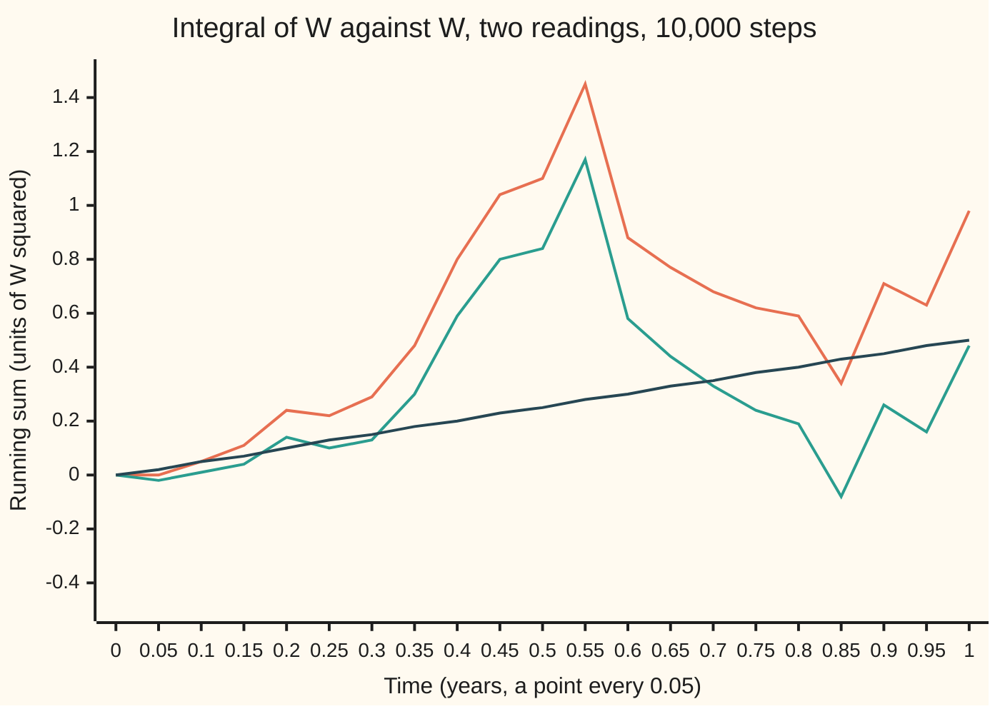

# The Stratonovich integral: the midpoint rule that keeps the ordinary chain rule

[Syllabus](../../../SYLLABUS.md) → [Stochastic processes and calculus](../README.md) → [Ito Calculus](../README.md#s06) → The Stratonovich integral

---

## General Overview

Take one year of Brownian motion $`W_t`$, the random walk seen from far away, on a path that ends at $`W_1 = 1.4`$. Hold $`W_t`$ units of it at each moment, and add up holding × move over the year. School calculus says the total is half the final square: $`1.4^2/2 = 0.98`$.

[The Ito integral](01-ito-integral.md) says 0.48. It reads the holding at the **start** of each short step, before the move, and on a Brownian path that choice costs half the elapsed time: $`(1.4^2 - 1)/2 = 0.48`$. Read the holding at the **middle** of each step instead, the average of its start and end values, and the sum comes back to 0.98, the school answer, exactly. That middle reading is the **Stratonovich integral**.

The gap, 0.98 − 0.48 = 0.5, is no accident. It is half the path's quadratic variation: the sum of its squared moves, which for one year of Brownian motion is 1 ([Quadratic variation](../05-Brownian%20Motion/03-quadratic-variation.md)). The middle value is the start value plus half the move, so each middle value × move is the start value × move plus half the squared move.

So there are two honest integrals for the same symbols. Ito's is a fair game (its average over all paths is zero) and fits trading. Stratonovich's keeps the ordinary chain rule, and it is what you get when real, slightly smooth noise is squeezed down to Brownian motion. Converting between them costs one term.

**The Stratonovich integral reads the integrand at the middle of each step; that symmetric reading cancels the second-order Taylor term, so the ordinary chain rule holds, and the result equals the Ito integral plus half the covariation.**

**What kind of fact this is:** a definition. The conversion formula and the chain rule are theorems, proved on this card in Why it works. The Wong–Zakai theorem (smoothed noise leads to the Stratonovich reading) is stated with its source; the code checks, on the share, which reading the smoothed equation lands on.

### The picture: one year on a path that ends at 1.4



One seeded path of 10,000 steps, pinned to end at 1.4 (code below). Orange: the Stratonovich (middle) sum, which is exactly $`W_t^2/2`$ at every point and ends at 0.98. Green: the Ito (start) sum, ending at 0.4769, close to its limit 0.48. Dark blue: half the running sum of squared moves, a nearly straight line at slope one half; it is the gap between the other two, at every time.

---

## The formula

Reminders from the shelf. An **Ito process** moves by a drift part and a noise part, $`dX_t = a\,dt + b\,dW_t`$, where $`dW_t`$ is shorthand for an Ito integral, never a derivative. The **covariation** $`[X,Y]_T`$ is what the products of matching small moves of $`X`$ and $`Y`$ add up to as the steps shrink ([Ito's product rule](03-ito-product-rule.md)); for two Ito processes with drifts $`a`$ and $`g`$ and noise sizes $`b`$ and $`h`$ it is $`\int_0^T b\,h\,dt`$. With $`X = Y = W`$ it is the quadratic variation, $`[W]_T = T`$.

The new mark is a small circle, $`\circ`$, read "Stratonovich". Cut $`[0, T]`$ at times $`0 = t_0 < t_1 < \dots < t_n = T`$ and write $`\Delta X_k = X_{t_{k+1}} - X_{t_k}`$ for a move over step $`k`$. For Ito processes $`X`$ and $`Y`$:

```math
\int_0^T X_t \circ dY_t = \lim_{n \to \infty} \sum_{k=0}^{n-1} \tfrac12 \left( X_{t_k} + X_{t_{k+1}} \right) \Delta Y_k
```

**Read it aloud:** the Stratonovich integral adds up the integrand's middle value, the average of its two ends, times each move of the integrator.

The limit is taken in probability as the longest step shrinks to zero. Reading $`X`$ at the middle time $`(t_k + t_{k+1})/2`$ instead of averaging the two ends gives the same limit.

Three facts carry the card. The **conversion**:

```math
\int_0^T X_t \circ dY_t = \int_0^T X_t \, dY_t + \tfrac12 [X, Y]_T
```

**Read it aloud:** the middle reading equals the start reading plus half of what the products of matching moves add up to.

The **chain rule**, for a function $`f`$ with three continuous derivatives:

```math
f(Y_T) - f(Y_0) = \int_0^T f'(Y_t) \circ dY_t
```

**Read it aloud:** a function of the process changes by its slope times the process's moves, read at the middle, with no extra term.

The **SDE conversion**: a stochastic differential equation (SDE) written in the Stratonovich reading is the Ito SDE with half of $`b\,b'`$ added to the drift:

```math
dX_t = a(X_t)\,dt + b(X_t) \circ dW_t \iff dX_t = \left( a(X_t) + \tfrac12 b(X_t)\, b'(X_t) \right) dt + b(X_t)\, dW_t
```

**Read it aloud:** to read a Stratonovich equation the Ito way, keep the noise size and add half the noise size times its own slope to the drift.

For the example, $`X = Y = W`$ and $`T = 1`$: $`\int_0^1 W\circ dW = W_1^2/2 = 0.98`$, $`\int_0^1 W\,dW = (W_1^2 - 1)/2 = 0.48`$, and the gap is $`\tfrac12 [W]_1 = 0.5`$.

| Symbol | Plain meaning | In our example | Push it up and the answer… |
| --- | --- | --- | --- |
| $`W_t`$, $`W_T`$, $`dW_t`$ | Brownian motion; its value at the horizon; its move, inside an integral | $`W_1 = 1.4`$ | both integrals of $`W`$ grow with $`W_1^2`$ |
| $`t`$, $`T`$, $`dt`$ | time in years; the horizon; a short slice of time | $`T = 1`$ | the gap $`\tfrac12 T`$ grows |
| $`t_k`$, $`k`$, $`n`$ | grid times; step number; number of steps | 4 quarter-year steps by hand; 10,000 in the code | sums settle on their limits |
| $`\Delta X_k`$, $`\Delta Y_k`$, $`D_k`$ | the move of $`X`$, of $`Y`$, of $`W`$ over step $`k`$ | moves 0.8, −0.2, 0.4, 0.4 | — |
| $`\circ`$ | the Stratonovich mark: read the integrand at the middle of each step | $`\int W \circ dW = 0.98`$ | — |
| $`X_t`$, $`Y_t`$, $`a`$, $`g`$, $`b`$, $`h`$ | Ito processes; drift sizes of $`X`$ and $`Y`$; noise sizes of $`X`$ and $`Y`$ | $`X = Y = W`$: $`a = 0`$, $`b = h = 1`$ | the gap grows with $`b\,h`$ |
| $`[X,Y]_T`$, $`[W]_T`$ | covariation; quadratic variation of $`W`$ | $`[W]_1 = 1`$; 1.0062 on the 10,000-step grid | the gap is half of it |
| $`f`$, $`f'`$, $`f''`$, $`f'''`$, $`b'`$ | a smooth function and its first three slopes; the slope of the noise size | $`f(w) = w^2/2`$; $`b' = \sigma`$ for the share | Ito's extra term grows with $`f''`$ |
| $`m_k`$, $`\delta_k`$, $`\xi`$, $`s_k`$ | in the proofs: middle value $`\tfrac12(W_{t_k} + W_{t_{k+1}})`$, half a move, a point between, the middle time of step $`k`$ | $`m_0 = 0.4`$, $`\delta_0 = 0.4`$ | — |
| $`S_t`$, $`S_0`$, $`\mu`$, $`\sigma`$ | the share price; today's price; its drift and volatility per year | $100; 0.05; 0.20 | the conversion adds $`\tfrac12\sigma^2 = 0.02`$ to the drift |
| $`U_t`$, $`V_t`$ | a point moving on a circle, in the geometry example | starts at (1, 0) | — |
| $`E`$ | the average over all paths | $`E[\int_0^1 W\circ dW] = 0.5`$ | — |

### When it holds

- **Both integrand and integrator are Ito processes** (more generally, continuous semimartingales: a fair-game part plus a drift part). The Ito integral accepts any integrand built from the past with a finite mean square; the middle reading needs the integrand to have a covariation with the integrator. For a merely adapted, very rough integrand the midpoint sums may not settle at all.
- **The use allows a peek ahead.** The middle value looks half a step into the future. A trading gain needs a holding fixed before the move; read at the middle instead, it stops being a fair game: $`E[\int_0^1 W\circ dW] = 0.5`$, not 0 (simulated 0.5018 ± 0.0050). A trading gain must be an Ito integral.
- **No jumps.** For a jumping integrator the average-of-ends sum and the conversion change, because a jump's square arrives at once; [Semimartingales](../09-Beyond%20Brownian/05-semimartingales-in-outline.md) treats integrals against jumping processes.
- **The chain rule needs a smooth $`f`$.** Three continuous derivatives make the proof below work. At a kink, such as $`f(w) = \lvert w \rvert`$, the conversion term $`[f'(W), W]`$ is set by the local time at 0 (the time the path spends near the kink, per unit of distance), not by $`\int f''\,dt`$.
- **Wong–Zakai needs one Brownian motion, or smoothing of a good kind.** With several independent Brownian motions, some smooth approximations converge to a Stratonovich equation plus an extra drift from the area swept by pairs of noises. Straight-line interpolation, used in the code, does not produce that extra drift.

---

## Why it works

### Step 0: a Taylor expansion about the middle has no second-order term

Expand a smooth $`f`$ about a point $`m`$, a distance $`\delta`$ each way. The even terms are the same on both sides, so they cancel in the difference:

```math
f(m + \delta) - f(m - \delta) = 2\delta\, f'(m) + \tfrac13 \delta^3 f'''(\xi)
```

for some point $`\xi`$ between $`m - \delta`$ and $`m + \delta`$. Over step $`k`$, write $`D_k = W_{t_{k+1}} - W_{t_k}`$ for the move of $`W`$, and take $`m_k`$ the middle value and $`\delta_k = D_k/2`$. The change of $`f`$ is the slope at the middle times the move, plus a cube. The definition averages $`f'`$ at the two ends instead of taking it at the middle value; that changes each term by another multiple of $`D_k^3`$. Ito's start-point expansion has a leftover $`\tfrac12 f''\,D_k^2`$ instead, and squared Brownian moves add up to time. Cubed moves do not: their sizes add up to at most the largest move times the sum of squares, which goes to zero. So the middle reading reproduces the ordinary chain rule path by path, and the start reading cannot.

### Step 1: the exact identity for $`W`$ against itself

Write $`W_k`$ for $`W_{t_k}`$. Two lines of algebra, with nothing random in them:

```math
\tfrac12 (W_k + W_{k+1}) D_k = \tfrac12 \left( W_{k+1}^2 - W_k^2 \right), \qquad W_k D_k = \tfrac12 \left( W_{k+1}^2 - W_k^2 \right) - \tfrac12 D_k^2
```

Add over $`k`$. The first telescopes: the middle sum is $`\tfrac12 W_T^2`$ **exactly, on every grid**, with no limit needed. The second gives the grid sum of [The Ito integral](01-ito-integral.md), $`\tfrac12 W_T^2 - \tfrac12 \sum D_k^2`$. The difference is half the sum of squared moves, which tends to $`\tfrac12 T`$ by the [Quadratic variation](../05-Brownian%20Motion/03-quadratic-variation.md) card. On the 10,000-step path the gap and half the sum of squares both print as 0.5031.

### Step 2: the conversion in general

For any two processes, the middle value is the start value plus half the move:

```math
\tfrac12 (X_{t_k} + X_{t_{k+1}})\, \Delta Y_k = X_{t_k}\, \Delta Y_k + \tfrac12\, \Delta X_k\, \Delta Y_k
```

This too is exact on every grid. Sum over $`k`$. The first sum is the grid sum of the Ito integral $`\int X\,dY`$ and converges to it. The second is half the sum of products of matching moves, which converges to $`\tfrac12 [X,Y]_T`$: that is the definition of the covariation, and [Ito's product rule](03-ito-product-rule.md) shows the sum settles for Ito processes. So the midpoint sums converge, and their limit is $`\int X\,dY + \tfrac12[X,Y]_T`$. The definition and the conversion are proved together.

<details>
<summary>Detailed proof: the middle-time reading has the same limit</summary>

Read $`X`$ at the middle time $`s_k = (t_k + t_{k+1})/2`$ instead. Split

$`\displaystyle X_{s_k} \Delta Y_k = X_{t_k} \Delta Y_k + (X_{s_k} - X_{t_k})(Y_{s_k} - Y_{t_k}) + (X_{s_k} - X_{t_k})(Y_{t_{k+1}} - Y_{s_k}).`$

**First sum.** The Ito grid sum; it converges to $`\int_0^T X\,dY`$.

**Second sum.** Products of matching moves over the first half of each step. Over the finer grid of all $`t_k`$ and $`s_k`$ these are half the terms of the covariation sum, and for Ito processes they add up to $`\int`$ of $`b\,h`$ over the first halves. The first halves fill half of every stretch of time, so in the limit that is half of $`\int_0^T b\,h\,dt`$: $`\tfrac12[X,Y]_T`$. For a $`b\,h`$ that is constant on stretches this holds up to the steps at the ends of each stretch, and any $`b\,h`$ along a path is close to such a one in total absolute difference, so no continuity is needed.

**Third sum.** The factor $`X_{s_k} - X_{t_k}`$ is known at time $`s_k`$, and $`Y_{t_{k+1}} - Y_{s_k}`$ is a later move. Its noise part is an Ito integral over $`[s_k, t_{k+1}]`$ with a known multiplier, so its terms are uncorrelated with mean zero, and the sum's mean square is at most a constant times $`\sum_k (t_{k+1} - t_k)^2`$ when the noise sizes and drifts are bounded, which goes to zero. Its drift part is bounded by $`\max_k \lvert X_{s_k} - X_{t_k} \rvert`$ times $`\int_0^T \lvert g \rvert\,dt`$, which goes to zero by continuity.

**Result.** $`\sum_k X_{s_k}\Delta Y_k \to \int_0^T X\,dY + \tfrac12 [X,Y]_T`$, the same limit as the average-of-ends reading. On the 10,000-step path the two readings give 0.9763 and 0.9800; for $`W`$ the middle-time error has mean square $`T^2/(4n)`$, which the code's tolerance uses.

</details>

### Step 3: the ordinary chain rule, from the conversion

Let $`Y`$ be an Ito process with noise size $`h`$. By [Ito's lemma](02-itos-lemma.md),

```math
f(Y_T) - f(Y_0) = \int_0^T f'(Y_t)\, dY_t + \tfrac12 \int_0^T f''(Y_t)\, h^2\, dt
```

Now $`f'(Y_t)`$ is itself an Ito process; by Ito's lemma again, its noise size is $`f''(Y_t)\,h`$. Its covariation with $`Y`$ is therefore $`\int_0^T f''(Y_t)\,h^2\,dt`$. The conversion adds half of that to the Ito integral:

```math
\int_0^T f'(Y_t) \circ dY_t = \int_0^T f'(Y_t)\, dY_t + \tfrac12 \int_0^T f''(Y_t)\, h^2\, dt = f(Y_T) - f(Y_0)
```

The second-derivative term of Ito's lemma is exactly half the covariation, so the middle reading swallows it. The same bookkeeping turns Ito's product rule into the school one: $`d(XY) = X\circ dY + Y\circ dX`$, because the two conversions add $`\tfrac12[X,Y]`$ each and Ito's rule needed one whole $`[X,Y]`$.

### Step 4: turning a Stratonovich equation into an Ito equation

Take $`dX_t = a(X_t)\,dt + b(X_t)\circ dW_t`$. The noise term is a Stratonovich integral of $`b(X_t)`$ against $`W`$. By the conversion it is the Ito integral plus $`\tfrac12 [b(X), W]_t`$. By Ito's lemma, $`b(X_t)`$ has noise size $`b'(X_t)\,b(X_t)`$, so that covariation is $`\int_0^t b'(X_s)\,b(X_s)\,ds`$. Half of it moves into the drift. That is the SDE conversion.

**The share.** [Stochastic differential equations](04-stochastic-differential-equations.md) noted that reading the share's rule at the middle gives a different share. Take $`dS_t = 0.05\,S_t\,dt + 0.20\,S_t\circ dW_t`$. The noise size is $`b(x) = 0.2x`$ with slope $`b' = 0.2`$, so the Ito drift gains $`\tfrac12 \times 0.2 \times 0.2\,S_t = 0.02\,S_t`$: the Ito form has drift 0.07. In the Stratonovich reading the ordinary chain rule solves it at once. Divide by $`S_t`$: $`d(\log S_t) = 0.05\,dt + 0.2\circ dW_t`$, so

```math
S_t = S_0\, e^{0.05 t + 0.2 W_t}
```

On the path ending at $`W_1 = 1.4`$ that is $`100\,e^{0.33}`$ = $139.10. The Ito reading of the same symbols gives $`100\,e^{0.03 + 0.28}`$ = $136.34. In the code, the middle share value times each step's $`0.05\,(t_{k+1} - t_k) + 0.2\,D_k`$, added along the path, gives 39.0969, matching $`S_1 - S_0 = 39.0968`$ with no correction term. The same sum with the start share value gives 36.5813, and needs $`\tfrac12\sigma^2\int_0^1 S_t\,dt`$ = 2.5002 added back. Together they make 39.0816; the rest of the way to 39.0968 is mainly there because this grid's squared moves add to 1.0062, not 1.

### Step 5: why physics calls for it (Wong–Zakai)

Real noise is never quite Brownian. A molecule's push lasts a short time; a voltage fluctuation has a short memory. Over that short time the noise is smooth, and the system obeys an ordinary differential equation, $`dX/dt = a(X) + b(X)\,\times`$ (smooth noise). Ordinary calculus applies to it, chain rule and all.

The **Wong–Zakai theorem** (1965) says: replace $`W`$ by smooth approximations that converge to it, such as straight lines between its values on finer and finer grids. The solutions of the ordinary equations then converge to the solution of the **Stratonovich** SDE, not the Ito one. The reason is Step 0: every approximation obeys the ordinary chain rule, the limit keeps it, and of the two readings only Stratonovich's has it. So a physicist who models fast, slightly smooth noise as white noise should write the equation in the Stratonovich reading, and convert before using Ito tools.

The code checks this on the share. Join the path's values every 0.01 year by straight lines, so the slope is constant on each piece. Solve $`dS/dt = S\,(0.05 + 0.2 \times \text{slope})`$ by the Runge–Kutta method (a standard step-by-step solver for ordinary equations). It lands on $139.0968, the Stratonovich solution, and nowhere near the Ito one, $136.3425. For this linear equation the landing is exact on every grid, even one straight line from 0 to 1.4: the ordinary equation's solution is $`100\,e^{0.05t + 0.2 \times (\text{straight-line path})}`$, the ordinary chain rule applied to the joined-up path. So the check shows which reading the limit picks, not how fast the approximations converge.

### Step 6: why geometry calls for it

A change of coordinates is a smooth function, and the Stratonovich reading changes coordinates by the ordinary chain rule. So a Stratonovich SDE means the same thing in every coordinate system, and a constraint the coefficients respect is respected by the solution.

**A point on a circle.** Let a point $`(U_t, V_t)`$ start at (1, 0) and be turned by the noise: $`dU = -V\circ dW`$, $`dV = U\circ dW`$. Each kick is at right angles to the radius. By the ordinary chain rule, $`d(U^2 + V^2) = 2U\circ dU + 2V\circ dV = 0`$, so the point stays on the circle: it is $`(\cos W_t, \sin W_t)`$. Read the same symbols the Ito way and Ito's lemma adds the squared kicks, $`d(U^2 + V^2) = (U^2 + V^2)\,dt`$: the squared radius grows to $`e^t`$, 2.7183 after a year. The point flies off the circle.

This is why SDEs on curved spaces (Brownian motion on a sphere, the noisy spin of a rigid body) are written in the Stratonovich reading. This card names that use only.

---

## Worked numbers, by hand

A path cut into four quarter-year steps, with values $`W`$ = 0, 0.8, 0.6, 1.0, 1.4 at $`t`$ = 0, 0.25, 0.5, 0.75, 1. Its moves are 0.8, −0.2, 0.4, 0.4.

| Step | Arithmetic | Value |
| --- | --- | --- |
| Ito sum: start value times move | 0 × 0.8 + 0.8 × (−0.2) + 0.6 × 0.4 + 1.0 × 0.4 = 0 − 0.16 + 0.24 + 0.40 | 0.48 |
| middle values | (0 + 0.8)/2, (0.8 + 0.6)/2, (0.6 + 1.0)/2, (1.0 + 1.4)/2 | 0.4, 0.7, 0.8, 1.2 |
| Stratonovich sum: middle value times move | 0.4 × 0.8 + 0.7 × (−0.2) + 0.8 × 0.4 + 1.2 × 0.4 = 0.32 − 0.14 + 0.32 + 0.48 | 0.98 |
| school calculus | $`1.4^2/2`$ | 0.98 |
| sum of squared moves | 0.64 + 0.04 + 0.16 + 0.16 | 1.00 |
| gap, Stratonovich minus Ito | 0.98 − 0.48, and half of 1.00 | **0.50** |

The middle reading gives the school answer on this coarse grid already, because Step 1's sum telescopes. The Ito sum lands on its limit only because this path's squared moves happen to add to exactly 1. On the 10,000-step path they add to 1.0062, and the Ito sum is 0.4769 against the limit 0.4800, while the Stratonovich sum stays at 0.9800.

### What breaks if you drop a piece

| Mistake | Comes out at | What went wrong |
| --- | --- | --- |
| School chain rule for an Ito integral, $`\int W\,dW = W_1^2/2`$ | 0.98 instead of 0.48 | the school rule belongs to the middle reading |
| Adding the whole covariation instead of half (the end-point sum) | 1.48 by hand; 1.4831 on the 10,000-step path | the end value uses the whole move it multiplies |
| A Stratonovich share stepped by Euler's start-point rule, drift left at 0.05 | average $105.04 ± 0.15 (exact on the grid 105.13) instead of 107.25 | Euler's rule reads the Ito way; the drift needed the extra 0.02 |
| Treating the Stratonovich integral as a fair game | average 0.5018 ± 0.0050, not 0 | the middle value peeks half a step ahead |
| Ito reading of the turning point, $`dU = -V\,dW`$, $`dV = U\,dW`$ | squared radius 2.7096 ± 0.0027 on the grid (exact 2.7048; e = 2.7183 in the limit), not 1 | the squared kicks push the point outwards |

The code prints all five.

---

## Code, from first principles, and it actually runs

Four roads. The four-step path, in whole tenths, checks the exact grid identities with integers. One seeded path of 10,000 steps, pinned to end at 1.4 (a Brownian bridge), compares the average-of-ends, middle-time and start-point sums, and checks the chain rule on the share. An ordinary differential equation solved along straight-line pieces of that path checks which reading Wong–Zakai picks. Then 20,000 seeded paths of 100 steps give averages with standard errors (the typical size of the chance error in a simulated average): the two integrals of $`W`$, the share by Heun's method (a predict-then-average step that converges to the Stratonovich solution), by Euler's method with and without the conversion, and the point on the circle both ways. The random numbers come from SplitMix64 and Box–Muller, written out.

### Python

```python
# The Stratonovich integral -- the check behind the card.  Only math is imported.
# W is Brownian motion, t in years.  The Stratonovich sum reads the integrand at
# the middle of each step; the Ito sum reads it at the start.  Roads: a 4-step
# path in whole tenths, exactly; one seeded path pinned to end at W_1 = 1.4;
# an ordinary differential equation along a smoothed path (Wong-Zakai); and
# 20000 seeded paths for averages.  Floats are added in plain loops, not sum().
from math import log, cos, pi, sqrt, exp
MASK = (1 << 64) - 1
MU, SIG, S0 = 0.05, 0.20, 100.0                          # the share, read the Stratonovich way

class SplitMix64:
    def __init__(self, seed): self.s = seed
    def next(self):
        self.s = (self.s + 0x9E3779B97F4A7C15) & MASK
        z = self.s
        z = ((z ^ (z >> 30)) * 0xBF58476D1CE4E5B9) & MASK
        z = ((z ^ (z >> 27)) * 0x94D049BB133111EB) & MASK
        return z ^ (z >> 31)
    def uniform(self): return ((self.next() >> 11) + 0.5) * 2.0 ** -53
    def normal(self):                                    # Box-Muller, cosine branch only
        u, v = self.uniform(), self.uniform()
        return sqrt(-2.0 * log(u)) * cos(2.0 * pi * v)

def mean_se(s, s2, m):                                   # sample mean and its standard error
    a = s / m
    return a, sqrt((s2 / m - a * a) * m / (m - 1) / m)

# Road 1: four quarter-year steps, W in whole tenths, so every sum is an exact integer
w = [0, 8, 6, 10, 14]
left = right = mid2 = qv = 0
for k in range(4):
    d = w[k + 1] - w[k]
    left += w[k] * d; right += w[k + 1] * d; mid2 += (w[k] + w[k + 1]) * d; qv += d * d
    print(f"hand, step {k + 1}: W {w[k] / 10:.1f} to {w[k + 1] / 10:.1f}, move {d / 10:.1f}, half-move {d / 20:.1f}, "
          f"middle {(w[k] + w[k + 1]) / 20:.1f}, start x move {w[k] * d / 100:.2f}, "
          f"middle x move {(w[k] + w[k + 1]) * d / 200:.2f}, move squared {d * d / 100:.2f}")
assert mid2 == w[4] * w[4]                               # midpoint sum telescopes to W^2/2
assert 2 * left == w[4] * w[4] - qv                      # left sum = W^2/2 - (sum of squares)/2
assert right - left == qv
print(f"hand, totals: Ito (start) {left / 100:.2f}, Stratonovich (middle) {mid2 / 200:.2f}, "
      f"end-point {right / 100:.2f}, sum of squares {qv / 100:.2f}, gap {(mid2 - 2 * left) / 200:.2f}")

# Road 2: one seeded path of 20000 half-steps, pinned to end at 1.4 (a Brownian bridge)
rng = SplitMix64(20261123)
N, END = 10000, 1.4
f = [0.0]
for j in range(2 * N): f.append(f[-1] + sqrt(1.0 / (2 * N)) * rng.normal())
last = f[2 * N]
f = [f[j] - j / (2 * N) * (last - END) for j in range(2 * N + 1)]
lsum = tsum = msum = q = sd = sl = sint = 0.0
chart = [[0.0], [0.0], [0.0]]
for k in range(N):
    a, m, b = f[2 * k], f[2 * k + 1], f[2 * k + 2]
    d, dt = b - a, 1.0 / N
    lsum += a * d; tsum += 0.5 * (a + b) * d; msum += m * d; q += d * d
    sa, sb = S0 * exp(MU * k * dt + SIG * a), S0 * exp(MU * (k + 1) * dt + SIG * b)
    sd += 0.5 * (sa + sb) * (MU * dt + SIG * d)          # Stratonovich sum for dS
    sl += sa * (MU * dt + SIG * d); sint += sa * dt      # Ito-reading sum, and int S dt
    if (k + 1) % 500 == 0:
        chart[0].append(tsum); chart[1].append(lsum); chart[2].append(0.5 * q)
assert abs(tsum - END * END / 2) < 1e-9
assert abs(msum - END * END / 2) < 4 * sqrt(1.0 / (4 * N))
assert abs(lsum - (END * END - 1) / 2) < 4 * sqrt(2.0 / N) / 2
assert abs(q - 1.0) < 4 * sqrt(2.0 / N)
print(f"path, {N} steps, W_1 = {f[2 * N]:.4f}: sum of squares {q:.4f} (limit 1)")
print(f"path, Stratonovich, average of ends: {tsum:.4f}; at the middle time: {msum:.4f}; W^2/2 = {END * END / 2:.4f}")
print(f"path, Ito (start): {lsum:.4f}; (W^2 - 1)/2 = {(END * END - 1) / 2:.4f}; end-point sum {tsum + 0.5 * q:.4f}")
print(f"path, gap Stratonovich - Ito {tsum - lsum:.4f}, half the sum of squares {0.5 * q:.4f}")
for i, name in enumerate(("Stratonovich sum", "Ito sum", "half the squares")):
    print(f"chart, {name}: " + ", ".join(f"{v:.2f}" for v in chart[i]))
s1 = S0 * exp(MU + SIG * END)
assert abs(sd - (s1 - S0)) < 0.01                        # ordinary chain rule, path by path
assert abs((s1 - S0) - sl - 0.5 * SIG * SIG * sint) < 0.1  # Ito reading needs the half sigma^2 term
print(f"share, S_1 = 100 exp(0.05 + 0.2 W_1) = {s1:.4f}; Stratonovich sum of dS {sd:.4f}; Ito-reading sum {sl:.4f}")
print(f"share, half sigma^2 x int S dt = {0.5 * SIG * SIG * sint:.4f}; Ito-reading sum plus it {sl + 0.5 * SIG * SIG * sint:.4f}")

# Road 3: Wong-Zakai. Join the path's values every 0.01 year by straight lines and
# solve the ordinary equation dS/dt = S (0.05 + 0.2 x slope) by Runge-Kutta.
x = S0
for k in range(100):
    slope = (f[200 * (k + 1)] - f[200 * k]) / 0.01
    h = 0.01 / 20
    for _ in range(20):
        g = lambda s: s * (MU + SIG * slope)
        k1 = g(x); k2 = g(x + h / 2 * k1); k3 = g(x + h / 2 * k2); k4 = g(x + h * k3)
        x += h / 6 * (k1 + 2 * k2 + 2 * k3 + k4)
ito_sol = S0 * exp(MU - SIG * SIG / 2 + SIG * END)
assert abs(x - s1) < 1e-6 * s1 and abs(x - ito_sol) > 2.0
print(f"smoothed path, ordinary equation: S_1 = {x:.4f}; Stratonovich solution {s1:.4f}; Ito solution {ito_sol:.4f}")

# Road 4: 20000 seeded paths of 100 steps: averages
M, n = 20000, 100
dt = 1.0 / n
acc = [[0.0, 0.0] for _ in range(6)]
worst = 0.0
for _ in range(M):
    wv = lf = 0.0
    heun = eul7 = eul5 = S0
    cx, cy, r2 = 1.0, 0.0, 1.0
    for k in range(n):
        d = sqrt(dt) * rng.normal()
        lf += wv * d; wv += d
        p = heun + heun * (MU * dt + SIG * d)            # Heun: predict, then average the ends
        heun += 0.5 * (heun + p) * (MU * dt + SIG * d)
        eul7 += eul7 * ((MU + SIG * SIG / 2) * dt + SIG * d)   # converted to Ito, Euler step
        eul5 += eul5 * (MU * dt + SIG * d)               # NOT converted: the mistake
        r2 *= 1.0 + d * d                                # Ito rotation dX = -Y dW, dY = X dW, Euler
        c = d / 2
        cx, cy = (cx * (1 - c * c) - 2 * c * cy) / (1 + c * c), (cy * (1 - c * c) + 2 * c * cx) / (1 + c * c)
    worst = max(worst, abs(cx * cx + cy * cy - 1.0))
    for a, v in zip(acc, (wv * wv / 2, lf, heun, eul7, eul5, r2)):
        a[0] += v; a[1] += v * v
names = ("Stratonovich int W dW", "Ito int W dW", "share, Heun (Stratonovich)",
         "share, Euler with drift 0.07", "share, Euler with drift 0.05", "Ito rotation, radius squared")
exact = (0.5, 0.0, S0 * (1 + MU * dt + 0.5 * (MU * MU * dt * dt + SIG * SIG * dt)) ** n, S0 * (1 + (MU + SIG * SIG / 2) * dt) ** n,
         S0 * (1 + MU * dt) ** n, (1 + dt) ** n)
print(f"averages, {M} paths, {n} steps, seed 20261123")
for i in range(6):
    m, se = mean_se(acc[i][0], acc[i][1], M)
    assert abs(m - exact[i]) < 4 * se
    print(f"averages, {names[i]}: {m:.4f} +/- {se:.4f} (exact {exact[i]:.4f})")
assert worst < 1e-12
print(f"averages, Stratonovich rotation: radius squared within 1e-12 of 1 on every path; Ito limit e = {exp(1.0):.4f}")
print(f"share, no grid: Stratonovich mean 100 e^0.07 = {S0 * exp(MU + SIG * SIG / 2):.2f}, median 100 e^0.05 = {S0 * exp(MU):.2f}; "
      f"Ito median 100 e^0.03 = {S0 * exp(MU - SIG * SIG / 2):.2f}")
print("ALL CHECKS PASS")
```

**Ran 2026-11-23 on macOS, Python 3.14.10, standard library only. All checks passed. Output, pasted from the run:**

```
hand, step 1: W 0.0 to 0.8, move 0.8, half-move 0.4, middle 0.4, start x move 0.00, middle x move 0.32, move squared 0.64
hand, step 2: W 0.8 to 0.6, move -0.2, half-move -0.1, middle 0.7, start x move -0.16, middle x move -0.14, move squared 0.04
hand, step 3: W 0.6 to 1.0, move 0.4, half-move 0.2, middle 0.8, start x move 0.24, middle x move 0.32, move squared 0.16
hand, step 4: W 1.0 to 1.4, move 0.4, half-move 0.2, middle 1.2, start x move 0.40, middle x move 0.48, move squared 0.16
hand, totals: Ito (start) 0.48, Stratonovich (middle) 0.98, end-point 1.48, sum of squares 1.00, gap 0.50
path, 10000 steps, W_1 = 1.4000: sum of squares 1.0062 (limit 1)
path, Stratonovich, average of ends: 0.9800; at the middle time: 0.9763; W^2/2 = 0.9800
path, Ito (start): 0.4769; (W^2 - 1)/2 = 0.4800; end-point sum 1.4831
path, gap Stratonovich - Ito 0.5031, half the sum of squares 0.5031
chart, Stratonovich sum: 0.00, 0.00, 0.05, 0.11, 0.24, 0.22, 0.29, 0.48, 0.80, 1.04, 1.10, 1.45, 0.88, 0.77, 0.68, 0.62, 0.59, 0.34, 0.71, 0.63, 0.98
chart, Ito sum: 0.00, -0.02, 0.01, 0.04, 0.14, 0.10, 0.13, 0.30, 0.59, 0.80, 0.84, 1.17, 0.58, 0.44, 0.33, 0.24, 0.19, -0.08, 0.26, 0.16, 0.48
chart, half the squares: 0.00, 0.02, 0.05, 0.07, 0.10, 0.13, 0.15, 0.18, 0.20, 0.23, 0.25, 0.28, 0.30, 0.33, 0.35, 0.38, 0.40, 0.43, 0.45, 0.48, 0.50
share, S_1 = 100 exp(0.05 + 0.2 W_1) = 139.0968; Stratonovich sum of dS 39.0969; Ito-reading sum 36.5813
share, half sigma^2 x int S dt = 2.5002; Ito-reading sum plus it 39.0816
smoothed path, ordinary equation: S_1 = 139.0968; Stratonovich solution 139.0968; Ito solution 136.3425
averages, 20000 paths, 100 steps, seed 20261123
averages, Stratonovich int W dW: 0.5018 +/- 0.0050 (exact 0.5000)
averages, Ito int W dW: 0.0009 +/- 0.0050 (exact 0.0000)
averages, share, Heun (Stratonovich): 107.1617 +/- 0.1532 (exact 107.2495)
averages, share, Euler with drift 0.07: 107.1568 +/- 0.1531 (exact 107.2482)
averages, share, Euler with drift 0.05: 105.0362 +/- 0.1501 (exact 105.1258)
averages, Ito rotation, radius squared: 2.7096 +/- 0.0027 (exact 2.7048)
averages, Stratonovich rotation: radius squared within 1e-12 of 1 on every path; Ito limit e = 2.7183
share, no grid: Stratonovich mean 100 e^0.07 = 107.25, median 100 e^0.05 = 105.13; Ito median 100 e^0.03 = 103.05
ALL CHECKS PASS
```

### Rust

Same numbers, same labels, built with `rustc --edition 2021 -O`.

```rust
// The Stratonovich integral -- the same check as the Python, in Rust.  No crates.
// W is Brownian motion, t in years.  The Stratonovich sum reads the integrand at
// the middle of each step; the Ito sum reads it at the start.  Roads: a 4-step
// path in whole tenths, exactly; one seeded path pinned to end at W_1 = 1.4;
// an ordinary differential equation along a smoothed path (Wong-Zakai); and
// 20000 seeded paths for averages.
const MU: f64 = 0.05;
const SIG: f64 = 0.20;
const S0: f64 = 100.0; // the share, read the Stratonovich way

struct SplitMix64 { s: u64 }
impl SplitMix64 {
    fn next(&mut self) -> u64 {
        self.s = self.s.wrapping_add(0x9E3779B97F4A7C15);
        let mut z = self.s;
        z = (z ^ (z >> 30)).wrapping_mul(0xBF58476D1CE4E5B9);
        z = (z ^ (z >> 27)).wrapping_mul(0x94D049BB133111EB);
        z ^ (z >> 31)
    }
    fn uniform(&mut self) -> f64 { ((self.next() >> 11) as f64 + 0.5) * 2f64.powi(-53) }
    fn normal(&mut self) -> f64 { // Box-Muller, cosine branch only
        let u = self.uniform();
        let v = self.uniform();
        (-2.0 * u.ln()).sqrt() * (2.0 * std::f64::consts::PI * v).cos()
    }
}

fn mean_se(s: f64, s2: f64, m: f64) -> (f64, f64) { // sample mean and its standard error
    let a = s / m;
    (a, ((s2 / m - a * a) * m / (m - 1.0) / m).sqrt())
}

fn join(v: &[f64]) -> String { v.iter().map(|x| format!("{:.2}", x)).collect::<Vec<_>>().join(", ") }

fn main() {
    // Road 1: four quarter-year steps, W in whole tenths, so every sum is an exact integer
    let w: [i64; 5] = [0, 8, 6, 10, 14];
    let (mut left, mut right, mut mid2, mut qv) = (0i64, 0i64, 0i64, 0i64);
    for k in 0..4 {
        let d = w[k + 1] - w[k];
        left += w[k] * d; right += w[k + 1] * d; mid2 += (w[k] + w[k + 1]) * d; qv += d * d;
        println!("hand, step {}: W {:.1} to {:.1}, move {:.1}, half-move {:.1}, middle {:.1}, start x move {:.2}, middle x move {:.2}, move squared {:.2}",
            k + 1, w[k] as f64 / 10.0, w[k + 1] as f64 / 10.0, d as f64 / 10.0, d as f64 / 20.0, (w[k] + w[k + 1]) as f64 / 20.0,
            (w[k] * d) as f64 / 100.0, ((w[k] + w[k + 1]) * d) as f64 / 200.0, (d * d) as f64 / 100.0);
    }
    assert!(mid2 == w[4] * w[4]); // midpoint sum telescopes to W^2/2
    assert!(2 * left == w[4] * w[4] - qv); // left sum = W^2/2 - (sum of squares)/2
    assert!(right - left == qv);
    println!("hand, totals: Ito (start) {:.2}, Stratonovich (middle) {:.2}, end-point {:.2}, sum of squares {:.2}, gap {:.2}",
        left as f64 / 100.0, mid2 as f64 / 200.0, right as f64 / 100.0, qv as f64 / 100.0, (mid2 - 2 * left) as f64 / 200.0);

    // Road 2: one seeded path of 20000 half-steps, pinned to end at 1.4 (a Brownian bridge)
    let mut rng = SplitMix64 { s: 20261123 };
    let n_big: usize = 10000;
    let end = 1.4;
    let mut f = vec![0.0f64];
    for _ in 0..2 * n_big { let x = f[f.len() - 1] + (1.0 / (2 * n_big) as f64).sqrt() * rng.normal(); f.push(x); }
    let last = f[2 * n_big];
    for j in 0..=2 * n_big { f[j] = f[j] - j as f64 / (2 * n_big) as f64 * (last - end); }
    let (mut lsum, mut tsum, mut msum, mut q, mut sd, mut sl, mut sint) = (0.0f64, 0.0f64, 0.0f64, 0.0f64, 0.0f64, 0.0f64, 0.0f64);
    let mut chart: Vec<Vec<f64>> = vec![vec![0.0], vec![0.0], vec![0.0]];
    for k in 0..n_big {
        let (a, m, b) = (f[2 * k], f[2 * k + 1], f[2 * k + 2]);
        let (d, dt) = (b - a, 1.0 / n_big as f64);
        lsum += a * d; tsum += 0.5 * (a + b) * d; msum += m * d; q += d * d;
        let sa = S0 * (MU * k as f64 * dt + SIG * a).exp();
        let sb = S0 * (MU * (k + 1) as f64 * dt + SIG * b).exp();
        sd += 0.5 * (sa + sb) * (MU * dt + SIG * d); // Stratonovich sum for dS
        sl += sa * (MU * dt + SIG * d); sint += sa * dt; // Ito-reading sum, and int S dt
        if (k + 1) % 500 == 0 { chart[0].push(tsum); chart[1].push(lsum); chart[2].push(0.5 * q); }
    }
    let nf = n_big as f64;
    assert!((tsum - end * end / 2.0).abs() < 1e-9);
    assert!((msum - end * end / 2.0).abs() < 4.0 * (1.0 / (4.0 * nf)).sqrt());
    assert!((lsum - (end * end - 1.0) / 2.0).abs() < 4.0 * (2.0 / nf).sqrt() / 2.0);
    assert!((q - 1.0).abs() < 4.0 * (2.0 / nf).sqrt());
    println!("path, {} steps, W_1 = {:.4}: sum of squares {:.4} (limit 1)", n_big, f[2 * n_big], q);
    println!("path, Stratonovich, average of ends: {:.4}; at the middle time: {:.4}; W^2/2 = {:.4}", tsum, msum, end * end / 2.0);
    println!("path, Ito (start): {:.4}; (W^2 - 1)/2 = {:.4}; end-point sum {:.4}", lsum, (end * end - 1.0) / 2.0, tsum + 0.5 * q);
    println!("path, gap Stratonovich - Ito {:.4}, half the sum of squares {:.4}", tsum - lsum, 0.5 * q);
    for (i, name) in ["Stratonovich sum", "Ito sum", "half the squares"].iter().enumerate() {
        println!("chart, {}: {}", name, join(&chart[i]));
    }
    let s1 = S0 * (MU + SIG * end).exp();
    assert!((sd - (s1 - S0)).abs() < 0.01); // ordinary chain rule, path by path
    assert!(((s1 - S0) - sl - 0.5 * SIG * SIG * sint).abs() < 0.1); // Ito reading needs the half sigma^2 term
    println!("share, S_1 = 100 exp(0.05 + 0.2 W_1) = {:.4}; Stratonovich sum of dS {:.4}; Ito-reading sum {:.4}", s1, sd, sl);
    println!("share, half sigma^2 x int S dt = {:.4}; Ito-reading sum plus it {:.4}", 0.5 * SIG * SIG * sint, sl + 0.5 * SIG * SIG * sint);

    // Road 3: Wong-Zakai. Join the path's values every 0.01 year by straight lines and
    // solve the ordinary equation dS/dt = S (0.05 + 0.2 x slope) by Runge-Kutta.
    let mut x = S0;
    for k in 0..100 {
        let slope = (f[200 * (k + 1)] - f[200 * k]) / 0.01;
        let h = 0.01 / 20.0;
        let g = |s: f64| s * (MU + SIG * slope);
        for _ in 0..20 {
            let k1 = g(x);
            let k2 = g(x + h / 2.0 * k1);
            let k3 = g(x + h / 2.0 * k2);
            let k4 = g(x + h * k3);
            x += h / 6.0 * (k1 + 2.0 * k2 + 2.0 * k3 + k4);
        }
    }
    let ito_sol = S0 * (MU - SIG * SIG / 2.0 + SIG * end).exp();
    assert!((x - s1).abs() < 1e-6 * s1 && (x - ito_sol).abs() > 2.0);
    println!("smoothed path, ordinary equation: S_1 = {:.4}; Stratonovich solution {:.4}; Ito solution {:.4}", x, s1, ito_sol);

    // Road 4: 20000 seeded paths of 100 steps: averages
    let (m_paths, n) = (20000usize, 100usize);
    let dt = 1.0 / n as f64;
    let mut acc = [[0.0f64; 2]; 6];
    let mut worst = 0.0f64;
    for _ in 0..m_paths {
        let (mut wv, mut lf) = (0.0f64, 0.0f64);
        let (mut heun, mut eul7, mut eul5) = (S0, S0, S0);
        let (mut cx, mut cy, mut r2) = (1.0f64, 0.0f64, 1.0f64);
        for _ in 0..n {
            let d = dt.sqrt() * rng.normal();
            lf += wv * d; wv += d;
            let p = heun + heun * (MU * dt + SIG * d); // Heun: predict, then average the ends
            heun += 0.5 * (heun + p) * (MU * dt + SIG * d);
            eul7 += eul7 * ((MU + SIG * SIG / 2.0) * dt + SIG * d); // converted to Ito, Euler step
            eul5 += eul5 * (MU * dt + SIG * d); // NOT converted: the mistake
            r2 *= 1.0 + d * d; // Ito rotation dX = -Y dW, dY = X dW, Euler
            let c = d / 2.0;
            let nx = (cx * (1.0 - c * c) - 2.0 * c * cy) / (1.0 + c * c);
            let ny = (cy * (1.0 - c * c) + 2.0 * c * cx) / (1.0 + c * c);
            cx = nx; cy = ny;
        }
        worst = worst.max((cx * cx + cy * cy - 1.0).abs());
        for (a, v) in acc.iter_mut().zip([wv * wv / 2.0, lf, heun, eul7, eul5, r2]) { a[0] += v; a[1] += v * v; }
    }
    let names = ["Stratonovich int W dW", "Ito int W dW", "share, Heun (Stratonovich)",
        "share, Euler with drift 0.07", "share, Euler with drift 0.05", "Ito rotation, radius squared"];
    let nn = n as f64;
    let exact = [0.5, 0.0, S0 * (1.0 + MU * dt + 0.5 * (MU * MU * dt * dt + SIG * SIG * dt)).powf(nn),
        S0 * (1.0 + (MU + SIG * SIG / 2.0) * dt).powf(nn), S0 * (1.0 + MU * dt).powf(nn), (1.0 + dt).powf(nn)];
    println!("averages, {} paths, {} steps, seed 20261123", m_paths, n);
    for i in 0..6 {
        let (m, se) = mean_se(acc[i][0], acc[i][1], m_paths as f64);
        assert!((m - exact[i]).abs() < 4.0 * se);
        println!("averages, {}: {:.4} +/- {:.4} (exact {:.4})", names[i], m, se, exact[i]);
    }
    assert!(worst < 1e-12);
    println!("averages, Stratonovich rotation: radius squared within 1e-12 of 1 on every path; Ito limit e = {:.4}", 1f64.exp());
    println!("share, no grid: Stratonovich mean 100 e^0.07 = {:.2}, median 100 e^0.05 = {:.2}; Ito median 100 e^0.03 = {:.2}",
        S0 * (MU + SIG * SIG / 2.0).exp(), S0 * MU.exp(), S0 * (MU - SIG * SIG / 2.0).exp());
    println!("ALL CHECKS PASS");
}
```

**Ran 2026-11-23 on macOS, rustc 1.98.1, no crates. All checks passed. Output, pasted from the run:**

```
hand, step 1: W 0.0 to 0.8, move 0.8, half-move 0.4, middle 0.4, start x move 0.00, middle x move 0.32, move squared 0.64
hand, step 2: W 0.8 to 0.6, move -0.2, half-move -0.1, middle 0.7, start x move -0.16, middle x move -0.14, move squared 0.04
hand, step 3: W 0.6 to 1.0, move 0.4, half-move 0.2, middle 0.8, start x move 0.24, middle x move 0.32, move squared 0.16
hand, step 4: W 1.0 to 1.4, move 0.4, half-move 0.2, middle 1.2, start x move 0.40, middle x move 0.48, move squared 0.16
hand, totals: Ito (start) 0.48, Stratonovich (middle) 0.98, end-point 1.48, sum of squares 1.00, gap 0.50
path, 10000 steps, W_1 = 1.4000: sum of squares 1.0062 (limit 1)
path, Stratonovich, average of ends: 0.9800; at the middle time: 0.9763; W^2/2 = 0.9800
path, Ito (start): 0.4769; (W^2 - 1)/2 = 0.4800; end-point sum 1.4831
path, gap Stratonovich - Ito 0.5031, half the sum of squares 0.5031
chart, Stratonovich sum: 0.00, 0.00, 0.05, 0.11, 0.24, 0.22, 0.29, 0.48, 0.80, 1.04, 1.10, 1.45, 0.88, 0.77, 0.68, 0.62, 0.59, 0.34, 0.71, 0.63, 0.98
chart, Ito sum: 0.00, -0.02, 0.01, 0.04, 0.14, 0.10, 0.13, 0.30, 0.59, 0.80, 0.84, 1.17, 0.58, 0.44, 0.33, 0.24, 0.19, -0.08, 0.26, 0.16, 0.48
chart, half the squares: 0.00, 0.02, 0.05, 0.07, 0.10, 0.13, 0.15, 0.18, 0.20, 0.23, 0.25, 0.28, 0.30, 0.33, 0.35, 0.38, 0.40, 0.43, 0.45, 0.48, 0.50
share, S_1 = 100 exp(0.05 + 0.2 W_1) = 139.0968; Stratonovich sum of dS 39.0969; Ito-reading sum 36.5813
share, half sigma^2 x int S dt = 2.5002; Ito-reading sum plus it 39.0816
smoothed path, ordinary equation: S_1 = 139.0968; Stratonovich solution 139.0968; Ito solution 136.3425
averages, 20000 paths, 100 steps, seed 20261123
averages, Stratonovich int W dW: 0.5018 +/- 0.0050 (exact 0.5000)
averages, Ito int W dW: 0.0009 +/- 0.0050 (exact 0.0000)
averages, share, Heun (Stratonovich): 107.1617 +/- 0.1532 (exact 107.2495)
averages, share, Euler with drift 0.07: 107.1568 +/- 0.1531 (exact 107.2482)
averages, share, Euler with drift 0.05: 105.0362 +/- 0.1501 (exact 105.1258)
averages, Ito rotation, radius squared: 2.7096 +/- 0.0027 (exact 2.7048)
averages, Stratonovich rotation: radius squared within 1e-12 of 1 on every path; Ito limit e = 2.7183
share, no grid: Stratonovich mean 100 e^0.07 = 107.25, median 100 e^0.05 = 105.13; Ito median 100 e^0.03 = 103.05
ALL CHECKS PASS
```

### Lean

Lean proves the exact grid identities behind Steps 1 and 2, for every path and every grid, and the card's worked numbers.

- Take any two processes $`X`$ and $`Y`$, read at the grid times. Then the middle sum equals the start sum plus half the sum of products of matching moves, as in Step 2.
- Take any path of $`W`$ on any grid. Then the middle sum of $`W`$ against itself is exactly $`\tfrac12 (W_n^2 - W_0^2)`$.
- Take the same path. Then the start sum is $`\tfrac12 (W_n^2 - W_0^2)`$ minus half the sum of squared moves.
- Take the four-step path 0, 0.8, 0.6, 1.0, 1.4. Then the Ito sum is 0.48, the Stratonovich sum 0.98, and the end-point sum 1.48.
- Take the same four-step path. Then the squared moves add to 1.00, and the gap of 0.50 is half of that.

The limits, the chain rule, the share, Wong–Zakai and the averages over many paths are left to the Python and Rust checks.

```lean
-- The Stratonovich integral: on every grid, the midpoint sum equals the start-point (Ito) sum plus half the sum of products of matching moves, and for W against itself it telescopes to half the change of W squared.
import Mathlib.Algebra.BigOperators.Group.Finset.Basic
import Mathlib.Data.Real.Basic
import Mathlib.Tactic.NormNum
import Mathlib.Tactic.Ring

open Finset

/-- The conversion, exact on every grid: for any values `X k`, `Y k` of two processes at the grid
times `t_0 < t_1 < ... < t_n`, the Stratonovich (average-of-ends) sum
`∑ ½ (X_k + X_{k+1}) ΔY_k` equals the Ito (start-point) sum `∑ X_k ΔY_k` plus half the sum of
products of matching moves `½ ∑ ΔX_k ΔY_k`, whose limit is half the covariation. -/
theorem stratonovich_sum_eq_ito_sum_add_half_covariation (X Y : ℕ → ℝ) (n : ℕ) :
    ∑ k ∈ range n, (X k + X (k + 1)) / 2 * (Y (k + 1) - Y k) =
      ∑ k ∈ range n, X k * (Y (k + 1) - Y k) +
        (1 / 2) * ∑ k ∈ range n, (X (k + 1) - X k) * (Y (k + 1) - Y k) := by
  induction n with
  | zero => simp
  | succ n ih =>
    rw [Finset.sum_range_succ, Finset.sum_range_succ, Finset.sum_range_succ, ih]; ring

/-- Step 1, first identity: the Stratonovich sum of `W` against itself telescopes, so on every grid
`∑ ½ (W_k + W_{k+1}) D_k = ½ (W_n² - W_0²)`, with no limit needed. -/
theorem stratonovich_sum_self_eq_half_sq_change (W : ℕ → ℝ) (n : ℕ) :
    ∑ k ∈ range n, (W k + W (k + 1)) / 2 * (W (k + 1) - W k) = (W n ^ 2 - W 0 ^ 2) / 2 := by
  induction n with
  | zero => simp
  | succ n ih => rw [Finset.sum_range_succ, ih]; ring

/-- Step 1, second identity: the Ito sum of `W` against itself is half the change of `W²` minus
half the sum of squared moves: `∑ W_k D_k = ½ (W_n² - W_0²) - ½ ∑ D_k²`. -/
theorem ito_sum_self_eq_half_sq_change_sub_half_sq_moves (W : ℕ → ℝ) (n : ℕ) :
    ∑ k ∈ range n, W k * (W (k + 1) - W k) =
      (W n ^ 2 - W 0 ^ 2) / 2 - (1 / 2) * ∑ k ∈ range n, (W (k + 1) - W k) ^ 2 := by
  induction n with
  | zero => simp
  | succ n ih => rw [Finset.sum_range_succ, Finset.sum_range_succ, ih]; ring

/-- The hand path: `W` = 0, 0.8, 0.6, 1.0, 1.4 at the quarter-years, written as exact fractions. -/
def handPath : ℕ → ℚ
  | 0 => 0
  | 1 => 4 / 5
  | 2 => 3 / 5
  | 3 => 1
  | _ => 7 / 5

-- Ito sum: 0 × 0.8 + 0.8 × (−0.2) + 0.6 × 0.4 + 1.0 × 0.4 = 0.48
example : ∑ k ∈ range 4, handPath k * (handPath (k + 1) - handPath k) = 12 / 25 := by
  simp [sum_range_succ, handPath]; norm_num

-- Stratonovich sum: 0.4 × 0.8 + 0.7 × (−0.2) + 0.8 × 0.4 + 1.2 × 0.4 = 0.98 = 1.4² / 2
example : ∑ k ∈ range 4, (handPath k + handPath (k + 1)) / 2 * (handPath (k + 1) - handPath k)
    = 49 / 50 := by
  simp [sum_range_succ, handPath]; norm_num

-- Sum of squared moves: 0.64 + 0.04 + 0.16 + 0.16 = 1.00
example : ∑ k ∈ range 4, (handPath (k + 1) - handPath k) ^ 2 = 1 := by
  simp [sum_range_succ, handPath]; norm_num

-- Gap, Stratonovich minus Ito: 0.98 − 0.48 = 0.50, half the sum of squared moves
example : ∑ k ∈ range 4, (handPath k + handPath (k + 1)) / 2 * (handPath (k + 1) - handPath k)
    - ∑ k ∈ range 4, handPath k * (handPath (k + 1) - handPath k)
    = (1 / 2) * ∑ k ∈ range 4, (handPath (k + 1) - handPath k) ^ 2 := by
  simp [sum_range_succ, handPath]; norm_num

-- The end-point sum (whole move instead of half): 1.48
example : ∑ k ∈ range 4, handPath (k + 1) * (handPath (k + 1) - handPath k) = 37 / 25 := by
  simp [sum_range_succ, handPath]; norm_num

#print axioms stratonovich_sum_eq_ito_sum_add_half_covariation
#print axioms stratonovich_sum_self_eq_half_sq_change
#print axioms ito_sum_self_eq_half_sq_change_sub_half_sq_moves
```

**Checked 2026-11-23 on macOS, Lean 4.36.0-rc2, Mathlib v4.36.0-rc2. Every proof is complete and uses only Lean's standard axioms. Output, pasted from the run:**

```
'stratonovich_sum_eq_ito_sum_add_half_covariation' depends on axioms: [propext, Classical.choice, Quot.sound]
'stratonovich_sum_self_eq_half_sq_change' depends on axioms: [propext, Classical.choice, Quot.sound]
'ito_sum_self_eq_half_sq_change_sub_half_sq_moves' depends on axioms: [propext, Classical.choice, Quot.sound]
```

> [!TIP]
> **Try changing**
> Guess first, then run it.
> - **A different hand path.** Change `w = [0, 8, 6, 10, 14]` to `w = [0, 8, 6, 10, 12]`, so the path ends at 1.2. Guess: the Stratonovich sum is $`1.2^2/2`$ = 0.72 again exactly; the squared moves add to 0.88, so the Ito sum is 0.28 and the gap is 0.44, not 0.5. Every assert still passes.
> - **A different end point.** Change `N, END = 10000, 1.4` to `N, END = 10000, 2.0`. Guess: the Stratonovich sum is 2.0000 exactly, the Ito sum about 1.5, and the gap still about 0.5, because the gap is half the squared moves, not anything about where the path ends.
> - **Forget the conversion.** In Road 4, change `eul7 += eul7 * ((MU + SIG * SIG / 2) * dt` to `eul7 += eul7 * (MU * dt`. Guess: its average falls to about 105.04, far below 107.25, and the averages assert stops the run.
> - **Middle time becomes start time.** Change `msum += m * d` to `msum += a * d`. Guess: the "middle time" sum turns into the Ito sum, 0.4769, and the assert that wants 0.98 fails.

---

## The usual mistake

> [!warning]
> **Writing a model in one reading and computing with the other.** The same symbols $`dS = 0.05\,S\,dt + 0.2\,S\,dW`$ describe two different shares. Read at the middle, the median share after a year is $105.13 and the average is $107.25. Read at the start, the median is $103.05. A physics model (Stratonovich, by Wong–Zakai) fed to Ito tools, or an Ito model fed to an ordinary-calculus solver, is off by the drift $`\tfrac12 b\,b'`$. Always say which reading an equation uses, and convert before switching tools.
>
> - **Stepping a Stratonovich equation with Euler's rule.** Euler's rule reads the noise size at the start of each step, so it converges to the Ito solution. On the share it averages $105.04, not $107.25. Convert first, or use a middle-reading method such as Heun's (average $107.16, exact on the grid $107.25).
> - **Expecting a zero average.** $`\int_0^1 W\circ dW`$ averages 0.5. The Stratonovich integral is not a fair game, so it cannot stand for a trading gain.
> - **Adding the whole covariation.** The conversion adds half of $`[X,Y]`$. Adding all of it gives the end-point sum, 1.48 instead of 0.98.
> - **Taking the gap to be always half the time.** It is half the covariation of the integrand with the integrator. For $`\int W\circ dW`$ that is $`\tfrac12 T`$; for the share it is $`\tfrac12\sigma^2\int S\,dt`$ = 2.5002 on the path; for an integrand with no noise part it is zero.

---

## Where you meet it in real life

- **Physics with fast noise.** Langevin equations (a particle's velocity, pushed by friction and by molecular kicks) and circuits with fluctuating components are usually derived with smooth noise first. By Wong–Zakai the white-noise limit is a Stratonovich equation, which the [Fokker-Planck](../08-Generators%2C%20Densities%20and%20Simulation/03-fokker-planck-forward-equation.md) card warns about: its drift must be converted.
- **Motion on curved spaces.** Gyroscope drift in a phone or a spacecraft, the random tumbling of a molecule, and Brownian motion on a sphere are written in the Stratonovich reading, so the state stays on its surface, as the point stayed on its circle.
- **Numerical methods.** Heun's method converges to Stratonovich solutions and [Euler-Maruyama](../08-Generators%2C%20Densities%20and%20Simulation/04-euler-maruyama-scheme.md) converges to Ito solutions. Choosing a solver chooses a reading.
- **Finance.** Gains from trading are Ito integrals, because a holding is fixed before the move. A Stratonovich formula can still be used to find a solution quickly, as for the share in Step 4, then converted.

> **Say it back**
> The Stratonovich integral reads the integrand at the middle of each step instead of the start. A Taylor expansion about the middle has no second-order term, so the ordinary chain rule holds: the integral of $`W`$ against itself is $`W_1^2/2`$, 0.98 on a path ending at 1.4. The middle value is the start value plus half the move, so the Stratonovich integral equals the Ito integral plus half the covariation: 0.48 + 0.5. It is not a fair game, but it is what smoothed physical noise converges to (Wong–Zakai), and it keeps a state on a curved surface. To use Ito tools on a Stratonovich equation, add half of $`b\,b'`$ to the drift.

---

## What this builds on

- [The Ito integral](01-ito-integral.md): the start-point sums, their limit, and the integral of $`W`$ against itself, $`(W_T^2 - T)/2`$, that this card shifts by $`\tfrac12 T`$.
- [Ito's lemma](02-itos-lemma.md): the chain rule with the half-second-derivative term, which the middle reading absorbs in Step 3.
- [Ito's product rule](03-ito-product-rule.md): the covariation $`[X,Y]`$ and why products of matching moves settle; the conversion is built from it.
- [Stochastic differential equations](04-stochastic-differential-equations.md): the share's rule and its Ito solution, and the warning that the middle reading gives a different share.
- [Quadratic variation](../05-Brownian%20Motion/03-quadratic-variation.md): squared Brownian moves add up to time, the source of the 0.5 gap.

## Where this goes next

- [Euler-Maruyama](../08-Generators%2C%20Densities%20and%20Simulation/04-euler-maruyama-scheme.md): the start-point stepping rule, which solves Ito equations; Stratonovich equations are converted before they reach it.
- [Fokker-Planck](../08-Generators%2C%20Densities%20and%20Simulation/03-fokker-planck-forward-equation.md): the equation for a diffusion's density, written for the Ito drift, so a Stratonovich model enters it with $`\tfrac12 b\,b'`$ added.
- [Rougher than Brownian](../09-Beyond%20Brownian/06-rough-paths-and-fractional-brownian-motion-in-outline.md): paths too rough for either reading, and rough paths, where solutions depend continuously on the path plus the area it sweeps, the idea behind Wong–Zakai.

This card leaves open how to write a Stratonovich equation on a curved space such as a sphere, where the coordinates themselves change from place to place.

---

## Sources

Verified 2026-11-23: every link below resolves to the publisher's page.

- Stratonovich, R. L. "A new representation for stochastic integrals and equations." *SIAM Journal on Control* 4, no. 2 (1966): 362–371. [doi:10.1137/0304028](https://doi.org/10.1137/0304028). The English version of the 1964 paper in *Vestnik Moskovskogo Universiteta* that introduced the middle reading and its chain rule.
- Wong, Eugene, and Moshe Zakai. "On the convergence of ordinary integrals to stochastic integrals." *Annals of Mathematical Statistics* 36, no. 5 (1965): 1560–1564. [doi:10.1214/aoms/1177699916](https://doi.org/10.1214/aoms/1177699916). Smoothed noise in an ordinary equation converges to the Stratonovich reading (Step 5).
- Karatzas, Ioannis, and Steven E. Shreve. *Brownian Motion and Stochastic Calculus*, 2nd ed. Springer, Graduate Texts in Mathematics 113, 1998. [doi:10.1007/978-1-4612-0949-2](https://doi.org/10.1007/978-1-4612-0949-2). Chapter 3: the Fisk–Stratonovich integral, its conversion to the Ito integral and its chain rule, with full proofs.
- Kloeden, Peter E., and Eckhard Platen. *Numerical Solution of Stochastic Differential Equations*. Springer, 1992. [doi:10.1007/978-3-662-12616-5](https://doi.org/10.1007/978-3-662-12616-5). Chapter 4: Stratonovich equations and their conversion to Ito form, the drift correction of Step 4.
