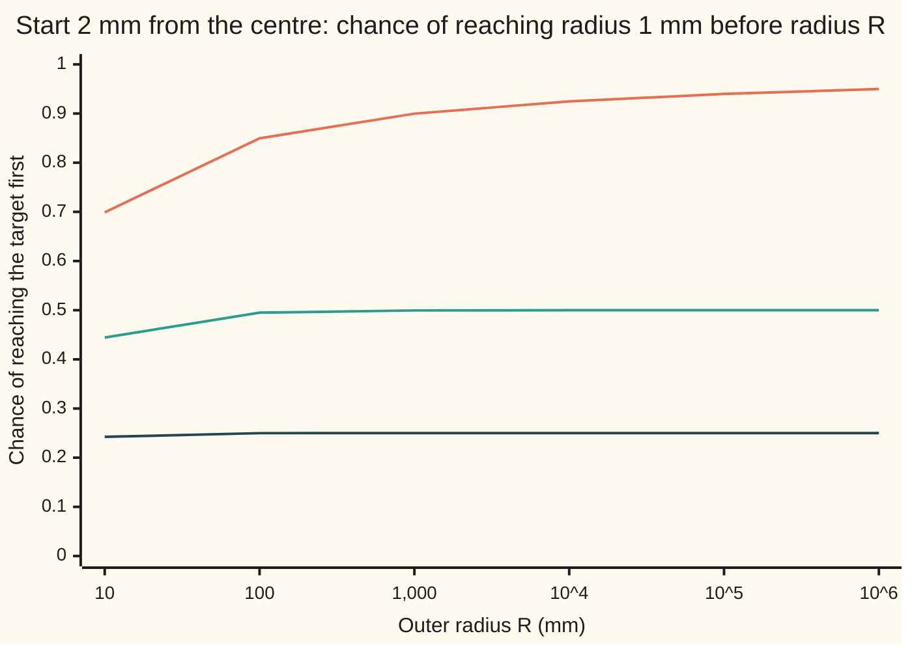

# Brownian motion in d dimensions: recurrent in the plane, gone for good in space

[Syllabus](../../../SYLLABUS.md) → [Stochastic processes and calculus](../README.md) → [Generators, Densities and Simulation](../README.md#s08) → Brownian motion in d dimensions

---

## General Overview

A pollen grain drifts in a large tank of still water, knocked about by the water's molecules. Nearby sits a glass bead of radius 1 mm. The grain starts 2 mm from the bead's centre, so 1 mm from its surface. Treat the grain as a point, and the water as stretching without end in every direction: real walls would bounce the grain back and change the answer.

Will the grain ever touch the bead? In this endless water, the chance is exactly 1/2. Half of all grains wander off and never reach it.

Now float the grain on the water's surface, a flat sheet that also goes on without end, and replace the bead by a disc of radius 1 mm. The grain reaches the disc before it gets 100 mm away with chance 0.8495. Move the far limit out to 1,000,000 mm and the chance is 0.9498. With no far limit at all, the chance is 1: the grain on a flat surface always finds the disc in the end.

The difference is room. In space there are so many directions to escape in that the grain can wander off for good. On a flat surface it cannot, however long it wanders. A random walk on a street grid behaves the same way: it comes home for sure on a flat grid, but on a three-dimensional grid only with chance 0.3405, about one time in three.

**A Brownian particle hits a small ball before a large sphere with a chance read off one harmonic function, the logarithm of the distance in the plane and the distance to the power 2 − d in d ≥ 3 dimensions; letting the large sphere recede shows that plane Brownian motion returns to every disc forever, while in three or more dimensions it drifts off to infinity.**

**What kind of fact this is:** theorems. The hitting chances, recurrence in the plane and transience in three or more dimensions are proved on this card in Why it works. Pólya's theorem for the grid walk is given in outline: its key estimate is quoted, not proved.

### The picture: the chance of reaching the target as the far limit recedes



Orange: the plane. Green: space, three dimensions. Dark blue: four dimensions. Each step to the right makes the outer radius ten times larger.

The plane's line keeps climbing towards 1, slowly: each tenfold step adds less. The space line flattens at 0.5 almost at once, and four dimensions flattens at 0.25. In three or more dimensions, the far wall stops mattering early, because almost every grain that reaches it never comes back anyway.

---

## The formula

Notation from earlier cards. $`B_t`$ is Brownian motion in $`d`$ dimensions: a point with $`d`$ coordinates, each an independent one-dimensional Brownian motion ([Several Brownian motions](../06-Ito%20Calculus/06-multidimensional-ito-and-correlation.md)). Distances are in millimetres and time in seconds. $`|x|`$ is the distance from the point $`x`$ to the centre.

The Laplacian $`\Delta f`$ is the sum of the $`d`$ second slopes of a function $`f`$, one per coordinate. A function with $`\Delta f = 0`$ is called **harmonic** ([Laplace's equation](../../08-Differential%20equations%20and%20dynamics/10-The%20Classical%20PDEs/07-laplaces-equation-and-harmonic-functions.md)).

New here. The grain starts at a point $`x`$ at distance $`s = |x|`$ from the centre. It lives in the **shell** between a small sphere of radius $`r`$ and a large sphere of radius $`R`$. The exit time $`\tau`$ (Greek "tau") is the first time $`|B_t|`$ equals $`r`$ or $`R`$. $`P_x`$ is a chance, and $`E_x`$ an average, over paths started at $`x`$.

The key function depends only on distance $`\rho`$ (Greek "rho") from the centre:

```math
\varphi(\rho) = \begin{cases} \ln \rho & d = 2 \\ \rho^{\,2-d} & d \ge 3 \end{cases}
```

**Read it aloud:** in the plane, the logarithm of the distance; in higher dimensions, the distance to the power two minus d, so one over the distance in space.

The chance of reaching the small sphere first:

```math
p = P_x\big(|B_\tau| = r\big) = \frac{\varphi(R) - \varphi(s)}{\varphi(R) - \varphi(r)}
```

**Read it aloud:** the chance of the small sphere first is how far the start sits from the large sphere, measured in φ, as a share of the whole gap between the spheres.

Let the large sphere recede, $`R \to \infty`$:

```math
P_x\big(\text{ever reach radius } r\big) = \begin{cases} 1 & d = 2 \\ (r/s)^{\,d-2} & d \ge 3 \end{cases}
```

**Read it aloud:** in the plane, the grain reaches every disc for sure; in d dimensions it reaches a ball with chance the radius over the start distance, to the power d minus two.

For the grain: in space, $`(1/2)^1 = 0.5`$. In the plane, $`\ln(100/2)/\ln(100/1) = 0.8495`$.

| Symbol | Plain meaning | In our example | Push it up and the answer… |
| --- | --- | --- | --- |
| $`d`$ | the number of dimensions | 2 on the surface, 3 in the tank | the chance of ever arriving falls, to $`(1/2)^{d-2}`$ |
| $`B_t`$, $`B^i_t`$, $`x`$ | the grain's position at time t, a point with d coordinates; its i-th coordinate; its start | starts 2 mm from the centre | — |
| $`\lvert x\rvert`$, $`\rho`$, $`a`$, $`b`$ | distance from the centre; a distance used as the input of φ; on a line, the distances to the two ends | — | — |
| $`s`$ | the start distance, $`\lvert x\rvert`$ | 2 mm | the target is reached less often |
| $`r`$ | radius of the target ball or disc | 1 mm | the target is reached more often |
| $`R`$ | radius of the far sphere | 100 mm; then without limit | the target is reached more often |
| $`\tau`$ | exit time: first time the distance equals r or R | — | — |
| $`\varphi`$, $`k`$ | the radial harmonic function: ln ρ in the plane, ρ to the power 2 − d above; a trial power in Step 2 | — | — |
| $`\Delta`$, $`\partial f/\partial x_i`$ | the Laplacian: sum of the d second slopes; the slope of f along coordinate i | 0 for φ, away from the centre | — |
| $`P_x`$, $`E_x`$, $`p`$, $`u`$ | chance and average for paths from x; the chance of the target first; in Road 3, that chance as a function of the start distance | p = 0.8495 in the plane | — |
| $`S_n`$, $`n`$, $`N`$ | the grid walk's position after n steps; a step count; half the steps counted | N = 200, so 400 steps | — |
| $`u_d`$, $`q`$ | expected visits of the grid walk to its start, the start included; the chance of ever returning, $`1 - 1/u_d`$ | 1.5164 and 0.3405 in space | q rises with it |

### When it holds

- **The motion is Brownian, the same in every direction.** A drift or a current changes which function is fair, and the answers change. Unequal noise in different directions needs a stretched φ.
- **The grain is a point and the target is a ball.** For other shapes the chance is still a harmonic function, but it no longer depends on distance alone: that is [The Dirichlet problem by Brownian motion](09-brownian-motion-and-the-dirichlet-problem.md).
- **The start lies between the two spheres.** φ blows up at the centre, so the argument never lets the grain reach it.
- **The motion has no end.** A grain that decays or is absorbed by the water at a steady rate faces a different equation, and even in the plane its chance of arriving is below 1.
- **Neighbourhood, not point.** In the plane the grain hits every disc for sure, but any fixed point with chance 0 (Step 5).

---

## Why it works

### Step 0: find a fair game that is constant on each sphere

Optional stopping turns a fair game into a hitting chance. The Brownian martingales card did this on a line: the position is fair, so the exit chances are fixed by the start ([Brownian martingales](../05-Brownian%20Motion/06-brownian-martingales-and-exponential-martingale.md)).

In $`d`$ dimensions, find a function of position that stays fair along the path, and that takes one value on the small sphere and another on the large one. Then its average at the exit time is a mix of those two values, with weights $`p`$ and $`1 - p`$. One equation, one unknown.

### Step 1: a harmonic function of position is a fair game

The generator of a process is its expected rate of change, applied to a measurement $`f`$ ([The generator](01-infinitesimal-generator.md)). For $`d`$-dimensional Brownian motion, the multidimensional Ito formula with independent coordinates (correlation 0 between different ones) gives

```math
df(B_t) = \sum_{i=1}^{d} \frac{\partial f}{\partial x_i}(B_t)\,dB^i_t + \tfrac12\,\Delta f(B_t)\,dt .
```

Here $`B^i_t`$ is the i-th coordinate and $`\partial f/\partial x_i`$ is the slope of f along it. The cross terms vanish because different coordinates are independent. So the generator is $`\tfrac12\Delta`$.

If $`\Delta f = 0`$ on the shell, the $`dt`$ term is gone. What remains is a sum of Ito integrals with bounded slopes, which is a martingale up to the exit time.

### Step 2: the harmonic functions of distance alone

For a function of distance only, $`f(x) = \varphi(|x|)`$, the Laplacian has a short form:

```math
\Delta f = \varphi''(\rho) + \frac{d-1}{\rho}\,\varphi'(\rho), \qquad \rho = |x| .
```

The first term is the bend along the radius. The second is the extra bend that comes from the spheres curving round, one share for each of the $`d - 1`$ directions along a sphere.

Try a power, $`\varphi = \rho^{\,k}`$. The formula gives $`k(k + d - 2)\,\rho^{\,k-2}`$. This is zero when $`k = 0`$ (a constant) or $`k = 2 - d`$. In the plane both roots are 0, and the second solution is the logarithm: $`\varphi' = 1/\rho`$ and $`\varphi'' = -1/\rho^2`$, which cancel.

The code checks this with second differences at a point 1.39 mm from the centre. The Laplacian of $`\ln|x|`$ in the plane and of $`|x|^{-1}`$ in space both print 0.000000. The wrong powers do not: $`|x|^{-1}`$ in the plane gives 0.372961, matching $`k(k+d-2)\rho^{k-2}`$.

<details>
<summary>Detailed derivation: the Laplacian of a function of distance</summary>

Write $`\rho = |x| = \sqrt{x_1^2 + \dots + x_d^2}`$. Then the slope of ρ along coordinate i is $`x_i/\rho`$.

The chain rule gives the first slope of $`f = \varphi(\rho)`$ along coordinate i:

$`\displaystyle \frac{\partial f}{\partial x_i} = \varphi'(\rho)\,\frac{x_i}{\rho}`$

Differentiate again along the same coordinate, using the product rule:

$`\displaystyle \frac{\partial^2 f}{\partial x_i^2} = \varphi''(\rho)\,\frac{x_i^2}{\rho^2} + \varphi'(\rho)\left(\frac{1}{\rho} - \frac{x_i^2}{\rho^3}\right)`$

Add over i from 1 to d. The squares $`x_i^2`$ add to $`\rho^2`$:

$`\displaystyle \Delta f = \varphi''(\rho) + \varphi'(\rho)\left(\frac{d}{\rho} - \frac{1}{\rho}\right) = \varphi''(\rho) + \frac{d-1}{\rho}\,\varphi'(\rho)`$

</details>

### Step 3: the grain leaves the shell, and the stopped game is bounded

Two facts make optional stopping safe here ([Stopping without a bound](../02-Martingales/06-uniform-integrability-and-unbounded-stopping.md)).

1. **The exit comes with chance 1.** While inside the shell, the first coordinate stays between $`-R`$ and $`R`$. A one-dimensional Brownian motion leaves that interval in average time $`R^2 - x_1^2`$, the product of its two distances to the ends. So the shell is left even sooner, on average.
2. **The stopped values are bounded.** Until the exit, $`\varphi(|B_t|)`$ stays between $`\varphi(r)`$ and $`\varphi(R)`$, because φ changes in one direction only between the spheres. Bounded stopped values are uniformly integrable.

So the average of the fair game at the exit equals its starting value:

```math
E_x\big[\varphi(|B_\tau|)\big] = \varphi(s) .
```

### Step 4: solve for the chance

At the exit, the distance is either $`r`$ (chance $`p`$) or $`R`$ (chance $`1 - p`$). So

```math
p\,\varphi(r) + (1-p)\,\varphi(R) = \varphi(s) \quad\Longrightarrow\quad p = \frac{\varphi(R) - \varphi(s)}{\varphi(R) - \varphi(r)} .
```

In the plane, with $`r = 1`$, $`s = 2`$ and $`R = 100`$: $`p = (\ln 100 - \ln 2)/(\ln 100 - \ln 1) = \ln 50 / \ln 100 = 0.8495`$.

### Step 5: the plane: every disc, again and again, but no point

Let $`R \to \infty`$ in the plane. The numerator and denominator both grow like $`\ln R`$, so $`p \to 1`$. The grain reaches the disc of radius $`r`$ for sure, from any start, because it must reach either the disc or the far circle, and the chance of the far circle first shrinks to 0.

That happens again after every visit. From the disc, the grain later reaches distance 2 mm, since it leaves any bounded region for sure. From there it returns to the disc for sure. So it visits the disc infinitely often, at times that grow without limit. This is **neighbourhood recurrence**: with chance 1, every open disc is visited at arbitrarily late times.

Now shrink the target with $`R`$ fixed at 100 mm. Then $`\ln(1/r)`$ in the denominator grows without limit, and $`p \to 0`$:

| Target radius r | Chance of reaching it before 100 mm, from 2 mm |
| --- | --- |
| 0.1 mm | 0.5663 |
| 0.01 mm | 0.4247 |
| $`10^{-6}`$ mm | 0.2124 |
| $`10^{-100}`$ mm | 0.0167 |

In the limit, the chance of ever touching the exact centre before 100 mm is 0. Let 100 mm grow, and the chance of ever touching it is 0. Plane Brownian motion visits every neighbourhood, but almost never a given point.

On a line the picture is stronger. One-dimensional Brownian motion hits every single point for sure: from the Brownian martingales card, it reaches $`b`$ before $`-a`$ with chance $`a/(a + b)`$, which tends to 1 as $`a`$ grows.

### Step 6: three or more dimensions: gone for good

Let $`R \to \infty`$ with $`d \ge 3`$. Now $`\varphi(R) = R^{\,2-d} \to 0`$, and

```math
p \to \frac{s^{\,2-d}}{r^{\,2-d}} = \left(\frac{r}{s}\right)^{d-2} < 1 .
```

In the tank, $`(1/2)^1 = 0.5`$. From 10 mm away, the chance of ever touching the bead is 0.1000.

**Transience** means $`|B_t| \to \infty`$ with chance 1: the grain eventually leaves every ball and stays out. The proof uses the formula once per distance.

1. Pick any $`n`$. The grain reaches distance $`n`$ for sure, because it leaves any bounded region.
2. From distance $`n`$, its chance of ever coming back to distance 1 is $`(1/n)^{d-2}`$.
3. So the chance that it comes within distance 1 at arbitrarily late times is at most $`(1/n)^{d-2}`$, for every $`n`$. That chance is therefore 0.
4. The same argument, scaled, works for every radius in place of 1. So the distance tends to infinity.

### Step 7: Pólya's grid walk, in outline

Pólya proved the same split for a walk on a street grid: each step moves one block, in one of the $`2d`$ directions, each with equal chance. Let $`S_n`$ be its position after $`n`$ steps, and $`u_d`$ the expected number of visits to the start, the start itself included.

1. **Count visits.** Each time the walk is at the start, its chance of ever coming back is the same number, say $`q`$. So the number of visits is geometric, and $`u_d = 1/(1 - q)`$. The walk returns for sure exactly when $`u_d`$ is infinite.
2. **Add up the chances.** The expected number of visits is the sum, over $`n`$, of the chance of being at the start after $`2n`$ steps.
3. **The key estimate, quoted.** That chance falls like $`2\,(d/(4\pi n))^{d/2}`$, a local version of the central limit theorem. The sum of $`n^{-d/2}`$ is infinite for $`d = 1, 2`$ and finite for $`d \ge 3`$.

The code adds the exact chances for 400 steps:

```
expected visits to the start, first 400 steps
line   ████████████████████████████████  15.988
plane  ██████                             2.754
space  ███                                1.4835
```

The line keeps growing like the square root of the steps; the plane like their logarithm, slower but without limit. Space levels off. Adding the estimated tail gives $`u_3 = 1.5164`$, so a walker on a three-dimensional grid ever returns with chance $`1 - 1/1.5164 = 0.3405`$.

The Brownian proof does not need the estimate. A harmonic function plays the role of the counting.

---

## Worked numbers, by hand

The plane, start $`s = 2`$, target $`r = 1`$, far circle $`R = 100`$; then space with no far sphere.

| Step | Arithmetic | Value |
| --- | --- | --- |
| φ at the far circle | $`\ln 100`$ | 4.6052 |
| φ at the start | $`\ln 2`$ | 0.6931 |
| φ at the target | $`\ln 1`$ | 0 |
| numerator | $`4.6052 - 0.6931 = \ln 50`$ | 3.9120 |
| denominator | $`4.6052 - 0`$ | 4.6052 |
| **plane: target before 100 mm** | $`3.9120 / 4.6052`$ | **0.8495** |
| plane, far circle at $`10^6`$ mm | $`\ln(500{,}000)/\ln(10^6) = 13.122/13.816`$ | 0.9498 |
| **space: ever touch the bead** | $`(1/2)^{3-2}`$ | **0.5000** |
| four dimensions | $`(1/2)^{4-2}`$ | 0.2500 |

The surface grain beats the far circle with chance 0.8495, and that chance creeps towards 1 as the circle recedes. The tank grain touches the bead only half the time, however long one waits.

### What breaks if you drop a piece

| Mistake | Comes out at | What went wrong |
| --- | --- | --- |
| Treat the distance as a one-dimensional Brownian motion: $`(R - s)/(R - r)`$ | 0.9899 (right: 0.8495) | The distance is pushed outward by the curving spheres, the $`(d-1)/\rho`$ term; a straight-line fair game ignores it |
| Use space's $`1/\lvert x\rvert`$ in the plane | 0.4949 (right: 0.8495) | $`1/\lvert x\rvert`$ is not harmonic in the plane, so it is not a fair game there |
| Report the far circle's chance, $`\ln(s/r)/\ln(R/r)`$ | 0.1505 (right: 0.8495) | The two weights are swapped: the start's distance to the far circle goes on top for the near target |
| Use the plane's logarithm in space, $`R = 10^6`$ | 0.9498 (right: 0.5000) | It predicts certain return in space; the logarithm is not harmonic in three dimensions |

---

## Code, from first principles, and it actually runs

The code reaches each hitting chance by **three independent roads**. Road 1 is the formula. Road 2 simulates 20,000 grains by **walk on spheres**: from the grain's position, jump to a uniform random point on the largest sphere that fits inside the shell. Brownian motion leaves such a sphere at a uniform point, by symmetry alone, so no harmonic function is used. The random numbers come from a SplitMix64 generator written out, seed 20260930.

Road 3 solves the radial equation $`u'' + \tfrac{d-1}{\rho}u' = 0`$ with $`u(1) = 1`$ and $`u(100) = 0`$ on a grid of step 0.005 mm, without guessing the answer's shape. The code also checks harmonicity by second differences, prints every table and chart value, and adds the grid walk's exact return chances for Pólya's theorem.

### Python

```python
# Recurrence and transience of Brownian motion -- the check behind the card.
# Standard library only. Three roads to each hitting chance: the harmonic
# formula, a walk-on-spheres simulation with its own random numbers, and a
# finite-difference solution of the radial Laplace equation. Then Polya's walk.
import math

def phi(d, rho):  # radial harmonic function: log in the plane, rho^(2-d) above
    return math.log(rho) if d == 2 else rho ** (2 - d)

def p_small(d, r, s, R):  # chance of radius r before radius R, from radius s
    if R == math.inf:
        return 1.0 if d == 2 else (r / s) ** (d - 2)
    return (phi(d, R) - phi(d, s)) / (phi(d, R) - phi(d, r))

def norm(x):  # plain loops, not sum(), so Rust can add in the same order
    t = 0.0
    for c in x: t += c * c
    return math.sqrt(t)

def laplacian(f, x, h=1e-3):  # sum of second differences, one per coordinate
    tot = 0.0
    for i in range(len(x)):
        up = list(x); dn = list(x); up[i] += h; dn[i] -= h
        tot += (f(up) - 2 * f(x) + f(dn)) / h ** 2
    return tot

M64 = (1 << 64) - 1
class SplitMix64:
    def __init__(self, seed): self.s = seed
    def uniform(self):
        self.s = (self.s + 0x9E3779B97F4A7C15) & M64
        z = self.s
        z = ((z ^ (z >> 30)) * 0xBF58476D1CE4E5B9) & M64
        z = ((z ^ (z >> 27)) * 0x94D049BB133111EB) & M64
        return ((z ^ (z >> 31)) >> 11) / 2.0 ** 53

def direction(rng, d):  # uniform point on the unit circle or sphere
    a = 2 * math.pi * rng.uniform()
    if d == 2:
        return [math.cos(a), math.sin(a)]
    z = 2 * rng.uniform() - 1; w = math.sqrt(1 - z * z)
    return [w * math.cos(a), w * math.sin(a), z]

def walk_on_spheres(d, r, s, R, paths, seed, eps=1e-6):
    rng = SplitMix64(seed); hits = 0; steps = 0
    for _ in range(paths):
        x = [s] + [0.0] * (d - 1)
        while True:
            rho = norm(x)
            if rho - r < eps: hits += 1; break
            if R - rho < eps * R: break
            jump = min(rho - r, R - rho); u = direction(rng, d); steps += 1
            x = [c + jump * e for c, e in zip(x, u)]
    p = hits / paths
    return p, math.sqrt(p * (1 - p) / paths), steps / paths

def radial_fd(d, r, s, R, n):  # u'' + (d-1)/rho u' = 0, u(r)=1, u(R)=0, Thomas
    h = (R - r) / n; a, b, c, rhs = [], [], [], []
    for i in range(1, n):
        rho = r + i * h; k = (d - 1) * h / (2 * rho)
        a.append(1 - k); b.append(-2.0); c.append(1 + k); rhs.append(0.0)
    rhs[0] -= a[0] * 1.0
    for i in range(1, n - 1):  # forward sweep
        m = a[i] / b[i - 1]; b[i] -= m * c[i - 1]; rhs[i] -= m * rhs[i - 1]
    u = [0.0] * (n - 1); u[-1] = rhs[-1] / b[-1]
    for i in range(n - 3, -1, -1):
        u[i] = (rhs[i] - c[i] * u[i + 1]) / b[i]
    return u[round((s - r) / h) - 1]

print("harmonic test: numerical Laplacian at a point 1.39 from the centre")
for d, x in ((2, [1.2, 0.7]), (3, [1.2, 0.7, 0.0])):
    rho = norm(x)
    for p in (2 - d, -1 if d == 2 else 1):
        f = (lambda y, p=p: norm(y) ** p) if p != 0 else (lambda y: math.log(norm(y)))
        lab = "log|x|" if p == 0 else f"|x|^{p}"
        num = laplacian(f, x); exact = p * (p + d - 2) * rho ** (p - 2)
        num = num if abs(num) >= 5e-7 else 0.0  # print rounding noise as 0
        print(f"  d={d}  {lab:8s} Laplacian {num:+.6f}  (p(p+d-2)rho^(p-2) = {exact:+.6f})")
        assert abs(num - exact) < 1e-5

pl = p_small(2, 1, 2, 100); sp = p_small(3, 1, 2, math.inf)
print(f"plane, from 2: radius 1 before radius 100 = ln(50)/ln(100) = {pl:.4f}")
print(f"space, from 2: ever hit radius 1 = (1/2)^1 = {sp:.4f}")
print(f"worked: ln 100 = {math.log(100):.4f}, ln 2 = {math.log(2):.4f}, ln 50 = {math.log(50):.4f}")
print(f"worked: ln 500,000 = {math.log(5e5):.3f}, ln 10^6 = {math.log(1e6):.3f}")
assert abs(pl - math.log(50) / math.log(100)) < 1e-12 and abs(sp - 0.5) < 1e-12

print("road 2, walk on spheres (20,000 paths each, seed 20260930)")
for d, R, lab in ((2, 100.0, "100"), (3, 1e6, "10^6")):
    est, se, st = walk_on_spheres(d, 1.0, 2.0, R, 20000, 20260930)
    ex = p_small(d, 1.0, 2.0, R)
    print(f"  d={d} R={lab}: simulated {est:.4f} +- {se:.4f}, formula {ex:.4f}, mean jumps {st:.1f}")
    assert abs(est - ex) < 4 * se
print("road 3, finite differences on the radial equation, step 0.005")
for d in (2, 3):
    fd = radial_fd(d, 1.0, 2.0, 100.0, 19800); ex = p_small(d, 1.0, 2.0, 100.0)
    print(f"  d={d} R=100: grid {fd:.6f}, formula {ex:.6f}")
    assert abs(fd - ex) < 1e-5

print("chance of radius 1 before radius R, from 2   (chart)")
print("  R        d=2      d=3      d=4")
for R in (10, 100, 1000, 10**4, 10**5, 10**6, math.inf):
    lab = "inf" if R == math.inf else f"10^{round(math.log10(R))}"
    print(f"  {lab:6s} " + " ".join(f"{p_small(d, 1, 2, R):8.4f}" for d in (2, 3, 4)))
print("plane, from 2, before radius 100: shrink the target towards a point")
for lab, r in (("0.1", 0.1), ("0.01", 0.01), ("10^-6", 1e-6), ("10^-100", 1e-100)):
    print(f"  r = {lab}: {p_small(2, r, 2, 100):.4f}")
print(f"space, start at 10: ever hit radius 1 = {p_small(3, 1, 10, math.inf):.4f}")

print("what breaks (plane from 2, R = 100, right answer 0.8495)")
lin = (100 - 2) / (100 - 1); inv = p_small(3, 1, 2, 100)
print(f"  radius treated as a 1-D Brownian motion: {lin:.4f}")
print(f"  space's 1/|x| used in the plane: {inv:.4f}")
print(f"  far wall instead of near ball: {1 - pl:.4f}")
print(f"  plane's log used in space, R = 10^6: {p_small(2, 1, 2, 1e6):.4f} (right {p_small(3, 1, 2, 1e6):.4f})")
assert lin > pl > inv

print("Polya: expected visits to the start in 2N steps of the grid walk")
N = 200; a = 1.0; s1 = s2 = 0.0; s3 = 0.0; lf = [0.0]
for k in range(1, N + 1): lf.append(lf[-1] + math.log(k))
for n in range(N + 1):
    if n > 0: a *= (2 * n - 1) / (2 * n)
    t3 = 0.0  # chance the three axes each net to zero, given n steps on them
    for j in range(n + 1):
        for k in range(n - j + 1):
            t3 += math.exp(2 * (lf[n] - lf[j] - lf[k] - lf[n - j - k]) - 2 * n * math.log(3))
    s1 += a; s2 += a * a; s3 += a * t3
    if n in (10, 100, 200):
        print(f"  N={n:3d}: line {s1:7.3f}   plane {s2:6.3f}   space {s3:6.4f}")
u3 = s3 + 2 * (3 / (4 * math.pi)) ** 1.5 * 2 / math.sqrt(N + 0.5)
print(f"  space with tail added: {u3:.4f}; chance of ever returning 1 - 1/u = {1 - 1 / u3:.4f}")
assert abs(1 - 1 / u3 - 0.340537) < 1e-3 and s2 > math.log(N) / math.pi
print("ALL CHECKS PASS")
```

**Ran 2026-11-23 on macOS, Python 3.14.10, standard library only. All checks passed. Output, pasted from the run:**

```
harmonic test: numerical Laplacian at a point 1.39 from the centre
  d=2  log|x|   Laplacian +0.000000  (p(p+d-2)rho^(p-2) = +0.000000)
  d=2  |x|^-1   Laplacian +0.372961  (p(p+d-2)rho^(p-2) = +0.372962)
  d=3  |x|^-1   Laplacian +0.000000  (p(p+d-2)rho^(p-2) = +0.000000)
  d=3  |x|^1    Laplacian +1.439631  (p(p+d-2)rho^(p-2) = +1.439632)
plane, from 2: radius 1 before radius 100 = ln(50)/ln(100) = 0.8495
space, from 2: ever hit radius 1 = (1/2)^1 = 0.5000
worked: ln 100 = 4.6052, ln 2 = 0.6931, ln 50 = 3.9120
worked: ln 500,000 = 13.122, ln 10^6 = 13.816
road 2, walk on spheres (20,000 paths each, seed 20260930)
  d=2 R=100: simulated 0.8494 +- 0.0025, formula 0.8495, mean jumps 26.4
  d=3 R=10^6: simulated 0.4990 +- 0.0035, formula 0.5000, mean jumps 79.7
road 3, finite differences on the radial equation, step 0.005
  d=2 R=100: grid 0.849485, formula 0.849485
  d=3 R=100: grid 0.494949, formula 0.494949
chance of radius 1 before radius R, from 2   (chart)
  R        d=2      d=3      d=4
  10^1     0.6990   0.4444   0.2424
  10^2     0.8495   0.4949   0.2499
  10^3     0.8997   0.4995   0.2500
  10^4     0.9247   0.4999   0.2500
  10^5     0.9398   0.5000   0.2500
  10^6     0.9498   0.5000   0.2500
  inf      1.0000   0.5000   0.2500
plane, from 2, before radius 100: shrink the target towards a point
  r = 0.1: 0.5663
  r = 0.01: 0.4247
  r = 10^-6: 0.2124
  r = 10^-100: 0.0167
space, start at 10: ever hit radius 1 = 0.1000
what breaks (plane from 2, R = 100, right answer 0.8495)
  radius treated as a 1-D Brownian motion: 0.9899
  space's 1/|x| used in the plane: 0.4949
  far wall instead of near ball: 0.1505
  plane's log used in space, R = 10^6: 0.9498 (right 0.5000)
Polya: expected visits to the start in 2N steps of the grid walk
  N= 10: line   3.700   plane  1.822   space 1.3741
  N=100: line  11.326   plane  2.535   space 1.4699
  N=200: line  15.988   plane  2.754   space 1.4835
  space with tail added: 1.5164; chance of ever returning 1 - 1/u = 0.3405
ALL CHECKS PASS
```

The simulation lands within one standard error of the formula in both cases. The grid solution agrees to six decimals. The harmonic test separates the right powers from the wrong ones.

### Rust

Same roads, same inputs, same random numbers.

```rust
// Recurrence and transience of Brownian motion -- the same check in Rust.
// Standard library only, no crates. Three roads to each hitting chance: the
// harmonic formula, a walk-on-spheres simulation with its own random numbers,
// and a finite-difference solution of the radial Laplace equation. Then Polya.
use std::f64::consts::PI;
const INF: f64 = f64::INFINITY;

fn phi(d: i32, rho: f64) -> f64 { // log in the plane, rho^(2-d) above
    if d == 2 { rho.ln() } else { rho.powf((2 - d) as f64) }
}
fn p_small(d: i32, r: f64, s: f64, big_r: f64) -> f64 { // r before R, from s
    if big_r == INF {
        return if d == 2 { 1.0 } else { (r / s).powf((d - 2) as f64) };
    }
    (phi(d, big_r) - phi(d, s)) / (phi(d, big_r) - phi(d, r))
}
fn norm(x: &[f64]) -> f64 {
    let mut t = 0.0;
    for c in x { t += c * c; }
    t.sqrt()
}
fn laplacian(f: &dyn Fn(&[f64]) -> f64, x: &[f64], h: f64) -> f64 {
    let mut tot = 0.0;
    for i in 0..x.len() {
        let (mut up, mut dn) = (x.to_vec(), x.to_vec());
        up[i] += h; dn[i] -= h;
        tot += (f(&up) - 2.0 * f(x) + f(&dn)) / h.powf(2.0);
    }
    tot
}
struct SplitMix64 { s: u64 }
impl SplitMix64 {
    fn uniform(&mut self) -> f64 {
        self.s = self.s.wrapping_add(0x9E3779B97F4A7C15);
        let mut z = self.s;
        z = (z ^ (z >> 30)).wrapping_mul(0xBF58476D1CE4E5B9);
        z = (z ^ (z >> 27)).wrapping_mul(0x94D049BB133111EB);
        ((z ^ (z >> 31)) >> 11) as f64 / 9007199254740992.0
    }
}
fn direction(rng: &mut SplitMix64, d: i32) -> Vec<f64> { // uniform on circle or sphere
    let a = 2.0 * PI * rng.uniform();
    if d == 2 { return vec![a.cos(), a.sin()]; }
    let z = 2.0 * rng.uniform() - 1.0;
    let w = (1.0 - z * z).sqrt();
    vec![w * a.cos(), w * a.sin(), z]
}
fn walk_on_spheres(d: i32, r: f64, s: f64, big_r: f64, paths: usize, seed: u64) -> (f64, f64, f64) {
    let eps = 1e-6;
    let mut rng = SplitMix64 { s: seed };
    let (mut hits, mut steps) = (0usize, 0usize);
    for _ in 0..paths {
        let mut x = vec![0.0; d as usize];
        x[0] = s;
        loop {
            let rho = norm(&x);
            if rho - r < eps { hits += 1; break; }
            if big_r - rho < eps * big_r { break; }
            let jump = (rho - r).min(big_r - rho);
            let u = direction(&mut rng, d);
            steps += 1;
            x = x.iter().zip(u.iter()).map(|(c, e)| c + jump * e).collect();
        }
    }
    let p = hits as f64 / paths as f64;
    (p, (p * (1.0 - p) / paths as f64).sqrt(), steps as f64 / paths as f64)
}
fn radial_fd(d: i32, r: f64, s: f64, big_r: f64, n: usize) -> f64 { // Thomas sweep
    let h = (big_r - r) / n as f64;
    let (mut a, mut b, mut c, mut rhs) = (vec![], vec![], vec![], vec![]);
    for i in 1..n {
        let rho = r + i as f64 * h;
        let k = (d - 1) as f64 * h / (2.0 * rho);
        a.push(1.0 - k); b.push(-2.0); c.push(1.0 + k); rhs.push(0.0);
    }
    rhs[0] -= a[0] * 1.0;
    for i in 1..n - 1 {
        let m = a[i] / b[i - 1];
        b[i] -= m * c[i - 1];
        rhs[i] -= m * rhs[i - 1];
    }
    let mut u = vec![0.0; n - 1];
    u[n - 2] = rhs[n - 2] / b[n - 2];
    for i in (0..n - 2).rev() { u[i] = (rhs[i] - c[i] * u[i + 1]) / b[i]; }
    u[((s - r) / h).round() as usize - 1]
}

fn main() {
    println!("harmonic test: numerical Laplacian at a point 1.39 from the centre");
    for (d, x) in [(2, vec![1.2, 0.7]), (3, vec![1.2, 0.7, 0.0])] {
        let rho = norm(&x);
        for p in [2 - d, if d == 2 { -1 } else { 1 }] {
            let f = move |y: &[f64]| if p == 0 { norm(y).ln() } else { norm(y).powf(p as f64) };
            let lab = if p == 0 { "log|x|".to_string() } else { format!("|x|^{}", p) };
            let mut num = laplacian(&f, &x, 1e-3);
            let exact = (p * (p + d - 2)) as f64 * rho.powf((p - 2) as f64);
            if num.abs() < 5e-7 { num = 0.0; }
            println!("  d={}  {:8} Laplacian {:+.6}  (p(p+d-2)rho^(p-2) = {:+.6})", d, lab, num, exact);
            assert!((num - exact).abs() < 1e-5);
        }
    }
    let pl = p_small(2, 1.0, 2.0, 100.0);
    let sp = p_small(3, 1.0, 2.0, INF);
    println!("plane, from 2: radius 1 before radius 100 = ln(50)/ln(100) = {:.4}", pl);
    println!("space, from 2: ever hit radius 1 = (1/2)^1 = {:.4}", sp);
    println!("worked: ln 100 = {:.4}, ln 2 = {:.4}, ln 50 = {:.4}", 100f64.ln(), 2f64.ln(), 50f64.ln());
    println!("worked: ln 500,000 = {:.3}, ln 10^6 = {:.3}", 5e5f64.ln(), 1e6f64.ln());
    assert!((pl - 50f64.ln() / 100f64.ln()).abs() < 1e-12 && (sp - 0.5).abs() < 1e-12);

    println!("road 2, walk on spheres (20,000 paths each, seed 20260930)");
    for (d, big_r, lab) in [(2, 100.0, "100"), (3, 1e6, "10^6")] {
        let (est, se, st) = walk_on_spheres(d, 1.0, 2.0, big_r, 20000, 20260930);
        let ex = p_small(d, 1.0, 2.0, big_r);
        println!("  d={} R={}: simulated {:.4} +- {:.4}, formula {:.4}, mean jumps {:.1}", d, lab, est, se, ex, st);
        assert!((est - ex).abs() < 4.0 * se);
    }
    println!("road 3, finite differences on the radial equation, step 0.005");
    for d in [2, 3] {
        let fd = radial_fd(d, 1.0, 2.0, 100.0, 19800);
        let ex = p_small(d, 1.0, 2.0, 100.0);
        println!("  d={} R=100: grid {:.6}, formula {:.6}", d, fd, ex);
        assert!((fd - ex).abs() < 1e-5);
    }

    println!("chance of radius 1 before radius R, from 2   (chart)");
    println!("  R        d=2      d=3      d=4");
    for big_r in [10.0, 100.0, 1000.0, 1e4, 1e5, 1e6, INF] {
        let lab = if big_r == INF { "inf".to_string() } else { format!("10^{}", big_r.log10().round() as i32) };
        let row: Vec<String> = [2, 3, 4].iter().map(|&d| format!("{:8.4}", p_small(d, 1.0, 2.0, big_r))).collect();
        println!("  {:6} {}", lab, row.join(" "));
    }
    println!("plane, from 2, before radius 100: shrink the target towards a point");
    for (lab, r) in [("0.1", 0.1), ("0.01", 0.01), ("10^-6", 1e-6), ("10^-100", 1e-100)] {
        println!("  r = {}: {:.4}", lab, p_small(2, r, 2.0, 100.0));
    }
    println!("space, start at 10: ever hit radius 1 = {:.4}", p_small(3, 1.0, 10.0, INF));

    println!("what breaks (plane from 2, R = 100, right answer 0.8495)");
    let lin = (100.0 - 2.0) / (100.0 - 1.0);
    let inv = p_small(3, 1.0, 2.0, 100.0);
    println!("  radius treated as a 1-D Brownian motion: {:.4}", lin);
    println!("  space's 1/|x| used in the plane: {:.4}", inv);
    println!("  far wall instead of near ball: {:.4}", 1.0 - pl);
    println!("  plane's log used in space, R = 10^6: {:.4} (right {:.4})", p_small(2, 1.0, 2.0, 1e6), p_small(3, 1.0, 2.0, 1e6));
    assert!(lin > pl && pl > inv);

    println!("Polya: expected visits to the start in 2N steps of the grid walk");
    let big_n = 200usize;
    let (mut a, mut s1, mut s2, mut s3) = (1.0f64, 0.0f64, 0.0f64, 0.0f64);
    let mut lf = vec![0.0f64];
    for k in 1..=big_n { let last = lf[k - 1]; lf.push(last + (k as f64).ln()); }
    for n in 0..=big_n {
        if n > 0 { a *= (2 * n - 1) as f64 / (2 * n) as f64; }
        let mut t3 = 0.0; // chance the three axes each net to zero, given n steps on them
        for j in 0..=n {
            for k in 0..=(n - j) {
                t3 += (2.0 * (lf[n] - lf[j] - lf[k] - lf[n - j - k]) - (2 * n) as f64 * 3f64.ln()).exp();
            }
        }
        s1 += a; s2 += a * a; s3 += a * t3;
        if n == 10 || n == 100 || n == 200 {
            println!("  N={:3}: line {:7.3}   plane {:6.3}   space {:6.4}", n, s1, s2, s3);
        }
    }
    let u3 = s3 + 2.0 * (3.0 / (4.0 * PI)).powf(1.5) * 2.0 / (big_n as f64 + 0.5).sqrt();
    println!("  space with tail added: {:.4}; chance of ever returning 1 - 1/u = {:.4}", u3, 1.0 - 1.0 / u3);
    assert!((1.0 - 1.0 / u3 - 0.340537).abs() < 1e-3 && s2 > (big_n as f64).ln() / PI);
    println!("ALL CHECKS PASS");
}
```

**Ran 2026-11-23 on macOS, rustc 1.98.1, no crates. All checks passed. Output, pasted from the run:**

```
harmonic test: numerical Laplacian at a point 1.39 from the centre
  d=2  log|x|   Laplacian +0.000000  (p(p+d-2)rho^(p-2) = +0.000000)
  d=2  |x|^-1   Laplacian +0.372961  (p(p+d-2)rho^(p-2) = +0.372962)
  d=3  |x|^-1   Laplacian +0.000000  (p(p+d-2)rho^(p-2) = +0.000000)
  d=3  |x|^1    Laplacian +1.439631  (p(p+d-2)rho^(p-2) = +1.439632)
plane, from 2: radius 1 before radius 100 = ln(50)/ln(100) = 0.8495
space, from 2: ever hit radius 1 = (1/2)^1 = 0.5000
worked: ln 100 = 4.6052, ln 2 = 0.6931, ln 50 = 3.9120
worked: ln 500,000 = 13.122, ln 10^6 = 13.816
road 2, walk on spheres (20,000 paths each, seed 20260930)
  d=2 R=100: simulated 0.8494 +- 0.0025, formula 0.8495, mean jumps 26.4
  d=3 R=10^6: simulated 0.4990 +- 0.0035, formula 0.5000, mean jumps 79.7
road 3, finite differences on the radial equation, step 0.005
  d=2 R=100: grid 0.849485, formula 0.849485
  d=3 R=100: grid 0.494949, formula 0.494949
chance of radius 1 before radius R, from 2   (chart)
  R        d=2      d=3      d=4
  10^1     0.6990   0.4444   0.2424
  10^2     0.8495   0.4949   0.2499
  10^3     0.8997   0.4995   0.2500
  10^4     0.9247   0.4999   0.2500
  10^5     0.9398   0.5000   0.2500
  10^6     0.9498   0.5000   0.2500
  inf      1.0000   0.5000   0.2500
plane, from 2, before radius 100: shrink the target towards a point
  r = 0.1: 0.5663
  r = 0.01: 0.4247
  r = 10^-6: 0.2124
  r = 10^-100: 0.0167
space, start at 10: ever hit radius 1 = 0.1000
what breaks (plane from 2, R = 100, right answer 0.8495)
  radius treated as a 1-D Brownian motion: 0.9899
  space's 1/|x| used in the plane: 0.4949
  far wall instead of near ball: 0.1505
  plane's log used in space, R = 10^6: 0.9498 (right 0.5000)
Polya: expected visits to the start in 2N steps of the grid walk
  N= 10: line   3.700   plane  1.822   space 1.3741
  N=100: line  11.326   plane  2.535   space 1.4699
  N=200: line  15.988   plane  2.754   space 1.4835
  space with tail added: 1.5164; chance of ever returning 1 - 1/u = 0.3405
ALL CHECKS PASS
```

### Lean

Lean proves the calculus and the algebra of Why it works, for every number of dimensions $`d \ge 2`$.

- Take $`d \ge 2`$ and a point $`x`$ other than the centre. Then $`\varphi(|x|)`$ is harmonic near $`x`$, with continuous second slopes there.
- Take $`0 < r < s < R`$. Then $`p\,\varphi(r) + (1-p)\,\varphi(R) = \varphi(s)`$ holds exactly when $`p`$ is the formula's chance of the small sphere first.
- Take $`0 < r < s`$ and let $`R \to \infty`$. Then that chance tends to 1 in the plane, and to $`(r/s)^{d-2}`$ when $`d \ge 3`$.
- In space, from 2 mm the chance is $`(1/2)^{3-2} = 1/2`$. From 10 mm it is $`(1/10)^{3-2} = 1/10`$.
- In four dimensions, from 2 mm the chance is $`(1/2)^{4-2} = 1/4`$. In space, $`\varphi(2) = 1/2`$.

The step from these facts to the grain's real chances, the simulations and Pólya's grid walk are left to the Python and Rust checks.

```lean
-- Brownian motion in d dimensions: the radial function phi (log of the distance in the plane, the distance to the power 2 - d above) is harmonic away from the centre, it fixes the chance of the small sphere first, and that chance tends to 1 in the plane and to (r/s)^(d-2) in three or more dimensions as the far sphere recedes.
import Mathlib.Analysis.InnerProductSpace.Harmonic.Basic
import Mathlib.Analysis.InnerProductSpace.Calculus
import Mathlib.Analysis.SpecialFunctions.Pow.Deriv
import Mathlib.Analysis.SpecialFunctions.Log.Deriv
import Mathlib.Analysis.InnerProductSpace.PiL2
import Mathlib.Analysis.SpecialFunctions.Log.Basic
import Mathlib.Analysis.SpecialFunctions.Pow.Real
import Mathlib.Order.Filter.AtTopBot.Basic

open Filter Topology InnerProductSpace

/-- The card's radial function: `φ(ρ) = ln ρ` in the plane (`d = 2`) and `φ(ρ) = ρ ^ (2 - d)`
in `d ≥ 3` dimensions. -/
noncomputable def phi (d : ℕ) (ρ : ℝ) : ℝ :=
  if d = 2 then Real.log ρ else ρ ^ ((2 : ℤ) - d)

open Laplacian in
/-- Laplacian of `z ↦ h (‖z‖ ^ 2)` away from the origin. -/
lemma lap_aux {E : Type*} [NormedAddCommGroup E] [InnerProductSpace ℝ E] [FiniteDimensional ℝ E]
    (h h' h'' : ℝ → ℝ) (hh : ∀ t, 0 < t → HasDerivAt h (h' t) t)
    (hh' : ∀ t, 0 < t → HasDerivAt h' (h'' t) t) (y : E) (hy : y ≠ 0) :
    Δ (fun z : E => h (‖z‖ ^ 2)) y =
      4 * h'' (‖y‖ ^ 2) * ‖y‖ ^ 2 + 2 * (Module.finrank ℝ E) * h' (‖y‖ ^ 2) := by
  obtain ⟨L, hL⟩ : ∃ L : E →L[ℝ] E →L[ℝ] ℝ, ∀ u v, L u v = inner ℝ u v :=
    ⟨innerSL ℝ, fun _ _ => rfl⟩
  set f := fun z : E => h (‖z‖ ^ 2) with hfdef
  set G : E → E →L[ℝ] ℝ := fun z => h' (‖z‖ ^ 2) • ((2 : ℝ) • L z) with hGdef
  have hN : ∀ z : E, HasFDerivAt (fun z : E => ‖z‖ ^ 2) ((2 : ℝ) • L z) z := by
    intro z
    have := (hasStrictFDerivAt_norm_sq z).hasFDerivAt
    convert this using 1
    ext v; simp [hL]
  have hf : ∀ z : E, z ≠ 0 → HasFDerivAt f (G z) z := by
    intro z hz
    have hz' : 0 < ‖z‖ ^ 2 := by positivity
    exact (hh _ hz').comp_hasFDerivAt z (hN z)
  have hG : HasFDerivAt G
      (h' (‖y‖ ^ 2) • ((2 : ℝ) • L)
        + (h'' (‖y‖ ^ 2) • ((2 : ℝ) • L y)).smulRight ((2 : ℝ) • L y)) y := by
    have hy' : 0 < ‖y‖ ^ 2 := by positivity
    have h1 := (hh' _ hy').comp_hasFDerivAt y (hN y)
    have h2 : HasFDerivAt (fun z : E => (2 : ℝ) • L z) ((2 : ℝ) • L) y :=
      ((2 : ℝ) • L).hasFDerivAt
    exact h1.smul h2
  have hD : fderiv ℝ (fderiv ℝ f) y = h' (‖y‖ ^ 2) • ((2 : ℝ) • L)
        + (h'' (‖y‖ ^ 2) • ((2 : ℝ) • L y)).smulRight ((2 : ℝ) • L y) := by
    have heq : fderiv ℝ f =ᶠ[𝓝 y] G := by
      filter_upwards [isOpen_ne.mem_nhds hy] with z hz
      exact (hf z hz).fderiv
    rw [heq.fderiv_eq]
    exact hG.fderiv
  rw [laplacian_eq_iteratedFDeriv_stdOrthonormalBasis]
  simp only [iteratedFDeriv_two_apply, Matrix.cons_val_zero, Matrix.cons_val_one, hD]
  set b := stdOrthonormalBasis ℝ E
  simp only [add_apply, smul_apply,
    ContinuousLinearMap.smulRight_apply, hL, smul_eq_mul, b.inner_eq_ite, ite_true]
  have hs : ∑ i, ⟪y, b i⟫_ℝ * ⟪y, b i⟫_ℝ = ‖y‖ ^ 2 := by
    have := b.sum_inner_mul_inner y y
    simp_rw [real_inner_comm y (b _)] at this ⊢
    rw [this, real_inner_self_eq_norm_sq]
  have h2 : ∑ i, h'' (‖y‖ ^ 2) * (2 * ⟪y, b i⟫_ℝ) * (2 * ⟪y, b i⟫_ℝ)
      = 4 * h'' (‖y‖ ^ 2) * ∑ i, ⟪y, b i⟫_ℝ * ⟪y, b i⟫_ℝ := by
    rw [Finset.mul_sum]; exact Finset.sum_congr rfl (fun i _ => by ring)
  rw [Finset.sum_add_distrib, h2, hs]
  simp only [Finset.sum_const, Finset.card_univ, Fintype.card_fin, nsmul_eq_mul]
  ring

/-- In `d ≥ 3` dimensions, `φ(ρ) = 1 / ρ ^ (d - 2)`. -/
lemma phi_eq_inv_pow (d : ℕ) (hd : 2 < d) (ρ : ℝ) : phi d ρ = (ρ ^ (d - 2))⁻¹ := by
  have hd2 : d ≠ 2 := by omega
  simp only [phi, hd2, ↓reduceIte]
  rw [show (2 : ℤ) - d = -((d - 2 : ℕ) : ℤ) by omega, zpow_neg, zpow_natCast]

/-- `φ` takes different values at two different positive radii. -/
lemma phi_ne_of_lt (d : ℕ) (hd : 2 ≤ d) (r R : ℝ) (hr : 0 < r) (hrR : r < R) :
    phi d R ≠ phi d r := by
  rcases eq_or_lt_of_le hd with h2 | h3
  · subst h2
    simp only [phi, ↓reduceIte]
    exact (Real.log_lt_log hr hrR).ne'
  · rw [phi_eq_inv_pow d h3, phi_eq_inv_pow d h3]
    have hk : d - 2 ≠ 0 := by omega
    have : r ^ (d - 2) < R ^ (d - 2) := pow_lt_pow_left₀ hrR hr.le hk
    exact (inv_strictAnti₀ (by positivity) this).ne

/-- Step 2 of the card: in `d ≥ 2` dimensions the function `x ↦ φ(|x|)` (the logarithm of the
distance in the plane, the distance to the power `2 - d` above) is harmonic at every point
other than the centre: it is twice continuously differentiable there and its Laplacian is 0
near that point. This is what makes `φ(|B_t|)` a fair game between the two spheres. -/
theorem radial_phi_harmonic (d : ℕ) (hd : 2 ≤ d) (x : EuclideanSpace ℝ (Fin d)) (hx : x ≠ 0) :
    HarmonicAt (fun y : EuclideanSpace ℝ (Fin d) => phi d ‖y‖) x := by
  rcases eq_or_lt_of_le hd with h2 | h3
  · subst h2
    have hfeq : (fun y : EuclideanSpace ℝ (Fin 2) => phi 2 ‖y‖) =
        fun y => Real.log (‖y‖ ^ 2) / 2 := by
      funext y; simp only [phi, ↓reduceIte, Real.log_pow]; push_cast; ring
    rw [hfeq]
    refine ⟨?_, ?_⟩
    · have : ‖x‖ ^ 2 ≠ 0 := by positivity
      exact ((Real.contDiffAt_log.2 this).comp x (contDiff_norm_sq ℝ).contDiffAt).div_const 2
    · filter_upwards [isOpen_ne.mem_nhds hx] with y hy
      have hy2 : 0 < ‖y‖ ^ 2 := by positivity
      have key := lap_aux (fun t => Real.log t / 2) (fun t => t⁻¹ / 2) (fun t => -(t ^ 2)⁻¹ / 2)
        (fun t ht => (Real.hasDerivAt_log ht.ne').div_const 2)
        (fun t ht => (hasDerivAt_inv ht.ne').div_const 2) y hy
      beta_reduce at key
      rw [key]
      simp only [finrank_euclideanSpace_fin, Pi.zero_apply]
      field_simp
      ring
  · have hd2 : d ≠ 2 := by omega
    set a : ℝ := (2 - d) / 2 with ha
    have hfeq : (fun y : EuclideanSpace ℝ (Fin d) => phi d ‖y‖) =
        fun y => (‖y‖ ^ 2) ^ a := by
      funext y
      simp only [phi, hd2, ↓reduceIte]
      rw [← Real.rpow_natCast ‖y‖ 2, ← Real.rpow_mul (norm_nonneg _),
        show ((2 : ℕ) : ℝ) * a = (((2 : ℤ) - d : ℤ) : ℝ) by rw [ha]; push_cast; ring,
        Real.rpow_intCast]
    rw [hfeq]
    refine ⟨?_, ?_⟩
    · have : ‖x‖ ^ 2 ≠ 0 := by positivity
      exact (Real.contDiffAt_rpow_const_of_ne this).comp x (contDiff_norm_sq ℝ).contDiffAt
    · filter_upwards [isOpen_ne.mem_nhds hx] with y hy
      have hy2 : 0 < ‖y‖ ^ 2 := by positivity
      have key := lap_aux (fun t => t ^ a) (fun t => a * t ^ (a - 1))
        (fun t => a * ((a - 1) * t ^ (a - 1 - 1)))
        (fun t ht => Real.hasDerivAt_rpow_const (Or.inl ht.ne'))
        (fun t ht => (Real.hasDerivAt_rpow_const (p := a - 1) (Or.inl ht.ne')).const_mul a) y hy
      beta_reduce at key
      rw [key]
      simp only [finrank_euclideanSpace_fin, Pi.zero_apply]
      rw [Real.rpow_sub_one hy2.ne' (a - 1)]
      field_simp
      rw [ha]
      ring

/-- Step 4 of the card: for a start distance `s` strictly between the target radius `r` and the
far radius `R`, the balance equation `p φ(r) + (1 - p) φ(R) = φ(s)` holds exactly when
`p = (φ(R) - φ(s)) / (φ(R) - φ(r))`, the chance of reaching the small sphere first. -/
theorem hitting_chance_balance (d : ℕ) (hd : 2 ≤ d) (r s R p : ℝ)
    (hr : 0 < r) (hrs : r < s) (hsR : s < R) :
    p * phi d r + (1 - p) * phi d R = phi d s ↔
      p = (phi d R - phi d s) / (phi d R - phi d r) := by
  have hne : phi d R - phi d r ≠ 0 := sub_ne_zero.2 (phi_ne_of_lt d hd r R hr (hrs.trans hsR))
  rw [eq_div_iff hne]
  constructor <;> intro h <;> linear_combination -h

/-- Steps 5 and 6 of the card: let the far sphere recede, `R → ∞`. The chance of reaching
radius `r` first, from distance `s > r`, tends to 1 in the plane (recurrence) and to
`(r / s) ^ (d - 2)`, which is below 1, in `d ≥ 3` dimensions (transience). -/
theorem hitting_chance_tendsto (d : ℕ) (hd : 2 ≤ d) (r s : ℝ) (hr : 0 < r) (hrs : r < s) :
    Tendsto (fun R : ℝ => (phi d R - phi d s) / (phi d R - phi d r)) atTop
      (𝓝 (if d = 2 then 1 else (r / s) ^ (d - 2))) := by
  rcases eq_or_lt_of_le hd with h2 | h3
  · subst h2
    simp only [phi, ↓reduceIte]
    have hL : Tendsto (fun R : ℝ => Real.log R - Real.log r) atTop atTop :=
      tendsto_atTop_add_const_right _ _ Real.tendsto_log_atTop
    have h0 : Tendsto (fun R : ℝ => (Real.log r - Real.log s) / (Real.log R - Real.log r)) atTop
        (𝓝 0) := tendsto_const_nhds.div_atTop hL
    have h1 := h0.const_add 1
    rw [add_zero] at h1
    refine h1.congr' ?_
    filter_upwards [hL.eventually_gt_atTop 0] with R hR
    field_simp
    ring
  · have hd2 : d ≠ 2 := by omega
    simp only [phi_eq_inv_pow d h3, hd2, ↓reduceIte]
    have hk : d - 2 ≠ 0 := by omega
    have hR : Tendsto (fun R : ℝ => (R ^ (d - 2))⁻¹) atTop (𝓝 0) :=
      tendsto_inv_atTop_zero.comp (tendsto_pow_atTop hk)
    have hs : 0 < s := hr.trans hrs
    have hrk : (0 : ℝ) - (r ^ (d - 2))⁻¹ ≠ 0 := by
      have : 0 < r ^ (d - 2) := by positivity
      simp [this.ne']
    have := (hR.sub_const ((s ^ (d - 2))⁻¹)).div (hR.sub_const ((r ^ (d - 2))⁻¹)) hrk
    have e : (r / s) ^ (d - 2) = (0 - (s ^ (d - 2))⁻¹) / (0 - (r ^ (d - 2))⁻¹) := by
      rw [zero_sub, zero_sub, neg_div_neg_eq, inv_div_inv, div_pow]
    rw [e]
    exact this

-- The card's whole-number examples, from distance 2 to a ball of radius 1 with no far sphere.
-- Space: (1/2)^(3-2) = 1/2.
example : ((1 : ℝ) / 2) ^ (3 - 2) = 1 / 2 := by norm_num
-- Four dimensions: (1/2)^(4-2) = 1/4.
example : ((1 : ℝ) / 2) ^ (4 - 2) = 1 / 4 := by norm_num
-- Space, start at 10: (1/10)^(3-2) = 1/10.
example : ((1 : ℝ) / 10) ^ (3 - 2) = 1 / 10 := by norm_num
-- In space phi is one over the distance: phi 3 2 = 1/2.
example : phi 3 2 = 1 / 2 := by norm_num [phi]

#print axioms lap_aux
#print axioms phi_eq_inv_pow
#print axioms phi_ne_of_lt
#print axioms radial_phi_harmonic
#print axioms hitting_chance_balance
#print axioms hitting_chance_tendsto
```

**Checked 2026-11-23 on macOS, Lean 4.36.0-rc2, Mathlib v4.36.0-rc2. Every proof is complete and uses only Lean's standard axioms. Output, pasted from the run:**

```
'lap_aux' depends on axioms: [propext, Classical.choice, Quot.sound]
'phi_eq_inv_pow' depends on axioms: [propext, Classical.choice, Quot.sound]
'phi_ne_of_lt' depends on axioms: [propext, Classical.choice, Quot.sound]
'radial_phi_harmonic' depends on axioms: [propext, Classical.choice, Quot.sound]
'hitting_chance_balance' depends on axioms: [propext, Classical.choice, Quot.sound]
'hitting_chance_tendsto' depends on axioms: [propext, Classical.choice, Quot.sound]
```

> [!TIP]
> **Try changing**
> - Guess first: four dimensions instead of three. In `sp = p_small(3, 1, 2, math.inf)` change the first 3 to 4. The chance of ever touching the bead drops from **0.5000** to **0.2500**, the square of one half (the chart table's last column).
> - Guess first: how small must the target be before the plane grain almost surely misses it? In `pl = p_small(2, 1, 2, 100)` change the target 1 to 0.01: **0.4247**. The shrinking-target lines show it is still **0.0167** at $`10^{-100}`$ mm. The chance falls only like one over the logarithm of the target's size.
> - Guess first: start the tank grain at 10 mm instead of 2. In `sp` change the start 2 to 10. The chance becomes **0.1000**: one over the distance.
> - Guess first: push the plane's far circle from 100 mm to $`10^6`$ mm. In `pl` change 100 to `1e6`. The chance rises only from **0.8495** to **0.9498**. Recurrence is certain but slow.

---

## The usual mistake

> [!warning]
> **Reading "recurrent in the plane" as "hits every point".** Plane Brownian motion returns to every disc, however small, infinitely often. But it hits a fixed point with chance 0: from 2 mm, the chance of reaching a target of radius $`10^{-100}`$ mm before 100 mm is already down to 0.0167, and it tends to 0 as the target shrinks. Recurrence in the plane is about neighbourhoods. Only on a line does Brownian motion hit every point.
>
> Smaller traps:
> - **Treating the distance like a one-dimensional Brownian motion.** The distance from the centre drifts outward, because a sphere's surface grows with its radius. Ignoring that gives 0.9899 instead of 0.8495.
> - **Using one formula for every dimension.** The logarithm is harmonic only in the plane, and $`1/|x|`$ only in space. Swap them and the plane gives 0.4949, or space appears recurrent at 0.9498.
> - **Thinking "transient" means "never comes back".** The tank grain touches the bead half the time. Transient means it eventually leaves every ball for good, not that it never visits.
> - **Expecting a quick return in the plane.** Return is certain, but the far circle must be ten times further away for each small gain: 0.6990 at 10 mm, 0.8495 at 100 mm, 0.9498 at $`10^6`$ mm. The average return time is infinite, as for the fair coin walk on [Hitting times](../01-Random%20Walks%20and%20Filtrations/06-first-passage-and-hitting-times.md).

---

## Where you meet it in real life

- **Molecules finding a cell.** A nutrient molecule released at distance s from a spherical cell of radius r ever reaches it with chance r/s. The same harmonic function, one over distance, gives the classical rate at which diffusing molecules arrive at a sphere.
- **Proteins on a membrane.** On a cell's surface, a flat sheet, a diffusing protein finds its partner for sure. Biologists use this to explain why some signals travel faster after they are moved onto the membrane: searching in two dimensions cannot miss.
- **Electric potential.** $`1/|x|`$ is the potential of a point charge in space and $`\ln|x|`$ that of a long straight wire. The hitting chance $`p`$ is the potential of a charged sphere inside a grounded one.
- **Monte Carlo for Laplace's equation.** Walk on spheres, Road 2 above, is a standard way to solve Laplace's equation at a single point without a grid. The next card turns it into a method: [The Dirichlet problem by Brownian motion](09-brownian-motion-and-the-dirichlet-problem.md).
- **Search and lattice models.** A random searcher on a flat grid covers every site in the end, but in a simple cubic crystal (atoms at the corners of a cube grid) a diffusing atom ever revisits its starting site with chance 0.3405.

> **Say it back**
> Brownian motion's generator is half the Laplacian, so a harmonic function of position is a fair game. The functions of distance alone that are harmonic are the logarithm in the plane and the distance to the power 2 − d above. Stopping that fair game when the particle hits either of two spheres gives the chance of the small one first. In the plane that chance tends to 1 as the large sphere recedes, so every disc is visited forever, though no fixed point is ever hit. In three or more dimensions it tends to $`(r/s)^{d-2}`$, below 1, and the particle drifts off to infinity, just as Pólya's grid walk in space returns only with chance 0.3405.

---

## What this builds on

- [The generator](01-infinitesimal-generator.md): the expected rate of change of a measurement; for Brownian motion it is half the Laplacian, Step 1's starting point.
- [Several Brownian motions](../06-Ito%20Calculus/06-multidimensional-ito-and-correlation.md): the multidimensional Ito formula, with correlation 0 between coordinates, used in Step 1.
- [Brownian martingales](../05-Brownian%20Motion/06-brownian-martingales-and-exponential-martingale.md): the one-dimensional exit chance $`a/(a+b)`$ and exit time $`ab`$; this card generalises the first and uses the second in Step 3.
- [Stopping without a bound](../02-Martingales/06-uniform-integrability-and-unbounded-stopping.md): why a bounded fair game keeps its average at an exit time with no ceiling.
- [Hitting times](../01-Random%20Walks%20and%20Filtrations/06-first-passage-and-hitting-times.md): sure return with infinite mean wait for the walk on a line, and the first mention of Pólya's theorem, proved in Brownian form here.
- [Laplace's equation](../../08-Differential%20equations%20and%20dynamics/10-The%20Classical%20PDEs/07-laplaces-equation-and-harmonic-functions.md): harmonic functions, the average-over-a-circle rule and the maximum principle.

## Where this goes next

- [The Dirichlet problem by Brownian motion](09-brownian-motion-and-the-dirichlet-problem.md): the hitting chance here is one harmonic function with given boundary values; that card solves Laplace's equation in any region by averaging the boundary value where Brownian motion first hits it.
- [One-dimensional diffusions](10-scale-function-speed-measure-and-boundaries.md): the distance $`|B_t|`$ is itself a one-dimensional diffusion, and φ is its scale function; that card uses the same scale-function test to decide whether a one-dimensional diffusion reaches each edge of its interval.

The question this card leaves open: the target here is a ball, so what is the chance of hitting a region of any shape, and which harmonic function gives it?

---

## Sources

Verified 2026-11-23: every link below resolves to the publisher's page.

- Pólya, Georg. "Über eine Aufgabe der Wahrscheinlichkeitsrechnung betreffend die Irrfahrt im Straßennetz." *Mathematische Annalen* 84 (1921): 149–160. [doi:10.1007/BF01458701](https://doi.org/10.1007/BF01458701). The grid walk: sure return in one and two dimensions, not in three.
- Kakutani, Shizuo. "Two-dimensional Brownian motion and harmonic functions." *Proceedings of the Imperial Academy* 20, no. 10 (1944): 706–714. [doi:10.3792/pia/1195572706](https://doi.org/10.3792/pia/1195572706). Plane Brownian motion and harmonic functions: the link this card uses.
- Mörters, Peter, and Yuval Peres. *Brownian Motion*. Cambridge University Press, 2010. [doi:10.1017/CBO9780511750489](https://doi.org/10.1017/CBO9780511750489). Chapter 3: harmonic functions, the hitting chances between two spheres, recurrence and transience.
- Karatzas, Ioannis, and Steven E. Shreve. *Brownian Motion and Stochastic Calculus*, 2nd ed. Springer, Graduate Texts in Mathematics 113, 1998. [doi:10.1007/978-1-4612-0949-2](https://doi.org/10.1007/978-1-4612-0949-2). Section 3.3: Ito's rule in several dimensions and Bessel processes, the distance from the centre as a process of its own.
- Muller, Mervin E. "Some continuous Monte Carlo methods for the Dirichlet problem." *Annals of Mathematical Statistics* 27, no. 3 (1956): 569–589. [doi:10.1214/aoms/1177728169](https://doi.org/10.1214/aoms/1177728169). Walk on spheres, Road 2 of the code.
