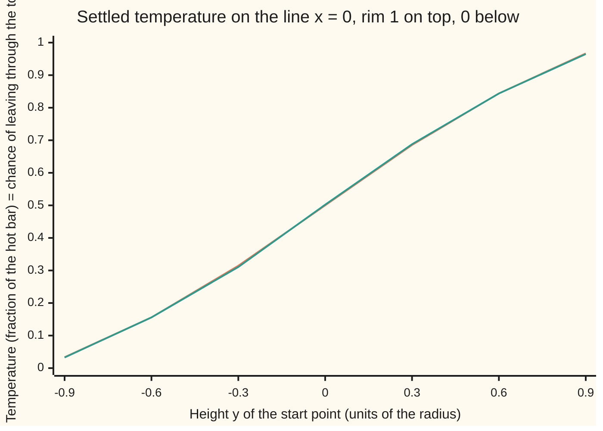
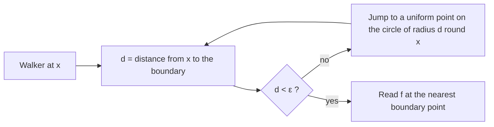

# The Dirichlet problem by Brownian motion: boundary values averaged over where the path exits

[Syllabus](../../../SYLLABUS.md) → [Stochastic processes and calculus](../README.md) → [Generators, Densities and Simulation](../README.md#s08) → The Dirichlet problem by Brownian motion

---

## General Overview

A thin round metal plate has radius 1 (measure lengths in units of the radius). The upper half of its rim is clamped to a hot bar. The lower half sits in iced water. Write the temperature as a fraction of the bar's: 1 on the upper half of the rim, 0 on the lower half. Hours later the plate has settled. What does it read at the point (0, 0.5), halfway from the centre to the top?

The answer is 0.795167 of the bar's temperature. At the centre it is exactly 1/2, by symmetry.

Here is a way to get that number with no equation solving. Release a random walker at (0, 0.5). Let it wander as a Brownian motion (the random walk seen from far away) until it first touches the rim. Note the rim temperature where it touches. Repeat many times and average. The average is the settled temperature. Here it is the chance that the walker leaves through the top half: 0.795.

The same averaging works for any region and any rim values. Engineers use it to get the voltage or temperature at one chosen point without meshing the whole region. The fast version, **walk-on-spheres**, jumps across the largest circle that fits at each step. From (0, 0.5) it needs 12.59 jumps on average.

**The settled value at a point x is the average of the boundary values over the place where a Brownian path started at x first leaves the region: this average is harmonic inside, takes the boundary values at every regular boundary point, and for the disc it reproduces the Poisson kernel.**

**What kind of fact this is:** a theorem (Kakutani, 1944), proved on this card in Why it works, with the steps "mean value implies harmonic" and "a regular point passes on its value" in folded Detailed proofs. Walk-on-spheres is an algorithm, exact in its jumps, with one controlled error: where it stops.

### The picture: the temperature up the vertical diameter



Orange: the exact temperature, from the closed form below. Green: walk-on-spheres, 20,000 walkers from each start point, each walker stopped within 0.0001 of the rim. The two lines agree to within the simulation's noise, printed beside each point. Both checks print every point.

---

## The formula

Reminders first.

- $`B_t`$ is Brownian motion in the plane: two independent one-dimensional Brownian motions, one for each coordinate ([Brownian motion in d dimensions](08-recurrence-and-transience-of-brownian-motion.md)).
- $`E_x`$ and $`P_x`$ are the average and the chance over paths that start at the point $`x`$.
- The **Laplacian** $`\Delta u = u_{xx} + u_{yy}`$ is the total bend of $`u`$. A function with $`\Delta u = 0`$ is **harmonic**: a settled temperature with no heater inside ([Laplace's equation](../../08-Differential%20equations%20and%20dynamics/10-The%20Classical%20PDEs/07-laplaces-equation-and-harmonic-functions.md)).
- The generator of Brownian motion is $`\tfrac12\Delta`$: drift 0 and noise 1 in each direction ([The generator](01-infinitesimal-generator.md)).

New notation. $`D`$ is the region and $`\partial D`$ its boundary. $`f`$ gives the value held at each boundary point. The **exit time** $`\tau`$ is the first time the path is outside $`D`$. Finding a harmonic $`u`$ in $`D`$ that equals $`f`$ on $`\partial D`$ is the **Dirichlet problem**.

```math
u(x) = E_x\big[f(B_\tau)\big], \qquad \tau = \inf\{t > 0 : B_t \notin D\}
```

**Read it aloud:** the value at x is the average of the boundary value at the place where a Brownian path from x first leaves the region.

Kakutani's theorem: for a bounded region and a bounded boundary function $`f`$,

```math
\Delta u = 0 \ \text{in } D, \qquad u(x) \to f(z) \ \text{as } x \to z, \ \text{at every regular } z \in \partial D \text{ where } f \text{ is continuous}
```

**Read it aloud:** the average is harmonic inside, and it approaches the held value as the start point approaches any regular boundary point.

A boundary point $`z`$ is **regular** when a path started at $`z`$ leaves $`D`$ at once, with chance 1. For the disc, the exit place has the Poisson kernel as its density ([The Poisson formula](../../07-Complex%20analysis/07-Conformal%20Maps%20and%20Harmonic%20Functions/06-poisson-integral-formula.md)). For the start point $`x = re^{i\varphi}`$ (distance $`r`$ from the centre, angle $`\varphi`$; the letter $`t`$ stays reserved for time):

```math
P_x\big(B_\tau \text{ lands at angle } s \text{ to } s + ds\big) = \frac{1}{2\pi}\,\frac{1 - r^2}{1 - 2r\cos(\varphi - s) + r^2}\,ds
```

Summed over the upper half of the rim, it gives the plate's temperature in closed form:

```math
u(x, y) = \frac12 + \frac1\pi \arctan\frac{2y}{1 - x^2 - y^2}
```

**Read it aloud:** the temperature is one half, plus one over pi times the angle whose tangent is twice the height over one minus the squared distance from the centre.

At $`(0, 0.5)`$ the fraction is $`1/0.75`$ and $`u = 0.795167`$.

| Symbol | Plain meaning | In our example | Push it up and the answer… |
| --- | --- | --- | --- |
| $`D`$, $`\partial D`$ | the region; its boundary | the unit disc; its rim | — |
| $`f`$ | the value held on the boundary | 1 on the top half, 0 on the bottom | raise $`f`$ by 1 everywhere: $`u`$ rises by 1 |
| $`x`$; $`(x, y)`$, $`r`$, $`\varphi`$ | the start point; its coordinates, its distance from the centre and its angle | (0, 0.5); r = 0.5, φ = π/2 | y up: u climbs toward 1 |
| $`B_t`$, $`E_x`$, $`P_x`$ | Brownian motion in the plane from $`x`$; average and chance over its paths | $`P_x`$(leave through the top) = 0.795167 | — |
| $`\tau`$, $`\sigma`$ | exit time from $`D`$; first time on a small circle round $`x`$ | average of $`\tau`$: 0.375 | — |
| $`u`$, $`h`$ | the exit-place average of $`f`$, the settled temperature; any other solution | 0.795167 at (0, 0.5), 0.5 at the centre | — |
| $`\Delta`$ | the Laplacian: total bend | 0 everywhere inside | — |
| $`s`$, $`\theta`$ | angle of a rim point; angle round a small circle | 0 to π is the top half | — |
| $`z`$, $`\rho`$ | a boundary point; the radius of a small circle in the proof | z = (1, 0) is a jump of f | — |
| $`d`$, $`\varepsilon`$, $`N`$ | walk-on-spheres: distance to the boundary; stopping width; number of walkers | first jump d = 0.5; ε = 0.0001; N = 100,000 | larger ε: fewer jumps, more bias; larger N: noise shrinks like $`1/\sqrt N`$ |
| $`\delta`$ | radius of a small held hole at the centre (Step 6) | 0.1 down to 0.000001 | larger δ: more grip |
| $`g`$, $`a`$, $`n`$, $`t_0`$; $`K`$, $`v`$, $`w`$, $`M`$ | proof helpers: Dynkin's test function, a tangent, a time cap, an earlier time in Step 4's fold; in Step 3's fold a small disc, its Poisson solution, the difference, its maximum | g = x² + y² | — |

### When it holds

- **A bounded region.** The proof needs the walker to leave in finite average time. On the half-plane y > 0 with edge value 0, both u = 0 and u = y are harmonic and 0 on the edge. The exit average returns 0, the bounded one; uniqueness then needs boundedness as an extra condition.
- **Regular boundary points.** At an irregular point, the walker never feels the held value. A disc with only its centre held at 1 gives $`u = 0`$ everywhere inside: the walker never hits a single point (Step 6).
- **Bounded boundary values.** The average must exist. Unbounded values can make $`E_x[f(B_\tau)]`$ infinite.
- **f continuous at z, for the limit there.** Our $`f`$ jumps at $`(\pm 1, 0)`$. There $`u`$ stays harmonic inside, but along the radius toward a jump it tends to the midpoint 1/2, not to 0 or 1.
- **No source and no drift.** A heater inside adds a running reward along the path ([Feynman-Kac](../07-Changing%20Measure/06-feynman-kac-formula.md)). A drift changes the operator from $`\tfrac12\Delta`$ to another generator, and the same exit average then solves that equation.

---

## Why it works

### Step 0: the idea, Brownian motion restarts and has no favoured direction

Brownian motion forgets its past at a **stopping time** (a random time fixed by the path so far, such as its first visit to a circle): after it first reaches a circle, it starts afresh from where it landed. This is the **strong Markov property**. And it has no favoured direction: turn the plane about the start point and the motion looks the same. Together these give the average a mean value property, and the mean value property is what makes a function harmonic.

### Step 1: the walker leaves, on average after 0.375

Apply Dynkin's formula ([The generator](01-infinitesimal-generator.md)): the average of a function at a stopping time equals its starting value plus the average of its generator value summed along the path. Apply it to $`g(x) = x^2 + y^2`$. Its generator value is $`\tfrac12 \Delta g = \tfrac12 \cdot 4 = 2`$ at every point. Stopped at $`\tau`$, where $`g = 1`$:

```math
1 = E_x\big[g(B_\tau)\big] = g(x) + 2\,E_x[\tau] \quad\Longrightarrow\quad E_x[\tau] = \frac{1 - r^2}{2}
```

At $`(0, 0.5)`$ this is $`0.75/2 = 0.375`$. (To be careful, stop at $`\tau \wedge n`$, the earlier of $`\tau`$ and time $`n`$, then let $`n`$ grow.) So every path leaves, and $`u`$ is well defined.

### Step 2: the average has the mean value property

Take a small circle of radius $`\rho`$ round $`x`$, inside $`D`$. A path from $`x`$ must cross this circle before it reaches the rim. Let $`\sigma`$ be the time it first does.

- By rotation, the crossing place $`B_\sigma`$ is spread evenly round the small circle.
- By the strong Markov property, from $`B_\sigma`$ the path starts again, so its average exit value from there is $`u(B_\sigma)`$.

```math
u(x) = E_x\big[u(B_\sigma)\big] = \frac{1}{2\pi}\int_0^{2\pi} u\big(x + \rho e^{i\theta}\big)\,d\theta
```

**Read it aloud:** the value at x is the plain average of u round any circle centred at x that stays inside the region.

The checks test this on the closed form: round the circle of radius 0.3 about (0, 0.5), $`u`$ averages to 0.795167, the centre value.

### Step 3: the mean value property makes u harmonic

A continuous function that equals its average round every small circle is harmonic. The converse is on [Mean value and maximum principle](../../07-Complex%20analysis/07-Conformal%20Maps%20and%20Harmonic%20Functions/05-mean-value-and-maximum-principle-for-harmonic-functions.md); this direction is in the fold. The checks also take second differences of the closed form at (0, 0.5) and find the Laplacian 0.000000.

<details>
<summary>Detailed proof: a bounded function with the mean value property is continuous and harmonic</summary>

Continuity. Average the circle identity over all radii from 0 to $`\rho`$, weighting each circle by its length. Then $`u(x)`$ equals the average of $`u`$ over the whole disc of radius $`\rho`$ round $`x`$. Move $`x`$ a little: the two discs differ only in a thin crescent of small area. Since $`|u| \le \max |f|`$, the averages differ by a small amount. So $`u`$ is continuous.

Harmonic. Fix a closed disc $`K`$ inside $`D`$. Let $`v`$ be the Poisson integral of $`u`$ round the edge of $`K`$: harmonic inside $`K`$ and equal to $`u`$ on its edge. Then $`w = u - v`$ is continuous, has the mean value property, and is 0 on the edge.

Suppose $`w`$ had a positive maximum $`M`$ inside $`K`$. The set where $`w = M`$ is closed. It is also open: at such a point, $`w`$ averages to $`M`$ round each small circle, yet is at most $`M`$ there, so it equals $`M`$ on each small circle. A set both open and closed in the disc is all of it or empty. All of it is impossible, since $`w = 0`$ on the edge. So $`w \le 0`$; the same argument for $`-w`$ gives $`w \ge 0`$. Hence $`u = v`$ inside $`K`$, and $`u`$ is harmonic there.

</details>

### Step 4: near a regular point, the walker exits nearby

Fix a boundary point $`z`$ where $`f`$ is continuous, and a start point $`x`$ close to $`z`$. Two things can happen.

- The path leaves within a short time, before it moves far. Then it exits close to $`z`$, where $`f`$ is close to $`f(z)`$.
- The path survives for a while. If $`z`$ is regular, this has small chance once $`x`$ is close enough to $`z`$: the fold below proves it.

So $`u(x) \to f(z)`$.

<details>
<summary>Detailed proof: a regular point passes on its value</summary>

Fix a time $`t > 0`$ and an earlier time $`t_0`$, with $`0 < t_0 < t`$. A path that stays in $`D`$ until time $`t`$ also stays in $`D`$ from $`t_0`$ to $`t`$. Restart it at $`t_0`$, by the Markov property:

$`\displaystyle P_x(\tau > t) \le E_x\big[P_{B_{t_0}}(\tau > t - t_0)\big] .`$

The right side averages a bounded function of $`B_{t_0}`$ against its bell-shaped density, which moves smoothly with $`x`$. So it is continuous in $`x`$, and as $`x \to z`$ it tends to its value at $`z`$: the chance that a path from $`z`$ stays in $`D`$ at all times after $`t_0`$, up to $`t`$. As $`t_0 \to 0`$ that chance falls to the chance of staying in $`D`$ at all times in $`(0, t]`$, which is 0 because $`z`$ is regular. So $`P_x(\tau > t) \to 0`$ as $`x \to z`$, for every fixed $`t`$.

Now pick a small distance, and a time $`t`$ so short that a path rarely moves that far by time $`t`$. Take $`x`$ within that distance of $`z`$. A path that leaves by time $`t`$ without moving that far exits within twice the distance of $`z`$, where $`f`$ is close to $`f(z)`$. The other cases, leaving after $`t`$ or moving far, have small chance once $`x`$ is close to $`z`$, and $`f`$ is bounded, so they move the average $`u(x)`$ only a little. Hence $`u(x) \to f(z)`$.

</details>

Every rim point of the disc is regular. A small wedge (a **cone**) at $`z`$ lies outside the disc. At every fixed time, a path from $`z`$ is inside that wedge with chance equal to the wedge's share of the full turn, so it enters the wedge at arbitrarily small times with at least that chance. **Blumenthal's zero-one law** (an event decided by the path's first instants has chance 0 or 1) then raises that chance to 1. This is **Poincaré's cone condition**: a boundary point that touches an outside cone is regular.

### Step 5: any solution is the average, so the exit place has the Poisson density

Run the argument backwards. Let $`h`$ be any function harmonic in $`D`$, continuous up to $`\partial D`$, and equal to $`f`$ there. Dynkin's formula with $`\tfrac12\Delta h = 0`$ gives $`h(x) = E_x[h(B_\tau)] = E_x[f(B_\tau)]`$. So a solution, if it exists, is $`u`$. This repeats, by paths, the uniqueness proved by the maximum principle.

For the disc, the Poisson formula builds a solution for every continuous $`f`$. It and $`u`$ agree for every continuous $`f`$. So the exit place has the Poisson kernel as its density. That is the formula above.

On the vertical axis, $`\varphi = \pi/2`$, the top half runs over the angles $`\varphi - s`$ from $`-\pi/2`$ to $`\pi/2`$. The kernel has an antiderivative, $`2\arctan\big(\tfrac{1+r}{1-r}\tan\tfrac{\varphi-s}{2}\big)`$. Between those limits it rises by $`4\arctan\tfrac{1+r}{1-r}`$, so

```math
u(0, r) = \frac{2}{\pi}\arctan\frac{1+r}{1-r} = \frac12 + \frac1\pi\arctan\frac{2r}{1-r^2}
```

The second form uses $`2\arctan a - \pi/2 = \arctan\frac{a^2 - 1}{2a}`$ with $`a = 3`$ at $`r = 0.5`$. Both forms give 0.795167. The general closed form, off the axis, is checked against the Poisson integral at (0.6, 0.3): both give 0.763831.

### Step 6: where the method fails, the punctured disc and the thorn

Take the disc with its centre removed. Hold the rim at 0 and the centre point at 1. A planar Brownian path never hits a fixed point ([Brownian motion in d dimensions](08-recurrence-and-transience-of-brownian-motion.md)). So every walker leaves through the rim, and $`u = 0`$ everywhere inside. The value 1 at the centre is never felt. The centre is an **irregular** point.

No other answer exists either. Step 5's argument works here too: a solution, harmonic inside and continuous up to the rim and the centre, would equal the exit average, 0, everywhere inside, so it could not reach 1 at the centre. The Dirichlet problem has no solution. Shrinking a real hole shows how the grip fades. Hold a small circle of radius $`\delta`$ at 1. The temperature at distance 0.5 is $`\ln 0.5 / \ln \delta`$, since $`\ln r`$ is harmonic in the plane.

```
hole radius δ    temperature at distance 0.5
0.1              ###############                0.301030
0.01             ########                       0.150515
0.001            #####                          0.100343
0.000001         ###                            0.050172
```

The fall is only logarithmic, but in the limit it is 0.

In three dimensions a boundary point need not be isolated to be irregular. **Lebesgue's thorn**, in outline: remove from a ball a thin spike pointing inward, whose width shrinks to 0 very fast near its tip. A path started at the tip slips into the region without touching the spike, with chance 1. Values held on the spike near the tip are not reached. The exact test for regularity, Wiener's test, is wing 19's subject.

### Step 7: walk-on-spheres, the method as an algorithm

Step 2 says the next useful fact about a walker is where it lands on a circle, and that landing place is uniform. So skip the path inside the circle. Muller (1956) turned this into an algorithm:



Each jump is exact in law. The only error is the last step, reading $`f`$ at the nearest boundary point when the walker is within $`\varepsilon`$ of it. The number of jumps grows only like $`\ln(1/\varepsilon)`$: 12.59 on average with $`\varepsilon`$ = 0.0001. A plain time-stepped walk with steps of 0.001 needs 391.3 steps per path on average.

---

## Worked numbers, by hand

The plate, at the point (0, 0.5): distance r = 0.5 from the centre, so $`x^2 + y^2 = 0.25`$.

| Step | Arithmetic | Value |
| --- | --- | --- |
| room to the rim | 1 − 0.25 | 0.750000 |
| the fraction | 2 × 0.5 / 0.75 | 1.333333 |
| its angle, in radians | arctan 1.333333 | 0.927295 |
| share of a half-turn | 0.927295 / π | 0.295167 |
| **temperature, = chance of leaving through the top** | 0.5 + 0.295167 | **0.795167** |
| cross-check on the axis | (2/π) × arctan 3 = (2/π) × 1.249046 | 0.795167 |
| Poisson weight of the top point (0, 1) | 0.75 / (1 − 2 × 0.5 + 0.25) | 3.000000 |
| Poisson weight of the bottom point (0, −1) | 0.75 / (1 + 2 × 0.5 + 0.25) | 0.333333 |
| Poisson weight of the side point (1, 0) | 0.75 / (1 + 0.25) | 0.600000 |
| average time to leave | (1 − 0.25) / 2 | 0.375000 |

Of all walkers released at (0, 0.5), 79.5 percent leave through the hot half. The top point weighs 3.000000 and the bottom point 0.333333; that tilt is the whole difference from 1/2. Each weight is the exit density of The formula times 2π, so a uniform rim would weigh 1 at every point.

### What breaks if you drop a piece

| Mistake | Comes out at | What went wrong |
| --- | --- | --- |
| Treat every rim point as equally likely | 0.500000 | drops the Poisson weighting; true only at the centre |
| Read the value at the rim point nearest the start | 1.000000 | the walker wanders; the near rim gets more weight (3.000000 against 0.333333), not all of it |
| Walk-on-spheres stopped at ε = 0.3 | 0.817620 ± 0.001221, after 1.80 jumps | walkers still well inside are read off at the nearest rim point; true value 0.795167 |
| Hold only the centre point at 1, rim at 0 | 0 everywhere; a hole of radius 0.000001 still gives just 0.050172 | the centre is irregular: no walker ever reaches it |

---

## Code, from first principles, and it actually runs

The code takes four independent roads to 0.795167. Road 1 is the closed form, with the axis form (2/π) arctan 3 beside it. Road 2 integrates the Poisson kernel over the top half of the rim by Simpson's rule, at (0, 0.5) and at (0.6, 0.3). Road 3 is walk-on-spheres with 100,000 walkers. Road 4 is plain Brownian motion in time steps of 0.001, with 10,000 paths. Both simulations use a SplitMix64 generator written out, seed 20261123, so Python and Rust draw the same numbers. The code also checks the mean value property, the Laplacian, the wide stopping shell, the shrinking hole (walk-on-spheres in the ring against the formula), the chart, and a ball in three dimensions. It prints the mean exit time and the other mistakes.

The time-stepped walk gives a mean exit time of 0.391257, not 0.375. It checks for an exit only at the end of each step, so it misses brief trips outside and stops late. The late stop also makes the disc act slightly larger, which pulls the exit chance a little low, by about as much as road 4's own noise; so road 4 confirms 0.795167 only roughly. Walk-on-spheres has no such time error, because it never uses time.

### Python

```python
# The Dirichlet problem by Brownian motion -- the check behind the card.  Standard library only.
# A unit disc plate, rim held at 1 on the upper half and 0 on the lower half.  u(x) = chance a
# Brownian path from x leaves through the upper half.  Four roads to u(0, 0.5): the closed form,
# the Poisson integral by Simpson's rule, walk-on-spheres, and time-stepped Brownian motion.
import math

M64 = (1 << 64) - 1

class SplitMix64:  # seeded random numbers, written out so Rust can repeat them exactly
    def __init__(self, seed):
        self.s = seed
    def unif(self):
        self.s = (self.s + 0x9E3779B97F4A7C15) & M64
        z = self.s
        z = ((z ^ (z >> 30)) * 0xBF58476D1CE4E5B9) & M64
        z = ((z ^ (z >> 27)) * 0x94D049BB133111EB) & M64
        return ((z ^ (z >> 31)) >> 11) * 2.0 ** -53

def exact(x, y):  # Road 1: closed form for the half-hot rim
    return 0.5 + math.atan(2 * y / (1 - x * x - y * y)) / math.pi

def kernel(x, y, s):  # Poisson kernel: weight of rim angle s seen from (x, y)
    return (1 - x * x - y * y) / ((math.cos(s) - x) ** 2 + (math.sin(s) - y) ** 2)

def simpson(f, a, b, n=2000):
    h = (b - a) / n
    return (f(a) + f(b) + sum((4 if k % 2 else 2) * f(a + k * h) for k in range(1, n))) * h / 3

def wos(x0, y0, eps, n, rng, dist, read):  # walk-on-spheres in the plane
    tot = sq = 0.0
    jumps = 0
    for _ in range(n):
        x, y = x0, y0
        while True:
            d = dist(x, y)
            if d < eps:
                break
            a = 2 * math.pi * rng.unif()
            x += d * math.cos(a)
            y += d * math.sin(a)
            jumps += 1
        v = read(x, y)
        tot += v
        sq += v * v
    m = tot / n
    return m, math.sqrt((sq / n - m * m) / n), jumps / n

disc = lambda x, y: 1 - math.hypot(x, y)
top = lambda x, y: 1.0 if y > 0 else 0.0
x0, y0 = 0.0, 0.5
u = exact(x0, y0)
print("example: unit disc, rim 1 on top half, 0 on bottom half, start (0, 0.5)")
print(f"centre u(0,0) = {exact(0, 0):.6f}")
print(f"road 1 closed form 1/2 + atan(1/0.75)/pi = {u:.6f}")
r1 = 2 / math.pi * math.atan((1 + y0) / (1 - y0))
print(f"road 1b on the axis (2/pi) atan(3) = {r1:.6f}")
g = 2 * y0 / (1 - y0 * y0)
print(f"by hand: 1 - r^2 = {1 - y0 * y0:.6f}, 2y/(1 - r^2) = {g:.6f}, atan = {math.atan(g):.6f}, "
      f"/pi = {math.atan(g) / math.pi:.6f}, atan(3) = {math.atan(3):.6f}")
pint = simpson(lambda s: kernel(x0, y0, s), 0, math.pi) / (2 * math.pi)
print(f"road 2 Poisson integral over top half = {pint:.6f}")
print(f"kernel weights: top (0,1) {kernel(x0, y0, math.pi / 2):.6f}, bottom (0,-1) "
      f"{kernel(x0, y0, -math.pi / 2):.6f}, sides (1,0) {kernel(x0, y0, 0):.6f}")
assert abs(pint - u) < 1e-9
assert abs(r1 - u) < 1e-12
off = simpson(lambda s: kernel(0.6, 0.3, s), 0, math.pi) / (2 * math.pi)
print(f"off the axis (0.6, 0.3): closed form {exact(0.6, 0.3):.6f}, Poisson {off:.6f}")
assert abs(off - exact(0.6, 0.3)) < 1e-9
rng = SplitMix64(20261123)
m, se, j = wos(x0, y0, 1e-4, 100000, rng, disc, top)
print(f"road 3 walk-on-spheres, 100000 walks, eps 1e-4: {m:.6f} +- {se:.6f}, mean jumps {j:.2f}")
assert abs(m - u) < 4 * se
up = tsum = 0.0
h, n = 1e-3, 10000
for _ in range(n):
    x, y, t = x0, y0, 0.0
    while x * x + y * y < 1:
        g = math.sqrt(-2 * h * math.log(1 - rng.unif()))
        a = 2 * math.pi * rng.unif()
        x += g * math.cos(a)
        y += g * math.sin(a)
        t += h
    up += 1.0 if y > 0 else 0.0
    tsum += t
p = up / n
sp = math.sqrt(p * (1 - p) / n)
print(f"road 4 time steps of 0.001, 10000 paths: {p:.6f} +- {sp:.6f}, steps per path {tsum / n / h:.1f}")
assert abs(p - u) < 4 * sp
print(f"mean exit time: Dynkin (1 - 0.25)/2 = {(1 - x0 * x0 - y0 * y0) / 2:.6f}, time steps {tsum / n:.6f}")
ring = sum(exact(0.3 * math.cos(2 * math.pi * k / 3600), y0 + 0.3 * math.sin(2 * math.pi * k / 3600))
           for k in range(3600)) / 3600
print(f"mean value: average of u on circle radius 0.3 round (0,0.5) = {ring:.6f}")
assert abs(ring - u) < 1e-9
dh = 1e-3
lap = (exact(dh, y0) + exact(-dh, y0) + exact(0, y0 + dh) + exact(0, y0 - dh) - 4 * u) / dh ** 2
print(f"Laplacian by differences at (0,0.5) = {lap:.6f}")
assert abs(lap) < 1e-4
print("what breaks:")
print(f"  rim treated as uniform: {simpson(lambda s: 1.0, 0, math.pi) / (2 * math.pi):.6f}")
print(f"  nearest rim point (0,1) read off: {top(0, 1):.6f}")
mb, sb, jb = wos(x0, y0, 0.3, 100000, rng, disc, top)
print(f"  walk-on-spheres with eps 0.3: {mb:.6f} +- {sb:.6f}, mean jumps {jb:.2f}")
assert mb - u > 5 * sb
print("hole of radius delta at the centre, held at 1; outer rim 0; start at distance 0.5:")
for e in (0.1, 0.01, 1e-3, 1e-6):
    print(f"  delta = {e:g}: u = ln 0.5 / ln delta = {math.log(0.5) / math.log(e):.6f}")
ma, sa, ja = wos(x0, y0, 1e-4, 20000, rng, lambda x, y: min(math.hypot(x, y) - 0.1, disc(x, y)),
                 lambda x, y: 1.0 if math.hypot(x, y) < 0.55 else 0.0)
print(f"  delta = 0.1 by walk-on-spheres, 20000 walks: {ma:.6f} +- {sa:.6f}")
assert abs(ma - math.log(0.5) / math.log(0.1)) < 4 * sa
print("chart: u up the vertical diameter, exact and walk-on-spheres (20000 walks each)")
for k in range(-3, 4):
    yk = 0.3 * k
    mk, sk, _ = wos(0.0, yk, 1e-4, 20000, rng, disc, top)
    print(f"  y = {yk:+.1f}: exact {exact(0, yk):.6f}, walks {mk:.6f} +- {sk:.6f}")
    assert abs(mk - exact(0, yk)) < 4 * sk + 1e-12
b3 = (1 - y0 ** 2) / (2 * y0) * (1 / (1 - y0) - 1 / math.sqrt(1 + y0 ** 2))
i3 = (1 - y0 ** 2) / 2 * simpson(lambda c: (1 - 2 * y0 * c + y0 ** 2) ** -1.5, 0, 1)
hit = 0.0
for _ in range(20000):
    x, y, z = 0.0, 0.0, y0
    while (d := 1 - math.sqrt(x * x + y * y + z * z)) >= 1e-4:
        c = 2 * rng.unif() - 1
        a = 2 * math.pi * rng.unif()
        w = math.sqrt(1 - c * c)
        x, y, z = x + d * w * math.cos(a), y + d * w * math.sin(a), z + d * c
    hit += 1.0 if z > 0 else 0.0
q = hit / 20000
sq3 = math.sqrt(q * (1 - q) / 20000)
print(f"ball in 3D, top half held at 1, start (0,0,0.5): formula {b3:.6f}, integral {i3:.6f}, "
      f"walks {q:.6f} +- {sq3:.6f}")
assert abs(b3 - i3) < 1e-9
assert abs(q - b3) < 4 * sq3
print("ALL CHECKS PASS")
```

**Ran 2026-11-23 on macOS, Python 3.14.10, standard library only. All checks passed. Output, pasted from the run:**

```
example: unit disc, rim 1 on top half, 0 on bottom half, start (0, 0.5)
centre u(0,0) = 0.500000
road 1 closed form 1/2 + atan(1/0.75)/pi = 0.795167
road 1b on the axis (2/pi) atan(3) = 0.795167
by hand: 1 - r^2 = 0.750000, 2y/(1 - r^2) = 1.333333, atan = 0.927295, /pi = 0.295167, atan(3) = 1.249046
road 2 Poisson integral over top half = 0.795167
kernel weights: top (0,1) 3.000000, bottom (0,-1) 0.333333, sides (1,0) 0.600000
off the axis (0.6, 0.3): closed form 0.763831, Poisson 0.763831
road 3 walk-on-spheres, 100000 walks, eps 1e-4: 0.794000 +- 0.001279, mean jumps 12.59
road 4 time steps of 0.001, 10000 paths: 0.789200 +- 0.004079, steps per path 391.3
mean exit time: Dynkin (1 - 0.25)/2 = 0.375000, time steps 0.391257
mean value: average of u on circle radius 0.3 round (0,0.5) = 0.795167
Laplacian by differences at (0,0.5) = 0.000000
what breaks:
  rim treated as uniform: 0.500000
  nearest rim point (0,1) read off: 1.000000
  walk-on-spheres with eps 0.3: 0.817620 +- 0.001221, mean jumps 1.80
hole of radius delta at the centre, held at 1; outer rim 0; start at distance 0.5:
  delta = 0.1: u = ln 0.5 / ln delta = 0.301030
  delta = 0.01: u = ln 0.5 / ln delta = 0.150515
  delta = 0.001: u = ln 0.5 / ln delta = 0.100343
  delta = 1e-06: u = ln 0.5 / ln delta = 0.050172
  delta = 0.1 by walk-on-spheres, 20000 walks: 0.301200 +- 0.003244
chart: u up the vertical diameter, exact and walk-on-spheres (20000 walks each)
  y = -0.9: exact 0.033475, walks 0.032700 +- 0.001258
  y = -0.6: exact 0.155958, walks 0.155700 +- 0.002564
  y = -0.3: exact 0.314453, walks 0.310650 +- 0.003272
  y = +0.0: exact 0.500000, walks 0.502150 +- 0.003536
  y = +0.3: exact 0.685547, walks 0.687800 +- 0.003277
  y = +0.6: exact 0.844042, walks 0.843600 +- 0.002568
  y = +0.9: exact 0.966525, walks 0.964750 +- 0.001304
ball in 3D, top half held at 1, start (0,0,0.5): formula 0.829180, integral 0.829180, walks 0.827650 +- 0.002671
ALL CHECKS PASS
```

### Rust

```rust
// The Dirichlet problem by Brownian motion -- the check behind the card.  std only, no crates.
// A unit disc plate, rim held at 1 on the upper half and 0 on the lower half.  u(x) = chance a
// Brownian path from x leaves through the upper half.  Four roads to u(0, 0.5): the closed form,
// the Poisson integral by Simpson's rule, walk-on-spheres, and time-stepped Brownian motion.
use std::f64::consts::PI;

struct SplitMix64 {
    s: u64,
}
impl SplitMix64 {
    fn unif(&mut self) -> f64 {
        self.s = self.s.wrapping_add(0x9E3779B97F4A7C15);
        let mut z = self.s;
        z = (z ^ (z >> 30)).wrapping_mul(0xBF58476D1CE4E5B9);
        z = (z ^ (z >> 27)).wrapping_mul(0x94D049BB133111EB);
        ((z ^ (z >> 31)) >> 11) as f64 * 2f64.powi(-53)
    }
}

fn exact(x: f64, y: f64) -> f64 {
    0.5 + (2.0 * y / (1.0 - x * x - y * y)).atan() / PI
}

fn kernel(x: f64, y: f64, s: f64) -> f64 {
    (1.0 - x * x - y * y) / ((s.cos() - x).powi(2) + (s.sin() - y).powi(2))
}

fn simpson(f: &dyn Fn(f64) -> f64, a: f64, b: f64) -> f64 {
    let n = 2000;
    let h = (b - a) / n as f64;
    let mut inner = 0.0;
    for k in 1..n {
        inner += (if k % 2 == 1 { 4.0 } else { 2.0 }) * f(a + k as f64 * h);
    }
    (f(a) + f(b) + inner) * h / 3.0
}

fn wos(x0: f64, y0: f64, eps: f64, n: usize, rng: &mut SplitMix64,
       dist: &dyn Fn(f64, f64) -> f64, read: &dyn Fn(f64, f64) -> f64) -> (f64, f64, f64) {
    let (mut tot, mut sq, mut jumps) = (0.0, 0.0, 0usize);
    for _ in 0..n {
        let (mut x, mut y) = (x0, y0);
        loop {
            let d = dist(x, y);
            if d < eps {
                break;
            }
            let a = 2.0 * PI * rng.unif();
            x += d * a.cos();
            y += d * a.sin();
            jumps += 1;
        }
        let v = read(x, y);
        tot += v;
        sq += v * v;
    }
    let m = tot / n as f64;
    (m, ((sq / n as f64 - m * m) / n as f64).sqrt(), jumps as f64 / n as f64)
}

fn main() {
    let disc = |x: f64, y: f64| 1.0 - x.hypot(y);
    let top = |_x: f64, y: f64| if y > 0.0 { 1.0 } else { 0.0 };
    let (x0, y0) = (0.0f64, 0.5f64);
    let u = exact(x0, y0);
    println!("example: unit disc, rim 1 on top half, 0 on bottom half, start (0, 0.5)");
    println!("centre u(0,0) = {:.6}", exact(0.0, 0.0));
    println!("road 1 closed form 1/2 + atan(1/0.75)/pi = {:.6}", u);
    let r1 = 2.0 / PI * ((1.0 + y0) / (1.0 - y0)).atan();
    println!("road 1b on the axis (2/pi) atan(3) = {:.6}", r1);
    let g = 2.0 * y0 / (1.0 - y0 * y0);
    println!("by hand: 1 - r^2 = {:.6}, 2y/(1 - r^2) = {:.6}, atan = {:.6}, /pi = {:.6}, atan(3) = {:.6}",
             1.0 - y0 * y0, g, g.atan(), g.atan() / PI, 3f64.atan());
    let pint = simpson(&|s| kernel(x0, y0, s), 0.0, PI) / (2.0 * PI);
    println!("road 2 Poisson integral over top half = {:.6}", pint);
    println!("kernel weights: top (0,1) {:.6}, bottom (0,-1) {:.6}, sides (1,0) {:.6}",
             kernel(x0, y0, PI / 2.0), kernel(x0, y0, -PI / 2.0), kernel(x0, y0, 0.0));
    assert!((pint - u).abs() < 1e-9);
    assert!((r1 - u).abs() < 1e-12);
    let off = simpson(&|s| kernel(0.6, 0.3, s), 0.0, PI) / (2.0 * PI);
    println!("off the axis (0.6, 0.3): closed form {:.6}, Poisson {:.6}", exact(0.6, 0.3), off);
    assert!((off - exact(0.6, 0.3)).abs() < 1e-9);
    let mut rng = SplitMix64 { s: 20261123 };
    let (m, se, j) = wos(x0, y0, 1e-4, 100000, &mut rng, &disc, &top);
    println!("road 3 walk-on-spheres, 100000 walks, eps 1e-4: {:.6} +- {:.6}, mean jumps {:.2}", m, se, j);
    assert!((m - u).abs() < 4.0 * se);
    let (mut up, mut tsum) = (0.0f64, 0.0f64);
    let (h, n) = (1e-3f64, 10000usize);
    for _ in 0..n {
        let (mut x, mut y, mut t) = (x0, y0, 0.0f64);
        while x * x + y * y < 1.0 {
            let g = (-2.0 * h * (1.0 - rng.unif()).ln()).sqrt();
            let a = 2.0 * PI * rng.unif();
            x += g * a.cos();
            y += g * a.sin();
            t += h;
        }
        up += if y > 0.0 { 1.0 } else { 0.0 };
        tsum += t;
    }
    let p = up / n as f64;
    let sp = (p * (1.0 - p) / n as f64).sqrt();
    println!("road 4 time steps of 0.001, 10000 paths: {:.6} +- {:.6}, steps per path {:.1}",
             p, sp, tsum / n as f64 / h);
    assert!((p - u).abs() < 4.0 * sp);
    println!("mean exit time: Dynkin (1 - 0.25)/2 = {:.6}, time steps {:.6}",
             (1.0 - x0 * x0 - y0 * y0) / 2.0, tsum / n as f64);
    let mut ring = 0.0;
    for k in 0..3600 {
        let a = 2.0 * PI * k as f64 / 3600.0;
        ring += exact(0.3 * a.cos(), y0 + 0.3 * a.sin());
    }
    ring /= 3600.0;
    println!("mean value: average of u on circle radius 0.3 round (0,0.5) = {:.6}", ring);
    assert!((ring - u).abs() < 1e-9);
    let dh = 1e-3;
    let lap = (exact(dh, y0) + exact(-dh, y0) + exact(0.0, y0 + dh) + exact(0.0, y0 - dh) - 4.0 * u)
        / (dh * dh);
    println!("Laplacian by differences at (0,0.5) = {:.6}", lap);
    assert!(lap.abs() < 1e-4);
    println!("what breaks:");
    println!("  rim treated as uniform: {:.6}", simpson(&|_s| 1.0, 0.0, PI) / (2.0 * PI));
    println!("  nearest rim point (0,1) read off: {:.6}", top(0.0, 1.0));
    let (mb, sb, jb) = wos(x0, y0, 0.3, 100000, &mut rng, &disc, &top);
    println!("  walk-on-spheres with eps 0.3: {:.6} +- {:.6}, mean jumps {:.2}", mb, sb, jb);
    assert!(mb - u > 5.0 * sb);
    println!("hole of radius delta at the centre, held at 1; outer rim 0; start at distance 0.5:");
    for (e, lab) in [(0.1f64, "0.1"), (0.01, "0.01"), (1e-3, "0.001"), (1e-6, "1e-06")] {
        println!("  delta = {}: u = ln 0.5 / ln delta = {:.6}", lab, 0.5f64.ln() / e.ln());
    }
    let (ma, sa, _) = wos(x0, y0, 1e-4, 20000, &mut rng,
                          &|x: f64, y: f64| (x.hypot(y) - 0.1).min(1.0 - x.hypot(y)),
                          &|x: f64, y: f64| if x.hypot(y) < 0.55 { 1.0 } else { 0.0 });
    println!("  delta = 0.1 by walk-on-spheres, 20000 walks: {:.6} +- {:.6}", ma, sa);
    assert!((ma - 0.5f64.ln() / 0.1f64.ln()).abs() < 4.0 * sa);
    println!("chart: u up the vertical diameter, exact and walk-on-spheres (20000 walks each)");
    for k in -3i32..4 {
        let yk = 0.3 * k as f64;
        let (mk, sk, _) = wos(0.0, yk, 1e-4, 20000, &mut rng, &disc, &top);
        println!("  y = {:+.1}: exact {:.6}, walks {:.6} +- {:.6}", yk, exact(0.0, yk), mk, sk);
        assert!((mk - exact(0.0, yk)).abs() < 4.0 * sk + 1e-12);
    }
    let b3 = (1.0 - y0 * y0) / (2.0 * y0) * (1.0 / (1.0 - y0) - 1.0 / (1.0 + y0 * y0).sqrt());
    let i3 = (1.0 - y0 * y0) / 2.0 * simpson(&|c| (1.0 - 2.0 * y0 * c + y0 * y0).powf(-1.5), 0.0, 1.0);
    let mut hit = 0.0f64;
    for _ in 0..20000 {
        let (mut x, mut y, mut z) = (0.0f64, 0.0f64, y0);
        loop {
            let d = 1.0 - (x * x + y * y + z * z).sqrt();
            if d < 1e-4 {
                break;
            }
            let c = 2.0 * rng.unif() - 1.0;
            let a = 2.0 * PI * rng.unif();
            let w = (1.0 - c * c).sqrt();
            x += d * w * a.cos();
            y += d * w * a.sin();
            z += d * c;
        }
        hit += if z > 0.0 { 1.0 } else { 0.0 };
    }
    let q = hit / 20000.0;
    let sq3 = (q * (1.0 - q) / 20000.0).sqrt();
    println!("ball in 3D, top half held at 1, start (0,0,0.5): formula {:.6}, integral {:.6}, walks {:.6} +- {:.6}",
             b3, i3, q, sq3);
    assert!((b3 - i3).abs() < 1e-9);
    assert!((q - b3).abs() < 4.0 * sq3);
    println!("ALL CHECKS PASS");
}
```

**Ran 2026-11-23 on macOS, rustc 1.98.1, no crates. All checks passed. Output, pasted from the run:**

```
example: unit disc, rim 1 on top half, 0 on bottom half, start (0, 0.5)
centre u(0,0) = 0.500000
road 1 closed form 1/2 + atan(1/0.75)/pi = 0.795167
road 1b on the axis (2/pi) atan(3) = 0.795167
by hand: 1 - r^2 = 0.750000, 2y/(1 - r^2) = 1.333333, atan = 0.927295, /pi = 0.295167, atan(3) = 1.249046
road 2 Poisson integral over top half = 0.795167
kernel weights: top (0,1) 3.000000, bottom (0,-1) 0.333333, sides (1,0) 0.600000
off the axis (0.6, 0.3): closed form 0.763831, Poisson 0.763831
road 3 walk-on-spheres, 100000 walks, eps 1e-4: 0.794000 +- 0.001279, mean jumps 12.59
road 4 time steps of 0.001, 10000 paths: 0.789200 +- 0.004079, steps per path 391.3
mean exit time: Dynkin (1 - 0.25)/2 = 0.375000, time steps 0.391257
mean value: average of u on circle radius 0.3 round (0,0.5) = 0.795167
Laplacian by differences at (0,0.5) = 0.000000
what breaks:
  rim treated as uniform: 0.500000
  nearest rim point (0,1) read off: 1.000000
  walk-on-spheres with eps 0.3: 0.817620 +- 0.001221, mean jumps 1.80
hole of radius delta at the centre, held at 1; outer rim 0; start at distance 0.5:
  delta = 0.1: u = ln 0.5 / ln delta = 0.301030
  delta = 0.01: u = ln 0.5 / ln delta = 0.150515
  delta = 0.001: u = ln 0.5 / ln delta = 0.100343
  delta = 1e-06: u = ln 0.5 / ln delta = 0.050172
  delta = 0.1 by walk-on-spheres, 20000 walks: 0.301200 +- 0.003244
chart: u up the vertical diameter, exact and walk-on-spheres (20000 walks each)
  y = -0.9: exact 0.033475, walks 0.032700 +- 0.001258
  y = -0.6: exact 0.155958, walks 0.155700 +- 0.002564
  y = -0.3: exact 0.314453, walks 0.310650 +- 0.003272
  y = +0.0: exact 0.500000, walks 0.502150 +- 0.003536
  y = +0.3: exact 0.685547, walks 0.687800 +- 0.003277
  y = +0.6: exact 0.844042, walks 0.843600 +- 0.002568
  y = +0.9: exact 0.966525, walks 0.964750 +- 0.001304
ball in 3D, top half held at 1, start (0,0,0.5): formula 0.829180, integral 0.829180, walks 0.827650 +- 0.002671
ALL CHECKS PASS
```

### Lean

Lean proves the card's disc facts that need no Brownian motion, for the unit disc, and checks the worked numbers.

- Take the plate's closed form $`u`$. Then it is harmonic inside the unit disc.
- Take a rim point $`z`$ off the horizontal axis. Then $`u(x) \to f(z)`$ as $`x \to z`$ from inside: 1 on the top half, 0 below.
- Take any $`h`$ harmonic inside the unit disc and continuous up to the rim. Then $`h`$ at $`re^{i\varphi}`$ is its rim values averaged with the Poisson kernel of The formula.
- Take a hole of radius $`\delta`$ held at 1, with $`0 < \delta < 1`$, and the rim held at 0. Then $`\ln r / \ln \delta`$ is harmonic between them, equal to 1 on the hole's edge and 0 on the rim.
- Take a fixed distance $`r`$ with $`0 < r < 1`$. Then $`\ln r / \ln \delta \to 0`$ as $`\delta`$ shrinks to 0.
- The worked numbers also check exactly. They include the centre value 1/2, the Poisson weights 3, 1/3 and 3/5, and the time 3/8.

The Brownian paths themselves, the walkers, the exit times and the ball in three dimensions are left to the Python and Rust checks.

```lean
-- The Dirichlet problem by Brownian motion: the half-hot plate's closed form is harmonic in the unit disc and takes the held rim values, every solution on the disc is the Poisson-weighted average of its rim values, and a held hole of radius δ loses its grip as δ shrinks to 0.
import Mathlib.Analysis.Complex.Harmonic.Poisson
import Mathlib.Analysis.InnerProductSpace.Harmonic.Constructions
import Mathlib.Analysis.SpecialFunctions.Trigonometric.ArctanDeriv
import Mathlib.Analysis.SpecialFunctions.Log.Deriv
import Mathlib.Analysis.SpecialFunctions.Complex.Analytic
import Mathlib.MeasureTheory.Integral.IntervalIntegral.Basic

open Complex InnerProductSpace Metric Filter Topology

/-- The settled temperature of the half-hot plate: the unit disc with its rim held at 1 on the
upper half and 0 on the lower half. At the point z = x + iy it is
u = 1/2 + (1/π) arctan(2y / (1 - x² - y²)). -/
noncomputable def plateTemp (z : ℂ) : ℝ :=
  1 / 2 + (1 / Real.pi) * Real.arctan (2 * z.im / (1 - ‖z‖ ^ 2))

lemma plateTemp_aux_re (z : ℂ) :
    ((1 + z) / (1 - z)).re = (1 - ‖z‖ ^ 2) / Complex.normSq (1 - z) := by
  rw [Complex.div_re, Complex.sq_norm]
  simp only [Complex.normSq_apply, Complex.add_re, Complex.one_re, Complex.sub_re, Complex.add_im, Complex.one_im,
    Complex.sub_im]
  field_simp
  ring

lemma plateTemp_aux_im (z : ℂ) :
    ((1 + z) / (1 - z)).im = 2 * z.im / Complex.normSq (1 - z) := by
  rw [Complex.div_im]
  simp only [Complex.add_re, Complex.one_re, Complex.sub_re, Complex.add_im, Complex.one_im,
    Complex.sub_im]
  field_simp
  ring

lemma plateTemp_eq_arg {z : ℂ} (hz : z ∈ ball (0 : ℂ) 1) :
    plateTemp z = 1 / 2 + (1 / Real.pi) * (Complex.log ((1 + z) / (1 - z))).im := by
  have hz1 : ‖z‖ < 1 := by simpa using hz
  have hne : (1 - z) ≠ 0 := by
    intro h
    have : z = 1 := by linear_combination -h
    simp [this] at hz1
  have hN : 0 < Complex.normSq (1 - z) := Complex.normSq_pos.2 hne
  have hre : 0 < ((1 + z) / (1 - z)).re := by
    rw [plateTemp_aux_re]
    apply div_pos _ hN
    nlinarith [norm_nonneg z]
  rw [Complex.log_im]
  have harg := Complex.abs_arg_lt_pi_div_two_iff.2 (Or.inl hre)
  rw [abs_lt] at harg
  rw [← Real.arctan_tan harg.1 harg.2, Complex.tan_arg, plateTemp_aux_re, plateTemp_aux_im,
    plateTemp]
  congr 3
  field_simp

lemma plateTemp_harmonic : HarmonicOnNhd plateTemp (ball (0 : ℂ) 1) := by
  intro z hz
  have hz1 : ‖z‖ < 1 := by simpa using hz
  have hne : (1 - z) ≠ 0 := by
    intro h
    have : z = 1 := by linear_combination -h
    simp [this] at hz1
  have hN : 0 < Complex.normSq (1 - z) := Complex.normSq_pos.2 hne
  have hre : 0 < ((1 + z) / (1 - z)).re := by
    rw [plateTemp_aux_re]
    apply div_pos _ hN
    nlinarith [norm_nonneg z]
  have hev : plateTemp =ᶠ[𝓝 z]
      ((fun _ => (1 / 2 : ℝ)) + (1 / Real.pi) • (fun w => (Complex.log ((1 + w) / (1 - w))).im)) := by
    filter_upwards [isOpen_ball.mem_nhds hz] with w hw
    rw [plateTemp_eq_arg hw]
    simp
  rw [harmonicAt_congr_nhds hev]
  apply (harmonicAt_const _).add
  apply HarmonicAt.const_smul
  apply AnalyticAt.harmonicAt_im
  apply AnalyticAt.clog
  · apply AnalyticAt.div (by fun_prop) (by fun_prop) hne
  · exact Or.inl hre

lemma plateTemp_rim_limit {z : ℂ} (hz : ‖z‖ = 1) (hzi : z.im ≠ 0) :
    Tendsto plateTemp (𝓝[ball (0 : ℂ) 1] z) (𝓝 (if 0 < z.im then 1 else 0)) := by
  have hden : Tendsto (fun w : ℂ => 1 - ‖w‖ ^ 2) (𝓝[ball (0 : ℂ) 1] z) (𝓝[>] 0) := by
    apply tendsto_nhdsWithin_iff.2 ⟨?_, ?_⟩
    · apply tendsto_nhdsWithin_of_tendsto_nhds
      have : (0 : ℝ) = 1 - ‖z‖ ^ 2 := by rw [hz]; norm_num
      rw [this]
      exact (continuous_const.sub (continuous_norm.pow 2)).tendsto z
    · apply eventually_nhdsWithin_of_forall
      intro w hw
      have hw1 : ‖w‖ < 1 := by simpa using hw
      show 0 < 1 - ‖w‖ ^ 2
      nlinarith [norm_nonneg w]
  have hinv : Tendsto (fun w : ℂ => (1 - ‖w‖ ^ 2)⁻¹) (𝓝[ball (0 : ℂ) 1] z) atTop :=
    tendsto_inv_nhdsGT_zero.comp hden
  have hnum : Tendsto (fun w : ℂ => 2 * w.im) (𝓝[ball (0 : ℂ) 1] z) (𝓝 (2 * z.im)) :=
    tendsto_nhdsWithin_of_tendsto_nhds
      ((continuous_const.mul Complex.continuous_im).tendsto z)
  have hpi : Real.pi ≠ 0 := Real.pi_ne_zero
  rcases lt_or_gt_of_ne hzi with hneg | hpos
  · have h1 : Tendsto (fun w : ℂ => 2 * w.im * (1 - ‖w‖ ^ 2)⁻¹) (𝓝[ball (0 : ℂ) 1] z) atBot :=
      hnum.neg_mul_atTop (by linarith) hinv
    have h2 := ((Real.tendsto_arctan_atBot.mono_right nhdsWithin_le_nhds).comp h1).const_mul
      (1 / Real.pi) |>.const_add (1 / 2)
    have hn : ¬ (0 < z.im) := by linarith
    simp only [hn, ↓reduceIte]
    convert h2 using 2
    · simp [plateTemp, div_eq_mul_inv]
    · field_simp; ring
  · have h1 : Tendsto (fun w : ℂ => 2 * w.im * (1 - ‖w‖ ^ 2)⁻¹) (𝓝[ball (0 : ℂ) 1] z) atTop :=
      hnum.pos_mul_atTop (by linarith) hinv
    have h2 := ((Real.tendsto_arctan_atTop.mono_right nhdsWithin_le_nhds).comp h1).const_mul
      (1 / Real.pi) |>.const_add (1 / 2)
    simp only [hpos, ↓reduceIte]
    convert h2 using 2
    · simp [plateTemp, div_eq_mul_inv]
    · field_simp; ring

lemma norm_sq_exp_sub (r φ s : ℝ) :
    ‖exp (s * I) - r * exp (φ * I)‖ ^ 2 = 1 - 2 * r * Real.cos (φ - s) + r ^ 2 := by
  rw [Complex.sq_norm, Complex.normSq_apply]
  simp only [Complex.sub_re, Complex.sub_im, Complex.mul_re, Complex.mul_im,
    Complex.exp_ofReal_mul_I_re, Complex.exp_ofReal_mul_I_im, Complex.ofReal_re,
    Complex.ofReal_im, zero_mul, sub_zero, add_zero]
  rw [Real.cos_sub]
  linear_combination Real.sin_sq_add_cos_sq s + r ^ 2 * Real.sin_sq_add_cos_sq φ

#print axioms plateTemp_aux_re
#print axioms plateTemp_aux_im
#print axioms plateTemp_eq_arg
#print axioms plateTemp_harmonic
#print axioms plateTemp_rim_limit
#print axioms norm_sq_exp_sub

/-- The half-hot plate solves the Dirichlet problem: its settled temperature
u = 1/2 + (1/π) arctan(2y / (1 - x² - y²)) is harmonic inside the unit disc, and as the point
approaches any rim point where the held value is continuous (every rim point off the real axis)
it tends to the held value there: 1 on the upper half of the rim, 0 on the lower half. -/
theorem half_hot_plate_solves_dirichlet :
    HarmonicOnNhd plateTemp (ball (0 : ℂ) 1) ∧
      ∀ z : ℂ, ‖z‖ = 1 → z.im ≠ 0 →
        Tendsto plateTemp (𝓝[ball (0 : ℂ) 1] z) (𝓝 (if 0 < z.im then 1 else 0)) := by
  exact ⟨plateTemp_harmonic, fun z hz hzi => plateTemp_rim_limit hz hzi⟩

/-- Any solution is the Poisson average: if h is harmonic inside the unit disc and continuous up
to the rim, then at the point at distance r < 1 from the centre and angle φ, h equals the average
of its rim values h(e^{is}) weighted by the Poisson kernel
(1/(2π)) (1 - r²) / (1 - 2r cos(φ - s) + r²) ds, the density of where the Brownian path exits. -/
theorem harmonic_eq_poisson_average (h : ℂ → ℝ) (hh : HarmonicContOnCl h (ball (0 : ℂ) 1))
    (r φ : ℝ) (hr0 : 0 ≤ r) (hr1 : r < 1) :
    h (r * exp (φ * I)) =
      (1 / (2 * Real.pi)) * ∫ s in (0 : ℝ)..2 * Real.pi,
        (1 - r ^ 2) / (1 - 2 * r * Real.cos (φ - s) + r ^ 2) * h (exp (s * I)) := by
  have hnw : ‖(r : ℂ) * exp (φ * I)‖ = r := by
    rw [norm_mul, Complex.norm_exp_ofReal_mul_I, Complex.norm_real, Real.norm_eq_abs,
      abs_of_nonneg hr0, mul_one]
  have hw : (r : ℂ) * exp (φ * I) ∈ ball (0 : ℂ) 1 := by
    rw [mem_ball_zero_iff, hnw]; exact hr1
  rw [← hh.circleAverage_poissonKernel_smul hw, Real.circleAverage_def, smul_eq_mul, one_div]
  congr 1
  apply intervalIntegral.integral_congr
  intro s _
  simp only [Pi.mul_apply, smul_eq_mul, circleMap, poissonKernel_def, zero_add, sub_zero,
    Complex.ofReal_one, one_mul, Complex.norm_exp_ofReal_mul_I, hnw, one_pow, norm_sq_exp_sub]

/-- A held hole loses its grip as it shrinks: for a hole of radius δ (0 < δ < 1) held at 1
inside the unit disc whose rim is held at 0, the temperature ln‖z‖ / ln δ is harmonic in the ring
δ < ‖z‖ < 1, equals 1 on the hole's edge and 0 on the rim; and at any fixed distance r with
0 < r < 1 the temperature ln r / ln δ tends to 0 as δ shrinks to 0. -/
theorem shrinking_hole_loses_grip :
    (∀ δ : ℝ, 0 < δ → δ < 1 →
      HarmonicOnNhd (fun z : ℂ => Real.log ‖z‖ / Real.log δ) {z : ℂ | δ < ‖z‖ ∧ ‖z‖ < 1} ∧
        (∀ z : ℂ, ‖z‖ = δ → Real.log ‖z‖ / Real.log δ = 1) ∧
        (∀ z : ℂ, ‖z‖ = 1 → Real.log ‖z‖ / Real.log δ = 0)) ∧
      ∀ r : ℝ, 0 < r → r < 1 →
        Tendsto (fun δ : ℝ => Real.log r / Real.log δ) (𝓝[>] 0) (𝓝 0) := by
  refine ⟨fun δ hδ0 hδ1 => ⟨?_, ?_, ?_⟩, fun r _ _ => ?_⟩
  · intro z hz
    have hz0 : z ≠ 0 := by
      intro h; subst h; simp at hz; linarith
    have hf : (fun z : ℂ => Real.log ‖z‖ / Real.log δ) =
        (Real.log δ)⁻¹ • (fun z : ℂ => Real.log ‖id z‖) := by
      funext w; simp [div_eq_mul_inv, mul_comm]
    rw [hf]
    exact (analyticAt_id.harmonicAt_log_norm hz0).const_smul
  · intro z hz
    rw [hz]
    exact div_self (Real.log_neg hδ0 hδ1).ne
  · intro z hz
    rw [hz, Real.log_one, zero_div]
  · have := (tendsto_inv_atBot_zero.comp Real.tendsto_log_nhdsGT_zero).const_mul (Real.log r)
    simpa [div_eq_mul_inv] using this

-- The card's worked numbers at the start point (0, 1/2), exact as fractions.
-- At the centre the temperature is exactly 1/2.
example : plateTemp 0 = 1 / 2 := by simp [plateTemp]
-- Room to the rim: 1 - r² = 3/4.
example : (1 : ℚ) - (1 / 2) ^ 2 = 3 / 4 := by norm_num
-- The fraction inside the arctan: 2y / (1 - r²) = 4/3.
example : (2 : ℚ) * (1 / 2) / (1 - (1 / 2) ^ 2) = 4 / 3 := by norm_num
-- On the axis: (1 + r)/(1 - r) = 3, and (a² - 1)/(2a) at a = 3 is the same 4/3.
example : ((1 : ℚ) + 1 / 2) / (1 - 1 / 2) = 3 := by norm_num
example : ((3 : ℚ) ^ 2 - 1) / (2 * 3) = 4 / 3 := by norm_num
-- Poisson weights seen from (0, 1/2): top point 3, bottom point 1/3, side point 3/5.
example : ((1 : ℚ) - (1 / 2) ^ 2) / (1 - 2 * (1 / 2) + (1 / 2) ^ 2) = 3 := by norm_num
example : ((1 : ℚ) - (1 / 2) ^ 2) / (1 + 2 * (1 / 2) + (1 / 2) ^ 2) = 1 / 3 := by norm_num
example : ((1 : ℚ) - (1 / 2) ^ 2) / (1 + (1 / 2) ^ 2) = 3 / 5 := by norm_num
-- Average time to leave, by Dynkin's formula: (1 - r²)/2 = 3/8.
example : ((1 : ℚ) - (1 / 2) ^ 2) / 2 = 3 / 8 := by norm_num

#print axioms half_hot_plate_solves_dirichlet
#print axioms harmonic_eq_poisson_average
#print axioms shrinking_hole_loses_grip
```

**Checked 2026-11-23 on macOS, Lean 4.36.0-rc2, Mathlib v4.36.0-rc2. Every proof is complete and uses only Lean's standard axioms. Output, pasted from the run:**

```
'plateTemp_aux_re' depends on axioms: [propext, Classical.choice, Quot.sound]
'plateTemp_aux_im' depends on axioms: [propext, Classical.choice, Quot.sound]
'plateTemp_eq_arg' depends on axioms: [propext, Classical.choice, Quot.sound]
'plateTemp_harmonic' depends on axioms: [propext, Classical.choice, Quot.sound]
'plateTemp_rim_limit' depends on axioms: [propext, Classical.choice, Quot.sound]
'norm_sq_exp_sub' depends on axioms: [propext, Classical.choice, Quot.sound]
'half_hot_plate_solves_dirichlet' depends on axioms: [propext, Classical.choice, Quot.sound]
'harmonic_eq_poisson_average' depends on axioms: [propext, Classical.choice, Quot.sound]
'shrinking_hole_loses_grip' depends on axioms: [propext, Classical.choice, Quot.sound]
```

> [!TIP]
> **Try changing**
> - Guess first: from (0, 0.9), near the top of the rim, what share of walkers leaves through the top? Set the start to y = 0.9. Answer: 0.966525 exactly; walk-on-spheres gives 0.964750 ± 0.001304.
> - Guess first: does a ball in three dimensions, top half held at 1, read higher or lower than the disc at the same height 0.5? Answer: higher, 0.829180, by a closed form, by integrating the three-dimensional Poisson kernel, and by walkers (0.827650 ± 0.002671). In three dimensions the near cap weighs even more.
> - Guess first: how does the stopping width ε trade speed for bias? Set ε to 0.3 in road 3. Answer: 1.80 jumps instead of 12.59, but 0.817620 ± 0.001221 against the true 0.795167: a bias far beyond the noise.
> - Guess first: how small must the central hole be before it barely matters? Shrink δ. Answer: δ = 0.1 gives 0.301030, δ = 0.000001 still gives 0.050172. The grip falls only like 1/ln(1/δ).

---

## The usual mistake

> [!warning]
> **Reading a boundary value at an irregular point as if the walker could reach it.** The formula $`E_x[f(B_\tau)]`$ only ever sees boundary points the walker actually hits. A single point in the plane, or the tip of a thin thorn in space, is never hit. Its held value has no effect, and the "solution" ignores it. In the punctured disc with the centre at 1, the answer is 0 everywhere inside, and no harmonic function fits.
>
> Smaller traps:
> - **Equal weights round the rim.** Correct only at the centre. At (0, 0.5) it gives 0.500000 instead of 0.795167.
> - **A wide stopping shell in walk-on-spheres.** With ε = 0.3 the estimate is 0.817620, not 0.795167. Shrinking ε is cheap: the jumps grow only like $`\ln(1/\varepsilon)`$.
> - **Trusting a time-stepped walk for exit times.** With steps of 0.001 the mean exit time comes out 0.391257, not 0.375, because exits between steps are missed.
> - **Expecting the jump values at a discontinuity.** At $`(\pm 1, 0)`$ the rim jumps from 1 to 0. Approached along the radius, the temperature tends to 1/2, the midpoint, not to either held value.

---

## Where you meet it in real life

- **Chip design.** Capacitance between wires on a chip comes from a voltage that solves Laplace's equation. "Floating random walk" solvers send walkers across the largest empty square or sphere at each step, the same idea as walk-on-spheres, and need no mesh.
- **Heat in parts.** The steady temperature at one sensor location in a casting can be estimated by walkers, without solving for the whole part.
- **Geometry processing.** Graphics software uses walk-on-spheres to solve Laplace's equation on complicated shapes, point by point, where building a mesh is the hard part.
- **Image segmentation.** The "random walker" method labels a pixel by the chance that a walker from it first reaches each user-marked seed: a Dirichlet problem on the pixel grid.
- **Two-asset barrier contracts.** A contract that pays when one of two prices first leaves a region is worth an exit-place average, the drifting version of this card ([Feynman-Kac](../07-Changing%20Measure/06-feynman-kac-formula.md)).

> **Say it back**
> To solve Laplace's equation at a point, release Brownian walkers there and average the boundary values where they first leave. The average equals its own average round every small circle, because Brownian motion restarts on the circle and favours no direction, so it is harmonic. Near a regular boundary point the walkers exit nearby, so the boundary values are met; for the disc the exit place follows the Poisson kernel, and the half-hot plate reads 0.795 at (0, 0.5). At an irregular point, such as a lone point in the plane, walkers never arrive and the held value is lost. Walk-on-spheres computes the average in a few jumps per walker, with one error: where it stops.

---

## What this builds on

- [Brownian motion in d dimensions](08-recurrence-and-transience-of-brownian-motion.md): planar Brownian motion, and the fact that it never hits a given point, which makes the punctured disc fail.
- [The generator](01-infinitesimal-generator.md): the generator $`\tfrac12\Delta`$ of Brownian motion and Dynkin's formula, used for the mean exit time and for uniqueness.
- [Feynman-Kac](../07-Changing%20Measure/06-feynman-kac-formula.md): an expectation of a diffusion solves a PDE; this card is its case with no time, no discount and a random stopping place.
- [Laplace's equation](../../08-Differential%20equations%20and%20dynamics/10-The%20Classical%20PDEs/07-laplaces-equation-and-harmonic-functions.md): the settled temperature as a harmonic function, and why the edge values fix it.
- [The Poisson formula](../../07-Complex%20analysis/07-Conformal%20Maps%20and%20Harmonic%20Functions/06-poisson-integral-formula.md): the disc's solution as a weighted rim average, which this card reads as the exit-place density.
- [Mean value and maximum principle](../../07-Complex%20analysis/07-Conformal%20Maps%20and%20Harmonic%20Functions/05-mean-value-and-maximum-principle-for-harmonic-functions.md): the circle average and the maximum principle, both used in Steps 2 and 3.

## Where this goes next

- [One-dimensional diffusions](10-scale-function-speed-measure-and-boundaries.md): the same exit question on a line, for any diffusion, answered by the scale function.
- Potential theory (wing 19, planned): Wiener's exact test for regular points, capacity, and the Dirichlet problem for general operators.

The question this card leaves open: which boundary points are regular in general, and how thin can a set be before Brownian motion stops seeing it?

---

## Sources

Verified 2026-11-23: every link below resolves to the publisher's page.

- Kakutani, Shizuo. "Two-dimensional Brownian motion and harmonic functions." *Proceedings of the Imperial Academy* 20, no. 10 (1944): 706–714. [doi:10.3792/pia/1195572706](https://doi.org/10.3792/pia/1195572706). The original theorem: the exit-place average solves the Dirichlet problem.
- Muller, Mervin E. "Some continuous Monte Carlo methods for the Dirichlet problem." *Annals of Mathematical Statistics* 27, no. 3 (1956): 569–589. [doi:10.1214/aoms/1177728169](https://doi.org/10.1214/aoms/1177728169). Walk-on-spheres: jumping across the largest sphere, and the stopping shell.
- Øksendal, Bernt. *Stochastic Differential Equations: An Introduction with Applications*, 6th ed. Springer, 2003. [doi:10.1007/978-3-642-14394-6](https://doi.org/10.1007/978-3-642-14394-6). Chapter 9, applications to boundary value problems: the stochastic Dirichlet problem and regular points.
- Mörters, Peter, and Yuval Peres. *Brownian Motion*. Cambridge University Press, 2010. [doi:10.1017/CBO9780511750489](https://doi.org/10.1017/CBO9780511750489). Chapter 3, harmonic functions, transience and recurrence: the mean value argument and the cone condition.
