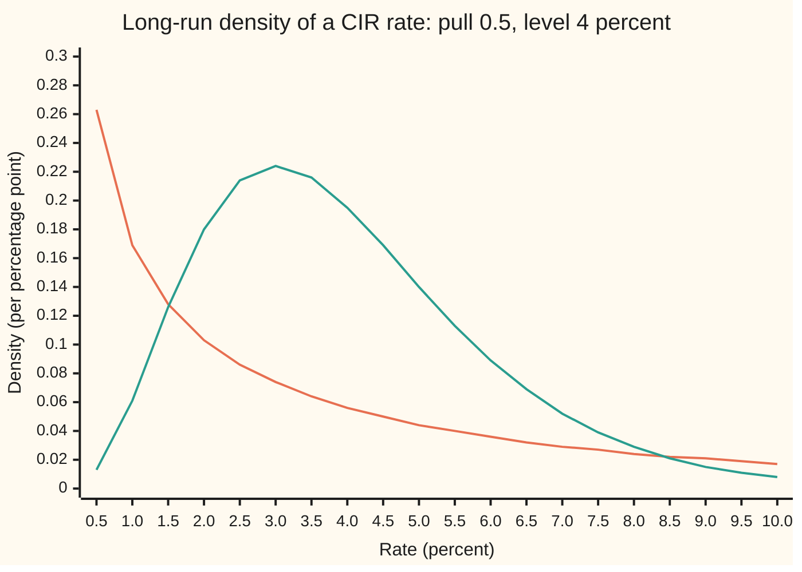

# One-dimensional diffusions: the scale function, the speed measure, and what happens at the edges

[Syllabus](../../../SYLLABUS.md) → [Stochastic processes and calculus](../README.md) → [Generators, Densities and Simulation](../README.md#s08) → One-dimensional diffusions

---

## General Overview

A short-term interest rate stands at 4 percent. It follows the Cox-Ingersoll-Ross (CIR) model of [Mean reversion](../06-Ito%20Calculus/05-ornstein-uhlenbeck-and-cir-processes.md): a pull of 0.5 a year toward a level of 4 percent, plus random shocks whose size is a noise number times the square root of the rate. Take the noise number as 0.30. Near zero the shocks shrink, yet the rate can still touch zero.

A risk desk asks four questions. Will the rate ever reach zero? How likely is it to reach zero before it reaches 8 percent? How long until it leaves the band from 0 to 8 percent? In the long run, how much of the time does it sit below half a percent?

The answers: zero is reached, and it comes before 8 percent with chance 0.4354. The rate leaves the band after 0.8113 years on average. In the long run the rate is below half a percent 0.3072 of the time. With noise 0.10 instead, zero is never reached: the average wait for 8 percent is 14.8789 years, and the long-run share of time below half a percent is 0.0018.

All of these come from two functions of the rate. The **scale function** re-measures the line so that the rate becomes a fair game, with no drift. The **speed measure** says how long the rate lingers at each place. Each question becomes an integral of these two functions. Two more integrals, Feller's tests, decide what happens at each edge of the line.

**Stretch the line until the process is a fair game, and weigh each place by how long the process lingers there; then every exit chance, mean exit time, long-run density and edge behaviour of a one-dimensional diffusion is an integral of those two functions.**

**What kind of fact this is:** a theorem. The scale and speed formulas, the exit chance, the mean exit time, the stationary density and the "reached" half of Feller's test are proved on this card in Why it works. The "never reached" half for an infinite scale distance is proved in [Mean reversion](../06-Ito%20Calculus/05-ornstein-uhlenbeck-and-cir-processes.md). The remaining parts of the classification are stated with their sources. Using CIR for a real rate is a model.

### The picture: where the rate spends its time



Orange: noise 0.30. The density rises without limit as the rate falls to zero, so the rate spends much of its time close to zero. Green: noise 0.10. The density is a hump around 4 percent and falls to nothing at zero. Both curves are the speed measure, scaled to total 1. Both have mean 4 percent.

---

## The formula

A **diffusion** on a line is a process $`X_t`$ that obeys $`dX_t = \mu(X_t)\,dt + \sigma(X_t)\,dW_t`$, where $`W_t`$ is Brownian motion. Here $`\mu(x)`$ is the **drift**, the steady push at the state $`x`$, and $`\sigma(x)`$ is the **noise size** there. The process lives on an interval, here the rates above zero. The ends of that interval, here zero and infinity, are its **edges**. Fix a reference point $`x_0`$ inside, here 4 percent.

The **scale density** $`s`$, the **scale function** $`S`$ and the **speed density** $`m`$ are

```math
s(x) = \exp\Big(-\int_{x_0}^{x} \frac{2\mu(y)}{\sigma(y)^2}\,dy\Big), \qquad S(x) = \int_{x_0}^{x} s(y)\,dy, \qquad m(x) = \frac{2}{\sigma(x)^2\,s(x)} .
```

**Read it aloud:** the scale density undoes the drift, the scale function adds it up into a new ruler, and the speed density is large where the noise is small or the ruler is short.

The **speed measure** of a stretch of the line is the area under $`m`$ over that stretch: $`M(a, b] = \int_a^b m(y)\,dy`$.

For a band from $`a`$ to $`b`$ and a start $`x`$ inside it, let $`\tau`$ be the first time the process leaves the band. Then

```math
P_x(\text{reach } a \text{ before } b) = \frac{S(b) - S(x)}{S(b) - S(a)}, \qquad E_x[\tau] = \int_a^b G(x, y)\,m(y)\,dy, \qquad G(x, y) = \frac{\big(S(x \wedge y) - S(a)\big)\big(S(b) - S(x \vee y)\big)}{S(b) - S(a)} .
```

**Read it aloud:** the chance of leaving at the bottom is the scale distance to the top over the scale width of the band; the mean exit time adds up the time spent near each point.

Here $`x \wedge y`$ is the smaller of the two and $`x \vee y`$ the larger. If the total speed measure is finite and no edge swallows the process, the long-run **stationary density** is the speed density scaled to total 1: $`\pi(x) = m(x) / \int m`$.

At an edge $`e`$, Feller's two tests are

```math
A(e) = \int_e^{x_0} \big(S(y) - S(e)\big)\,m(y)\,dy, \qquad D(e) = \int_e^{x_0} \big(S(x_0) - S(y)\big)\,m(y)\,dy .
```

**Read it aloud:** A asks whether a path can arrive at the edge in finite time; D asks whether a path started at the edge can depart from it.

| $`A(e)`$ | $`D(e)`$ | The edge is | What a path does there |
| --- | --- | --- | --- |
| finite | finite | **regular** | reaches it and can leave it again; the model must say which |
| finite | infinite | **exit** | reaches it and never comes back |
| infinite | finite | **entrance** | never reaches it, but a path started there moves in at once |
| infinite | infinite | **natural** | never reaches it and cannot start there |

For CIR, $`\mu(x) = \kappa(\theta - x)`$ and $`\sigma(x) = \sigma\sqrt{x}`$, and the integral in $`s`$ is done by hand:

```math
s(x) = \Big(\frac{x}{x_0}\Big)^{-\nu} e^{2\kappa (x - x_0)/\sigma^2}, \qquad m(x) \propto x^{\nu - 1}\,e^{-2\kappa x/\sigma^2}, \qquad \nu = \frac{2\kappa\theta}{\sigma^2} .
```

Here $`\propto`$ means "equal up to a constant factor".

| Symbol | Plain meaning | In our example | Push it up and the answer… |
| --- | --- | --- | --- |
| $`X_t`$, $`x`$, $`y`$, $`x_0`$ | the process at time $`t`$; a state, as a variable; a second state; the reference point | the rate; start 4 percent; $`x_0`$ = 4 percent | — |
| $`\mu(x)`$, $`\sigma(x)`$, $`W_t`$ | drift and noise size at $`x`$; Brownian motion | CIR: $`0.5(0.04 - x)`$ and $`\sigma\sqrt{x}`$ | more drift toward an edge makes it easier to reach |
| $`\kappa`$, $`\theta`$, $`\sigma`$ | CIR pull per year, level, noise number | 0.5; 0.04; 0.30 or 0.10 | larger $`\sigma`$ brings zero within reach |
| $`\nu`$ | Feller's ratio $`2\kappa\theta/\sigma^2`$ | 0.4444 at noise 0.30; 4 at noise 0.10 | at 1 or more, zero is never reached |
| $`s(x)`$ | scale density: how much the new ruler stretches at $`x`$ | about $`x^{-0.4444}`$ near zero, noise 0.30 | a longer ruler near an edge keeps paths away from it |
| $`S(x)`$ | scale function: the new ruler, a fair-game coordinate | $`S(4\%) - S(0)`$ = 0.0546 at noise 0.30 | — |
| $`m(x)`$, $`M`$ | speed density: how slowly the process moves at $`x`$: mean time near $`y`$ before the exit is $`G(x, y)\,m(y)\,dy`$; speed measure, its area | $`M(0, 4\%]`$ = 68.58 at noise 0.30 | more time spent there |
| $`a`$, $`b`$, $`\tau`$ | band edges; first exit time from the band | 0 and 8 percent; mean 0.8113 years | a wider band, a longer wait |
| $`P_x`$, $`E_x`$ | chance and average over paths started at $`x`$ | chance of zero first 0.4354 | — |
| $`G(x, y)`$, $`L`$, $`g`$, $`h`$; $`\xi`$, $`z`$, $`u`$, $`c`$ | Green's function: the weight of time spent near $`y`$; the generator $`Lf = \mu f' + \tfrac12\sigma^2 f''`$; mean exit time $`g(x) = E_x[\tau]`$; mean climb time from the edge; dummy variables, a helper and a constant in the integrations | $`g(4\%)`$ = 0.8113 years | — |
| $`\pi(x)`$ | stationary density | mean 4 percent, sd 6 points at noise 0.30 | — |
| $`e`$, $`A(e)`$, $`D(e)`$ | an edge; the arrive and depart tests | at zero, noise 0.30: 1.396 and 2.349 | — |

### When it holds

- **One dimension.** The scale function needs a line, where a path must pass every point between two others. In two or more dimensions there is no such ruler in general: see [Brownian motion in d dimensions](08-recurrence-and-transience-of-brownian-motion.md).
- **Noise size above zero inside the interval.** Where $`\sigma(x) = 0`$ inside, $`2\mu/\sigma^2`$ blows up, the scale density is undefined, and the process may get stuck or move with no noise at all.
- **$`2\mu/\sigma^2`$ integrable over every closed stretch inside.** Otherwise the integral in $`s`$ is undefined at some interior point, and the formulas fail there.
- **Drift and noise that do not depend on time.** A drift that changes with the calendar gives a ruler that changes with the calendar, and none of the formulas above apply.
- **For the stationary density, a finite total speed measure and no swallowing edge.** With level 0 the speed measure of $`(0, 4\%]`$ is infinite and zero is an exit: the rate is absorbed and no long-run density exists.

---

## Why it works

### Step 0: two changes of ruler

Drift is what makes a diffusion hard to reason about: the path is pushed one way while the noise shakes it. In one dimension the push can be removed by re-measuring the line. Stretch the line where the drift pushes forward and shrink it where the drift pushes back. On the right ruler the process has no drift at all: it is a **fair game**, also called a martingale, a process whose expected future value is its present value.

A fair game on a line is easy. Where it leaves a band follows from optional stopping alone. What is left is time: a fair game still moves faster in some places than in others. The speed measure records that. These two functions together describe the diffusion completely.

### Step 1: the scale function removes the drift

Apply Ito's lemma ([Ito's lemma](../06-Ito%20Calculus/02-itos-lemma.md)) to $`S(X_t)`$:

```math
dS(X_t) = \Big(\mu S' + \tfrac12\sigma^2 S''\Big)(X_t)\,dt + S'(X_t)\,\sigma(X_t)\,dW_t .
```

The drift term is zero when $`S''/S' = -2\mu/\sigma^2`$. Integrate once: $`S' = s`$, the scale density of The formula. So $`S(X_t)`$ has no $`dt`$ term. In the words of [The generator](01-infinitesimal-generator.md), $`LS = 0`$: the scale function is the one-dimensional case of a harmonic function, as in [The Dirichlet problem by Brownian motion](09-brownian-motion-and-the-dirichlet-problem.md).

For CIR, $`2\mu/\sigma^2 = 2\kappa(\theta - x)/(\sigma^2 x) = \nu/x - 2\kappa/\sigma^2`$. Its integral from $`x_0`$ is $`\nu \ln(x/x_0) - 2\kappa(x - x_0)/\sigma^2`$. Take minus that and exponentiate: that is the CIR scale density in The formula.

### Step 2: exit chances by optional stopping

Start at $`x`$ inside the band. Stopped when it leaves the band, $`S(X_t)`$ is a bounded fair game. Optional stopping ([Stopping times](../02-Martingales/03-stopping-times-and-optional-stopping.md)) says its average at the exit equals its start:

```math
S(x) = P_x(\text{reach } a \text{ first})\,S(a) + \big(1 - P_x(\text{reach } a \text{ first})\big)\,S(b) .
```

Solve for the chance: that is the exit formula. It is the gambler's-ruin answer of [Gambler's ruin](../01-Random%20Walks%20and%20Filtrations/04-gamblers-ruin.md), read on the new ruler. With no drift, ordinary distance would be the right ruler, and the CIR band would give (8 − 4) / 8 = 0.5000. The drift and the noise move it to 0.4354.

### Step 3: the generator in two derivatives, and the mean exit time

Rewrite the generator with the scale density and the speed density. A line of algebra gives

```math
Lf = \mu f' + \tfrac12\sigma^2 f'' = \frac{1}{m}\,\frac{d}{dx}\Big(\frac{f'}{s}\Big) .
```

Check it: $`(f'/s)' = (f'' - f' s'/s)/s = (f'' + 2\mu f'/\sigma^2)/s`$, and $`1/(m s) = \sigma^2/2`$. So the generator is a derivative along the new ruler, then a derivative along the speed measure.

The mean exit time $`g(x) = E_x[\tau]`$ solves $`Lg = -1`$ with $`g(a) = g(b) = 0`$, by Dynkin's formula ([The generator](01-infinitesimal-generator.md)). In the two-derivative form this reads $`(g'/s)' = -m`$. Integrate twice, fix the two constants by the two edges, and the answer is $`\int G(x, y)\,m(y)\,dy`$.

The weight $`G(x, y)`$ is a tent. It is zero at both band edges and peaks at $`y = x`$. A path spends more time near its start than near the edges, and the speed density adds how slowly it moves at each place.

<details>
<summary>The two integrations for the mean exit time</summary>

Write $`u = g'/s`$. Then $`u' = -m`$, so $`u(y) = c - M(a, y]`$ for a constant $`c`$, and $`g'(y) = s(y)\big(c - M(a, y]\big)`$.

Integrate from $`a`$, where $`g(a) = 0`$:

$`\displaystyle g(x) = c\,\big(S(x) - S(a)\big) - \int_a^x \big(S(x) - S(z)\big)\,m(z)\,dz .`$

The second term comes from swapping the order of integration: $`\int_a^x s(y) M(a, y]\,dy = \int_a^x m(z)\big(S(x) - S(z)\big)\,dz`$.

Set $`g(b) = 0`$ to fix $`c = \int_a^b \big(S(b) - S(z)\big)\,m(z)\,dz \,/\, \big(S(b) - S(a)\big)`$. Substitute and collect the terms for $`z < x`$ and $`z \ge x`$:

$`\displaystyle g(x) = \int_a^b \frac{\big(S(x \wedge z) - S(a)\big)\big(S(b) - S(x \vee z)\big)}{S(b) - S(a)}\,m(z)\,dz .`$

That is $`\int G(x, z)\,m(z)\,dz`$. $`\blacksquare`$

</details>

The same formulas reproduce the Ornstein-Uhlenbeck band of [The generator](01-infinitesimal-generator.md). From 6 percent, with noise 0.02, the chance of reaching 8 percent before 4 percent is 0.252692 and the mean exit time is 1.083540 years.

### Step 4: the stationary density is the speed density

[Fokker-Planck](03-fokker-planck-forward-equation.md) shows that a stationary density has zero probability current: $`\mu \pi = \tfrac12(\sigma^2 \pi)'`$. Try $`\pi = m`$. Then $`\sigma^2 m = 2/s`$, so

```math
\tfrac12(\sigma^2 m)' = \Big(\frac{1}{s}\Big)' = -\frac{s'}{s^2} = \frac{2\mu}{\sigma^2}\cdot\frac{1}{s} = \mu\,m .
```

So the speed density, scaled to total 1, is stationary whenever its total is finite. A place where the process moves slowly is a place where it piles up. At a regular zero this needs the path to bounce back in, not stop; the CIR equation does exactly that, because its upward pull $`\kappa\theta`$ is positive there.

For CIR, $`m(x) \propto x^{\nu - 1} e^{-2\kappa x/\sigma^2}`$. That is the **gamma law** with shape $`\nu`$ and scale $`\sigma^2/(2\kappa)`$. Its total is finite whenever $`\nu > 0`$. Its mean is $`\nu \sigma^2/(2\kappa) = \theta`$ and its variance is $`\theta\sigma^2/(2\kappa)`$. This proves the gamma stationary law that [Mean reversion](../06-Ito%20Calculus/05-ornstein-uhlenbeck-and-cir-processes.md) took from its source. At noise 0.30 the shape is 0.4444, below 1, so the density grows without limit at zero, as in the picture.

### Step 5: can a path reach the edge? The test A

[Mean reversion](../06-Ito%20Calculus/05-ornstein-uhlenbeck-and-cir-processes.md), Step 7, proves one half. If the scale distance to the edge is infinite, $`S(e) = -\infty`$, the exit formula gives the edge chance 0 for every band, and the edge is never reached. That argument is not repeated here.

The other half is new: **if $`A(e)`$ is finite, the edge is reached in finite time with positive chance.** The idea is to shrink the band's lower edge $`a`$ down to $`e`$. The mean exit time stays finite exactly when $`A(e)`$ is finite, and the chance of leaving at the bottom stays above zero. So the path arrives at $`e`$, in finite time, with positive chance.

<details>
<summary>Detailed proof: a finite A means the edge is reached</summary>

**Setting.** $`e`$ is the left edge and $`S(e)`$ is finite. Fix $`x < b`$ inside, and let $`a`$ run down to $`e`$.

**1. The exit time grows to a limit.** As $`a`$ falls, the first exit $`\tau_a`$ from $`(a, b)`$ can only grow. Its limit $`\tau`$ is the first time the path reaches $`b`$ or arrives at $`e`$.

**2. Its mean.** By Step 3, $`E_x[\tau_a] = \int_a^b G_a(x, y)\,m(y)\,dy`$. For $`y \le x`$, $`G_a(x, y) = \big(S(y) - S(a)\big)\big(S(b) - S(x)\big)/\big(S(b) - S(a)\big)`$, which grows as $`a`$ falls. For $`y > x`$ the factor $`(S(x) - S(a))/(S(b) - S(a))`$ grows too. Monotone convergence (wing 10) gives

$`\displaystyle E_x[\tau] = \int_e^b G_e(x, y)\,m(y)\,dy .`$

**3. Finite exactly when A is.** For $`y < x`$, $`G_e(x, y)`$ is the constant $`(S(b) - S(x))/(S(b) - S(e))`$ times $`S(y) - S(e)`$, the integrand of $`A(e)`$. On $`[x, b]`$, $`G_e`$ is bounded and $`m`$ is integrable. So $`E_x[\tau]`$ is finite exactly when $`A(e)`$ is. Moving $`x_0`$ changes $`A(e)`$ only by an integral over a closed stretch, which is finite.

**4. The edge is reached.** If $`A(e)`$ is finite, $`\tau`$ is finite almost surely. By Step 2 the chance of reaching $`a`$ before $`b`$ is $`(S(b) - S(x))/(S(b) - S(a))`$, which falls to $`(S(b) - S(x))/(S(b) - S(e)) > 0`$. On that event the path reaches every level above $`e`$ before $`b`$, at times that grow to $`\tau`$. By continuity it is at $`e`$ at the finite time $`\tau`$. $`\blacksquare`$

**Stated with its source.** The converse also holds: if $`S(e)`$ is finite but $`A(e)`$ is infinite, the path may drift toward $`e`$ forever, but it never arrives in finite time. This is Feller's test for explosions (Karatzas and Shreve, Section 5.5). The same test at an infinite edge decides whether a path **explodes**, reaching infinity in finite time, as in [When an SDE has one solution](../06-Ito%20Calculus/07-existence-and-uniqueness-for-sdes.md).

</details>

### Step 6: can a path leave the edge? The test D, and the four kinds

Start a path at the edge and ask for the mean time to climb to $`x_0`$. That time $`h`$ solves $`Lh = -1`$ with $`h(x_0) = 0`$ and no flow out through the edge. The two-derivative form of Step 3 gives

```math
h(x) = \int_x^{x_0} s(\xi)\,M(e, \xi]\,d\xi , \qquad h(e) = \int_e^{x_0} \big(S(x_0) - S(y)\big)\,m(y)\,dy = D(e) .
```

The second equality swaps the order of integration. Here $`\xi`$ is a dummy variable of integration. So $`D(e)`$ is the mean climb time from the edge: if it is finite, a path can start at the edge and come in. That $`h`$ is the climb time when the edge cannot swallow the path is Feller's theorem (Feller 1952; Revuz and Yor, Chapter VII), stated here.

The two tests add up to a product: $`A(e) + D(e) = \big(S(x_0) - S(e)\big)\,M(e, x_0]`$. So an edge is regular exactly when both the scale distance and the speed measure to it are finite.

For CIR near zero, $`s(x) \approx x^{-\nu}`$ and $`m(x) \approx x^{\nu - 1}`$, up to constants. Each test is a power of $`x`$:

- **$`\nu < 1`$.** $`S(y) - S(0) \approx y^{1 - \nu}`$, so the integrand of A is about $`y^{1-\nu} y^{\nu - 1} = 1`$: finite. $`M(0, y] \approx y^{\nu}`$, so D is about $`\int y^{\nu} y^{-\nu}\,dy`$: finite. Zero is **regular**.
- **$`\nu \ge 1`$.** $`\int_0 x^{-\nu}\,dx`$ is infinite, so $`S(0) = -\infty`$ and A is infinite. D is still about $`\int y^{\nu} y^{-\nu}\,dy`$: finite. Zero is an **entrance**.
- **$`\theta = 0`$, so $`\nu = 0`$.** $`s(x) = e^{2\kappa(x - x_0)/\sigma^2}`$ stays bounded near zero, so A is finite, but $`m \approx 1/x`$ makes $`M(0, y]`$ and D infinite. Zero is an **exit**: the rate is absorbed.
- **The edge at infinity.** $`s`$ grows like $`e^{2\kappa x/\sigma^2}`$, so $`S(\infty) = \infty`$ and A is infinite. The integrand of D falls only like $`1/x`$, so D is infinite. Infinity is **natural** for every CIR rate.

---

## Worked numbers, by hand

The CIR rate: pull $`\kappa`$ = 0.5 a year, level $`\theta`$ = 0.04, start 4 percent, band from 0 to 8 percent. The powers come by hand. The integrals come from the code, one line each.

| Step | Arithmetic | Value |
| --- | --- | --- |
| Feller's ratio, noise 0.30 | 2 × 0.5 × 0.04 / 0.09 | 0.4444 |
| scale and speed densities near zero | $`s \approx x^{-0.4444}`$, $`m \approx x^{0.4444 - 1}`$ | $`m \approx x^{-0.5556}`$ |
| test A near zero | $`(S(y) - S(0))\,m \approx y^{0.5556} \times y^{-0.5556}`$ | about 1: finite, 1.396 |
| test D near zero | $`M(0, y]\,s \approx y^{0.4444} \times y^{-0.4444}`$ | about 1: finite, 2.349 |
| so zero, at noise 0.30, is | A finite, D finite | **regular** |
| Feller's ratio, noise 0.10 | 2 × 0.5 × 0.04 / 0.01 | 4.0000 |
| scale density near zero | $`s \approx x^{-4}`$, whose integral to zero is infinite | $`S(0) = -\infty`$ |
| so zero, at noise 0.10, is | A infinite, D finite (3.403) | **entrance** |
| chance of zero before 8 percent, noise 0.30 | $`(S(8\%) - S(4\%)) / (S(8\%) - S(0))`$, integrals by code | **0.4354** |
| mean time to leave the band, noise 0.30 | $`\int_0^{8\%} G(4\%, y)\,m(y)\,dy`$, by code | **0.8113 years** |
| the same, noise 0.10 | the chance is 0, because $`S(0) = -\infty`$; mean wait for 8 percent | 0.0000; 14.8789 years |
| stationary mean | $`\nu\sigma^2/(2\kappa)`$ = 0.4444 × 0.09 / 1 | 0.0400 |
| stationary variance, noise 0.30 | 0.04 × 0.09 / (2 × 0.5) | 0.0036, sd 0.0600 |
| stationary variance, noise 0.10 | 0.04 × 0.01 / (2 × 0.5) | 0.0004, sd 0.0200 |

At noise 0.30 a rate at 4 percent hits zero before 8 percent with chance 0.4354, and leaves the band in under a year on average; at noise 0.10 zero is out of reach, and the same rate waits 14.8789 years on average to touch 8 percent.

### What breaks if you drop a piece

| Mistake | Comes out at | What went wrong |
| --- | --- | --- |
| Feller's ratio with $`\sigma`$, not $`\sigma^2`$, at noise 0.10 | 0.4000, so zero is wrongly called reachable | The true ratio is 4.0000; noise enters the drift-to-noise balance squared |
| Exit chance by ordinary distance: (8 − 4) / 8 | 0.5000 instead of 0.4354 | Ordinary distance is the right ruler only when the drift is zero |
| Stationary density taken as $`1/s`$, dropping the $`1/\sigma(x)^2`$ | mean 0.1300 instead of 0.0400 at noise 0.30 | The speed density needs both factors: slow noise is where the rate piles up |
| Testing only the scale distance at the edge, level 0 | zero called regular; D actually grows 6.513, 14.27, 29.79 as the cut moves in | A finite scale distance says the edge is reached, not that a path can leave it: zero is an exit |

The code prints every row.

---

## Code, from first principles, and it actually runs

The code builds the scale density, the scale function and the speed density on a grid of rates, 800 points per doubling, from $`4\%/2^{60}`$ up to $`4\% \times 2^{6}`$, spaced evenly in the logarithm. It adds them up with the trapezoid rule. It cuts each edge test at $`4\%/2^k`$ for $`k`$ = 10, 20 and 40: a test that settles is finite, and a test that keeps growing is infinite. It reaches the exit answers by **three independent roads**:

1. the scale and speed integrals of The formula;
2. finite differences: the equations $`Lp = 0`$ and $`Lg = -1`$ solved directly on 20,000 grid steps, with no scale function;
3. a simulation: 4,000 Euler paths at 1,000 steps a year, as in [Euler-Maruyama](04-euler-maruyama-scheme.md).

It also checks the stationary mean and spread against the moment equations of [Mean reversion](../06-Ito%20Calculus/05-ornstein-uhlenbeck-and-cir-processes.md), and the band of [The generator](01-infinitesimal-generator.md) against finite differences.

### Python

```python
# Scale function, speed measure and boundaries -- the check behind the card.
# Standard library only.  A CIR rate dr = kappa(theta - r)dt + sigma sqrt(r) dW,
# pull 0.5 a year, level 0.04, noise 0.30 or 0.10.  Three roads: scale and speed
# integrals, finite differences on the generator, and a simulation.
from math import exp, log, sqrt, cos, pi
KAPPA, THETA, X0, TOP, DU = 0.5, 0.04, 0.04, 0.08, log(2) / 800
XS = [X0 * exp(j * DU) for j in range(-800 * 60, 800 * 6 + 1)]  # 4%/2^60 .. 4% x 2^6
I0 = 800 * 60                                                   # index of 4% in XS
idx = lambda x: I0 + round(log(x / X0) / DU)                    # grid index of a level
def cir(sig, th=THETA):
    return (lambda x: KAPPA * (th - x)), (lambda x: sig * sqrt(max(x, 0.0)))
def trap(f, i, j):  # integral of f(x) dx from XS[i] to XS[j] (dx = x du), trapezoid
    return sum(0.5 * (f(k) * XS[k] + f(k - 1) * XS[k - 1]) * DU for k in range(i + 1, j + 1))
class Diffusion:  # scale density s, scale function S, speed density m on the grid
    def __init__(self, mu, sd):
        q = [2 * mu(x) / sd(x) ** 2 * x for x in XS]            # 2 mu / sd^2, times dx/du
        ls = [0.0] * len(XS)
        for i in range(I0 + 1, len(XS)): ls[i] = ls[i - 1] - 0.5 * (q[i] + q[i - 1]) * DU
        for i in range(I0 - 1, -1, -1): ls[i] = ls[i + 1] + 0.5 * (q[i] + q[i + 1]) * DU
        self.s = [exp(v) for v in ls]                           # s(4%) = 1
        self.m = [2 / (sd(x) ** 2 * v) for x, v in zip(XS, self.s)]
        self.S = [0.0] * len(XS)                                # S(4%) = 0
        w = [v * x * DU for v, x in zip(self.s, XS)]             # s dx on each grid step
        for i in range(I0 + 1, len(XS)): self.S[i] = self.S[i - 1] + 0.5 * (w[i] + w[i - 1])
        for i in range(I0 - 1, -1, -1): self.S[i] = self.S[i + 1] - 0.5 * (w[i] + w[i + 1])
    def tests(self, k):  # Feller's two integrals at zero, the edge cut at 4%/2^k
        e, S, m = I0 - 800 * k, self.S, self.m
        arrive = trap(lambda i: (S[i] - S[e]) * m[i], e, I0)       # A: can the edge be reached?
        depart = trap(lambda i: (S[I0] - S[i]) * m[i], e, I0)      # D: can a path start there?
        return -S[e], trap(lambda i: m[i], e, I0), arrive, depart
    def band(self, b, x, zero_reached):  # band (0, b) from x: P(zero first), mean exit time
        S, m, ib, ix = self.S, self.m, idx(b), idx(x)
        if not zero_reached:                                    # S(0) = -infinity: G = S(b) - S(max)
            return 0.0, trap(lambda i: (S[ib] - S[max(i, ix)]) * m[i], 0, ib)
        S0 = S[0]; W = S[ib] - S0
        G = lambda i: (S[min(i, ix)] - S0) * (S[ib] - S[max(i, ix)]) / W
        return (S[ib] - S[ix]) / W, trap(lambda i: G(i) * m[i], 0, ib)
    def law(self):  # normalised speed density: mean, sd, chance below 0.5%
        Z = trap(lambda i: self.m[i], 0, len(XS) - 1)
        mean = trap(lambda i: XS[i] * self.m[i], 0, len(XS) - 1) / Z
        var = trap(lambda i: (XS[i] - mean) ** 2 * self.m[i], 0, len(XS) - 1) / Z
        return Z, mean, sqrt(var), trap(lambda i: self.m[i], 0, idx(X0 / 8)) / Z
def uniform_band(mu, sd, a, b, x, n):  # the same formulas on an even grid, for any band
    h = (b - a) / n; ys = [a + i * h for i in range(n + 1)]; ls, S = [0.0], [0.0]
    for i in range(1, n + 1): ls.append(ls[-1] - h * (mu(ys[i]) / sd(ys[i]) ** 2 + mu(ys[i - 1]) / sd(ys[i - 1]) ** 2))
    s = [exp(v) for v in ls]; m = [2 / (sd(y) ** 2 * v) for y, v in zip(ys, s)]
    for i in range(1, n + 1): S.append(S[-1] + 0.5 * h * (s[i] + s[i - 1]))
    ix = round((x - a) / h); G = [S[min(i, ix)] * (S[n] - S[max(i, ix)]) / S[n] * m[i] for i in range(n + 1)]
    return S[ix] / S[n], h * (sum(G) - 0.5 * (G[0] + G[n]))
def fd(mu, sd, a, b, x, rhs, fa, fb, n, entrance=False):  # road 2: L f = rhs on a grid
    h = (b - a) / n; lo, di, up, r = [0.0] * (n + 1), [1.0] * (n + 1), [0.0] * (n + 1), [0.0] * (n + 1)
    r[0], r[n] = fa, fb
    if entrance: di[0], up[0], r[0] = -mu(a) / h, mu(a) / h, rhs  # no noise at 0: drift only
    for i in range(1, n):
        y = a + i * h; D, C = 0.5 * sd(y) ** 2 / h ** 2, mu(y) / (2 * h)
        lo[i], di[i], up[i], r[i] = D - C, -2 * D, D + C, rhs
    for i in range(1, n + 1):
        w = lo[i] / di[i - 1]; di[i] -= w * up[i - 1]; r[i] -= w * r[i - 1]
    f = [0.0] * (n + 1); f[n] = r[n] / di[n]
    for i in range(n - 1, -1, -1): f[i] = (r[i] - up[i] * f[i + 1]) / di[i]
    return f[round((x - a) / h)]
ST = [0x2026]
def nxt():  # splitmix64, then a uniform on (0, 1]
    ST[0] = (ST[0] + 0x9E3779B97F4A7C15) & 0xFFFFFFFFFFFFFFFF
    z = ST[0]; z = ((z ^ (z >> 30)) * 0xBF58476D1CE4E5B9) & 0xFFFFFFFFFFFFFFFF
    z = ((z ^ (z >> 27)) * 0x94D049BB133111EB) & 0xFFFFFFFFFFFFFFFF
    return (((z ^ (z >> 31)) >> 11) + 1) / 2.0 ** 53
def simulate(sig, h, paths):  # road 3: Euler, stop on leaving (0, 8%)
    hits, total = 0, 0.0
    for _ in range(paths):
        r, t = X0, 0.0
        while 0.0 < r < TOP:
            z = sqrt(-2 * log(nxt())) * cos(2 * pi * nxt())
            r += KAPPA * (THETA - r) * h + sig * sqrt(r * h) * z; t += h
        hits += r <= 0.0; total += t
    p = hits / paths
    return p, sqrt(p * (1 - p) / paths), total / paths
f4 = lambda v: f"{v:.4f}"
print("CIR rate: pull 0.5 a year, level 4%, start 4%, band 0 to 8%")
cases = [("noise 0.30", 0.3, THETA), ("noise 0.10", 0.1, THETA), ("level 0, noise 0.30", 0.3, 0.0)]
D = {}
for name, sg, th in cases:
    D[name] = Diffusion(*cir(sg, th))
    nu = 2 * KAPPA * th / sg ** 2
    print(f"{name}: Feller ratio 2 x 0.5 x {th:.2f} / {sg ** 2:.2f} = {nu:.4f}; near 0, s ~ x^{0 - nu:.4f}, m ~ x^{nu - 1:.4f}")
print("Feller's tests at zero, cut at 4%/2^k: k | S(4%)-S(cut) | M(cut,4%) | A | D")
T = {}
for name, sg, th in cases:
    for k in (10, 20, 40):
        T[name, k] = D[name].tests(k)
        print(f"  {name:<20} {k:>2} " + " ".join(f"{v:>11.4g}" for v in T[name, k]))
finite = lambda a, b, c: abs(c - b) < 0.5 * abs(b - a)  # 20 more halvings add little
kinds = {(1, 1): "regular", (1, 0): "exit", (0, 1): "entrance", (0, 0): "natural"}
verdict = {}
for name in D:  # A finite <=> zero is reached; D finite <=> the rate can start at zero
    fa, fdp = (finite(*[T[name, k][j] for k in (10, 20, 40)]) for j in (2, 3))
    verdict[name] = kinds[fa, fdp]; print(f"  {name}: zero is {verdict[name]}")
d3 = D["noise 0.30"]
inf = [trap(lambda i: d3.S[i] * d3.m[i], I0, I0 + 800 * k) for k in (2, 4, 6)]
print("D at infinity, noise 0.30, cut at 16%, 64%, 256%:", ", ".join(f4(v) for v in inf), "-> natural")
p3, g3 = d3.band(TOP, X0, True)
p1, g1 = D["noise 0.10"].band(TOP, X0, False)
mu3, sd3 = cir(0.3); mu1, sd1 = cir(0.1)
fp3, fg3 = fd(mu3, sd3, 0, TOP, X0, 0, 1, 0, 20000), fd(mu3, sd3, 0, TOP, X0, -1, 0, 0, 20000)
fg1 = fd(mu1, sd1, 0, TOP, X0, -1, 0, 0, 20000, True)
mp, mse, mt = simulate(0.3, 0.001, 4000)
print(f"noise 0.30, P(zero before 8%): scale {p3:.4f}, finite differences {fp3:.4f}, simulation {mp:.4f} +/- {mse:.4f}")
print(f"noise 0.30, mean exit time (years): speed {g3:.4f}, finite differences {fg3:.4f}, simulation {mt:.4f}")
print(f"noise 0.10, P(zero before 8%) {p1:.4f}; mean time to 8% (years): speed {g1:.4f}, finite differences {fg1:.4f}")
ou = (lambda x: KAPPA * (THETA - x)), (lambda x: 0.02)
op, og = uniform_band(*ou, 0.04, 0.08, 0.06, 4000)
fop, fog = fd(*ou, 0.04, 0.08, 0.06, 0, 0, 1, 4000), fd(*ou, 0.04, 0.08, 0.06, -1, 0, 0, 4000)
print(f"OU band 4% to 8% from 6%: P(8% first) {op:.6f} (fd {fop:.6f}), mean exit {og:.6f} years (fd {fog:.6f})")
L = {}
for name, sg in (("noise 0.30", 0.3), ("noise 0.10", 0.1)):
    L[name] = D[name].law(); Z, mean, sd, low = L[name]
    print(f"stationary, {name}: mean {mean:.4f}, sd {sd:.4f}; moments: mean {THETA:.4f}, "
          f"variance {THETA * sg ** 2 / (2 * KAPPA):.4f}, sd {sqrt(THETA * sg ** 2 / (2 * KAPPA)):.4f}; P(rate < 0.5%) {low:.4f}")
def density(x, sg):  # stationary density per percentage point, s in closed form
    nu, beta = 2 * KAPPA * THETA / sg ** 2, 2 * KAPPA / sg ** 2
    return 0.01 * 2 / (sg ** 2 * x * (x / X0) ** -nu * exp(beta * (x - X0))) / L[f"noise {sg:.2f}"][0]
grid = [0.005 * j for j in range(1, 21)]
for sg in (0.3, 0.1): print(f"chart, density per point, noise {sg:.2f}:", " ".join(f"{density(x, sg):.3f}" for x in grid))
Zw = trap(lambda i: 1 / d3.s[i], 0, len(XS) - 1)
mean_w = trap(lambda i: XS[i] / d3.s[i], 0, len(XS) - 1) / Zw
print(f"breaks: ratio with sigma not squared, noise 0.10: {2 * KAPPA * THETA / 0.1:.4f}; "
      f"straight-line chance {(TOP - X0) / TOP:.4f}; density 1/s, noise 0.30: mean {mean_w:.4f}")
print("try: noise 0.20, S(4%)-S(cut) at k = 10, 20, 40:", ", ".join(f4(Diffusion(*cir(0.2)).tests(k)[0]) for k in (10, 20, 40)))
print(f"try: level 2%, noise 0.30, P(zero first) {Diffusion(*cir(0.3, 0.02)).band(TOP, X0, True)[0]:.4f}; "
      f"band 0 to 16%, P(zero first) {d3.band(0.16, X0, True)[0]:.4f}")
print(f"try: simulation with 100 steps a year, P(zero first) {simulate(0.3, 0.01, 4000)[0]:.4f}")
nu3 = 2 * KAPPA * THETA / 0.09
assert abs(d3.s[idx(TOP)] - 2 ** -nu3 * exp(TOP / 0.09 - X0 / 0.09)) < 1e-6  # s in closed form
assert [verdict[n] for n in D] == ["regular", "entrance", "exit"]
assert abs(p3 - fp3) < 2e-3 and abs(g3 - fg3) < 5e-3 and abs(g1 - fg1) < 1e-3  # road 1 vs road 2
assert abs(p3 - mp) < 3 * mse and abs(g3 - mt) < 0.03                           # road 1 vs road 3
assert abs(op - fop) < 1e-5 and abs(og - fog) < 1e-5
for name, sg in (("noise 0.30", 0.3), ("noise 0.10", 0.1)):                    # speed vs moments
    assert abs(L[name][1] - THETA) < 1e-5 and abs(L[name][2] - sqrt(THETA * sg ** 2 / (2 * KAPPA))) < 1e-5
print("ALL CHECKS PASS")
```

**Ran 2026-11-23 on macOS, Python 3.14.10, standard library only. All checks passed. Output, pasted from the run:**

```text
CIR rate: pull 0.5 a year, level 4%, start 4%, band 0 to 8%
noise 0.30: Feller ratio 2 x 0.5 x 0.04 / 0.09 = 0.4444; near 0, s ~ x^-0.4444, m ~ x^-0.5556
noise 0.10: Feller ratio 2 x 0.5 x 0.04 / 0.01 = 4.0000; near 0, s ~ x^-4.0000, m ~ x^3.0000
level 0, noise 0.30: Feller ratio 2 x 0.5 x 0.00 / 0.09 = 0.0000; near 0, s ~ x^0.0000, m ~ x^-1.0000
Feller's tests at zero, cut at 4%/2^k: k | S(4%)-S(cut) | M(cut,4%) | A | D
  noise 0.30           10     0.05362          65        1.33       2.155
  noise 0.30           20     0.05458       68.42       1.394        2.34
  noise 0.30           40      0.0546       68.58       1.396       2.349
  noise 0.10           10   2.638e+05         145   3.824e+07         3.4
  noise 0.10           20   2.816e+14         145   4.082e+16       3.403
  noise 0.10           40   3.246e+32         145   4.707e+34       3.403
  level 0, noise 0.30  10     0.03227       226.4      0.7926       6.513
  level 0, noise 0.30  20     0.03229       466.6      0.7991       14.27
  level 0, noise 0.30  40     0.03229       947.1      0.7991       29.79
  noise 0.30: zero is regular
  noise 0.10: zero is entrance
  level 0, noise 0.30: zero is exit
D at infinity, noise 0.30, cut at 16%, 64%, 256%: 1.1711, 4.1482, 7.0308 -> natural
noise 0.30, P(zero before 8%): scale 0.4354, finite differences 0.4358, simulation 0.4485 +/- 0.0079
noise 0.30, mean exit time (years): speed 0.8113, finite differences 0.8093, simulation 0.8151
noise 0.10, P(zero before 8%) 0.0000; mean time to 8% (years): speed 14.8789, finite differences 14.8789
OU band 4% to 8% from 6%: P(8% first) 0.252692 (fd 0.252692), mean exit 1.083540 years (fd 1.083540)
stationary, noise 0.30: mean 0.0400, sd 0.0600; moments: mean 0.0400, variance 0.0036, sd 0.0600; P(rate < 0.5%) 0.3072
stationary, noise 0.10: mean 0.0400, sd 0.0200; moments: mean 0.0400, variance 0.0004, sd 0.0200; P(rate < 0.5%) 0.0018
chart, density per point, noise 0.30: 0.263 0.169 0.128 0.103 0.086 0.074 0.064 0.056 0.050 0.044 0.040 0.036 0.032 0.029 0.027 0.024 0.022 0.021 0.019 0.017
chart, density per point, noise 0.10: 0.013 0.061 0.126 0.180 0.214 0.224 0.216 0.195 0.169 0.140 0.113 0.089 0.069 0.052 0.039 0.029 0.021 0.015 0.011 0.008
breaks: ratio with sigma not squared, noise 0.10: 0.4000; straight-line chance 0.5000; density 1/s, noise 0.30: mean 0.1300
try: noise 0.20, S(4%)-S(cut) at k = 10, 20, 40: 0.1214, 0.2234, 0.4274
try: level 2%, noise 0.30, P(zero first) 0.5324; band 0 to 16%, P(zero first) 0.7506
try: simulation with 100 steps a year, P(zero first) 0.4815
ALL CHECKS PASS
```

### Rust

```rust
// Scale function, speed measure and boundaries -- the check behind the card.
// std only.  A CIR rate dr = kappa(theta - r)dt + sigma sqrt(r) dW, pull 0.5 a
// year, level 0.04, noise 0.30 or 0.10.  Three roads: scale and speed integrals,
// finite differences on the generator, and a simulation.
use std::f64::consts::PI;
const KAPPA: f64 = 0.5; const THETA: f64 = 0.04; const X0: f64 = 0.04; const TOP: f64 = 0.08;
const I0: usize = 800 * 60; // index of 4% on the grid
fn du() -> f64 { 2f64.ln() / 800.0 }
fn idx(x: f64) -> usize { (I0 as f64 + ((x / X0).ln() / du()).round()) as usize }
fn psum(v: impl Iterator<Item = f64>) -> f64 { // compensated sum, as Python's sum()
    let (mut s, mut c) = (0.0f64, 0.0f64);
    for x in v { let t = s + x; if s.abs() >= x.abs() { c += (s - t) + x; } else { c += (x - t) + s; } s = t; }
    if c != 0.0 && c.is_finite() { s + c } else { s }
}
fn g4(v: f64) -> String { // Python's {:.4g}
    let e: i32 = format!("{:.3e}", v).split('e').nth(1).unwrap().parse().unwrap();
    if e < -4 || e >= 4 {
        let s = format!("{:.3e}", v); let m = s.split_once('e').unwrap().0.trim_end_matches('0').trim_end_matches('.');
        format!("{}e{}{:02}", m, if e < 0 { '-' } else { '+' }, e.abs())
    } else { let s = format!("{:.*}", (3 - e) as usize, v);
        if s.contains('.') { s.trim_end_matches('0').trim_end_matches('.').to_string() } else { s } }
}
struct Grid { xs: Vec<f64> }
impl Grid { // integral of f(x) dx from xs[i] to xs[j] (dx = x du), trapezoid
    fn trap(&self, f: &dyn Fn(usize) -> f64, i: usize, j: usize) -> f64 {
        let (xs, d) = (&self.xs, du()); psum((i + 1..=j).map(|k| 0.5 * (f(k) * xs[k] + f(k - 1) * xs[k - 1]) * d)) } }
struct Diffusion { s: Vec<f64>, m: Vec<f64>, cs: Vec<f64> }
fn diffusion(g: &Grid, sig: f64, th: f64) -> Diffusion {
    let xs = &g.xs; let n = xs.len(); let d = du();
    let (mu, sd) = (|x: f64| KAPPA * (th - x), |x: f64| sig * x.max(0.0).sqrt());
    let q: Vec<f64> = xs.iter().map(|&x| 2.0 * mu(x) / sd(x).powi(2) * x).collect();
    let (mut ls, mut cs) = (vec![0.0; n], vec![0.0; n]);
    for i in I0 + 1..n { ls[i] = ls[i - 1] - 0.5 * (q[i] + q[i - 1]) * d; }
    for i in (0..I0).rev() { ls[i] = ls[i + 1] + 0.5 * (q[i] + q[i + 1]) * d; }
    let s: Vec<f64> = ls.iter().map(|v| v.exp()).collect();
    let m: Vec<f64> = xs.iter().zip(&s).map(|(&x, &v)| 2.0 / (sd(x).powi(2) * v)).collect();
    let w: Vec<f64> = s.iter().zip(xs).map(|(&v, &x)| v * x * d).collect();
    for i in I0 + 1..n { cs[i] = cs[i - 1] + 0.5 * (w[i] + w[i - 1]); }
    for i in (0..I0).rev() { cs[i] = cs[i + 1] - 0.5 * (w[i] + w[i + 1]); }
    Diffusion { s, m, cs }
}
impl Diffusion {
    fn tests(&self, g: &Grid, k: usize) -> [f64; 4] { // Feller's two integrals at zero, cut at 4%/2^k
        let (e, s, m) = (I0 - 800 * k, &self.cs, &self.m);
        let arrive = g.trap(&|i| (s[i] - s[e]) * m[i], e, I0);   // A: can the edge be reached?
        let depart = g.trap(&|i| (s[I0] - s[i]) * m[i], e, I0);  // D: can a path start there?
        [-s[e], g.trap(&|i| m[i], e, I0), arrive, depart]
    }
    fn band(&self, g: &Grid, b: f64, x: f64, reached: bool) -> (f64, f64) {
        let (s, m, ib, ix) = (&self.cs, &self.m, idx(b), idx(x));
        if !reached { return (0.0, g.trap(&|i| (s[ib] - s[i.max(ix)]) * m[i], 0, ib)); }
        let (s0, w) = (s[0], s[ib] - s[0]); let gr = |i: usize| (s[i.min(ix)] - s0) * (s[ib] - s[i.max(ix)]) / w;
        ((s[ib] - s[ix]) / w, g.trap(&|i| gr(i) * m[i], 0, ib))
    }
    fn law(&self, g: &Grid) -> (f64, f64, f64, f64) {
        let (m, xs, last) = (&self.m, &g.xs, g.xs.len() - 1);
        let z = g.trap(&|i| m[i], 0, last); let mean = g.trap(&|i| xs[i] * m[i], 0, last) / z;
        let var = g.trap(&|i| (xs[i] - mean).powi(2) * m[i], 0, last) / z;
        (z, mean, var.sqrt(), g.trap(&|i| m[i], 0, idx(X0 / 8.0)) / z)
    }
}
fn uniform_band(mu: &dyn Fn(f64) -> f64, sd: &dyn Fn(f64) -> f64, a: f64, b: f64, x: f64, n: usize) -> (f64, f64) {
    let h = (b - a) / n as f64; let ys: Vec<f64> = (0..=n).map(|i| a + i as f64 * h).collect();
    let (mut ls, mut cs) = (vec![0.0], vec![0.0]);
    for i in 1..=n { let v = ls[i - 1] - h * (mu(ys[i]) / sd(ys[i]).powi(2) + mu(ys[i - 1]) / sd(ys[i - 1]).powi(2)); ls.push(v); }
    let s: Vec<f64> = ls.iter().map(|v| v.exp()).collect(); let m: Vec<f64> = ys.iter().zip(&s).map(|(&y, &v)| 2.0 / (sd(y).powi(2) * v)).collect();
    for i in 1..=n { let v = cs[i - 1] + 0.5 * h * (s[i] + s[i - 1]); cs.push(v); }
    let ix = ((x - a) / h).round() as usize; let gg: Vec<f64> = (0..=n).map(|i| cs[i.min(ix)] * (cs[n] - cs[i.max(ix)]) / cs[n] * m[i]).collect();
    (cs[ix] / cs[n], h * (psum(gg.iter().cloned()) - 0.5 * (gg[0] + gg[n])))
}
fn fd(mu: &dyn Fn(f64) -> f64, sd: &dyn Fn(f64) -> f64, a: f64, b: f64, x: f64, rhs: f64, fa: f64, fb: f64, n: usize, entrance: bool) -> f64 {
    let h = (b - a) / n as f64;
    let (mut lo, mut di, mut up, mut r) = (vec![0.0; n + 1], vec![1.0; n + 1], vec![0.0; n + 1], vec![0.0; n + 1]); r[0] = fa; r[n] = fb;
    if entrance { di[0] = -mu(a) / h; up[0] = mu(a) / h; r[0] = rhs; } // no noise at 0: drift only
    for i in 1..n {
        let y = a + i as f64 * h; let dd = 0.5 * sd(y).powi(2) / h.powi(2); let c = mu(y) / (2.0 * h);
        lo[i] = dd - c; di[i] = -2.0 * dd; up[i] = dd + c; r[i] = rhs;
    }
    for i in 1..=n { let w = lo[i] / di[i - 1]; di[i] -= w * up[i - 1]; r[i] -= w * r[i - 1]; }
    let mut f = vec![0.0; n + 1]; f[n] = r[n] / di[n];
    for i in (0..n).rev() { f[i] = (r[i] - up[i] * f[i + 1]) / di[i]; }
    f[((x - a) / h).round() as usize]
}
struct Rng(u64);
impl Rng {
    fn nxt(&mut self) -> f64 { // splitmix64, then a uniform on (0, 1]
        self.0 = self.0.wrapping_add(0x9E3779B97F4A7C15);
        let mut z = self.0; z = (z ^ (z >> 30)).wrapping_mul(0xBF58476D1CE4E5B9);
        z = (z ^ (z >> 27)).wrapping_mul(0x94D049BB133111EB);
        (((z ^ (z >> 31)) >> 11) + 1) as f64 / 2f64.powi(53)
    }
}
fn simulate(rng: &mut Rng, sig: f64, h: f64, paths: usize) -> (f64, f64, f64) { // road 3: Euler
    let (mut hits, mut total) = (0usize, 0.0f64);
    for _ in 0..paths {
        let (mut r, mut t) = (X0, 0.0); while 0.0 < r && r < TOP {
            let u1 = rng.nxt(); let z = (-2.0 * u1.ln()).sqrt() * (2.0 * PI * rng.nxt()).cos();
            r += KAPPA * (THETA - r) * h + sig * (r * h).sqrt() * z; t += h; }
        if r <= 0.0 { hits += 1; } total += t;
    }
    let p = hits as f64 / paths as f64; (p, (p * (1.0 - p) / paths as f64).sqrt(), total / paths as f64)
}
fn main() {
    let g = Grid { xs: (0..=800 * 66).map(|j| X0 * ((j as f64 - I0 as f64) * du()).exp()).collect() };
    println!("CIR rate: pull 0.5 a year, level 4%, start 4%, band 0 to 8%");
    let cases = [("noise 0.30", 0.3, THETA), ("noise 0.10", 0.1, THETA), ("level 0, noise 0.30", 0.3, 0.0)];
    let dd: Vec<Diffusion> = cases.iter().map(|&(_, sg, th)| diffusion(&g, sg, th)).collect();
    for &(name, sg, th) in &cases {
        let nu = 2.0 * KAPPA * th / sg.powi(2);
        println!("{}: Feller ratio 2 x 0.5 x {:.2} / {:.2} = {:.4}; near 0, s ~ x^{:.4}, m ~ x^{:.4}", name, th, sg.powi(2), nu, 0.0 - nu, nu - 1.0); }
    println!("Feller's tests at zero, cut at 4%/2^k: k | S(4%)-S(cut) | M(cut,4%) | A | D");
    let mut t = vec![];
    for (c, d) in cases.iter().zip(&dd) {
        let row: Vec<[f64; 4]> = [10, 20, 40].iter().map(|&k| d.tests(&g, k)).collect();
        for (k, v) in [10, 20, 40].iter().zip(&row) { println!("  {:<20} {:>2} {}", c.0, k, v.iter().map(|x| format!("{:>11}", g4(*x))).collect::<Vec<_>>().join(" ")); }
        t.push(row);
    }
    let finite = |a: f64, b: f64, c: f64| (c - b).abs() < 0.5 * (b - a).abs(); let mut verdict = vec![];
    for (c, row) in cases.iter().zip(&t) { // A finite <=> zero is reached; D finite <=> the rate can start at zero
        let (fa, fdp) = (finite(row[0][2], row[1][2], row[2][2]), finite(row[0][3], row[1][3], row[2][3]));
        let v = match (fa, fdp) { (true, true) => "regular", (true, false) => "exit", (false, true) => "entrance", _ => "natural" };
        println!("  {}: zero is {}", c.0, v); verdict.push(v);
    }
    let d3 = &dd[0];
    let inf: Vec<String> = [2, 4, 6].iter().map(|&k| format!("{:.4}", g.trap(&|i| d3.cs[i] * d3.m[i], I0, I0 + 800 * k))).collect();
    println!("D at infinity, noise 0.30, cut at 16%, 64%, 256%: {} -> natural", inf.join(", "));
    let ((p3, g3), (p1, g1)) = (d3.band(&g, TOP, X0, true), dd[1].band(&g, TOP, X0, false));
    let mu = |x: f64| KAPPA * (THETA - x); let sd3 = |x: f64| 0.3 * x.max(0.0).sqrt(); let sd1 = |x: f64| 0.1 * x.max(0.0).sqrt();
    let (fp3, fg3) = (fd(&mu, &sd3, 0.0, TOP, X0, 0.0, 1.0, 0.0, 20000, false), fd(&mu, &sd3, 0.0, TOP, X0, -1.0, 0.0, 0.0, 20000, false));
    let fg1 = fd(&mu, &sd1, 0.0, TOP, X0, -1.0, 0.0, 0.0, 20000, true);
    let mut rng = Rng(0x2026); let (mp, mse, mt) = simulate(&mut rng, 0.3, 0.001, 4000);
    println!("noise 0.30, P(zero before 8%): scale {:.4}, finite differences {:.4}, simulation {:.4} +/- {:.4}", p3, fp3, mp, mse);
    println!("noise 0.30, mean exit time (years): speed {:.4}, finite differences {:.4}, simulation {:.4}", g3, fg3, mt);
    println!("noise 0.10, P(zero before 8%) {:.4}; mean time to 8% (years): speed {:.4}, finite differences {:.4}", p1, g1, fg1);
    let sdou = |_x: f64| 0.02; let (op, og) = uniform_band(&mu, &sdou, 0.04, 0.08, 0.06, 4000);
    let (fop, fog) = (fd(&mu, &sdou, 0.04, 0.08, 0.06, 0.0, 0.0, 1.0, 4000, false), fd(&mu, &sdou, 0.04, 0.08, 0.06, -1.0, 0.0, 0.0, 4000, false));
    println!("OU band 4% to 8% from 6%: P(8% first) {:.6} (fd {:.6}), mean exit {:.6} years (fd {:.6})", op, fop, og, fog);
    let laws = [dd[0].law(&g), dd[1].law(&g)];
    for (name, sg, l) in [("noise 0.30", 0.3f64, laws[0]), ("noise 0.10", 0.1, laws[1])] {
        println!("stationary, {}: mean {:.4}, sd {:.4}; moments: mean {:.4}, variance {:.4}, sd {:.4}; P(rate < 0.5%) {:.4}",
                 name, l.1, l.2, THETA, THETA * sg.powi(2) / (2.0 * KAPPA), (THETA * sg.powi(2) / (2.0 * KAPPA)).sqrt(), l.3);
    }
    let density = |x: f64, sg: f64, z: f64| { // stationary density per percentage point, s in closed form
        let (nu, beta) = (2.0 * KAPPA * THETA / sg.powi(2), 2.0 * KAPPA / sg.powi(2));
        0.01 * 2.0 / (sg.powi(2) * x * (x / X0).powf(-nu) * (beta * (x - X0)).exp()) / z
    };
    for (sg, z) in [(0.3f64, laws[0].0), (0.1, laws[1].0)] {
        let v: Vec<String> = (1..=20).map(|j| format!("{:.3}", density(0.005 * j as f64, sg, z))).collect();
        println!("chart, density per point, noise {:.2}: {}", sg, v.join(" "));
    }
    let last = g.xs.len() - 1; let zw = g.trap(&|i| 1.0 / d3.s[i], 0, last);
    let mean_w = g.trap(&|i| g.xs[i] / d3.s[i], 0, last) / zw;
    println!("breaks: ratio with sigma not squared, noise 0.10: {:.4}; straight-line chance {:.4}; density 1/s, noise 0.30: mean {:.4}",
             2.0 * KAPPA * THETA / 0.1, (TOP - X0) / TOP, mean_w);
    let d2 = diffusion(&g, 0.2, THETA); let tr: Vec<String> = [10, 20, 40].iter().map(|&k| format!("{:.4}", d2.tests(&g, k)[0])).collect();
    println!("try: noise 0.20, S(4%)-S(cut) at k = 10, 20, 40: {}", tr.join(", "));
    println!("try: level 2%, noise 0.30, P(zero first) {:.4}; band 0 to 16%, P(zero first) {:.4}",
             diffusion(&g, 0.3, 0.02).band(&g, TOP, X0, true).0, d3.band(&g, 0.16, X0, true).0);
    println!("try: simulation with 100 steps a year, P(zero first) {:.4}", simulate(&mut rng, 0.3, 0.01, 4000).0);
    let nu3 = 2.0 * KAPPA * THETA / 0.09;
    assert!((d3.s[idx(TOP)] - 2f64.powf(-nu3) * (TOP / 0.09 - X0 / 0.09).exp()).abs() < 1e-6); // s in closed form
    assert_eq!(verdict, ["regular", "entrance", "exit"]);
    assert!((p3 - fp3).abs() < 2e-3 && (g3 - fg3).abs() < 5e-3 && (g1 - fg1).abs() < 1e-3); // road 1 vs road 2
    assert!((p3 - mp).abs() < 3.0 * mse && (g3 - mt).abs() < 0.03); // road 1 vs road 3
    assert!((op - fop).abs() < 1e-5 && (og - fog).abs() < 1e-5);
    for (sg, l) in [(0.3f64, laws[0]), (0.1, laws[1])] { // speed vs moments
        assert!((l.1 - THETA).abs() < 1e-5 && (l.2 - (THETA * sg.powi(2) / (2.0 * KAPPA)).sqrt()).abs() < 1e-5);
    }
    println!("ALL CHECKS PASS");
}
```

**Ran 2026-11-23 on macOS, rustc 1.98.1, no crates. All checks passed. Output, pasted from the run:**

```text
CIR rate: pull 0.5 a year, level 4%, start 4%, band 0 to 8%
noise 0.30: Feller ratio 2 x 0.5 x 0.04 / 0.09 = 0.4444; near 0, s ~ x^-0.4444, m ~ x^-0.5556
noise 0.10: Feller ratio 2 x 0.5 x 0.04 / 0.01 = 4.0000; near 0, s ~ x^-4.0000, m ~ x^3.0000
level 0, noise 0.30: Feller ratio 2 x 0.5 x 0.00 / 0.09 = 0.0000; near 0, s ~ x^0.0000, m ~ x^-1.0000
Feller's tests at zero, cut at 4%/2^k: k | S(4%)-S(cut) | M(cut,4%) | A | D
  noise 0.30           10     0.05362          65        1.33       2.155
  noise 0.30           20     0.05458       68.42       1.394        2.34
  noise 0.30           40      0.0546       68.58       1.396       2.349
  noise 0.10           10   2.638e+05         145   3.824e+07         3.4
  noise 0.10           20   2.816e+14         145   4.082e+16       3.403
  noise 0.10           40   3.246e+32         145   4.707e+34       3.403
  level 0, noise 0.30  10     0.03227       226.4      0.7926       6.513
  level 0, noise 0.30  20     0.03229       466.6      0.7991       14.27
  level 0, noise 0.30  40     0.03229       947.1      0.7991       29.79
  noise 0.30: zero is regular
  noise 0.10: zero is entrance
  level 0, noise 0.30: zero is exit
D at infinity, noise 0.30, cut at 16%, 64%, 256%: 1.1711, 4.1482, 7.0308 -> natural
noise 0.30, P(zero before 8%): scale 0.4354, finite differences 0.4358, simulation 0.4485 +/- 0.0079
noise 0.30, mean exit time (years): speed 0.8113, finite differences 0.8093, simulation 0.8151
noise 0.10, P(zero before 8%) 0.0000; mean time to 8% (years): speed 14.8789, finite differences 14.8789
OU band 4% to 8% from 6%: P(8% first) 0.252692 (fd 0.252692), mean exit 1.083540 years (fd 1.083540)
stationary, noise 0.30: mean 0.0400, sd 0.0600; moments: mean 0.0400, variance 0.0036, sd 0.0600; P(rate < 0.5%) 0.3072
stationary, noise 0.10: mean 0.0400, sd 0.0200; moments: mean 0.0400, variance 0.0004, sd 0.0200; P(rate < 0.5%) 0.0018
chart, density per point, noise 0.30: 0.263 0.169 0.128 0.103 0.086 0.074 0.064 0.056 0.050 0.044 0.040 0.036 0.032 0.029 0.027 0.024 0.022 0.021 0.019 0.017
chart, density per point, noise 0.10: 0.013 0.061 0.126 0.180 0.214 0.224 0.216 0.195 0.169 0.140 0.113 0.089 0.069 0.052 0.039 0.029 0.021 0.015 0.011 0.008
breaks: ratio with sigma not squared, noise 0.10: 0.4000; straight-line chance 0.5000; density 1/s, noise 0.30: mean 0.1300
try: noise 0.20, S(4%)-S(cut) at k = 10, 20, 40: 0.1214, 0.2234, 0.4274
try: level 2%, noise 0.30, P(zero first) 0.5324; band 0 to 16%, P(zero first) 0.7506
try: simulation with 100 steps a year, P(zero first) 0.4815
ALL CHECKS PASS
```

### Lean

Lean proves Steps 3 and 4 for any diffusion under When it holds, and Feller's tests at zero for every CIR rate.

- Take a point inside the interval where the drift and noise size are continuous, and any $`f`$ whose slope has a derivative there. Then $`\mu f' + \tfrac12\sigma^2 f'' = (f'/s)'/m`$ at that point.
- Take the same kind of point. Then $`\tfrac12(\sigma^2 m)' = \mu m`$ there: the speed density has zero probability current.
- Take a CIR rate with pull above zero, level zero or more, and noise number above zero. Then the scale distance to zero and test A are both finite exactly when Feller's ratio is below 1.
- For the same rate, test D at zero is finite exactly when the level is above zero.
- Read through the table of The formula, these give the three CIR cases of Step 6: regular, entrance and exit.
- Feller's ratio is 4/9, about 0.4444, at noise 0.30, and 4 at noise 0.10. Forgetting the square gives 0.4.
- Take noise 0.30, so Feller's ratio is 4/9. Then the stationary mean $`\nu\sigma^2/(2\kappa)`$ is 0.04.
- Take pull 0.5 and level 0.04. Then the stationary variance $`\theta\sigma^2/(2\kappa)`$ is 0.0036 at noise 0.30 and 0.0004 at noise 0.10.
- The straight-line chance (8 − 4) / 8 is 0.5.

The exit chances, mean exit times, long-run shares, the edge at infinity and the simulations are left to the Python and Rust checks.

```lean
-- One-dimensional diffusions: the generator of a one-dimensional diffusion is a derivative along the scale function followed by one along the speed measure, the speed density has zero probability current, and Feller's tests at zero sort a Cox-Ingersoll-Ross rate into regular, entrance or exit by its ratio 2κθ/σ² and its level θ.
import Mathlib.MeasureTheory.Integral.IntervalIntegral.FundThmCalculus
import Mathlib.Analysis.SpecialFunctions.ExpDeriv
import Mathlib.Analysis.SpecialFunctions.Sqrt
import Mathlib.Analysis.SpecialFunctions.Pow.Real
import Mathlib.Analysis.SpecialFunctions.Integrability.Basic
import Mathlib.Tactic.NormNum
import Mathlib.Analysis.SpecialFunctions.Integrals.Basic

namespace ScaleSpeedBoundaries

open MeasureTheory Real Set

/-- The scale density of `dX = μ(X) dt + σ(X) dW` with reference point `x₀`:
`s(x) = exp(-∫_{x₀}^x 2μ(y)/σ(y)² dy)`. -/
noncomputable def scaleDensity (μ σ : ℝ → ℝ) (x₀ x : ℝ) : ℝ :=
  exp (-∫ y in x₀..x, 2 * μ y / σ y ^ 2)

/-- The speed density `m(x) = 2 / (σ(x)² s(x))`. -/
noncomputable def speedDensity (μ σ : ℝ → ℝ) (x₀ x : ℝ) : ℝ :=
  2 / (σ x ^ 2 * scaleDensity μ σ x₀ x)

theorem hasDerivAt_driftIntegral (μ σ : ℝ → ℝ) (I : Set ℝ) (hI : IsOpen I)
    (hσ : ∀ y ∈ I, 0 < σ y)
    (hint : ∀ a ∈ I, ∀ b ∈ I, IntervalIntegrable (fun y => 2 * μ y / σ y ^ 2) volume a b)
    {x₀ x : ℝ} (hx₀ : x₀ ∈ I) (hx : x ∈ I) (hμx : ContinuousAt μ x) (hσx : ContinuousAt σ x) :
    HasDerivAt (fun y => ∫ t in x₀..y, 2 * μ t / σ t ^ 2) (2 * μ x / σ x ^ 2) x := by
  obtain ⟨ε, hε, hball⟩ := Metric.isOpen_iff.mp hI x hx
  have ha : x - ε / 2 ∈ I := hball (by
    rw [Metric.mem_ball, Real.dist_eq, abs_lt]; constructor <;> linarith)
  have hb : x + ε / 2 ∈ I := hball (by
    rw [Metric.mem_ball, Real.dist_eq, abs_lt]; constructor <;> linarith)
  have hloc := hint _ ha _ hb
  rw [intervalIntegrable_iff_integrableOn_Ioc_of_le (by linarith)] at hloc
  refine intervalIntegral.integral_hasDerivAt_right (hint _ hx₀ _ hx) ?_ ?_
  · exact ⟨Ioc (x - ε / 2) (x + ε / 2), Ioc_mem_nhds (by linarith) (by linarith),
      hloc.aestronglyMeasurable⟩
  · exact (continuousAt_const.mul hμx).div (hσx.pow 2) (pow_ne_zero 2 (hσ x hx).ne')
#print axioms hasDerivAt_driftIntegral
theorem cir_scaleDensity_eq {κ θ σ x₀ z : ℝ} (hσ : 0 < σ) (hx₀ : 0 < x₀) (hz : 0 < z) :
    scaleDensity (fun y => κ * (θ - y)) (fun y => σ * √y) x₀ z =
      x₀ ^ (2 * κ * θ / σ ^ 2) * exp (-(2 * κ / σ ^ 2 * x₀)) * z ^ (-(2 * κ * θ / σ ^ 2)) *
        exp (2 * κ / σ ^ 2 * z) := by
  have hg : ∀ t ∈ uIcc x₀ z, 2 * (κ * (θ - t)) / (σ * √t) ^ 2 =
      2 * κ * θ / σ ^ 2 * t⁻¹ - 2 * κ / σ ^ 2 := by
    intro t ht
    have htpos : 0 < t := lt_of_lt_of_le (lt_min hx₀ hz) ht.1
    rw [mul_pow, sq_sqrt htpos.le]
    field_simp
  have hpos : ∀ t ∈ uIcc x₀ z, t ≠ 0 := fun t ht =>
    (lt_of_lt_of_le (lt_min hx₀ hz) ht.1).ne'
  have hI : ∫ t in x₀..z, 2 * (κ * (θ - t)) / (σ * √t) ^ 2 =
      2 * κ * θ / σ ^ 2 * log (z / x₀) - (z - x₀) * (2 * κ / σ ^ 2) := by
    rw [intervalIntegral.integral_congr hg, intervalIntegral.integral_sub,
      intervalIntegral.integral_const_mul, integral_inv_of_pos hx₀ hz,
      intervalIntegral.integral_const, smul_eq_mul]
    · exact (continuousOn_const.mul (continuousOn_inv₀.mono fun t ht => hpos t ht)).intervalIntegrable
    · exact intervalIntegrable_const
  show exp (-∫ t in x₀..z, 2 * (κ * (θ - t)) / (σ * √t) ^ 2) = _
  rw [hI, rpow_def_of_pos hx₀, rpow_def_of_pos hz, log_div hz.ne' hx₀.ne', ← exp_add, ← exp_add,
    ← exp_add]
  congr 1
  ring
#print axioms cir_scaleDensity_eq

theorem cir_speedDensity_eq {κ θ σ x₀ y : ℝ} (hσ : 0 < σ) (hx₀ : 0 < x₀) (hy : 0 < y) :
    speedDensity (fun y => κ * (θ - y)) (fun y => σ * √y) x₀ y =
      2 / (σ ^ 2 * (x₀ ^ (2 * κ * θ / σ ^ 2) * exp (-(2 * κ / σ ^ 2 * x₀)))) *
        y ^ (2 * κ * θ / σ ^ 2 - 1) * exp (-(2 * κ / σ ^ 2 * y)) := by
  rw [speedDensity, cir_scaleDensity_eq hσ hx₀ hy, mul_pow, sq_sqrt hy.le, rpow_sub_one hy.ne',
    rpow_neg hy.le, exp_neg (2 * κ / σ ^ 2 * y)]
  have h1 : 0 < x₀ ^ (2 * κ * θ / σ ^ 2) := rpow_pos_of_pos hx₀ _
  have h2 : 0 < y ^ (2 * κ * θ / σ ^ 2) := rpow_pos_of_pos hy _
  have h3 := exp_pos (-(2 * κ / σ ^ 2 * x₀))
  have h4 := exp_pos (2 * κ / σ ^ 2 * y)
  field_simp
#print axioms cir_speedDensity_eq

theorem feller_core {s m : ℝ → ℝ} {ν a K σ x₀ : ℝ} (hσ : 0 < σ) (hx₀ : 0 < x₀) (ha : 0 < a)
    (hK : 0 < K) (hν : 0 ≤ ν) (hspos : ∀ z, 0 < s z)
    (hs0 : ∀ z, 0 < z → s z = K * z ^ (-ν) * exp (a * z))
    (hm0 : ∀ y, 0 < y → m y = 2 / (σ ^ 2 * K) * y ^ (ν - 1) * exp (-(a * y))) :
    ((IntegrableOn s (Ioo 0 x₀) ∧
        IntegrableOn (fun y => (∫ z in (0 : ℝ)..y, s z) * m y) (Ioo 0 x₀)) ↔ ν < 1) ∧
    (IntegrableOn (fun y => (∫ z in y..x₀, s z) * m y) (Ioo 0 x₀) ↔ 0 < ν) := by
  have hsm : ∀ y z, 0 < y → 0 < z →
      s z * m y = 2 / σ ^ 2 * exp (a * (z - y)) * y ^ (ν - 1) * z ^ (-ν) := by
    intro y z hy hz
    rw [hs0 z hz, hm0 y hy, show a * (z - y) = a * z + -(a * y) by ring, exp_add]
    field_simp
  have hcontz : ∀ y, ContinuousOn (fun z => 2 / σ ^ 2 * exp (a * (z - y)) * y ^ (ν - 1) * z ^ (-ν))
      (Ioi 0) := fun y =>
    (Continuous.continuousOn (by fun_prop)).mul
      (continuousOn_id.rpow_const fun z hz => Or.inl (ne_of_gt hz))
  have hpos_uIcc : ∀ b c : ℝ, 0 < b → 0 < c → uIcc b c ⊆ Ioi 0 := fun b c hb hc t ht =>
    lt_of_lt_of_le (lt_min hb hc) ht.1
  have hs_cont : ContinuousOn s (Ioi 0) :=
    ((continuousOn_const.mul (continuousOn_id.rpow_const fun z hz => Or.inl (ne_of_gt hz))).mul
      (Continuous.continuousOn (by fun_prop))).congr fun z hz => hs0 z hz
  have hm_cont : ContinuousOn m (Ioi 0) :=
    ((continuousOn_const.mul (continuousOn_id.rpow_const fun z hz => Or.inl (ne_of_gt hz))).mul
      (Continuous.continuousOn (by fun_prop))).congr fun z hz => hm0 z hz
  have hF : ∀ y, 0 < y → y ≤ x₀ → (∫ z in y..x₀, s z) * m y =
      ∫ z in y..x₀, 2 / σ ^ 2 * exp (a * (z - y)) * y ^ (ν - 1) * z ^ (-ν) := by
    intro y hy0 hyx
    rw [← intervalIntegral.integral_mul_const]
    refine intervalIntegral.integral_congr fun z hz => ?_
    rw [uIcc_of_le hyx] at hz
    exact hsm y z hy0 (hy0.trans_le hz.1)
  constructor
  · constructor
    · rintro ⟨h1, -⟩
      have h2 : IntegrableOn (fun z : ℝ => z ^ (-ν)) (Ioo 0 x₀) := by
        refine Integrable.mono' (h1.const_mul K⁻¹)
          ((continuousOn_id.rpow_const fun z (hz : z ∈ Ioo (0:ℝ) x₀) => Or.inl (ne_of_gt hz.1)).aestronglyMeasurable
            measurableSet_Ioo) (ae_restrict_of_forall_mem measurableSet_Ioo fun z hz => ?_)
        have hz0 : 0 < z := hz.1
        rw [norm_of_nonneg (rpow_nonneg hz0.le _), hs0 z hz0]
        have he : 1 ≤ exp (a * z) := one_le_exp (by positivity)
        have hr := rpow_nonneg hz0.le (-ν)
        calc z ^ (-ν) ≤ z ^ (-ν) * exp (a * z) := le_mul_of_one_le_right hr he
          _ = K⁻¹ * (K * z ^ (-ν) * exp (a * z)) := by field_simp
      have := (intervalIntegral.integrableOn_Ioo_rpow_iff hx₀).mp h2
      linarith
    · intro hν1
      have hsI : IntegrableOn s (Ioo 0 x₀) := by
        refine Integrable.mono' (((intervalIntegral.integrableOn_Ioo_rpow_iff hx₀).mpr
            (by linarith : -1 < -ν)).const_mul (K * exp (a * x₀)))
          ((hs_cont.mono fun z (hz : z ∈ Ioo (0:ℝ) x₀) => hz.1).aestronglyMeasurable measurableSet_Ioo)
          (ae_restrict_of_forall_mem measurableSet_Ioo fun z hz => ?_)
        have hz0 : 0 < z := hz.1
        rw [hs0 z hz0, norm_of_nonneg (by positivity)]
        have he : exp (a * z) ≤ exp (a * x₀) :=
          exp_le_exp.mpr (mul_le_mul_of_nonneg_left hz.2.le ha.le)
        have hr := rpow_nonneg hz0.le (-ν)
        calc K * z ^ (-ν) * exp (a * z) ≤ K * z ^ (-ν) * exp (a * x₀) :=
              mul_le_mul_of_nonneg_left he (by positivity)
          _ = K * exp (a * x₀) * z ^ (-ν) := by ring
      have hsII : IntervalIntegrable s volume 0 x₀ :=
        (intervalIntegrable_iff_integrableOn_Ioo_of_le hx₀.le).mpr hsI
      refine ⟨hsI, ?_⟩
      have hG := intervalIntegral.continuousOn_primitive_interval' hsII left_mem_uIcc
      have hsub : Ioo 0 x₀ ⊆ uIcc 0 x₀ := by
        rw [uIcc_of_le hx₀.le]; exact Ioo_subset_Icc_self
      refine Integrable.mono' (integrableOn_const (C := 2 / σ ^ 2 / (1 - ν)) measure_Ioo_lt_top.ne)
        (((hG.mono hsub).mul (hm_cont.mono fun y (hy : y ∈ Ioo (0:ℝ) x₀) => hy.1)).aestronglyMeasurable
          measurableSet_Ioo) (ae_restrict_of_forall_mem measurableSet_Ioo fun y hy => ?_)
      have hy0 : 0 < y := hy.1
      have hP : (∫ z in (0 : ℝ)..y, s z) * m y =
          ∫ z in (0 : ℝ)..y, 2 / σ ^ 2 * exp (a * (z - y)) * y ^ (ν - 1) * z ^ (-ν) := by
        rw [← intervalIntegral.integral_mul_const]
        refine intervalIntegral.integral_congr_ae (ae_of_all _ fun z hz => ?_)
        rw [uIoc_of_le hy0.le] at hz
        exact hsm y z hy0 hz.1
      have hnn : 0 ≤ (∫ z in (0 : ℝ)..y, s z) * m y :=
        mul_nonneg (intervalIntegral.integral_nonneg hy0.le fun z _ => (hspos z).le)
          (by rw [hm0 y hy0]; positivity)
      rw [norm_of_nonneg hnn, hP]
      have hrI := intervalIntegral.intervalIntegrable_rpow' (a := 0) (b := y)
        (by linarith : -1 < -ν)
      calc ∫ z in (0 : ℝ)..y, 2 / σ ^ 2 * exp (a * (z - y)) * y ^ (ν - 1) * z ^ (-ν)
          ≤ ∫ z in (0 : ℝ)..y, 2 / σ ^ 2 * y ^ (ν - 1) * z ^ (-ν) := by
            apply intervalIntegral.integral_mono_on_of_le_Ioo hy0.le
            · exact hrI.continuousOn_mul (Continuous.continuousOn (by fun_prop))
            · exact hrI.const_mul _
            · intro z hz
              have he : exp (a * (z - y)) ≤ 1 :=
                exp_le_one_iff.mpr (mul_nonpos_of_nonneg_of_nonpos ha.le (by linarith [hz.2]))
              have h1 := rpow_nonneg hy0.le (ν - 1)
              have h2 := rpow_nonneg hz.1.le (-ν)
              calc 2 / σ ^ 2 * exp (a * (z - y)) * y ^ (ν - 1) * z ^ (-ν)
                  = 2 / σ ^ 2 * (y ^ (ν - 1) * z ^ (-ν)) * exp (a * (z - y)) := by ring
                _ ≤ 2 / σ ^ 2 * (y ^ (ν - 1) * z ^ (-ν)) * 1 :=
                  mul_le_mul_of_nonneg_left he (by positivity)
                _ = _ := by ring
        _ = 2 / σ ^ 2 / (1 - ν) := by
            rw [intervalIntegral.integral_const_mul, integral_rpow (Or.inl (by linarith)),
              zero_rpow (by linarith : (-ν + 1) ≠ 0)]
            have h1 : y ^ (ν - 1) * y ^ (-ν + 1) = 1 := by
              rw [← rpow_add hy0, show ν - 1 + (-ν + 1) = 0 by ring, rpow_zero]
            rw [show 2 / σ ^ 2 * y ^ (ν - 1) * ((y ^ (-ν + 1) - 0) / (-ν + 1)) =
              2 / σ ^ 2 * (y ^ (ν - 1) * y ^ (-ν + 1)) / (-ν + 1) by ring, h1]
            ring
  · constructor
    · intro h
      by_contra hν'
      have hν00 : ν = 0 := le_antisymm (not_lt.mp hν') hν
      subst hν00
      have hhalf : 0 < x₀ / 2 := half_pos hx₀
      have h2 : IntegrableOn (fun y : ℝ => y ^ (-1 : ℝ)) (Ioo 0 (x₀ / 2)) := by
        refine Integrable.mono' ((h.mono_set (Ioo_subset_Ioo_right (by linarith))).const_mul
            (σ ^ 2 / x₀))
          ((continuousOn_id.rpow_const fun z (hz : z ∈ Ioo (0:ℝ) (x₀ / 2)) => Or.inl (ne_of_gt hz.1)).aestronglyMeasurable
            measurableSet_Ioo) (ae_restrict_of_forall_mem measurableSet_Ioo fun y hy => ?_)
        have hy0 : 0 < y := hy.1
        have hyx : y ≤ x₀ := by linarith [hy.2]
        rw [norm_of_nonneg (rpow_nonneg hy0.le _)]
        have hlow : (x₀ / 2) * (2 / σ ^ 2 * y ^ (-1 : ℝ)) ≤ ∫ z in y..x₀,
            2 / σ ^ 2 * exp (a * (z - y)) * y ^ ((0 : ℝ) - 1) * z ^ (-(0 : ℝ)) := by
          have hyr := rpow_nonneg hy0.le (-1 : ℝ)
          calc (x₀ / 2) * (2 / σ ^ 2 * y ^ (-1 : ℝ))
              ≤ (x₀ - y) * (2 / σ ^ 2 * y ^ (-1 : ℝ)) :=
                mul_le_mul_of_nonneg_right (by linarith [hy.2]) (by positivity)
            _ = ∫ z in y..x₀, 2 / σ ^ 2 * y ^ (-1 : ℝ) := by
                rw [intervalIntegral.integral_const, smul_eq_mul]
            _ ≤ _ := by
                apply intervalIntegral.integral_mono_on hyx intervalIntegrable_const
                · exact ((hcontz y).mono (hpos_uIcc _ _ hy0 hx₀)).intervalIntegrable
                · intro z hz
                  have he : 1 ≤ exp (a * (z - y)) :=
                    one_le_exp (mul_nonneg ha.le (by linarith [hz.1]))
                  simp only [neg_zero, rpow_zero, mul_one, zero_sub]
                  calc 2 / σ ^ 2 * y ^ (-1 : ℝ) = 2 / σ ^ 2 * 1 * y ^ (-1 : ℝ) := by ring
                    _ ≤ 2 / σ ^ 2 * exp (a * (z - y)) * y ^ (-1 : ℝ) := by gcongr
        have hyr := rpow_nonneg hy0.le (-1 : ℝ)
        calc y ^ (-1 : ℝ) = σ ^ 2 / x₀ * ((x₀ / 2) * (2 / σ ^ 2 * y ^ (-1 : ℝ))) := by
              field_simp
          _ ≤ σ ^ 2 / x₀ * ((∫ z in y..x₀, s z) * m y) := by
              rw [hF y hy0 hyx]
              exact mul_le_mul_of_nonneg_left hlow (by positivity)
      have := (intervalIntegral.integrableOn_Ioo_rpow_iff hhalf).mp h2
      exact lt_irrefl _ this
    · intro hνpos
      set β := min ν (1 / 2) with hβ
      have hβpos : 0 < β := lt_min hνpos (by norm_num)
      have hβle : β ≤ ν := min_le_left _ _
      have hβhalf : β ≤ 1 / 2 := min_le_right _ _
      have hF_cont : ContinuousOn (fun y => ∫ z in y..x₀, s z) (Ioo 0 x₀) := by
        intro y hy
        have hy0 : 0 < y := hy.1
        have hint : IntegrableOn s (uIcc (y / 2) x₀) :=
          (hs_cont.mono (hpos_uIcc _ _ (half_pos hy0) hx₀)).integrableOn_uIcc
        have hc := intervalIntegral.continuousOn_primitive_interval_left hint
        have hmem : uIcc (y / 2) x₀ ∈ nhds y := by
          rw [uIcc_of_le (by linarith [hy.2])]; exact Icc_mem_nhds (by linarith) hy.2
        exact (hc.continuousAt hmem).continuousWithinAt
      refine Integrable.mono' (((intervalIntegral.integrableOn_Ioo_rpow_iff hx₀).mpr
          (by linarith : -1 < β - 1)).const_mul
            (2 / σ ^ 2 * exp (a * x₀) * (x₀ ^ (-β + 1) / (-β + 1))))
        ((hF_cont.mul (hm_cont.mono fun y (hy : y ∈ Ioo (0:ℝ) x₀) => hy.1)).aestronglyMeasurable measurableSet_Ioo)
        (ae_restrict_of_forall_mem measurableSet_Ioo fun y hy => ?_)
      have hy0 : 0 < y := hy.1
      have hyx : y ≤ x₀ := hy.2.le
      have hnn : 0 ≤ (∫ z in y..x₀, s z) * m y :=
        mul_nonneg (intervalIntegral.integral_nonneg hyx fun z _ => (hspos z).le)
          (by rw [hm0 y hy0]; positivity)
      rw [norm_of_nonneg hnn, hF y hy0 hyx]
      calc ∫ z in y..x₀, 2 / σ ^ 2 * exp (a * (z - y)) * y ^ (ν - 1) * z ^ (-ν)
          ≤ ∫ z in y..x₀, 2 / σ ^ 2 * exp (a * x₀) * y ^ (β - 1) * z ^ (-β) := by
            apply intervalIntegral.integral_mono_on hyx
            · exact ((hcontz y).mono (hpos_uIcc _ _ hy0 hx₀)).intervalIntegrable
            · exact (intervalIntegral.intervalIntegrable_rpow' (by linarith : -1 < -β)).const_mul _
            · intro z hz
              have hz0 : 0 < z := hy0.trans_le hz.1
              have hE : exp (a * (z - y)) ≤ exp (a * x₀) :=
                exp_le_exp.mpr (mul_le_mul_of_nonneg_left (by linarith [hz.2]) ha.le)
              have hY : y ^ (ν - 1) = y ^ (β - 1) * y ^ (ν - β) := by
                rw [← rpow_add hy0]; congr 1; ring
              have hZ : z ^ (-β) = z ^ (-ν) * z ^ (ν - β) := by
                rw [← rpow_add hz0]; congr 1; ring
              have hyz : y ^ (ν - β) ≤ z ^ (ν - β) := rpow_le_rpow hy0.le hz.1 (by linarith)
              have h1 := rpow_nonneg hy0.le (β - 1)
              have h2 := rpow_nonneg hz0.le (-ν)
              have h3 := rpow_nonneg hy0.le (ν - 1)
              have hYZ : y ^ (ν - 1) * z ^ (-ν) ≤ y ^ (β - 1) * z ^ (-β) := by
                rw [hY, hZ]
                calc y ^ (β - 1) * y ^ (ν - β) * z ^ (-ν) = (y ^ (β - 1) * z ^ (-ν)) * y ^ (ν - β) := by
                      ring
                  _ ≤ (y ^ (β - 1) * z ^ (-ν)) * z ^ (ν - β) := by gcongr
                  _ = _ := by ring
              calc 2 / σ ^ 2 * exp (a * (z - y)) * y ^ (ν - 1) * z ^ (-ν)
                  = 2 / σ ^ 2 * exp (a * (z - y)) * (y ^ (ν - 1) * z ^ (-ν)) := by ring
                _ ≤ 2 / σ ^ 2 * exp (a * x₀) * (y ^ (β - 1) * z ^ (-β)) := by gcongr
                _ = _ := by ring
        _ ≤ 2 / σ ^ 2 * exp (a * x₀) * (x₀ ^ (-β + 1) / (-β + 1)) * y ^ (β - 1) := by
            rw [intervalIntegral.integral_const_mul, integral_rpow (Or.inl (by linarith))]
            have h1 := rpow_nonneg hy0.le (-β + 1)
            have h2 : 0 < -β + 1 := by linarith
            have h3 := rpow_nonneg hy0.le (β - 1)
            calc 2 / σ ^ 2 * exp (a * x₀) * y ^ (β - 1) * ((x₀ ^ (-β + 1) - y ^ (-β + 1)) / (-β + 1))
                ≤ 2 / σ ^ 2 * exp (a * x₀) * y ^ (β - 1) * (x₀ ^ (-β + 1) / (-β + 1)) := by
                  gcongr; linarith
              _ = _ := by ring
#print axioms feller_core

/-- **The generator in two derivatives** (the card's Step 3). Let the diffusion
`dX = μ(X) dt + σ(X) dW` live on an open interval `I`, with noise size `σ > 0` inside `I` and
`2μ/σ²` integrable over every closed stretch inside `I`. Build the scale density `s` and the speed
density `m` from a reference point `x₀` in `I`. Then at every point `x` of `I` where the drift and
the noise size are continuous, and for every `f` whose slope `f'` has a derivative `f''` at `x`,
`μ f' + ½ σ² f'' = (1/m) · (f'/s)'`: the generator is a derivative along the new ruler, then a
derivative along the speed measure. -/
theorem generator_eq_speed_then_scale_derivative (μ σ f : ℝ → ℝ) (I : Set ℝ) (hI : IsOpen I)
    (hIc : I.OrdConnected) (hσ : ∀ y ∈ I, 0 < σ y)
    (hint : ∀ a ∈ I, ∀ b ∈ I, IntervalIntegrable (fun y => 2 * μ y / σ y ^ 2) volume a b)
    {x₀ x f₂ : ℝ} (hx₀ : x₀ ∈ I) (hx : x ∈ I) (hμx : ContinuousAt μ x) (hσx : ContinuousAt σ x)
    (hf : HasDerivAt (deriv f) f₂ x) :
    μ x * deriv f x + σ x ^ 2 / 2 * f₂ =
      1 / speedDensity μ σ x₀ x * deriv (fun y => deriv f y / scaleDensity μ σ x₀ y) x := by
  have hL := hasDerivAt_driftIntegral μ σ I hI hσ hint hx₀ hx hμx hσx
  have hs : HasDerivAt (fun y => scaleDensity μ σ x₀ y)
      (scaleDensity μ σ x₀ x * -(2 * μ x / σ x ^ 2)) x := hL.neg.exp
  have hspos : 0 < scaleDensity μ σ x₀ x := exp_pos _
  have hσ0 : σ x ≠ 0 := (hσ x hx).ne'
  have hq : HasDerivAt (fun y => deriv f y / scaleDensity μ σ x₀ y)
      ((f₂ * scaleDensity μ σ x₀ x - deriv f x * (scaleDensity μ σ x₀ x * -(2 * μ x / σ x ^ 2)))
        / scaleDensity μ σ x₀ x ^ 2) x := hf.div hs hspos.ne'
  rw [hq.deriv, speedDensity]
  field_simp
  ring

/-- **The speed density has zero probability current** (the card's Step 4). Under the same
conditions, the speed density `m` solves the stationary Fokker-Planck equation with zero current,
`½ (σ² m)' = μ m`, at every point of `I` where the drift and the noise size are continuous. So the
speed density, scaled to total 1 when its total is finite, is a stationary density. -/
theorem speed_density_has_zero_current (μ σ : ℝ → ℝ) (I : Set ℝ) (hI : IsOpen I)
    (hIc : I.OrdConnected) (hσ : ∀ y ∈ I, 0 < σ y)
    (hint : ∀ a ∈ I, ∀ b ∈ I, IntervalIntegrable (fun y => 2 * μ y / σ y ^ 2) volume a b)
    {x₀ x : ℝ} (hx₀ : x₀ ∈ I) (hx : x ∈ I) (hμx : ContinuousAt μ x) (hσx : ContinuousAt σ x) :
    HasDerivAt (fun y => σ y ^ 2 * speedDensity μ σ x₀ y / 2) (μ x * speedDensity μ σ x₀ x) x := by
  have hL := hasDerivAt_driftIntegral μ σ I hI hσ hint hx₀ hx hμx hσx
  have hE := hL.exp
  have hσ0 : σ x ≠ 0 := (hσ x hx).ne'
  have heq : (fun y => σ y ^ 2 * speedDensity μ σ x₀ y / 2) =ᶠ[nhds x]
      (fun y => exp (∫ t in x₀..y, 2 * μ t / σ t ^ 2)) := by
    filter_upwards [hI.mem_nhds hx] with y hy
    have hσy : σ y ≠ 0 := (hσ y hy).ne'
    simp only [speedDensity, scaleDensity, exp_neg]
    field_simp
  refine (hE.congr_of_eventuallyEq heq).congr_deriv ?_
  simp only [speedDensity, scaleDensity, exp_neg]
  field_simp

/-- **Feller's tests at zero for a CIR rate** (the card's Step 6). Take
`dr = κ(θ - r) dt + σ √r dW` with pull `κ > 0`, level `θ ≥ 0`, noise number `σ > 0`, and a
reference point `x₀ > 0`; let `s` and `m` be its scale and speed densities. Then:
* the scale distance to zero, `S(x₀) - S(0) = ∫_0^{x₀} s`, and the arrive test
  `A(0) = ∫_0^{x₀} (S(y) - S(0)) m(y) dy` are both finite exactly when Feller's ratio
  `2κθ/σ²` is below 1 (zero is reached);
* the depart test `D(0) = ∫_0^{x₀} (S(x₀) - S(y)) m(y) dy` is finite exactly when the level `θ`
  is above zero (a path started at zero can leave).
So zero is regular when `0 < 2κθ/σ² < 1`, an entrance when the ratio is 1 or more, and an exit
when the level is 0. -/
theorem cir_feller_tests_at_zero {κ θ σ x₀ : ℝ} (hκ : 0 < κ) (hθ : 0 ≤ θ) (hσ : 0 < σ)
    (hx₀ : 0 < x₀) :
    let s := scaleDensity (fun y => κ * (θ - y)) (fun y => σ * √y) x₀
    let m := speedDensity (fun y => κ * (θ - y)) (fun y => σ * √y) x₀
    ((IntegrableOn s (Ioo 0 x₀) ∧
        IntegrableOn (fun y => (∫ z in (0 : ℝ)..y, s z) * m y) (Ioo 0 x₀)) ↔
      2 * κ * θ / σ ^ 2 < 1) ∧
    (IntegrableOn (fun y => (∫ z in y..x₀, s z) * m y) (Ioo 0 x₀) ↔ 0 < θ) := by
  intro s m
  have hθν : 0 < θ ↔ 0 < 2 * κ * θ / σ ^ 2 := by
    constructor
    · intro h; positivity
    · intro h
      by_contra h'
      have : θ = 0 := le_antisymm (not_lt.mp h') hθ
      rw [this] at h; simp at h
  rw [hθν]
  exact feller_core hσ hx₀ (by positivity) (by positivity) (by positivity)
    (fun z => exp_pos _) (fun z hz => cir_scaleDensity_eq hσ hx₀ hz)
    (fun y hy => cir_speedDensity_eq hσ hx₀ hy)

/-! The card's worked numbers: pull 1/2 a year, level 4/100, noise 3/10 or 1/10. -/

-- Feller's ratio at noise 0.30 is 4/9, below 1: zero is reached.
example : 2 * (1 / 2 : ℚ) * (4 / 100) / (3 / 10) ^ 2 = 4 / 9 := by norm_num
example : (4 / 9 : ℚ) < 1 := by norm_num
-- Feller's ratio at noise 0.10 is 4: zero is never reached.
example : 2 * (1 / 2 : ℚ) * (4 / 100) / (1 / 10) ^ 2 = 4 := by norm_num
-- The mistake: forgetting the square at noise 0.10 gives 0.4.
example : 2 * (1 / 2 : ℚ) * (4 / 100) / (1 / 10) = 2 / 5 := by norm_num
-- Stationary mean ν σ²/(2κ) = θ at noise 0.30.
example : (4 / 9 : ℚ) * (3 / 10) ^ 2 / (2 * (1 / 2)) = 4 / 100 := by norm_num
-- Stationary variance θ σ²/(2κ): 0.0036 = 0.06² at noise 0.30, 0.0004 = 0.02² at noise 0.10.
example : (4 / 100 : ℚ) * (3 / 10) ^ 2 / (2 * (1 / 2)) = (6 / 100) ^ 2 := by norm_num
example : (4 / 100 : ℚ) * (1 / 10) ^ 2 / (2 * (1 / 2)) = (2 / 100) ^ 2 := by norm_num
-- The straight-line chance (8 - 4)/8 that ignores the drift.
example : ((8 - 4) / 8 : ℚ) = 1 / 2 := by norm_num

#print axioms generator_eq_speed_then_scale_derivative
#print axioms speed_density_has_zero_current
#print axioms cir_feller_tests_at_zero

end ScaleSpeedBoundaries
```

**Checked 2026-11-23 on macOS, Lean 4.36.0-rc2, Mathlib v4.36.0-rc2. Every proof is complete and uses only Lean's standard axioms. Output, pasted from the run:**

```
'ScaleSpeedBoundaries.hasDerivAt_driftIntegral' depends on axioms: [propext, Classical.choice, Quot.sound]
'ScaleSpeedBoundaries.cir_scaleDensity_eq' depends on axioms: [propext, Classical.choice, Quot.sound]
'ScaleSpeedBoundaries.cir_speedDensity_eq' depends on axioms: [propext, Classical.choice, Quot.sound]
'ScaleSpeedBoundaries.feller_core' depends on axioms: [propext, Classical.choice, Quot.sound]
'ScaleSpeedBoundaries.generator_eq_speed_then_scale_derivative' depends on axioms: [propext, Classical.choice, Quot.sound]
'ScaleSpeedBoundaries.speed_density_has_zero_current' depends on axioms: [propext, Classical.choice, Quot.sound]
'ScaleSpeedBoundaries.cir_feller_tests_at_zero' depends on axioms: [propext, Classical.choice, Quot.sound]
```

> [!TIP]
> **Try changing**
> - Guess first: at noise 0.20 Feller's ratio is exactly 1. Is zero reached? Build `Diffusion(*cir(0.2))`. The scale distance to the cut is 0.1214, 0.2234 and 0.4274 at $`k`$ = 10, 20 and 40: it grows in step with $`k`$, like a logarithm, so $`S(0) = -\infty`$ and zero is never reached. Feller's condition includes equality.
> - Guess first: lower the level to 2 percent with noise 0.30, `cir(0.3, 0.02)`. The chance of zero before 8 percent rises from 0.4354 to 0.5324.
> - Guess first: widen the band to 16 percent, `d3.band(0.16, X0, True)`. The chance of zero first rises to 0.7506: the top is now harder to reach than zero.
> - Guess first: simulate with 100 steps a year, `simulate(0.3, 0.01, 4000)`. The chance comes out 0.4815, against 0.4354 from the integrals. Euler steps overshoot zero, and coarser steps overshoot more.

---

## The usual mistake

> [!warning]
> **Reading "the noise vanishes at zero" as "zero is never reached".** The CIR noise $`\sigma\sqrt{x}`$ is zero at zero for every noise number. Yet at noise 0.30 a rate at 4 percent reaches zero before 8 percent with chance 0.4354. Whether an edge is reached depends on the balance of drift and noise near it, which the tests A and D measure. For CIR that balance is Feller's ratio.
>
> Smaller traps:
> - **Forgetting the square.** $`2\kappa\theta/\sigma`$ at noise 0.10 is 0.4000, which wrongly says zero is reachable. The ratio is 4.0000.
> - **Measuring the band in ordinary distance.** That gives 0.5000 for the chance of zero first, not 0.4354.
> - **Dropping $`1/\sigma(x)^2`$ from the speed density.** The long-run mean comes out 0.1300, not 0.0400.
> - **Trusting a coarse simulation near a regular edge.** Euler at 100 steps a year gives 0.4815 for the chance of zero first, against 0.4354. At 1,000 steps a year it gives 0.4485 ± 0.0079: the bias shrinks but does not vanish, and 4,000 paths are too few to show what is left. Near a regular edge the scheme needs fine steps or a scheme built for the edge.

---

## Where you meet it in real life

- **Short-rate models.** Whether the CIR rate of [Cox-Ingersoll-Ross](../../12-Financial%20mathematics/30-Short-Rate%20Models/03-cox-ingersoll-ross-model.md) can touch zero is Feller's test at zero. A regular zero changes what a simulation must do there.
- **Stochastic volatility.** In the Heston model a stock's variance follows CIR. Fitted parameters often break Feller's condition, as one of the fits in [Heston Greeks and calibration](../../12-Financial%20mathematics/14-Stochastic%20volatility%20-%20Heston%2C%20SABR%20and%20their%20mix/03-heston-greeks-and-calibration.md) does. Zero is then a regular edge, and the variance touches it.
- **Population genetics.** The share of a gene variant in a population moves as a diffusion on the interval from 0 to 1, with noise $`\sqrt{x(1-x)}`$ times a constant. With no selection the drift is zero, so the scale function is $`x`$ itself and the chance the variant takes over equals its share today. Both edges are exits: once a variant is lost or fixed, it stays so.
- **Extinction.** A population with no inflow, modelled as CIR with level 0, is Feller's branching diffusion. Zero is an exit: the population dies out and stays out.

> **Say it back**
> A one-dimensional diffusion becomes a fair game on the right ruler, the scale function, built from the drift-to-noise ratio. The chance of leaving a band at either end is a ratio of scale distances. The speed density measures how long the process lingers at each place, so the mean exit time and the long-run density are integrals of it. Two integrals at each edge, A and D, decide whether a path can arrive there and whether it can leave. For a CIR rate, zero is regular when Feller's ratio is below 1, an entrance when it is 1 or more, and an exit when the level is zero; infinity is natural.

---

## What this builds on

- [The generator](01-infinitesimal-generator.md): the operator $`L`$ and Dynkin's formula, whose two equations $`Lp = 0`$ and $`Lg = -1`$ this card solves for every one-dimensional diffusion.
- [Mean reversion](../06-Ito%20Calculus/05-ornstein-uhlenbeck-and-cir-processes.md): the CIR rate, the example's numbers, and the proof that an infinite scale distance keeps a path off zero.
- [When an SDE has one solution](../06-Ito%20Calculus/07-existence-and-uniqueness-for-sdes.md): that the equation fixes one path, and what explosion is.
- [Kolmogorov backward equation](02-kolmogorov-backward-equation.md): expectations as functions of the start, which is how exit chances and exit times are read here.
- [Fokker-Planck](03-fokker-planck-forward-equation.md): the zero-current condition that makes the speed density stationary.

## Where this goes next

- [Cox-Ingersoll-Ross](../../12-Financial%20mathematics/30-Short-Rate%20Models/03-cox-ingersoll-ross-model.md): prices bonds under the CIR rate whose zero edge this card classifies.
- [Heston Greeks and calibration](../../12-Financial%20mathematics/14-Stochastic%20volatility%20-%20Heston%2C%20SABR%20and%20their%20mix/03-heston-greeks-and-calibration.md): fits a CIR variance to market prices, where Feller's condition often fails.

This card classifies each edge, but it leaves open what a regular edge should do, reflect, absorb or hold the path for a while, which the model must choose and which the operator theory of the generator, in the functional analysis wing, makes precise.

---

## Sources

Verified 2026-11-23: every link below resolves to the publisher's page, and each DOI's title and first author match at Crossref.

- Feller, William. "The Parabolic Differential Equations and the Associated Semi-Groups of Transformations." *Annals of Mathematics* 55, no. 3 (1952): 468–519. [doi:10.2307/1969644](https://doi.org/10.2307/1969644). The classification of edges as regular, exit, entrance and natural.
- Feller, William. "Two Singular Diffusion Problems." *Annals of Mathematics* 54, no. 1 (1951): 173–182. [doi:10.2307/1969318](https://doi.org/10.2307/1969318). The square-root diffusion and when it reaches zero.
- Karatzas, Ioannis, and Steven E. Shreve. *Brownian Motion and Stochastic Calculus*. 2nd ed. Springer, 1998. [doi:10.1007/978-1-4612-0949-2](https://doi.org/10.1007/978-1-4612-0949-2). Section 5.5: scale function, speed measure, exit chances and Feller's test for explosions.
- Revuz, Daniel, and Marc Yor. *Continuous Martingales and Brownian Motion*. 3rd ed. Springer, 1999. [doi:10.1007/978-3-662-06400-9](https://doi.org/10.1007/978-3-662-06400-9). Chapter VII: one-dimensional diffusions through scale and speed, and the behaviour at the edges.
- Cox, John C., Jonathan E. Ingersoll, and Stephen A. Ross. "A Theory of the Term Structure of Interest Rates." *Econometrica* 53, no. 2 (1985): 385–407. [doi:10.2307/1911242](https://doi.org/10.2307/1911242). The CIR rate and its gamma stationary law.
