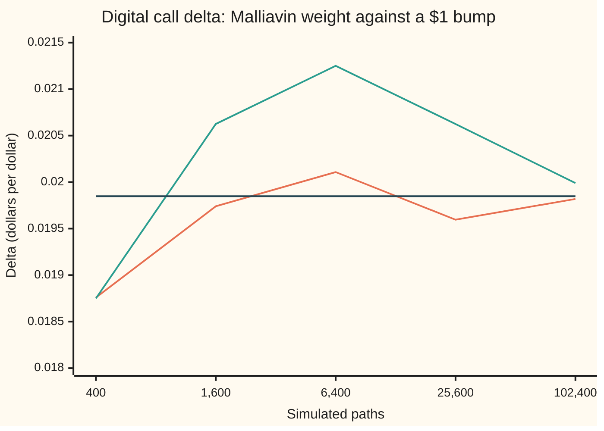

# Malliavin calculus in outline: differentiating a random variable with respect to the noise

[Syllabus](../../../SYLLABUS.md) → [Stochastic processes and calculus](../README.md) → [Beyond Brownian](../README.md#s09) → Malliavin calculus in outline

---

## General Overview

A share trades at $100. Its volatility is 20% a year, and the bank pays no interest. A dealer sells a **digital call**: a ticket that pays $1 if the share ends the year above $100, and nothing otherwise. Its fair value is $0.460172.

The dealer needs the ticket's **delta**: how much its value moves when today's share price moves by $1. The delta is the number of shares that hedges the ticket. The exact answer is 0.019848 dollars per dollar.

For most real contracts no formula exists, so desks simulate. The usual trick is to rerun the simulation from $101 and from $99 and take the difference. For a digital this is noisy: a path changes the payoff only if it lands within a dollar or two of the strike. Differentiating each path's payoff is worse. The payoff is flat on both sides of $100, so its slope is zero on every path, and the simulated delta comes out exactly 0.

**Malliavin calculus** fixes this. It treats the payoff as a function of the Brownian path that drives the share, and differentiates it with respect to that path. Then an integration by parts moves the derivative off the jumpy payoff and onto the path itself. The delta becomes a plain average:

- simulate the share's driving noise $`W_T`$ (the Brownian motion's value at the year's end),
- multiply the payoff by $`W_T`$,
- average, and divide by $100 × 0.2 × 1 = 20.

On 102,400 simulated years this gives 0.019819, with a standard error of 0.000091. Bumping by $1 on the same paths has a standard error of 0.000306: it would need 11.23 times as many paths for the same accuracy.

The same derivative also answers the hedging question of [Martingale representation](../07-Changing%20Measure/04-martingale-representation-theorem.md). That card proved a hedge exists. The **Clark-Ocone formula** says what it is: at each moment, the stake in the noise is the average of the payoff's sensitivity to the noise, given what is known so far. Divided by the volatility times the share price, it is the number of shares.

**Malliavin calculus differentiates a random payoff with respect to the Brownian path that produced it; integration by parts against the path turns that derivative into a weight, so a Greek of a jumpy payoff becomes an ordinary average, and the same derivative, averaged on what is known so far, is the hedge in the martingale representation.**

**What kind of fact this is:** a definition (the Malliavin derivative) and two theorems. The integration by parts is proved on this card in Why it works for payoffs of finitely many path values. The Clark-Ocone formula is proved for those payoffs in a folded Detailed proof; its extension to every payoff whose derivative exists as a limit (the space Nualart calls $`\mathbb D^{1,2}`$) is stated, with its proof in Nualart's book (Sources).

### The picture: the simulated delta as the paths pile up



Orange: the Malliavin weight estimate. Green: the $1 bump on the same paths. Dark blue: the exact delta, 0.019848. Both estimates settle on the exact value; the orange one gets there with fewer paths. The $1 bump also carries a small bias, because it measures the slope over a $2 range, not at a point.

---

## The formula

Notation first, in words.

- $`W_t`$ is Brownian motion, the share's source of randomness, with $`t`$ in years from now to the expiry $`T`$.
- $`\mathcal F_t`$ is what is known by time $`t`$: the path of $`W`$ up to then.
- $`F`$ is a random variable fixed by the path up to $`T`$, such as a payoff. A **smooth functional** is one of the form $`F = f(W_{t_1}, \dots, W_{t_n})`$: a smooth function $`f`$ of the path's values at finitely many times $`t_1, \dots, t_n`$.
- $`\partial_i f`$ is the slope of $`f`$ in its $`i`$-th entry.
- $`\mathbf 1\{A\}`$ is 1 if $`A`$ happens and 0 if not.

**The Malliavin derivative.** For a smooth functional,

```math
D_t F = \sum_{i=1}^{n} \partial_i f(W_{t_1}, \dots, W_{t_n})\,\mathbf 1\{t \le t_i\}.
```

**Read it aloud:** the sensitivity of $`F`$ to a kick in the noise at time $`t`$ is the sum of its slopes in every path value that comes after $`t`$.

A kick at time $`t`$ lifts every later value of $`W`$ by the same amount, and earlier values not at all. That is why only the times $`t_i \ge t`$ count. So $`D_t W_T = 1`$, and $`D_t W_T^3 = 3W_T^2`$.

**Integration by parts.** For a smooth functional $`F`$ and any non-random rate $`h_t`$,

```math
E\left[\int_0^T D_t F\; h_t\, dt\right] = E\left[F \int_0^T h_t\, dW_t\right].
```

**Read it aloud:** the average sensitivity of $`F`$ to a steady nudge of the path equals the average of $`F`$ times the Ito integral of that nudge.

**The Clark-Ocone formula.** For $`F`$ with a finite average square and a Malliavin derivative,

```math
F = E[F] + \int_0^T E\left[D_t F \mid \mathcal F_t\right] dW_t .
```

**Read it aloud:** a payoff is its average plus the gain from holding, at each moment, the average of its sensitivity to the noise given the path so far.

**The Greek.** The share is $`S_T = S_0 \exp(-\tfrac12\sigma^2 T + \sigma W_T)`$, with no interest. For a payoff $`g(S_T)`$, the delta is

```math
\Delta = \frac{\partial}{\partial S_0} E\left[g(S_T)\right] = \frac{E\left[g(S_T)\, W_T\right]}{S_0\,\sigma\,T}, \qquad \text{for the digital: } \frac{E\left[\mathbf 1\{S_T > K\}\, W_T\right]}{100 \times 0.2 \times 1} = \frac{\varphi(d_2)}{S_0\,\sigma\sqrt T} = \frac{0.396953}{20} = 0.019848 .
```

**Read it aloud:** the delta is the average of the payoff times the year-end noise, divided by today's price, the volatility and the time.

Here $`d_2 = \big(\ln(S_0/K) - \tfrac12\sigma^2 T\big)/(\sigma\sqrt T) = -0.1`$. $`\varphi`$ is the bell curve's height, $`\varphi(x) = e^{-x^2/2}/\sqrt{2\pi}`$, and $`N(d_2)`$ is the bell curve's area to the left of $`d_2`$: the digital's value, 0.460172.

| Symbol | Plain meaning | In our example | Push it up and the answer… |
| --- | --- | --- | --- |
| $`W_t`$, $`dW_t`$, $`Z`$ | Brownian motion, the share's noise; $`Z`$ a standard normal number (Step 0) | $`S_T > 100`$ exactly when $`W_T > 0.1`$ | larger $`W_T`$, higher share |
| $`t`$, $`s`$, $`T`$, $`t_i`$, $`n`$ | times in years; the expiry; the times a smooth functional reads; their count | $`T = 1`$ | — |
| $`\mathcal F_t`$ | what is known by time $`t`$ | the path up to $`t`$ | — |
| $`F`$, $`f`$, $`g`$, $`\mathbf 1\{\cdot\}`$ | a random variable fixed by the path; a smooth function of path values; a payoff function of the final price; the indicator | $`F = \mathbf 1\{S_T > 100\}`$ | — |
| $`D_t F`$, $`\partial_i f`$, $`\mathbb D^{1,2}`$ | Malliavin derivative: the sensitivity of $`F`$ to a kick in the noise at $`t`$; a slope of $`f`$; the payoffs that have a derivative, as a limit | $`D_t S_T = \sigma S_T`$ | — |
| $`h_t`$, $`\varepsilon`$ | the shape of a nudge to the path; its size | $`h_t = 1`$ for the Greek | — |
| $`S_t`$, $`S_0`$, $`K`$ | share price; today's price; the strike | $`S_0 = K = 100`$ dollars | higher $`S_0`$, higher value |
| $`\sigma`$ | volatility, per year | 0.2 | delta 0.009776 at 0.4 |
| $`d_2`$, $`\varphi`$, $`N`$ | the strike's distance in standard deviations; bell-curve height; bell-curve area | $`d_2 = -0.1`$, $`\varphi(d_2) = 0.396953`$, $`N(d_2) = 0.460172`$ | — |
| $`\Delta`$ | delta: value change per $1 change in $`S_0`$ | 0.019848 | — |
| $`\theta_t`$, $`H_t`$ | the Clark-Ocone integrand $`E[D_tF \mid \mathcal F_t]`$; shares to hold, $`\theta_t/(\sigma S_t)`$ | $`\theta_0 = 0.396953`$, $`H_0 = 0.019848`$ | — |
| $`E`$, $`M`$ | average over paths; the number of simulated paths | $`M = 102{,}400`$ | standard error falls like $`1/\sqrt M`$ |

### When it holds

- **Brownian motion is the only noise.** The derivative is taken along the Brownian path. A payoff that also depends on an independent jump or a second noise has a part this derivative cannot see; jumps need their own version ([Levy processes](01-levy-processes.md)).
- **The payoff is a mean-square limit of smooth functionals whose derivatives also converge in mean square** (the space Nualart calls $`\mathbb D^{1,2}`$). Then $`D_tF`$ exists. The digital fails this: its smoothed versions converge, but their derivatives blow up into a spike at the strike. The Greek formula still holds because its right side needs only $`g`$ bounded. The Clark-Ocone integrand still makes sense as a limit: the smoothed payoffs' integrands converge, because the payoffs do.
- **The nudge is in the noise, not in time.** $`D_t F`$ is not a time derivative. A Brownian path has no slope, so nobody differentiates it in $`t`$; the Malliavin derivative asks how $`F`$ responds when the path is lifted, which is always possible.
- **The weight matches the model.** The weight $`W_T/(S_0\sigma T)`$ is for this share. Pairing the payoff with the noise at the wrong time, $`W_{T/2}`$, returns 0.009932: half the delta.
- **The sample is big enough.** The weight is unbiased but random. With 102,400 paths its standard error is 0.000091, against a delta of 0.019848.

---

## Why it works

### Step 0: one normal number first

All of Malliavin calculus is one identity for a standard normal number $`Z`$, applied to every Brownian kick at once. For a smooth $`f`$ that does not grow too fast,

```math
E\left[f'(Z)\right] = E\left[Z\, f(Z)\right].
```

The reason is the shape of the bell curve. Its slope is $`\varphi'(z) = -z\,\varphi(z)`$. Integrate $`f'(z)\varphi(z)`$ by parts: the boundary terms vanish far out, and what remains is $`\int f(z)\, z\,\varphi(z)\,dz`$.

This moves the derivative from $`f`$ to a weight, $`Z`$. That is the whole trick. If $`f`$ is a step, $`f'`$ is a spike, but $`E[Z f(Z)]`$ is still a plain average. For $`f = \mathbf 1\{z > 0.1\}`$ it is $`\varphi(0.1) = 0.396953`$, which the code finds by numerical integration.

### Step 1: the derivative is a response to a kick

A Brownian path is the sum of many small independent normal kicks. Kick the path by $`\varepsilon`$ at time $`t`$: every later value rises by $`\varepsilon`$, every earlier one stays put. The Malliavin derivative $`D_tF`$ is the rate at which $`F`$ responds.

For our share, $`S_T = S_0\exp(-\tfrac12\sigma^2T + \sigma W_T)`$. A kick before $`T`$ raises $`W_T`$, so

```math
D_t S_T = \sigma S_T \quad (t \le T).
```

The usual calculus rules hold. The chain rule gives $`D_t\, g(S_T) = g'(S_T)\,\sigma S_T`$ for a smooth payoff $`g`$. Products obey the product rule.

A steady nudge combines the kicks. Lift the whole path by $`\varepsilon\int_0^t h_s\,ds`$: the response of $`F`$ is $`\varepsilon\int_0^T D_tF\,h_t\,dt`$ to first order. This directional form is what Step 2 uses.

### Step 2: integration by parts, from Girsanov

[Girsanov](../07-Changing%20Measure/02-girsanov-theorem.md) says a nudged Brownian motion is a Brownian motion under reweighted odds. Moving the path by $`\varepsilon\int_0^t h_s\,ds`$ gives the same averages as keeping the path and multiplying each outcome by

```math
\exp\left(\varepsilon\int_0^T h_t\,dW_t - \tfrac12\varepsilon^2\int_0^T h_t^2\,dt\right).
```

So $`E[F(\text{nudged path})] = E[F \times \text{that weight}]`$ for every $`\varepsilon`$. Differentiate both sides at $`\varepsilon = 0`$:

- the left side gives $`E\left[\int_0^T D_tF\,h_t\,dt\right]`$, by Step 1;
- the right side gives $`E\left[F\int_0^T h_t\,dW_t\right]`$, since the weight's slope at $`\varepsilon = 0`$ is the Ito integral.

That is the integration by parts in The formula. With $`n = 1`$, $`h = 1`$ and $`T = 1`$ it is Step 0 again.

The code checks it on two payoffs over 102,400 paths:

| $`F`$ | $`E[F\,W_T]`$, simulated | $`E[\int_0^T D_tF\,dt]`$, simulated | Exact |
| --- | --- | --- | --- |
| $`W_T^3`$ | 3.0024 ± 0.0312 | 2.9932 ± 0.0133 | 3 |
| $`S_T`$ | 19.9615 ± 0.3376 | 19.9992 ± 0.0126 | 20 |

<details>
<summary>Detailed proof: integration by parts for a smooth functional</summary>

Let $`F = f(W_{t_1}, \dots, W_{t_n})`$ with $`0 < t_1 < \dots < t_n = T`$ and $`f`$ smooth with slopes of at most polynomial growth. Write the increments $`\xi_j = W_{t_j} - W_{t_{j-1}}`$, independent normals with variances $`t_j - t_{j-1}`$, and $`F = G(\xi_1, \dots, \xi_n)`$ with $`G(x) = f(x_1, x_1 + x_2, \dots, x_1 + \dots + x_n)`$.

Take $`h`$ constant on each interval, $`h = c_j`$ on $`(t_{j-1}, t_j]`$. Then $`\int_0^T h\,dW = \sum_j c_j \xi_j`$ and

$`\displaystyle \int_0^T D_tF\,h_t\,dt = \sum_{i} \partial_i f \sum_{j \le i} c_j (t_j - t_{j-1}) = \sum_j c_j (t_j - t_{j-1})\,\partial_j G .`$

The last step uses $`\partial_j G = \sum_{i \ge j} \partial_i f`$, the chain rule for $`G`$. Step 0, applied to the normal $`\xi_j`$ of variance $`v_j = t_j - t_{j-1}`$ with the other increments held fixed, gives $`E[v_j\,\partial_j G] = E[\xi_j\, G]`$. Multiply by $`c_j`$ and add:

$`\displaystyle E\left[\int_0^T D_tF\,h_t\,dt\right] = E\left[F\sum_j c_j\xi_j\right] = E\left[F\int_0^T h_t\,dW_t\right].`$

Step-shaped $`h`$ approximate any square-integrable $`h`$, and both sides are continuous in $`h`$ by the Ito isometry, so the identity holds for all of them.

The same identity shows the derivative is well defined: two formulas $`f`$ for the same $`F`$ give the same $`D_tF`$. Taking limits then defines $`D`$ on a larger space, written $`\mathbb D^{1,2}`$ in Nualart's book. Allowing $`h`$ to be random and not adapted to $`\mathcal F_t`$ turns the right side into the Skorokhod integral, which equals the Ito integral when $`h`$ is adapted. Both extensions are in Nualart, Chapter 1.

</details>

### Step 3: the Greek, with the derivative moved off the payoff

Start with a smooth payoff $`g`$. Raising $`S_0`$ scales $`S_T`$ by the same factor, so $`\partial S_T/\partial S_0 = S_T/S_0`$ and

```math
\Delta = E\left[g'(S_T)\,\frac{S_T}{S_0}\right].
```

This is the **pathwise** delta: differentiate each path's payoff. Now use Step 1. Since $`D_t\,g(S_T) = g'(S_T)\,\sigma S_T`$ for every $`t \le T`$, averaging over $`t`$ gives

```math
g'(S_T)\,S_T = \frac{1}{\sigma T}\int_0^T D_t\, g(S_T)\,dt .
```

Put this into $`\Delta`$ and apply Step 2 with $`h = 1`$, so $`\int_0^T h\,dW = W_T`$:

```math
\Delta = \frac{1}{S_0\sigma T}\,E\left[\int_0^T D_t\, g(S_T)\,dt\right] = \frac{E\left[g(S_T)\,W_T\right]}{S_0\sigma T}.
```

The derivative is gone. The right side only needs $`g`$ bounded, so the formula passes to the digital: smooth payoffs closing in on the step give deltas closing in on both sides.

For the digital, $`S_T > 100`$ exactly when $`W_T > 0.1`$, because $`\ln(100/100) + \tfrac12 \times 0.04 = 0.02`$ and $`0.02/0.2 = 0.1`$. So $`E[\mathbf 1\{S_T > K\}W_T] = \int_{0.1}^\infty w\,\varphi(w)\,dw = \varphi(0.1) = 0.396953`$. Dividing by 20 gives 0.019848. The closed form agrees, and so does a one-cent bump of the exact price.

In this one-dimensional case the weight is the same as the likelihood-ratio weight of [Greeks inside the simulation](../../12-Financial%20mathematics/07-Greeks%20by%20Numbers%20and%20Calibration/02-pathwise-and-likelihood-ratio-greeks.md), which differentiates the density of $`S_T`$. Malliavin's route needs no density. That matters for payoffs on a whole path, or for models where the density is unknown.

### Step 4: Clark-Ocone, the hedge read off the derivative

Martingale representation says $`F = E[F] + \int_0^T \theta_t\,dW_t`$ for exactly one strategy $`\theta_t`$. Clark-Ocone names it: $`\theta_t = E[D_tF \mid \mathcal F_t]`$.

The reason, in words: a kick at time $`t`$ changes the final payoff by $`D_tF`$ on average, given the past. In the representation, a kick at $`t`$ changes the payoff by $`\theta_t`$, the stake held at that moment. Both measure the same thing, so they agree. The fold makes this exact.

Three examples:

- **$`F = W_T^2`$.** $`D_tF = 2W_T`$, and its average given the past is $`2W_t`$. So $`W_T^2 = T + \int_0^T 2W_t\,dW_t`$, as [Ito's lemma](../06-Ito%20Calculus/02-itos-lemma.md) also says. On a grid of 500 steps the hedge misses by 0.062813 root-mean-square (the square root of the average squared miss) over 2,000 paths; the exact grid value is $`\sqrt{2/500} = 0.063246`$.
- **$`F = \int_0^T W_s\,ds`$, the year's average of $`W`$.** This payoff depends on the whole path. A kick at $`t`$ raises $`W_s`$ for every later $`s`$, so $`D_tF = T - t`$, with nothing random left. The hedge is to hold $`T - t`$ units, no equation needed. The isometry says the variance is $`\int_0^T (T-t)^2\,dt`$, a third; the code's 500-step grid gives 0.3323 exactly, and simulation gives 0.3250 ± 0.0103.
- **The digital.** $`D_tF`$ is a spike at the strike times $`\sigma S_T`$. Its average given $`S_t`$ is $`\sigma K`$ times the chance density of $`S_T`$ at $`K`$, which works out to $`\theta_t = \varphi(d_2(t))/\sqrt{T - t}`$, with $`d_2(t)`$ the same distance computed from $`S_t`$ and the time left. The shares to hold are $`H_t = \theta_t/(\sigma S_t)`$.

The digital's hedge from Clark-Ocone, against a one-cent bump of the exact value:

| Time $`t`$ | Share $`S_t`$ | $`\theta_t = E[D_tF \mid \mathcal F_t]`$ | Shares $`H_t`$ | Bumped slope |
| --- | --- | --- | --- | --- |
| 0 | 100 | 0.396953 | 0.019848 | 0.019848 |
| 0.5 | 110 | 0.470335 | 0.021379 | 0.021379 |
| 0.5 | 100 | 0.562781 | 0.028139 | 0.028139 |
| 0.9960, a trading day left | 100 | 6.332887 | 0.316644 | 0.316641 |

At $`t = 0`$ the hedge equals the Greek from Step 3. That is no accident: the hedge ratio is the delta, and both are the payoff's sensitivity to the noise, averaged.

<details>
<summary>Detailed proof: Clark-Ocone for smooth functionals</summary>

Let $`F`$ be a smooth functional. By martingale representation, $`F = E[F] + \int_0^T \theta_t\,dW_t`$ for one adapted $`\theta`$ with $`E\int_0^T \theta_t^2\,dt < \infty`$. Let $`u`$ be any adapted process with $`E\int_0^T u_t^2\,dt`$ finite and $`G = \int_0^T u_t\,dW_t`$.

By the Ito isometry,

$`\displaystyle E[F\,G] = E\left[\int_0^T \theta_t\,u_t\,dt\right].`$

Integration by parts also holds for adapted $`u`$. The proof above goes through when each $`c_j`$ is random but fixed by the increments before $`t_j`$, because Step 0 holds those increments still (add $`u`$'s switch times to the grid). Limits then cover every adapted $`u`$. So

$`\displaystyle E[F\,G] = E\left[\int_0^T D_tF\,u_t\,dt\right] = E\left[\int_0^T E[D_tF \mid \mathcal F_t]\,u_t\,dt\right],`$

the last step because $`u_t`$ is known at time $`t`$, so it can be pulled through the average given $`\mathcal F_t`$. The two right sides agree for every adapted $`u`$. Take $`u_t = \theta_t - E[D_tF \mid \mathcal F_t]`$: then $`E\int_0^T u_t^2\,dt = 0`$, so $`\theta_t = E[D_tF \mid \mathcal F_t]`$ for almost every $`t`$ and path.

The extension to every $`F`$ in $`\mathbb D^{1,2}`$ is by limits (Nualart, Chapter 1). For a payoff outside it, such as the digital, the integrand is the limit of its smoothed versions' integrands, which converge by the Ito isometry. Ocone proved the formula for functionals of diffusions in 1984; Clark's 1970 paper had it for smooth path functionals. Both are in Sources.

</details>

### Step 5: why the weight beats the bump

A bump of $`h`$ dollars, using the same paths at $`S_0 + h`$ and $`S_0 - h`$, scores $`1/(2h)`$ on the few paths whose final price lands within about $`h`$ of the strike, and 0 elsewhere. A rare large score makes a noisy average. Shrinking $`h`$ removes bias but makes the scores rarer and larger.

The weight scores $`W_T/20`$ on every path that pays. Every paying path contributes, and the scores are small. On 102,400 paths:

```
Standard error of the simulated delta (102,400 paths)
Malliavin weight       #                                     0.000091
bump h = $1            ###                                   0.000306
bump h = 1 cent        ##################################    0.003164
```

Standard error falls like $`1/\sqrt M`$ ([Monte Carlo](../../09-Probability%20and%20statistics/11-Simulation/04-monte-carlo-estimates-and-error.md)). So the ratio of squared errors is the ratio of paths needed: 11.23 for the $1 bump.

### Step 6: beyond the outline

- **Diffusions.** For a solution of a stochastic differential equation, $`D_tX_T`$ is built from the equation's first variation (how $`X_T`$ moves when $`X_t`$ moves). The Greek weights for local-volatility and path-dependent payoffs come from this.
- **Densities.** Malliavin's original 1976 aim was to prove that solutions of such equations have smooth densities. Hörmander's criterion, about the equation's coefficients, is the condition he recovered by this route. It is named here, not proved.
- **Non-adapted integrands.** The partner of $`D`$ in integration by parts is the Skorokhod integral. It integrates strategies that peek at the future and equals the Ito integral when they do not.

---

## Worked numbers, by hand

The digital: $`S_0 = K = 100`$, $`\sigma = 0.2`$, $`T = 1`$, no interest.

| Step | Arithmetic | Value |
| --- | --- | --- |
| distance $`d_2`$ | $`(\ln 1 - 0.5 \times 0.04 \times 1)/(0.2 \times 1)`$ | −0.100000 |
| bell-curve height | $`\varphi(-0.1) = e^{-0.005}/\sqrt{2\pi}`$ | 0.396953 |
| digital value | $`N(-0.1)`$ | $0.460172 |
| where the digital pays | $`S_T > 100`$ when $`W_T > (0 + 0.02)/0.2`$ | $`W_T > 0.100000`$ |
| average of payoff times noise | $`E[\mathbf 1\{W_T > 0.1\}W_T] = \varphi(0.1)`$ | 0.396953 |
| divide by $`S_0\sigma T`$ | $`0.396953 / 20`$ | **0.019848** |
| simulated, 102,400 paths | average of $`\mathbf 1\{S_T > 100\}W_T/20`$ | 0.019819 ± 0.000091 |
| Clark-Ocone hedge at the start | $`\varphi(-0.1)/(0.2 \times 100 \times \sqrt 1)`$ | 0.019848 shares |

A $1 rise in the share today raises the ticket's value by about 2 cents. The dealer who sold it hedges by holding 0.019848 shares per ticket, and the simulated delta lands within one standard error of that.

### What breaks if you drop a piece

| Mistake | Comes out at | What went wrong |
| --- | --- | --- |
| Differentiate each path's payoff (pathwise) | 0.000000 | the step is flat almost everywhere; all its slope sits at the strike, where no path lands exactly |
| Weight the payoff by $`W_{T/2}`$, the noise at half a year | 0.009932 ± 0.000070, half the delta | integration by parts needs the integral of $`h`$ over the whole year; half the nudges are missing |
| Bump by 1 cent in the simulation | 0.020508 ± 0.003164 | very few paths end between $99.99 and $100.01, so a handful of large scores make the whole estimate |
| Bump by $1 in the simulation | 0.019990 ± 0.000306 | usable, but it needs 11.23 times as many paths, and it measures a slope over $2 |

---

## Code, from first principles, and it actually runs

Both programs reach the digital's delta four ways: the closed form, a one-cent bump of the exact price, numerical integration (Simpson's rule) of $`E[\mathbf 1\{W_T > 0.1\}W_T]`$, and a seeded simulation of 102,400 paths (SplitMix64, seed 20261123, Box-Muller normals) using the Malliavin weight. The same paths give the digital's value, the bumps, the wrong weight and the integration-by-parts checks. A second run of 2,000 paths on a 500-step grid (seed 7) checks Clark-Ocone on $`W_T^2`$ and on the average of $`W`$. Finally, the Clark-Ocone hedge for the digital is checked against bumped slopes at four times. Simulated numbers carry their standard errors; each simulation assert allows four.

### Python

```python
# Malliavin calculus in outline -- the check behind the card.  Standard library only.
# A digital call pays $1 if a share, now $100, ends one year above $100 (volatility 20%,
# no interest).  Its delta from the Malliavin weight, E[1{S_T > K} W_T] / (S0 sigma T),
# against the exact phi(d2) / (S0 sigma); then the duality and Clark-Ocone by simulation.
from math import sqrt, exp, log, cos, pi

S0, K, SIG, T = 100.0, 100.0, 0.2, 1.0
MASK = (1 << 64) - 1
class Rng:                                        # SplitMix64, normals by Box-Muller
    def __init__(self, seed): self.s = seed
    def u(self):
        self.s = (self.s + 0x9E3779B97F4A7C15) & MASK
        z = self.s
        z = ((z ^ (z >> 30)) * 0xBF58476D1CE4E5B9) & MASK
        z = ((z ^ (z >> 27)) * 0x94D049BB133111EB) & MASK
        return (((z ^ (z >> 31)) >> 11) + 0.5) / 9007199254740992.0
    def normal(self):
        u1 = self.u()
        return sqrt(-2.0 * log(u1)) * cos(2.0 * pi * self.u())
def pdf(x): return exp(-0.5 * x * x) / sqrt(2.0 * pi)      # bell-curve height phi
def cdf(x):                                       # 1/2 + phi(x)(x + x^3/3 + x^5/15 + ...)
    term, total, k = x, x, 0
    while abs(term) > 1e-17:
        k += 1; term *= x * x / (2 * k + 1); total += term
    return 0.5 + pdf(x) * total
def d2(s, tau): return (log(s / K) - 0.5 * SIG * SIG * tau) / (SIG * sqrt(tau))
def value(s, tau): return cdf(d2(s, tau))         # digital's fair value, rate 0
def share(w, s0=S0): return s0 * exp(-0.5 * SIG * SIG * T + SIG * w)
def mse(xs):                                      # mean and its standard error
    n = len(xs); m = sum(xs) / n
    return m, sqrt(sum((x - m) ** 2 for x in xs) / (n - 1) / n)
def simpson(f, a, b, n=4000):
    h = (b - a) / n
    return h / 3 * sum((1 if i in (0, n) else 4 if i % 2 else 2) * f(a + i * h) for i in range(n + 1))

# Road 1: closed form.  Road 2: bump the exact price.  Road 3: quadrature of E[1{S_T>K} W_T].
z2 = d2(S0, T); delta = pdf(z2) / (S0 * SIG * sqrt(T))
bump = (value(S0 + 0.01, T) - value(S0 - 0.01, T)) / 0.02
wstar = (log(K / S0) + 0.5 * SIG * SIG * T) / SIG          # S_T > K exactly when W_T > wstar
quad = simpson(lambda w: w * pdf(w / sqrt(T)) / sqrt(T), wstar, 10.0)
print(f"d2 = (ln(S0/K) - sigma^2 T/2)/(sigma sqrt T)  {z2:.6f}")
print(f"phi(d2), bell-curve height                    {pdf(z2):.6f}")
print(f"digital value N(d2), dollars                  {value(S0, T):.6f}")
print(f"S_T > K exactly when W_T >                    {wstar:.6f}")
print(f"delta exact phi(d2)/(S0 sigma sqrt T)         {delta:.6f}")
print(f"delta by bumping the exact price 1 cent       {bump:.6f}")
print(f"E[1{{S_T>K}} W_T] by quadrature                 {quad:.6f}")
print(f"quadrature / (S0 sigma T)                     {quad / (S0 * SIG * T):.6f}")
assert abs(bump - delta) < 1e-7 and abs(quad - pdf(z2)) < 1e-9

# Road 4: Monte Carlo, 102,400 paths; W at half a year and at the year's end.
rng, N = Rng(20261123), 102400
wh = [sqrt(0.5 * T) * rng.normal() for _ in range(N)]
wt = [a + sqrt(0.5 * T) * rng.normal() for a in wh]
mall = [(share(w) > K) * w / (S0 * SIG * T) for w in wt]
half = [(share(w) > K) * a / (S0 * SIG * T) for a, w in zip(wh, wt)]
def bumped(h): return [((share(w, S0 + h) > K) - (share(w, S0 - h) > K)) / (2 * h) for w in wt]
b1, b001 = bumped(1.0), bumped(0.01)
m_val, s_val = mse([float(share(w) > K) for w in wt])      # the value itself, by a road that skips d2
print(f"MC digital value, mean of 1{{S_T>K}}            {m_val:.6f} +- {s_val:.6f}")
assert abs(m_val - value(S0, T)) < 4 * s_val
for name, xs in [("Malliavin weight", mall), ("bump h = $1, same draws", b1),
                 ("bump h = 1 cent, same draws", b001), ("weight W_{T/2} (wrong)", half)]:
    m, s = mse(xs); print(f"MC delta, {name:36s}{m:.6f} +- {s:.6f}")
m_mall, s_mall = mse(mall); m_b1, s_b1 = mse(b1); m_half, s_half = mse(half)
print(f"MC delta, pathwise (payoff slope is 0)        {0.0:.6f} +- {0.0:.6f}")
print(f"paths needed, bump $1 / Malliavin, same error {(s_b1 / s_mall) ** 2:.2f}")
assert abs(m_mall - delta) < 4 * s_mall and abs(m_half - delta / 2) < 4 * s_half
assert s_b1 > 2 * s_mall
for n in (400, 1600, 6400, 25600, 102400):
    print(f"chart, paths {n:6d}  Malliavin {sum(mall[:n]) / n:.6f}  bump $1 {sum(b1[:n]) / n:.6f}")

# The duality E[F W_T] = E[integral of D_t F dt], with F = W_T^3 and F = S_T.
c3l, s3l = mse([w ** 4 for w in wt]); c3r, s3r = mse([3 * w * w * T for w in wt])
csl, ssl = mse([share(w) * w for w in wt]); csr, ssr = mse([SIG * share(w) * T for w in wt])
print(f"F = W_T^3: E[F W_T] = {c3l:.4f} +- {s3l:.4f}   E[3 W_T^2 T] = {c3r:.4f} +- {s3r:.4f}   exact 3")
print(f"F = S_T:   E[F W_T] = {csl:.4f} +- {ssl:.4f}   E[sigma S_T T] = {csr:.4f} +- {ssr:.4f}  exact {S0 * SIG * T:.0f}")
assert abs(c3l - 3 * T * T) < 4 * s3l and abs(csl - S0 * SIG * T) < 4 * ssl

# Clark-Ocone.  W_T^2 = T + int 2 W_t dW_t; mean of W = int (T - s) dW_s; the digital's shares.
rng, P, n = Rng(7), 2000, 500
dt = T / n; miss2, avg = [], []
for _ in range(P):
    w = a = g = 0.0
    for _ in range(n):
        dw = sqrt(dt) * rng.normal(); a += w * dt; g += 2 * w * dw; w += dw
    miss2.append((w * w - (T + g)) ** 2); avg.append(a)
rms = sqrt(sum(miss2) / P); ma, _ = mse(avg)
va = sum((x - ma) ** 2 for x in avg) / (P - 1); vgrid = sum((T - j * dt) ** 2 * dt for j in range(1, n + 1))
print(f"W_T^2 hedge, 500 steps: RMS miss {rms:.6f}, exact sqrt(2/500) {sqrt(2 * T * T / n):.6f}")
print(f"mean of W: variance {va:.4f} +- {va * sqrt(2 / (P - 1)):.4f}, isometry on grid {vgrid:.4f}, limit 1/3")
assert abs(rms - sqrt(2 * T * T / n)) < 0.1 * sqrt(2 * T * T / n) and abs(va - vgrid) < 4 * va * sqrt(2 / (P - 1))
for t, s in [(0.0, 100.0), (0.5, 110.0), (0.5, 100.0), (1 - 1 / 252, 100.0)]:
    tau = T - t; co = pdf(d2(s, tau)) / sqrt(tau); h = co / (SIG * s)
    fd = (value(s + 0.01, tau) - value(s - 0.01, tau)) / 0.02
    print(f"t = {t:.4f}, S = {s:.0f}: E[D_t F | F_t] = {co:.6f}, shares {h:.6f}, bumped slope {fd:.6f}")
    assert abs(h - fd) < 1e-4 * h + 1e-9
print("ALL CHECKS PASS")
```

**Ran 2026-11-23 on macOS, Python 3.14.10, standard library only. All checks passed. Output, pasted from the run:**

```
d2 = (ln(S0/K) - sigma^2 T/2)/(sigma sqrt T)  -0.100000
phi(d2), bell-curve height                    0.396953
digital value N(d2), dollars                  0.460172
S_T > K exactly when W_T >                    0.100000
delta exact phi(d2)/(S0 sigma sqrt T)         0.019848
delta by bumping the exact price 1 cent       0.019848
E[1{S_T>K} W_T] by quadrature                 0.396953
quadrature / (S0 sigma T)                     0.019848
MC digital value, mean of 1{S_T>K}            0.459795 +- 0.001557
MC delta, Malliavin weight                    0.019819 +- 0.000091
MC delta, bump h = $1, same draws             0.019990 +- 0.000306
MC delta, bump h = 1 cent, same draws         0.020508 +- 0.003164
MC delta, weight W_{T/2} (wrong)              0.009932 +- 0.000070
MC delta, pathwise (payoff slope is 0)        0.000000 +- 0.000000
paths needed, bump $1 / Malliavin, same error 11.23
chart, paths    400  Malliavin 0.018758  bump $1 0.018750
chart, paths   1600  Malliavin 0.019740  bump $1 0.020625
chart, paths   6400  Malliavin 0.020108  bump $1 0.021250
chart, paths  25600  Malliavin 0.019596  bump $1 0.020625
chart, paths 102400  Malliavin 0.019819  bump $1 0.019990
F = W_T^3: E[F W_T] = 3.0024 +- 0.0312   E[3 W_T^2 T] = 2.9932 +- 0.0133   exact 3
F = S_T:   E[F W_T] = 19.9615 +- 0.3376   E[sigma S_T T] = 19.9992 +- 0.0126  exact 20
W_T^2 hedge, 500 steps: RMS miss 0.062813, exact sqrt(2/500) 0.063246
mean of W: variance 0.3250 +- 0.0103, isometry on grid 0.3323, limit 1/3
t = 0.0000, S = 100: E[D_t F | F_t] = 0.396953, shares 0.019848, bumped slope 0.019848
t = 0.5000, S = 110: E[D_t F | F_t] = 0.470335, shares 0.021379, bumped slope 0.021379
t = 0.5000, S = 100: E[D_t F | F_t] = 0.562781, shares 0.028139, bumped slope 0.028139
t = 0.9960, S = 100: E[D_t F | F_t] = 6.332887, shares 0.316644, bumped slope 0.316641
ALL CHECKS PASS
```

### Rust

The same roads. Rust has no bell-curve area function, so both programs use the same series; Python's `sum` adds with a running correction, and the Rust copies it so the outputs match digit for digit.

```rust
// Malliavin calculus in outline -- the check behind the card.  Rust std only, no crates.
// A digital call pays $1 if a share, now $100, ends one year above $100 (volatility 20%,
// no interest).  Its delta from the Malliavin weight, E[1{S_T > K} W_T] / (S0 sigma T),
// against the exact phi(d2) / (S0 sigma); then the duality and Clark-Ocone by simulation.
use std::f64::consts::PI;

const S0: f64 = 100.0;
const K: f64 = 100.0;
const SIG: f64 = 0.2;
const T: f64 = 1.0;

struct Rng { s: u64 } // SplitMix64, normals by Box-Muller
impl Rng {
    fn u(&mut self) -> f64 {
        self.s = self.s.wrapping_add(0x9E3779B97F4A7C15);
        let mut z = self.s;
        z = (z ^ (z >> 30)).wrapping_mul(0xBF58476D1CE4E5B9);
        z = (z ^ (z >> 27)).wrapping_mul(0x94D049BB133111EB);
        (((z ^ (z >> 31)) >> 11) as f64 + 0.5) / 9007199254740992.0
    }
    fn normal(&mut self) -> f64 {
        let u1 = self.u();
        (-2.0 * u1.ln()).sqrt() * (2.0 * PI * self.u()).cos()
    }
}
fn psum(xs: &[f64]) -> f64 { // compensated sum, as Python's sum() does
    let (mut s, mut c) = (0.0f64, 0.0f64);
    for &x in xs {
        let t = s + x;
        if s.abs() >= x.abs() { c += (s - t) + x; } else { c += (x - t) + s; }
        s = t;
    }
    s + c
}
fn pdf(x: f64) -> f64 { (-0.5 * x * x).exp() / (2.0 * PI).sqrt() } // bell-curve height phi
fn cdf(x: f64) -> f64 { // 1/2 + phi(x)(x + x^3/3 + x^5/15 + ...)
    let (mut term, mut total, mut k) = (x, x, 0.0);
    while term.abs() > 1e-17 {
        k += 1.0; term *= x * x / (2.0 * k + 1.0); total += term;
    }
    0.5 + pdf(x) * total
}
fn d2(s: f64, tau: f64) -> f64 { ((s / K).ln() - 0.5 * SIG * SIG * tau) / (SIG * tau.sqrt()) }
fn value(s: f64, tau: f64) -> f64 { cdf(d2(s, tau)) } // digital's fair value, rate 0
fn share(w: f64, s0: f64) -> f64 { s0 * (-0.5 * SIG * SIG * T + SIG * w).exp() }
fn mse(xs: &[f64]) -> (f64, f64) { // mean and its standard error
    let n = xs.len() as f64; let m = psum(xs) / n;
    let d: Vec<f64> = xs.iter().map(|x| (x - m).powf(2.0)).collect();
    (m, (psum(&d) / (n - 1.0) / n).sqrt())
}
fn simpson(f: impl Fn(f64) -> f64, a: f64, b: f64, n: usize) -> f64 {
    let h = (b - a) / n as f64;
    let v: Vec<f64> = (0..=n).map(|i| {
        let c = if i == 0 || i == n { 1.0 } else if i % 2 == 1 { 4.0 } else { 2.0 };
        c * f(a + i as f64 * h) }).collect();
    h / 3.0 * psum(&v)
}

fn main() {
    // Road 1: closed form.  Road 2: bump the exact price.  Road 3: quadrature of E[1{S_T>K} W_T].
    let z2 = d2(S0, T); let delta = pdf(z2) / (S0 * SIG * T.sqrt());
    let bump = (value(S0 + 0.01, T) - value(S0 - 0.01, T)) / 0.02;
    let wstar = ((K / S0).ln() + 0.5 * SIG * SIG * T) / SIG; // S_T > K exactly when W_T > wstar
    let quad = simpson(|w| w * pdf(w / T.sqrt()) / T.sqrt(), wstar, 10.0, 4000);
    println!("d2 = (ln(S0/K) - sigma^2 T/2)/(sigma sqrt T)  {:.6}", z2);
    println!("phi(d2), bell-curve height                    {:.6}", pdf(z2));
    println!("digital value N(d2), dollars                  {:.6}", value(S0, T));
    println!("S_T > K exactly when W_T >                    {:.6}", wstar);
    println!("delta exact phi(d2)/(S0 sigma sqrt T)         {:.6}", delta);
    println!("delta by bumping the exact price 1 cent       {:.6}", bump);
    println!("E[1{{S_T>K}} W_T] by quadrature                 {:.6}", quad);
    println!("quadrature / (S0 sigma T)                     {:.6}", quad / (S0 * SIG * T));
    assert!((bump - delta).abs() < 1e-7 && (quad - pdf(z2)).abs() < 1e-9);

    // Road 4: Monte Carlo, 102,400 paths; W at half a year and at the year's end.
    let mut rng = Rng { s: 20261123 }; let n_paths = 102400;
    let wh: Vec<f64> = (0..n_paths).map(|_| (0.5 * T).sqrt() * rng.normal()).collect();
    let wt: Vec<f64> = wh.iter().map(|a| a + (0.5 * T).sqrt() * rng.normal()).collect();
    let ind = |w: f64, s0: f64| if share(w, s0) > K { 1.0 } else { 0.0 };
    let mall: Vec<f64> = wt.iter().map(|&w| ind(w, S0) * w / (S0 * SIG * T)).collect();
    let half: Vec<f64> = wh.iter().zip(&wt).map(|(&a, &w)| ind(w, S0) * a / (S0 * SIG * T)).collect();
    let bumped = |h: f64| -> Vec<f64> {
        wt.iter().map(|&w| (ind(w, S0 + h) - ind(w, S0 - h)) / (2.0 * h)).collect() };
    let (b1, b001) = (bumped(1.0), bumped(0.01));
    let (m_val, s_val) = mse(&wt.iter().map(|&w| ind(w, S0)).collect::<Vec<f64>>()); // the value itself, by a road that skips d2
    println!("MC digital value, mean of 1{{S_T>K}}            {:.6} +- {:.6}", m_val, s_val);
    assert!((m_val - value(S0, T)).abs() < 4.0 * s_val);
    for (name, xs) in [("Malliavin weight", &mall), ("bump h = $1, same draws", &b1),
                       ("bump h = 1 cent, same draws", &b001), ("weight W_{T/2} (wrong)", &half)] {
        let (m, s) = mse(xs); println!("MC delta, {:<36}{:.6} +- {:.6}", name, m, s);
    }
    let (m_mall, s_mall) = mse(&mall); let (_, s_b1) = mse(&b1); let (m_half, s_half) = mse(&half);
    println!("MC delta, pathwise (payoff slope is 0)        {:.6} +- {:.6}", 0.0, 0.0);
    println!("paths needed, bump $1 / Malliavin, same error {:.2}", (s_b1 / s_mall).powf(2.0));
    assert!((m_mall - delta).abs() < 4.0 * s_mall && (m_half - delta / 2.0).abs() < 4.0 * s_half);
    assert!(s_b1 > 2.0 * s_mall);
    for n in [400usize, 1600, 6400, 25600, 102400] {
        println!("chart, paths {:6}  Malliavin {:.6}  bump $1 {:.6}", n,
                 psum(&mall[..n]) / n as f64, psum(&b1[..n]) / n as f64);
    }

    // The duality E[F W_T] = E[integral of D_t F dt], with F = W_T^3 and F = S_T.
    let col = |f: &dyn Fn(f64) -> f64| -> Vec<f64> { wt.iter().map(|&w| f(w)).collect() };
    let (c3l, s3l) = mse(&col(&|w| w.powf(4.0))); let (c3r, s3r) = mse(&col(&|w| 3.0 * w * w * T));
    let (csl, ssl) = mse(&col(&|w| share(w, S0) * w)); let (csr, ssr) = mse(&col(&|w| SIG * share(w, S0) * T));
    println!("F = W_T^3: E[F W_T] = {:.4} +- {:.4}   E[3 W_T^2 T] = {:.4} +- {:.4}   exact 3", c3l, s3l, c3r, s3r);
    println!("F = S_T:   E[F W_T] = {:.4} +- {:.4}   E[sigma S_T T] = {:.4} +- {:.4}  exact {:.0}",
             csl, ssl, csr, ssr, S0 * SIG * T);
    assert!((c3l - 3.0 * T * T).abs() < 4.0 * s3l && (csl - S0 * SIG * T).abs() < 4.0 * ssl);

    // Clark-Ocone.  W_T^2 = T + int 2 W_t dW_t; mean of W = int (T - s) dW_s; the digital's shares.
    let mut rng = Rng { s: 7 }; let (p, n) = (2000usize, 500usize);
    let dt = T / n as f64; let (mut miss2, mut avg) = (Vec::new(), Vec::new());
    for _ in 0..p {
        let (mut w, mut a, mut g) = (0.0f64, 0.0f64, 0.0f64);
        for _ in 0..n {
            let dw = dt.sqrt() * rng.normal(); a += w * dt; g += 2.0 * w * dw; w += dw;
        }
        miss2.push((w * w - (T + g)).powf(2.0)); avg.push(a);
    }
    let rms = (psum(&miss2) / p as f64).sqrt(); let (ma, _) = mse(&avg);
    let dev: Vec<f64> = avg.iter().map(|x| (x - ma).powf(2.0)).collect();
    let va = psum(&dev) / (p - 1) as f64;
    let g: Vec<f64> = (1..=n).map(|j| (T - j as f64 * dt).powf(2.0) * dt).collect();
    let vgrid = psum(&g); let se_va = va * (2.0 / (p - 1) as f64).sqrt();
    let exact = (2.0 * T * T / n as f64).sqrt();
    println!("W_T^2 hedge, 500 steps: RMS miss {:.6}, exact sqrt(2/500) {:.6}", rms, exact);
    println!("mean of W: variance {:.4} +- {:.4}, isometry on grid {:.4}, limit 1/3", va, se_va, vgrid);
    assert!((rms - exact).abs() < 0.1 * exact && (va - vgrid).abs() < 4.0 * se_va);
    for (t, s) in [(0.0, 100.0), (0.5, 110.0), (0.5, 100.0), (1.0 - 1.0 / 252.0, 100.0)] {
        let tau = T - t; let co = pdf(d2(s, tau)) / tau.sqrt(); let h = co / (SIG * s);
        let fd = (value(s + 0.01, tau) - value(s - 0.01, tau)) / 0.02;
        println!("t = {:.4}, S = {:.0}: E[D_t F | F_t] = {:.6}, shares {:.6}, bumped slope {:.6}", t, s, co, h, fd);
        assert!((h - fd).abs() < 1e-4 * h + 1e-9);
    }
    println!("ALL CHECKS PASS");
}
```

**Ran 2026-11-23 on macOS, rustc 1.98.1, no crates. All checks passed. Output, pasted from the run:**

```
d2 = (ln(S0/K) - sigma^2 T/2)/(sigma sqrt T)  -0.100000
phi(d2), bell-curve height                    0.396953
digital value N(d2), dollars                  0.460172
S_T > K exactly when W_T >                    0.100000
delta exact phi(d2)/(S0 sigma sqrt T)         0.019848
delta by bumping the exact price 1 cent       0.019848
E[1{S_T>K} W_T] by quadrature                 0.396953
quadrature / (S0 sigma T)                     0.019848
MC digital value, mean of 1{S_T>K}            0.459795 +- 0.001557
MC delta, Malliavin weight                    0.019819 +- 0.000091
MC delta, bump h = $1, same draws             0.019990 +- 0.000306
MC delta, bump h = 1 cent, same draws         0.020508 +- 0.003164
MC delta, weight W_{T/2} (wrong)              0.009932 +- 0.000070
MC delta, pathwise (payoff slope is 0)        0.000000 +- 0.000000
paths needed, bump $1 / Malliavin, same error 11.23
chart, paths    400  Malliavin 0.018758  bump $1 0.018750
chart, paths   1600  Malliavin 0.019740  bump $1 0.020625
chart, paths   6400  Malliavin 0.020108  bump $1 0.021250
chart, paths  25600  Malliavin 0.019596  bump $1 0.020625
chart, paths 102400  Malliavin 0.019819  bump $1 0.019990
F = W_T^3: E[F W_T] = 3.0024 +- 0.0312   E[3 W_T^2 T] = 2.9932 +- 0.0133   exact 3
F = S_T:   E[F W_T] = 19.9615 +- 0.3376   E[sigma S_T T] = 19.9992 +- 0.0126  exact 20
W_T^2 hedge, 500 steps: RMS miss 0.062813, exact sqrt(2/500) 0.063246
mean of W: variance 0.3250 +- 0.0103, isometry on grid 0.3323, limit 1/3
t = 0.0000, S = 100: E[D_t F | F_t] = 0.396953, shares 0.019848, bumped slope 0.019848
t = 0.5000, S = 110: E[D_t F | F_t] = 0.470335, shares 0.021379, bumped slope 0.021379
t = 0.5000, S = 100: E[D_t F | F_t] = 0.562781, shares 0.028139, bumped slope 0.028139
t = 0.9960, S = 100: E[D_t F | F_t] = 6.332887, shares 0.316644, bumped slope 0.316641
ALL CHECKS PASS
```

### Lean

Lean proves the one-normal identity of Step 0, the digital's weighted average, and the delta formula of Step 3 for every bounded payoff.

- Take a smooth $`f`$ that, with its slope, grows at most like a power of $`z`$. Then $`E[f'(Z)] = E[Z f(Z)]`$ for a standard normal $`Z`$.
- Take a step $`\mathbf 1\{z > a\}`$ at any level $`a`$. Then $`E[\mathbf 1\{Z > a\}\, Z] = \varphi(a)`$, the bell curve's height at $`a`$.
- Take any bounded payoff $`g`$, with $`S_0`$, $`\sigma`$ and $`T`$ positive and no interest. Then the slope of $`E[g(S_T)]`$ in $`S_0`$ is $`E[g(S_T)\, W_T]/(S_0\sigma T)`$.
- Take $`S_0 = K = 100`$, $`\sigma = 0.2`$ and $`T = 1`$. Then $`d_2 = -0.1`$, the digital pays when $`W_T > 0.1`$, and $`S_0\sigma T = 20`$.
- The slope of $`w^3`$ is $`3w^2`$, the step behind $`D_t W_T^3 = 3W_T^2`$.
- Take $`T = 1`$ and the year's average of $`W`$. Then the integral behind its variance, $`\int_0^1 (1-t)^2\,dt`$, equals one third.

Lean works with one normal number, so the path version, Clark-Ocone, the simulations and the decimals are left to the Python and Rust checks.

```lean
-- Malliavin calculus in outline: for a standard normal Z the slope moves onto a weight, E[f'(Z)] = E[Z f(Z)]; the digital's weighted average E[1{Z > a} Z] is the bell-curve height φ(a); and the delta of any bounded payoff on the zero-rate share is E[g(S_T) W_T] / (S₀ σ T).
import Mathlib.Probability.Distributions.Gaussian.Real
import Mathlib.Analysis.Calculus.ContDiff.Defs
import Mathlib.Analysis.SpecialFunctions.Integrals.Basic

open MeasureTheory ProbabilityTheory
open scoped ContDiff

/-! The model: `Z` is a standard normal number, the measure `gaussianReal 0 1`, so an average
`E[h(Z)]` is `∫ z, h z ∂(gaussianReal 0 1)`. Brownian motion at the expiry is `W_T = √T Z`.
The share with no interest is `S_T = S₀ exp(-σ²T/2 + σ W_T)`.
`φ(x)` is Mathlib's `gaussianPDFReal 0 1 x`, the bell curve's height at `x`.
Wiener space and the Malliavin derivative `D_t` itself are not in Mathlib; this file states the
one-normal identity of Step 0 that the card calls "all of Malliavin calculus", the digital's
weighted average, and the Greek of Step 3 that integration by parts delivers. -/

lemma malliavin_integrable_gaussianReal_iff {μ : ℝ} {v : NNReal} (hv : v ≠ 0) {h : ℝ → ℝ} :
    Integrable h (gaussianReal μ v) ↔ Integrable (fun x => gaussianPDFReal μ v x * h x) := by
  rw [gaussianReal_of_var_ne_zero _ hv, integrable_withDensity_iff_integrable_smul'
    (measurable_gaussianPDF _ _) (ae_of_all _ fun _ => gaussianPDF_lt_top)]
  simp [toReal_gaussianPDF]

#print axioms malliavin_integrable_gaussianReal_iff

lemma malliavin_integrable_one_add_abs_pow (μ : ℝ) (v : NNReal) (n : ℕ) :
    Integrable (fun x : ℝ => (1 + |x|) ^ n) (gaussianReal μ v) := by
  refine ((integrable_exp_mul_gaussianReal (μ := μ) (v := v) (n : ℝ)).add
    (integrable_exp_mul_gaussianReal (μ := μ) (v := v) (-(n : ℝ)))).mono'
    (by fun_prop) (ae_of_all _ fun x => ?_)
  have h1 : (1 + |x|) ^ n ≤ Real.exp (n * |x|) := by
    rw [Real.exp_nat_mul]
    exact pow_le_pow_left₀ (by positivity) (by linarith [Real.add_one_le_exp |x|]) n
  have h2 : Real.exp (n * |x|) ≤ Real.exp (n * x) + Real.exp (-n * x) := by
    rcases abs_cases x with ⟨hx, _⟩ | ⟨hx, _⟩
    · rw [hx]; linarith [Real.exp_pos (-n * x)]
    · rw [hx]; ring_nf; linarith [Real.exp_pos (n * x)]
  rw [Real.norm_eq_abs, abs_of_nonneg (by positivity)]
  exact h1.trans h2

#print axioms malliavin_integrable_one_add_abs_pow

lemma malliavin_hasDerivAt_gaussianPDFReal_x (m : ℝ) (v : NNReal) (x : ℝ) :
    HasDerivAt (gaussianPDFReal m v) (-((x - m) / v) * gaussianPDFReal m v x) x := by
  have h0 : HasDerivAt (fun y : ℝ => (y - m) ^ 2) (2 * (x - m)) x := by
    simpa using ((hasDerivAt_id x).sub_const m).fun_pow 2
  have := ((h0.fun_neg.div_const (2 * (v : ℝ))).exp).const_mul (Real.sqrt (2 * Real.pi * v))⁻¹
  rw [gaussianPDFReal_def]
  convert this using 1
  · by_cases hv : (v : ℝ) = 0
    · simp [hv]
    · simp only [neg_div]; field_simp

#print axioms malliavin_hasDerivAt_gaussianPDFReal_x

lemma malliavin_hasDerivAt_gaussianPDFReal_m (m : ℝ) (v : NNReal) (x : ℝ) :
    HasDerivAt (fun m => gaussianPDFReal m v x) ((x - m) / v * gaussianPDFReal m v x) m := by
  have h0 : HasDerivAt (fun y : ℝ => (x - y) ^ 2) (-(2 * (x - m))) m := by
    simpa using ((hasDerivAt_id m).const_sub x).fun_pow 2
  have := ((h0.fun_neg.div_const (2 * (v : ℝ))).exp).const_mul (Real.sqrt (2 * Real.pi * v))⁻¹
  simp only [gaussianPDFReal]
  convert this using 1
  · by_cases hv : (v : ℝ) = 0
    · simp [hv]
    · simp only [neg_div]; field_simp

#print axioms malliavin_hasDerivAt_gaussianPDFReal_m

lemma malliavin_integral_affine (k : ℝ → ℝ) (hk : Measurable k) (m c : ℝ) (hc : c ≠ 0) :
    ∫ z, k (m + c * z) ∂(gaussianReal 0 1) =
      ∫ y, gaussianPDFReal m ⟨c ^ 2, sq_nonneg c⟩ y * k y := by
  have hv : (⟨c ^ 2, sq_nonneg c⟩ : NNReal) ≠ 0 := by
    intro h; apply hc
    have : c ^ 2 = 0 := congrArg (fun x : NNReal => (x : ℝ)) h
    exact (pow_eq_zero_iff two_ne_zero).mp this
  have hmap : (gaussianReal 0 1).map (fun z => m + c * z) = gaussianReal m ⟨c ^ 2, sq_nonneg c⟩ := by
    have : (fun z : ℝ => m + c * z) = (m + ·) ∘ (c * ·) := rfl
    rw [this, ← Measure.map_map (measurable_const_add m) (measurable_const_mul c),
      gaussianReal_map_const_mul, gaussianReal_map_const_add]
    congr 1
    · simp
    · ext; simp; rfl
  rw [← integral_map (by fun_prop) hk.aestronglyMeasurable, hmap,
    integral_gaussianReal_eq_integral_smul hv]
  simp only [smul_eq_mul]

#print axioms malliavin_integral_affine

lemma malliavin_integrable_abs_add_one_mul_exp {b : ℝ} (hb : 0 < b) :
    Integrable (fun x : ℝ => (|x| + 1) * Real.exp (-b * x ^ 2)) := by
  have := (integrable_mul_exp_neg_mul_sq hb).norm.add (integrable_exp_neg_mul_sq hb)
  convert this using 1
  ext x
  simp [abs_of_pos (Real.exp_pos _)]
  ring

#print axioms malliavin_integrable_abs_add_one_mul_exp

lemma malliavin_hasDerivAt_integral_pdf (h : ℝ → ℝ) (hh : Measurable h) (C : ℝ)
    (hC : ∀ y, |h y| ≤ C) (v : NNReal) (hv : v ≠ 0) (m0 : ℝ) :
    HasDerivAt (fun m => ∫ y, gaussianPDFReal m v y * h y)
      (∫ y, ((y - m0) / v * gaussianPDFReal m0 v y) * h y) m0 := by
  have hvpos : (0 : ℝ) < v := by positivity
  set K := (Real.sqrt (2 * Real.pi * v))⁻¹ with hK
  have hK0 : 0 ≤ K := by positivity
  have hC0 : 0 ≤ C := (abs_nonneg _).trans (hC 0)
  set bound : ℝ → ℝ := fun y => (|y - m0| + 1) / v *
    (K * Real.exp (1 / (2 * v) + -(1 / (4 * v)) * (y - m0) ^ 2)) * C with hbound
  have hb : 0 < 1 / (4 * (v : ℝ)) := by positivity
  have ib : Integrable bound := by
    have := ((malliavin_integrable_abs_add_one_mul_exp hb).comp_sub_right m0).const_mul
      (K * Real.exp (1 / (2 * v)) * C / v)
    convert this using 1
    ext y
    simp only [hbound, Real.exp_add]
    ring
  refine (hasDerivAt_integral_of_dominated_loc_of_deriv_le (Metric.ball_mem_nhds m0 one_pos)
    (Filter.Eventually.of_forall fun m =>
      ((measurable_gaussianPDFReal m v).mul hh).aestronglyMeasurable)
    (((integrable_gaussianPDFReal m0 v).mul_const C).mono'
      ((measurable_gaussianPDFReal m0 v).mul hh).aestronglyMeasurable
      (ae_of_all _ fun y => ?_))
    (((measurable_id.sub_const m0).div_const _).mul (measurable_gaussianPDFReal m0 v)
      |>.mul hh).aestronglyMeasurable
    (ae_of_all _ fun y m hm => ?_) ib
    (ae_of_all _ fun y m _ =>
      (malliavin_hasDerivAt_gaussianPDFReal_m m v y).mul_const (h y))).2
  · rw [Real.norm_eq_abs, Pi.mul_apply, abs_mul, abs_of_nonneg (gaussianPDFReal_nonneg _ _ _)]
    exact mul_le_mul_of_nonneg_left (hC y) (gaussianPDFReal_nonneg _ _ _)
  · rw [Metric.mem_ball, Real.dist_eq] at hm
    have hm' := abs_lt.mp hm
    have h1 : |y - m| ≤ |y - m0| + 1 := by
      calc |y - m| = |(y - m0) - (m - m0)| := by ring_nf
        _ ≤ |y - m0| + |m - m0| := abs_sub _ _
        _ ≤ |y - m0| + 1 := by linarith
    have hq : (y - m0) ^ 2 ≤ 2 * (y - m) ^ 2 + 2 := by
      nlinarith [sq_nonneg (y - m - (m - m0))]
    have h2 : -(y - m) ^ 2 / (2 * v) ≤ 1 / (2 * v) + -(1 / (4 * v)) * (y - m0) ^ 2 := by
      have e : -(y - m) ^ 2 / (2 * v) - (1 / (2 * v) + -(1 / (4 * v)) * (y - m0) ^ 2) =
          ((y - m0) ^ 2 - 2 * (y - m) ^ 2 - 2) / (4 * v) := by
        field_simp; ring
      have : ((y - m0) ^ 2 - 2 * (y - m) ^ 2 - 2) / (4 * v) ≤ 0 :=
        div_nonpos_of_nonpos_of_nonneg (by linarith) (by positivity)
      linarith
    rw [Real.norm_eq_abs, abs_mul, abs_mul, abs_div, abs_of_pos hvpos,
      abs_of_nonneg (gaussianPDFReal_nonneg _ _ _), gaussianPDFReal]
    simp only [hbound]
    gcongr
    exact hC y

#print axioms malliavin_hasDerivAt_integral_pdf

/-- **Step 0: integration by parts for one normal number.** For a smooth `f` that does not
grow too fast (it and its slope are bounded by a polynomial), the average slope of `f` at a
standard normal `Z` equals the average of `Z` times `f(Z)`: `E[f'(Z)] = E[Z f(Z)]`.
The derivative moves off `f` and onto the weight `Z`. -/
theorem gaussian_integration_by_parts (f : ℝ → ℝ) (hf : ContDiff ℝ ∞ f)
    (C : ℝ) (n : ℕ) (hfC : ∀ x, |f x| ≤ C * (1 + |x|) ^ n)
    (hf'C : ∀ x, |deriv f x| ≤ C * (1 + |x|) ^ n) :
    ∫ z, deriv f z ∂(gaussianReal 0 1) = ∫ z, z * f z ∂(gaussianReal 0 1) := by
  have h1 : (1 : NNReal) ≠ 0 := one_ne_zero
  have hdiff : Differentiable ℝ f := hf.differentiable (by simp)
  have hP := malliavin_integrable_one_add_abs_pow 0 1
  have iF : Integrable f (gaussianReal 0 1) :=
    ((hP n).const_mul C).mono' hdiff.continuous.aestronglyMeasurable
      (ae_of_all _ fun x => by simpa using hfC x)
  have iF' : Integrable (deriv f) (gaussianReal 0 1) :=
    ((hP n).const_mul C).mono' (measurable_deriv f).aestronglyMeasurable
      (ae_of_all _ fun x => by simpa using hf'C x)
  have iZF : Integrable (fun x => x * f x) (gaussianReal 0 1) := by
    refine ((hP (n + 1)).const_mul C).mono'
      (continuous_id.mul hdiff.continuous).aestronglyMeasurable (ae_of_all _ fun x => ?_)
    rw [Real.norm_eq_abs, abs_mul, pow_succ]
    have h0 : 0 ≤ C * (1 + |x|) ^ n := (abs_nonneg _).trans (hfC x)
    calc |x| * |f x| ≤ (1 + |x|) * (C * (1 + |x|) ^ n) :=
          mul_le_mul (by linarith) (hfC x) (abs_nonneg _) (by positivity)
      _ = C * ((1 + |x|) ^ n * (1 + |x|)) := by ring
  rw [malliavin_integrable_gaussianReal_iff h1] at iF iF' iZF
  rw [integral_gaussianReal_eq_integral_smul h1, integral_gaussianReal_eq_integral_smul h1]
  simp only [smul_eq_mul]
  have key := integral_mul_deriv_eq_deriv_mul_of_integrable
    (u := gaussianPDFReal 0 1) (v := f) (u' := fun x => -((x - 0) / ((1 : NNReal) : ℝ)) * gaussianPDFReal 0 1 x)
    (v' := deriv f)
    (fun x _ => malliavin_hasDerivAt_gaussianPDFReal_x 0 1 x)
    (fun x _ => (hdiff x).hasDerivAt) iF'
    (by simpa [Pi.mul_def, mul_assoc, mul_comm, mul_left_comm] using iZF.neg) iF
  rw [key, ← integral_neg]
  congr 1; ext x; simp; ring

/-- **The digital's weight.** For a step `f = 1{z > a}`, whose slope is a spike, the weighted
average is still a plain number: `E[1{Z > a} Z] = φ(a)`, the bell curve's height at `a`.
At `a = 0.1` this is the card's 0.396953. -/
theorem digital_weighted_average_eq_bell_height (a : ℝ) :
    ∫ z, (if a < z then (1 : ℝ) else 0) * z ∂(gaussianReal 0 1) = gaussianPDFReal 0 1 a := by
  have h1 : (1 : NNReal) ≠ 0 := one_ne_zero
  have iZ : Integrable (fun x : ℝ => x) (gaussianReal 0 1) :=
    (memLp_id_gaussianReal 1).integrable le_rfl
  rw [malliavin_integrable_gaussianReal_iff h1] at iZ
  rw [integral_gaussianReal_eq_integral_smul h1]
  have e : (fun z => gaussianPDFReal 0 1 z • ((if a < z then (1 : ℝ) else 0) * z)) =
      Set.indicator (Set.Ioi a) (fun z => z * gaussianPDFReal 0 1 z) := by
    ext z; by_cases h : a < z <;> simp [h, Set.indicator, mul_comm]
  rw [e, integral_indicator measurableSet_Ioi]
  have hlim : Filter.Tendsto (fun x => -gaussianPDFReal 0 1 x) Filter.atTop (nhds 0) := by
    have : Filter.Tendsto (fun x : ℝ => -(x - 0) ^ 2 / (2 * ((1 : NNReal) : ℝ))) Filter.atTop
        Filter.atBot := by
      simp only [sub_zero, NNReal.coe_one, mul_one, neg_div]
      exact Filter.tendsto_neg_atTop_atBot.comp
        ((Filter.tendsto_pow_atTop two_ne_zero).atTop_div_const two_pos)
    have := (Real.tendsto_exp_atBot.comp this).const_mul (Real.sqrt (2 * Real.pi * ((1 : NNReal) : ℝ)))⁻¹
    simpa [gaussianPDFReal] using this.neg
  have := integral_Ioi_of_hasDerivAt_of_tendsto' (a := a) (f := fun x => -gaussianPDFReal 0 1 x)
    (f' := fun z => z * gaussianPDFReal 0 1 z)
    (fun x _ => by simpa using (malliavin_hasDerivAt_gaussianPDFReal_x 0 1 x).fun_neg)
    (by simpa [mul_comm] using iZ.integrableOn) hlim
  rw [this]; simp

/-- **Step 3: the Greek by Malliavin integration by parts.** For a payoff `g` of the final
share price that is measurable and bounded (the digital qualifies), with today's price
`S₀ > 0`, volatility `σ > 0`, time `T > 0` and no interest, the slope of `E[g(S_T)]` in `S₀`
is the average of the payoff times the year-end noise `W_T = √T Z`, divided by `S₀ σ T`:
`Δ = E[g(S_T) W_T] / (S₀ σ T)`. The payoff is never differentiated. -/
theorem malliavin_weight_gives_delta (g : ℝ → ℝ) (hg : Measurable g) (C : ℝ)
    (hgC : ∀ x, |g x| ≤ C) (S₀ σ T : ℝ) (hS : 0 < S₀) (hσ : 0 < σ) (hT : 0 < T) :
    HasDerivAt
      (fun s => ∫ z, g (s * Real.exp (-(σ ^ 2 / 2 * T) + σ * (Real.sqrt T * z)))
        ∂(gaussianReal 0 1))
      ((∫ z, g (S₀ * Real.exp (-(σ ^ 2 / 2 * T) + σ * (Real.sqrt T * z))) *
          (Real.sqrt T * z) ∂(gaussianReal 0 1)) / (S₀ * σ * T))
      S₀ := by
  set μ0 := -(σ ^ 2 / 2 * T) with hμ0
  set c := σ * Real.sqrt T with hcdef
  have hsT : 0 < Real.sqrt T := Real.sqrt_pos.mpr hT
  have hc : 0 < c := mul_pos hσ hsT
  set h : ℝ → ℝ := fun y => g (Real.exp y) with hhdef
  have hh : Measurable h := hg.comp Real.measurable_exp
  set v : NNReal := ⟨c ^ 2, sq_nonneg c⟩ with hvdef
  have hv : v ≠ 0 := by
    intro h0; apply hc.ne'
    have : c ^ 2 = 0 := congrArg (fun x : NNReal => (x : ℝ)) h0
    exact (pow_eq_zero_iff two_ne_zero).mp this
  have hpt : ∀ s, 0 < s → ∀ z,
      g (s * Real.exp (μ0 + σ * (Real.sqrt T * z))) = h (Real.log s + μ0 + c * z) := by
    intro s hs z
    simp only [hhdef]
    rw [show Real.log s + μ0 + c * z = Real.log s + (μ0 + σ * (Real.sqrt T * z)) by
      rw [hcdef]; ring, Real.exp_add (Real.log s), Real.exp_log hs]
  set G : ℝ → ℝ := fun m => ∫ y, gaussianPDFReal m v y * h y with hG
  have hF : ∀ s, 0 < s →
      ∫ z, g (s * Real.exp (μ0 + σ * (Real.sqrt T * z))) ∂(gaussianReal 0 1) =
        G (Real.log s + μ0) := by
    intro s hs
    simp only [hG]
    rw [← malliavin_integral_affine h hh _ c hc.ne']
    exact integral_congr_ae (ae_of_all _ fun z => hpt s hs z)
  set m0 := Real.log S₀ + μ0 with hm0
  have hGd := malliavin_hasDerivAt_integral_pdf h hh C (fun y => hgC _) v hv m0
  have hcomp := hGd.comp S₀ ((Real.hasDerivAt_log hS.ne').add_const μ0)
  have hfinal := hcomp.congr_of_eventuallyEq (f₁ := fun s =>
      ∫ z, g (s * Real.exp (μ0 + σ * (Real.sqrt T * z))) ∂(gaussianReal 0 1))
    (by filter_upwards [lt_mem_nhds hS] with s hs using hF s hs)
  convert hfinal using 1
  have e1 : ∫ y, ((y - m0) / v * gaussianPDFReal m0 v y) * h y =
      c⁻¹ * ∫ z, z * h (m0 + c * z) ∂(gaussianReal 0 1) := by
    rw [← integral_const_mul]
    have := malliavin_integral_affine (fun y => (y - m0) / v * h y)
      ((measurable_id.sub_const m0).div_const _ |>.mul hh) m0 c hc.ne'
    rw [show (fun y => (y - m0) / v * gaussianPDFReal m0 v y * h y) =
      fun y => gaussianPDFReal m0 v y * ((y - m0) / v * h y) by ext y; ring, ← this]
    refine integral_congr_ae (ae_of_all _ fun z => ?_)
    have hvc : ((v : NNReal) : ℝ) = c ^ 2 := rfl
    rw [hvc]
    field_simp
    ring
  have e2 : ∫ z, g (S₀ * Real.exp (μ0 + σ * (Real.sqrt T * z))) * (Real.sqrt T * z)
      ∂(gaussianReal 0 1) = Real.sqrt T * ∫ z, z * h (m0 + c * z) ∂(gaussianReal 0 1) := by
    rw [← integral_const_mul]
    refine integral_congr_ae (ae_of_all _ fun z => ?_)
    dsimp only
    rw [hpt S₀ hS z, hm0]
    ring
  rw [e2, e1]
  have hT' : Real.sqrt T ^ 2 = T := Real.sq_sqrt hT.le
  generalize ∫ z, z * h (m0 + c * z) ∂(gaussianReal 0 1) = I
  rw [hcdef]
  field_simp
  rw [hT']
  ring

/-! The card's exact worked steps: `S₀ = K = 100`, `σ = 1/5`, `T = 1`. -/

-- d₂ = (ln(100/100) - (1/5)²/2 · 1) / ((1/5) √1) = -1/10 (the card's -0.100000).
example : (Real.log (100 / 100) - (1 / 5 : ℝ) ^ 2 / 2 * 1) / ((1 / 5) * Real.sqrt 1) = -1 / 10 := by
  norm_num
-- The digital pays exactly when W_T > (ln(100/100) + (1/5)²/2 · 1) / (1/5) = 1/10.
example : (Real.log (100 / 100) + (1 / 5 : ℝ) ^ 2 / 2 * 1) / (1 / 5) = 1 / 10 := by
  norm_num
-- The divisor S₀ σ T = 100 · 1/5 · 1 = 20.
example : (100 : ℚ) * (1 / 5) * 1 = 20 := by norm_num
-- D_t W_T³ = 3 W_T²: the slope of w ↦ w³ is 3w².
example (w : ℝ) : deriv (fun x : ℝ => x ^ 3) w = 3 * w ^ 2 := by
  simp
-- The average of W over a year has variance ∫₀¹ (1 - t)² dt = 1/3 (Clark-Ocone, D_t F = T - t).
example : ∫ t in (0 : ℝ)..1, (1 - t) ^ 2 = 1 / 3 := by
  rw [intervalIntegral.integral_comp_sub_left (fun x : ℝ => x ^ 2)]
  norm_num [integral_pow]

#print axioms gaussian_integration_by_parts
#print axioms digital_weighted_average_eq_bell_height
#print axioms malliavin_weight_gives_delta
```

**Checked 2026-11-23 on macOS, Lean 4.36.0-rc2, Mathlib v4.36.0-rc2. Every proof is complete and uses only Lean's standard axioms. Output, pasted from the run:**

```
'malliavin_integrable_gaussianReal_iff' depends on axioms: [propext, Classical.choice, Quot.sound]
'malliavin_integrable_one_add_abs_pow' depends on axioms: [propext, Classical.choice, Quot.sound]
'malliavin_hasDerivAt_gaussianPDFReal_x' depends on axioms: [propext, Classical.choice, Quot.sound]
'malliavin_hasDerivAt_gaussianPDFReal_m' depends on axioms: [propext, Classical.choice, Quot.sound]
'malliavin_integral_affine' depends on axioms: [propext, Classical.choice, Quot.sound]
'malliavin_integrable_abs_add_one_mul_exp' depends on axioms: [propext, Classical.choice, Quot.sound]
'malliavin_hasDerivAt_integral_pdf' depends on axioms: [propext, Classical.choice, Quot.sound]
'gaussian_integration_by_parts' depends on axioms: [propext, Classical.choice, Quot.sound]
'digital_weighted_average_eq_bell_height' depends on axioms: [propext, Classical.choice, Quot.sound]
'malliavin_weight_gives_delta' depends on axioms: [propext, Classical.choice, Quot.sound]
```

> [!TIP]
> **Try changing**
> Guess first, then run it.
> - **A higher strike.** Set `K = 110.0`. Guess whether the delta rises or falls. It falls to 0.016893; the simulation gives 0.016867 ± 0.000094, and the $1 bump now needs 9.45 times as many paths.
> - **A wilder share.** Set `SIG = 0.4`. Guess: the payoff's step is smeared over a wider range of prices. The delta almost halves, to 0.009776, and the bump needs 21.62 times as many paths.
> - **A finer bump.** Change `bumped(1.0)` to `bumped(0.1)`. Guess: less bias, more noise. The standard error rises to 0.000972, and the paths-needed ratio jumps to 113.29.

---

## The usual mistake

> [!warning]
> **Reading $`D_t F`$ as a derivative in time.** It is a derivative with respect to the noise: how the payoff would change if the Brownian path had been kicked at time $`t`$. A Brownian path has no time slope, and the digital's payoff does not change with time at all, yet $`D_t S_T = \sigma S_T`$ for every $`t`$ up to expiry. Treating it as a time slope leads nowhere; the delta comes from integrating $`D_t`$ over $`t`$ and swapping it for the weight $`W_T`$.
>
> Three smaller traps:
> - **Differentiating the digital path by path.** The slope is zero on every path, so the simulated delta is 0.000000 against the true 0.019848.
> - **Using the wrong weight.** The weight belongs to the model and the nudge. Pairing the payoff with $`W_{T/2}`$ gives 0.009932, half the delta.
> - **Expecting the weight to be free.** It removes the bump's bias and much of its noise, but it is still a simulation: 0.019819 ± 0.000091 on 102,400 paths, not the exact 0.019848.

---

## Where you meet it in real life

- **Greeks of digital and barrier options.** Desks price these by simulation and need their deltas and vegas. Weights from Malliavin integration by parts give stable Greeks where bumping is noisy: [Greeks inside the simulation](../../12-Financial%20mathematics/07-Greeks%20by%20Numbers%20and%20Calibration/02-pathwise-and-likelihood-ratio-greeks.md) and [Digital Greeks and pin risk](../../12-Financial%20mathematics/10-Digitals%20and%20the%20implied%20density/03-digital-greeks-and-pin-risk.md).
- **Hedging path-dependent claims.** Clark-Ocone gives the hedge for payoffs on the whole path, such as an average-price option, without solving a pricing equation.
- **Smooth densities.** Malliavin built the calculus to show that solutions of stochastic differential equations have smooth densities under Hörmander's condition. It is now a standard tool in the study of random equations, including stochastic PDEs.
- **Backward equations.** In a backward stochastic differential equation, the hedge part is the Malliavin derivative of the value: [Backward SDEs in outline](08-backward-sdes-in-outline.md).

> **Say it back**
> The Malliavin derivative $`D_tF`$ measures how a random payoff responds when the Brownian path is kicked at time $`t`$. Girsanov turns a nudge of the path into a reweighting, which gives integration by parts: the average of the derivative equals the average of the payoff times an Ito integral. For a digital call at strike 100, volatility 20%, one year, this turns the delta into the average of the payoff times $`W_T`$, divided by 20: exactly 0.019848, and 0.019819 ± 0.000091 by simulation, where differentiating each path gives 0. The Clark-Ocone formula says the hedge in the martingale representation is the derivative's average given the past. At the start that hedge, turned into shares, is the delta.

---

## What this builds on

- [Martingale representation](../07-Changing%20Measure/04-martingale-representation-theorem.md): every payoff is its average plus an Ito integral, with one integrand; Clark-Ocone identifies that integrand.
- [The Ito integral](../06-Ito%20Calculus/01-ito-integral.md): the integral against $`dW_t`$ and its isometry, used in both folded proofs.
- [Ito's lemma](../06-Ito%20Calculus/02-itos-lemma.md): the chain rule for Brownian paths, which agrees with Clark-Ocone on $`W_T^2`$.
- [Girsanov](../07-Changing%20Measure/02-girsanov-theorem.md): a nudged Brownian motion is a reweighted one, which is the integration by parts in Step 2.
- [Monte Carlo](../../09-Probability%20and%20statistics/11-Simulation/04-monte-carlo-estimates-and-error.md): averages of random draws and their standard errors, used to compare the weight with the bump.

## Where this goes next

- [Backward SDEs in outline](08-backward-sdes-in-outline.md): equations solved backwards from a payoff, whose hedge part is the Clark-Ocone integrand of this card.

This card differentiates payoffs of a single Brownian motion; the open question is how to build weights that stay stable for many assets, jumps and long paths, where the variance of the weight itself can grow large.

---

## Sources

Verified 2026-11-23: every link below resolves to the publisher's page.

- Nualart, David. *The Malliavin Calculus and Related Topics*, 2nd ed. Probability and Its Applications. Springer, 2006. [doi:10.1007/3-540-28329-3](https://doi.org/10.1007/3-540-28329-3). Chapter 1: the derivative on smooth functionals, integration by parts, the Skorokhod integral and the Clark-Ocone formula.
- Fournié, Eric, Jean-Michel Lasry, Jérôme Lebuchoux, Pierre-Louis Lions, and Nizar Touzi. "Applications of Malliavin Calculus to Monte Carlo Methods in Finance." *Finance and Stochastics* 3, no. 4 (1999): 391–412. [doi:10.1007/s007800050068](https://doi.org/10.1007/s007800050068). Greeks as averages of the payoff times a weight, the method of Step 3 and the code.
- Ocone, Daniel. "Malliavin's Calculus and Stochastic Integral Representations of Functionals of Diffusion Processes." *Stochastics* 12, no. 3–4 (1984): 161–185. [doi:10.1080/17442508408833299](https://doi.org/10.1080/17442508408833299). The integrand of the martingale representation as the conditional average of the Malliavin derivative.
- Clark, J. M. C. "The Representation of Functionals of Brownian Motion by Stochastic Integrals." *The Annals of Mathematical Statistics* 41, no. 4 (1970): 1282–1295. [doi:10.1214/aoms/1177696903](https://doi.org/10.1214/aoms/1177696903). The first explicit integrand for smooth path functionals.
