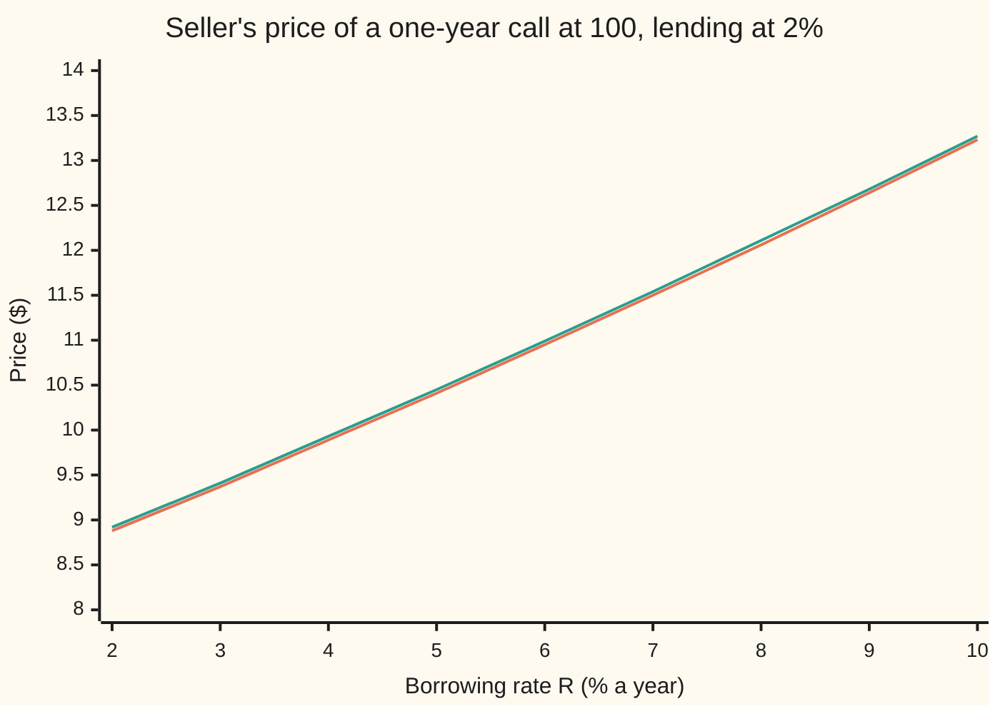

# Backward SDEs in outline: equations solved from a known end value

[Syllabus](../../../SYLLABUS.md) → [Stochastic processes and calculus](../README.md) → [Beyond Brownian](../README.md#s09) → Backward SDEs in outline

---

## General Overview

A dealer sells a one-year call option on a share that trades at $100. The call pays the share price minus $100 in a year, if that is positive. The share's volatility (its typical yearly swing) is 20 percent. The bank pays 2 percent a year on cash.

The dealer knows the end value exactly: whatever the call pays. The dealer does not know the start value, the money needed today. The dealer also needs a rule for trading the share along the way so that the money lands on the payoff on every path. Find both, and the start value is the price.

This is an equation run backward. An ordinary stochastic differential equation (SDE) starts from a known value and lets noise push it forward. A **backward SDE** fixes the end value and asks for two unknowns: a **value process** (the money held at each moment) and a **hedge** (the share position that cancels the noise). With one interest rate the answer is the Black-Scholes price, $8.92.

Now make it realistic. The dealer earns 2 percent on cash lent but pays 6 percent on cash borrowed. Hedging a sold call means holding shares bought with borrowed money, so the 6 percent rate matters. The equation stops being linear. Solved backward on a 50-step tree, the dealer's price rises to $10.95, and to $10.99 on a finer tree. A buyer of the same call, who hedges by lending, still prices it at $8.88 on the 50-step tree. One payoff, two prices.

**A backward SDE asks for the money process and the hedge that together reach a given payoff at a given date; with a linear driver its start value is a discounted average under a changed measure, with a nonlinear driver it solves a semilinear PDE, and on a tree it is solved one step at a time from the end.**

**What kind of fact this is:** a theorem. Existence and uniqueness for a driver that changes at most in proportion to its inputs is stated with its source and outlined in a fold. The linear solution, the link to the PDE and the tree recursion are proved on this card in Why it works. The two-rate market is a model.

### The picture: the dealer's price as the borrowing rate rises

Lending stays at 2 percent. The borrowing rate runs from 2 to 10 percent.



Orange: the backward SDE solved on a 50-step tree with two rates. Green: the Black-Scholes formula at the borrowing rate alone. They agree to within 0.05 at every point: the seller of a call borrows at every node of the tree, so only the borrowing rate counts. The left end, 8.88 against 8.92, is the one-rate case.

---

## The formula

Reminders first.

- $`W_t`$ is Brownian motion under the real-world measure $`P`$: the source of all the noise.
- The share follows $`dS_t = \mu S_t\,dt + \sigma S_t\,dW_t`$: real drift $`\mu`$ and volatility $`\sigma`$.
- "Adapted" means a quantity at time t uses only what is known by time t. The hedge cannot peek at the future.

A backward SDE is a pair of adapted processes $`(Y_t, Z_t)`$ with

```math
Y_t = \xi + \int_t^T f(Y_v, Z_v)\,dv - \int_t^T Z_v\,dW_v, \qquad 0 \le t \le T
```

**Read it aloud:** the value now equals the payoff at the end, plus everything the driver will take away between now and the end, minus the gains from the noise between now and the end.

The value process $`Y_t`$ is the money held. The hedge $`Z_t`$ is the size of its exposure to the noise. In the market, $`Z_t = \sigma S_t \Delta_t`$, where $`\Delta_t`$ is the number of shares held. The driver $`f`$ is the rate at which the value must shrink, per unit time, to stay on course.

For the dealer, the cash held is $`Y_t - \Delta_t S_t = Y_t - Z_t/\sigma`$. It earns $`r`$ when positive and costs $`R`$ when negative. That gives the driver

```math
f(y, z) = -r\,y - \theta\,z + (R - r)\,\big(y - z/\sigma\big)^-, \qquad \theta = \frac{\mu - r}{\sigma}
```

Here $`x^-`$ means $`-x`$ when x is negative and 0 otherwise. When $`R = r`$ the last term vanishes and the driver is linear. Then the solution is a discounted average under the pricing measure $`Q`$:

```math
Y_0 = E^Q\big[e^{-rT}\,\xi\big]
```

The **nonlinear Feynman-Kac formula** writes $`Y_t = u(t, S_t)`$ and $`Z_t = \sigma S_t\,u_s(t, S_t)`$, where $`u`$ solves a semilinear PDE (linear in the slopes of highest order, nonlinear in the rest):

```math
u_t + \tfrac12\sigma^2 s^2 u_{ss} + r\,s\,u_s - r\,u + (R - r)\,(u - s\,u_s)^- = 0, \qquad u(T, s) = (s - K)^+
```

| Symbol | Plain meaning | In our example | Push it up and the answer… |
| --- | --- | --- | --- |
| $`t`$, $`T`$, $`v`$, $`h`$ | time now, the payoff date, a time in between, the tree step, in years | t = 0, T = 1, h = 1/50 | longer T: higher call price; smaller h: tree closer to the limit |
| $`W_t`$, $`\mathcal F_t`$ | Brownian motion; the information its path reveals up to time t | one draw per path | — |
| $`S_t`$, $`s`$, $`S_{\text{up}}`$, $`S_{\text{down}}`$, $`\mu`$, $`\sigma`$ | share price at time t; a value it may take; the share price at a node's two children; real drift; volatility | $100 today; 105.8199 and 100.0000 at the hand node; 0.08 and 0.20 a year | s and σ: price rises; μ: no change |
| $`\xi`$, $`K`$ | the payoff at T; the strike | $`(S_T - 100)^+`$; $100 | higher strike, lower price |
| $`Y_t`$, $`Y_{\text{up}}`$, $`Y_{\text{down}}`$ | value process: money held, with $`Y_0`$ the price; its values at a node's two children | $`Y_0`$ = 8.92 at one rate, 10.99 at two | — |
| $`Z_t`$, $`\Delta_t`$ | hedge in noise units; shares held, $`Z = \sigma S \Delta`$ | Δ = 1 at the hand node | — |
| $`f`$, $`f_r`$, $`f_R`$, $`x^+`$, $`x^-`$ | driver: the rate the value must lose, given value y and hedge z; the one-rate drivers; positive part; negative part | $`-0.02y - 0.3z`$ plus the borrowing term | bigger driver, bigger value (comparison) |
| $`r`$, $`R`$, $`\rho`$ | rate earned on cash lent; rate paid on cash borrowed; the one that applies | 0.02 and 0.06 | R: seller's price rises, 10.99 at 6% |
| $`\theta`$, $`P`$, $`Q`$, $`E^Q`$, $`W^Q_t`$ | market price of risk; real-world and pricing measures; averages under Q; Brownian motion under Q | θ = 0.3 | — |
| $`u`$, $`u_t`$, $`u_s`$, $`u_{ss}`$ | price as a function of time and share price; its slopes and curvature | u(0, 100) = 10.99 | — |
| $`q`$, $`g_u`$, $`g_d`$ | tree weight; the share's up and down factors for one step | q = 0.5142, $`g_u`$ = 1.0287 | — |
| $`\beta`$, $`L`$, $`c`$, $`\delta`$, $`\epsilon`$ | fold only: a time weight; the Lipschitz constant; a fixed constant; a difference of two guesses; a free positive number | — | — |

### When it holds

- **The driver changes at most in proportion to changes in y and z (Lipschitz).** Then one pair $`(Y, Z)`$ exists and no other. The two-rate driver qualifies, with constants R and θ + (R − r)/σ. A driver like $`z^2`$ needs separate, harder theory.
- **The payoff has a finite average square.** The call does. Without it the averages in the proof may not exist.
- **The noise is Brownian and the information is what the Brownian path reveals.** Martingale representation then supplies the hedge. Add jumps and the equation needs an extra hedge term for each jump size.
- **Markov inputs for the PDE link.** The payoff and driver depend on the path only through today's share price. A path-dependent payoff still has a backward SDE, but no PDE in $`(t, s)`$ alone.
- **The PDE solution may have kinks.** Then it solves the PDE only in a weaker sense, called a viscosity solution. The call is smooth before T, so the classical sense works here.

---

## Why it works

### Step 0: the end is fixed, so a second unknown must absorb the noise

Run a forward SDE backward from the payoff and the value at time t would depend on the future noise. That breaks adaptedness. The fix is a second unknown. The hedge $`Z`$ is chosen, moment by moment, to cancel exactly the noise that would otherwise push the value off target. One equation, two unknowns, and the requirement "adapted and reaching ξ" pins both down.

### Step 1: with no driver, the value is a forecast and the hedge comes from representation

Set $`f = 0`$. The equation says $`Y_t = \xi - \int_t^T Z_v\,dW_v`$. Take the forecast given what is known at t. The Ito integral forecasts to zero, so

```math
Y_t = E\big[\xi \,\big|\, \mathcal F_t\big]
```

Here $`\mathcal F_t`$ is the information up to time t. That forecast is a martingale (a fair game: its best forecast is its current value). [Martingale representation](../07-Changing%20Measure/04-martingale-representation-theorem.md) says every such martingale is $`Y_0 + \int_0^t Z_v\,dW_v`$ for one adapted $`Z`$. That is the hedge.

### Step 2: the wealth of a hedger obeys a backward SDE

Hold $`\Delta_t`$ shares and the rest, $`Y_t - \Delta_t S_t`$, in cash. Self-financing means no money enters or leaves. Then

```math
dY_t = \Delta_t\,dS_t + \rho_t\,(Y_t - \Delta_t S_t)\,dt
```

where $`\rho_t`$ is r if the cash is positive and R if negative. Put in $`dS_t`$ and $`Z_t = \sigma S_t \Delta_t`$. The noise term is $`Z_t\,dW_t`$. The time term is $`r Y + \theta Z - (R - r)(Y - Z/\sigma)^-`$, which is minus the driver $`f`$ of The formula. Integrate from t to T and use $`Y_T = \xi`$: that is the backward SDE.

### Step 3: the linear case, solved by a change of measure

With $`R = r`$ the driver is $`-rY - \theta Z`$. Discount the value and use Ito's product rule:

```math
d\big(e^{-rt}Y_t\big) = e^{-rt}Z_t\,\big(dW_t + \theta\,dt\big)
```

[Girsanov](../07-Changing%20Measure/02-girsanov-theorem.md) says there is a measure $`Q`$ under which $`W^Q_t = W_t + \theta t`$ is a Brownian motion. Its density over the year is $`e^{-\theta W_T - \theta^2 T/2}`$. Under $`Q`$ the discounted value is an Ito integral, so it is a martingale. Its start equals its forecast of the end:

```math
Y_0 = E^Q\big[e^{-rT}\xi\big] = 8.9160
```

The check reaches 8.9160 by the Black-Scholes formula and by a Simpson average under Q. A third road draws 200,000 paths under P, with the real drift 8 percent, and multiplies each discounted payoff by the density: 8.9186 ± 0.0217. Without the density the same draws average 12.8721.

### Step 4: a nonlinear driver still has one solution, and a bigger driver gives a bigger value

For a Lipschitz driver, guess a pair, put it into the driver, and solve the linear equation that results. Repeat. Measured with a suitable weight on time, each round shrinks the gap between guesses by a fixed factor, so the rounds converge to one pair. The first source below proves this.

The **comparison theorem** follows from the same estimates. If one driver is at least another everywhere, and the payoffs are in the same order, the values are in the same order at every time.

The two-rate driver is the larger of two linear drivers. One prices everything at r; the other borrows at R:

```math
f = \max\big(f_r,\ f_R\big), \qquad f_R(y, z) = -R\,y - \theta\,z + (R - r)\,z/\sigma
```

So the dealer's price is at least each linear price. For the call, the cash is negative everywhere, so $`f = f_R`$ and the price is Black-Scholes at 6 percent: 10.9895.

<details>
<summary>Outline of the existence proof: the guesses contract</summary>

Write the norm of a pair as an average of $`e^{\beta t}(Y_t^2 + Z_t^2)`$ over time and paths, for a weight β to be chosen.

Map a guess $`(y, z)`$ to the solution $`(Y, Z)`$ of the equation with driver frozen at $`f(y_t, z_t)`$. That equation has a known source term, so Step 1 solves it:

$`\displaystyle Y_t = E\Big[\xi + \int_t^T f(y_v, z_v)\,dv \,\Big|\, \mathcal F_t\Big]`$

and martingale representation gives Z.

Take two guesses and subtract. Apply Ito's formula to $`e^{\beta t}(\delta Y_t)^2`$, where δ marks a difference. The Lipschitz bound with constant L and the inequality $`2ab \le a^2/\epsilon + \epsilon b^2`$ give

$`\displaystyle \|(\delta Y, \delta Z)\|^2 \le \frac{c\,L^2}{\beta}\,\|(\delta y, \delta z)\|^2`$

for a constant c that does not depend on β. Choose β larger than $`4cL^2`$. The map then halves distances, and a map that shrinks distances by a fixed factor has exactly one fixed point. That fixed point solves the backward SDE.

The comparison theorem uses the same Ito computation on the positive part of the difference of two solutions, and shows its weighted average is zero.

</details>

### Step 5: the nonlinear Feynman-Kac link

Guess $`Y_t = u(t, S_t)`$ for a smooth $`u`$. [Ito's lemma](../06-Ito%20Calculus/02-itos-lemma.md) gives

```math
dY_t = \big(u_t + \mu s\,u_s + \tfrac12\sigma^2 s^2 u_{ss}\big)\,dt + \sigma s\,u_s\,dW_t
```

Match the noise term with the backward SDE: $`Z_t = \sigma S_t\,u_s`$. Match the time terms: the bracket must equal $`-f(u, \sigma s\,u_s)`$. The real drift cancels, because $`\mu s u_s - \theta \sigma s u_s = r s u_s`$. What is left is the semilinear PDE of The formula.

With $`R = r`$ it is the Black-Scholes equation, and this step is [Feynman-Kac](../07-Changing%20Measure/06-feynman-kac-formula.md). With $`R > r`$, the check solves it backward on a grid in log price: 10.9884 for the call, against 10.9875 from a 1,000-step tree.

### Step 6: on a tree, one step has two states and two unknowns

On a tree each node has an up child and a down child. The values there are known, because the recursion runs from the end. Choose $`\Delta`$ shares and cash so that the account matches both children. That is two equations in two unknowns:

```math
\Delta = \frac{Y_{\text{up}} - Y_{\text{down}}}{S_{\text{up}} - S_{\text{down}}}, \qquad \text{cash} = Y_{\text{up}} - \Delta\,S_{\text{up}}
```

The cash at the next date is the same in both states. Its sign says whether the hedge lends (positive) or borrows (negative). Discount it at that rate and add the shares:

```math
Y = \Delta\,S + \text{cash} \times e^{-\rho h}, \qquad \rho = r \text{ if cash} \ge 0, \ \rho = R \text{ if cash} < 0
```

This is the discrete backward SDE: Δ is the hedge, and the rate choice is the driver. Written another way, $`Y = e^{-\rho h}\big(q\,Y_{\text{up}} + (1 - q)\,Y_{\text{down}}\big)`$ with $`q = (e^{\rho h} - g_d)/(g_u - g_d)`$: a change of measure, one step at a time. Here $`g_u`$ and $`g_d`$ are the share's up and down factors. As the step shrinks, the tree's value converges to the backward SDE's.

The same recursion also handles a right to stop early. If the holder may stop and take a reward, the recursion takes the larger of the reward and the value. That is [Optimal stopping](../08-Generators%2C%20Densities%20and%20Simulation/07-optimal-stopping-and-snell-envelope.md) again, and in continuous time it is a reflected backward SDE.

---

## Worked numbers, by hand

One node of the 50-step tree, one step before the end. The step is h = 1/50 year. The up factor is $`g_u = e^{0.20\sqrt{0.02}}`$ and the down factor is $`g_d = 1/g_u`$.

| Step | Arithmetic | Value |
| --- | --- | --- |
| up factor | e to the power 0.20 × √0.02 | 1.0287 |
| share at the node | 100 × 1.0287 | 102.8688 |
| children | 102.8688 × 1.0287; 102.8688 ÷ 1.0287 | 105.8199 and 100.0000 |
| payoffs at the children | 105.8199 − 100; 0 | 5.8199 and 0.0000 |
| shares held, Δ | 5.8199 ÷ (105.8199 − 100) | 1.0000 |
| cash at the end (negative: a debt) | 5.8199 − 1 × 105.8199 | −100.0000 |
| borrowed today at 6% | −100 × e to the power −0.06 × 0.02 | −99.8801 |
| value at the node | 102.8688 − 99.8801 | **2.9887** |
| same at the lending rate 2% | 102.8688 − 100 × e to the power −0.0004 | 2.9088 |
| reweighted average | q = 0.5142; 0.5142 × 5.8199 × e to the power −0.0012 | 2.9887 |

The dealer needs $2.9887 at this node to reach the payoff in both states. It is 8 cents more than at one rate, because the $100 needed at the end is borrowed at 6 percent. Repeat at every node back to the start and the price is 10.9494. The hedge borrows at 950 nodes, lends at none, and holds no cash at the rest, far below the strike.

### What breaks if you drop a piece

| Mistake | Comes out at | What went wrong |
| --- | --- | --- |
| Average the payoff under P, with no change of measure | 12.8544 (draws: 12.8721) | The real drift 8% is not the drift the hedge earns; the density removes θ = 0.3 |
| Price the dealer's call at the lending rate | 8.9160, about 2.07 short | The hedge borrows at every node; only R = 6% applies |
| Use one average rate, 4% | 9.9251, against 10.9895 | The driver picks a rate by the sign of the cash; it does not blend them |
| Price the call spread 100/110 as two separate hedges and add | 6.0420, against 4.5717 | The driver is nonlinear: hedged together, the two legs share cash and borrow less |

---

## Code, from first principles, and it actually runs

Each script builds every tool it uses: a normal curve by a series, Simpson's rule, a seeded random generator (SplitMix64, seed 20261123, made normal by Box-Muller), the tree and the grid. Four independent roads lead to the prices:

- **Closed form:** Black-Scholes at 2% and at 6%.
- **Change of measure:** a Simpson average under Q, and 200,000 draws under P reweighted by the density.
- **Backward on a tree:** replication with the borrow-or-lend rule at every node, at 50 and 1,000 steps.
- **The semilinear PDE:** solved backward by explicit steps on a grid in log price, 401 points and 1,000 time steps.

The call spread (long the 100 call, short the 110 call) has no closed form at two rates. The tree and the grid must agree on it, and the comparison theorem says it must sit above both one-rate prices.

### Python

```python
# Backward SDEs in outline -- the check behind the card.  Only math is imported.
# A one-year call on a share at 100, strike 100, volatility 0.20, real drift 0.08.
# Cash lent earns r = 2%; cash borrowed costs R = 6%.  Roads to the hedger's price:
# the Black-Scholes closed form; a Simpson average under Q (the change of measure);
# seeded draws under the real-world P, reweighted by the density; replication backward
# on a tree; the semilinear PDE (nonlinear Feynman-Kac) solved backward on a grid.
import math

S0, K, K2, SIG, T, MU = 100.0, 100.0, 110.0, 0.20, 1.0, 0.08
LEND, BORROW, N = 0.02, 0.06, 50
THETA = (MU - LEND) / SIG                     # market price of risk


def ncdf(x):                                  # Marsaglia: 1/2 + phi(x)(x + x^3/3 + x^5/15 + ...)
    s, t, k = x, x, 1
    while abs(t) > 1e-17:
        t *= x * x / (2 * k + 1)
        s += t
        k += 1
    return 0.5 + s * math.exp(-0.5 * x * x) / math.sqrt(2 * math.pi)


def bs(rate, k):                              # Black-Scholes call, one year, at one rate
    d1 = (math.log(S0 / k) + (rate + 0.5 * SIG * SIG) * T) / (SIG * math.sqrt(T))
    return S0 * ncdf(d1) - k * math.exp(-rate * T) * ncdf(d1 - SIG * math.sqrt(T))


def pay(kind, s):                             # 0 call, 1 short call, 2 call spread 100/110, 3 short 110 call
    c1, c2 = max(s - K, 0.0), max(s - K2, 0.0)
    return [c1, -c1, c1 - c2, -c2][kind]


def tree(kind, n, lend, borrow):              # replicate backward: shares and cash, two states, two unknowns
    h = T / n
    a = SIG * math.sqrt(h)
    y = [pay(kind, S0 * math.exp(a * (2 * j - n))) for j in range(n + 1)]
    lends = borrows = 0
    for m in range(n - 1, -1, -1):
        for j in range(m + 1):
            s = S0 * math.exp(a * (2 * j - m))
            su, sd = s * math.exp(a), s * math.exp(-a)
            delta = (y[j + 1] - y[j]) / (su - sd)      # shares held: the hedge
            cash = y[j + 1] - delta * su               # cash at the next date, same in both states
            lends, borrows = lends + (cash > 0), borrows + (cash < 0)   # nodes with no cash count as neither
            y[j] = delta * s + cash * math.exp(-(lend if cash >= 0 else borrow) * h)
    return y[0], lends, borrows


def pde(kind, lend, borrow, m=200, dx=0.01, steps=1000):   # u_t + s^2 sig^2 u_ss/2 + rho(s u_s - u) = 0
    dt, v = T / steps, [pay(kind, S0 * math.exp((i - m) * dx)) for i in range(2 * m + 1)]
    for _ in range(steps):
        w = v[:]
        for i in range(1, 2 * m):
            ux = (v[i + 1] - v[i - 1]) / (2 * dx)
            uxx = (v[i + 1] - 2 * v[i] + v[i - 1]) / (dx * dx)
            rho = lend if v[i] - ux >= 0 else borrow    # cash = u - s u_s; its sign picks the rate
            w[i] = v[i] + dt * (0.5 * SIG * SIG * uxx + (rho - 0.5 * SIG * SIG) * ux - rho * v[i])
        w[0] = w[1] - (w[2] - w[1]) * math.exp(-dx)     # straight line in s at both ends
        w[2 * m] = w[2 * m - 1] + (w[2 * m - 1] - w[2 * m - 2]) * math.exp(dx)
        v = w
    return v[m]


class Rng:                                    # SplitMix64, then Box-Muller
    def __init__(self, seed):
        self.state, self.spare = seed, None

    def uniform(self):
        self.state = (self.state + 0x9E3779B97F4A7C15) % 2**64
        z = self.state
        z = ((z ^ (z >> 30)) * 0xBF58476D1CE4E5B9) % 2**64
        z = ((z ^ (z >> 27)) * 0x94D049BB133111EB) % 2**64
        return (((z ^ (z >> 31)) >> 11) + 1) / 9007199254740992.0

    def normal(self):
        if self.spare is not None:
            z, self.spare = self.spare, None
            return z
        r, a = math.sqrt(-2 * math.log(self.uniform())), 2 * math.pi * self.uniform()
        self.spare = r * math.sin(a)
        return r * math.cos(a)


f = lambda x: f"{x:.4f}"
bs_r, bs_R, bs_mid = bs(LEND, K), bs(BORROW, K), bs(0.5 * (LEND + BORROW), K)
d1 = (math.log(S0 / K) + (MU + 0.5 * SIG * SIG) * T) / SIG
real = math.exp((MU - LEND) * T) * S0 * ncdf(d1) - K * math.exp(-LEND * T) * ncdf(d1 - SIG)
print("closed form: call at r", f(bs_r), "at R", f(bs_R), "at 4%", f(bs_mid), "| no change of measure", f(real))
zs = [-8 + 16 * i / 4000 for i in range(4001)]                 # Simpson over the bell curve, under Q
g = [max(S0 * math.exp((LEND - 0.5 * SIG * SIG) * T + SIG * z) - K, 0.0) * math.exp(-0.5 * z * z) for z in zs]
simpson = sum(gi * (1 if i in (0, 4000) else 4 if i % 2 else 2) for i, gi in enumerate(g)) * (16 / 4000) / 3
simpson *= math.exp(-LEND * T) / math.sqrt(2 * math.pi)
print("linear BSDE, Y_0 = E^Q[e^(-rT) xi] by Simpson:", f(simpson))
rng, n, s1, s2, p1 = Rng(20261123), 200000, 0.0, 0.0, 0.0
for _ in range(n):
    w = rng.normal()                                           # W_T under P, T = 1
    x = math.exp(-LEND * T) * max(S0 * math.exp((MU - 0.5 * SIG * SIG) * T + SIG * w) - K, 0.0)
    y = x * math.exp(-THETA * w - 0.5 * THETA * THETA * T)       # reweight by the density dQ/dP
    s1, s2, p1 = s1 + y, s2 + y * y, p1 + x
mc, se = s1 / n, math.sqrt((s2 / n - (s1 / n) ** 2) / n)
print("draws under P, theta", f(THETA), "reweighted:", f(mc), "+-", f(se), "| not reweighted:", f(p1 / n))
h = T / N
u, dd = math.exp(SIG * math.sqrt(h)), math.exp(-SIG * math.sqrt(h))
s = S0 * u                                                     # hand step: node at step 49, price 100u
su, sd = s * u, s * dd
delta = (max(su - K, 0) - max(sd - K, 0)) / (su - sd)
cash = max(su - K, 0) - delta * su
print("hand step: u", f(u), "s", f(s), "su", f(su), "sd", f(sd), "payoffs", f(max(su - K, 0)), f(max(sd - K, 0)))
print("  delta", f(delta), "cash", f(cash), "borrow today", f(cash * math.exp(-BORROW * h)),
      "Y", f(delta * s + cash * math.exp(-BORROW * h)), "| at r", f(delta * s + cash * math.exp(-LEND * h)))
q = (math.exp(BORROW * h) - dd) / (u - dd)
print("  same Y as a reweighted average: q", f(q), "Y", f(math.exp(-BORROW * h) * q * max(su - K, 0)))
t_lin, _, _ = tree(0, N, LEND, LEND)
t_sell, lends, borrows = tree(0, N, LEND, BORROW)
t_buy, blends, bborrows = tree(1, N, LEND, BORROW)
print("tree 50 steps: linear at r", f(t_lin), "| seller two rates", f(t_sell), "lending nodes", lends, "borrowing", borrows)
print("  buyer two rates (hedges the short call)", f(-t_buy), "lending nodes", blends, "borrowing", bborrows)
print("  seller minus buyer", f(t_sell + t_buy), "| linear at 4%", f(tree(0, N, 0.04, 0.04)[0]))
big = [tree(k, 1000, LEND, BORROW)[0] for k in (0, 2, 3)]
grid = [pde(0, LEND, BORROW), pde(0, LEND, LEND), pde(2, LEND, BORROW)]
print("tree 1000 steps, two rates: call", f(big[0]), "spread", f(big[1]))
print("PDE grid: call two rates", f(grid[0]), "call linear at r", f(grid[1]), "spread two rates", f(grid[2]))
sp_r, sp_R = bs(LEND, K) - bs(LEND, K2), bs(BORROW, K) - bs(BORROW, K2)
print("spread linear at r", f(sp_r), "at R", f(sp_R), "| parts priced apart", f(big[0] + big[2]))
rates = [0.02 + 0.01 * i for i in range(9)]
print("chart, borrow %     ", " ".join(f"{100 * x:.0f}" for x in rates))
print("chart, tree seller  ", " ".join(f"{tree(0, N, LEND, x)[0]:.2f}" for x in rates))
print("chart, closed form R", " ".join(f"{bs(x, K):.2f}" for x in rates))
assert abs(bs_r - 8.916) < 5e-4 and abs(simpson - bs_r) < 1e-4       # change of measure = closed form
assert abs(mc - bs_r) < 4 * se and abs(p1 / n - real) < 0.2         # density reweighting finds Q's price
assert abs(t_lin - bs_r) < 0.05 and abs(big[0] - bs_R) < 0.005     # tree converges to both closed forms
assert lends == 0 and bborrows == 0 and abs(-t_buy - t_lin) < 1e-9  # seller always borrows, buyer always lends
assert abs(grid[0] - bs_R) < 0.01 and abs(grid[1] - bs_r) < 0.01   # nonlinear Feynman-Kac: PDE = BSDE
assert abs(grid[2] - big[1]) < 0.01 and big[1] > max(sp_r, sp_R) + 0.01  # comparison: above both linear prices
assert t_sell > t_lin + 2 and big[0] + big[2] > big[1] + 0.01        # nonlinear: the parts do not add
print("ALL CHECKS PASS")
```

**Ran 2026-11-23 on macOS, Python 3.14.10, standard library only. All checks passed. Output, pasted from the run:**

```
closed form: call at r 8.9160 at R 10.9895 at 4% 9.9251 | no change of measure 12.8544
linear BSDE, Y_0 = E^Q[e^(-rT) xi] by Simpson: 8.9160
draws under P, theta 0.3000 reweighted: 8.9186 +- 0.0217 | not reweighted: 12.8721
hand step: u 1.0287 s 102.8688 su 105.8199 sd 100.0000 payoffs 5.8199 0.0000
  delta 1.0000 cash -100.0000 borrow today -99.8801 Y 2.9887 | at r 2.9088
  same Y as a reweighted average: q 0.5142 Y 2.9887
tree 50 steps: linear at r 8.8765 | seller two rates 10.9494 lending nodes 0 borrowing 950
  buyer two rates (hedges the short call) 8.8765 lending nodes 950 borrowing 0
  seller minus buyer 2.0729 | linear at 4% 9.8854
tree 1000 steps, two rates: call 10.9875 spread 4.5717
PDE grid: call two rates 10.9884 call linear at r 8.9147 spread two rates 4.5729
spread linear at r 3.9722 at R 4.5523 | parts priced apart 6.0420
chart, borrow %      2 3 4 5 6 7 8 9 10
chart, tree seller   8.88 9.37 9.89 10.41 10.95 11.50 12.06 12.64 13.23
chart, closed form R 8.92 9.41 9.93 10.45 10.99 11.54 12.11 12.68 13.27
ALL CHECKS PASS
```

### Rust

Same numbers, same labels, built with `rustc --edition 2021 -O`.

```rust
// Backward SDEs in outline -- the same check as the Python, std only.
// A one-year call on a share at 100, strike 100, volatility 0.20, real drift 0.08.
// Cash lent earns r = 2%; cash borrowed costs R = 6%.  Roads to the hedger's price:
// the Black-Scholes closed form; a Simpson average under Q (the change of measure);
// seeded draws under the real-world P, reweighted by the density; replication backward
// on a tree; the semilinear PDE (nonlinear Feynman-Kac) solved backward on a grid.
use std::f64::consts::PI;

const S0: f64 = 100.0;
const K: f64 = 100.0;
const K2: f64 = 110.0;
const SIG: f64 = 0.20;
const T: f64 = 1.0;
const MU: f64 = 0.08;
const LEND: f64 = 0.02;
const BORROW: f64 = 0.06;
const N: usize = 50;

fn ncdf(x: f64) -> f64 { // Marsaglia: 1/2 + phi(x)(x + x^3/3 + x^5/15 + ...)
    let (mut s, mut t, mut k) = (x, x, 1.0);
    while t.abs() > 1e-17 {
        t *= x * x / (2.0 * k + 1.0);
        s += t;
        k += 1.0;
    }
    0.5 + s * (-0.5 * x * x).exp() / (2.0 * PI).sqrt()
}

fn bs(rate: f64, k: f64) -> f64 { // Black-Scholes call, one year, at one rate
    let d1 = ((S0 / k).ln() + (rate + 0.5 * SIG * SIG) * T) / (SIG * T.sqrt());
    S0 * ncdf(d1) - k * (-rate * T).exp() * ncdf(d1 - SIG * T.sqrt())
}

fn pay(kind: usize, s: f64) -> f64 { // 0 call, 1 short call, 2 call spread 100/110, 3 short 110 call
    let (c1, c2) = ((s - K).max(0.0), (s - K2).max(0.0));
    [c1, -c1, c1 - c2, -c2][kind]
}

fn tree(kind: usize, n: usize, lend: f64, borrow: f64) -> (f64, usize, usize) { // replicate backward on the tree
    let h = T / n as f64;
    let a = SIG * h.sqrt();
    let mut y: Vec<f64> = (0..=n).map(|j| pay(kind, S0 * (a * (2.0 * j as f64 - n as f64)).exp())).collect();
    let (mut lends, mut borrows) = (0, 0);
    for m in (0..n).rev() {
        for j in 0..=m {
            let s = S0 * (a * (2.0 * j as f64 - m as f64)).exp();
            let (su, sd) = (s * a.exp(), s * (-a).exp());
            let delta = (y[j + 1] - y[j]) / (su - sd); // shares held: the hedge
            let cash = y[j + 1] - delta * su; // cash at the next date, same in both states
            if cash > 0.0 { lends += 1; }
            if cash < 0.0 { borrows += 1; } // nodes with no cash count as neither
            y[j] = delta * s + cash * (-(if cash >= 0.0 { lend } else { borrow }) * h).exp();
        }
    }
    (y[0], lends, borrows)
}

fn pde(kind: usize, lend: f64, borrow: f64) -> f64 { // u_t + s^2 sig^2 u_ss/2 + rho(s u_s - u) = 0
    let (m, dx, steps) = (200usize, 0.01, 1000usize);
    let dt = T / steps as f64;
    let mut v: Vec<f64> = (0..=2 * m).map(|i| pay(kind, S0 * ((i as f64 - m as f64) * dx).exp())).collect();
    for _ in 0..steps {
        let mut w = v.clone();
        for i in 1..2 * m {
            let ux = (v[i + 1] - v[i - 1]) / (2.0 * dx);
            let uxx = (v[i + 1] - 2.0 * v[i] + v[i - 1]) / (dx * dx);
            let rho = if v[i] - ux >= 0.0 { lend } else { borrow }; // cash = u - s u_s; its sign picks the rate
            w[i] = v[i] + dt * (0.5 * SIG * SIG * uxx + (rho - 0.5 * SIG * SIG) * ux - rho * v[i]);
        }
        w[0] = w[1] - (w[2] - w[1]) * (-dx).exp(); // straight line in s at both ends
        w[2 * m] = w[2 * m - 1] + (w[2 * m - 1] - w[2 * m - 2]) * dx.exp();
        v = w;
    }
    v[m]
}

struct Rng { state: u64, spare: Option<f64> }

impl Rng {
    fn uniform(&mut self) -> f64 { // SplitMix64 -> a number in (0, 1]
        self.state = self.state.wrapping_add(0x9E3779B97F4A7C15);
        let mut z = self.state;
        z = (z ^ (z >> 30)).wrapping_mul(0xBF58476D1CE4E5B9);
        z = (z ^ (z >> 27)).wrapping_mul(0x94D049BB133111EB);
        (((z ^ (z >> 31)) >> 11) + 1) as f64 / 9007199254740992.0
    }
    fn normal(&mut self) -> f64 { // Box-Muller, both values of each pair used
        if let Some(z) = self.spare.take() { return z; }
        let r = (-2.0 * self.uniform().ln()).sqrt();
        let a = 2.0 * PI * self.uniform();
        self.spare = Some(r * a.sin());
        r * a.cos()
    }
}

fn f(x: f64) -> String { format!("{:.4}", x) }

fn main() {
    let theta = (MU - LEND) / SIG; // market price of risk
    let (bs_r, bs_big, bs_mid) = (bs(LEND, K), bs(BORROW, K), bs(0.5 * (LEND + BORROW), K));
    let d1 = ((S0 / K).ln() + (MU + 0.5 * SIG * SIG) * T) / SIG;
    let real = ((MU - LEND) * T).exp() * S0 * ncdf(d1) - K * (-LEND * T).exp() * ncdf(d1 - SIG);
    println!("closed form: call at r {} at R {} at 4% {} | no change of measure {}", f(bs_r), f(bs_big), f(bs_mid), f(real));
    let mut simpson = 0.0; // Simpson over the bell curve, under Q
    for i in 0..=4000usize {
        let z = -8.0 + 16.0 * i as f64 / 4000.0;
        let g = (S0 * ((LEND - 0.5 * SIG * SIG) * T + SIG * z).exp() - K).max(0.0) * (-0.5 * z * z).exp();
        let wt = if i == 0 || i == 4000 { 1.0 } else if i % 2 == 1 { 4.0 } else { 2.0 };
        simpson += g * wt;
    }
    simpson = simpson * (16.0 / 4000.0) / 3.0;
    simpson *= (-LEND * T).exp() / (2.0 * PI).sqrt();
    println!("linear BSDE, Y_0 = E^Q[e^(-rT) xi] by Simpson: {}", f(simpson));
    let mut rng = Rng { state: 20261123, spare: None };
    let n = 200000usize;
    let (mut s1, mut s2, mut p1) = (0.0, 0.0, 0.0);
    for _ in 0..n {
        let w = rng.normal(); // W_T under P, T = 1
        let x = (-LEND * T).exp() * (S0 * ((MU - 0.5 * SIG * SIG) * T + SIG * w).exp() - K).max(0.0);
        let y = x * (-theta * w - 0.5 * theta * theta * T).exp(); // reweight by the density dQ/dP
        s1 += y;
        s2 += y * y;
        p1 += x;
    }
    let nf = n as f64;
    let (mc, se) = (s1 / nf, ((s2 / nf - (s1 / nf).powi(2)) / nf).sqrt());
    println!("draws under P, theta {} reweighted: {} +- {} | not reweighted: {}", f(theta), f(mc), f(se), f(p1 / nf));
    let h = T / N as f64;
    let (u, dd) = ((SIG * h.sqrt()).exp(), (-SIG * h.sqrt()).exp());
    let s = S0 * u; // hand step: node at step 49, price 100u
    let (su, sd) = (s * u, s * dd);
    let (pu, pd) = ((su - K).max(0.0), (sd - K).max(0.0));
    let delta = (pu - pd) / (su - sd);
    let cash = pu - delta * su;
    println!("hand step: u {} s {} su {} sd {} payoffs {} {}", f(u), f(s), f(su), f(sd), f(pu), f(pd));
    println!("  delta {} cash {} borrow today {} Y {} | at r {}", f(delta), f(cash), f(cash * (-BORROW * h).exp()),
        f(delta * s + cash * (-BORROW * h).exp()), f(delta * s + cash * (-LEND * h).exp()));
    let q = ((BORROW * h).exp() - dd) / (u - dd);
    println!("  same Y as a reweighted average: q {} Y {}", f(q), f((-BORROW * h).exp() * q * pu));
    let (t_lin, _, _) = tree(0, N, LEND, LEND);
    let (t_sell, lends, borrows) = tree(0, N, LEND, BORROW);
    let (t_buy, blends, bborrows) = tree(1, N, LEND, BORROW);
    println!("tree 50 steps: linear at r {} | seller two rates {} lending nodes {} borrowing {}", f(t_lin), f(t_sell), lends, borrows);
    println!("  buyer two rates (hedges the short call) {} lending nodes {} borrowing {}", f(-t_buy), blends, bborrows);
    println!("  seller minus buyer {} | linear at 4% {}", f(t_sell + t_buy), f(tree(0, N, 0.04, 0.04).0));
    let big: Vec<f64> = [0usize, 2, 3].iter().map(|&k| tree(k, 1000, LEND, BORROW).0).collect();
    let grid = [pde(0, LEND, BORROW), pde(0, LEND, LEND), pde(2, LEND, BORROW)];
    println!("tree 1000 steps, two rates: call {} spread {}", f(big[0]), f(big[1]));
    println!("PDE grid: call two rates {} call linear at r {} spread two rates {}", f(grid[0]), f(grid[1]), f(grid[2]));
    let (sp_r, sp_big) = (bs(LEND, K) - bs(LEND, K2), bs(BORROW, K) - bs(BORROW, K2));
    println!("spread linear at r {} at R {} | parts priced apart {}", f(sp_r), f(sp_big), f(big[0] + big[2]));
    let rates: Vec<f64> = (0..9).map(|i| 0.02 + 0.01 * i as f64).collect();
    let row = |v: Vec<String>| v.join(" ");
    println!("chart, borrow %      {}", row(rates.iter().map(|x| format!("{:.0}", 100.0 * x)).collect()));
    println!("chart, tree seller   {}", row(rates.iter().map(|&x| format!("{:.2}", tree(0, N, LEND, x).0)).collect()));
    println!("chart, closed form R {}", row(rates.iter().map(|&x| format!("{:.2}", bs(x, K))).collect()));
    assert!((bs_r - 8.916).abs() < 5e-4 && (simpson - bs_r).abs() < 1e-4); // change of measure = closed form
    assert!((mc - bs_r).abs() < 4.0 * se && (p1 / nf - real).abs() < 0.2); // density reweighting finds Q's price
    assert!((t_lin - bs_r).abs() < 0.05 && (big[0] - bs_big).abs() < 0.005); // tree converges to both closed forms
    assert!(lends == 0 && bborrows == 0 && (-t_buy - t_lin).abs() < 1e-9); // seller always borrows, buyer always lends
    assert!((grid[0] - bs_big).abs() < 0.01 && (grid[1] - bs_r).abs() < 0.01); // nonlinear Feynman-Kac: PDE = BSDE
    assert!((grid[2] - big[1]).abs() < 0.01 && big[1] > sp_r.max(sp_big) + 0.01); // comparison: above both linear prices
    assert!(t_sell > t_lin + 2.0 && big[0] + big[2] > big[1] + 0.01); // nonlinear: the parts do not add
    println!("ALL CHECKS PASS");
}
```

**Ran 2026-11-23 on macOS, rustc 1.98.1, no crates. All checks passed. Output, pasted from the run:**

```
closed form: call at r 8.9160 at R 10.9895 at 4% 9.9251 | no change of measure 12.8544
linear BSDE, Y_0 = E^Q[e^(-rT) xi] by Simpson: 8.9160
draws under P, theta 0.3000 reweighted: 8.9186 +- 0.0217 | not reweighted: 12.8721
hand step: u 1.0287 s 102.8688 su 105.8199 sd 100.0000 payoffs 5.8199 0.0000
  delta 1.0000 cash -100.0000 borrow today -99.8801 Y 2.9887 | at r 2.9088
  same Y as a reweighted average: q 0.5142 Y 2.9887
tree 50 steps: linear at r 8.8765 | seller two rates 10.9494 lending nodes 0 borrowing 950
  buyer two rates (hedges the short call) 8.8765 lending nodes 950 borrowing 0
  seller minus buyer 2.0729 | linear at 4% 9.8854
tree 1000 steps, two rates: call 10.9875 spread 4.5717
PDE grid: call two rates 10.9884 call linear at r 8.9147 spread two rates 4.5729
spread linear at r 3.9722 at R 4.5523 | parts priced apart 6.0420
chart, borrow %      2 3 4 5 6 7 8 9 10
chart, tree seller   8.88 9.37 9.89 10.41 10.95 11.50 12.06 12.64 13.23
chart, closed form R 8.92 9.41 9.93 10.45 10.99 11.54 12.11 12.68 13.27
ALL CHECKS PASS
```

The two outputs match line for line.

Four roads agree on the one-rate price to within 0.004: 8.9160 by formula and by Simpson, 8.9186 ± 0.0217 by reweighted draws, 8.9147 on the grid. The 50-step tree sits 0.04 below, at 8.8765: that is the tree's step error, which shrinks as the steps get smaller. At two rates the call is 10.9895 by formula, 10.9884 on the grid and 10.9875 on the 1,000-step tree. The spread is 4.5729 on the grid and 4.5717 on the tree, above both one-rate prices, 3.9722 and 4.5523.

### Lean

Lean proves Step 6's one tree step, Step 4's larger-of-two driver and the Lipschitz bound for all real inputs, plus the worked numbers.

- Take a node with share price $`S \ne 0`$, up factor $`g_u`$ and a smaller down factor $`g_d`$. Then Δ shares and the cash match the values at both children.
- Take also $`r \le R`$, a step $`h \ge 0`$, and ρ chosen by the sign of the cash. Then the node's value Y equals Step 6's reweighted average with weight q.
- Take the same node. Then Y is the larger of the value with cash discounted at r alone and at R alone.
- Take $`R \ge r`$. Then the two-rate driver f equals the larger of $`f_r`$ and $`f_R`$, for every value y and hedge z.
- Take $`r \ge 0`$, $`R \ge r`$, $`\theta \ge 0`$ and $`\sigma > 0`$. Then f is Lipschitz, with constants R for y and $`\theta + (R - r)/\sigma`$ for z.
- Take the hand node, where the down child is the strike, 100. Then $`\Delta = 1`$ share and the cash at the end is −100, for any up child other than 100.
- Take μ = 0.08, r = 0.02, R = 0.06 and σ = 0.20. Then θ = 0.3 and the constant for z is 0.5.
- Take the 50-step tree. Then it has 1 + 2 + … + 50 = 1275 nodes before the end. With 950 borrowing and none lending, 325 hold no cash.

Existence, comparison, the change of measure, the PDE and every price are left to the Python and Rust checks.

```lean
-- Backward SDEs in outline: one backward step on a tree replicates both children, equals a discounted reweighted average, and picks the larger of the two one-rate values, while the two-rate driver is the larger of two linear drivers and is Lipschitz with constants R and θ + (R − r)/σ.
import Mathlib.Analysis.SpecialFunctions.Exp
import Mathlib.Algebra.Order.Group.PosPart
import Mathlib.Algebra.BigOperators.Intervals
import Mathlib.Tactic.FieldSimp
import Mathlib.Tactic.NormNum
import Mathlib.Tactic.Ring

namespace BackwardSDEOutline

open Real Finset

/-- The dealer's two-rate driver `f(y, z) = -r y - θ z + (R - r)(y - z/σ)⁻`: cash lent earns
`r`, cash borrowed costs `R`, `θ` is the market price of risk and `σ` the volatility. Here `y`
is the value held, `z` the hedge in noise units, and `y - z/σ` the cash. -/
noncomputable def twoRateDriver (r R θ σ y z : ℝ) : ℝ :=
  -r * y - θ * z + (R - r) * (y - z / σ)⁻

/-- **One backward step on a tree is the discrete backward SDE** (the card's Step 6).
A node has share price `S ≠ 0` and two children `S_up = S g_u` and `S_down = S g_d` with
down factor `g_d` below up factor `g_u`; the values `Y_up` and `Y_down` there are known.
Hold `Δ = (Y_up - Y_down)/(S_up - S_down)` shares and `cash = Y_up - Δ S_up` (cash at the
next date). Discount the cash at `ρ = r` if it is lent (`cash ≥ 0`) and at `ρ = R` if it is
borrowed, over a step `h ≥ 0`, with lending rate `r` at most borrowing rate `R`, and set
`Y = Δ S + cash e^{-ρh}`. Then the account matches both children, `Y` is the discounted
average `e^{-ρh}(q Y_up + (1 - q) Y_down)` with weight `q = (e^{ρh} - g_d)/(g_u - g_d)`
(a change of measure, one step at a time), and the rate rule makes `Y` the larger of the
value at `r` alone and the value at `R` alone. -/
theorem tree_step_is_discrete_backward_sde
    (S g_u g_d Y_up Y_down r R h : ℝ) (hS : S ≠ 0) (hg : g_d < g_u) (hrR : r ≤ R)
    (hh : 0 ≤ h) :
    let S_up := S * g_u
    let S_down := S * g_d
    let Δ := (Y_up - Y_down) / (S_up - S_down)
    let cash := Y_up - Δ * S_up
    let ρ := if 0 ≤ cash then r else R
    let Y := Δ * S + cash * exp (-(ρ * h))
    let q := (exp (ρ * h) - g_d) / (g_u - g_d)
    Δ * S_up + cash = Y_up ∧ Δ * S_down + cash = Y_down ∧
      Y = exp (-(ρ * h)) * (q * Y_up + (1 - q) * Y_down) ∧
      Y = max (Δ * S + cash * exp (-(r * h))) (Δ * S + cash * exp (-(R * h))) := by
  intro S_up S_down Δ cash ρ Y q
  have hSup : S_up = S * g_u := rfl
  have hSdn : S_down = S * g_d := rfl
  have hcash : cash = Y_up - Δ * S_up := rfl
  have hρ : ρ = if 0 ≤ cash then r else R := rfl
  have hY : Y = Δ * S + cash * exp (-(ρ * h)) := rfl
  have hq : q = (exp (ρ * h) - g_d) / (g_u - g_d) := rfl
  have hgd : g_u - g_d ≠ 0 := sub_ne_zero.mpr (ne_of_gt hg)
  have hSd0 : S_up - S_down ≠ 0 := by
    rw [hSup, hSdn, ← mul_sub]; exact mul_ne_zero hS hgd
  have hΔ : Δ * (S_up - S_down) = Y_up - Y_down := div_mul_cancel₀ _ hSd0
  clear_value q Y ρ cash Δ S_up S_down
  subst hSup hSdn
  have hΔS : Δ * S * (g_u - g_d) = Y_up - Y_down := by rw [← hΔ]; ring
  refine ⟨?_, ?_, ?_, ?_⟩
  · rw [hcash]; ring
  · rw [hcash]; linear_combination (-1 : ℝ) * hΔ
  · have he : exp (-(ρ * h)) * exp (ρ * h) = 1 := by
      rw [← Real.exp_add]; simp
    have hqD : q * (Y_up - Y_down) = (exp (ρ * h) - g_d) * (Δ * S) := by
      rw [← hΔS, hq]; field_simp
    rw [hY, hcash]
    linear_combination (-exp (-(ρ * h))) * hqD - (Δ * S) * he - exp (-(ρ * h)) * hΔS
  · have hmono : exp (-(R * h)) ≤ exp (-(r * h)) := by
      apply Real.exp_le_exp.mpr
      nlinarith
    by_cases hc : 0 ≤ cash
    · have hρr : ρ = r := by rw [hρ, ite_eq_left_iff.mpr (fun h => absurd hc h)]
      rw [hY, hρr, max_eq_left]
      nlinarith [mul_le_mul_of_nonneg_left hmono hc]
    · have hρR : ρ = R := by rw [hρ, ite_eq_right_iff.mpr (fun h => absurd h hc)]
      rw [hY, hρR, max_eq_right]
      have hc' : cash ≤ 0 := le_of_lt (lt_of_not_ge hc)
      nlinarith [mul_le_mul_of_nonpos_left hmono hc']

/-- **The two-rate driver is the larger of two linear drivers** (the card's Step 4). When the
borrowing rate `R` is at least the lending rate `r`, the driver
`-r y - θ z + (R - r)(y - z/σ)⁻` equals the larger of the one-rate driver
`f_r(y, z) = -r y - θ z` and the borrowing driver `f_R(y, z) = -R y - θ z + (R - r) z/σ`.
By the comparison theorem, the dealer's price is therefore at least each linear price. -/
theorem two_rate_driver_eq_max_of_linear_drivers (r R θ σ y z : ℝ) (hrR : r ≤ R) :
    twoRateDriver r R θ σ y z = max (-r * y - θ * z) (-R * y - θ * z + (R - r) * z / σ) := by
  unfold twoRateDriver
  rw [negPart_def, mul_div_assoc]
  have hk : 0 ≤ R - r := sub_nonneg.mpr hrR
  rcases le_total (-(y - z / σ)) 0 with hc | hc
  · rw [max_eq_right hc, max_eq_left]
    · ring
    · nlinarith [mul_nonneg hk (neg_nonneg.mpr hc)]
  · rw [max_eq_left hc, max_eq_right]
    · ring
    · nlinarith [mul_nonneg hk hc]

/-- **The two-rate driver is Lipschitz** (the card's "When it holds"). With lending rate
`r ≥ 0`, borrowing rate `R ≥ r`, market price of risk `θ ≥ 0` and volatility `σ > 0`, the
driver changes at most in proportion to changes in `y` and `z`, with constants `R` and
`θ + (R - r)/σ`. So the existence and uniqueness theorem applies to the dealer's equation. -/
theorem two_rate_driver_lipschitz (r R θ σ : ℝ) (hr : 0 ≤ r) (hrR : r ≤ R) (hθ : 0 ≤ θ)
    (hσ : 0 < σ) (y z y' z' : ℝ) :
    |twoRateDriver r R θ σ y z - twoRateDriver r R θ σ y' z'|
      ≤ R * |y - y'| + (θ + (R - r) / σ) * |z - z'| := by
  unfold twoRateDriver
  have hk : 0 ≤ R - r := sub_nonneg.mpr hrR
  have hneg : |(y - z / σ)⁻ - (y' - z' / σ)⁻| ≤ |y - y'| + |z - z'| / σ := by
    rw [negPart_def, negPart_def]
    calc |max (-(y - z / σ)) 0 - max (-(y' - z' / σ)) 0|
        ≤ |-(y - z / σ) - -(y' - z' / σ)| := abs_max_sub_max_le_abs _ _ _
      _ = |(y - y') - (z - z') / σ| := by rw [← abs_neg]; congr 1; ring
      _ ≤ |y - y'| + |(z - z') / σ| := abs_sub _ _
      _ = |y - y'| + |z - z'| / σ := by rw [abs_div, abs_of_pos hσ]
  have h1 : |-r * y - θ * z + (R - r) * (y - z / σ)⁻ - (-r * y' - θ * z' + (R - r) * (y' - z' / σ)⁻)|
      ≤ r * |y - y'| + θ * |z - z'| + (R - r) * |(y - z / σ)⁻ - (y' - z' / σ)⁻| := by
    have e : -r * y - θ * z + (R - r) * (y - z / σ)⁻ - (-r * y' - θ * z' + (R - r) * (y' - z' / σ)⁻)
        = (-r) * (y - y') + (-θ) * (z - z') + (R - r) * ((y - z / σ)⁻ - (y' - z' / σ)⁻) := by ring
    rw [e]
    calc _ ≤ |(-r) * (y - y') + (-θ) * (z - z')| + |(R - r) * ((y - z / σ)⁻ - (y' - z' / σ)⁻)| :=
          abs_add_le _ _
      _ ≤ |(-r) * (y - y')| + |(-θ) * (z - z')| + |(R - r) * ((y - z / σ)⁻ - (y' - z' / σ)⁻)| := by
          gcongr; exact abs_add_le _ _
      _ = _ := by
          rw [abs_mul, abs_mul, abs_mul, abs_neg, abs_neg, abs_of_nonneg hr, abs_of_nonneg hθ,
            abs_of_nonneg hk]
  have h2 := mul_le_mul_of_nonneg_left hneg hk
  have e2 : (θ + (R - r) / σ) * |z - z'| = θ * |z - z'| + (R - r) * (|z - z'| / σ) := by ring
  rw [e2]
  nlinarith [h1, h2]

/-! The card's exact worked numbers. -/

-- The hand node: the down child is 100, the strike, so its payoff is 0 and the up payoff is
-- S_up − 100. Then Δ = 1 share and the cash at the end is −100 (a debt), whatever S_up is.
example (S_up : ℝ) (h : S_up ≠ 100) :
    ((S_up - 100) - 0) / (S_up - 100) = 1 ∧ (S_up - 100) - 1 * S_up = -100 := by
  constructor
  · rw [sub_zero, div_self (sub_ne_zero.mpr h)]
  · ring

-- The example's market price of risk θ = (μ − r)/σ = (0.08 − 0.02)/0.20 = 0.3.
example : ((8 / 100 : ℚ) - 2 / 100) / (20 / 100) = 3 / 10 := by norm_num

-- The Lipschitz constant for z: θ + (R − r)/σ = 0.3 + (0.06 − 0.02)/0.20 = 0.5.
example : (3 / 10 : ℚ) + (6 / 100 - 2 / 100) / (20 / 100) = 1 / 2 := by norm_num

-- The 50-step tree has 1 + 2 + … + 50 = 1275 nodes before the end; the seller's hedge
-- borrows at 950, lends at none, and holds no cash at the other 325.
example : ∑ m ∈ range 50, (m + 1) = 1275 ∧ 950 + 0 + 325 = 1275 := by decide

#print axioms tree_step_is_discrete_backward_sde
#print axioms two_rate_driver_eq_max_of_linear_drivers
#print axioms two_rate_driver_lipschitz

end BackwardSDEOutline
```

**Checked 2026-11-23 on macOS, Lean 4.36.0-rc2, Mathlib v4.36.0-rc2. Every proof is complete and uses only Lean's standard axioms. Output, pasted from the run:**

```
'BackwardSDEOutline.tree_step_is_discrete_backward_sde' depends on axioms: [propext, Classical.choice, Quot.sound]
'BackwardSDEOutline.two_rate_driver_eq_max_of_linear_drivers' depends on axioms: [propext, Classical.choice, Quot.sound]
'BackwardSDEOutline.two_rate_driver_lipschitz' depends on axioms: [propext, Classical.choice, Quot.sound]
```

> [!TIP]
> **Try changing**
> Guess first, then run it.
> - **One rate.** Set `BORROW` to `0.02` in the line `LEND, BORROW, N = ...`. Guess: seller and buyer agree at 8.8765, the gap is 0.0000, and the comparison assert stops the run, because the spread no longer sits above the one-rate price.
> - **A finer tree.** Set `N` to `200` in the same line. Guess: the tree prices move to 8.9061 and 10.9795, within 0.01 of the formulas, and every chart point moves up by about 0.03.
> - **A greedier share.** Set `MU` to `0.12` in the first line of settings. Guess: θ becomes 0.5 and the reweighted draws still give 8.9173 ± 0.0172, while the draws without the density rise to 16.0214. No price on the tree or grid moves.
> - **Wrong sign rule.** In `tree`, swap `lend` and `borrow` in the rate choice. Guess: the seller now gets the lending rate, the price falls to the one-rate value, and the asserts stop the run.

---

## The usual mistake

> [!warning]
> **Treating a backward SDE as a forward SDE run with time reversed.** Running $`dY = -f\,dt + Z\,dW`$ from ξ toward time 0 makes the value at time t depend on noise after t. No trader can hold that. The hedge $`Z`$ is an unknown, solved for together with $`Y`$, and adaptedness is what makes the answer unique.
>
> - **Thinking the real drift sets the price.** In the linear case it cancels through θ; averaging under P instead gives 12.8544, not 8.9160.
> - **Adding nonlinear prices.** The parts of the call spread, hedged apart, cost 6.0420; hedged together, 4.5717. A nonlinear driver makes the price of a sum differ from the sum of prices.
> - **Expecting one price for buyer and seller.** At two rates the seller needs 10.9494 and the buyer pays at most 8.8765 on the 50-step tree: a gap of 2.0729 from the rate spread alone.
> - **Assuming a nonlinear price lies between the two linear ones.** The spread's two-rate price, 4.5717, is above both one-rate prices, 3.9722 and 4.5523, as the comparison theorem says.

---

## Where you meet it in real life

- **Funding costs on a dealer's book.** Banks borrow above the rate they lend at. The adjustment for this is a backward SDE with a funding term in the driver: [FVA](../../12-Financial%20mathematics/47-Collateral%2C%20Funding%20and%20the%20Rest%20of%20the%20XVAs/02-fva.md).
- **Prices with a bid and an ask.** Any market friction that makes the driver nonlinear gives the seller's price, $`Y_0(\xi)`$, and the buyer's, $`-Y_0(-\xi)`$, and they differ. Here they are 10.9494 and 8.8765.
- **American options.** The holder may stop early. The price is a reflected backward SDE, kept above the exercise value; on a tree it is the Snell envelope of [Optimal stopping](../08-Generators%2C%20Densities%20and%20Simulation/07-optimal-stopping-and-snell-envelope.md).
- **Control and utility.** The value of an optimal control problem, and of utility under some taste for risk, solves a backward SDE. Its driver is the optimised part of the HJB equation of [Stochastic control](03-stochastic-control-and-the-hjb-equation.md).
- **High-dimensional PDEs.** Solving a semilinear PDE in many variables on a grid is impossible. Simulating the backward SDE along sampled paths, with regression or a neural network for the hedge, still works.

> **Say it back**
> A backward SDE fixes the end value and asks for the value process and the hedge that reach it. The hedge absorbs the noise, so the value stays adapted; martingale representation supplies it. With a linear driver, a change of measure makes the discounted value a fair game, and the start is the Black-Scholes price, 8.92. With borrowing at 6% and lending at 2%, the driver is the larger of two linear drivers, and the seller's call price rises to 10.99. The same pair solves a semilinear PDE, and on a tree it is one exact hedge per node, solved backward from the end.

---

## What this builds on

- [Feynman-Kac](../07-Changing%20Measure/06-feynman-kac-formula.md): the linear link between an average and a PDE, which Step 5 extends to a nonlinear driver.
- [Martingale representation](../07-Changing%20Measure/04-martingale-representation-theorem.md): the hedge $`Z`$ exists because every Brownian martingale is an Ito integral.
- [Stochastic control](03-stochastic-control-and-the-hjb-equation.md): the HJB equation, a nonlinear backward equation whose solutions backward SDEs represent.
- [Optimal stopping](../08-Generators%2C%20Densities%20and%20Simulation/07-optimal-stopping-and-snell-envelope.md): the backward recursion with a "take the larger" rule, the discrete form of a reflected backward SDE.

## Where this goes next

- [FVA](../../12-Financial%20mathematics/47-Collateral%2C%20Funding%20and%20the%20Rest%20of%20the%20XVAs/02-fva.md): the funding adjustment a bank books, the two-rate driver at work on a whole portfolio.
- [Stochastic PDEs in outline](09-stochastic-pdes-in-outline.md): equations whose unknown is a whole random field, not a single number per time.
- [McKean-Vlasov equations in outline](10-mckean-vlasov-and-mean-field-limits-in-outline.md): the driver may depend on the law of the solution, which gives mean-field backward SDEs.

This card kept the driver Lipschitz; what happens when it grows like the square of the hedge, as it does for exponential utility, is the open question for quadratic backward SDEs.

---

## Sources

Verified 2026-11-23: every link below resolves to the publisher's page.

- Pardoux, Étienne, and Shige Peng. "Adapted Solution of a Backward Stochastic Differential Equation." *Systems & Control Letters* 14, no. 1 (1990): 55–61. [doi:10.1016/0167-6911(90)90082-6](https://doi.org/10.1016/0167-6911(90)90082-6). Existence and uniqueness for a Lipschitz driver, by the contraction outlined in the fold.
- Pardoux, Étienne, and Shige Peng. "Backward Stochastic Differential Equations and Quasilinear Parabolic Partial Differential Equations." In *Stochastic Partial Differential Equations and Their Applications*, Lecture Notes in Control and Information Sciences 176 (1992). [doi:10.1007/BFb0007334](https://doi.org/10.1007/BFb0007334). The nonlinear Feynman-Kac formula of Step 5.
- El Karoui, Nicole, Shige Peng, and Marie-Claire Quenez. "Backward Stochastic Differential Equations in Finance." *Mathematical Finance* 7, no. 1 (1997): 1–71. [doi:10.1111/1467-9965.00022](https://doi.org/10.1111/1467-9965.00022). The hedging reading, the comparison theorem, and the market with a higher borrowing rate.
- El Karoui, Nicole, Christophe Kapoudjian, Étienne Pardoux, Shige Peng, and Marie-Claire Quenez. "Reflected Solutions of Backward SDE's, and Related Obstacle Problems for PDE's." *The Annals of Probability* 25, no. 2 (1997): 702–737. [doi:10.1214/aop/1024404416](https://doi.org/10.1214/aop/1024404416). Reflected backward SDEs and the link to optimal stopping and American options.
- Pham, Huyên. *Continuous-time Stochastic Control and Optimization with Financial Applications*. Springer, 2009. [doi:10.1007/978-3-540-89500-8](https://doi.org/10.1007/978-3-540-89500-8). Chapter 6: a textbook treatment of backward SDEs, comparison and the link to control.
