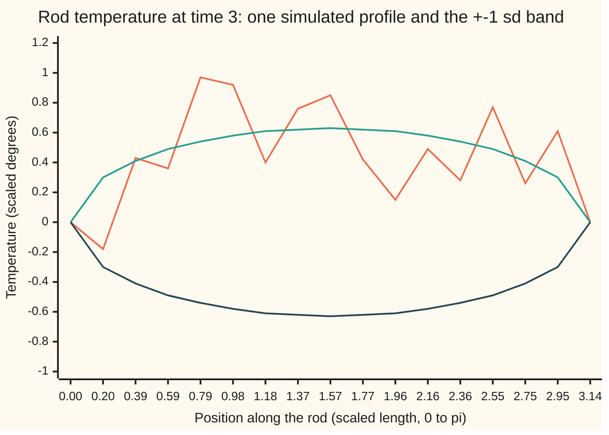
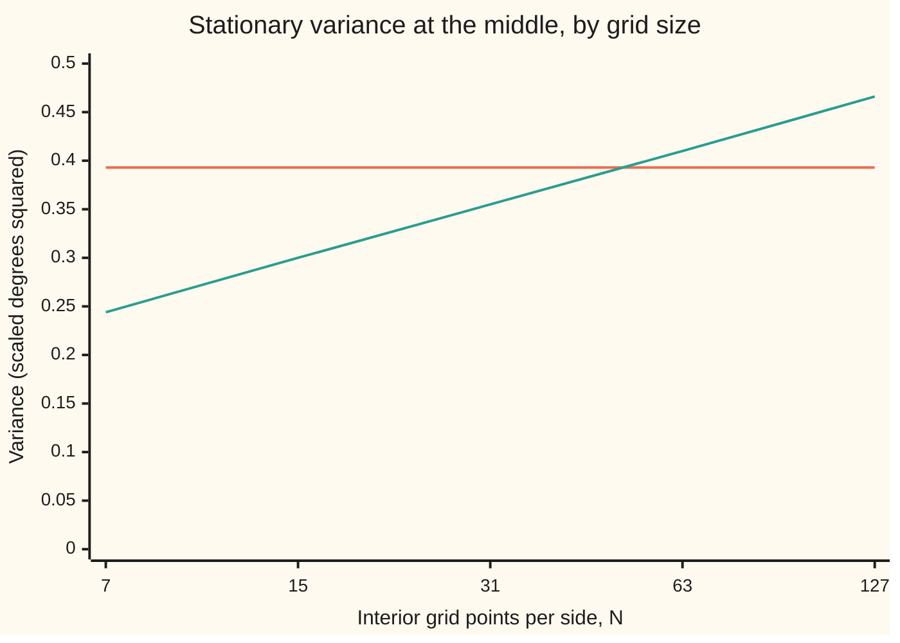

# Stochastic PDEs in outline: the heat equation driven by space-time noise

[Syllabus](../../../SYLLABUS.md) → [Stochastic processes and calculus](../README.md) → [Beyond Brownian](../README.md#s09) → Stochastic PDEs in outline

---

## General Overview

A thin metal rod has both ends clamped in ice baths, so the ends stay at 0 degrees. Along its length, tiny random bursts of heat arrive at every point and every instant. Each burst is independent of every other, in place and in time. The rod conducts heat, so it smooths each burst out and drains it to the cold ends.

The temperature never settles to one shape. It keeps flickering. But its spread settles: after a while, the rod's middle sits at 0 on average, give or take 0.63 degrees (in scaled units, set out in The formula: the rod is π long and heat spreads at rate 1).

This rod is the simplest **stochastic partial differential equation** (SPDE): a PDE, here the heat equation, with a random push added at every point and time. The push is **space-time white noise**: noise that is independent from point to point and from instant to instant, with the same strength everywhere.

The trick is to stop looking at points and look at shapes. Split the temperature into the rod's sine-shaped **modes** (the shapes from [Separation of variables](../../08-Differential%20equations%20and%20dynamics/10-The%20Classical%20PDEs/04-separation-of-variables-for-the-heat-equation.md)). Each mode then obeys its own mean-reverting equation, the Ornstein-Uhlenbeck equation of [Mean reversion](../06-Ito%20Calculus/05-ornstein-uhlenbeck-and-cir-processes.md). Mode k is pulled back at rate k² and settles at variance 1/(2k²). Add the modes up: 1/2 + 1/8 + 1/18 + … = π²/12 = 0.822, a finite total.

Do the same on a square plate and the same kind of sum never stops growing. On a line the solution is a genuine random function. On a plane it is not: its value at a point has infinite variance.

**The stochastic heat equation splits into one independent Ornstein-Uhlenbeck process per mode, mode k pulled back at rate k² with stationary variance 1/(2k²); on a line these variances add up to π²/12, so the solution is a random function, but on a square there are too many modes and the sum diverges, so the solution exists only as an average over regions.**

**What kind of fact this is:** a theorem. The mode-by-mode solution, the total π²/12, the point variance x(π − x)/(2π) and the divergence on the square are proved on this card in Why it works. That the one-dimensional solution has continuous paths is stated with a named source. Using the equation for a real rod is a model.

### The picture: one snapshot of the flickering rod

One simulated temperature profile at time 3, on a grid of 16 cells (seed 20261123, in the code), with the stationary spread on each side.



Orange: one simulated profile. Green and dark: plus and minus one standard deviation, the square root of x(π − x)/(2π). The profile is jagged at every cell but pinned to 0 at the ends, and the band is widest, 0.63, in the middle.

---

## The formula

Notation first, in words. $`u(t, x)`$ is the temperature at time $`t`$ and position $`x`$ along the rod, $`0 \le x \le \pi`$. A subscript is a rate: $`u_t`$ is the change in time, $`u_{xx}`$ the curvature along the rod. $`\xi(t, x)`$, read "xi", is space-time white noise, and $`\sigma`$ is its strength. $`E`$ is the average over all random outcomes, and Var is the variance.

```math
u_t = u_{xx} + \sigma\,\xi(t, x), \qquad u(t, 0) = u(t, \pi) = 0, \qquad u(0, x) = 0 .
```

**Read it aloud:** the temperature changes at a rate equal to its curvature, which smooths it, plus a fresh random push at every point and instant; the ends stay at 0 and the rod starts cold.

[The heat equation](../../08-Differential%20equations%20and%20dynamics/10-The%20Classical%20PDEs/03-the-heat-equation.md) uses a rod of length 1 and its own time unit, in which the sine with k humps fades at rate k²π². Stretch the rod to length π and count time in units π² times shorter: the rate becomes k², as on this card.

White noise is too rough to have values at points; only its averages over regions make sense. It is pinned down by one rule: for two shapes $`f`$ and $`g`$ along the rod, the noise's total over a time $`t`$, weighted by $`f`$, is normal with mean 0, and two such totals have covariance $`t\int_0^\pi f(x)g(x)\,dx`$. So shapes that do not overlap, in the sense that this integral is 0, get independent noise.

Write the temperature in the rod's modes, the orthonormal sine shapes (each has $`\int_0^\pi e_k^2\,dx = 1`$, and any two different ones multiply to an integral of 0) $`e_k(x) = \sqrt{2/\pi}\,\sin(kx)`$:

```math
u(t, x) = \sum_{k=1}^{\infty} a_k(t)\,e_k(x), \qquad da_k = -k^2 a_k\,dt + \sigma\,dW_k, \qquad \mathrm{Var}\,a_k(t) = \frac{\sigma^2}{2k^2}\big(1 - e^{-2k^2 t}\big).
```

**Read it aloud:** the temperature is a sum of sine humps; the size of hump k is an Ornstein-Uhlenbeck process pulled to 0 at rate k squared and shoved by its own Brownian motion, and its variance climbs to sigma squared over 2 k squared.

Two sums follow, one over the whole rod and one at a point:

```math
E\int_0^\pi u^2\,dx \;\to\; \sum_{k=1}^{\infty} \frac{\sigma^2}{2k^2} = \frac{\pi^2}{12}\,\sigma^2, \qquad \mathrm{Var}\,u(\infty, x) = \frac{\sigma^2\,x(\pi - x)}{2\pi} .
```

On a square of side π the modes are $`\sin(jx)\sin(ky)`$ with pull $`j^2 + k^2`$, and

```math
\sum_{j, k \ge 1} \frac{\sigma^2}{2(j^2 + k^2)} = \infty .
```

| Symbol | Plain meaning | In our example | Push it up and the answer… |
| --- | --- | --- | --- |
| $`u(t, x)`$; $`u_t`$, $`u_{xx}`$ | temperature at time t, position x; its rate in time and its curvature | 0 at the ends; spread 0.63 in the middle | — |
| $`t`$, $`x`$, $`y`$ | time; position along the rod; second position on the square | t = 3 in the simulation; 0 to π | variance climbs to its stationary value |
| $`\xi(t, x)`$ | space-time white noise: independent at every point and instant | — | — |
| $`\sigma`$ | noise strength | 1 | every variance scales with its square |
| $`f`$, $`g`$, $`E`$; $`C`$, $`G`$, $`c_k`$, $`r`$, $`\theta`$ | test shapes that define the noise; the mean over all random outcomes; proof names: the covariance, the Green's function, its mode coefficients, polar radius and angle | — | — |
| $`k`$, $`j`$, $`K`$, $`R`$ | mode numbers; a cut-off in 1D; a cut-off radius on the square | k = 1 to 5 in the tables; K up to 100,000; R up to 320 | more modes, more of the total |
| $`e_k(x)`$ | mode k: the sine shape $`\sqrt{2/\pi}\,\sin(kx)`$ | $`e_1`$ peaks at the middle | — |
| $`a_k(t)`$ | the size of mode k at time t | variance 0.5000 for k = 1 | — |
| $`W_k(t)`$ | the Brownian motion driving mode k; independent for different k | — | — |
| $`k^2`$, $`j^2 + k^2`$, $`\kappa`$, $`\Lambda`$ | pull: the rate at which heat flow damps a mode, called κ on the mean-reversion card; Λ a cut-off on the pull | 1, 4, 9 | that mode settles lower and faster |
| $`h`$, $`\Delta t`$, $`N`$ | grid cell width, time step, number of interior grid points | π/16; about h²/4: 0.009646 (311 steps to t = 3); 15 | finer grid; past Δt = h²/2 the scheme explodes |
| $`Z_i`$, $`\rho`$ | standard normal draws in the scheme; one step's damping factor $`1 - \lambda\,\Delta t`$, with $`\lambda`$ a mode's pull on the grid | — | — |

### When it holds

- **Additive noise.** The noise strength σ does not depend on u. If it does, as in the equation $`u_t = u_{xx} + u\,\xi`$, the modes are coupled and do not split into separate Ornstein-Uhlenbeck processes; the solution then needs Walsh's integral (Sources), not this card's sums.
- **A linear equation.** Heat flow is linear in u, so modes do not mix. Add a term like $`-u^3`$ and the modes mix; in one dimension the solution still exists, but on a plane the cube of a non-function has no meaning without renormalisation (subtracting infinite constants by a rule). On a plane an older, simpler rule is enough; in three dimensions it takes Hairer's regularity structures (Sources).
- **One space dimension.** On a line the variances add to π²/12. On a square they diverge, so the solution is not a function; it exists only as averages over regions, called a distribution.
- **Fixed ends.** Ends held at 0 give sine modes and no mode with zero pull. Insulated ends give cosines and a constant mode with pull 0; that mode is plain Brownian motion and its variance grows without limit.
- **Grid simulations need small time steps.** The explicit scheme is stable only when Δt is at most h²/2. At Δt = 0.6h² the fastest grid mode is multiplied by −1.3769 each step.

---

## Why it works

### Step 0: heat flow damps each shape at its own rate; noise feeds each shape on its own

Heat flow does not move heat between sine shapes; it only shrinks each one, mode k at rate k². White noise feeds every shape equally, and shapes that do not overlap get independent noise. So the rod is infinitely many separate one-dimensional problems, each a pull against a shove: an Ornstein-Uhlenbeck process. Whether the rod's temperature is a real function comes down to one question: is the total variance of all these modes finite?

### Step 1: project the equation onto one mode

Multiply the equation by $`e_k(x)`$ and integrate along the rod. The curvature term, integrated by parts twice with the ends at 0, gives $`-k^2 a_k`$, because $`e_k'' = -k^2 e_k`$. The noise term gives the noise weighted by $`e_k`$. By the rule in The formula, its total over time t is normal with variance $`t\int_0^\pi e_k^2\,dx = t`$. So it is a Brownian motion $`W_k`$.

Two different modes have $`\int_0^\pi e_j e_k\,dx = 0`$ ([Fourier series](../../08-Differential%20equations%20and%20dynamics/09-Fourier%20Series/01-fourier-series-and-orthogonality.md)). Their noise totals are jointly normal with covariance 0, so $`W_j`$ and $`W_k`$ are independent. Each mode obeys

```math
da_k = -k^2 a_k\,dt + \sigma\,dW_k, \qquad a_k(0) = 0 .
```

### Step 2: each mode is an Ornstein-Uhlenbeck process

This is the equation on [Mean reversion](../06-Ito%20Calculus/05-ornstein-uhlenbeck-and-cir-processes.md), with pull speed $`\kappa = k^2`$, level 0 and noise σ. That card's solution gives a normal mode with mean 0 and variance $`\sigma^2(1 - e^{-2k^2 t})/(2k^2)`$. As t grows, mode k settles at $`\sigma^2/(2k^2)`$.

| Mode | Pull | Stationary variance | Share of the total | Variance at t = 3 |
| --- | ---: | ---: | ---: | ---: |
| 1 | 1 | 0.5000 | 60.79% | 0.49876 |
| 2 | 4 | 0.1250 | 15.20% | 0.12500 |
| 3 | 9 | 0.0556 | 6.75% | 0.05556 |
| 4 | 16 | 0.0312 | 3.80% | 0.03125 |
| 5 | 25 | 0.0200 | 2.43% | 0.02000 |

Every mode gets the same noise. High modes are pulled back hard, so they stay small. The slow first mode carries 60.79% of the rod's fluctuation.

### Step 3: on a line, the variances add up

The modes are independent with mean 0, and the $`e_k`$ are orthonormal. So the expected integral of u² along the rod is the sum of the mode variances. In the long run, with σ = 1,

```math
\sum_{k=1}^{\infty} \frac{1}{2k^2} = \frac12 \cdot \frac{\pi^2}{6} = \frac{\pi^2}{12} = 0.822467 .
```

The value π²/6 for the sum of 1/k² is Euler's Basel sum. The code checks it by brute force: the first 1,000 modes give 0.821967. The missing tail is 0.000500, and the tail beyond mode K is always below 1/(2K), because 1/k² is less than the area under 1/x² from k − 1 to k.

At a single point the answer is also finite. The variance of $`u(\infty, x)`$ is $`\tfrac1\pi\sum \sin^2(kx)/k^2`$, which equals $`x(\pi - x)/(2\pi)`$. At the middle that is π/8 = 0.3927, a spread of 0.63. At a quarter of the way along it is 3π/32 = 0.2945.

<details>
<summary>Detailed proof: the point variance is x(π − x)/(2π)</summary>

The stationary covariance of the temperatures at x and y is the sum over modes of each mode's variance times its two shape values:

$`\displaystyle C(x, y) = \sum_{k=1}^{\infty} \frac{1}{2k^2}\,e_k(x)\,e_k(y) .`$

Take the function $`G(x, y) = x(\pi - y)/\pi`$ for $`x \le y`$, and $`y(\pi - x)/\pi`$ for $`x > y`$. As a function of x it is 0 at both ends, a straight line on each side of y, with a kink of slope −1 at y. So its second derivative is minus a unit spike at y.

Expand it in the modes: $`G(\cdot, y) = \sum c_k e_k`$. Integrating by parts twice, $`-k^2 c_k = \int_0^\pi G''\,e_k\,dx = -e_k(y)`$. So $`c_k = e_k(y)/k^2`$, and

$`\displaystyle G(x, y) = \sum_{k=1}^{\infty} \frac{e_k(x)\,e_k(y)}{k^2} = 2\,C(x, y) .`$

At $`y = x`$ this gives $`\mathrm{Var}\,u(\infty, x) = x(\pi - x)/(2\pi)`$. This is half the variance of a Brownian bridge on the rod: the stationary profile is a Brownian bridge (a Brownian path forced back to 0 at the end) times $`1/\sqrt2`$. [Gaussian processes](../05-Brownian%20Motion/09-gaussian-processes-and-karhunen-loeve.md) gives the bridge's sine expansion, which is this one.

</details>

The same covariance gives the difference of two nearby temperatures a variance of $`\tfrac12|x - y|(1 - |x - y|/\pi)`$. Moves grow like the square root of the distance, as for Brownian motion. By Kolmogorov's continuity criterion (Walsh, Sources) that is enough for continuous profiles, Hölder continuous (moves bounded by a constant times the distance to a power) for every power below 1/2 in space; Walsh (Sources) proves the solution is also continuous in time.

### Step 4: on a square, there are too many modes

On a square plate of side π, held at 0 on all four edges, the modes are $`\sin(jx)\sin(ky)`$ with pull $`j^2 + k^2`$. Each still settles at variance $`1/(2(j^2 + k^2))`$. But now count them.

The modes are lattice points (j, k) in a quarter plane. Those with $`j^2 + k^2`$ between R² and 4R² fill a quarter ring of area about $`\tfrac34\pi R^2`$, and each contributes between $`1/(8R^2)`$ and $`1/(2R^2)`$. So the ring's total is between $`3\pi/32`$ and $`3\pi/8`$, whatever R is. For large R the ring's total, in polar coordinates, is $`\int \tfrac{1}{2r^2}\,r\,dr\,d\theta`$ over a quarter ring, which is $`\tfrac\pi4\ln 2 = 0.5444`$. Every doubling of R adds the same amount, forever.

| Cut-off radius R | 10 | 20 | 40 | 80 | 160 | 320 |
| --- | ---: | ---: | ---: | ---: | ---: | ---: |
| Sum of $`1/(2(j^2 + k^2))`$ | 1.3600 | 1.8780 | 2.4101 | 2.9480 | 3.4896 | 4.0326 |
| Rise since last | — | 0.5180 | 0.5321 | 0.5379 | 0.5416 | 0.5430 |

The rises approach 0.5444. The sum grows like $`\tfrac\pi4\ln R`$ and has no limit. The point variance diverges the same way. On a line the mode count up to pull Λ is $`\sqrt\Lambda`$; on a plane it is about $`\pi\Lambda/4`$, and that extra growth is what breaks the sum.

What survives is the average of the temperature over any small patch: a weighted sum of mode sizes whose weights fall off fast enough. So on the plate the solution is a **distribution**: an object defined by its averages against smooth shapes, not by values at points. For a linear equation that is enough. For a nonlinear one it is the start of the hard problems.

### Step 5: simulate it on a grid, and watch the dimension show

Cut the rod into cells of width h, with N interior grid points. Replace the curvature by the difference $`(u_{i-1} - 2u_i + u_{i+1})/h^2`$ and step forward in time with [Euler-Maruyama](../08-Generators%2C%20Densities%20and%20Simulation/04-euler-maruyama-scheme.md):

```math
u_i^{\text{new}} = u_i + \Delta t\,\frac{u_{i-1} - 2u_i + u_{i+1}}{h^2} + \sigma\sqrt{\frac{\Delta t}{h}}\,Z_i .
```

**Read it aloud:** each grid temperature moves by the step times its discrete curvature, plus a normal draw scaled by the square root of the time step over the cell width.

The noise scale comes from the rule in The formula. The noise total over one cell and one step has variance $`h\,\Delta t`$. The grid value stands for the cell's average, so divide the total by h: variance $`\Delta t/h`$. Finer cells get bigger kicks, because a smaller patch averages away less of the noise.

Leave out the time-step error for a moment, as if the grid ran in continuous time. Then the grid's stationary variance at each grid point equals the continuum value exactly. The grid's curvature matrix has sine eigenvectors too (shapes it only rescales), and its middle variance is π/8 = 0.3927 on every grid, because its response to a unit spike of heat is the same tent shape as in the proof above. On the square, the same calculation gives a middle variance that grows as the grid is refined, by $`\ln 2/(4\pi) = 0.0552`$ each time h is halved.



Orange: the rod, flat at π/8 on every grid. Green: the square, climbing by 0.0552 per halving of h, with no limit. A grid simulation of the plate gives a different answer at every resolution. That is the divergence of Step 4, seen through a grid.

The time step adds its own error. One step multiplies a grid mode with pull λ by $`\rho = 1 - \lambda\,\Delta t`$, so it settles at $`1/(h\lambda(2 - \lambda\,\Delta t))`$ instead of $`1/(2h\lambda)`$. Fast modes are inflated. At Δt = h²/4 the middle variance at time 3 is 0.4093, not the continuum's 0.3919. The code simulates 1,000 rods on this grid and lands at 0.4141 ± 0.0172, matching the grid's own exact value.

---

## Worked numbers, by hand

| Step | Arithmetic | Value |
| --- | --- | --- |
| mode 1 stationary variance | 1/(2 × 1²) | 0.5000 |
| mode 2 | 1/(2 × 2²) = 1/8 | 0.1250 |
| mode 3 | 1/(2 × 3²) = 1/18 | 0.0556 |
| first ten modes | 0.5 + 0.125 + … + 0.005 | 0.774884 |
| Basel sum | 1 + 1/4 + 1/9 + … = π²/6 | 1.6449 |
| total over the rod | half of π²/6 = π²/12 | **0.8225** |
| variance at the middle | (π/2)(π − π/2)/(2π) = π/8 | 0.3927 |
| spread at the middle | square root of 0.3927 | 0.63 |
| square: added per doubling of R | (π/4) × ln 2 | **0.5444** |

On the rod, all the fluctuation fits in a finite total of 0.8225, and the middle swings by about 0.63 either way. On the square, each doubling of the frequency range adds 0.5444 more, so there is no total.

### What breaks if you drop a piece

| Mistake | Comes out at | What went wrong |
| --- | --- | --- |
| Take mode k's variance as 1/k², dropping the 2 | total 1.6449, true 0.8225 | The Ornstein-Uhlenbeck variance is σ² over twice the pull |
| Scale the grid noise by $`\sqrt{\Delta t}`$, not $`\sqrt{\Delta t/h}`$ | middle variance 0.0804 on h = π/16, true 0.4093 | The cell's noise total was not turned into a cell average; the variance comes out h times too small, and the shortfall gets worse, toward 0, as the grid is refined |
| Take a time step Δt = 0.6h² | fastest mode multiplied by −1.3769 a step; grows by 10^18.1 by t = 3 | The explicit scheme is stable only for Δt at most h²/2 |
| Truncate the square's sum and call it the variance | 1.3600 at R = 10, 4.0326 at R = 320 | The sum has no limit; the cut-off sets the answer |

---

## Code, from first principles, and it actually runs

The code solves the rod three ways and prints every number on the card. Random numbers come from SplitMix64 (a short seeded generator of uniform numbers), seed 20261123, turned into normal draws by the Box-Muller formula. In the code, `dt` is Δt.

- **Mode sums:** each mode's Ornstein-Uhlenbeck variance, summed to 100,000 modes in 1D and over a disc of radius 320 on the square.
- **Closed forms:** π²/12 from the Basel sum, and x(π − x)/(2π) from the Green's function, each checked against its mode sum; the exact grid variances on the rod (π/8 on every grid) and the square.
- **Simulation:** 1,000 rods stepped by Euler-Maruyama on 15 interior points to time 3, compared with the grid's exact value for that scheme. That exact value is checked once more, with no modes, by stepping the scheme's response directly. Each simulated number carries its standard error, and each assert allows four.

### Python

```python
# Stochastic heat equation u_t = u_xx + xi on a rod (0, pi), ends held at 0, noise strength 1.
# Road 1: mode sums (each mode an OU process). Road 2: closed forms (Basel sum, Green's function).
# Road 3: Euler-Maruyama simulation on a grid, seeded SplitMix64 + Box-Muller.
import math

PI = math.pi
MASK = (1 << 64) - 1
state = 20261123

def next_u():
    global state
    state = (state + 0x9E3779B97F4A7C15) & MASK
    z = state
    z = ((z ^ (z >> 30)) * 0xBF58476D1CE4E5B9) & MASK
    z = ((z ^ (z >> 27)) * 0x94D049BB133111EB) & MASK
    z ^= z >> 31
    return ((z >> 11) + 0.5) / 9007199254740992.0

def normal_pair():
    r = math.sqrt(-2.0 * math.log(next_u()))
    a = 2.0 * PI * next_u()
    return r * math.cos(a), r * math.sin(a)

print("rod (0, pi), ends at 0, noise strength 1; mode k: pull k^2, stationary variance 1/(2k^2)")
for k in range(1, 6):
    v = 1.0 / (2 * k * k)
    print(f"mode {k}: pull {k*k:2d}  variance {v:.4f}  share of total {100 * v / (PI**2 / 12):5.2f}%  at t = 3: {v * (1 - math.exp(-6 * k * k)):.5f}")
total = PI ** 2 / 12
print(f"total, closed form pi^2/12 = {total:.6f}")
s, partial = 0.0, {}
for k in range(1, 100001):
    s += 1.0 / (2 * k * k)
    if k in (1, 2, 5, 10, 100, 1000, 100000):
        partial[k] = s
        print(f"1D partial sum to K = {k:6d}: {s:.6f}  gap to pi^2/12 {total - s:.6f}  tail bound 1/(2K) {1 / (2 * k):.6f}")
assert abs(partial[100000] - total) < 1e-5
assert total - partial[1000] < 1 / 2000 and total - partial[1000] > 1 / 2002

def point_var_modes(x, K):
    return sum(math.sin(k * x) ** 2 / (k * k) for k in range(1, K + 1)) / PI

for x, name in ((PI / 2, "pi/2"), (PI / 4, "pi/4")):
    mv, cf = point_var_modes(x, 200000), x * (PI - x) / (2 * PI)
    print(f"variance at x = {name}: mode sum {mv:.6f}  closed form x(pi-x)/(2pi) {cf:.6f}")
    assert abs(mv - cf) < 1e-5
print(f"hand: pi^2/12 {PI**2/12:.4f}, pi/8 {PI/8:.4f}, 3pi/32 {3*PI/32:.4f}, (pi/4) ln 2 {PI/4*math.log(2):.4f}")

def square_sum(R):
    return sum(1.0 / (2 * (j * j + k * k)) for j in range(1, R + 1) for k in range(1, R + 1) if j * j + k * k <= R * R)

prev = None
for R in (10, 20, 40, 80, 160, 320):
    s2 = square_sum(R)
    print(f"2D square sum over j^2+k^2 <= {R:3d}^2: {s2:.4f}" + (f"  rise since last {s2 - prev:.4f}" if prev else ""))
    if R == 320:
        assert abs((s2 - prev) - PI / 4 * math.log(2)) < 0.01
    prev = s2

def grid1d(N):
    h = PI / (N + 1)
    m = (N + 1) // 2
    v = sum((2 / (N + 1)) * math.sin(j * m * PI / (N + 1)) ** 2 / ((4 / h**2) * math.sin(j * h / 2) ** 2) for j in range(1, N + 1))
    return v / (2 * h)

def grid2d(N):
    h = PI / (N + 1)
    lam = [(4 / h**2) * math.sin(j * h / 2) ** 2 for j in range(N + 1)]
    v = sum((2 / (N + 1)) ** 2 / (lam[j] + lam[k]) for j in range(1, N + 1, 2) for k in range(1, N + 1, 2))
    return v / (2 * h * h)

g1, g2 = [], []
for N in (7, 15, 31, 63, 127):
    g1.append(grid1d(N)); g2.append(grid2d(N))
    print(f"grid N = {N:3d}, h = pi/{N+1}: midpoint variance, rod {g1[-1]:.4f}  square {g2[-1]:.4f}")
    assert abs(g1[-1] - PI / 8) < 1e-12
print(f"square: rise per halving of h {g2[-1] - g2[-2]:.4f}, continuum rate ln 2/(4 pi) {math.log(2) / (4 * PI):.4f}")
assert abs((g2[-1] - g2[-2]) - math.log(2) / (4 * PI)) < 0.002
print(f"chart, rod    {' '.join(f'{v:.3f}' for v in g1)}")
print(f"chart, square {' '.join(f'{v:.3f}' for v in g2)}")

N, T, M = 15, 3.0, 1000
h = PI / (N + 1)
dt = h * h / 4
n = round(T / dt)
dt = T / n
xs = [(i + 1) * h for i in range(N)]
vk = [[math.sqrt(2 / (N + 1)) * math.sin(k * (i + 1) * PI / (N + 1)) for i in range(N)] for k in range(1, N + 1)]
lk = [(4 / h**2) * math.sin(k * h / 2) ** 2 for k in range(1, N + 1)]
assert 1 - lk[N - 1] * dt >= -1                  # stable: the fastest grid mode does not flip and grow

def mode_var(k, step=dt, scale=dt / h):
    rho = 1 - lk[k] * step
    return scale * (1 - rho ** (2 * round(T / step))) / (1 - rho * rho)

mid = N // 2
ex_mid = sum(vk[k][mid] ** 2 * mode_var(k) for k in range(N))
ex_energy = h * sum(mode_var(k) for k in range(N))
ex_a1 = h * mode_var(0)
print(f"simulation: N = {N} interior points, h = pi/{N + 1}, dt = {dt:.6f}, {n} steps to t = {T:.0f}, {M} paths, seed 20261123")
mids, energies, a1s, snap = [], [], [], None
for p in range(M):
    u = [0.0] * N
    c = math.sqrt(dt / h)
    for _ in range(n):
        z = []
        while len(z) < N:
            z.extend(normal_pair())
        u = [u[i] + dt * ((u[i - 1] if i > 0 else 0.0) - 2 * u[i] + (u[i + 1] if i < N - 1 else 0.0)) / (h * h) + c * z[i] for i in range(N)]
    if p == 0:
        snap = [0.0] + u + [0.0]
    mids.append(u[mid] ** 2)
    energies.append(h * sum(w * w for w in u))
    a1s.append((h * sum(math.sqrt(2 / PI) * math.sin(xs[i]) * u[i] for i in range(N))) ** 2)

def report(label, vals, exact, cont):
    mean = sum(vals) / M
    se = math.sqrt(sum((w - mean) ** 2 for w in vals) / (M - 1) / M)
    print(f"{label:22s} sim {mean:.4f} +- {se:.4f}  grid exact {exact:.4f}  continuum {cont:.4f}")
    assert abs(mean - exact) < 4 * se

cont_mid = PI / 8 - sum(math.exp(-6 * k * k) / (k * k) for k in range(1, 50, 2)) / PI
report("midpoint variance", mids, ex_mid, cont_mid)
report("energy, integral u^2", energies, ex_energy, PI ** 2 / 12 - sum(math.exp(-6 * k * k) / (2 * k * k) for k in range(1, 50)))
report("mode 1 variance", a1s, ex_a1, 0.5 * (1 - math.exp(-6)))
print(f"chart, x      {' '.join(f'{(i * h):.2f}' for i in range(N + 2))}")
print(f"chart, path   {' '.join(f'{w:.2f}' for w in snap)}")
sd = [math.sqrt(i * h * (PI - i * h) / (2 * PI)) for i in range(N + 2)]
print(f"chart, +1 sd  {' '.join(f'{w:.2f}' for w in sd)}")
print(f"chart, -1 sd  {' '.join(f'{(-w if w > 0.005 else 0.0):.2f}' for w in sd)}")
wrong_noise = sum(vk[k][mid] ** 2 * mode_var(k, scale=dt) for k in range(N))
big = 0.6 * h * h
amp = round(T / big) * math.log10(abs(1 - lk[N - 1] * big))
print(f"mistake, variance 1/k^2 (drop the 2): total {PI ** 2 / 6:.4f}")
print(f"mistake, noise sqrt(dt) not sqrt(dt/h): midpoint variance {wrong_noise:.4f}, true {ex_mid:.4f}")
print(f"mistake, dt = 0.6 h^2: top mode factor {1 - lk[N-1] * big:.4f} per step, grows by 10^{amp:.1f} by t = 3")
r, direct = [float(i == mid) for i in range(N)], 0.0      # the same variance with no modes: step the scheme directly
for _ in range(n): direct, r = direct + dt * sum(w * w for w in r), [r[i] + dt * ((r[i - 1] if i > 0 else 0.0) - 2 * r[i] + (r[i + 1] if i < N - 1 else 0.0)) / (h * h) for i in range(N)]
assert abs(direct - wrong_noise) < 1e-9
assert 1 - lk[N - 1] * big < -1
print("ALL CHECKS PASS")
```

**Ran 2026-11-23 on macOS, Python 3.14.10, standard library only. All checks passed. Output, pasted from the run:**

```
rod (0, pi), ends at 0, noise strength 1; mode k: pull k^2, stationary variance 1/(2k^2)
mode 1: pull  1  variance 0.5000  share of total 60.79%  at t = 3: 0.49876
mode 2: pull  4  variance 0.1250  share of total 15.20%  at t = 3: 0.12500
mode 3: pull  9  variance 0.0556  share of total  6.75%  at t = 3: 0.05556
mode 4: pull 16  variance 0.0312  share of total  3.80%  at t = 3: 0.03125
mode 5: pull 25  variance 0.0200  share of total  2.43%  at t = 3: 0.02000
total, closed form pi^2/12 = 0.822467
1D partial sum to K =      1: 0.500000  gap to pi^2/12 0.322467  tail bound 1/(2K) 0.500000
1D partial sum to K =      2: 0.625000  gap to pi^2/12 0.197467  tail bound 1/(2K) 0.250000
1D partial sum to K =      5: 0.731806  gap to pi^2/12 0.090661  tail bound 1/(2K) 0.100000
1D partial sum to K =     10: 0.774884  gap to pi^2/12 0.047583  tail bound 1/(2K) 0.050000
1D partial sum to K =    100: 0.817492  gap to pi^2/12 0.004975  tail bound 1/(2K) 0.005000
1D partial sum to K =   1000: 0.821967  gap to pi^2/12 0.000500  tail bound 1/(2K) 0.000500
1D partial sum to K = 100000: 0.822462  gap to pi^2/12 0.000005  tail bound 1/(2K) 0.000005
variance at x = pi/2: mode sum 0.392698  closed form x(pi-x)/(2pi) 0.392699
variance at x = pi/4: mode sum 0.294524  closed form x(pi-x)/(2pi) 0.294524
hand: pi^2/12 0.8225, pi/8 0.3927, 3pi/32 0.2945, (pi/4) ln 2 0.5444
2D square sum over j^2+k^2 <=  10^2: 1.3600
2D square sum over j^2+k^2 <=  20^2: 1.8780  rise since last 0.5180
2D square sum over j^2+k^2 <=  40^2: 2.4101  rise since last 0.5321
2D square sum over j^2+k^2 <=  80^2: 2.9480  rise since last 0.5379
2D square sum over j^2+k^2 <= 160^2: 3.4896  rise since last 0.5416
2D square sum over j^2+k^2 <= 320^2: 4.0326  rise since last 0.5430
grid N =   7, h = pi/8: midpoint variance, rod 0.3927  square 0.2445
grid N =  15, h = pi/16: midpoint variance, rod 0.3927  square 0.3000
grid N =  31, h = pi/32: midpoint variance, rod 0.3927  square 0.3553
grid N =  63, h = pi/64: midpoint variance, rod 0.3927  square 0.4105
grid N = 127, h = pi/128: midpoint variance, rod 0.3927  square 0.4657
square: rise per halving of h 0.0552, continuum rate ln 2/(4 pi) 0.0552
chart, rod    0.393 0.393 0.393 0.393 0.393
chart, square 0.244 0.300 0.355 0.410 0.466
simulation: N = 15 interior points, h = pi/16, dt = 0.009646, 311 steps to t = 3, 1000 paths, seed 20261123
midpoint variance      sim 0.4141 +- 0.0172  grid exact 0.4093  continuum 0.3919
energy, integral u^2   sim 0.8466 +- 0.0220  grid exact 0.8690  continuum 0.8212
mode 1 variance        sim 0.4792 +- 0.0213  grid exact 0.5028  continuum 0.4988
chart, x      0.00 0.20 0.39 0.59 0.79 0.98 1.18 1.37 1.57 1.77 1.96 2.16 2.36 2.55 2.75 2.95 3.14
chart, path   0.00 -0.18 0.43 0.36 0.97 0.92 0.40 0.76 0.85 0.42 0.15 0.49 0.28 0.77 0.26 0.61 0.00
chart, +1 sd  0.00 0.30 0.41 0.49 0.54 0.58 0.61 0.62 0.63 0.62 0.61 0.58 0.54 0.49 0.41 0.30 0.00
chart, -1 sd  0.00 -0.30 -0.41 -0.49 -0.54 -0.58 -0.61 -0.62 -0.63 -0.62 -0.61 -0.58 -0.54 -0.49 -0.41 -0.30 0.00
mistake, variance 1/k^2 (drop the 2): total 1.6449
mistake, noise sqrt(dt) not sqrt(dt/h): midpoint variance 0.0804, true 0.4093
mistake, dt = 0.6 h^2: top mode factor -1.3769 per step, grows by 10^18.1 by t = 3
ALL CHECKS PASS
```

### Rust

Same numbers, same labels, built with `rustc --edition 2021 -O`.

```rust
// Stochastic heat equation u_t = u_xx + xi on a rod (0, pi), ends held at 0, noise strength 1.
// Road 1: mode sums (each mode an OU process). Road 2: closed forms (Basel sum, Green's function).
// Road 3: Euler-Maruyama simulation on a grid, seeded SplitMix64 + Box-Muller.
use std::f64::consts::PI;

struct Rng(u64);
impl Rng {
    fn next_u(&mut self) -> f64 {
        self.0 = self.0.wrapping_add(0x9E3779B97F4A7C15);
        let mut z = self.0;
        z = (z ^ (z >> 30)).wrapping_mul(0xBF58476D1CE4E5B9);
        z = (z ^ (z >> 27)).wrapping_mul(0x94D049BB133111EB);
        z ^= z >> 31;
        ((z >> 11) as f64 + 0.5) / 9007199254740992.0
    }
    fn normal_pair(&mut self) -> (f64, f64) {
        let r = (-2.0 * self.next_u().ln()).sqrt();
        let a = 2.0 * PI * self.next_u();
        (r * a.cos(), r * a.sin())
    }
}

fn point_var_modes(x: f64, kmax: usize) -> f64 {
    (1..=kmax).fold(0.0, |a, k| { let sk = (k as f64 * x).sin(); a + sk * sk / ((k * k) as f64) }) / PI
}

fn square_sum(r: i64) -> f64 {
    let mut s = 0.0;
    for j in 1..=r {
        for k in (1..=r).filter(|k| j * j + k * k <= r * r) { s += 1.0 / ((2 * (j * j + k * k)) as f64); }
    }
    s
}

fn grid1d(n: usize) -> f64 {
    let h = PI / (n + 1) as f64;
    let m = (n + 1) / 2;
    let mut v = 0.0;
    for j in 1..=n {
        let s = (j as f64 * m as f64 * PI / (n + 1) as f64).sin();
        let l = (j as f64 * h / 2.0).sin();
        v += (2.0 / (n + 1) as f64) * (s * s) / ((4.0 / (h * h)) * (l * l));
    }
    v / (2.0 * h)
}

fn grid2d(n: usize) -> f64 {
    let h = PI / (n + 1) as f64;
    let lam: Vec<f64> = (0..=n).map(|j| { let l = (j as f64 * h / 2.0).sin(); (4.0 / (h * h)) * (l * l) }).collect();
    let w = 2.0 / (n + 1) as f64;
    let mut v = 0.0;
    for j in (1..=n).step_by(2) {
        for k in (1..=n).step_by(2) { v += (w * w) / (lam[j] + lam[k]); }
    }
    v / (2.0 * h * h)
}

fn report(label: &str, vals: &[f64], exact: f64, cont: f64) {
    let m = vals.len() as f64;
    let mean = vals.iter().fold(0.0, |a, w| a + w) / m;
    let se = (vals.iter().fold(0.0, |a, w| a + (w - mean) * (w - mean)) / (m - 1.0) / m).sqrt();
    println!("{:22} sim {:.4} +- {:.4}  grid exact {:.4}  continuum {:.4}", label, mean, se, exact, cont);
    assert!((mean - exact).abs() < 4.0 * se);
}

fn join(v: &[f64], d: usize) -> String {
    v.iter().map(|x| format!("{:.*}", d, x)).collect::<Vec<_>>().join(" ")
}

fn main() {
    println!("rod (0, pi), ends at 0, noise strength 1; mode k: pull k^2, stationary variance 1/(2k^2)");
    let total = PI * PI / 12.0;
    for k in 1..=5usize {
        let v = 1.0 / ((2 * k * k) as f64);
        println!("mode {}: pull {:2}  variance {:.4}  share of total {:5.2}%  at t = 3: {:.5}", k, k * k, v, 100.0 * v / total, v * (1.0 - (-6.0 * (k * k) as f64).exp()));
    }
    println!("total, closed form pi^2/12 = {:.6}", total);
    let (mut s, mut p1000, mut pbig) = (0.0, 0.0, 0.0);
    for k in 1..=100000usize {
        s += 1.0 / ((2 * k * k) as f64);
        if [1, 2, 5, 10, 100, 1000, 100000].contains(&k) {
            if k == 1000 { p1000 = s; }
            if k == 100000 { pbig = s; }
            println!("1D partial sum to K = {:6}: {:.6}  gap to pi^2/12 {:.6}  tail bound 1/(2K) {:.6}", k, s, total - s, 1.0 / (2 * k) as f64);
        }
    }
    assert!((pbig - total).abs() < 1e-5);
    assert!(total - p1000 < 1.0 / 2000.0 && total - p1000 > 1.0 / 2002.0);
    for (x, name) in [(PI / 2.0, "pi/2"), (PI / 4.0, "pi/4")] {
        let (mv, cf) = (point_var_modes(x, 200000), x * (PI - x) / (2.0 * PI));
        println!("variance at x = {}: mode sum {:.6}  closed form x(pi-x)/(2pi) {:.6}", name, mv, cf);
        assert!((mv - cf).abs() < 1e-5);
    }
    println!("hand: pi^2/12 {:.4}, pi/8 {:.4}, 3pi/32 {:.4}, (pi/4) ln 2 {:.4}", total, PI / 8.0, 3.0 * PI / 32.0, PI / 4.0 * 2f64.ln());
    let mut prev = 0.0;
    for r in [10, 20, 40, 80, 160, 320] {
        let s2 = square_sum(r);
        let rise = if r > 10 { format!("  rise since last {:.4}", s2 - prev) } else { String::new() };
        println!("2D square sum over j^2+k^2 <= {:3}^2: {:.4}{}", r, s2, rise);
        if r == 320 { assert!(((s2 - prev) - PI / 4.0 * 2f64.ln()).abs() < 0.01); }
        prev = s2;
    }
    let (mut g1, mut g2) = (vec![], vec![]);
    for n in [7usize, 15, 31, 63, 127] {
        g1.push(grid1d(n));
        g2.push(grid2d(n));
        println!("grid N = {:3}, h = pi/{}: midpoint variance, rod {:.4}  square {:.4}", n, n + 1, g1[g1.len() - 1], g2[g2.len() - 1]);
        assert!((g1[g1.len() - 1] - PI / 8.0).abs() < 1e-12);
    }
    let rise = g2[4] - g2[3];
    println!("square: rise per halving of h {:.4}, continuum rate ln 2/(4 pi) {:.4}", rise, 2f64.ln() / (4.0 * PI));
    assert!((rise - 2f64.ln() / (4.0 * PI)).abs() < 0.002);
    println!("chart, rod    {}", join(&g1, 3));
    println!("chart, square {}", join(&g2, 3));

    let (n, t, m) = (15usize, 3.0f64, 1000usize);
    let h = PI / (n + 1) as f64;
    let steps = (t / (h * h / 4.0)).round() as usize;
    let dt = t / steps as f64;
    let xs: Vec<f64> = (0..n).map(|i| (i + 1) as f64 * h).collect();
    let vk: Vec<Vec<f64>> = (1..=n).map(|k| (0..n).map(|i| (2.0 / (n + 1) as f64).sqrt() * (k as f64 * (i + 1) as f64 * PI / (n + 1) as f64).sin()).collect()).collect();
    let lk: Vec<f64> = (1..=n).map(|k| { let l = (k as f64 * h / 2.0).sin(); (4.0 / (h * h)) * (l * l) }).collect();
    assert!(1.0 - lk[n - 1] * dt >= -1.0); // stable: the fastest grid mode does not flip and grow
    let mode_var = |k: usize, step: f64, scale: f64| -> f64 { let rho = 1.0 - lk[k] * step;
        scale * (1.0 - rho.powf(2.0 * (t / step).round())) / (1.0 - rho * rho) };
    let mid = n / 2;
    let ex_mid = (0..n).fold(0.0, |a, k| a + vk[k][mid] * vk[k][mid] * mode_var(k, dt, dt / h));
    let ex_energy = h * (0..n).fold(0.0, |a, k| a + mode_var(k, dt, dt / h));
    let ex_a1 = h * mode_var(0, dt, dt / h);
    println!("simulation: N = {} interior points, h = pi/{}, dt = {:.6}, {} steps to t = {:.0}, {} paths, seed 20261123", n, n + 1, dt, steps, t, m);
    let mut rng = Rng(20261123);
    let (mut mids, mut energies, mut a1s, mut snap) = (vec![], vec![], vec![], vec![]);
    let c = (dt / h).sqrt();
    for p in 0..m {
        let mut u = vec![0.0f64; n];
        for _ in 0..steps {
            let mut z: Vec<f64> = vec![];
            while z.len() < n { let (a, b) = rng.normal_pair(); z.push(a); z.push(b); }
            u = (0..n).map(|i| { let (l, r) = (if i > 0 { u[i - 1] } else { 0.0 }, if i < n - 1 { u[i + 1] } else { 0.0 });
                u[i] + dt * (l - 2.0 * u[i] + r) / (h * h) + c * z[i] }).collect();
        }
        if p == 0 { snap.push(0.0); snap.extend(u.iter()); snap.push(0.0); }
        mids.push(u[mid] * u[mid]);
        energies.push(h * u.iter().fold(0.0, |a, w| a + w * w));
        let a1 = h * (0..n).fold(0.0, |a, i| a + (2.0 / PI).sqrt() * xs[i].sin() * u[i]);
        a1s.push(a1 * a1);
    }
    let cm = (1..50usize).step_by(2).fold(0.0, |a, k| a + (-6.0 * (k * k) as f64).exp() / ((k * k) as f64));
    let ce = (1..50usize).fold(0.0, |a, k| a + (-6.0 * (k * k) as f64).exp() / ((2 * k * k) as f64));
    report("midpoint variance", &mids, ex_mid, PI / 8.0 - cm / PI);
    report("energy, integral u^2", &energies, ex_energy, total - ce);
    report("mode 1 variance", &a1s, ex_a1, 0.5 * (1.0 - (-6.0f64).exp()));
    let xg: Vec<f64> = (0..n + 2).map(|i| i as f64 * h).collect();
    println!("chart, x      {}", join(&xg, 2));
    println!("chart, path   {}", join(&snap, 2));
    let sd: Vec<f64> = xg.iter().map(|x| (x * (PI - x) / (2.0 * PI)).sqrt()).collect();
    println!("chart, +1 sd  {}", join(&sd, 2));
    println!("chart, -1 sd  {}", join(&sd.iter().map(|w| if *w > 0.005 { -w } else { 0.0 }).collect::<Vec<_>>(), 2));
    let wrong_noise = (0..n).fold(0.0, |a, k| a + vk[k][mid] * vk[k][mid] * mode_var(k, dt, dt));
    let big = 0.6 * h * h; let factor = 1.0 - lk[n - 1] * big;
    let amp = (t / big).round() * factor.abs().log10();
    println!("mistake, variance 1/k^2 (drop the 2): total {:.4}", PI * PI / 6.0);
    println!("mistake, noise sqrt(dt) not sqrt(dt/h): midpoint variance {:.4}, true {:.4}", wrong_noise, ex_mid);
    println!("mistake, dt = 0.6 h^2: top mode factor {:.4} per step, grows by 10^{:.1} by t = 3", factor, amp);
    let (mut r, mut direct): (Vec<f64>, f64) = ((0..n).map(|i| if i == mid { 1.0 } else { 0.0 }).collect(), 0.0); // the same variance with no modes: step the scheme directly
    for _ in 0..steps { direct += dt * r.iter().fold(0.0, |a, w| a + w * w); r = (0..n).map(|i| r[i] + dt * ((if i > 0 { r[i - 1] } else { 0.0 }) - 2.0 * r[i] + (if i < n - 1 { r[i + 1] } else { 0.0 })) / (h * h)).collect(); }
    assert!((direct - wrong_noise).abs() < 1e-9);
    assert!(factor < -1.0);
    println!("ALL CHECKS PASS");
}
```

**Ran 2026-11-23 on macOS, rustc 1.98.1, no crates. All checks passed. Output, pasted from the run:**

```
rod (0, pi), ends at 0, noise strength 1; mode k: pull k^2, stationary variance 1/(2k^2)
mode 1: pull  1  variance 0.5000  share of total 60.79%  at t = 3: 0.49876
mode 2: pull  4  variance 0.1250  share of total 15.20%  at t = 3: 0.12500
mode 3: pull  9  variance 0.0556  share of total  6.75%  at t = 3: 0.05556
mode 4: pull 16  variance 0.0312  share of total  3.80%  at t = 3: 0.03125
mode 5: pull 25  variance 0.0200  share of total  2.43%  at t = 3: 0.02000
total, closed form pi^2/12 = 0.822467
1D partial sum to K =      1: 0.500000  gap to pi^2/12 0.322467  tail bound 1/(2K) 0.500000
1D partial sum to K =      2: 0.625000  gap to pi^2/12 0.197467  tail bound 1/(2K) 0.250000
1D partial sum to K =      5: 0.731806  gap to pi^2/12 0.090661  tail bound 1/(2K) 0.100000
1D partial sum to K =     10: 0.774884  gap to pi^2/12 0.047583  tail bound 1/(2K) 0.050000
1D partial sum to K =    100: 0.817492  gap to pi^2/12 0.004975  tail bound 1/(2K) 0.005000
1D partial sum to K =   1000: 0.821967  gap to pi^2/12 0.000500  tail bound 1/(2K) 0.000500
1D partial sum to K = 100000: 0.822462  gap to pi^2/12 0.000005  tail bound 1/(2K) 0.000005
variance at x = pi/2: mode sum 0.392698  closed form x(pi-x)/(2pi) 0.392699
variance at x = pi/4: mode sum 0.294524  closed form x(pi-x)/(2pi) 0.294524
hand: pi^2/12 0.8225, pi/8 0.3927, 3pi/32 0.2945, (pi/4) ln 2 0.5444
2D square sum over j^2+k^2 <=  10^2: 1.3600
2D square sum over j^2+k^2 <=  20^2: 1.8780  rise since last 0.5180
2D square sum over j^2+k^2 <=  40^2: 2.4101  rise since last 0.5321
2D square sum over j^2+k^2 <=  80^2: 2.9480  rise since last 0.5379
2D square sum over j^2+k^2 <= 160^2: 3.4896  rise since last 0.5416
2D square sum over j^2+k^2 <= 320^2: 4.0326  rise since last 0.5430
grid N =   7, h = pi/8: midpoint variance, rod 0.3927  square 0.2445
grid N =  15, h = pi/16: midpoint variance, rod 0.3927  square 0.3000
grid N =  31, h = pi/32: midpoint variance, rod 0.3927  square 0.3553
grid N =  63, h = pi/64: midpoint variance, rod 0.3927  square 0.4105
grid N = 127, h = pi/128: midpoint variance, rod 0.3927  square 0.4657
square: rise per halving of h 0.0552, continuum rate ln 2/(4 pi) 0.0552
chart, rod    0.393 0.393 0.393 0.393 0.393
chart, square 0.244 0.300 0.355 0.410 0.466
simulation: N = 15 interior points, h = pi/16, dt = 0.009646, 311 steps to t = 3, 1000 paths, seed 20261123
midpoint variance      sim 0.4141 +- 0.0172  grid exact 0.4093  continuum 0.3919
energy, integral u^2   sim 0.8466 +- 0.0220  grid exact 0.8690  continuum 0.8212
mode 1 variance        sim 0.4792 +- 0.0213  grid exact 0.5028  continuum 0.4988
chart, x      0.00 0.20 0.39 0.59 0.79 0.98 1.18 1.37 1.57 1.77 1.96 2.16 2.36 2.55 2.75 2.95 3.14
chart, path   0.00 -0.18 0.43 0.36 0.97 0.92 0.40 0.76 0.85 0.42 0.15 0.49 0.28 0.77 0.26 0.61 0.00
chart, +1 sd  0.00 0.30 0.41 0.49 0.54 0.58 0.61 0.62 0.63 0.62 0.61 0.58 0.54 0.49 0.41 0.30 0.00
chart, -1 sd  0.00 -0.30 -0.41 -0.49 -0.54 -0.58 -0.61 -0.62 -0.63 -0.62 -0.61 -0.58 -0.54 -0.49 -0.41 -0.30 0.00
mistake, variance 1/k^2 (drop the 2): total 1.6449
mistake, noise sqrt(dt) not sqrt(dt/h): midpoint variance 0.0804, true 0.4093
mistake, dt = 0.6 h^2: top mode factor -1.3769 per step, grows by 10^18.1 by t = 3
ALL CHECKS PASS
```

The two outputs match line for line. The simulated middle variance, 0.4141 ± 0.0172, sits within one standard error of the grid's exact 0.4093. The whole-rod integral, 0.8466 ± 0.0220, sits near the grid's 0.8690; both sit above the continuum's 0.8212 because the time step inflates the fast modes. Mode 1 comes out at 0.4792 ± 0.0213 against 0.5028.

### Lean

Lean proves the three sums of The formula, for every noise strength σ and every point x on the rod.

- Take mode k's stationary variance $`\sigma^2/(2k^2)`$, for k = 1, 2, 3, and so on. Then these variances add up to $`\pi^2\sigma^2/12`$.
- Take a point x with $`0 \le x \le \pi`$. Then the mode variances times $`e_k(x)^2`$ add up to $`\sigma^2 x(\pi - x)/(2\pi)`$.
- Take a nonzero noise strength σ on the square of side π. Then the variances $`\sigma^2/(2(j^2 + k^2))`$ over all modes (j, k) have no finite sum.
- With σ = 1, modes 1, 2, 3 have pulls 1, 4, 9 and stationary variances 1/2, 1/8, 1/18.
- The first ten modes add to exactly 1968329/2540160, which is the 0.774884 of Worked numbers.
- The middle's variance is π/8 and the quarter point's is 3π/32, for σ = 1.

The decimal values, the square's cut-off sums, the grids and the simulation are left to the Python and Rust checks.

```lean
-- Stochastic PDEs in outline: the stationary mode variances σ²/(2k²) of the stochastic heat equation on a rod sum to π²σ²/12 and give the point variance σ²x(π − x)/(2π), while the same sum over a square diverges.
import Mathlib.NumberTheory.ZetaValues
import Mathlib.Analysis.SpecialFunctions.Trigonometric.Basic
import Mathlib.Analysis.SpecialFunctions.Pow.Real
import Mathlib.Topology.Algebra.InfiniteSum.Real
import Mathlib.Analysis.PSeries

open Real

theorem hasSum_inv_succ_sq :
    HasSum (fun k : ℕ => 1 / ((k : ℝ) + 1) ^ 2) (π ^ 2 / 6) := by
  have h := (hasSum_nat_add_iff' 1).mpr hasSum_zeta_two
  simpa using h

theorem hasSum_cos_succ_div_sq {x : ℝ} (hx : x ∈ Set.Icc 0 π) :
    HasSum (fun k : ℕ => 1 / ((k : ℝ) + 1) ^ 2 * Real.cos (2 * (((k : ℝ) + 1) * x)))
      (π ^ 2 / 6 - π * x + x ^ 2) := by
  have hpi := Real.pi_pos
  have hx' : x / π ∈ Set.Icc (0 : ℝ) 1 := by
    obtain ⟨h0, h1⟩ := hx
    constructor
    · positivity
    · rw [div_le_one hpi]; exact h1
  have h := hasSum_one_div_nat_pow_mul_cos one_ne_zero hx'
  have h2 := (hasSum_nat_add_iff' 1).mpr h
  have hb : (Polynomial.map (algebraMap ℚ ℝ) (Polynomial.bernoulli (2 * 1))).eval (x / π)
      = (x / π) ^ 2 - x / π + 6⁻¹ := bernoulliFun_two (x / π)
  rw [hb] at h2
  convert h2 using 1
  · funext k
    push_cast
    congr 2
    field_simp
  · simp [Nat.factorial]
    field_simp
    ring

/-- On the rod (0, π) with ends held at 0, mode k (k = 1, 2, 3, …) of the stochastic heat
equation with noise strength σ is an Ornstein-Uhlenbeck process with pull k² and stationary
variance σ²/(2k²). These variances add up to a finite total: the sum over all modes is
π²σ²/12. -/
theorem stationary_mode_variances_sum_to_pi_sq_div_twelve (σ : ℝ) :
    HasSum (fun k : ℕ => σ ^ 2 / (2 * ((k : ℝ) + 1) ^ 2)) (π ^ 2 / 12 * σ ^ 2) := by
  convert hasSum_inv_succ_sq.mul_left (σ ^ 2 / 2) using 1
  · funext k
    field_simp
  · ring

/-- The stationary variance at a point x of the rod, the sum over modes of each mode's variance
σ²/(2k²) times the squared mode shape e_k(x)² = (√(2/π) sin(kx))², equals σ²x(π − x)/(2π). -/
theorem stationary_point_variance_eq (σ : ℝ) {x : ℝ} (hx : x ∈ Set.Icc 0 π) :
    HasSum
      (fun k : ℕ => σ ^ 2 / (2 * ((k : ℝ) + 1) ^ 2) *
        (Real.sqrt (2 / π) * Real.sin (((k : ℝ) + 1) * x)) ^ 2)
      (σ ^ 2 * x * (π - x) / (2 * π)) := by
  have hpi := Real.pi_pos
  have h := (hasSum_inv_succ_sq.sub (hasSum_cos_succ_div_sq hx)).mul_left (σ ^ 2 / (2 * π))
  convert h using 1
  · funext k
    rw [mul_pow, Real.sq_sqrt (by positivity), Real.sin_sq, Real.cos_sq]
    field_simp
    ring
  · field_simp
    ring

/-- On a square of side π held at 0 on all four edges, mode (j, k) (j, k = 1, 2, 3, …) has pull
j² + k² and stationary variance σ²/(2(j² + k²)). With nonzero noise these variances do not add
up to a finite total: their sum diverges. -/
theorem square_mode_variances_not_summable (σ : ℝ) (hσ : σ ≠ 0) :
    ¬ Summable (fun p : ℕ × ℕ =>
      σ ^ 2 / (2 * (((p.1 : ℝ) + 1) ^ 2 + ((p.2 : ℝ) + 1) ^ 2))) := by
  intro hs
  set f : ℕ × ℕ → ℝ := fun p => σ ^ 2 / (2 * (((p.1 : ℝ) + 1) ^ 2 + ((p.2 : ℝ) + 1) ^ 2))
    with hf
  have hσ2 : 0 < σ ^ 2 := by positivity
  have fnn : ∀ p, 0 ≤ f p := fun p => by positivity
  have key : ∀ N : ℕ, ∑ k ∈ Finset.range N, σ ^ 2 / 4 * (1 / ((k : ℝ) + 1)) ≤ ∑' p, f p := by
    intro N
    calc ∑ k ∈ Finset.range N, σ ^ 2 / 4 * (1 / ((k : ℝ) + 1))
        ≤ ∑ k ∈ Finset.range N, ∑ j ∈ Finset.range (k + 1), f (j, k) := by
          apply Finset.sum_le_sum
          intro k _
          have hle : ∀ j ∈ Finset.range (k + 1), σ ^ 2 / (4 * ((k : ℝ) + 1) ^ 2) ≤ f (j, k) := by
            intro j hj
            have hj' : (j : ℝ) ≤ k := by
              exact_mod_cast Nat.lt_succ_iff.mp (Finset.mem_range.mp hj)
            simp only [hf]
            apply div_le_div_of_nonneg_left hσ2.le (by positivity)
            have : ((j : ℝ) + 1) ^ 2 ≤ ((k : ℝ) + 1) ^ 2 := by
              gcongr
            nlinarith
          calc σ ^ 2 / 4 * (1 / ((k : ℝ) + 1))
              = ∑ j ∈ Finset.range (k + 1), σ ^ 2 / (4 * ((k : ℝ) + 1) ^ 2) := by
                rw [Finset.sum_const, Finset.card_range, nsmul_eq_mul]
                push_cast
                field_simp
            _ ≤ _ := Finset.sum_le_sum hle
      _ ≤ ∑ k ∈ Finset.range N, ∑ j ∈ Finset.range N, f (j, k) := by
          apply Finset.sum_le_sum
          intro k hk
          apply Finset.sum_le_sum_of_subset_of_nonneg
          · intro j hj
            simp only [Finset.mem_range] at hj hk ⊢
            omega
          · intro i _ _; exact fnn _
      _ = ∑ p ∈ Finset.range N ×ˢ Finset.range N, f p := by
          rw [Finset.sum_product_right]
      _ ≤ ∑' p, f p := hs.sum_le_tsum _ (fun i _ => fnn i)
  have hsum : Summable (fun k : ℕ => σ ^ 2 / 4 * (1 / ((k : ℝ) + 1))) :=
    summable_of_sum_range_le (fun k => by positivity) key
  have h2 : Summable (fun k : ℕ => 1 / ((k : ℝ) + 1)) := by
    have := hsum.mul_left (4 / σ ^ 2)
    convert this using 1
    funext k
    field_simp
  have h3 : Summable (fun k : ℕ => 1 / ((k + 1 : ℕ) : ℝ)) := by
    simpa using h2
  exact Real.not_summable_one_div_natCast ((summable_nat_add_iff 1).mp h3)

/-- The card's table: modes 1, 2, 3 have pulls 1, 4, 9 and stationary variances 1/2, 1/8, 1/18
(noise strength 1). -/
example : (1 : ℕ) ^ 2 = 1 ∧ (2 : ℕ) ^ 2 = 4 ∧ (3 : ℕ) ^ 2 = 9 ∧ (4 : ℕ) ^ 2 = 16 ∧
    (5 : ℕ) ^ 2 = 25 := by decide

example : (1 : ℚ) / (2 * 1 ^ 2) = 1 / 2 ∧ (1 : ℚ) / (2 * 2 ^ 2) = 1 / 8 ∧
    (1 : ℚ) / (2 * 3 ^ 2) = 1 / 18 := by norm_num

/-- The first ten modes' variances add to 1968329/2540160 (the card's 0.774884). -/
example : ∑ k ∈ Finset.range 10, (1 : ℚ) / (2 * ((k : ℚ) + 1) ^ 2) = 1968329 / 2540160 := by
  norm_num [Finset.sum_range_succ]

/-- The point variance at the middle is π/8, and a quarter of the way along it is 3π/32. -/
example : (π / 2) * (π - π / 2) / (2 * π) = π / 8 := by
  have := Real.pi_pos
  field_simp
  ring

example : (π / 4) * (π - π / 4) / (2 * π) = 3 * π / 32 := by
  have := Real.pi_pos
  field_simp
  ring

#print axioms stationary_mode_variances_sum_to_pi_sq_div_twelve
#print axioms stationary_point_variance_eq
#print axioms square_mode_variances_not_summable
#print axioms hasSum_inv_succ_sq
#print axioms hasSum_cos_succ_div_sq
```

**Checked 2026-11-23 on macOS, Lean 4.36.0-rc2, Mathlib v4.36.0-rc2. Every proof is complete and uses only Lean's standard axioms. Output, pasted from the run:**

```
'stationary_mode_variances_sum_to_pi_sq_div_twelve' depends on axioms: [propext, Classical.choice, Quot.sound]
'stationary_point_variance_eq' depends on axioms: [propext, Classical.choice, Quot.sound]
'square_mode_variances_not_summable' depends on axioms: [propext, Classical.choice, Quot.sound]
'hasSum_inv_succ_sq' depends on axioms: [propext, Classical.choice, Quot.sound]
'hasSum_cos_succ_div_sq' depends on axioms: [propext, Classical.choice, Quot.sound]
```

> [!TIP]
> **Try changing**
> Guess first, then run it.
> - **A smaller time step.** Change `dt = h * h / 4` to `dt = h * h / 16`. Guess: the grid's exact middle variance drops from 0.4093 to 0.3952, close to the continuum's 0.3919, because the fast modes are inflated less.
> - **A step past the limit.** Change it to `dt = h * h * 0.6`. Guess: the scheme is now unstable, its fastest mode flipping sign and growing every step, and the stability assert stops the run before the simulation starts.
> - **Drop the cell width from the noise.** Change `c = math.sqrt(dt / h)` to `c = math.sqrt(dt)`. Guess: the simulated middle variance falls to 0.0813, about a factor h too small, and an assert stops the run.
> - **A finer grid.** Change `N, T, M = 15, 3.0, 1000` to `N, T, M = 31, 3.0, 200`. Guess: the time step h²/4 shrinks with h, so the grid's exact middle variance moves from 0.4093 to 0.4006, nearer the continuum's 0.3919; with fewer rods the standard error grows to about 0.05.

---

## The usual mistake

> [!warning]
> **Treating the space-time noise as a nice random function and refining the grid until the answer settles.** White noise has no values at points, and the grid noise grows like $`1/\sqrt{h}`$ as cells shrink. On the rod the heat flow tames it and the middle variance sits at 0.3927 on every grid. On the square it does not: the middle variance reads 0.2445, 0.3000, 0.3553, 0.4105 and 0.4657 on finer and finer grids, and never settles.
>
> - **Dropping the 2 in the stationary variance.** Mode k settles at 1/(2k²), not 1/k²; the wrong total is 1.6449 instead of 0.8225.
> - **Scaling the grid noise like an SDE's.** An SDE step uses $`\sqrt{\Delta t}`$; a grid cell needs $`\sqrt{\Delta t/h}`$. The wrong scale gives a middle variance of 0.0804, not 0.4093.
> - **Choosing the time step by accuracy alone.** Above Δt = h²/2 the explicit scheme explodes: at 0.6h² by a factor of 10^18.1 by time 3.
> - **Reading the time-step bias as noise.** At Δt = h²/4 the grid's middle variance is 0.4093, against the continuum's 0.3919; that gap is the scheme, not bad luck.

---

## Where you meet it in real life

- **Surface growth.** A surface built up by randomly arriving atoms, smoothed by surface tension, follows this equation with u the surface height. On a line the roughness stays finite however small the atoms; on a plane it grows like the log of the sample size over the atom size, the divergence of Step 4.
- **Spatial statistics.** Smooth random maps of rainfall or soil quality are often built as stationary solutions of SPDEs like this one, with an extra damping term. Their mode structure gives cheap sparse computations.
- **Forward curves.** The prices today for electricity delivered in each future month form a curve. Models let the whole curve move, each delivery date with its own shock, so the curve obeys an SPDE in time and delivery date. A spike in today's price, as in the shelf's electricity example, hits near deliveries hard and far ones little.
- **Nonlinear SPDEs.** Equations with a nonlinear term on a plane or in space, such as models of growing interfaces and of field theories in physics, need renormalisation; the hardest cases, such as the cube term in three dimensions, need regularity structures. That theory is named here and belongs to the frontier wing.

> **Say it back**
> The stochastic heat equation adds space-time white noise to heat flow on a rod with cold ends. Split into sine modes, it becomes one independent Ornstein-Uhlenbeck process per mode, mode k pulled back at rate k² and settling at variance 1/(2k²). On a line these add to π²/12 = 0.8225, and the middle of the rod has variance π/8, so the solution is a random function: a Brownian bridge scaled by $`1/\sqrt2`$. On a square each doubling of the frequency range adds 0.5444, so the solution exists only as averages over patches. A grid simulation steps the cells by Euler-Maruyama with noise of size $`\sqrt{\Delta t/h}`$ and a time step at most h²/2.

---

## What this builds on

- [Mean reversion](../06-Ito%20Calculus/05-ornstein-uhlenbeck-and-cir-processes.md): the Ornstein-Uhlenbeck solution and its stationary variance σ²/(2κ), used for every mode.
- [Euler-Maruyama](../08-Generators%2C%20Densities%20and%20Simulation/04-euler-maruyama-scheme.md): the stepping rule the grid simulation applies to every cell.
- [Gaussian processes](../05-Brownian%20Motion/09-gaussian-processes-and-karhunen-loeve.md): random functions set by a covariance, and the sine expansion of the Brownian bridge, which the stationary rod turns out to be.
- [The heat equation](../../08-Differential%20equations%20and%20dynamics/10-The%20Classical%20PDEs/03-the-heat-equation.md): the equation without noise, on a rod of length 1; The formula rescales it to this card's rod of length π.
- [Separation of variables](../../08-Differential%20equations%20and%20dynamics/10-The%20Classical%20PDEs/04-separation-of-variables-for-the-heat-equation.md): the sine modes and their decay rates, k²π² on that card's rod of length 1 and k² on this card's rod.
- [Fourier series](../../08-Differential%20equations%20and%20dynamics/09-Fourier%20Series/01-fourier-series-and-orthogonality.md): orthogonality of the sines, which makes the modes' noises independent.
- [Rougher than Brownian](06-rough-paths-and-fractional-brownian-motion-in-outline.md): another case where the noise is too rough for ordinary calculus and new tools are needed.

## Where this goes next

- [McKean-Vlasov equations in outline](10-mckean-vlasov-and-mean-field-limits-in-outline.md): another infinite-dimensional limit, where many interacting particles feel only their own average.
- Regularity structures, on the frontier wing: how to give meaning to nonlinear SPDEs on a plane or in space, where the solution is not a function.

The linear equation on a plane is fine as a distribution; what a nonlinear term like u³ means there is the question this card leaves open.

---

## Sources

Verified 2026-11-23: every link below resolves to the publisher's page.

- Walsh, John B. "An Introduction to Stochastic Partial Differential Equations." In *École d'Été de Probabilités de Saint Flour XIV – 1984*, Lecture Notes in Mathematics 1180, 265–439. Springer, 1986. [doi:10.1007/BFb0074920](https://doi.org/10.1007/BFb0074920). Space-time white noise, the stochastic heat equation on an interval, and continuity of its solution in one space dimension.
- Da Prato, Giuseppe, and Jerzy Zabczyk. *Stochastic Equations in Infinite Dimensions*, 2nd ed. Cambridge University Press, 2014. [doi:10.1017/CBO9781107295513](https://doi.org/10.1017/CBO9781107295513). The mode-by-mode view: linear SPDEs as infinitely many Ornstein-Uhlenbeck processes, and when their variances sum.
- Hairer, Martin. "An Introduction to Stochastic PDEs." Lecture notes, 2009. [arXiv:0907.4178](https://arxiv.org/abs/0907.4178). A short course on the same ground, including why the stochastic heat equation is a function only in one space dimension.
- Hairer, Martin. "A Theory of Regularity Structures." *Inventiones Mathematicae* 198, no. 2 (2014): 269–504. [doi:10.1007/s00222-014-0505-4](https://doi.org/10.1007/s00222-014-0505-4). The renormalisation theory for nonlinear SPDEs whose solutions are distributions.
