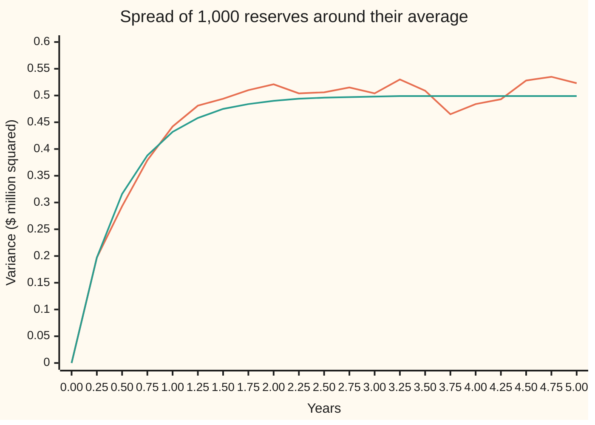
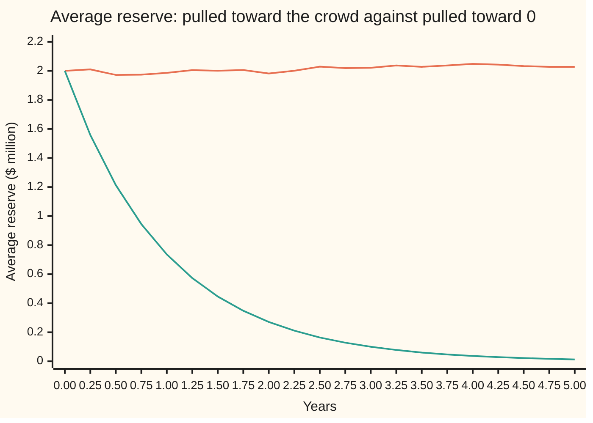

# McKean-Vlasov equations in outline: particles that feel the crowd's average

[Syllabus](../../../SYLLABUS.md) → [Stochastic processes and calculus](../README.md) → [Beyond Brownian](../README.md#s09) → McKean-Vlasov equations in outline

---

## General Overview

Picture 1,000 banks. Each holds a cash reserve above its required minimum, and each starts at $2 million. Every day, payments in and out push each reserve up or down at random, by about $1 million over a year.

The banks also lend to each other overnight. A bank above the average reserve lends; a bank below it borrows. So each reserve is pulled toward the crowd's average. In the model on this card the pull closes the gap at rate 1 per year.

That pull is odd. A bank's drift depends on the average of all 1,000 reserves, and that average includes the bank itself. With many banks, the average stops depending on any one of them. It becomes a fixed number: the mean of the probability distribution of a typical bank. The single bank then follows a stochastic differential equation (SDE: a rule for a random path, written as a steady push plus random noise). Its drift, the steady push, contains the distribution of its own solution.

Such an equation is a **McKean-Vlasov equation**. The step from 1,000 interacting banks to one bank facing a known crowd is a **mean-field limit**. For the banks, the numbers come out exactly:

- The crowd's average wanders like a Brownian motion with variance t/1,000: after one year its spread is only 0.031623, in millions of dollars.
- Each bank's spread around the average settles to variance (1 − 1/1,000)/2 = 0.4995, close to the limit 1/2.
- Lending cuts one bank's chance of sitting below its minimum one year from now from 0.022750 to 0.001184.

**A McKean-Vlasov equation is an SDE whose drift depends on the probability law of its own solution; it is the limit of N particles that each feel the crowd's average, and as N grows those particles become independent copies of it, which is called propagation of chaos.**

**What kind of fact this is:** the equation is a definition. The bank example, its exact Gaussian solution and its 1/N gaps are proved on this card in Why it works. Propagation of chaos in general is a theorem, outlined here and proved in Sznitman's lecture notes (Sources). Using it for banks is a model.

### The picture: one simulated crowd of 1,000 banks



Orange: the variance of the 1,000 simulated reserves around their own average, read every quarter year. Green: the formula (1 − 1/N) v(t), which climbs to 0.4995. The simulated crowd tracks the formula within its sampling noise of about 0.02.

---

## The formula

Notation first, in words. Bank i's reserve at time t, in millions of dollars above its minimum, is $`X^i_t`$; there are N banks, labelled i = 1 to N. Each bank has its own Brownian motion $`W^i_t`$ ([Brownian motion](../05-Brownian%20Motion/01-brownian-motion.md)), independent of the others. As on [Mean reversion](../06-Ito%20Calculus/05-ornstein-uhlenbeck-and-cir-processes.md), $`dW^i_t`$ is shorthand for an Ito integral, never a derivative. The **law** of a random quantity is its whole probability distribution: every probability it can be asked about.

The N-bank system, called the **particle system**:

```math
dX^i_t = -\kappa\,\big(X^i_t - m^N_t\big)\,dt + \sigma\,dW^i_t, \qquad m^N_t = \frac{1}{N}\sum_{j=1}^{N} X^j_t .
```

**Read it aloud:** each bank's reserve moves toward the crowd's average at rate kappa, plus its own random shove of size sigma.

Let N grow. The average $`m^N_t`$ becomes the mean $`E[X_t]`$ of one typical bank. The limit is the **McKean-Vlasov equation**:

```math
dX_t = -\kappa\,\big(X_t - E[X_t]\big)\,dt + \sigma\,dW_t .
```

**Read it aloud:** one bank moves toward the mean of its own distribution, plus a random shove.

The general form lets both the drift and the noise read the law $`\mu_t`$ of $`X_t`$:

```math
dX_t = b(X_t, \mu_t)\,dt + \sigma(X_t, \mu_t)\,dW_t, \qquad \mu_t = \text{the law of } X_t .
```

The banks are the case $`b(x, \mu) = -\kappa\,(x - \text{the mean of } \mu)`$ with constant noise. That case solves exactly. Every bank starts at $`x_0`$:

```math
E[X_t] = x_0, \qquad \mathrm{Var}(X_t) = v(t) = \frac{\sigma^2}{2\kappa}\big(1 - e^{-2\kappa t}\big).
```

The finite crowd differs from the limit by amounts of size 1/N:

```math
\mathrm{Var}(m^N_t) = \frac{\sigma^2 t}{N}, \qquad \mathrm{Var}(X^i_t - m^N_t) = \Big(1 - \frac1N\Big)v(t), \qquad E\big[(X^i_t - \bar X^i_t)^2\big] = \frac{\sigma^2}{N}\int_0^t \big(1 - e^{-\kappa u}\big)^2\,du .
```

**Read it aloud:** the crowd's average spreads like a Brownian motion slowed by N; each bank's spread around it is the limit spread less a share 1/N; and each bank sits within a distance of order one over root N of its limit copy.

Here $`\bar X^i_t`$ is bank i's **limit copy**: the McKean-Vlasov equation driven by bank i's own noise $`W^i_t`$. The last formula is **propagation of chaos** in numbers. "Chaos" is the old physics word for independence: the limit copies are independent, so the banks are nearly independent too.

| Symbol | Plain meaning | In our example | Push it up and the answer… |
| --- | --- | --- | --- |
| $`X^i_t`$, $`i`$, $`j`$, $`N`$ | bank i's reserve, $ million above its minimum; bank labels; number of banks | starts at 2; N = 1,000 | larger N: every 1/N gap shrinks |
| $`m^N_t`$ | the crowd's average reserve | 2 at the start; 1.985743 after a year in the simulation | — |
| $`\kappa`$ | pull rate toward the average, per year ("kappa") | 1 | spread settles faster and lower |
| $`\sigma`$ | noise size, $ million per root year ("sigma") | 1 | every variance grows as its square |
| $`x_0`$ | the common start | 2 | the crowd's mean moves with it |
| $`W^i_t`$, $`dW^i_t`$, $`W_t`$, $`\bar W_t`$ | bank i's Brownian motion; its step; the limit bank's Brownian motion; the average of all N of them | $`\bar W_1`$ has variance 0.001 | — |
| $`X_t`$, $`\mu_t`$, $`E[X_t]`$, $`\mathrm{Var}`$ | the limit bank; its law; its mean; variance | mean 2 forever | — |
| $`b(x, \mu)`$, $`\sigma(x, \mu)`$, $`b(x, y)`$ | a general drift and noise size, read at position x and law μ; Step 5's pull of position y on position x | $`-\kappa(x - 2)`$ and 1; $`-\kappa(x - y)`$ | — |
| $`v(t)`$ | the limit variance | 0.432332 at one year; 0.5 in the long run | — |
| $`Y^i_t`$, $`\bar X^i_t`$, $`D_t`$ | bank i's gap from the average; its limit copy; the gap $`X^i_t - \bar X^i_t`$ | rms of $`D_1`$ 0.012965 | — |
| $`p(t, x)`$, $`m^{(k)}(t)`$, $`k`$ | the limit density; the k-th guessed mean path in Step 3 | $`m^{(1)}(1)`$ = 0.735759 | — |
| $`t`$, $`u`$, $`s`$, $`y`$, $`h`$, $`C_T`$ | time in years; times inside integrals; a position inside an integral; simulation step; Step 5's constant | horizon 1 year; h = 0.01 | — |

### When it holds

- **A fixed horizon.** The gap to the limit grows like t/N, because the crowd's average keeps wandering. After 1,000 years a crowd of 1,000 has an average with spread 1.000000, as large as one bank's own noise.
- **Weak, even-handed interaction.** Each bank weighs every other by 1/N. A giant bank with a fixed share of the average keeps its own noise in the average for every N, and the average never becomes a fixed number.
- **No shared shock.** If one shock hits every bank, called **common noise**, the average stays random as N grows. The limit then has a random law, a harder equation.
- **Coefficients that change gently.** The general theorem needs b and σ to change at most in proportion to a change in position or in the law (a **Lipschitz** condition). Without it, the limit equation can have no solution or several.
- **Independent starts.** Banks that start independent, or at the same fixed point as here, become independent. Banks whose starting reserves are correlated stay correlated.

---

## Why it works

### Step 0: the crowd's average stops being random

Each bank feels the others only through one number, their average. An average of many nearly independent quantities settles to its mean ([Law of large numbers](../../09-Probability%20and%20statistics/06-Limit%20Theorems%20in%20Practice/01-law-of-large-numbers.md)). So in a large crowd, the average becomes a known function of time. Each bank then follows an ordinary SDE with that known input, driven by its own noise. Different banks use different noises, so they are independent. The only task left is self-consistency: the known input must equal the mean of the bank it drives.

### Step 1: the pulls cancel, so the average is a slowed Brownian motion

Add the N equations and divide by N. The pulls $`-\kappa(X^i_t - m^N_t)`$ sum to zero, because the reserves sum to N times their average. What remains is the averaged noise:

```math
m^N_t = x_0 + \sigma\,\bar W_t, \qquad \bar W_t = \frac{1}{N}\sum_{j=1}^{N} W^j_t .
```

An average of N independent Brownian motions is a Brownian motion with variance t/N ([Several Brownian motions](../06-Ito%20Calculus/06-multidimensional-ito-and-correlation.md)). After a year the crowd's average has variance 0.001000 and spread 0.031623. Lending moves cash between banks; it never adds cash to the system.

### Step 2: each bank's gap from the average is mean-reverting

Write $`Y^i_t = X^i_t - m^N_t`$ for bank i's gap from the average. Subtracting Step 1 from bank i's equation gives

```math
dY^i_t = -\kappa\,Y^i_t\,dt + \sigma\,\big(dW^i_t - d\bar W_t\big).
```

This is the Ornstein-Uhlenbeck equation with long-run level 0. Its noise has variance $`\sigma^2(1 - 1/N)`$ per year, slightly below $`\sigma^2`$, because bank i is part of the average it chases. The variance formula from [Mean reversion](../06-Ito%20Calculus/05-ornstein-uhlenbeck-and-cir-processes.md) then gives $`(1 - 1/N)\,v(t)`$: 0.431900 after a year, 0.499500 in the long run.

<details>
<summary>Detailed step: the noise of the gap, and the covariance of two banks</summary>

Split the noise: $`dW^i_t - d\bar W_t = (1 - 1/N)\,dW^i_t - (1/N)\sum_{j \ne i} dW^j_t`$. The pieces are independent, so the variances add:

$`\displaystyle (1 - 1/N)^2 + (N-1)/N^2 = (1 - 1/N)\big((1 - 1/N) + 1/N\big) = 1 - 1/N .`$

For two banks i and j, the gaps $`Y^1_t, \dots, Y^N_t`$ always sum to zero. So the variance of their sum is zero, and by symmetry every pair has covariance $`-\mathrm{Var}(Y^i_t)/(N-1) = -v(t)/N`$. The average is independent of the gaps (it uses the sum of the noises, the gaps use the differences), so

$`\displaystyle \mathrm{Cov}(X^i_t, X^j_t) = \mathrm{Var}(m^N_t) + \mathrm{Cov}(Y^i_t, Y^j_t) = \frac{\sigma^2 t - v(t)}{N} .`$

At one year that is (1 − 0.432332)/1,000 = 0.000568. One bank's variance is 0.431900 + 0.001000 = 0.432900, so two banks have correlation 0.001311.

</details>

### Step 3: the limit equation, solved by self-consistency

Take the mean of both sides of the McKean-Vlasov equation. The drift's mean is $`-\kappa(E[X_t] - E[X_t]) = 0`$, so $`E[X_t]`$ never moves: it stays at $`x_0`$ = 2. With the mean known, the equation is the Ornstein-Uhlenbeck equation with long-run level 2, so $`X_t`$ is normal with variance v(t): 0.432332 after a year.

The same answer comes from treating the law as an unknown to be found, which is how general McKean-Vlasov equations are solved. Guess a mean path $`m^{(k)}(t)`$. Solve the ordinary equation that pulls toward the guess. Read off its mean; call that the next guess. This loop is called **Picard iteration**. The mean of the pulled equation obeys $`dE/dt = -\kappa(E - m^{(k)}(t))`$, so

```math
m^{(k+1)}(t) = x_0\,e^{-\kappa t} + \int_0^t \kappa\,e^{-\kappa(t-s)}\,m^{(k)}(s)\,ds .
```

Start from the guess 0, a fixed target at the minimum. Each round adds one term of the exponential series: $`m^{(k)}(t) = x_0 e^{-t}\big(1 + t + \dots + t^{k-1}/(k-1)!\big)`$ with κ = 1. At one year:

| Round k | 1 | 2 | 3 | 4 | 5 | 6 |
| --- | ---: | ---: | ---: | ---: | ---: | ---: |
| guessed mean at 1 year | 0.735759 | 1.471518 | 1.839397 | 1.962024 | 1.992680 | 1.998812 |

The rounds climb to 2, the fixed point: the only mean path that reproduces itself.

The density of the limit bank obeys a **nonlinear Fokker-Planck equation**: the forward equation of [Fokker-Planck](../08-Generators%2C%20Densities%20and%20Simulation/03-fokker-planck-forward-equation.md), with the density's own mean inside the drift.

```math
\frac{\partial p}{\partial t}(t, x) = \frac{\partial}{\partial x}\Big[\kappa\Big(x - \int y\,p(t, y)\,dy\Big)\,p(t, x)\Big] + \frac{\sigma^2}{2}\,\frac{\partial^2 p}{\partial x^2}(t, x).
```

It is nonlinear because p appears inside the integral as well as outside. The normal density with mean 2 and variance v(t) solves it: its own mean is 2, and with 2 in place the equation is the Ornstein-Uhlenbeck forward equation.

The chart below shows why the fixed point matters. One simulated crowd keeps its average near 2. A pull toward the fixed target 0, which is round 1 above, would drain it.



Orange: the simulated crowd's average, which wanders within a few hundredths of 2. Green: $`2e^{-t}`$, the mean if every bank were pulled toward 0 instead of toward the crowd.

### Step 4: propagation of chaos, by coupling

To compare bank i with the limit, build its limit copy $`\bar X^i_t`$ from the same start and the same noise $`W^i_t`$, but pulled toward the limit mean 2. This trick, running two processes on the same noise, is called **coupling**. The noise cancels in the gap $`D_t = X^i_t - \bar X^i_t`$:

```math
dD_t = -\kappa\,D_t\,dt + \kappa\,\big(m^N_t - x_0\big)\,dt .
```

So the gap is driven only by the crowd's wandering average, which Step 1 sized at variance t/N. Solving gives the gap formula in The formula: after a year its mean square is 0.168091/N, so 0.000168 for 1,000 banks, and its typical size is 0.012965.

The limit copies are independent, since each uses its own noise. Each bank sits within about 0.013 of its copy, so any fixed group of banks behaves almost like independent copies of the limit. That is propagation of chaos: independence at the start propagates to every later time, up to gaps of order one over root N.

<details>
<summary>Detailed proof: the gap's mean square</summary>

The gap starts at 0 and solves a linear equation, so

$`\displaystyle D_t = \kappa\int_0^t e^{-\kappa(t-s)}\big(m^N_s - x_0\big)\,ds = \kappa\sigma\int_0^t e^{-\kappa(t-s)}\,\bar W_s\,ds .`$

Write $`\bar W_s = \int_0^s d\bar W_u`$ and swap the order of the two integrals. The inner integral over s from u to t of $`\kappa e^{-\kappa(t-s)}`$ is $`1 - e^{-\kappa(t-u)}`$, so

$`\displaystyle D_t = \sigma\int_0^t \big(1 - e^{-\kappa(t-u)}\big)\,d\bar W_u .`$

$`\bar W`$ is a Brownian motion with variance 1/N per unit time. The Ito isometry ([The Ito integral](../06-Ito%20Calculus/01-ito-integral.md)) turns the mean square of the integral into the integral of the square:

$`\displaystyle E[D_t^2] = \frac{\sigma^2}{N}\int_0^t \big(1 - e^{-\kappa u}\big)^2\,du = \frac{\sigma^2}{N}\Big(t - \frac{2(1 - e^{-\kappa t})}{\kappa} + \frac{1 - e^{-2\kappa t}}{2\kappa}\Big).`$

At t = 1 and κ = σ = 1: 1 − 2(1 − 0.367879) + 0.432332 = 0.168091.

</details>

### Step 5: the general theorem, in outline

The coupling works far beyond the Gaussian case. Take a drift that is an average over the crowd, $`b(x, \mu) = \int b(x, y)\,\mu(dy)`$, of a Lipschitz function b(x, y) of a particle's position x and another particle's position y, with constant noise. The banks are the case $`b(x, y) = -\kappa\,(x - y)`$. With independent starts of finite mean square and a fixed horizon T, the coupling gives a constant $`C_T`$ with

```math
E\Big[\sup_{t \le T}\big|X^i_t - \bar X^i_t\big|^2\Big] \le \frac{C_T}{N}.
```

**Read it aloud:** over the whole horizon, each particle stays within a mean-square distance of order 1/N of its independent limit copy.

The proof has the shape of Step 4. Subtract the two equations. The gap's growth is bounded by a constant times the gap itself, plus the distance between the crowd's empirical law and the true law. Gronwall's lemma turns "growth bounded by the size" into an exponential bound. The law of large numbers makes the empirical law of N independent copies close to the true law, at mean-square distance of order 1/N for the averages the drift reads. The bank example gives the end-of-year gap exactly: its mean square is 0.168091/N at T = 1. The largest gap over the year is only slightly bigger in mean square, so here $`C_T`$ is a little above 0.168091.

Sznitman's 1991 lecture notes give this coupling proof when b is also bounded, and bound the gap's average size by a constant over root N. The banks' pull is not bounded, but the same argument, run on the mean square, covers it.

McKean introduced these equations in 1966 to give nonlinear heat-type equations a probability meaning, using exactly this picture of many interacting particles.

---

## Worked numbers, by hand

One thousand banks, κ = 1 per year, σ = $1 million per root year, every bank starting at $2 million, read after one year.

| Step | Arithmetic | Value |
| --- | --- | --- |
| decay factors | e to the −1, e to the −2 | 0.367879, 0.135335 |
| limit variance v(1) | (1 − 0.135335) / 2 | 0.432332 |
| spread around the average | 0.432332 × (1 − 1/1,000) | 0.431900 |
| crowd average's variance, and spread | 1/1,000, and its square root | 0.001000, 0.031623 |
| one bank's variance | 0.431900 + 0.001000 | 0.432900 |
| gap to the limit copy, mean square | (1 − 2 × (1 − 0.367879) + 0.432332) / 1,000 | 0.000168 |
| gap, typical size | square root of 0.168091/1,000 | **0.012965** |
| covariance of two banks | (1 − 0.432332) / 1,000 | 0.000568 |
| their correlation | 0.000568 / 0.432900 | **0.001311** |
| chance a bank is below 0: alone, with lending | normal tail beyond 2 / √1 and 2 / √0.432900 | 0.022750, **0.001184** |

After a year each bank is typically 0.012965 million dollars from the bank it would be in an infinite crowd, and two banks are correlated at 0.001311: for practical purposes, independent copies of one equation.

### What breaks if you drop a piece

| Mistake | Comes out at | What went wrong |
| --- | --- | --- |
| Pull toward a fixed target 0, not the crowd | mean after a year 0.735759; the simulated crowd sits at 1.985743 | The target is the crowd's own mean, which the pulls never move |
| Treat the limit as exact for all time | crowd average's spread after 1,000 years 1.000000, not 0 | The gap grows like t/N; the limit holds on a fixed horizon |
| Call 10 banks a crowd | average's variance 0.1 after a year (simulated 0.098486), 100 times the 1,000-bank value | Every finite-crowd effect is of size 1/N |
| Ignore the lending | chance below 0 at one year 0.022750 instead of 0.001184 | Each bank's variance is 1 instead of 0.432900 |

---

## Code, from first principles, and it actually runs

The script works the bank example and takes four roads to its numbers. Random numbers come from SplitMix64, a short standard pseudo-random generator, with seed 20261123. The Box-Muller formula turns pairs of its uniform numbers into normal ones.

- **Closed forms:** the variances, the gap and the covariance from The formula.
- **Moment recursions:** the exact means and variances of the [Euler-Maruyama](../08-Generators%2C%20Densities%20and%20Simulation/04-euler-maruyama-scheme.md) scheme, stepped forward one step at a time. With a step of 0.0001 year they must match the closed forms to 0.1%. With the simulation's own step they give the exact target for each simulated number, free of the scheme's small step-size bias.
- **Quadrature and self-consistency:** Simpson's rule for the gap's integral, and the Picard rounds of Step 3 computed on a grid against their exponential-series closed form.
- **Simulation:** one crowd of 1,000 banks over 5 years with step 0.01 year, then 10,000 crowds of 10 banks and 2,000 crowds of 100 banks over one year with step 0.02, each bank run beside its limit copy on the same noise.

Each simulated number carries its standard error, and each assert allows four. The simulated 1/N effects are printed times N, so they should sit near the same value for 10 banks and 100.

### Python

```python
# McKean-Vlasov in outline: banks pulled toward the crowd's mean reserve.
# Bank i: dX^i = -K (X^i - crowd mean) dt + S dW^i from X0; limit dX = -K (X - E[X_t]) dt + S dW.
# Roads: closed forms; moment recursions of the Euler scheme; Simpson quadrature;
# Picard iteration on the mean; seeded particle simulation (SplitMix64, Box-Muller).
import math

K, S, X0, N, T = 1.0, 1.0, 2.0, 1000, 1.0
M64 = (1 << 64) - 1

class Rng:
    def __init__(self, seed):
        self.s, self.spare = seed, None
    def u(self):
        self.s = (self.s + 0x9E3779B97F4A7C15) & M64
        z = self.s
        z = ((z ^ (z >> 30)) * 0xBF58476D1CE4E5B9) & M64
        z = ((z ^ (z >> 27)) * 0x94D049BB133111EB) & M64
        return ((z ^ (z >> 31)) >> 11) / 9007199254740992.0
    def normal(self):
        if self.spare is not None:
            z, self.spare = self.spare, None
            return z
        u1, u2 = 1.0 - self.u(), self.u()
        r = math.sqrt(-2.0 * math.log(u1))
        self.spare = r * math.sin(2.0 * math.pi * u2)
        return r * math.cos(2.0 * math.pi * u2)

def v_lim(t): return S * S / (2 * K) * (1 - math.exp(-2 * K * t))
def gap2(t, n): return S * S / n * (t - 2 * (1 - math.exp(-K * t)) / K + v_lim(t) / (S * S))
def cov2(t, n): return S * S / n * (t - v_lim(t) / (S * S))

def scheme(n, h, steps):  # exact moments of the Euler scheme: spread, mean, gap, pair covariance
    r = 1 - K * h
    v = q = a = c = 0.0
    for _ in range(steps):
        a, c = r * r * a + 2 * r * K * h * c + K * h * K * h * q, r * c + K * h * q
        v, q = r * r * v + S * S * h * (1 - 1 / n), q + S * S * h / n
    return v, q, a, q - v / (n - 1)

def simpson(f, a, b, m):
    s = f(a) + f(b)
    for j in range(1, m):
        s += (4 if j % 2 else 2) * f(a + j * (b - a) / m)
    return s * (b - a) / m / 3

def phi(x):  # chance a standard normal falls below x
    half = simpson(lambda y: math.exp(-y * y / 2) / math.sqrt(2 * math.pi), 0.0, abs(x), 2000)
    return 0.5 + half if x >= 0 else 0.5 - half

e1, e2 = math.exp(-1), math.exp(-2)
vl, vd = v_lim(T), (1 - 1 / N) * v_lim(T)
g, cv, vb = gap2(T, N), cov2(T, N), (1 - 1 / N) * v_lim(T) + S * S * T / N
p_lend, p_alone = phi(-X0 / math.sqrt(vb)), phi(-X0 / (S * math.sqrt(T)))
print(f"K = {K} per year, S = {S} $M per root year, X0 = {X0} $M, N = {N} banks, t = {T} year")
print(f"hand: e^-1 {e1:.6f}, e^-2 {e2:.6f}, 1 - 2(1 - e^-1) + v(1) = {g * N:.6f}")
print(f"limit variance v(1)              {vl:.6f}   stationary {S * S / (2 * K):.6f}")
print(f"spread around crowd mean, N={N} {vd:.6f}   stationary {(1 - 1 / N) * S * S / (2 * K):.6f}")
print(f"crowd mean variance t/N          {S * S * T / N:.6f}   sd {math.sqrt(S * S * T / N):.6f}")
print(f"gap to limit, mean square        {g:.6f}   x N {g * N:.6f}   rms {math.sqrt(g):.6f}")
print(f"covariance of two banks          {cv:.6f}   x N {cv * N:.6f}")
print(f"variance of one bank             {vb:.6f}   correlation {cv / vb:.6f}")
print(f"chance a bank is below 0         with lending {p_lend:.6f}   alone {p_alone:.6f}")
assert abs(p_alone - 0.0227501319) < 1e-8  # published value of the normal tail at 2
print(f"pull to fixed target 0: mean {X0 * e1:.6f}; crowd mean after 1000 years sd {math.sqrt(1000 / N):.6f}")
# road 2: moments of the Euler scheme with a fine step, against the closed forms
v, q, a, c = scheme(N, 1e-4, 10000)
print(f"recursion, step 1e-4: spread {v:.6f} mean var {q:.6f} gap {a * N:.6f}/N cov {c * N:.6f}/N")
for got, want in ((v, vd), (q, S * S * T / N), (a, g), (c, cv)):
    assert abs(got - want) < 1e-3 * abs(want)
simp = S * S * simpson(lambda u: (1 - math.exp(-K * u)) * (1 - math.exp(-K * u)), 0.0, 1.0, 1000)
print(f"Simpson, integral of (1 - e^-u)^2 over [0, 1]: {simp:.6f}")
assert abs(simp - g * N) < 1e-9
# road 3: Picard iteration on the mean path; closed form X0 e^-t (1 + t + ... + t^(k-1)/(k-1)!)
steps, h = 1000, 1e-3
m_path, decay = [0.0] * (steps + 1), math.exp(-K * h)
for k in range(1, 7):
    new, conv = [X0], 0.0
    for j in range(steps):
        conv = decay * conv + K * h / 2 * (decay * m_path[j] + m_path[j + 1])
        new.append(X0 * math.exp(-K * (j + 1) * h) + conv)
    m_path = new
    closed, term = 0.0, 1.0
    for j in range(k): closed, term = closed + term, term / (j + 1)
    closed = X0 * e1 * closed
    print(f"Picard round {k}: mean at 1 year {m_path[-1]:.6f}   closed form {closed:.6f}")
    assert abs(m_path[-1] - closed) < 1e-6
assert abs(m_path[-1] - X0) < 0.002
def simulate(n, reps, h, steps, every):  # road 4: Euler-Maruyama simulation
    sm = sd = sc = 0.0
    trace, sh = [], S * math.sqrt(h)
    for _ in range(reps):
        x, xb = [X0] * n, [X0] * n
        for k in range(steps + 1):
            tot = 0.0
            for xi in x: tot += xi
            m = tot / n
            if every and k % every == 0:
                ss = 0.0
                for xi in x: ss += (xi - m) * (xi - m)
                trace.append((k * h, m, ss / n))
            if k == steps:
                break
            for i in range(n):
                dw = sh * rng.normal()
                x[i] += -K * (x[i] - m) * h + dw
                xb[i] += -K * (xb[i] - X0) * h + dw
        s1 = s2 = 0.0
        for xi in x:
            s1 += xi - X0
            s2 += (xi - X0) * (xi - X0)
        sm += (m - X0) * (m - X0) / reps
        sd += (x[0] - xb[0]) * (x[0] - xb[0]) / reps
        sc += (s1 * s1 - s2) / (n * (n - 1)) / reps
    return sm, sd, sc, trace

rng = Rng(20261123)
print(f"-- simulation: one crowd of {N}, step 0.01 year, 5 years --")
_, _, _, tr = simulate(N, 1, 0.01, 500, 25)
for t_mark in (1.0, 5.0):
    t, m, sp = tr[int(t_mark * 4)]
    want = scheme(N, 0.01, int(t_mark * 100))[0]
    se = want * math.sqrt(2 / N)
    print(f"t = {t:.0f}: spread sim {sp:.6f} +- {se:.6f}  scheme {want:.6f}  crowd mean {m:.6f}")
    assert abs(sp - want) < 4 * se and abs(m - X0) < 4 * math.sqrt(t / N)
print("chart, t      " + " ".join(f"{t:.2f}" for t, _, _ in tr))
print("chart, spread " + " ".join(f"{sp:.3f}" for _, _, sp in tr))
print("chart, v(t)   " + " ".join(f"{(1 - 1 / N) * v_lim(t):.3f}" for t, _, _ in tr))
print("chart, mean   " + " ".join(f"{m:.3f}" for _, m, _ in tr))
print("chart, 2e^-t  " + " ".join(f"{X0 * math.exp(-K * t):.3f}" for t, _, _ in tr))
print("-- simulation: many small crowds, step 0.02 year, to 1 year --")
for n, reps in ((10, 10000), (100, 2000)):
    sm, sd, sc, _ = simulate(n, reps, 0.02, 50, 0)
    v, q, a, c = scheme(n, 0.02, 50)
    print(f"N = {n}, {reps} crowds: mean var sim {sm:.6f} scheme {q:.6f} formula {T / n:.6f}")
    print(f"  gap x N  sim {sd * n:.4f} +- {a * n * math.sqrt(2 / reps):.4f}  scheme {a * n:.4f}  formula {gap2(T, n) * n:.4f}")
    print(f"  cov x N  sim {sc * n:.4f} +- {q * n * math.sqrt(2 / reps):.4f}  scheme {c * n:.4f}  formula {cov2(T, n) * n:.4f}")
    assert abs(sm - q) < 4 * q * math.sqrt(2 / reps)
    assert abs(sd - a) < 4 * a * math.sqrt(2 / reps)
    assert abs(sc - c) < 4 * math.sqrt(2.0 / reps) * q
print("ALL CHECKS PASS")
```

**Ran 2026-11-23 on macOS, Python 3.14.10, standard library only. All checks passed. Output, pasted from the run:**

```
K = 1.0 per year, S = 1.0 $M per root year, X0 = 2.0 $M, N = 1000 banks, t = 1.0 year
hand: e^-1 0.367879, e^-2 0.135335, 1 - 2(1 - e^-1) + v(1) = 0.168091
limit variance v(1)              0.432332   stationary 0.500000
spread around crowd mean, N=1000 0.431900   stationary 0.499500
crowd mean variance t/N          0.001000   sd 0.031623
gap to limit, mean square        0.000168   x N 0.168091   rms 0.012965
covariance of two banks          0.000568   x N 0.567668
variance of one bank             0.432900   correlation 0.001311
chance a bank is below 0         with lending 0.001184   alone 0.022750
pull to fixed target 0: mean 0.735759; crowd mean after 1000 years sd 1.000000
recursion, step 1e-4: spread 0.431928 mean var 0.001000 gap 0.168083/N cov 0.567639/N
Simpson, integral of (1 - e^-u)^2 over [0, 1]: 0.168091
Picard round 1: mean at 1 year 0.735759   closed form 0.735759
Picard round 2: mean at 1 year 1.471518   closed form 1.471518
Picard round 3: mean at 1 year 1.839397   closed form 1.839397
Picard round 4: mean at 1 year 1.962024   closed form 1.962024
Picard round 5: mean at 1 year 1.992680   closed form 1.992680
Picard round 6: mean at 1 year 1.998812   closed form 1.998812
-- simulation: one crowd of 1000, step 0.01 year, 5 years --
t = 1: spread sim 0.442238 +- 0.019443  scheme 0.434751  crowd mean 1.985743
t = 5: spread sim 0.523117 +- 0.022450  scheme 0.501988  crowd mean 2.028109
chart, t      0.00 0.25 0.50 0.75 1.00 1.25 1.50 1.75 2.00 2.25 2.50 2.75 3.00 3.25 3.50 3.75 4.00 4.25 4.50 4.75 5.00
chart, spread 0.000 0.197 0.293 0.379 0.442 0.481 0.494 0.510 0.521 0.504 0.506 0.515 0.504 0.530 0.509 0.465 0.484 0.493 0.528 0.535 0.523
chart, v(t)   0.000 0.197 0.316 0.388 0.432 0.458 0.475 0.484 0.490 0.494 0.496 0.497 0.498 0.499 0.499 0.499 0.499 0.499 0.499 0.499 0.499
chart, mean   2.000 2.010 1.972 1.974 1.986 2.005 2.001 2.006 1.982 2.001 2.029 2.019 2.021 2.037 2.028 2.037 2.048 2.043 2.033 2.028 2.028
chart, 2e^-t  2.000 1.558 1.213 0.945 0.736 0.573 0.446 0.348 0.271 0.211 0.164 0.128 0.100 0.078 0.060 0.047 0.037 0.029 0.022 0.017 0.013
-- simulation: many small crowds, step 0.02 year, to 1 year --
N = 10, 10000 crowds: mean var sim 0.098486 scheme 0.100000 formula 0.100000
  gap x N  sim 0.1647 +- 0.0024  scheme 0.1664  formula 0.1681
  cov x N  sim 0.5458 +- 0.0141  scheme 0.5619  formula 0.5677
N = 100, 2000 crowds: mean var sim 0.010560 scheme 0.010000 formula 0.010000
  gap x N  sim 0.1753 +- 0.0053  scheme 0.1664  formula 0.1681
  cov x N  sim 0.6192 +- 0.0316  scheme 0.5619  formula 0.5677
ALL CHECKS PASS
```

### Rust

Same numbers, same labels, built with `rustc --edition 2021 -O`.

```rust
// McKean-Vlasov in outline: banks pulled toward the crowd's mean reserve.
// Bank i: dX^i = -K (X^i - crowd mean) dt + S dW^i from X0; limit dX = -K (X - E[X_t]) dt + S dW.
// Roads: closed forms; moment recursions of the Euler scheme; Simpson quadrature;
// Picard iteration on the mean; seeded particle simulation (SplitMix64, Box-Muller).
use std::f64::consts::PI;

const K: f64 = 1.0; const S: f64 = 1.0; const X0: f64 = 2.0; const N: usize = 1000; const T: f64 = 1.0;

struct Rng { s: u64, spare: Option<f64> }

impl Rng {
    fn u(&mut self) -> f64 {
        self.s = self.s.wrapping_add(0x9E3779B97F4A7C15);
        let mut z = self.s;
        z = (z ^ (z >> 30)).wrapping_mul(0xBF58476D1CE4E5B9);
        z = (z ^ (z >> 27)).wrapping_mul(0x94D049BB133111EB);
        ((z ^ (z >> 31)) >> 11) as f64 / 9007199254740992.0
    }
    fn normal(&mut self) -> f64 {
        if let Some(z) = self.spare.take() { return z; }
        let (u1, u2) = (1.0 - self.u(), self.u());
        let r = (-2.0 * u1.ln()).sqrt();
        self.spare = Some(r * (2.0 * PI * u2).sin());
        r * (2.0 * PI * u2).cos()
    }
}

fn v_lim(t: f64) -> f64 { S * S / (2.0 * K) * (1.0 - (-2.0 * K * t).exp()) }
fn gap2(t: f64, n: f64) -> f64 { S * S / n * (t - 2.0 * (1.0 - (-K * t).exp()) / K + v_lim(t) / (S * S)) }
fn cov2(t: f64, n: f64) -> f64 { S * S / n * (t - v_lim(t) / (S * S)) }

// exact moments of the Euler scheme: spread, mean, gap, pair covariance
fn scheme(n: f64, h: f64, steps: usize) -> (f64, f64, f64, f64) {
    let r = 1.0 - K * h;
    let (mut v, mut q, mut a, mut c) = (0.0, 0.0, 0.0, 0.0);
    for _ in 0..steps {
        (a, c) = (r * r * a + 2.0 * r * K * h * c + K * h * K * h * q, r * c + K * h * q);
        (v, q) = (r * r * v + S * S * h * (1.0 - 1.0 / n), q + S * S * h / n);
    }
    (v, q, a, q - v / (n - 1.0))
}

fn simpson(f: &dyn Fn(f64) -> f64, a: f64, b: f64, m: usize) -> f64 {
    let mut s = f(a) + f(b);
    for j in 1..m {
        let w = if j % 2 == 1 { 4.0 } else { 2.0 };
        s += w * f(a + j as f64 * (b - a) / m as f64);
    }
    s * (b - a) / m as f64 / 3.0
}

// chance a standard normal falls below x
fn phi(x: f64) -> f64 {
    let half = simpson(&|y: f64| (-y * y / 2.0).exp() / (2.0 * PI).sqrt(), 0.0, x.abs(), 2000);
    if x >= 0.0 { 0.5 + half } else { 0.5 - half }
}

// road 4: Euler-Maruyama simulation
fn simulate(rng: &mut Rng, n: usize, reps: usize, h: f64, steps: usize, every: usize)
    -> (f64, f64, f64, Vec<(f64, f64, f64)>) {
    let (mut sm, mut sd, mut sc) = (0.0, 0.0, 0.0);
    let mut trace = Vec::new();
    let (sh, nf, rf) = (S * h.sqrt(), n as f64, reps as f64);
    for _ in 0..reps {
        let (mut x, mut xb, mut m) = (vec![X0; n], vec![X0; n], 0.0);
        for k in 0..=steps {
            let mut tot = 0.0;
            for xi in &x { tot += xi; }
            m = tot / nf;
            if every > 0 && k % every == 0 {
                let mut ss = 0.0;
                for xi in &x { ss += (xi - m) * (xi - m); }
                trace.push((k as f64 * h, m, ss / nf));
            }
            if k == steps { break; }
            for i in 0..n {
                let dw = sh * rng.normal();
                x[i] += -K * (x[i] - m) * h + dw;
                xb[i] += -K * (xb[i] - X0) * h + dw;
            }
        }
        let (mut s1, mut s2) = (0.0, 0.0);
        for xi in &x { s1 += xi - X0; s2 += (xi - X0) * (xi - X0); }
        sm += (m - X0) * (m - X0) / rf;
        sd += (x[0] - xb[0]) * (x[0] - xb[0]) / rf;
        sc += (s1 * s1 - s2) / (nf * (nf - 1.0)) / rf;
    }
    (sm, sd, sc, trace)
}

fn line(label: &str, v: Vec<f64>, d: usize) {
    let parts: Vec<String> = v.iter().map(|x| format!("{:.*}", d, x)).collect();
    println!("{}{}", label, parts.join(" "));
}

fn main() {
    let nf = N as f64;
    let (e1, e2) = ((-1.0f64).exp(), (-2.0f64).exp());
    let (vl, vd) = (v_lim(T), (1.0 - 1.0 / nf) * v_lim(T));
    let (g, cv, vb) = (gap2(T, nf), cov2(T, nf), (1.0 - 1.0 / nf) * v_lim(T) + S * S * T / nf);
    let (p_lend, p_alone) = (phi(-X0 / vb.sqrt()), phi(-X0 / (S * T.sqrt())));
    println!("K = {:.1} per year, S = {:.1} $M per root year, X0 = {:.1} $M, N = {} banks, t = {:.1} year", K, S, X0, N, T);
    println!("hand: e^-1 {:.6}, e^-2 {:.6}, 1 - 2(1 - e^-1) + v(1) = {:.6}", e1, e2, g * nf);
    println!("limit variance v(1)              {:.6}   stationary {:.6}", vl, S * S / (2.0 * K));
    println!("spread around crowd mean, N={} {:.6}   stationary {:.6}", N, vd, (1.0 - 1.0 / nf) * S * S / (2.0 * K));
    println!("crowd mean variance t/N          {:.6}   sd {:.6}", S * S * T / nf, (S * S * T / nf).sqrt());
    println!("gap to limit, mean square        {:.6}   x N {:.6}   rms {:.6}", g, g * nf, g.sqrt());
    println!("covariance of two banks          {:.6}   x N {:.6}", cv, cv * nf);
    println!("variance of one bank             {:.6}   correlation {:.6}", vb, cv / vb);
    println!("chance a bank is below 0         with lending {:.6}   alone {:.6}", p_lend, p_alone);
    assert!((p_alone - 0.0227501319).abs() < 1e-8); // published value of the normal tail at 2
    println!("pull to fixed target 0: mean {:.6}; crowd mean after 1000 years sd {:.6}", X0 * e1, (1000.0 / nf).sqrt());
    // road 2: moments of the Euler scheme with a fine step, against the closed forms
    let (v, q, a, c) = scheme(nf, 1e-4, 10000);
    println!("recursion, step 1e-4: spread {:.6} mean var {:.6} gap {:.6}/N cov {:.6}/N", v, q, a * nf, c * nf);
    for (got, want) in [(v, vd), (q, S * S * T / nf), (a, g), (c, cv)] { assert!((got - want).abs() < 1e-3 * want.abs()); }
    let simp = S * S * simpson(&|u: f64| (1.0 - (-K * u).exp()) * (1.0 - (-K * u).exp()), 0.0, 1.0, 1000);
    println!("Simpson, integral of (1 - e^-u)^2 over [0, 1]: {:.6}", simp);
    assert!((simp - g * nf).abs() < 1e-9);
    // road 3: Picard iteration on the mean path; closed form X0 e^-t (1 + t + ... + t^(k-1)/(k-1)!)
    let (steps, h) = (1000usize, 1e-3);
    let (decay, mut m_path) = ((-K * h).exp(), vec![0.0; steps + 1]);
    for k in 1..7 {
        let (mut new, mut conv) = (vec![X0], 0.0);
        for j in 0..steps {
            conv = decay * conv + K * h / 2.0 * (decay * m_path[j] + m_path[j + 1]);
            new.push(X0 * (-K * (j + 1) as f64 * h).exp() + conv);
        }
        m_path = new;
        let (mut closed, mut term) = (0.0, 1.0);
        for j in 0..k { closed += term; term /= (j + 1) as f64; }
        closed = X0 * e1 * closed;
        println!("Picard round {}: mean at 1 year {:.6}   closed form {:.6}", k, m_path[steps], closed);
        assert!((m_path[steps] - closed).abs() < 1e-6);
    }
    assert!((m_path[steps] - X0).abs() < 0.002);
    let mut rng = Rng { s: 20261123, spare: None };
    println!("-- simulation: one crowd of {}, step 0.01 year, 5 years --", N);
    let (_, _, _, tr) = simulate(&mut rng, N, 1, 0.01, 500, 25);
    for t_mark in [1.0f64, 5.0] {
        let (t, m, sp) = tr[(t_mark * 4.0) as usize];
        let want = scheme(nf, 0.01, (t_mark * 100.0) as usize).0;
        let se = want * (2.0 / nf).sqrt();
        println!("t = {:.0}: spread sim {:.6} +- {:.6}  scheme {:.6}  crowd mean {:.6}", t, sp, se, want, m);
        assert!((sp - want).abs() < 4.0 * se && (m - X0).abs() < 4.0 * (t / nf).sqrt());
    }
    line("chart, t      ", tr.iter().map(|p| p.0).collect(), 2);
    line("chart, spread ", tr.iter().map(|p| p.2).collect(), 3);
    line("chart, v(t)   ", tr.iter().map(|p| (1.0 - 1.0 / nf) * v_lim(p.0)).collect(), 3);
    line("chart, mean   ", tr.iter().map(|p| p.1).collect(), 3);
    line("chart, 2e^-t  ", tr.iter().map(|p| X0 * (-K * p.0).exp()).collect(), 3);
    println!("-- simulation: many small crowds, step 0.02 year, to 1 year --");
    for (n, reps) in [(10usize, 10000usize), (100, 2000)] {
        let (sm, sd, sc, _) = simulate(&mut rng, n, reps, 0.02, 50, 0);
        let (nn, rr) = (n as f64, reps as f64);
        let (_, q, a, c) = scheme(nn, 0.02, 50);
        println!("N = {}, {} crowds: mean var sim {:.6} scheme {:.6} formula {:.6}", n, reps, sm, q, T / nn);
        println!("  gap x N  sim {:.4} +- {:.4}  scheme {:.4}  formula {:.4}", sd * nn, a * nn * (2.0 / rr).sqrt(), a * nn, gap2(T, nn) * nn);
        println!("  cov x N  sim {:.4} +- {:.4}  scheme {:.4}  formula {:.4}", sc * nn, q * nn * (2.0 / rr).sqrt(), c * nn, cov2(T, nn) * nn);
        assert!((sm - q).abs() < 4.0 * q * (2.0 / rr).sqrt());
        assert!((sd - a).abs() < 4.0 * a * (2.0 / rr).sqrt());
        assert!((sc - c).abs() < 4.0 * (2.0 / rr).sqrt() * q);
    }
    println!("ALL CHECKS PASS");
}
```

**Ran 2026-11-23 on macOS, rustc 1.98.1, no crates. All checks passed. Output, pasted from the run:**

```
K = 1.0 per year, S = 1.0 $M per root year, X0 = 2.0 $M, N = 1000 banks, t = 1.0 year
hand: e^-1 0.367879, e^-2 0.135335, 1 - 2(1 - e^-1) + v(1) = 0.168091
limit variance v(1)              0.432332   stationary 0.500000
spread around crowd mean, N=1000 0.431900   stationary 0.499500
crowd mean variance t/N          0.001000   sd 0.031623
gap to limit, mean square        0.000168   x N 0.168091   rms 0.012965
covariance of two banks          0.000568   x N 0.567668
variance of one bank             0.432900   correlation 0.001311
chance a bank is below 0         with lending 0.001184   alone 0.022750
pull to fixed target 0: mean 0.735759; crowd mean after 1000 years sd 1.000000
recursion, step 1e-4: spread 0.431928 mean var 0.001000 gap 0.168083/N cov 0.567639/N
Simpson, integral of (1 - e^-u)^2 over [0, 1]: 0.168091
Picard round 1: mean at 1 year 0.735759   closed form 0.735759
Picard round 2: mean at 1 year 1.471518   closed form 1.471518
Picard round 3: mean at 1 year 1.839397   closed form 1.839397
Picard round 4: mean at 1 year 1.962024   closed form 1.962024
Picard round 5: mean at 1 year 1.992680   closed form 1.992680
Picard round 6: mean at 1 year 1.998812   closed form 1.998812
-- simulation: one crowd of 1000, step 0.01 year, 5 years --
t = 1: spread sim 0.442238 +- 0.019443  scheme 0.434751  crowd mean 1.985743
t = 5: spread sim 0.523117 +- 0.022450  scheme 0.501988  crowd mean 2.028109
chart, t      0.00 0.25 0.50 0.75 1.00 1.25 1.50 1.75 2.00 2.25 2.50 2.75 3.00 3.25 3.50 3.75 4.00 4.25 4.50 4.75 5.00
chart, spread 0.000 0.197 0.293 0.379 0.442 0.481 0.494 0.510 0.521 0.504 0.506 0.515 0.504 0.530 0.509 0.465 0.484 0.493 0.528 0.535 0.523
chart, v(t)   0.000 0.197 0.316 0.388 0.432 0.458 0.475 0.484 0.490 0.494 0.496 0.497 0.498 0.499 0.499 0.499 0.499 0.499 0.499 0.499 0.499
chart, mean   2.000 2.010 1.972 1.974 1.986 2.005 2.001 2.006 1.982 2.001 2.029 2.019 2.021 2.037 2.028 2.037 2.048 2.043 2.033 2.028 2.028
chart, 2e^-t  2.000 1.558 1.213 0.945 0.736 0.573 0.446 0.348 0.271 0.211 0.164 0.128 0.100 0.078 0.060 0.047 0.037 0.029 0.022 0.017 0.013
-- simulation: many small crowds, step 0.02 year, to 1 year --
N = 10, 10000 crowds: mean var sim 0.098486 scheme 0.100000 formula 0.100000
  gap x N  sim 0.1647 +- 0.0024  scheme 0.1664  formula 0.1681
  cov x N  sim 0.5458 +- 0.0141  scheme 0.5619  formula 0.5677
N = 100, 2000 crowds: mean var sim 0.010560 scheme 0.010000 formula 0.010000
  gap x N  sim 0.1753 +- 0.0053  scheme 0.1664  formula 0.1681
  cov x N  sim 0.6192 +- 0.0316  scheme 0.5619  formula 0.5677
ALL CHECKS PASS
```

### Lean

Lean proves the exact formulas of the bank example, for every pull rate $`\kappa > 0`$, noise size σ and crowd size N.

- Take any $`\kappa > 0`$, any σ, any N and any time $`t \ge 0`$. Then the integral in the gap's mean square equals its closed form in Step 4.
- Take $`v(t) = \frac{\sigma^2}{2\kappa}\big(1 - e^{-2\kappa t}\big)`$ with $`\kappa > 0`$. Then $`v(0) = 0`$, v has slope $`\sigma^2 - 2\kappa\,v(t)`$, and v(t) tends to $`\sigma^2/(2\kappa)`$.
- Take any $`\kappa > 0`$, any start $`x_0`$, and round k of Step 3 written with κt in place of t. Then one more Picard round gives round k + 1.
- Round 0 is the guess 0, so every round in Step 3's table follows from the last.
- The constant mean path $`x_0`$ reproduces itself under one Picard round.
- For 1,000 banks, the noise of a bank's gap from the average has variance exactly 1 − 1/1,000.
- The long-run spread around the average is (1 − 1/1,000)/2 = 0.4995.
- Ten banks give an average with variance 1/10 after a year, 100 times the 1,000-bank value.
- After 1,000 years, a crowd of 1,000 has an average with variance t/N = 1.

The probability steps that lead to these formulas, the decimals and every simulation are left to the Python and Rust checks.

```lean
-- McKean-Vlasov equations in outline: the exact Gaussian bank example, its 1/N gap integral, the limit variance equation and the Picard rounds toward the self-consistent mean.
import Mathlib.Analysis.SpecialFunctions.Integrals.Basic
import Mathlib.Analysis.SpecialFunctions.ExpDeriv
import Mathlib.Analysis.SpecialFunctions.Exp
import Mathlib.Data.Nat.Factorial.Basic

open Real Filter Topology

lemma hasDerivAt_exp_const_mul (c x : ℝ) :
    HasDerivAt (fun u => Real.exp (c * u)) (Real.exp (c * x) * c) x := by
  have := ((hasDerivAt_id x).const_mul c).exp
  simpa using this

#print axioms hasDerivAt_exp_const_mul

/-- Propagation of chaos in numbers: for banks pulled toward the crowd's average at rate
`κ > 0` with noise size `σ`, the mean square gap between bank `i` and its limit copy after
time `t`, `(σ² / N) ∫₀ᵗ (1 - e^{-κu})² du`, equals
`(σ² / N) (t - 2(1 - e^{-κt})/κ + (1 - e^{-2κt})/(2κ))`. -/
theorem gap_mean_square_eq (κ σ t : ℝ) (N : ℕ) (hκ : 0 < κ) (ht : 0 ≤ t) (hN : 1 ≤ N) :
    σ ^ 2 / N * ∫ u in (0 : ℝ)..t, (1 - Real.exp (-κ * u)) ^ 2
      = σ ^ 2 / N * (t - 2 * (1 - Real.exp (-κ * t)) / κ
          + (1 - Real.exp (-2 * κ * t)) / (2 * κ)) := by
  have hκ0 : κ ≠ 0 := hκ.ne'
  congr 1
  have hF : ∀ x ∈ Set.uIcc (0:ℝ) t, HasDerivAt
      (fun u => u + 2 * Real.exp (-κ * u) / κ - Real.exp (-2 * κ * u) / (2 * κ))
      ((1 - Real.exp (-κ * x)) ^ 2) x := by
    intro x _
    have h1 := hasDerivAt_exp_const_mul (-κ) x
    have h2 := hasDerivAt_exp_const_mul (-2 * κ) x
    have := (((hasDerivAt_id x).add ((h1.const_mul 2).div_const κ)).sub (h2.div_const (2 * κ)))
    refine this.congr_deriv ?_
    have e : Real.exp (-2 * κ * x) = Real.exp (-κ * x) ^ 2 := by
      rw [← Real.exp_nat_mul]; ring_nf
    rw [e]; field_simp; ring
  rw [intervalIntegral.integral_eq_sub_of_hasDerivAt hF
    (by apply Continuous.intervalIntegrable; fun_prop)]
  simp; field_simp; ring

/-- The limit variance `v(t) = σ²/(2κ) (1 - e^{-2κt})` of the McKean-Vlasov bank starts at 0,
solves the Ornstein-Uhlenbeck variance equation `v' = σ² - 2κ v`, and settles to `σ²/(2κ)`. -/
theorem limit_variance_solves_ou_equation (κ σ : ℝ) (hκ : 0 < κ) :
    let v : ℝ → ℝ := fun t => σ ^ 2 / (2 * κ) * (1 - Real.exp (-2 * κ * t))
    v 0 = 0 ∧ (∀ t, HasDerivAt v (σ ^ 2 - 2 * κ * v t) t) ∧
      Tendsto v atTop (𝓝 (σ ^ 2 / (2 * κ))) := by
  intro v
  have hκ0 : κ ≠ 0 := hκ.ne'
  refine ⟨by simp [v], ?_, ?_⟩
  · intro t
    have h := ((hasDerivAt_exp_const_mul (-2 * κ) t).const_sub 1).const_mul (σ ^ 2 / (2 * κ))
    refine h.congr_deriv ?_
    simp only [v]
    field_simp; ring
  · have hlim : Tendsto (fun t : ℝ => Real.exp (-2 * κ * t)) atTop (𝓝 0) := by
      have : Tendsto (fun t : ℝ => -2 * κ * t) atTop atBot :=
        tendsto_id.const_mul_atTop_of_neg (by linarith)
      exact Real.tendsto_exp_atBot.comp this
    have := (hlim.const_sub 1).const_mul (σ ^ 2 / (2 * κ))
    simpa [v] using this

/-- Picard iteration on the mean path, `m⁽ᵏ⁺¹⁾(t) = x₀ e^{-κt} + ∫₀ᵗ κ e^{-κ(t-s)} m⁽ᵏ⁾(s) ds`:
starting from the guess 0, each round adds one term of the exponential series, so round `k` is
`x₀ e^{-κt} (1 + κt + ⋯ + (κt)^{k-1}/(k-1)!)`; and the constant mean path `x₀` reproduces itself. -/
theorem picard_round_adds_series_term (κ x₀ t : ℝ) (k : ℕ) (hκ : 0 < κ) :
    (x₀ * Real.exp (-κ * t) + ∫ s in (0 : ℝ)..t, κ * Real.exp (-κ * (t - s)) *
        (x₀ * Real.exp (-κ * s) * ∑ j ∈ Finset.range k, (κ * s) ^ j / (j.factorial : ℝ))
      = x₀ * Real.exp (-κ * t) * ∑ j ∈ Finset.range (k + 1), (κ * t) ^ j / (j.factorial : ℝ)) ∧
    (x₀ * Real.exp (-κ * t) + ∫ s in (0 : ℝ)..t, κ * Real.exp (-κ * (t - s)) * x₀ = x₀) := by
  have hκ0 : κ ≠ 0 := hκ.ne'
  constructor
  · have hG : ∀ x ∈ Set.uIcc (0:ℝ) t, HasDerivAt
        (fun s => x₀ * Real.exp (-κ * t) *
          ∑ j ∈ Finset.range k, (κ * s) ^ (j + 1) / ((j + 1).factorial : ℝ))
        (κ * Real.exp (-κ * (t - x)) *
          (x₀ * Real.exp (-κ * x) * ∑ j ∈ Finset.range k, (κ * x) ^ j / (j.factorial : ℝ))) x := by
      intro x _
      have hs : HasDerivAt
          (fun s => ∑ j ∈ Finset.range k, (κ * s) ^ (j + 1) / ((j + 1).factorial : ℝ))
          (∑ j ∈ Finset.range k, κ * ((κ * x) ^ j / (j.factorial : ℝ))) x := by
        have := HasDerivAt.sum (u := Finset.range k)
          (A := fun j s => (κ * s) ^ (j + 1) / ((j + 1).factorial : ℝ))
          (A' := fun j => κ * ((κ * x) ^ j / (j.factorial : ℝ))) (x := x) ?_
        · convert this using 1; funext s; simp [Finset.sum_apply]
        intro j _
        have h1 := (((hasDerivAt_id x).const_mul κ).pow (j + 1)).div_const ((j + 1).factorial : ℝ)
        refine h1.congr_deriv ?_
        simp only [id, Nat.factorial_succ, Nat.cast_mul, Nat.cast_succ, Nat.add_sub_cancel,
          mul_one]
        have : (j.factorial : ℝ) ≠ 0 := by positivity
        field_simp
      have := hs.const_mul (x₀ * Real.exp (-κ * t))
      convert this using 1
      rw [← Finset.mul_sum]
      have e : Real.exp (-κ * (t - x)) * Real.exp (-κ * x) = Real.exp (-κ * t) := by
        rw [← Real.exp_add]; ring_nf
      linear_combination (κ * x₀ * ∑ j ∈ Finset.range k, (κ * x) ^ j / (j.factorial : ℝ)) * e
    rw [intervalIntegral.integral_eq_sub_of_hasDerivAt hG
      (by apply Continuous.intervalIntegrable; fun_prop)]
    rw [Finset.sum_range_succ']
    simp
    ring
  · have hH : ∀ x ∈ Set.uIcc (0:ℝ) t, HasDerivAt
        (fun s => x₀ * Real.exp (-κ * (t - s)))
        (κ * Real.exp (-κ * (t - x)) * x₀) x := by
      intro x _
      have := (((hasDerivAt_id x).const_sub t).const_mul (-κ)).exp.const_mul x₀
      refine this.congr_deriv ?_
      simp only [id]; ring
    rw [intervalIntegral.integral_eq_sub_of_hasDerivAt hH
      (by apply Continuous.intervalIntegrable; fun_prop)]
    simp

-- The noise of a bank's gap from the average has variance 1 - 1/N, for N = 1,000.
example : ((1 : ℚ) - 1 / 1000) ^ 2 + (1000 - 1) / 1000 ^ 2 = 1 - 1 / 1000 := by norm_num
-- Long-run spread around the average: (1 - 1/1,000)/2 = 0.4995.
example : ((1 : ℚ) - 1 / 1000) / 2 = 4995 / 10000 := by norm_num
-- Ten banks: the average's variance after a year, 1/10, is 100 times the 1,000-bank value.
example : (1 : ℚ) / 10 = 100 * (1 / 1000) := by norm_num
-- After 1,000 years a crowd of 1,000 has an average with variance t/N = 1.
example : (1000 : ℚ) / 1000 = 1 := by norm_num

#print axioms gap_mean_square_eq
#print axioms limit_variance_solves_ou_equation
#print axioms picard_round_adds_series_term
```

**Checked 2026-11-23 on macOS, Lean 4.36.0-rc2, Mathlib v4.36.0-rc2. Every proof is complete and uses only Lean's standard axioms. Output, pasted from the run:**

```
'hasDerivAt_exp_const_mul' depends on axioms: [propext, Classical.choice, Quot.sound]
'gap_mean_square_eq' depends on axioms: [propext, Classical.choice, Quot.sound]
'limit_variance_solves_ou_equation' depends on axioms: [propext, Classical.choice, Quot.sound]
'picard_round_adds_series_term' depends on axioms: [propext, Classical.choice, Quot.sound]
```

> [!TIP]
> **Try changing**
> Guess first, then run it.
> - **A smaller crowd.** Set N to 100 in the line `K, S, X0, N, T = ...`. Guess: the crowd average's variance after a year rises tenfold, to t/N = 0.01; the gap and covariance times N stay at 0.168091 and 0.567668.
> - **Pull toward the start, not the crowd.** In the simulation, change `(x[i] - m)` to `(x[i] - X0)`. Guess: each bank becomes its own limit copy, the crowd's average is held near 2 so its variance falls below t/N, and the assert on that variance stops the run.
> - **Drop the 1/N share.** In `scheme`, change `(1 - 1 / n)` to `1`. Guess: the recursion's spread rises above the closed form 0.431900 by more than 0.1%, and its assert stops the run.
> - **Another seed.** Change 20261123 to any other number. Guess: simulated numbers move by about their standard errors; the closed forms, the recursion and the Picard rounds stay put.

---

## The usual mistake

> [!warning]
> **Treating the crowd's average as a fixed target.** Ordinary mean reversion pulls toward a level chosen in advance. Here the level is the crowd's own mean, and the pulls cancel when summed, so they never move it. A pull toward 0 predicts a mean of 0.735759 after a year; the crowd stays at 2, and the simulated crowd sits at 1.985743.
>
> - **Taking the limit's constant mean literally for a real crowd.** The average of 1,000 banks still wanders: spread 0.031623 after a year and 1.000000 after 1,000 years.
> - **Calling a finite crowd independent.** Two of 1,000 banks have correlation 0.001311; with 10 banks the shared average has variance 0.1 after a year, 100 times larger.
> - **Forgetting that each bank is part of the average it chases.** The spread around the average is 0.431900, not the limit's 0.432332: a factor 1 − 1/N.
> - **Reading the first Picard round as the answer.** The first guess, a fixed target, gives 0.735759; the law must be iterated to its fixed point, 2.

---

## Where you meet it in real life

- **Interbank lending and systemic risk.** Carmona, Fouque and Sun study exactly this model: lending toward the average. It makes each bank safer, 0.001184 against 0.022750 here, but every bank now rides the same average. When the average falls, they fall together.
- **Plasmas and gases.** Vlasov's equation for a plasma lets each charged particle feel the averaged field of all the others. McKean's equation is its random version, and propagation of chaos is the reason the averaged field is a good model.
- **Calibrating option models.** In [Stochastic-local volatility](../../12-Financial%20mathematics/14-Stochastic%20volatility%20-%20Heston%2C%20SABR%20and%20their%20mix/06-stochastic-local-volatility.md), the model's leverage function depends on an average taken under the model's own law: a McKean-Vlasov equation. Practitioners solve it with a particle system like the one simulated here.
- **Choosing against a crowd.** When each particle also chooses its own drift to do best against the crowd's law, the result is a **mean-field game**, which joins this card to [Stochastic control](03-stochastic-control-and-the-hjb-equation.md).

> **Say it back**
> A McKean-Vlasov equation is an SDE whose drift reads the law of its own solution. It arises as the limit of N particles that each feel the crowd's average, because that average settles to the law's mean. For banks pulled toward the average reserve, the pulls cancel, the average wanders only with variance t/N, and each bank's spread is the Ornstein-Uhlenbeck spread less a share 1/N. Coupling each bank to its own limit copy shows the gap has mean square 0.168091/N after a year, so the banks become independent copies of the limit: propagation of chaos. The limit holds on a fixed horizon, with no shared shock and no giant particle.

---

## What this builds on

- [Mean reversion](../06-Ito%20Calculus/05-ornstein-uhlenbeck-and-cir-processes.md): the Ornstein-Uhlenbeck variance that each bank's gap from the average follows.
- [Several Brownian motions](../06-Ito%20Calculus/06-multidimensional-ito-and-correlation.md): how independent Brownian motions add, which sizes the crowd's average and the gap's noise.
- [Fokker-Planck](../08-Generators%2C%20Densities%20and%20Simulation/03-fokker-planck-forward-equation.md): the forward equation for a density, which becomes nonlinear here.
- [Euler-Maruyama](../08-Generators%2C%20Densities%20and%20Simulation/04-euler-maruyama-scheme.md): the stepping scheme the simulation and the moment recursions use.
- [Law of large numbers](../../09-Probability%20and%20statistics/06-Limit%20Theorems%20in%20Practice/01-law-of-large-numbers.md): why the crowd's average settles to a fixed number.

## Where this goes next

- McKean-Vlasov equations with common noise: when one shock hits every bank, the crowd's density stays random and obeys a stochastic version of the Fokker-Planck equation.
- [Stochastic-local volatility](../../12-Financial%20mathematics/14-Stochastic%20volatility%20-%20Heston%2C%20SABR%20and%20their%20mix/06-stochastic-local-volatility.md): a price model whose calibration is a McKean-Vlasov equation, solved by particles.
- Mean-field games: each particle optimises against the crowd's law, coupling this card's forward equation to a backward control equation.

What happens when every bank chooses how much to lend, knowing the crowd will do the same, is the question this card leaves open.

---

## Sources

Verified 2026-11-23: every link below resolves to the publisher's page.

- McKean, H. P. "A Class of Markov Processes Associated with Nonlinear Parabolic Equations." *Proceedings of the National Academy of Sciences* 56, no. 6 (1966): 1907–1911. [doi:10.1073/pnas.56.6.1907](https://doi.org/10.1073/pnas.56.6.1907). The original equations whose drift depends on the law of the solution, and their particle picture.
- Sznitman, Alain-Sol. "Topics in Propagation of Chaos." In *École d'Été de Probabilités de Saint-Flour XIX, 1989*, Lecture Notes in Mathematics 1464, 165–251. Springer, 1991. [doi:10.1007/BFb0085169](https://doi.org/10.1007/BFb0085169). The coupling proof of propagation of chaos, for a bounded Lipschitz pair drift, which Step 5 outlines.
- Carmona, René, Jean-Pierre Fouque, and Li-Hsien Sun. "Mean Field Games and Systemic Risk." *Communications in Mathematical Sciences* 13, no. 4 (2015): 911–933. [doi:10.4310/CMS.2015.v13.n4.a4](https://doi.org/10.4310/CMS.2015.v13.n4.a4). The interbank lending model of the example, with lending toward the average.
- Carmona, René, and François Delarue. *Probabilistic Theory of Mean Field Games with Applications I.* Springer, 2018. [doi:10.1007/978-3-319-58920-6](https://doi.org/10.1007/978-3-319-58920-6). A modern account of McKean-Vlasov equations and mean-field games.
