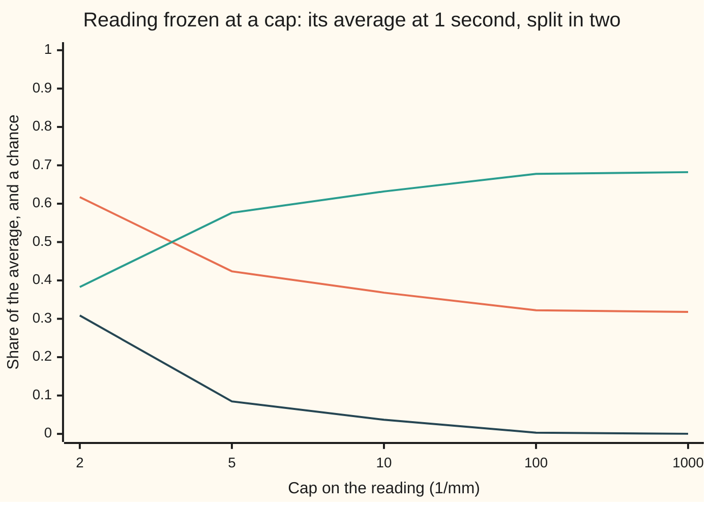

# Continuous martingales and local martingales: fair games in continuous time, and fair only up to a stopping time

[Syllabus](../../../SYLLABUS.md) → [Stochastic processes and calculus](../README.md) → [Continuous Martingales](../README.md#s10) → Continuous martingales and local martingales

---

## General Overview

A dust particle floats in still air, 1 mm from a tiny charged speck. Molecules knock it about in all three directions. A sensor on the particle reads the speck's electric potential, which is one over the distance: 1 at 1 mm, 2 at half a millimetre, 10 at a tenth.

Lengths are in millimetres and time in seconds, and each coordinate of the particle's position spreads so that its variance grows by 1 mm² per second.

Over each short instant, the reading is a fair game. [Ito's lemma](../06-Ito%20Calculus/02-itos-lemma.md) finds no drift in it at all. Because one over the distance curves upward, a step towards the speck raises the reading more than an equal step away lowers it. Sideways steps always carry the particle slightly further out, and in three dimensions they cancel that gain exactly. So the reading should average 1 forever.

It does not. After one second, the reading averages **0.682689**. About 32 percent of the average has gone.

Here is where it went. Freeze the reading the moment it first reaches 10, so the particle is within 0.1 mm of the speck. The frozen reading averages exactly 1 at every time.

But 0.368120 of that average sits on paths that reached the freeze, and those paths have a chance of only 0.036812. Raise the freeze to 100, then 1000, and the stranded part stays near 0.32 while its paths grow rarer. Remove the freeze altogether and that part is gone.

This card carries fair games into continuous time. A **continuous martingale** is a fair game whose value moves without jumps.

A **local martingale** becomes a genuine fair game once it is frozen at stopping times (random times decided by the path so far) that run off to infinity, like the freezes at 10, 100 and 1000. Every Ito integral is one. The reading is one that is not a true fair game.

**A local martingale is fair up to every cap on its size; the caps come off without losing average only when its values frozen at the caps carry a vanishing share, and one over the distance in three dimensions is the standard case where they do not.**

**What kind of fact this is:** two definitions and three theorems, proved on this card in Why it works: optional stopping in continuous time, every Ito integral is a local martingale, and one over the distance is a local martingale whose average falls. The chance of reaching a cap is quoted from [Novikov](../07-Changing%20Measure/03-novikov-condition.md), which proves it.

### The picture: where the average sits when the reading is frozen at a cap



Orange: the part of the average carried by paths that reached the cap by 1 second. Green: the part carried by all other paths. Orange plus green is exactly 1 at every cap. Dark blue: the chance of reaching the cap by 1 second.

As the cap rises, the blue chance falls towards 0, but the orange share settles near 0.317, not 0. The green line climbs to 0.682689, the true average with no cap.

---

## The formula

Notation from earlier cards. $`W_t`$ is a one-dimensional Brownian motion and $`\mathcal F_t`$ is what is known by time $`t`$ ([The Ito integral](../06-Ito%20Calculus/01-ito-integral.md)). $`E`$ is the average over all paths. $`\tau`$ (Greek "tau") is a stopping time: a random time that is recognised when it arrives, $`\{\tau \le t\} \in \mathcal F_t`$. $`t \wedge \tau`$ is the smaller of $`t`$ and $`\tau`$ ([Stopping times](../02-Martingales/03-stopping-times-and-optional-stopping.md)).

**A continuous martingale** $`M_t`$ has continuous paths, a finite average at each time, and the fair-game rule at every pair of times $`s < t`$:

```math
E[M_t \mid \mathcal F_s] = M_s .
```

**Read it aloud:** given everything known at an earlier time, the best forecast of the later value is the value then.

The house example of this shelf is $`M_t = \int_0^t W_s\,dW_s = (W_t^2 - t)/2`$: holding as many shares as the walk stands above zero. Its **clock** is $`\int_0^t W_s^2\,ds`$, the running total of its squared holding. The clock runs fast when $`W`$ is far from 0 and stalls when $`W`$ is near it.

**Optional stopping in continuous time.** If $`\tau \le T`$ on every path, for a fixed time $`T`$, then

```math
E[M_\tau] = E[M_0].
```

**Read it aloud:** a quitting rule that looks only at the past, and is sure to stop by a fixed time, cannot change the average of a continuous fair game.

**A local martingale** $`X_t`$ is a continuous process with stopping times $`\tau_1 \le \tau_2 \le \dots`$ that grow to infinity on every path, such that each frozen copy is a martingale:

```math
X_{t \wedge \tau_n} \text{ is a martingale for every } n .
```

**Read it aloud:** freeze the process at the n-th stopping time and it is a fair game, for every n; the stopping times are called a **localising sequence**.

**The example.** Let $`B_t`$ be a three-dimensional Brownian motion, the particle's position, started at distance 1 from the speck at the origin. Let $`X_t = 1/|B_t|`$, the sensor reading. Then $`X`$ is a local martingale, frozen at $`\tau_n`$, the first time the reading reaches $`n`$. Yet

```math
E[X_t] = 2\Phi\!\left(\frac{1}{\sqrt t}\right) - 1 \;<\; 1 = X_0 .
```

**Read it aloud:** the average reading at time t is twice the bell-curve area left of one over root t, minus one. That is less than the starting reading of 1.

At $`t = 1`$ this is $`2 \times 0.841345 - 1 = 0.682689`$. A local martingale that is not a martingale is called a **strict local martingale**.

| Symbol | Plain meaning | In our example | Push it up and the answer… |
| --- | --- | --- | --- |
| $`t`$, $`s`$, $`T`$ | time in seconds; an earlier time; a fixed horizon | $`t = 1`$ | later t: the average reading falls further |
| $`B_t`$, $`\lvert B_t\rvert`$ | the particle's position, three coordinates each an independent Brownian motion; its distance from the speck | distance 1 mm at the start | — |
| $`X_t`$ | the reading, $`1/\lvert B_t\rvert`$, in units of 1/mm | 1 at the start; average 0.682689 at 1 s | — |
| $`\rho`$ | distance the particle has moved from its start, in Step 5 | below 1 mm by 1 s with chance 0.198748 | — |
| $`W_t`$, $`M_t`$, $`H_t`$ | a one-dimensional Brownian motion; a continuous martingale, in the house example $`(W_t^2 - t)/2`$; a strategy, the holding at time t chosen from the past | $`E[M_1^2] = 0.5`$; $`H_t = W_t`$ | — |
| $`\mathcal F_t`$ | what is known by time t: the path so far | — | — |
| $`\tau`$, $`t \wedge \tau`$, $`\tau_k`$ | a stopping time; the smaller of t and it; in Step 1's proof, $`\tau`$ rounded up to a grid | first time $`\lvert W\rvert = 1`$, average 1 s | — |
| $`\tau_n`$, $`n`$ | the n-th localising time; the cap it enforces | first time the reading reaches 10 | higher cap: rarer paths reach it |
| $`E`$, $`P`$ | the average over all paths; a chance | $`P(\tau_{10} \le 1) = 0.036812`$ | — |
| $`\Phi`$, $`\varphi`$ | the bell curve's area to the left of a point; its height | $`\Phi(1) = 0.841345`$, $`\varphi(1) = 0.241971`$ | — |
| $`f`$, $`x`$, $`x_i`$, $`B^i_s`$, $`y`$, $`u`$, $`\theta`$, $`C`$, $`m`$, $`k`$, $`j`$ | in the steps and proofs: the function one over the distance; a point in space; its i-th coordinate; the particle's i-th coordinate; a point on a sphere; the cosine of an angle; the angle; a bound; a second cap above n; a grid level; a grid point's number | — | — |

### When it holds

- **Paths are continuous.** Every result here uses the fact that a continuous path reaches a level exactly when it first crosses it, so a frozen reading never overshoots its cap. With jumps, a frozen value can land far past the cap, and the definitions need more care ([Semimartingales](../09-Beyond%20Brownian/05-semimartingales-in-outline.md)).
- **Optional stopping needs a bounded stopping time, or a substitute.** Without a fixed horizon, "stop when $`W`$ first reaches 1" stops $`W`$ at exactly 1 on every path, an average of 1, not 0. [Stopping without a bound](../02-Martingales/06-uniform-integrability-and-unbounded-stopping.md) gives the substitute: uniform integrability.
- **A local martingale is a martingale only under an extra condition.** Bounded is enough. So is "the frozen values are uniformly integrable at each time". The reading fails both: it is unbounded, and its values frozen at ever higher caps keep 0.317311 of its average. Even a bounded average square is not enough. The reading's average square stays bounded over all time (in three dimensions, one over the squared distance still averages finitely near the speck), so its values at fixed times are uniformly integrable; its frozen values are not.
- **The motion is three-dimensional.** One over the distance is fair over each instant only in three dimensions. In the plane its Ito drift is positive, and the fair function is the logarithm of the distance ([Brownian motion in d dimensions](../08-Generators%2C%20Densities%20and%20Simulation/08-recurrence-and-transience-of-brownian-motion.md)).

---

## Why it works

### Step 0: fair over each instant is a statement about small moves, not about the average

Ito's lemma reads a process one instant at a time. "No drift" means each tiny move averages zero. Adding up those zeros gives a zero total only if the average can be passed through the infinite sum of moves.

That passage fails when rare paths carry huge values. The remedy is to cap the process with a stopping time. Below the cap, everything is bounded, every average is finite, and the instant-by-instant fairness adds up properly. Each capped copy is a true martingale. Whether the uncapped process is one depends on what the caps were hiding.

### Step 1: optional stopping in continuous time, by rounding up to a grid

Take a continuous martingale $`M`$ and a stopping time $`\tau \le T`$. Round $`\tau`$ up to the next point of a grid with spacing $`2^{-k}`$, capped at $`T`$. The rounded time is a stopping time on the grid, so the theorem on [Stopping times](../02-Martingales/03-stopping-times-and-optional-stopping.md) gives the right average there.

Now let the grid shrink. The rounded times fall to $`\tau`$, and continuous paths carry the values with them. The values are uniformly integrable (their rare large values carry a vanishing share of the average), so their averages follow too.

<details>
<summary>Detailed proof: optional stopping for a bounded stopping time</summary>

Let $`\tau \le T`$ and $`\tau_k = \min(\lceil 2^k \tau \rceil / 2^k,\ T)`$, where $`\lceil x \rceil`$ is the smallest whole number at least $`x`$. Add $`T`$ to the grid if it is not on it. Then $`\tau_k`$ takes finitely many grid values, and $`\{\tau_k \le j 2^{-k}\} = \{\tau \le j 2^{-k}\}`$, which is known at time $`j 2^{-k}`$. So $`\tau_k`$ is a stopping time for the grid martingale $`M_{j 2^{-k}}`$.

The discrete theorem, in its conditional form, gives

$`\displaystyle M_{\tau_k} = E[M_T \mid \mathcal F_{\tau_k}],`$

where $`\mathcal F_{\tau_k}`$ is what is known at the stopping time. In particular $`E[M_{\tau_k}] = E[M_0]`$.

Every $`M_{\tau_k}`$ is a conditional average of the one integrable value $`M_T`$. Such a family is uniformly integrable ([Stopping without a bound](../02-Martingales/06-uniform-integrability-and-unbounded-stopping.md)). As $`k`$ grows, $`\tau_k`$ falls to $`\tau`$, and because the path is continuous, $`M_{\tau_k} \to M_\tau`$ on every path. Uniform integrability lets the average pass to the limit:

$`\displaystyle E[M_\tau] = \lim_{k \to \infty} E[M_{\tau_k}] = E[M_0].`$

Applied to $`\tau \wedge t`$ for each $`t`$, the same argument shows the frozen process $`M_{t \wedge \tau}`$ is again a martingale.

</details>

**The house example.** Let $`\tau`$ be the first time $`|W_t| = 1`$. The time $`\tau \wedge t`$ is bounded, so $`E[M_{\tau \wedge t}] = 0`$, which says $`E[W_{\tau \wedge t}^2] = E[\tau \wedge t]`$. The left side is at most 1. Let $`t`$ grow: $`W_\tau^2 = 1`$, so $`E[\tau] = 1`$ second. The code confirms it by a separate road, the series $`\tfrac{32}{\pi^3}\left(1 - \tfrac{1}{27} + \tfrac{1}{125} - \dots\right) = 1.000000`$, which comes from the exact law of the exit time.

### Step 2: what a local martingale is, and two easy facts

Every martingale is a local martingale: take $`\tau_n = n`$. Two facts go the other way.

- **A bounded local martingale is a martingale.** If $`|X_t| \le C`$, then $`X_{t \wedge \tau_n} \to X_t`$ as $`n`$ grows, and bounded values let the average and the conditional average pass to the limit.
- **A positive local martingale is a supermartingale:** its forecast of later values is at most today's value, so its average can only fall. The limit argument still works, but only as an inequality (Fatou's lemma: the average of a limit of positive values is at most the limit of their averages). [Novikov](../07-Changing%20Measure/03-novikov-condition.md) proves this. The reading is positive, so its average can fall but never rise.

### Step 3: every Ito integral is a local martingale

[The Ito integral](../06-Ito%20Calculus/01-ito-integral.md) builds $`\int_0^t H_s\,dW_s`$ as a true martingale when $`E[\int_0^t H_s^2\,ds]`$ is finite. Many useful strategies only satisfy the weaker condition that $`\int_0^t H_s^2\,ds`$ is finite on every path.

Localise by the clock. Let $`\tau_n`$ be the first time $`\int_0^t H_s^2\,ds`$ reaches $`n`$. The strategy "hold $`H_s`$ until $`\tau_n`$, then nothing" has total squared holding at most $`n`$ on every path. So its integral is a true martingale, by the Ito card.

Two of these integrals, for caps $`n < m`$, agree up to $`\tau_n`$, because the strategies agree there. So one process $`\int_0^t H_s\,dW_s`$ is defined on all of time, and it equals the n-th integral until $`\tau_n`$. The clock is finite on every path, so $`\tau_n`$ grows to infinity. That is exactly a local martingale.

For the house example, $`E[\int_0^1 W_s^2\,ds] = \int_0^1 s\,ds = 0.5`$ is finite, so no localising is needed: $`M`$ is a true martingale. The isometry (an Ito integral's average square equals its clock's average) says $`E[M_1^2] = 0.5`$, and the code finds 0.500000 by a separate Gaussian integral.

### Step 4: the reading is a local martingale

Ito's lemma in three dimensions ([Several Brownian motions](../06-Ito%20Calculus/06-multidimensional-ito-and-correlation.md)) for $`f(x) = 1/|x|`$ needs its slopes. With $`x_i`$ the i-th coordinate, the slope along coordinate $`i`$ is $`-x_i/|x|^3`$, and the second slope is $`-1/|x|^3 + 3x_i^2/|x|^5`$. Add the three second slopes:

```math
\sum_{i=1}^{3}\left(-\frac{1}{|x|^3} + \frac{3x_i^2}{|x|^5}\right) = -\frac{3}{|x|^3} + \frac{3|x|^2}{|x|^5} = 0 .
```

**Read it aloud:** the three curvatures of one over the distance cancel exactly, away from the speck.

So the drift term vanishes and the reading is an Ito integral:

```math
X_t = 1 - \sum_{i=1}^{3} \int_0^t \frac{B^i_s}{|B_s|^3}\, dB^i_s .
```

**Read it aloud:** the reading is its start, minus the sum over the three coordinates of a strategy that holds the coordinate divided by the distance cubed.

Here $`B^i_s`$ is the i-th coordinate. The squared holding adds to $`X_s^4`$ at each instant.

A three-dimensional Brownian motion from distance 1 never reaches the speck ([Brownian motion in d dimensions](../08-Generators%2C%20Densities%20and%20Simulation/08-recurrence-and-transience-of-brownian-motion.md): it ever reaches radius $`1/n`$ with chance $`1/n`$). So on each path the distance stays above some positive amount up to time $`t`$, and the clock is finite. By Step 3, the reading is a local martingale.

The natural localising time is $`\tau_n`$, the first time the reading reaches $`n`$. Before it, $`X \le n`$, so the frozen reading is bounded and is a true martingale: $`E[X_{t \wedge \tau_n}] = 1`$ at every time.

The isometry route fails, and this is the reason. Near the speck, $`X^4`$ is so large that its average $`E[X_s^4]`$ is infinite, so the Ito card's condition does not hold.

### Step 5: the average falls, by Newton's shell theorem

Newton proved that a thin uniform shell pulls on an outside point as if its mass sat at its centre. It does not pull on an inside point at all.

In terms of one over the distance: average $`1/|y|`$ over the points $`y`$ of a sphere of radius $`\rho`$ centred at the start. If the sphere is too small to enclose the speck, the answer is the reading at the centre, 1. If it encloses the speck, the answer is $`1/\rho`$. Together: $`1/\max(\rho, 1)`$.

Brownian motion is the same in every direction, so given the distance moved $`\rho`$, the particle is spread evenly over that sphere. Hence

```math
E[X_t] = E\left[\frac{1}{\max(\rho_t, 1)}\right] = P(\rho_t \le 1) + E\left[\frac{1}{\rho_t};\ \rho_t > 1\right].
```

**Read it aloud:** the average reading is the chance the particle moved at most 1 mm, plus the average of one over the distance moved when it moved more.

Here $`E[\,\cdot\,;\ A]`$ is the average counted on the event $`A`$ only. The distance moved $`\rho_t`$ is $`\sqrt t`$ times the length of three independent standard normal draws. Both pieces are bell-curve areas, and they sum to $`2\Phi(1/\sqrt t) - 1`$.

<details>
<summary>Detailed proof: the shell average, and the two bell-curve pieces</summary>

**The shell.** Put the speck at distance 1 from the sphere's centre. A point on the sphere at angle $`\theta`$ from the speck's direction is at distance $`\sqrt{\rho^2 + 1 - 2\rho u}`$ from the speck, with $`u = \cos\theta`$. On a sphere, $`u`$ is spread evenly over $`[-1, 1]`$ (Archimedes' hat-box theorem). So the average is

$`\displaystyle \frac12 \int_{-1}^{1} \frac{du}{\sqrt{\rho^2 + 1 - 2\rho u}} = \frac{(\rho + 1) - |\rho - 1|}{2\rho} = \frac{1}{\max(\rho, 1)}.`$

**The pieces at $`t = 1`$.** The length $`\rho`$ of three standard normal draws has density $`\sqrt{2/\pi}\,\rho^2 e^{-\rho^2/2}`$. Then

$`\displaystyle E\left[\frac{1}{\rho};\ \rho > 1\right] = \sqrt{\tfrac{2}{\pi}} \int_1^\infty \rho\, e^{-\rho^2/2}\, d\rho = \sqrt{\tfrac{2}{\pi}}\, e^{-1/2} = 2\varphi(1).`$

Integrating by parts,

$`\displaystyle P(\rho \le 1) = \sqrt{\tfrac{2}{\pi}} \int_0^1 \rho^2 e^{-\rho^2/2}\, d\rho = 2\Phi(1) - 1 - 2\varphi(1).`$

The $`2\varphi(1)`$ terms cancel in the sum, leaving $`2\Phi(1) - 1`$. At time $`t`$, replace 1 by $`1/\sqrt t`$, because $`\rho_t = \sqrt t\,\rho`$.

</details>

So $`E[X_1] = 0.682689 < 1`$: the reading is a strict local martingale. Combine with Step 4. At the cap $`n`$,

```math
1 = E[X_{1 \wedge \tau_n}] = n\,P(\tau_n \le 1) + E[X_1;\ \tau_n > 1].
```

**Read it aloud:** the frozen reading averages 1: the cap value times the chance of reaching it, plus the average reading on paths that never got that close.

As $`n`$ grows, $`\tau_n`$ grows to infinity, so the second piece climbs to $`E[X_1] = 0.682689`$. The first piece must therefore settle at 0.317311 while $`P(\tau_n \le 1)`$ shrinks to 0. That is the picture's orange line. The chance $`P(\tau_n \le 1) = \tfrac{1}{n} \cdot 2\left(1 - \Phi(1 - \tfrac1n)\right)`$ is proved on [Novikov](../07-Changing%20Measure/03-novikov-condition.md), whose weight under its tilt C is this same reading.

---

## Worked numbers, by hand

The particle starts 1 mm from the speck; the horizon is 1 second.

| Step | Arithmetic | Value |
| --- | --- | --- |
| $`\Phi(1)`$ | bell-curve area left of 1 | 0.841345 |
| $`\varphi(1)`$ | $`e^{-1/2} / \sqrt{2\pi}`$ | 0.241971 |
| chance the particle moved at most 1 mm | $`2 \times 0.841345 - 1 - 2 \times 0.241971`$ | 0.198748 |
| average of one over the distance moved, beyond 1 mm | $`2 \times 0.241971`$ | 0.483941 |
| **average reading at 1 second** | $`0.198748 + 0.483941`$ | **0.682689** |
| average lost | $`1 - 0.682689`$ | 0.317311 |
| chance of reaching the cap 10 by 1 second | $`\tfrac{1}{10} \times 2\,(1 - \Phi(0.9))`$ | 0.036812 |
| share carried by those paths | $`10 \times 0.036812`$ | 0.368120 |
| share carried by the rest | $`2\Phi(0.9) - 1`$ | 0.631880 |
| frozen reading's average | $`0.368120 + 0.631880`$ | 1.000000 |

The reading starts at 1 and is fair over every instant, yet after one second it averages 0.682689. The missing 0.317311 lives on paths that pass ever closer to the speck.

### What breaks if you drop a piece

| Mistake | Comes out at | What went wrong |
| --- | --- | --- |
| Treat the reading as a martingale because it has no drift | average 1.000000 at 1 s; true 0.682689 | no drift makes it fair up to each cap, not over the whole second |
| Read the lost average as the chance of passing near the speck | 0.317311; the chance of reaching the cap 10 is 0.036812 | the lost average rides on large values on rare paths, not on many paths |
| Scale time as $`t`$ instead of $`\sqrt t`$ | $`2\Phi(1/4) - 1 = 0.197413`$ at 4 s; true 0.382925 | Brownian distance grows like the square root of time |

---

## Code, from first principles, and it actually runs

The code computes the average reading at 1 second by **four independent roads**:

- **Road 1** is the closed form, with the bell-curve area built from its power series.
- **Road 2** averages one over the distance over all of space, shell by shell, with Simpson's rule (thin slices added with weights 1, 4, 2, 4, …, 1).
- **Road 3** draws the position at 1 second exactly, 100,000 times. The draws come from SplitMix64 (a simple random number generator) and Box-Muller (a recipe turning uniform draws into normal ones), both written out.
- **Road 4** simulates 4,000 whole paths on a grid of 200 steps. It reads each path twice: frozen at the cap 4, and not frozen. On the same paths, the frozen average is close to 1 and the unfrozen one close to 0.683. The grid checks the cap only at its 200 time points: it freezes some paths late, above the cap, and misses some crossings altogether. These errors pull opposite ways, so the frozen average gets a small margin.

The code also checks the shell theorem numerically and prints the cap table behind the picture. It checks the chance of reaching the cap 10 by a separate road: it solves the heat equation for that chance on a grid of distances, without using the formula. It also checks the house example twice: $`E[M_1^2]`$ by a Gaussian integral against the isometry, and the exit time by its series against optional stopping. Every number on the card is printed by both programs.

### Python

```python
# Continuous martingales and local martingales -- the check behind the card.
# Only math is imported. B is a 3-dimensional Brownian motion started at
# distance R0 = 1 from the origin, and X_t = 1/|B_t| is one over its distance.
# Roads to E[X_1]: the closed form 2 Phi(1) - 1; a Simpson integral of the
# Gaussian average over space; exact draws of B_1; whole simulated paths.
import math

R0, T, CAP = 1.0, 1.0, 10      # start distance, horizon, cap on X (stop when |B| <= 1/CAP)

def phi(x): return math.exp(-x * x / 2) / math.sqrt(2 * math.pi)   # the bell curve's height

def Phi(x):                    # its area to the left: 1/2 + phi(x) * (x + x^3/3 + x^5/15 + ...)
    term, total, k = x, x, 0
    while abs(term) > 1e-17:
        k += 1
        term *= x * x / (2 * k + 1)
        total += term
    return 0.5 + phi(x) * total

def simpson(f, a, b, n):       # Simpson's rule, n even
    h = (b - a) / n
    acc = 0.0
    for i in range(1, n):
        acc += (4 if i % 2 else 2) * f(a + i * h)
    return (f(a) + f(b) + acc) * h / 3

def mean_closed(r0, t): return (2 * Phi(r0 / math.sqrt(t)) - 1) / r0   # E[1/|B_t|]

def mean_space(r0, t):         # the Gaussian average of 1/|y| over space, in shells:
    c = 2 * math.pi / (2 * math.pi * t) ** 1.5    # rho = |y|, u = cosine of y's angle to the start
    def inner(rho):
        g = lambda u: rho * math.exp(-(rho * rho - 2 * rho * r0 * u + r0 * r0) / (2 * t))
        return simpson(g, -1.0, 1.0, 200)
    return c * simpson(inner, 0.0, r0 + 12 * math.sqrt(t), 600)

def shell(rho, r0):            # average of 1/|y| over the sphere of radius rho around the start
    return simpson(lambda u: 0.5 / math.sqrt(rho * rho + r0 * r0 - 2 * rho * r0 * u), -1.0, 1.0, 2000)

def capped(n, r0, t):          # stop at the first time |B| = 1/n, i.e. X reaches n
    chance = (1 / n) / r0 * 2 * (1 - Phi((r0 - 1 / n) / math.sqrt(t)))
    return chance, n * chance, (2 * Phi((r0 - 1 / n) / math.sqrt(t)) - 1) / r0

state = 20261123               # SplitMix64 and Box-Muller, written out
def uniform():
    global state
    state = (state + 0x9E3779B97F4A7C15) % 2 ** 64
    z = state
    z = ((z ^ (z >> 30)) * 0xBF58476D1CE4E5B9) % 2 ** 64
    z = ((z ^ (z >> 27)) * 0x94D049BB133111EB) % 2 ** 64
    return ((z ^ (z >> 31)) >> 11) / 2 ** 53
def normals():
    u, v = 1 - uniform(), uniform()
    r = math.sqrt(-2 * math.log(u))
    return r * math.cos(2 * math.pi * v), r * math.sin(2 * math.pi * v)
def stats(xs):                 # mean and its standard error, summed in order
    m, v = 0.0, 0.0
    for x in xs: m += x
    m /= len(xs)
    for x in xs: v += (x - m) ** 2
    return m, math.sqrt(v / (len(xs) - 1) / len(xs))

# ---- the example: one over the distance, started 1 unit out ----
exact = mean_closed(R0, T)
quad = mean_space(R0, T)
print(f"Phi(1) = {Phi(1.0):.6f}, phi(1) = {phi(1.0):.6f}")
print(f"E[X_1], road 1, closed form 2 Phi(1) - 1 = {exact:.6f}")
print(f"E[X_1], road 2, Simpson over space = {quad:.6f}")
assert abs(quad - exact) < 1e-6
print(f"mean lost by time 1 = {1 / R0 - exact:.6f}")
inside = 2 * Phi(1.0) - 1 - 2 * phi(1.0)
print(f"Newton split: P(moved <= 1) = {inside:.6f}, E[1/moved; moved > 1] = {2 * phi(1.0):.6f}")
print(f"shell averages: radius 0.3 -> {shell(0.3, R0):.6f}, radius 3 -> {shell(3.0, R0):.6f}")
assert abs(shell(0.3, R0) - 1 / R0) < 1e-6     # inside the shell: 1 / (start distance)
assert abs(shell(3.0, R0) - 1 / 3.0) < 1e-6    # outside: 1 / (shell radius)
print(f"E[X_4] = {mean_closed(R0, 4.0):.6f} (Simpson {mean_space(R0, 4.0):.6f})")
assert abs(mean_space(R0, 4.0) - mean_closed(R0, 4.0)) < 1e-6

# ---- road 3: exact draws of B_T = start + sqrt(T) times three standard normals ----
xs = []
for i in range(100000):
    a, b = normals()
    c, _ = normals()
    q = math.sqrt(T)
    xs.append(1 / math.sqrt((R0 + q * a) ** 2 + (q * b) ** 2 + (q * c) ** 2))
m, se = stats(xs)
print(f"E[X_1], road 3, 100000 exact draws = {m:.6f} +- {se:.6f}")
assert abs(m - exact) < 4 * se

# ---- localisation: caps at X = n, read at time 1 ----
for n in [2, 5, CAP, 100, 1000]:
    ch, mass, rest = capped(n, R0, T)
    print(f"cap {n}: P(reach cap by 1) = {ch:.6f}, mean on capped paths = {mass:.6f}, mean on the rest = {rest:.6f}")
print(f"cap {CAP}: frozen reading's average = {capped(CAP, R0, T)[1] + capped(CAP, R0, T)[2]:.6f}")
assert abs(capped(10 ** 6, R0, T)[2] - exact) < 1e-5

# ---- road 4: 4000 whole paths, 200 steps; frozen at the cap X = 4, and not ----
paths, steps, ncap = 4000, 200, 4
free, frozen = [], []
for p in range(paths):
    x, y, z, stop = R0, 0.0, 0.0, None
    for k in range(steps):
        a, b = normals()
        c, _ = normals()
        s = math.sqrt(T / steps)
        x, y, z = x + s * a, y + s * b, z + s * c
        if stop is None and math.sqrt(x * x + y * y + z * z) <= 1 / ncap:
            stop = 1 / math.sqrt(x * x + y * y + z * z)
    free.append(1 / math.sqrt(x * x + y * y + z * z))
    frozen.append(stop if stop is not None else free[-1])
mf, sf = stats(free)
mz, sz = stats(frozen)
print(f"paths: unfrozen mean at 1 = {mf:.6f} +- {sf:.6f}")
print(f"paths: frozen at cap {ncap}, mean = {mz:.6f} +- {sz:.6f}")
assert abs(mf - exact) < 4 * sf
assert abs(mz - 1 / R0) < 4 * sz + 0.02        # the grid freezes a little late

# ---- the chance of reaching the cap, by another road: the radial heat equation on a grid ----
a, dr, ds = 1 / CAP, 0.025, 0.00025            # u[i] = P(reach radius a by now | start at a + i dr)
u = [1.0] + [0.0] * 320
for _ in range(round(T / ds)):
    u = [1.0] + [u[i] + ds * ((u[i + 1] - 2 * u[i] + u[i - 1]) / (2 * dr * dr) + (u[i + 1] - u[i - 1]) / (2 * dr) / (a + i * dr)) for i in range(1, 320)] + [0.0]
print(f"cap {CAP}: P(reach cap by 1) on a heat-equation grid = {u[round((R0 - a) / dr)]:.6f}")
assert abs(u[round((R0 - a) / dr)] - capped(CAP, R0, T)[0]) < 1e-4

# ---- the house example M_t = (W_t^2 - t)/2, a true martingale ----
msq = simpson(lambda w: ((w * w - 1) / 2) ** 2 * phi(w), -12.0, 12.0, 4000)
clock = simpson(lambda s: s, 0.0, 1.0, 2)
print(f"house: E[M_1^2] by Simpson = {msq:.6f}; isometry, E[clock at 1] = {clock:.6f}")
assert abs(msq - clock) < 1e-6
series = 0.0
for k in range(200000): series += (-1) ** k / (2 * k + 1) ** 3
series *= 32 / math.pi ** 3
print(f"house: exit time of (-1, 1), E[tau] by series = {series:.6f}; optional stopping gives 1")
assert abs(series - 1.0) < 1e-6

# ---- what breaks ----
print(f"break: martingale assumed, E[X_1] = {1 / R0:.6f}; true {exact:.6f}")
print(f"break: lost mean read as a chance = {1 / R0 - exact:.6f}; P(reach cap {CAP} by 1) = {capped(CAP, R0, T)[0]:.6f}")
print(f"break: t for sqrt t at time 4 = {(2 * Phi(R0 / 4) - 1) / R0:.6f}; true {mean_closed(R0, 4.0):.6f}")
print("ALL CHECKS PASS")
```

**Ran 2026-11-23 on macOS, Python 3.14.10, standard library only. All checks passed. Output, pasted from the run:**

```
Phi(1) = 0.841345, phi(1) = 0.241971
E[X_1], road 1, closed form 2 Phi(1) - 1 = 0.682689
E[X_1], road 2, Simpson over space = 0.682689
mean lost by time 1 = 0.317311
Newton split: P(moved <= 1) = 0.198748, E[1/moved; moved > 1] = 0.483941
shell averages: radius 0.3 -> 1.000000, radius 3 -> 0.333333
E[X_4] = 0.382925 (Simpson 0.382925)
E[X_1], road 3, 100000 exact draws = 0.684253 +- 0.001683
cap 2: P(reach cap by 1) = 0.308538, mean on capped paths = 0.617075, mean on the rest = 0.382925
cap 5: P(reach cap by 1) = 0.084742, mean on capped paths = 0.423711, mean on the rest = 0.576289
cap 10: P(reach cap by 1) = 0.036812, mean on capped paths = 0.368120, mean on the rest = 0.631880
cap 100: P(reach cap by 1) = 0.003222, mean on capped paths = 0.322174, mean on the rest = 0.677826
cap 1000: P(reach cap by 1) = 0.000318, mean on capped paths = 0.317795, mean on the rest = 0.682205
cap 10: frozen reading's average = 1.000000
paths: unfrozen mean at 1 = 0.686188 +- 0.007930
paths: frozen at cap 4, mean = 0.985216 +- 0.019537
cap 10: P(reach cap by 1) on a heat-equation grid = 0.036815
house: E[M_1^2] by Simpson = 0.500000; isometry, E[clock at 1] = 0.500000
house: exit time of (-1, 1), E[tau] by series = 1.000000; optional stopping gives 1
break: martingale assumed, E[X_1] = 1.000000; true 0.682689
break: lost mean read as a chance = 0.317311; P(reach cap 10 by 1) = 0.036812
break: t for sqrt t at time 4 = 0.197413; true 0.382925
ALL CHECKS PASS
```

### Rust

```rust
// Continuous martingales and local martingales -- the check behind the card.
// std only. B is a 3-dimensional Brownian motion started at distance R0 = 1
// from the origin, and X_t = 1/|B_t| is one over its distance.
// Roads to E[X_1]: the closed form 2 Phi(1) - 1; a Simpson integral of the
// Gaussian average over space; exact draws of B_1; whole simulated paths.
use std::f64::consts::PI;

const R0: f64 = 1.0; const T: f64 = 1.0; const CAP: u32 = 10; // start distance, horizon, cap on X

fn phi(x: f64) -> f64 { (-x * x / 2.0).exp() / (2.0 * PI).sqrt() } // the bell curve's height

fn big_phi(x: f64) -> f64 { // its area to the left: 1/2 + phi(x) * (x + x^3/3 + x^5/15 + ...)
    let (mut term, mut total, mut k) = (x, x, 0.0);
    while term.abs() > 1e-17 {
        k += 1.0;
        term *= x * x / (2.0 * k + 1.0);
        total += term;
    }
    0.5 + phi(x) * total
}

fn simpson<F: Fn(f64) -> f64>(f: F, a: f64, b: f64, n: usize) -> f64 { // Simpson's rule, n even
    let h = (b - a) / n as f64;
    let mut acc = 0.0;
    for i in 1..n {
        acc += if i % 2 == 1 { 4.0 } else { 2.0 } * f(a + i as f64 * h);
    }
    (f(a) + f(b) + acc) * h / 3.0
}

fn mean_closed(r0: f64, t: f64) -> f64 { (2.0 * big_phi(r0 / t.sqrt()) - 1.0) / r0 } // E[1/|B_t|]

fn mean_space(r0: f64, t: f64) -> f64 { // the Gaussian average of 1/|y| over space, in shells:
    // rho = |y|, u = cosine of y's angle to the start
    let c = 2.0 * PI / (2.0 * PI * t).powf(1.5);
    let inner = |rho: f64| {
        let g = |u: f64| rho * (-(rho * rho - 2.0 * rho * r0 * u + r0 * r0) / (2.0 * t)).exp();
        simpson(g, -1.0, 1.0, 200)
    };
    c * simpson(inner, 0.0, r0 + 12.0 * t.sqrt(), 600)
}

fn shell(rho: f64, r0: f64) -> f64 { // average of 1/|y| over the sphere of radius rho around the start
    simpson(|u| 0.5 / (rho * rho + r0 * r0 - 2.0 * rho * r0 * u).sqrt(), -1.0, 1.0, 2000)
}

fn capped(n: u32, r0: f64, t: f64) -> (f64, f64, f64) { // stop at the first time |B| = 1/n, i.e. X reaches n
    let n = n as f64;
    let q = big_phi((r0 - 1.0 / n) / t.sqrt());
    let chance = (1.0 / n) / r0 * 2.0 * (1.0 - q);
    (chance, n * chance, (2.0 * q - 1.0) / r0)
}

struct Rng(u64); // SplitMix64 and Box-Muller, written out
impl Rng {
    fn uniform(&mut self) -> f64 {
        self.0 = self.0.wrapping_add(0x9E3779B97F4A7C15);
        let mut z = self.0;
        z = (z ^ (z >> 30)).wrapping_mul(0xBF58476D1CE4E5B9);
        z = (z ^ (z >> 27)).wrapping_mul(0x94D049BB133111EB);
        ((z ^ (z >> 31)) >> 11) as f64 / 2f64.powi(53)
    }
    fn normals(&mut self) -> (f64, f64) {
        let (u, v) = (1.0 - self.uniform(), self.uniform());
        let r = (-2.0 * u.ln()).sqrt();
        (r * (2.0 * PI * v).cos(), r * (2.0 * PI * v).sin())
    }
}

fn stats(xs: &[f64]) -> (f64, f64) { // mean and its standard error, summed in order
    let (mut m, mut v) = (0.0, 0.0);
    for x in xs { m += x; }
    m /= xs.len() as f64;
    for x in xs { v += (x - m) * (x - m); }
    (m, (v / (xs.len() as f64 - 1.0) / xs.len() as f64).sqrt())
}

fn main() {
    // ---- the example: one over the distance, started 1 unit out ----
    let (exact, quad) = (mean_closed(R0, T), mean_space(R0, T));
    println!("Phi(1) = {:.6}, phi(1) = {:.6}", big_phi(1.0), phi(1.0));
    println!("E[X_1], road 1, closed form 2 Phi(1) - 1 = {:.6}", exact);
    println!("E[X_1], road 2, Simpson over space = {:.6}", quad);
    assert!((quad - exact).abs() < 1e-6);
    println!("mean lost by time 1 = {:.6}", 1.0 / R0 - exact);
    let inside = 2.0 * big_phi(1.0) - 1.0 - 2.0 * phi(1.0);
    println!("Newton split: P(moved <= 1) = {:.6}, E[1/moved; moved > 1] = {:.6}", inside, 2.0 * phi(1.0));
    println!("shell averages: radius 0.3 -> {:.6}, radius 3 -> {:.6}", shell(0.3, R0), shell(3.0, R0));
    assert!((shell(0.3, R0) - 1.0 / R0).abs() < 1e-6); // inside the shell: 1 / (start distance)
    assert!((shell(3.0, R0) - 1.0 / 3.0).abs() < 1e-6); // outside: 1 / (shell radius)
    println!("E[X_4] = {:.6} (Simpson {:.6})", mean_closed(R0, 4.0), mean_space(R0, 4.0));
    assert!((mean_space(R0, 4.0) - mean_closed(R0, 4.0)).abs() < 1e-6);

    // ---- road 3: exact draws of B_T = start + sqrt(T) times three standard normals ----
    let mut rng = Rng(20261123);
    let mut xs = Vec::new();
    for _ in 0..100000 {
        let (a, b) = rng.normals();
        let (c, _) = rng.normals();
        let q = T.sqrt();
        xs.push(1.0 / ((R0 + q * a) * (R0 + q * a) + (q * b) * (q * b) + (q * c) * (q * c)).sqrt());
    }
    let (m, se) = stats(&xs);
    println!("E[X_1], road 3, 100000 exact draws = {:.6} +- {:.6}", m, se);
    assert!((m - exact).abs() < 4.0 * se);

    // ---- localisation: caps at X = n, read at time 1 ----
    for n in [2, 5, CAP, 100, 1000] {
        let (ch, mass, rest) = capped(n, R0, T);
        println!("cap {}: P(reach cap by 1) = {:.6}, mean on capped paths = {:.6}, mean on the rest = {:.6}", n, ch, mass, rest);
    }
    println!("cap {}: frozen reading's average = {:.6}", CAP, capped(CAP, R0, T).1 + capped(CAP, R0, T).2);
    assert!((capped(1000000, R0, T).2 - exact).abs() < 1e-5);

    // ---- road 4: 4000 whole paths, 200 steps; frozen at the cap X = 4, and not ----
    let (paths, steps, ncap) = (4000, 200, 4.0);
    let s = (T / steps as f64).sqrt();
    let (mut free, mut frozen) = (Vec::new(), Vec::new());
    for _ in 0..paths {
        let (mut x, mut y, mut z, mut stop): (f64, f64, f64, Option<f64>) = (R0, 0.0, 0.0, None);
        for _ in 0..steps {
            let (a, b) = rng.normals();
            let (c, _) = rng.normals();
            (x, y, z) = (x + s * a, y + s * b, z + s * c);
            if stop.is_none() && (x * x + y * y + z * z).sqrt() <= 1.0 / ncap {
                stop = Some(1.0 / (x * x + y * y + z * z).sqrt());
            }
        }
        let last = 1.0 / (x * x + y * y + z * z).sqrt();
        free.push(last);
        frozen.push(stop.unwrap_or(last));
    }
    let ((mf, sf), (mz, sz)) = (stats(&free), stats(&frozen));
    println!("paths: unfrozen mean at 1 = {:.6} +- {:.6}", mf, sf);
    println!("paths: frozen at cap {}, mean = {:.6} +- {:.6}", ncap, mz, sz);
    assert!((mf - exact).abs() < 4.0 * sf);
    assert!((mz - 1.0 / R0).abs() < 4.0 * sz + 0.02); // the grid freezes a little late

    // ---- the chance of reaching the cap, by another road: the radial heat equation on a grid ----
    let (a, dr, ds) = (1.0 / CAP as f64, 0.025, 0.00025); // u[i] = P(reach radius a by now | start at a + i dr)
    let mut u: Vec<f64> = (0..321).map(|i| if i == 0 { 1.0 } else { 0.0 }).collect();
    for _ in 0..(T / ds).round() as usize {
        let old = u.clone();
        for i in 1..320 {
            u[i] = old[i] + ds * ((old[i + 1] - 2.0 * old[i] + old[i - 1]) / (2.0 * dr * dr) + (old[i + 1] - old[i - 1]) / (2.0 * dr) / (a + i as f64 * dr));
        }
    }
    let pde = u[((R0 - a) / dr).round() as usize];
    println!("cap {}: P(reach cap by 1) on a heat-equation grid = {:.6}", CAP, pde);
    assert!((pde - capped(CAP, R0, T).0).abs() < 1e-4);

    // ---- the house example M_t = (W_t^2 - t)/2, a true martingale ----
    let msq = simpson(|w| ((w * w - 1.0) / 2.0).powi(2) * phi(w), -12.0, 12.0, 4000);
    let clock = simpson(|s| s, 0.0, 1.0, 2);
    println!("house: E[M_1^2] by Simpson = {:.6}; isometry, E[clock at 1] = {:.6}", msq, clock);
    assert!((msq - clock).abs() < 1e-6);
    let mut series = 0.0;
    for k in 0..200000i64 {
        series += (if k % 2 == 0 { 1.0 } else { -1.0 }) / ((2 * k + 1) * (2 * k + 1) * (2 * k + 1)) as f64;
    }
    series *= 32.0 / PI.powi(3);
    println!("house: exit time of (-1, 1), E[tau] by series = {:.6}; optional stopping gives 1", series);
    assert!((series - 1.0).abs() < 1e-6);

    // ---- what breaks ----
    println!("break: martingale assumed, E[X_1] = {:.6}; true {:.6}", 1.0 / R0, exact);
    println!("break: lost mean read as a chance = {:.6}; P(reach cap {} by 1) = {:.6}", 1.0 / R0 - exact, CAP, capped(CAP, R0, T).0);
    println!("break: t for sqrt t at time 4 = {:.6}; true {:.6}", (2.0 * big_phi(R0 / 4.0) - 1.0) / R0, mean_closed(R0, 4.0));
    println!("ALL CHECKS PASS");
}
```

**Ran 2026-11-23 on macOS, rustc 1.98.1, no crates. All checks passed. Output, pasted from the run:**

```
Phi(1) = 0.841345, phi(1) = 0.241971
E[X_1], road 1, closed form 2 Phi(1) - 1 = 0.682689
E[X_1], road 2, Simpson over space = 0.682689
mean lost by time 1 = 0.317311
Newton split: P(moved <= 1) = 0.198748, E[1/moved; moved > 1] = 0.483941
shell averages: radius 0.3 -> 1.000000, radius 3 -> 0.333333
E[X_4] = 0.382925 (Simpson 0.382925)
E[X_1], road 3, 100000 exact draws = 0.684253 +- 0.001683
cap 2: P(reach cap by 1) = 0.308538, mean on capped paths = 0.617075, mean on the rest = 0.382925
cap 5: P(reach cap by 1) = 0.084742, mean on capped paths = 0.423711, mean on the rest = 0.576289
cap 10: P(reach cap by 1) = 0.036812, mean on capped paths = 0.368120, mean on the rest = 0.631880
cap 100: P(reach cap by 1) = 0.003222, mean on capped paths = 0.322174, mean on the rest = 0.677826
cap 1000: P(reach cap by 1) = 0.000318, mean on capped paths = 0.317795, mean on the rest = 0.682205
cap 10: frozen reading's average = 1.000000
paths: unfrozen mean at 1 = 0.686188 +- 0.007930
paths: frozen at cap 4, mean = 0.985216 +- 0.019537
cap 10: P(reach cap by 1) on a heat-equation grid = 0.036815
house: E[M_1^2] by Simpson = 0.500000; isometry, E[clock at 1] = 0.500000
house: exit time of (-1, 1), E[tau] by series = 1.000000; optional stopping gives 1
break: martingale assumed, E[X_1] = 1.000000; true 0.682689
break: lost mean read as a chance = 0.317311; P(reach cap 10 by 1) = 0.036812
break: t for sqrt t at time 4 = 0.197413; true 0.382925
ALL CHECKS PASS
```

### Lean

Lean proves Step 1's optional stopping, Step 2's bounded fact, and the example's average reading at every time $`t > 0`$.

- Take a continuous martingale $`M`$ and a stopping time $`\tau \le T`$ on every path, for a fixed time $`T`$. Then $`E[M_\tau] = E[M_0]`$.
- Take a local martingale $`X`$ with $`\lvert X_t\rvert \le C`$ at all times, on every path. Then $`X`$ is a martingale.
- Take the reading $`X_t`$, with the particle started 1 mm from the speck, and any time $`t > 0`$. Then $`E[X_t] = 2\Phi(1/\sqrt t) - 1`$, and this is less than 1.
- At the point $`(1, 2, 2)`$, the three second slopes of one over the distance add to 0.
- Take a sphere of radius $`\rho = 3`$, as in Step 5. Then its shell average $`((\rho + 1) - \lvert\rho - 1\rvert)/(2\rho)`$ equals $`1/\max(\rho, 1) = 1/3`$.
- Take a sphere of radius $`\rho = 1/2`$, inside the start distance. Then the same shell average is 1.

The cap table, the house example, the heat-equation grid and the simulations are left to the Python and Rust checks.

```lean
-- Continuous martingales and local martingales: optional stopping holds for a continuous martingale at a bounded stopping time, a bounded continuous local martingale is a martingale, and one over the distance of a 3-dimensional Brownian motion started 1 unit out has mean 2 Phi(1/sqrt t) - 1 < 1.
import Mathlib.Probability.Martingale.OptionalSampling
import Mathlib.Probability.Process.LocalProperty
import Mathlib.Probability.BrownianMotion.Basic
import Mathlib.Probability.CDF
import Mathlib.Probability.Distributions.Gaussian.Real
import Mathlib.Probability.Independence.Basic
import Mathlib.Probability.Independence.Integration
import Mathlib.MeasureTheory.Function.JacobianOneDim
import Mathlib.MeasureTheory.Integral.Pi
import Mathlib.Analysis.SpecialFunctions.Gaussian.GaussianIntegral

open MeasureTheory ProbabilityTheory
open scoped NNReal ENNReal


section CMLMHelpers

open Real Filter Topology

lemma cmlm_dyad_le_iff (n : ℕ) (r s : ℝ≥0) :
    (⌈r * 2 ^ n⌉₊ : ℝ≥0) / 2 ^ n ≤ s ↔ r ≤ (⌊s * 2 ^ n⌋₊ : ℝ≥0) / 2 ^ n := by
  have h2 : (0 : ℝ≥0) < 2 ^ n := by positivity
  rw [div_le_iff₀ h2, le_div_iff₀ h2, ← Nat.le_floor_iff (by positivity), Nat.ceil_le]

#print axioms cmlm_dyad_le_iff

lemma cmlm_dyad_bounds (n : ℕ) (r : ℝ≥0) :
    r ≤ (⌈r * 2 ^ n⌉₊ : ℝ≥0) / 2 ^ n ∧ (⌈r * 2 ^ n⌉₊ : ℝ≥0) / 2 ^ n ≤ r + (1 / 2) ^ n := by
  have h2 : (0 : ℝ≥0) < 2 ^ n := by positivity
  constructor
  · rw [le_div_iff₀ h2]; exact Nat.le_ceil _
  · rw [div_le_iff₀ h2, add_mul, div_pow, one_pow, div_mul_cancel₀ _ h2.ne']
    exact (Nat.ceil_lt_add_one (by positivity)).le

#print axioms cmlm_dyad_bounds

lemma cmlm_dyad_tendsto (r : ℝ≥0) :
    Tendsto (fun n : ℕ => (⌈r * 2 ^ n⌉₊ : ℝ≥0) / 2 ^ n) atTop (𝓝 r) := by
  have h : Tendsto (fun n : ℕ => r + (1 / 2 : ℝ≥0) ^ n) atTop (𝓝 r) := by
    have := (tendsto_pow_atTop_nhds_zero_of_lt_one (r := (1 / 2 : ℝ≥0)) (by positivity)
      (by norm_num)).const_add r
    simpa using this
  exact tendsto_of_tendsto_of_tendsto_of_le_of_le tendsto_const_nhds h
    (fun n => (cmlm_dyad_bounds n r).1) (fun n => (cmlm_dyad_bounds n r).2)

#print axioms cmlm_dyad_tendsto

lemma cmlm_dyad_isStoppingTime {Ω : Type*} {mΩ : MeasurableSpace Ω} {ℱ : Filtration ℝ≥0 mΩ}
    {τ : Ω → WithTop ℝ≥0} (hτ : IsStoppingTime ℱ τ) (hfin : ∀ ω, τ ω ≠ ⊤) (n : ℕ) :
    IsStoppingTime ℱ
      (fun ω => (((⌈(τ ω).untopA * 2 ^ n⌉₊ : ℝ≥0) / 2 ^ n : ℝ≥0) : WithTop ℝ≥0)) := by
  intro s
  have hset : {ω | (((⌈(τ ω).untopA * 2 ^ n⌉₊ : ℝ≥0) / 2 ^ n : ℝ≥0) : WithTop ℝ≥0) ≤ s}
      = {ω | τ ω ≤ (((⌊s * 2 ^ n⌋₊ : ℝ≥0) / 2 ^ n : ℝ≥0) : WithTop ℝ≥0)} := by
    ext ω
    simp only [Set.mem_ofPred_eq, WithTop.coe_le_coe, cmlm_dyad_le_iff]
    exact WithTop.untopA_le_iff (hfin ω)
  rw [hset]
  have hq : ((⌊s * 2 ^ n⌋₊ : ℝ≥0) / 2 ^ n) ≤ s := by
    rw [div_le_iff₀ (by positivity)]; exact Nat.floor_le (by positivity)
  exact ℱ.mono hq _ (hτ _)

#print axioms cmlm_dyad_isStoppingTime

theorem cmlm_thm1_aux
    {Ω : Type*} {mΩ : MeasurableSpace Ω} {P : Measure Ω} [IsProbabilityMeasure P]
    {ℱ : Filtration ℝ≥0 mΩ} {M : ℝ≥0 → Ω → ℝ}
    (hM : Martingale M ℱ P) (hcont : ∀ ω, Continuous (fun t ↦ M t ω))
    {τ : Ω → WithTop ℝ≥0} (hτ : IsStoppingTime ℱ τ) {T : ℝ≥0} (hτT : ∀ ω, τ ω ≤ T) :
    P[stoppedValue M τ] = P[M 0] := by
  have hfin : ∀ ω, τ ω ≠ ⊤ := fun ω h => by
    have := hτT ω; rw [h] at this; exact WithTop.coe_ne_top (top_le_iff.1 this)
  set σ : ℕ → Ω → WithTop ℝ≥0 := fun n ω =>
    (((⌈(τ ω).untopA * 2 ^ n⌉₊ : ℝ≥0) / 2 ^ n : ℝ≥0) : WithTop ℝ≥0) with hσ
  have hσst : ∀ n, IsStoppingTime ℱ (σ n) := fun n => cmlm_dyad_isStoppingTime hτ hfin n
  have hσle : ∀ n ω, σ n ω ≤ ((T + 1 : ℝ≥0) : WithTop ℝ≥0) := by
    intro n ω
    simp only [hσ, WithTop.coe_le_coe]
    have h1 := (cmlm_dyad_bounds n (τ ω).untopA).2
    have h2 : (τ ω).untopA ≤ T := (WithTop.untopA_le_iff (hfin ω)).2 (hτT ω)
    have h3 : (1 / 2 : ℝ≥0) ^ n ≤ 1 := pow_le_one₀ (by positivity) (by norm_num)
    calc _ ≤ (τ ω).untopA + (1 / 2) ^ n := h1
      _ ≤ T + 1 := add_le_add h2 h3
  have hcount : ∀ n, (Set.range (σ n)).Countable := fun n =>
    (Set.countable_range (fun k : ℕ => (((k : ℝ≥0) / 2 ^ n : ℝ≥0) : WithTop ℝ≥0))).mono
      (by rintro _ ⟨ω, rfl⟩; exact ⟨_, rfl⟩)
  have key : ∀ n, stoppedValue M (σ n) =ᵐ[P] P[M (T + 1) | (hσst n).measurableSpace] := fun n =>
    hM.stoppedValue_ae_eq_condExp_of_le_const_of_countable_range (hσst n) (hσle n) (hcount n)
  have hle : ∀ n, (hσst n).measurableSpace ≤ mΩ := fun n =>
    (hσst n).measurableSpace_le_of_le (hσle n)
  set F : ℕ → Ω → ℝ := fun n => P[M (T + 1) | (hσst n).measurableSpace] with hF
  have hUI : UniformIntegrable F 1 P := (hM.integrable (T + 1)).uniformIntegrable_condExp hle
  have hpt : ∀ ω, Tendsto (fun n => stoppedValue M (σ n) ω) atTop (𝓝 (stoppedValue M τ ω)) := by
    intro ω
    simp only [stoppedValue, hσ, WithTop.untopD_coe]
    exact ((hcont ω).tendsto _).comp (cmlm_dyad_tendsto _)
  have hFlim : ∀ᵐ ω ∂P, Tendsto (fun n => F n ω) atTop (𝓝 (stoppedValue M τ ω)) := by
    filter_upwards [ae_all_iff.2 key] with ω hω
    exact (hpt ω).congr hω
  have hFm : ∀ n, AEStronglyMeasurable (F n) P := fun n =>
    (stronglyMeasurable_condExp.mono (hle n)).aestronglyMeasurable
  have hTIM := tendstoInMeasure_of_tendsto_ae hFm hFlim
  have hmem : MemLp (stoppedValue M τ) 1 P := hUI.memLp_of_tendstoInMeasure hTIM
  have hL1 := tendsto_Lp_finite_of_tendstoInMeasure le_rfl ENNReal.one_ne_top hFm hmem
    hUI.1 hTIM
  have hint : Tendsto (fun n => ∫ ω, F n ω ∂P) atTop (𝓝 (∫ ω, stoppedValue M τ ω ∂P)) :=
    tendsto_integral_of_L1' _ (Eventually.of_forall fun n => integrable_condExp) hL1
  have hconst : ∀ n, ∫ ω, F n ω ∂P = P[M 0] := fun n => by
    rw [hF]; dsimp only
    rw [integral_condExp (hle n), ← integral_condExp (ℱ.le 0)]
    exact integral_congr_ae (hM.condExp_ae_eq (zero_le))
  simp_rw [hconst] at hint
  exact tendsto_nhds_unique hint tendsto_const_nhds

#print axioms cmlm_thm1_aux

theorem cmlm_thm2_aux
    {Ω : Type*} {mΩ : MeasurableSpace Ω} {P : Measure Ω} [IsProbabilityMeasure P]
    {ℱ : Filtration ℝ≥0 mΩ} {X : ℝ≥0 → Ω → ℝ}
    (hadapt : StronglyAdapted ℱ X)
    (hloc : Locally (fun Y ↦ Martingale Y ℱ P) ℱ X P)
    {C : ℝ} (hbound : ∀ t ω, |X t ω| ≤ C) :
    Martingale X ℱ P := by
  obtain ⟨τ, hτ, hmart⟩ := hloc
  set Y : ℕ → ℝ≥0 → Ω → ℝ := fun n =>
    stoppedProcess (fun i ↦ {ω | ⊥ < τ n ω}.indicator (X i)) (τ n) with hY
  have hYb : ∀ n r ω, ‖Y n r ω‖ ≤ C := by
    intro n r ω
    simp only [hY, stoppedProcess]
    exact (norm_indicator_le_norm_self _ _).trans (hbound _ ω)
  have hlim : ∀ᵐ ω ∂P, ∀ r, Tendsto (fun n => Y n r ω) atTop (𝓝 (X r ω)) := by
    filter_upwards [hτ.tendsto_top] with ω hω r
    have hev : ∀ᶠ n in atTop, (r : WithTop ℝ≥0) < τ n ω :=
      hω (Ioi_mem_nhds (WithTop.coe_lt_top r))
    refine tendsto_const_nhds.congr' ?_
    filter_upwards [hev] with n hn
    simp only [hY]
    rw [stoppedProcess_eq_of_le hn.le]
    have : ω ∈ {ω | ⊥ < τ n ω} := lt_of_le_of_lt bot_le hn
    rw [Set.indicator_of_mem this]
  have hXint : ∀ r, Integrable (X r) P := fun r =>
    Integrable.of_bound ((hadapt r).mono (ℱ.le r)).aestronglyMeasurable C
      (Eventually.of_forall fun ω => by rw [Real.norm_eq_abs]; exact hbound r ω)
  refine ⟨hadapt, fun s r hsr => ?_⟩
  have h1 : P[X r | ℱ s] =ᵐ[P] P[X s | ℱ s] := by
    refine tendsto_condExp_unique (fun n => Y n r) (fun n => Y n s) (X r) (X s)
      (fun n => (hmart n).integrable r) (fun n => (hmart n).integrable s) ?_ ?_
      (fun _ => C) (integrable_const C) (fun _ => C) (integrable_const C)
      (fun n => Eventually.of_forall fun ω => hYb n r ω)
      (fun n => Eventually.of_forall fun ω => hYb n s ω) ?_
    · filter_upwards [hlim] with ω hω using hω r
    · filter_upwards [hlim] with ω hω using hω s
    · intro n
      refine ((hmart n).condExp_ae_eq hsr).trans ?_
      rw [condExp_of_stronglyMeasurable (ℱ.le s) ((hmart n).stronglyAdapted s)
        ((hmart n).integrable s)]
  refine h1.trans ?_
  rw [condExp_of_stronglyMeasurable (ℱ.le s) (hadapt s) (hXint s)]

#print axioms cmlm_thm2_aux

lemma cmlm_gauss_line {q : ℝ} (hq : 0 < q) :
    ∫⁻ s : ℝ, ENNReal.ofReal ((√(2 * π))⁻¹ * rexp (-(q / 2) * s ^ 2)) = ENNReal.ofReal (1 / √q) := by
  rw [← ofReal_integral_eq_lintegral_ofReal]
  · rw [integral_const_mul, integral_gaussian]
    congr 1
    have h1 : π / (q / 2) = (2 * π) / q := by field_simp
    rw [h1, Real.sqrt_div (by positivity)]
    have : 0 < √(2 * π) := by positivity
    have : 0 < √q := Real.sqrt_pos.2 hq
    field_simp
  · exact (integrable_exp_neg_mul_sq (by positivity)).const_mul _
  · exact Filter.Eventually.of_forall fun s => by positivity

#print axioms cmlm_gauss_line

lemma cmlm_gauss_1d {t : ℝ≥0} (ht : 0 < t) (s a : ℝ) :
    ∫ w, rexp (-(s ^ 2 / 2) * (a + w) ^ 2) ∂gaussianReal 0 t
      = (√(1 + s ^ 2 * t))⁻¹ * rexp (-(s ^ 2 * a ^ 2) / (2 * (1 + s ^ 2 * t))) := by
  have htR : (0 : ℝ) < t := by exact_mod_cast ht
  have hu : 0 < 1 + s ^ 2 * (t : ℝ) := by positivity
  set β : ℝ := (1 + s ^ 2 * t) / (2 * t) with hβ
  set γ : ℝ := s ^ 2 * t * a / (1 + s ^ 2 * t) with hγ
  set δ : ℝ := s ^ 2 * a ^ 2 / (2 * (1 + s ^ 2 * t)) with hδ
  have hβpos : 0 < β := by positivity
  rw [integral_gaussianReal_eq_integral_smul ht.ne']
  have hpt : ∀ w : ℝ, gaussianPDFReal 0 t w • rexp (-(s ^ 2 / 2) * (a + w) ^ 2)
      = ((√(2 * π * t))⁻¹ * rexp (-δ)) * rexp (-β * (w + γ) ^ 2) := by
    intro w
    rw [gaussianPDFReal_def, smul_eq_mul, mul_assoc, ← Real.exp_add, mul_assoc _ (rexp (-δ)), ← Real.exp_add]
    congr 2
    rw [hβ, hγ, hδ]
    field_simp
    ring
  simp_rw [hpt]
  rw [integral_const_mul, integral_add_right_eq_self (fun w => rexp (-β * w ^ 2)), integral_gaussian]
  have h1 : π / β = (2 * π * t) / (1 + s ^ 2 * t) := by rw [hβ]; field_simp
  rw [h1, Real.sqrt_div (by positivity)]
  have : 0 < √(2 * π * t) := by positivity
  have : 0 < √(1 + s ^ 2 * t) := Real.sqrt_pos.2 hu
  rw [hδ, neg_div]
  field_simp

#print axioms cmlm_gauss_1d

lemma cmlm_inner_pi {t : ℝ≥0} (ht : 0 < t) (s : ℝ) :
    ∫ v : Fin 3 → ℝ, rexp (-(((1 + v 0) ^ 2 + (v 1) ^ 2 + (v 2) ^ 2) / 2) * s ^ 2)
        ∂Measure.pi (fun _ => gaussianReal 0 t)
      = ((√(1 + s ^ 2 * t))⁻¹) ^ 3 * rexp (-(s ^ 2) / (2 * (1 + s ^ 2 * t))) := by
  have hpt : ∀ v : Fin 3 → ℝ, rexp (-(((1 + v 0) ^ 2 + (v 1) ^ 2 + (v 2) ^ 2) / 2) * s ^ 2)
      = ∏ i : Fin 3, (fun (i : Fin 3) (x : ℝ) =>
          rexp (-(s ^ 2 / 2) * ((if i = 0 then 1 else 0) + x) ^ 2)) i (v i) := by
    intro v
    simp only [Fin.prod_univ_three]
    rw [← Real.exp_add, ← Real.exp_add]; congr 1; simp; ring
  simp_rw [hpt]
  rw [integral_fintype_prod_eq_prod (f := fun (i : Fin 3) (x : ℝ) =>
          rexp (-(s ^ 2 / 2) * ((if i = 0 then 1 else 0) + x) ^ 2))]
  simp only [Fin.prod_univ_three, cmlm_gauss_1d ht]
  simp
  ring

#print axioms cmlm_inner_pi

lemma cmlm_change {T : ℝ} (hT : 0 < T) :
    ∫⁻ s : ℝ, ENNReal.ofReal ((√(2 * π))⁻¹ *
        (((√(1 + s ^ 2 * T))⁻¹) ^ 3 * rexp (-(s ^ 2) / (2 * (1 + s ^ 2 * T)))))
      = gaussianReal 0 1 (Set.Ioo (-(1 / √T)) (1 / √T)) := by
  set f : ℝ → ℝ := fun s => s * (√(1 + s ^ 2 * T))⁻¹ with hf
  set g : ℝ → ℝ := fun u => u * (√(1 - T * u ^ 2))⁻¹ with hg
  have hu : ∀ s : ℝ, 0 < 1 + s ^ 2 * T := fun s => by positivity
  have hsq : ∀ s : ℝ, f s ^ 2 = s ^ 2 / (1 + s ^ 2 * T) := by
    intro s; rw [hf]; dsimp only; rw [mul_pow, inv_pow, Real.sq_sqrt (hu s).le]; ring
  have hgf : ∀ s, g (f s) = s := by
    intro s
    have h1 : 1 - T * f s ^ 2 = ((√(1 + s ^ 2 * T))⁻¹) ^ 2 := by
      rw [hsq, inv_pow, Real.sq_sqrt (hu s).le]; field_simp; ring
    rw [hg]; dsimp only
    rw [h1, Real.sqrt_sq (by positivity), inv_inv, hf]; dsimp only
    have : 0 < √(1 + s ^ 2 * T) := Real.sqrt_pos.2 (hu s)
    field_simp
  have hsT : 0 < √T := Real.sqrt_pos.2 hT
  have hsq1 : (1 / √T) ^ 2 = 1 / T := by rw [div_pow, Real.sq_sqrt hT.le]; ring
  have himg : f '' Set.univ = Set.Ioo (-(1 / √T)) (1 / √T) := by
    ext u
    simp only [Set.image_univ, Set.mem_range, Set.mem_Ioo]
    constructor
    · rintro ⟨s, rfl⟩
      have : f s ^ 2 < (1 / √T) ^ 2 := by
        rw [hsq, hsq1, div_lt_div_iff₀ (hu s) hT]; nlinarith
      have := abs_lt_of_sq_lt_sq this (by positivity)
      exact abs_lt.1 this
    · rintro ⟨h1, h2⟩
      have hu2 : u ^ 2 < 1 / T := hsq1 ▸ sq_lt_sq' h1 h2
      have hv : 0 < 1 - T * u ^ 2 := by
        rw [lt_div_iff₀ hT] at hu2; nlinarith
      refine ⟨g u, ?_⟩
      have h3 : 1 + g u ^ 2 * T = ((√(1 - T * u ^ 2))⁻¹) ^ 2 := by
        rw [hg]; dsimp only
        have hv' : (1 - u ^ 2 * T) ≠ 0 := by intro h; nlinarith
        rw [mul_pow, inv_pow, Real.sq_sqrt hv.le]; field_simp; ring
      rw [hf]; dsimp only
      rw [h3, Real.sqrt_sq (by positivity), inv_inv, hg]; dsimp only
      have : 0 < √(1 - T * u ^ 2) := Real.sqrt_pos.2 hv
      rw [mul_assoc, inv_mul_cancel₀ this.ne', mul_one]
  have hinj : Set.InjOn f Set.univ := fun a _ b _ hab => by
    rw [← hgf a, ← hgf b, hab]
  have hder : ∀ s ∈ Set.univ, HasDerivWithinAt f (((√(1 + s ^ 2 * T))⁻¹) ^ 3) Set.univ s := by
    intro s _
    apply HasDerivAt.hasDerivWithinAt
    have h1 : HasDerivAt (fun s : ℝ => 1 + s ^ 2 * T) (2 * s * T) s := by
      have := ((hasDerivAt_pow 2 s).mul_const T).const_add 1
      convert this using 1; push_cast; ring
    have h2 := (h1.sqrt (hu s).ne').inv (Real.sqrt_pos.2 (hu s)).ne'
    have h3 := (hasDerivAt_id s).mul h2
    refine h3.congr_deriv ?_
    have : 0 < √(1 + s ^ 2 * T) := Real.sqrt_pos.2 (hu s)
    have hs2 := Real.sq_sqrt (hu s).le
    simp only [Pi.inv_apply, id, one_mul]
    field_simp
    rw [hs2]; ring
  rw [gaussianReal_apply 0 one_ne_zero, ← himg,
    lintegral_image_eq_lintegral_abs_deriv_mul MeasurableSet.univ hder hinj, Measure.restrict_univ]
  refine lintegral_congr fun s => ?_
  have : 0 < √(1 + s ^ 2 * T) := Real.sqrt_pos.2 (hu s)
  rw [gaussianPDF, ← ENNReal.ofReal_mul (abs_nonneg _), abs_of_pos (by positivity)]
  congr 1
  rw [gaussianPDFReal_def]
  dsimp only
  rw [sub_zero, hsq]
  have e : -(s ^ 2 / (1 + s ^ 2 * T)) / (2 * ((1 : ℝ≥0) : ℝ)) = -(s ^ 2) / (2 * (1 + s ^ 2 * T)) := by
    push_cast; field_simp
  rw [e]
  push_cast
  ring_nf

#print axioms cmlm_change

lemma cmlm_ioo_cdf {x : ℝ} (hx : 0 < x) :
    (gaussianReal 0 1).real (Set.Ioo (-x) x) = 2 * cdf (gaussianReal 0 1) x - 1 ∧
    (gaussianReal 0 1).real (Set.Ioo (-x) x) < 1 := by
  set G := gaussianReal 0 1 with hG
  have := nullSingletonClass_gaussianReal (μ := 0) (v := 1) one_ne_zero
  have hsym : G.real (Set.Iic (-x)) = G.real (Set.Ici x) := by
    have hm : G.map (fun y => -y) = G := by rw [hG, gaussianReal_map_neg, neg_zero]
    conv_lhs => rw [← hm]
    rw [measureReal_def, Measure.map_apply measurable_neg measurableSet_Iic, measureReal_def]
    congr 2
    ext y; simp
  have hici : G.real (Set.Ici x) = G.real (Set.Ioi x) := measureReal_congr Ioi_ae_eq_Ici.symm
  have hioi : G.real (Set.Ioi x) = 1 - G.real (Set.Iic x) := by
    rw [← Set.compl_Iic, probReal_compl_eq_one_sub measurableSet_Iic]
  have hiio : G.real (Set.Iio x) = G.real (Set.Iic x) := measureReal_congr Iio_ae_eq_Iic
  have hdiff : Set.Ioo (-x) x = Set.Iio x \ Set.Iic (-x) := by
    ext y; simp [and_comm]
  have hioo : G.real (Set.Ioo (-x) x) = 2 * cdf G x - 1 := by
    rw [hdiff, measureReal_sdiff (Set.Iic_subset_Iio.2 (by linarith)) measurableSet_Iic, hiio,
      hsym, hici, hioi, cdf_eq_real]
    ring
  refine ⟨hioo, ?_⟩
  have hpos : 0 < G.real (Set.Ioi x) := by
    rw [measureReal_def]
    refine ENNReal.toReal_pos ?_ (measure_ne_top _ _)
    intro h0
    have := gaussianReal_absolutelyContinuous' 0 (v := 1) one_ne_zero h0
    simp at this
  rw [hioo, cdf_eq_real]
  linarith

#print axioms cmlm_ioo_cdf

theorem cmlm_thm3_aux
    {Ω : Type*} {mΩ : MeasurableSpace Ω} {P : Measure Ω} [IsProbabilityMeasure P]
    {B : Fin 3 → ℝ≥0 → Ω → ℝ} (hB : ∀ i, IsBrownianReal (B i) P)
    (hind : iIndepFun (fun i ω ↦ fun s ↦ B i s ω) P) {t : ℝ≥0} (ht : 0 < t) :
    P[fun ω ↦ 1 / Real.sqrt ((1 + B 0 t ω) ^ 2 + (B 1 t ω) ^ 2 + (B 2 t ω) ^ 2)]
        = 2 * cdf (gaussianReal 0 1) (1 / Real.sqrt t) - 1 ∧
      P[fun ω ↦ 1 / Real.sqrt ((1 + B 0 t ω) ^ 2 + (B 1 t ω) ^ 2 + (B 2 t ω) ^ 2)] < 1 := by
  have htR : (0 : ℝ) < t := by exact_mod_cast ht
  set μ3 := Measure.pi (fun _ : Fin 3 => gaussianReal 0 t) with hμ3
  have hmeas : ∀ i, AEMeasurable (B i t) P := fun i => (hB i).aemeasurable t
  have hind' : iIndepFun (fun i ω => B i t ω) P :=
    hind.comp (fun _ (f : ℝ≥0 → ℝ) => f t) (fun _ => measurable_pi_apply t)
  have hmap : P.map (fun ω i => B i t ω) = μ3 := by
    rw [(iIndepFun_iff_map_fun_eq_pi_map hmeas).1 hind', hμ3]
    congr; funext i; exact ((hB i).hasLaw_eval t).map_eq
  set h : (Fin 3 → ℝ) → ℝ := fun v => 1 / √((1 + v 0) ^ 2 + (v 1) ^ 2 + (v 2) ^ 2) with hh
  have hhm : Measurable h := by fun_prop
  have hint : P[fun ω ↦ 1 / Real.sqrt ((1 + B 0 t ω) ^ 2 + (B 1 t ω) ^ 2 + (B 2 t ω) ^ 2)]
      = ∫ v, h v ∂μ3 := by
    rw [← hmap, integral_map (AEMeasurable.of_eval hmeas) hhm.aestronglyMeasurable]
  have := nullSingletonClass_gaussianReal (μ := 0) ht.ne'
  have hae : ∀ᵐ v ∂μ3, v 0 ≠ -1 := by
    rw [ae_iff]
    simpa using Measure.pi_hyperplane (fun _ : Fin 3 => gaussianReal 0 t) 0 (-1)
  have hval : ∫ v, h v ∂μ3 = (gaussianReal 0 1).real (Set.Ioo (-(1 / √(t : ℝ))) (1 / √(t : ℝ))) := by
    rw [integral_eq_lintegral_of_nonneg_ae (Filter.Eventually.of_forall fun v => by positivity)
      hhm.aestronglyMeasurable, measureReal_def]
    congr 1
    rw [← cmlm_change htR]
    have h1 : ∫⁻ v, ENNReal.ofReal (h v) ∂μ3 = ∫⁻ v, (∫⁻ s : ℝ, ENNReal.ofReal
        ((√(2 * π))⁻¹ * rexp (-(((1 + v 0) ^ 2 + (v 1) ^ 2 + (v 2) ^ 2) / 2) * s ^ 2))) ∂μ3 := by
      refine lintegral_congr_ae ?_
      filter_upwards [hae] with v hv
      have hq : 0 < (1 + v 0) ^ 2 + (v 1) ^ 2 + (v 2) ^ 2 := by
        have : 1 + v 0 ≠ 0 := fun h0 => hv (by linarith)
        positivity
      rw [cmlm_gauss_line hq]
    rw [h1, lintegral_lintegral_swap (by fun_prop)]
    refine lintegral_congr fun s => ?_
    rw [← ofReal_integral_eq_lintegral_ofReal, integral_const_mul, cmlm_inner_pi ht]
    · refine (integrable_const ((√(2 * π))⁻¹)).mono' (by fun_prop) ?_
      refine Filter.Eventually.of_forall fun v => ?_
      rw [Real.norm_eq_abs, abs_of_nonneg (by positivity)]
      have : rexp (-(((1 + v 0) ^ 2 + (v 1) ^ 2 + (v 2) ^ 2) / 2) * s ^ 2) ≤ 1 := by
        rw [Real.exp_le_one_iff]
        have : 0 ≤ ((1 + v 0) ^ 2 + (v 1) ^ 2 + (v 2) ^ 2) / 2 * s ^ 2 := by positivity
        linarith
      have h0 : 0 ≤ (√(2 * π))⁻¹ := by positivity
      nlinarith
    · exact Filter.Eventually.of_forall fun v => by positivity
  rw [hint, hval]
  exact cmlm_ioo_cdf (by positivity)

#print axioms cmlm_thm3_aux

end CMLMHelpers

/-- Optional stopping in continuous time: if `M` is a martingale with continuous paths and
`τ` is a stopping time with `τ ≤ T` on every path for a fixed time `T`, then the average of
`M` at the stopping time equals its average at time 0: `E[M_τ] = E[M_0]`. -/
theorem optional_stopping_bounded_continuous
    {Ω : Type*} {mΩ : MeasurableSpace Ω} {P : Measure Ω} [IsProbabilityMeasure P]
    {ℱ : Filtration ℝ≥0 mΩ} {M : ℝ≥0 → Ω → ℝ}
    (hM : Martingale M ℱ P) (hcont : ∀ ω, Continuous (fun t ↦ M t ω))
    {τ : Ω → WithTop ℝ≥0} (hτ : IsStoppingTime ℱ τ) {T : ℝ≥0} (hτT : ∀ ω, τ ω ≤ T) :
    P[stoppedValue M τ] = P[M 0] := by
  exact cmlm_thm1_aux hM hcont hτ hτT

/-- A bounded local martingale is a martingale: if an adapted process `X` with continuous
paths becomes a martingale when frozen along some localising sequence of stopping times,
and `|X_t| ≤ C` for all times and paths, then `X` itself is a martingale. -/
theorem bounded_local_martingale_is_martingale
    {Ω : Type*} {mΩ : MeasurableSpace Ω} {P : Measure Ω} [IsProbabilityMeasure P]
    {ℱ : Filtration ℝ≥0 mΩ} {X : ℝ≥0 → Ω → ℝ}
    (hadapt : StronglyAdapted ℱ X) (hcont : ∀ ω, Continuous (fun t ↦ X t ω))
    (hloc : Locally (fun Y ↦ Martingale Y ℱ P) ℱ X P)
    {C : ℝ} (hbound : ∀ t ω, |X t ω| ≤ C) :
    Martingale X ℱ P := by
  exact cmlm_thm2_aux hadapt hloc hbound

/-- One over the distance is not a true martingale: let `B` be a 3-dimensional Brownian
motion (three independent real Brownian motions) started at distance 1 from the origin,
at the point `(1, 0, 0)`. For every time `t > 0` the average reading `E[1/|B_t|]` equals
`2 Φ(1/√t) - 1`, where `Φ` is the standard normal distribution function, and this is
strictly less than the starting reading 1. -/
theorem mean_inverse_distance_brownian_three_dim
    {Ω : Type*} {mΩ : MeasurableSpace Ω} {P : Measure Ω} [IsProbabilityMeasure P]
    {B : Fin 3 → ℝ≥0 → Ω → ℝ} (hB : ∀ i, IsBrownianReal (B i) P)
    (hind : iIndepFun (fun i ω ↦ fun s ↦ B i s ω) P) {t : ℝ≥0} (ht : 0 < t) :
    P[fun ω ↦ 1 / Real.sqrt ((1 + B 0 t ω) ^ 2 + (B 1 t ω) ^ 2 + (B 2 t ω) ^ 2)]
        = 2 * cdf (gaussianReal 0 1) (1 / Real.sqrt t) - 1 ∧
      P[fun ω ↦ 1 / Real.sqrt ((1 + B 0 t ω) ^ 2 + (B 1 t ω) ^ 2 + (B 2 t ω) ^ 2)] < 1 := by
  exact cmlm_thm3_aux hB hind ht

/-! Exact checks of the card's own formulas. -/

/-- Step 4: the three curvatures of one over the distance cancel, at the point `(1, 2, 2)`
where the distance is 3. -/
example : ((-1 / 3 ^ 3 + 3 * 1 ^ 2 / 3 ^ 5) + (-1 / 3 ^ 3 + 3 * 2 ^ 2 / 3 ^ 5)
    + (-1 / 3 ^ 3 + 3 * 2 ^ 2 / 3 ^ 5) : ℚ) = 0 := by norm_num

/-- Step 5 shell formula `((ρ + 1) - |ρ - 1|) / (2ρ) = 1 / max ρ 1` at radius 3: the shell
average is `1/3`. -/
example : (((3 + 1) - |(3 : ℚ) - 1|) / (2 * 3)) = 1 / max (3 : ℚ) 1 ∧
    1 / max (3 : ℚ) 1 = 1 / 3 := by norm_num

/-- The same shell formula at radius `1/2`, inside the start distance: the average is 1. -/
example : (((1 / 2 + 1) - |(1 / 2 : ℚ) - 1|) / (2 * (1 / 2))) = 1 := by norm_num


#print axioms optional_stopping_bounded_continuous
#print axioms bounded_local_martingale_is_martingale
#print axioms mean_inverse_distance_brownian_three_dim
```

**Checked 2026-11-23 on macOS, Lean 4.36.0-rc2, Mathlib v4.36.0-rc2. Every proof is complete and uses only Lean's standard axioms. Output, pasted from the run:**

```
'cmlm_dyad_le_iff' depends on axioms: [propext, Classical.choice, Quot.sound]
'cmlm_dyad_bounds' depends on axioms: [propext, Classical.choice, Quot.sound]
'cmlm_dyad_tendsto' depends on axioms: [propext, Classical.choice, Quot.sound]
'cmlm_dyad_isStoppingTime' depends on axioms: [propext, Classical.choice, Quot.sound]
'cmlm_thm1_aux' depends on axioms: [propext, Classical.choice, Quot.sound]
'cmlm_thm2_aux' depends on axioms: [propext, Classical.choice, Quot.sound]
'cmlm_gauss_line' depends on axioms: [propext, Classical.choice, Quot.sound]
'cmlm_gauss_1d' depends on axioms: [propext, Classical.choice, Quot.sound]
'cmlm_inner_pi' depends on axioms: [propext, Classical.choice, Quot.sound]
'cmlm_change' depends on axioms: [propext, Classical.choice, Quot.sound]
'cmlm_ioo_cdf' depends on axioms: [propext, Classical.choice, Quot.sound]
'cmlm_thm3_aux' depends on axioms: [propext, Classical.choice, Quot.sound]
'optional_stopping_bounded_continuous' depends on axioms: [propext, Classical.choice, Quot.sound]
'bounded_local_martingale_is_martingale' depends on axioms: [propext, Classical.choice, Quot.sound]
'mean_inverse_distance_brownian_three_dim' depends on axioms: [propext, Classical.choice, Quot.sound]
```

> [!TIP]
> **Try changing**
> - **Guess first:** start the particle 2 mm away, `R0 = 2.0` (`R0` in Rust too). The reading starts at 0.5. Does it lose more or less of its average? Road 1 prints 0.477250: it keeps 95 percent, because the particle rarely gets close to the speck. The chance of reaching the cap 10 drops to 0.002872.
> - **Guess first:** start it half a millimetre away, `R0 = 0.5`. The reading starts at 2. Road 1 prints 0.765850: it keeps only 38 percent.
> - **Guess first:** freeze the simulated paths at the cap 2 instead of 4: `ncap = 2` in Python, `ncap = 2.0` in Rust. The frozen average prints 0.987399 ± 0.011791, still 1 within the noise. Any cap gives a true martingale.

---

## The usual mistake

> [!warning]
> **"It has no drift, so it is a martingale."** No drift makes a process a local martingale: fair up to every cap. A true martingale also needs the caps to come off without losing average. The reading has no drift and still loses 0.317311 of its average in one second.
>
> Smaller traps:
> - **Using the isometry without its condition.** The Ito card's isometry needs a finite average squared holding. For the reading, $`E[X_s^4]`$ is infinite, so the isometry says nothing, and the reading is not a square-integrable martingale.
> - **Optional stopping with no horizon.** "Stop when $`W`$ first reaches 1" gives $`W_\tau = 1`$ on every path, an average of 1, not 0. The theorem needs a bounded stopping time, or uniform integrability in its place.
> - **Reading the lost average as a chance.** The 0.317311 is a share of the average; the paths carrying it have chance 0.036812 at the cap 10.
> - **Taking the wrong dimension.** One over the distance is a local martingale in three dimensions only. In the plane it has a positive drift.

---

## Where you meet it in real life

- **Price bubbles.** A price whose random moves are proportional to its own square, under a pricing measure (the averaging rule used for prices), behaves exactly like the reading. It is fair over each instant, yet its price today exceeds the average of its future price. Researchers use strict local martingales like this as a model of an asset bubble.
- **Changing measure.** Girsanov's weight, which reweights every path, is always a positive local martingale. It defines a valid new world only if it is a true martingale, averaging exactly 1; [Novikov](../07-Changing%20Measure/03-novikov-condition.md) gives a test.
- **Pricing equations.** [Feynman-Kac](../07-Changing%20Measure/06-feynman-kac-formula.md) needs the random part of a discounted price to be a true martingale. For a strict local martingale, the pricing equation can have more than one solution.
- **Optimal control.** In [Stochastic control](../09-Beyond%20Brownian/03-stochastic-control-and-the-hjb-equation.md), a policy's gains are Ito integrals. Admissible policies are those whose integrals are true martingales; without that, a "verification" can fail.
- **Physics.** One over the distance is the electric potential of a point charge and the gravitational potential of a point mass. Its curvatures cancel, which is why it is fair for a diffusing particle in three dimensions.

> **Say it back**
> A continuous martingale is a fair game with no jumps, and optional stopping holds for it at any stopping time bounded by a fixed horizon. A local martingale is a process that becomes a martingale once frozen at stopping times running off to infinity. Every Ito integral is one, localised by its clock. One over the distance of a three-dimensional Brownian motion from distance 1 has no drift, so it is a local martingale, but its average falls to 0.682689 by one second. The lost 0.317311 sits on paths that pass ever closer to the origin, ever more rarely.

---

## What this builds on

- [The Ito integral](../06-Ito%20Calculus/01-ito-integral.md): the integral of a strategy against Brownian motion, a true martingale when the average squared holding is finite. Step 3 extends it by localising.
- [Stopping times](../02-Martingales/03-stopping-times-and-optional-stopping.md): stopping times and optional stopping on a grid. Step 1 carries both into continuous time.
- [Stopping without a bound](../02-Martingales/06-uniform-integrability-and-unbounded-stopping.md): uniform integrability, the condition that lets averages pass to a limit, used in Step 1 and missing for the reading's frozen values.
- [Novikov](../07-Changing%20Measure/03-novikov-condition.md): the same leaking process seen as a Girsanov weight, the chance of reaching a cap, and the fact that a positive local martingale is a supermartingale.
- [Semimartingales](../09-Beyond%20Brownian/05-semimartingales-in-outline.md): where local martingales were first named in outline, as the fair-game part of every process one can integrate against.
- [Brownian motion in d dimensions](../08-Generators%2C%20Densities%20and%20Simulation/08-recurrence-and-transience-of-brownian-motion.md): one over the distance as the harmonic function of space, and why a three-dimensional Brownian motion never reaches the origin.

## Where this goes next

- [Doob-Meyer](02-doob-meyer-decomposition.md): the clock of a continuous martingale in general, the increasing process that makes its square fair.
- [Burkholder-Davis-Gundy](03-burkholder-davis-gundy-inequalities.md): how high a continuous local martingale's peaks can go, bounded by its clock.
- [Levy's characterisation and Dubins-Schwarz](04-levys-characterisation-and-dubins-schwarz.md): every continuous local martingale is a Brownian motion run on its own clock.
- [Local time and Tanaka's formula](05-local-time-and-tanakas-formula.md): Ito's lemma for a function with a corner, where a new increasing process appears.
- [Weak solutions and the martingale problem](06-weak-solutions-and-the-martingale-problem.md): solving an equation by asking which processes make given functions local martingales.

The question this card leaves open: the reading runs on a clock that races whenever the particle nears the speck. What does a continuous local martingale look like once its own clock is used as time?

---

## Sources

Verified 2026-11-23: every link below resolves to the publisher's page.

- Le Gall, Jean-François. *Brownian Motion, Martingales, and Stochastic Calculus*. Springer, 2016, Graduate Texts in Mathematics 274. [doi:10.1007/978-3-319-31089-3](https://doi.org/10.1007/978-3-319-31089-3). Chapters 3 and 4: continuous-time martingales, optional stopping by rounding to a grid, and local martingales.
- Revuz, Daniel, and Marc Yor. *Continuous Martingales and Brownian Motion*, 3rd ed. Springer, 1999, Grundlehren 293. [doi:10.1007/978-3-662-06400-9](https://doi.org/10.1007/978-3-662-06400-9). Chapters II and IV: continuous martingales, localisation, and stochastic integrals as local martingales.
- Karatzas, Ioannis, and Steven E. Shreve. *Brownian Motion and Stochastic Calculus*, 2nd ed. Springer, 1991, Graduate Texts in Mathematics 113; the DOI is its 1998 printing. [doi:10.1007/978-1-4612-0949-2](https://doi.org/10.1007/978-1-4612-0949-2). Section 1.3, optional sampling in continuous time; Section 3.2, the Ito integral extended by localisation.
- Johnson, G., and L. L. Helms. "Class D Supermartingales." *Bulletin of the American Mathematical Society* 69, no. 1 (1963): 59–62. [doi:10.1090/S0002-9904-1963-10857-5](https://doi.org/10.1090/S0002-9904-1963-10857-5). The original example of this card's kind: one over the distance of a three-dimensional Brownian motion, a positive supermartingale that is uniformly integrable yet not of class D: its values frozen at the caps are not uniformly integrable.
- Elworthy, K. D., X.-M. Li, and M. Yor. "The Importance of Strictly Local Martingales; Applications to Radial Ornstein–Uhlenbeck Processes." *Probability Theory and Related Fields* 115 (1999): 325–355. [doi:10.1007/s004400050240](https://doi.org/10.1007/s004400050240). The lost average of a strict local martingale as the limit of the cap times the chance of reaching it, as in Step 5, and why such processes are common rather than exotic.
