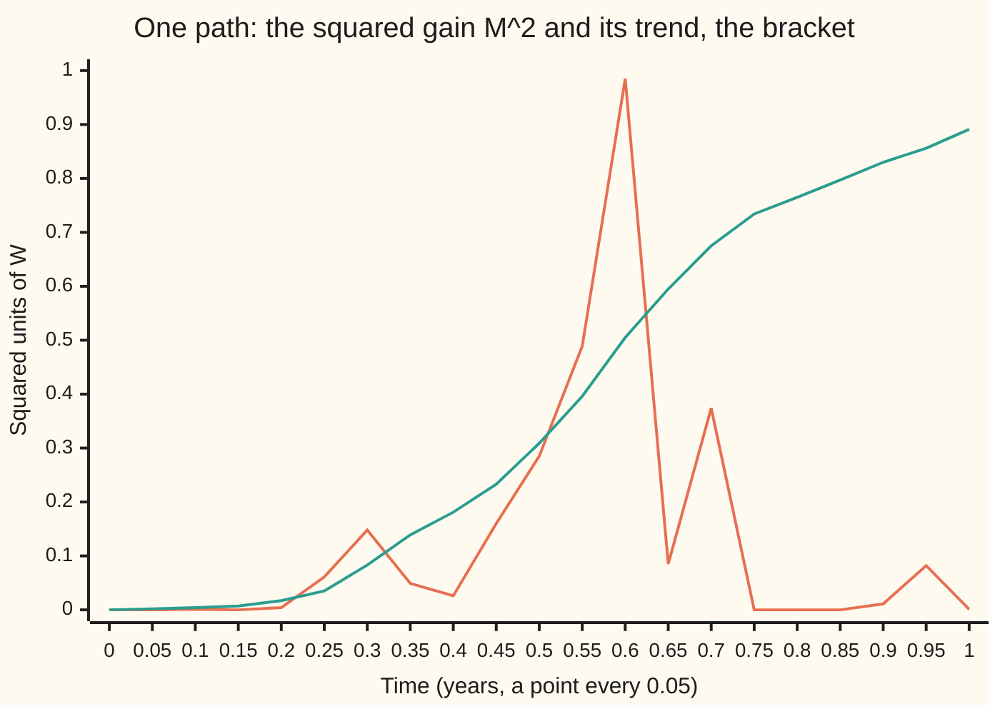

# Doob-Meyer: every submartingale is a martingale plus a rising trend, and the bracket of a martingale

[Syllabus](../../../SYLLABUS.md) → [Stochastic processes and calculus](../README.md) → [Continuous Martingales](../README.md#s10) → Doob-Meyer

---

## General Overview

An asset's price moves like a Brownian motion: $`W_t`$ is how far it stands above its start. A trader holds $`W_t`$ units of it: long when the price stands above its start, short below. Brownian motion is the random walk seen from far away ([Brownian motion](../05-Brownian%20Motion/01-brownian-motion.md)): its moves are independent, with mean 0 and variance equal to the time they take. The trader's gain after $`t`$ years is the Ito integral $`M_t = \int_0^t W_s\,dW_s = (W_t^2 - t)/2`$ ([The Ito integral](../06-Ito%20Calculus/01-ito-integral.md)). It is a fair game: its average is 0 at every time.

A fair game's square is not fair. $`M_t^2`$ measures how far the gain has strayed from 0, and that distance grows on average. This card finds the exact rate. The square drifts up at speed $`W_t^2`$: fast when the holding is big, slow when it is near zero. Add that speed over the first year and average it: $`\int_0^1 s\,ds = 1/2`$. So the gain's variance after one year is $`E[M_1^2] = 1/2`$, found without ever working out the law of $`M_1`$.

A second game: a switchboard takes calls at 4 an hour. The count $`N_t`$ only rises, so it is not fair. Take away its trend, $`4t`$, and $`N_t - 4t`$ is fair. Square that and the trend is $`4t`$ again: the variance of the count after one hour is 4, and after an eight-hour shift 32.

Both splits are one theorem. A **submartingale** is a process whose best forecast of the future is at least its value now: it drifts up on average. The **Doob-Meyer decomposition** splits it into a fair game plus a rising trend that is known just before it happens. Applied to the square of a fair game, the trend is called the **bracket**, written $`\langle M\rangle_t`$: the fair game's own clock.

**Every submartingale splits, in exactly one way, into a fair game plus a rising trend fixed just before it happens (in continuous time, given the tail condition called class D); for the square of a fair game $`M`$ that trend is the bracket $`\langle M\rangle`$, and for a continuous $`M`$ it equals the sum of squared steps.**

**What kind of fact this is:** a theorem. The discrete Doob decomposition is proved on this card in Why it works. The continuous Doob-Meyer theorem is stated, and proved here only for the square of a continuous martingale with finite variance, in outline with the key steps in a fold.

### The picture: the square wanders, its trend climbs



Two lines on one simulated path (20,480 steps, seed 7 in the code). Orange: the squared gain $`M_t^2`$, which jumps about and ends near 0, since $`M_1 = -0.0285`$. Green: the bracket $`\langle M\rangle_t = \int_0^t W_s^2\,ds`$, which only climbs, to 0.8913. Their difference $`M_t^2 - \langle M\rangle_t`$ is a fair game: on this path it ends well below 0, on others well above, and on average at 0.

---

## The formula

Notation first, in words. $`\mathcal F_t`$ is what is known by time $`t`$: the whole history so far. $`E[X \mid \mathcal F_s]`$ is the best forecast of $`X`$ given what is known at time $`s`$ ([Martingales](../02-Martingales/01-martingales.md)). A **martingale** is a fair game: $`E[M_t \mid \mathcal F_s] = M_s`$ for $`s \le t`$. A **submartingale** $`Z`$ has $`E[Z_t \mid \mathcal F_s] \ge Z_s`$ instead.

**In discrete time** (rounds $`n = 0, 1, 2, \dots`$), the trend adds up, round by round, the forecast rise of the next round:

```math
Z_n = Z_0 + M_n + A_n, \qquad A_n = \sum_{k=1}^{n} E\big[Z_k - Z_{k-1} \mid \mathcal F_{k-1}\big], \qquad M_n = Z_n - Z_0 - A_n.
```

**Read it aloud:** the process is where it started, plus a fair game, plus the sum of the rises it was forecast to make one round ahead.

Each term of $`A_n`$ is known one round early: $`A`$ is **predictable**. If $`Z`$ is a submartingale, every term is at least 0, so $`A`$ rises.

**In continuous time** (Doob-Meyer), a right-continuous submartingale of class D (defined under When it holds) splits in exactly one way as

```math
Z_t = Z_0 + M_t + A_t,
```

with $`M`$ a martingale starting at 0 and $`A`$ rising, starting at 0, and predictable. If $`Z`$ has continuous paths, so does $`A`$.

**The bracket.** If $`M`$ is a continuous martingale with $`E[M_t^2]`$ finite, then $`M^2`$ is a submartingale, and its trend is the bracket $`\langle M\rangle`$:

```math
M_t^2 - \langle M\rangle_t \text{ is a martingale}, \qquad \langle M\rangle_t = [M]_t = \lim_{n\to\infty} \sum_{k} \big(M_{t_{k+1}} - M_{t_k}\big)^2 .
```

**Read it aloud:** the bracket is the rising trend hidden in the square of a fair game, and for a continuous fair game it is the sum of its squared steps, which is its quadratic variation.

Taking averages gives the rule used most: $`E[M_t^2] = E[M_0^2] + E\langle M\rangle_t`$. Two brackets carry this card:

```math
\Big\langle \int_0^{\cdot} H_s\,dW_s \Big\rangle_t = \int_0^t H_s^2\,ds, \qquad \big\langle N - \lambda t \big\rangle_t = \lambda t .
```

**Read it aloud:** the clock of an Ito integral runs at the squared holding, and the clock of a Poisson count with its trend removed runs at the call rate.

In the house example $`H_s = W_s`$, so $`\langle M\rangle_t = \int_0^t W_s^2\,ds`$ and $`E\langle M\rangle_1 = \int_0^1 s\,ds = 1/2`$. For the switchboard $`\lambda = 4`$, so the bracket is $`4t`$.

| Symbol | Plain meaning | In our example | Push it up and the answer… |
| --- | --- | --- | --- |
| $`t`$, $`s`$ | time in years (calls: hours); an earlier time | $`t = 1`$ | brackets grow with time |
| $`W_t`$ | Brownian motion: moves independent, variance equal to elapsed time | $`W_1 = -0.9710`$ on the pictured path | — |
| $`\mathcal F_t`$ | what is known by time $`t`$ | the path of $`W`$ up to $`t`$ | — |
| $`E[\cdot]`$, $`E[\cdot \mid \mathcal F_s]`$ | the average; the best forecast given time-$`s`$ knowledge | $`E[M_1^2] = 0.5`$ | — |
| $`Z_n`$, $`Z_t`$ | a submartingale to be split | $`M_t^2`$; or $`N_t`$ | — |
| $`M_n`$, $`M_t`$ | the fair game: the martingale part | $`(W_t^2 - t)/2`$; or $`N_t - 4t`$ | — |
| $`A_n`$, $`A_t`$ | the trend: rising, known just before it happens | $`\int_0^t W_s^2\,ds`$; or $`4t`$ | — |
| $`\langle M\rangle_t`$ | the bracket: the trend of $`M^2`$ | 0.8913 at $`t = 1`$ on the path; average 0.5 | the variance $`E[M_t^2]`$ rises one for one |
| $`[M]_t`$ | quadratic variation: the limit of summed squared steps | 0.8724 on 20,480 steps; for calls, $`N_t`$ | — |
| $`H_s`$ | the holding in an Ito integral | $`W_s`$ | the bracket grows with its square |
| $`N_t`$, $`\lambda`$ | calls by time $`t`$; calls per hour | 5 calls in simulated hour 1; $`\lambda = 4`$ | bracket $`\lambda t`$ rises with the rate |
| $`n`$, $`m`$, $`k`$, $`t_k`$, $`\Delta M_k`$, $`T`$; $`\tau`$, $`D`$, $`c`$, $`Q`$, $`V`$ | grid counts; a step number; grid times; one step of $`M`$; the end time. In the proofs: a stopping time, a difference of trends, a stopping level, summed squared steps, a bound on travel | 10 and 100 tree steps | finer grids: sums nearer the bracket |

### When it holds

- **A submartingale, for a rising trend.** Any process with finite averages has a discrete Doob decomposition, but $`A`$ rises only when the process drifts up. For a supermartingale (drifting down) the trend falls.
- **The trend must be predictable, or the split is not unique.** For the calls, $`(N_t - 4t)^2 - N_t`$ is a fair game too. But $`N_t`$ jumps without warning, so it is not predictable. Drop the word and both $`4t`$ and $`N_t`$ qualify.
- **Class D, in continuous time.** Class D means the values $`Z_\tau`$ at all stopping times $`\tau`$ (random times recognised when they arrive) are uniformly integrable: no far tail carries a fixed share of the average. Without it, the fair part may be only a local martingale ([Continuous martingales and local martingales](01-continuous-martingales-and-local-martingales.md)).
- **Continuity, for the bracket to equal quadratic variation.** With jumps they differ. In simulated hour 1 the switchboard took 5 calls, so $`[M]_1 = 5`$, while $`\langle M\rangle_1 = 4`$. Only their averages agree.
- **Finite variance, $`E[M_t^2] < \infty`$.** Otherwise $`M^2`$ has no average to split. For continuous local martingales the bracket still exists, built by stopping before $`M`$ grows large.

---

## Why it works

### Step 0: forecast rises are known in advance, so collect them

Stand at round $`k - 1`$. The best forecast of the next round's rise, $`E[Z_k - Z_{k-1} \mid \mathcal F_{k-1}]`$, is a number known now. Put that number in the trend. What is left of the rise has forecast 0, so it is a fair bet. Add the rounds: trend plus fair game.

The split is unique because a fair game that is known one round ahead cannot move. Its forecast is its next value, and its forecast is also its current value.

### Step 1: the discrete Doob decomposition, proved

Existence is the recipe in The formula. The [Martingales](../02-Martingales/01-martingales.md) card checks that $`M`$ is then a martingale, and that each term of $`A`$ is at least 0 for a submartingale. Uniqueness takes four lines.

<details>
<summary>Detailed proof: the split is unique</summary>

Suppose $`Z_n = Z_0 + M_n + A_n = Z_0 + M'_n + A'_n`$, both with a martingale part starting at 0 and a predictable part starting at 0. Put $`D_n = A_n - A'_n = M'_n - M_n`$.

$`D`$ is a martingale, as a difference of martingales. $`D`$ is predictable, as a difference of predictable processes, so $`D_n`$ is fixed by $`\mathcal F_{n-1}`$. Then

$`\displaystyle D_n = E[D_n \mid \mathcal F_{n-1}] = D_{n-1}.`$

The first equality holds because $`D_n`$ is known at round $`n - 1`$; the second is the martingale property. So $`D_n = D_0 = 0`$ for every $`n`$, and the two splits are the same.

</details>

### Step 2: the house example on a coin-toss tree

Replace Brownian motion by a coin-toss walk with $`n`$ steps of size $`1/\sqrt n`$ in one year. For this walk the Ito sum is exactly $`M_k = (W_{t_k}^2 - t_k)/2`$, as on [The Ito integral](../06-Ito%20Calculus/01-ito-integral.md) card. Run Doob's recipe on $`Z = M^2`$ at every node of the tree: average the two children, subtract the parent.

The answer at every node is $`W_{t_k}^2 \times 1/n`$: the holding squared, times the time step. The code checks all 55 nodes of a 10-step tree and all 5,050 of a 100-step tree, in whole numbers. The square of the step of $`M`$ gives the same $`W_{t_k}^2/n`$, so on a coin walk the trend and the summed squared steps agree exactly.

Averages then agree as the recipe promises: $`E[M_1^2] = E[A] = 9/20 = 0.450000`$ on 10 steps and $`99/200 = 0.495000`$ on 100. In general it is $`(n-1)/(2n)`$, which climbs to $`1/2`$.

### Step 3: Doob-Meyer in continuous time, stated

Run the recipe on finer and finer grids: steps of $`2^{-m}`$ years, $`m = 1, 2, \dots`$. Each grid gives its own trend. The theorem says these trends settle on one rising, predictable process $`A`$. Paul-André Meyer proved it in 1962. Class D is what stops the grid trends from leaking average into a far tail.

<details>
<summary>The continuous theorem, in outline</summary>

Take a right-continuous submartingale $`Z`$ of class D on the times 0 to $`T`$. On the grid of step $`2^{-m}T`$, the discrete recipe gives a trend $`A^{(m)}`$ and a martingale $`Z - Z_0 - A^{(m)}`$.

Class D gives a bound that does not depend on $`m`$: the values $`A^{(m)}_T`$ are uniformly integrable. Uniformly integrable families have limits in a weak sense (averages against every bounded variable converge) along a subsequence. Call the limit $`A_T`$.

Define $`A_t`$ from $`A_T`$ through the martingale property, $`A_t = Z_t - Z_0 - E[Z_T - Z_0 - A_T \mid \mathcal F_t]`$. Each grid trend rises, so $`A`$ rises on grid times, and right-continuity fills in the rest. Predictability passes to the limit too, which is the delicate step. Uniqueness copies Step 1: a predictable martingale with paths of finite travel that starts at 0 stays at 0.

Rao (1969) gave this proof by discrete approximation. Karatzas and Shreve, Section 1.4, write it out in full.

</details>

### Step 4: the bracket of a continuous martingale is its quadratic variation

This is the case the card proves. Take a continuous martingale $`M`$ with finite variance. Cut the time from 0 to $`t`$ at grid times $`t_k`$ and write each step as $`\Delta M_k = M_{t_{k+1}} - M_{t_k}`$. Expanding a square gives an exact identity:

```math
M_t^2 - M_0^2 = 2\sum_k M_{t_k}\,\Delta M_k + \sum_k (\Delta M_k)^2 .
```

**Read it aloud:** the change in the square is twice a betting gain plus the sum of squared steps.

The first sum is a bet of $`2M_{t_k}`$ on each step, fixed before the step. By [Betting on a martingale](../02-Martingales/02-predictable-bets-and-the-martingale-transform.md) it is a fair game. So $`M^2`$ minus the summed squared steps is fair at every grid time.

As the grid gets finer, the summed squared steps converge, and the limit $`[M]_t`$ rises and is continuous. A continuous rising process is predictable. So $`M^2 - [M]`$ is a martingale with a continuous rising trend $`[M]`$, which is the Doob-Meyer split of $`M^2`$. By uniqueness, $`\langle M\rangle = [M]`$.

<details>
<summary>Detailed proof: why the sums converge, and why the split is unique</summary>

**Bounded case first.** Stop $`M`$ when $`\lvert M\rvert`$ first reaches a level $`c`$; this is the localising step, removed at the end by letting $`c`$ grow. Write $`Q^{(n)}_t`$ for the summed squared steps on grid $`n`$.

**Cauchy in mean square.** For two grids, refine both to their common grid. $`Q^{(n)} - Q^{(m)}`$ is then a betting gain (Step 4's identity on each grid), with stakes of the form $`2(M_{t_k} - M_{s_j})`$, where $`s_j`$ is the last point of the coarser grid before $`t_k`$. Its mean square is the average of stake squared times squared step, at most $`4\,E\big[\max_k (M_{t_k} - M_{s_j})^2\, Q_t\big]`$. Continuity makes the maximum go to 0 as both grids refine, and $`E[(Q_t)^2]`$ stays bounded for bounded $`M`$ (at most $`6c^4`$ by the same identity). So the sums converge in mean square, and Doob's maximal inequality makes the convergence uniform in time along a subsequence.

**Uniqueness.** Suppose $`D`$ is a continuous martingale, starting at 0, whose paths have finite travel: the sum of $`\lvert\Delta D_k\rvert`$ stays below some $`V`$ on every grid. By the identity above with $`D`$ in place of $`M`$,

$`\displaystyle E[D_t^2] = E\Big[\sum_k (\Delta D_k)^2\Big] \le E\Big[\max_k \lvert\Delta D_k\rvert \cdot V\Big] \to 0 .`$

So $`D = 0`$. If $`M^2 - A`$ and $`M^2 - A'`$ are both martingales with continuous rising $`A`$, $`A'`$, then $`D = A' - A`$ is such a martingale, and $`A = A'`$.

</details>

One simulated path, with the true bracket $`\int_0^1 W_s^2\,ds = 0.8913`$:

```
squared steps of M, 20 steps     ███████████████████████████ 1.3612
squared steps of M, 320 steps    █████████████████ 0.8361
squared steps of M, 5,120 steps  ██████████████████ 0.9133
squared steps of M, 20,480 steps █████████████████ 0.8724
bracket, int of W^2 ds           ██████████████████ 0.8913
```

The sums settle on the bracket. The bracket is a feature of the path, not only of averages.

### Step 5: brackets of Ito integrals

For a holding $`H`$ fixed at each grid time $`t_k`$, the gain over a stretch is $`H_{t_k}\,\Delta W_k`$. Its forecast square is

```math
E\big[(H_{t_k}\,\Delta W_k)^2 \mid \mathcal F_{t_k}\big] = H_{t_k}^2\,E\big[(\Delta W_k)^2\big] = H_{t_k}^2\,(t_{k+1} - t_k).
```

**Read it aloud:** a known holding squared times the variance of a fresh move, which is its length in time.

Added up, that is Doob's recipe for the square, and it builds $`\int_0^t H_s^2\,ds`$. The limit from simple holdings to general ones is the one on [The Ito integral](../06-Ito%20Calculus/01-ito-integral.md) card. Taking averages gives that card's isometry, $`E[M_t^2] = E\int_0^t H_s^2\,ds`$, read here as "variance equals average bracket".

For the house example, two roads give $`1/2`$ at $`t = 1`$:

- **The bracket.** $`E[W_s^2] = s`$, so $`E\langle M\rangle_1 = \int_0^1 s\,ds = 1/2`$.
- **The square, directly.** $`E[M_1^2] = E[(W_1^2 - 1)^2]/4 = (E[W_1^4] - 2E[W_1^2] + 1)/4 = (3 - 2 + 1)/4 = 1/2`$.

[Ito's lemma](../06-Ito%20Calculus/02-itos-lemma.md) gives a third road: applied to $`M_t^2 = (W_t^2 - t)^2/4`$, its $`dt`$ terms add to $`W_t^2\,dt`$, the bracket's speed.

### Step 6: the calls, where the bracket and the squared jumps part ways

The count $`N_t`$ is a submartingale: it only rises. Its Doob-Meyer trend is $`4t`$, since a Poisson process gains $`4h`$ calls on average over $`h`$ hours whatever has happened ([Poisson process](../04-Poisson%20and%20Jump%20Processes/01-poisson-process.md)). So $`M_t = N_t - 4t`$ is the fair part.

Now square it. For $`s < t`$, the future count $`N_t - N_s`$ is independent of the past, with variance $`4(t - s)`$. The cross term $`2M_s\,E[M_t - M_s \mid \mathcal F_s]`$ is 0. So

```math
E\big[M_t^2 - M_s^2 \mid \mathcal F_s\big] = E\big[(M_t - M_s)^2 \mid \mathcal F_s\big] = 4(t - s),
```

and the bracket is $`\langle M\rangle_t = 4t`$.

The summed squared steps tell a different story. $`M`$ moves smoothly down at rate 4 between calls and jumps up by 1 at each call. The smooth part contributes nothing to the squared steps; each jump contributes $`1^2`$. So $`[M]_t = N_t`$: random, and rising only at calls.

Both $`M^2 - 4t`$ and $`M^2 - N_t`$ are fair games. Doob-Meyer picks $`4t`$ because it is predictable. A jump that comes without warning is not.

A grid version shows the recipe at work. Split the hour into slots, each holding a call with chance $`4/\text{slots}`$. The recipe's trend for $`(N - 4t)^2`$ over the hour is 3.733333 with 60 slots and 3.995556 with 3,600, closing on 4.

---

## Worked numbers, by hand

| Step | Arithmetic | Value |
| --- | --- | --- |
| moments of $`W_1`$ | Simpson's rule on the bell curve | $`E[W_1^2] = 1`$, $`E[W_1^4] = 3`$ |
| square of the gain | $`(3 - 2 \times 1 + 1)/4`$ | $`E[M_1^2] = 0.5`$ |
| average bracket | $`\int_0^1 s\,ds`$ | $`E\langle M\rangle_1 = 0.5`$ |
| coin tree, 10 steps | Doob's recipe at all 55 nodes; $`(10 - 1)/20`$ | 9/20 = 0.450000 |
| coin tree, 100 steps | all 5,050 nodes; $`(100 - 1)/200`$ | 99/200 = 0.495000 |
| 4,000 simulated paths | average of $`M_1^2`$; average of $`\int_0^1 W_s^2\,ds`$ | 0.4877 ± 0.0282; 0.4987 ± 0.0091 |
| calls, one hour | $`\sum_k P(N_1 = k)(k - 4)^2`$ | $`E[(N_1 - 4)^2] = 4`$ |
| calls, 20,000 simulated hours | average of $`(N_1 - 4)^2`$ | 4.0325 ± 0.0449 |
| calls, an 8-hour shift | variance = bracket $`4 \times 8`$; spread = its square root | **variance 32, spread 5.656854 calls** |

The gain from holding $`W`$ has variance 1/2 after a year, and a switchboard at 4 an hour has a shift count with variance 32 (calls squared), a spread of 5.656854 calls: each variance is an average bracket.

### What breaks if you drop a piece

| Mistake | Comes out at | What went wrong |
| --- | --- | --- |
| Holding not squared: bracket taken as $`\int W_s\,ds`$ | −0.0124 ± 0.0091, consistent with 0, not 0.5 | the clock runs at $`H^2`$, never $`H`$ |
| Using $`W`$'s own clock, $`[W]_1 = 1`$ | 1.0006 ± 0.0016, not 0.5 | $`M`$ is $`W`$ seen through the holding; its clock is $`\int W^2\,ds`$ |
| Squaring the count without removing $`4t`$ | $`E[N_1^2] = 20`$, not 4 | the trend of $`N^2`$ includes $`(4t)^2`$; only the fair part's square gives the variance |
| Squared jumps used as the bracket | 5 in simulated hour 1, not 4 | $`[M] = N_t`$ is not predictable; it agrees with $`\langle M\rangle`$ only on average |

The code prints all four.

---

## Code, from first principles, and it actually runs

Both programs take three independent roads to $`E[M_1^2] = E\langle M\rangle_1 = 1/2`$ and to the calls' bracket of 4. Road 1 is the formulas, with the normal's moments found by Simpson's rule. Road 2 runs Doob's recipe exactly on a coin-toss tree, in whole numbers, and checks it at every node. Road 3 simulates Brownian paths and call counts with a seeded generator (SplitMix64 and Box-Muller, written out), printing each average with its standard error and asserting it lies within four of them. A single fine path checks that the summed squared steps of $`M`$ settle on its bracket.

### Python

```python
# Doob-Meyer -- the check behind the card.  Standard library only.
# House example: M_t = integral of W against W = (W_t^2 - t)/2, W a Brownian motion.
# Its bracket <M>_t = integral of W_s^2 ds, so E[M_1^2] = E<M>_1 = 1/2.
# Calls at 4 an hour: N_t - 4t is a martingale whose bracket is 4t.
# Road 1: the formulas, with the normal's moments by Simpson's rule.
# Road 2: Doob's recipe run exactly on a coin-toss tree, in whole numbers.
# Road 3: seeded simulation (SplitMix64 and Box-Muller, written out).
import math

MASK = (1 << 64) - 1

class Rng:
    def __init__(self, seed): self.s = seed
    def u(self):  # uniform on [0, 1), 53 bits
        z = self.s = (self.s + 0x9E3779B97F4A7C15) & MASK
        z = ((z ^ (z >> 30)) * 0xBF58476D1CE4E5B9) & MASK
        z = ((z ^ (z >> 27)) * 0x94D049BB133111EB) & MASK
        return ((z ^ (z >> 31)) >> 11) / 9007199254740992.0
    def normal(self):  # Box-Muller, cosine branch
        a, b = 1.0 - self.u(), self.u()
        return math.sqrt(-2.0 * math.log(a)) * math.cos(2.0 * math.pi * b)

def simpson(f, a, b, n=2000):
    h, s = (b - a) / n, f(a) + f(b)
    for i in range(1, n):
        s += (4.0 if i % 2 else 2.0) * f(a + i * h)
    return s * h / 3.0

def mean_se(xs):
    s = q = 0.0
    for x in xs: s, q = s + x, q + x * x
    m = s / len(xs)
    return m, math.sqrt((q - len(xs) * m * m) / (len(xs) - 1) / len(xs))

# ---- road 1: formulas ----
phi = lambda z: math.exp(-z * z / 2) / math.sqrt(2 * math.pi)
m2, m4 = simpson(lambda z: z**2 * phi(z), -12, 12), simpson(lambda z: z**4 * phi(z), -12, 12)
print(f"road 1: E[W_1^2] = {m2:.6f}, E[W_1^4] = {m4:.6f} (Simpson)")
for t in (1.0, 2.0):
    em2 = (m4 * t * t - 2 * t * m2 * t + t * t) / 4    # E[(W_t^2 - t)^2]/4
    ea = simpson(lambda s: m2 * s, 0, t)                # E int_0^t W_s^2 ds
    print(f"t = {t:.0f}: E[M_t^2] = {em2:.6f}, E<M>_t = {ea:.6f}")
    assert abs(em2 - t * t / 2) < 1e-9 and abs(ea - em2) < 1e-9

# ---- road 2: Doob's recipe on a coin-toss tree, n steps of size 1/sqrt(n) ----
# Walk S (sum of +-1), W = S/sqrt(n), M = (S^2 - k)/(2n); work with 4n^2 M^2 = (S^2-k)^2.
def tree(n):
    z = lambda k, s: (s * s - k) ** 2
    bad = 0
    for k in range(n):
        for s in range(-k, k + 1, 2):
            recipe = z(k + 1, s + 1) + z(k + 1, s - 1) - 2 * z(k, s)  # 2 x 4n^2 x trend step
            dm = (s + 1) ** 2 - (k + 1) - (s * s - k)                  # 2n x step of M
            bad += recipe != 8 * s * s or dm * dm != 4 * s * s         # trend = (dM)^2 = W^2 dt
    c, ez = 1, 0
    for j in range(n + 1):
        ez += c * z(n, 2 * j - n)
        c = c * (n - j) // (j + 1)
    ea = 0
    for k in range(n):
        c, sk = 1, 0
        for j in range(k + 1):
            sk += c * (2 * j - k) ** 2
            c = c * (k - j) // (j + 1)
        ea += sk * 2 ** (n - k) * 4                                    # E[S_k^2]/n^2, scaled
    den = 2**n * 4 * n * n
    g, h = math.gcd(ez, den), math.gcd(ea, den)
    return n * (n + 1) // 2, bad, (ez // g, den // g), (ea // h, den // h)

for n in (10, 100):
    nodes, bad, ez, ea = tree(n)
    print(f"tree, {n} steps: recipe = W^2 dt = (dM)^2 at {nodes - bad} of {nodes} nodes")
    print(f"  E[M^2] = {ez[0]}/{ez[1]} = {ez[0] / ez[1]:.6f}, E[A] = {ea[0]}/{ea[1]}")
    assert bad == 0 and ez == ea and ez[0] * 2 * n == ez[1] * (n - 1)

# ---- road 3: Brownian paths ----
rng, P, n, cols = Rng(20261123), 4000, 200, [[] for _ in range(5)]
dt, sq = 1.0 / n, math.sqrt(1.0 / n)
for _ in range(P):
    w = a = q = qw = iw = mprev = 0.0
    for k in range(n):
        dw = sq * rng.normal()
        a += (w * w + (w + dw) ** 2) / 2 * dt   # trapezoid for int W^2 ds
        iw += (w + w + dw) / 2 * dt             # int W ds, the unsquared mistake
        w, qw = w + dw, qw + dw * dw
        m = (w * w - (k + 1) * dt) / 2
        q, mprev = q + (m - mprev) ** 2, m
    for c, v in zip(cols, (mprev * mprev, a, q, iw, qw)): c.append(v)
names = ["E[M_1^2]", "E<M>_1 = E int W^2 ds", "E[sum (dM)^2]", "mistake E int W ds", "mistake E[W]_1"]
for name, c, want in zip(names, cols, (0.5, 0.5, 0.5, 0.0, 1.0)):
    m, se = mean_se(c)
    print(f"sim {P} paths x {n} steps: {name} = {m:.4f} +- {se:.4f}")
    assert abs(m - want) < 4 * se

# one path, fine grid: the squared steps of M settle on int W^2 ds
fine, rng, ws = 20480, Rng(7), [0.0]
for _ in range(fine):
    ws.append(ws[-1] + math.sqrt(1.0 / fine) * rng.normal())
ms = [(w * w - i / fine) / 2 for i, w in enumerate(ws)]
br = [0.0]
for i in range(fine):
    br.append(br[-1] + (ws[i] ** 2 + ws[i + 1] ** 2) / 2 / fine)
print(f"one path: W_1 = {ws[-1]:.4f}, M_1 = {ms[-1]:.4f}, <M>_1 = int W^2 ds = {br[-1]:.4f}")
for steps in (20, 320, 5120, 20480):
    j, qv = fine // steps, 0.0
    for i in range(steps): qv += (ms[(i + 1) * j] - ms[i * j]) ** 2
    print(f"  sum of squared steps of M, {steps:5d} steps: {qv:.4f}")
assert abs(qv - br[-1]) < 0.05
print("chart M^2:", ", ".join(f"{ms[i * 1024] ** 2:.3f}" for i in range(21)))
print("chart <M>:", ", ".join(f"{br[i * 1024]:.3f}" for i in range(21)))

# ---- calls at 4 an hour ----
lam = 4.0
p, e2c, e2, p4 = math.exp(-lam), 0.0, 0.0, 0.0
for k in range(100):
    e2c, e2, p4 = e2c + p * (k - lam) ** 2, e2 + p * k * k, p if k == 4 else p4
    p = p * lam / (k + 1)
print(f"Poisson sums: E[(N_1-4)^2] = {e2c:.6f}, E[N_1^2] = {e2:.6f}, P(N_1 = 4) = {p4:.6f}")
assert abs(e2c - lam) < 1e-12 and abs(e2 - lam - lam * lam) < 1e-12
for slots in (60, 3600):
    pp = lam / slots
    for m in (-3.5, 0.0, 2.25):  # recipe one slot ahead, from the two outcomes
        step = pp * (m + 1 - pp) ** 2 + (1 - pp) * (m - pp) ** 2 - m * m
        assert abs(step - pp * (1 - pp)) < 1e-12
    print(f"{slots} slots an hour: trend of (N - 4t)^2 over the hour = {slots * step:.6f}")
rng, H = Rng(20261124), 20000
counts = []
for _ in range(H):
    t, c = -math.log(1.0 - rng.u()) / lam, 0
    while t <= 1.0: c, t = c + 1, t - math.log(1.0 - rng.u()) / lam
    counts.append(c)
print(f"hour 1 of the simulation: N_1 = {counts[0]}, so [M]_1 = {counts[0]}; <M>_1 = 4")
for name, xs, want in (("E[N_1]", counts, lam), ("E[(N_1-4)^2] = E<M>_1", [(c - lam) ** 2 for c in counts], lam),
                       ("P(N_1 = 4)", [1.0 if c == 4 else 0.0 for c in counts], p4),
                       ("mistake E[N_1^2]", [c * c * 1.0 for c in counts], e2)):
    m, se = mean_se(xs)
    print(f"sim {H} hours: {name} = {m:.4f} +- {se:.4f}")
    assert abs(m - want) < 4 * se
print(f"8-hour shift: <M>_8 = {8 * lam:.0f}, spread sqrt(32) = {math.sqrt(8 * lam):.6f} calls")
print("ALL CHECKS PASS")
```

**Ran 2026-11-23 on macOS, Python 3.14.10, standard library only. All checks passed. Output, pasted from the run:**

```
road 1: E[W_1^2] = 1.000000, E[W_1^4] = 3.000000 (Simpson)
t = 1: E[M_t^2] = 0.500000, E<M>_t = 0.500000
t = 2: E[M_t^2] = 2.000000, E<M>_t = 2.000000
tree, 10 steps: recipe = W^2 dt = (dM)^2 at 55 of 55 nodes
  E[M^2] = 9/20 = 0.450000, E[A] = 9/20
tree, 100 steps: recipe = W^2 dt = (dM)^2 at 5050 of 5050 nodes
  E[M^2] = 99/200 = 0.495000, E[A] = 99/200
sim 4000 paths x 200 steps: E[M_1^2] = 0.4877 +- 0.0282
sim 4000 paths x 200 steps: E<M>_1 = E int W^2 ds = 0.4987 +- 0.0091
sim 4000 paths x 200 steps: E[sum (dM)^2] = 0.4992 +- 0.0094
sim 4000 paths x 200 steps: mistake E int W ds = -0.0124 +- 0.0091
sim 4000 paths x 200 steps: mistake E[W]_1 = 1.0006 +- 0.0016
one path: W_1 = -0.9710, M_1 = -0.0285, <M>_1 = int W^2 ds = 0.8913
  sum of squared steps of M,    20 steps: 1.3612
  sum of squared steps of M,   320 steps: 0.8361
  sum of squared steps of M,  5120 steps: 0.9133
  sum of squared steps of M, 20480 steps: 0.8724
chart M^2: 0.000, 0.000, 0.001, 0.000, 0.004, 0.061, 0.148, 0.049, 0.026, 0.160, 0.285, 0.489, 0.985, 0.085, 0.374, 0.000, 0.000, 0.000, 0.011, 0.082, 0.001
chart <M>: 0.000, 0.002, 0.004, 0.007, 0.017, 0.035, 0.083, 0.139, 0.181, 0.233, 0.309, 0.396, 0.505, 0.595, 0.675, 0.734, 0.765, 0.797, 0.830, 0.856, 0.891
Poisson sums: E[(N_1-4)^2] = 4.000000, E[N_1^2] = 20.000000, P(N_1 = 4) = 0.195367
60 slots an hour: trend of (N - 4t)^2 over the hour = 3.733333
3600 slots an hour: trend of (N - 4t)^2 over the hour = 3.995556
hour 1 of the simulation: N_1 = 5, so [M]_1 = 5; <M>_1 = 4
sim 20000 hours: E[N_1] = 4.0259 +- 0.0142
sim 20000 hours: E[(N_1-4)^2] = E<M>_1 = 4.0325 +- 0.0449
sim 20000 hours: P(N_1 = 4) = 0.2016 +- 0.0028
sim 20000 hours: mistake E[N_1^2] = 20.2397 +- 0.1362
8-hour shift: <M>_8 = 32, spread sqrt(32) = 5.656854 calls
ALL CHECKS PASS
```

### Rust

```rust
// Doob-Meyer -- the check behind the card.  std only, no crates.
// House example: M_t = integral of W against W = (W_t^2 - t)/2, W a Brownian motion.
// Its bracket <M>_t = integral of W_s^2 ds, so E[M_1^2] = E<M>_1 = 1/2.
// Calls at 4 an hour: N_t - 4t is a martingale whose bracket is 4t.
// Road 1: the formulas, with the normal's moments by Simpson's rule.
// Road 2: Doob's recipe run exactly on a coin-toss tree, in whole numbers.
// Road 3: seeded simulation (SplitMix64 and Box-Muller, written out).
use std::f64::consts::PI;

struct Rng { s: u64 }
impl Rng {
    fn u(&mut self) -> f64 { // uniform on [0, 1), 53 bits
        self.s = self.s.wrapping_add(0x9E3779B97F4A7C15);
        let mut z = self.s;
        z = (z ^ (z >> 30)).wrapping_mul(0xBF58476D1CE4E5B9);
        z = (z ^ (z >> 27)).wrapping_mul(0x94D049BB133111EB);
        ((z ^ (z >> 31)) >> 11) as f64 / 9007199254740992.0
    }
    fn normal(&mut self) -> f64 { // Box-Muller, cosine branch
        let (a, b) = (1.0 - self.u(), self.u());
        (-2.0 * a.ln()).sqrt() * (2.0 * PI * b).cos()
    }
}

fn simpson<F: Fn(f64) -> f64>(f: F, a: f64, b: f64) -> f64 {
    let (n, mut s) = (2000, f(a) + f(b));
    let h = (b - a) / n as f64;
    for i in 1..n { s += if i % 2 == 1 { 4.0 } else { 2.0 } * f(a + i as f64 * h); }
    s * h / 3.0
}

fn mean_se(xs: &[f64]) -> (f64, f64) {
    let (mut s, mut q) = (0.0, 0.0);
    for &x in xs { s += x; q += x * x; }
    let (n, m) = (xs.len() as f64, s / xs.len() as f64);
    (m, ((q - n * m * m) / (n - 1.0) / n).sqrt())
}

fn gcd(a: i128, b: i128) -> i128 { if b == 0 { a.abs() } else { gcd(b, a % b) } }

// Walk S (sum of +-1), W = S/sqrt(n), M = (S^2 - k)/(2n); work with 4n^2 M^2 = (S^2-k)^2.
fn tree(n: i128) -> (i128, i128, (i128, i128), (i128, i128)) {
    let z = |k: i128, s: i128| (s * s - k) * (s * s - k);
    let mut bad = 0;
    for k in 0..n {
        let mut s = -k;
        while s <= k {
            let recipe = z(k + 1, s + 1) + z(k + 1, s - 1) - 2 * z(k, s); // 2 x 4n^2 x trend step
            let dm = (s + 1) * (s + 1) - (k + 1) - (s * s - k);            // 2n x step of M
            if recipe != 8 * s * s || dm * dm != 4 * s * s { bad += 1; }  // trend = (dM)^2 = W^2 dt
            s += 2;
        }
    }
    let (mut c, mut ez) = (1i128, 0i128);
    for j in 0..=n { ez += c * z(n, 2 * j - n); c = c * (n - j) / (j + 1); }
    let mut ea = 0i128;
    for k in 0..n {
        let (mut c, mut sk) = (1i128, 0i128);
        for j in 0..=k { sk += c * (2 * j - k) * (2 * j - k); c = c * (k - j) / (j + 1); }
        ea += sk * (1i128 << (n - k)) * 4; // E[S_k^2]/n^2, scaled
    }
    let den = (1i128 << n) * 4 * n * n;
    let (g, h) = (gcd(ez, den), gcd(ea, den));
    (n * (n + 1) / 2, bad, (ez / g, den / g), (ea / h, den / h))
}

fn main() {
    // ---- road 1: formulas ----
    let phi = |z: f64| (-z * z / 2.0).exp() / (2.0 * PI).sqrt();
    let m2 = simpson(|z| z.powi(2) * phi(z), -12.0, 12.0);
    let m4 = simpson(|z| z.powi(4) * phi(z), -12.0, 12.0);
    println!("road 1: E[W_1^2] = {:.6}, E[W_1^4] = {:.6} (Simpson)", m2, m4);
    for t in [1.0f64, 2.0] {
        let em2 = (m4 * t * t - 2.0 * t * m2 * t + t * t) / 4.0; // E[(W_t^2 - t)^2]/4
        let ea = simpson(|s| m2 * s, 0.0, t);                    // E int_0^t W_s^2 ds
        println!("t = {:.0}: E[M_t^2] = {:.6}, E<M>_t = {:.6}", t, em2, ea);
        assert!((em2 - t * t / 2.0).abs() < 1e-9 && (ea - em2).abs() < 1e-9);
    }

    // ---- road 2: Doob's recipe on a coin-toss tree ----
    for n in [10i128, 100] {
        let (nodes, bad, ez, ea) = tree(n);
        println!("tree, {} steps: recipe = W^2 dt = (dM)^2 at {} of {} nodes", n, nodes - bad, nodes);
        println!("  E[M^2] = {}/{} = {:.6}, E[A] = {}/{}", ez.0, ez.1, ez.0 as f64 / ez.1 as f64, ea.0, ea.1);
        assert!(bad == 0 && ez == ea && ez.0 * 2 * n == ez.1 * (n - 1));
    }

    // ---- road 3: Brownian paths ----
    let (mut rng, p, n) = (Rng { s: 20261123 }, 4000usize, 200usize);
    let (dt, sq) = (1.0 / n as f64, (1.0 / n as f64).sqrt());
    let mut cols: Vec<Vec<f64>> = vec![Vec::new(); 5];
    for _ in 0..p {
        let (mut w, mut a, mut q, mut qw, mut iw, mut mprev) = (0.0f64, 0.0, 0.0, 0.0, 0.0, 0.0);
        for k in 0..n {
            let dw = sq * rng.normal();
            a += (w * w + (w + dw).powi(2)) / 2.0 * dt; // trapezoid for int W^2 ds
            iw += (w + w + dw) / 2.0 * dt;              // int W ds, the unsquared mistake
            w += dw; qw += dw * dw;
            let m = (w * w - (k + 1) as f64 * dt) / 2.0;
            q += (m - mprev).powi(2); mprev = m;
        }
        for (c, v) in cols.iter_mut().zip([mprev * mprev, a, q, iw, qw]) { c.push(v); }
    }
    let names = ["E[M_1^2]", "E<M>_1 = E int W^2 ds", "E[sum (dM)^2]", "mistake E int W ds", "mistake E[W]_1"];
    for ((name, c), want) in names.iter().zip(cols.iter()).zip([0.5, 0.5, 0.5, 0.0, 1.0]) {
        let (m, se) = mean_se(c);
        println!("sim {} paths x {} steps: {} = {:.4} +- {:.4}", p, n, name, m, se);
        assert!((m - want).abs() < 4.0 * se);
    }

    // one path, fine grid: the squared steps of M settle on int W^2 ds
    let (fine, mut rng, mut ws) = (20480usize, Rng { s: 7 }, vec![0.0f64]);
    for _ in 0..fine { let last = ws[ws.len() - 1]; ws.push(last + (1.0 / fine as f64).sqrt() * rng.normal()); }
    let ms: Vec<f64> = ws.iter().enumerate().map(|(i, w)| (w * w - i as f64 / fine as f64) / 2.0).collect();
    let mut br = vec![0.0f64];
    for i in 0..fine { let last = br[i]; br.push(last + (ws[i].powi(2) + ws[i + 1].powi(2)) / 2.0 / fine as f64); }
    println!("one path: W_1 = {:.4}, M_1 = {:.4}, <M>_1 = int W^2 ds = {:.4}", ws[fine], ms[fine], br[fine]);
    let mut qv = 0.0;
    for steps in [20usize, 320, 5120, 20480] {
        let j = fine / steps;
        qv = 0.0;
        for i in 0..steps { qv += (ms[(i + 1) * j] - ms[i * j]).powi(2); }
        println!("  sum of squared steps of M, {:5} steps: {:.4}", steps, qv);
    }
    assert!((qv - br[fine]).abs() < 0.05);
    let line = |v: &Vec<f64>, sq: bool| (0..21).map(|i| { let x = v[i * 1024]; format!("{:.3}", if sq { x * x } else { x }) }).collect::<Vec<_>>().join(", ");
    println!("chart M^2: {}", line(&ms, true));
    println!("chart <M>: {}", line(&br, false));

    // ---- calls at 4 an hour ----
    let lam = 4.0f64;
    let (mut pr, mut e2c, mut e2, mut p4) = ((-lam).exp(), 0.0f64, 0.0f64, 0.0f64);
    for k in 0..100 {
        e2c += pr * (k as f64 - lam).powi(2);
        e2 += pr * (k * k) as f64;
        if k == 4 { p4 = pr; }
        pr = pr * lam / (k + 1) as f64;
    }
    println!("Poisson sums: E[(N_1-4)^2] = {:.6}, E[N_1^2] = {:.6}, P(N_1 = 4) = {:.6}", e2c, e2, p4);
    assert!((e2c - lam).abs() < 1e-12 && (e2 - lam - lam * lam).abs() < 1e-12);
    for slots in [60.0f64, 3600.0] {
        let pp = lam / slots;
        let mut step = 0.0;
        for m in [-3.5f64, 0.0, 2.25] { // recipe one slot ahead, from the two outcomes
            step = pp * (m + 1.0 - pp).powi(2) + (1.0 - pp) * (m - pp).powi(2) - m * m;
            assert!((step - pp * (1.0 - pp)).abs() < 1e-12);
        }
        println!("{:.0} slots an hour: trend of (N - 4t)^2 over the hour = {:.6}", slots, slots * step);
    }
    let (mut rng, h) = (Rng { s: 20261124 }, 20000usize);
    let mut counts: Vec<f64> = Vec::new();
    for _ in 0..h {
        let (mut t, mut c) = (-(1.0 - rng.u()).ln() / lam, 0.0f64);
        while t <= 1.0 { c += 1.0; t -= (1.0 - rng.u()).ln() / lam; }
        counts.push(c);
    }
    println!("hour 1 of the simulation: N_1 = {}, so [M]_1 = {}; <M>_1 = 4", counts[0], counts[0]);
    let dev: Vec<f64> = counts.iter().map(|c| (c - lam).powi(2)).collect();
    let is4: Vec<f64> = counts.iter().map(|&c| if c == 4.0 { 1.0 } else { 0.0 }).collect();
    let sqr: Vec<f64> = counts.iter().map(|c| c * c).collect();
    for (name, xs, want) in [("E[N_1]", &counts, lam), ("E[(N_1-4)^2] = E<M>_1", &dev, lam),
                             ("P(N_1 = 4)", &is4, p4), ("mistake E[N_1^2]", &sqr, e2)] {
        let (m, se) = mean_se(xs);
        println!("sim {} hours: {} = {:.4} +- {:.4}", h, name, m, se);
        assert!((m - want).abs() < 4.0 * se);
    }
    println!("8-hour shift: <M>_8 = {:.0}, spread sqrt(32) = {:.6} calls", 8.0 * lam, (8.0 * lam).sqrt());
    println!("ALL CHECKS PASS");
}
```

**Ran 2026-11-23 on macOS, rustc 1.98.1, no crates. All checks passed. Output, pasted from the run:**

```
road 1: E[W_1^2] = 1.000000, E[W_1^4] = 3.000000 (Simpson)
t = 1: E[M_t^2] = 0.500000, E<M>_t = 0.500000
t = 2: E[M_t^2] = 2.000000, E<M>_t = 2.000000
tree, 10 steps: recipe = W^2 dt = (dM)^2 at 55 of 55 nodes
  E[M^2] = 9/20 = 0.450000, E[A] = 9/20
tree, 100 steps: recipe = W^2 dt = (dM)^2 at 5050 of 5050 nodes
  E[M^2] = 99/200 = 0.495000, E[A] = 99/200
sim 4000 paths x 200 steps: E[M_1^2] = 0.4877 +- 0.0282
sim 4000 paths x 200 steps: E<M>_1 = E int W^2 ds = 0.4987 +- 0.0091
sim 4000 paths x 200 steps: E[sum (dM)^2] = 0.4992 +- 0.0094
sim 4000 paths x 200 steps: mistake E int W ds = -0.0124 +- 0.0091
sim 4000 paths x 200 steps: mistake E[W]_1 = 1.0006 +- 0.0016
one path: W_1 = -0.9710, M_1 = -0.0285, <M>_1 = int W^2 ds = 0.8913
  sum of squared steps of M,    20 steps: 1.3612
  sum of squared steps of M,   320 steps: 0.8361
  sum of squared steps of M,  5120 steps: 0.9133
  sum of squared steps of M, 20480 steps: 0.8724
chart M^2: 0.000, 0.000, 0.001, 0.000, 0.004, 0.061, 0.148, 0.049, 0.026, 0.160, 0.285, 0.489, 0.985, 0.085, 0.374, 0.000, 0.000, 0.000, 0.011, 0.082, 0.001
chart <M>: 0.000, 0.002, 0.004, 0.007, 0.017, 0.035, 0.083, 0.139, 0.181, 0.233, 0.309, 0.396, 0.505, 0.595, 0.675, 0.734, 0.765, 0.797, 0.830, 0.856, 0.891
Poisson sums: E[(N_1-4)^2] = 4.000000, E[N_1^2] = 20.000000, P(N_1 = 4) = 0.195367
60 slots an hour: trend of (N - 4t)^2 over the hour = 3.733333
3600 slots an hour: trend of (N - 4t)^2 over the hour = 3.995556
hour 1 of the simulation: N_1 = 5, so [M]_1 = 5; <M>_1 = 4
sim 20000 hours: E[N_1] = 4.0259 +- 0.0142
sim 20000 hours: E[(N_1-4)^2] = E<M>_1 = 4.0325 +- 0.0449
sim 20000 hours: P(N_1 = 4) = 0.2016 +- 0.0028
sim 20000 hours: mistake E[N_1^2] = 20.2397 +- 0.1362
8-hour shift: <M>_8 = 32, spread sqrt(32) = 5.656854 calls
ALL CHECKS PASS
```

### Lean

Lean proves the discrete-time half of the card, for any submartingale and any martingale with finite variance, and checks the worked numbers.

- Take any submartingale $`Z`$ in rounds. Then $`Z_n = Z_0 + M_n + A_n`$, where $`M`$ is a martingale starting at 0.
- The trend $`A`$ starts at 0, rises, and each of its steps is known one round early.
- The split is unique. Any other split with a martingale part and a predictable trend, both starting at 0, gives the same parts, except on paths of chance 0.
- Take a martingale $`M`$ in rounds with $`E[M_n^2]`$ finite. Then the trend of $`M^2`$ is $`\sum_{k<n} E[(\Delta M_k)^2 \mid \mathcal F_k]`$. That is the sum of forecast squared steps, and $`M^2`$ minus it is a martingale.
- Take any node of the coin-toss tree, with the walk at $`W`$ and time step $`1/n`$. Then Doob's recipe for $`M^2`$ and the squared step of $`M`$ both equal $`W^2/n`$.
- The coin trees give exactly 9/20 and 99/200. The house example gives 1/2 both ways, by the bracket and by the square.
- For the calls, Lean checks 20, 32 and the slot totals 56/15 = 3.733333 and 899/225 = 3.995556.

Continuous time, including $`\langle M\rangle = [M]`$ and the calls' bracket $`4t`$, is left to the Python and Rust checks.

```lean
-- Doob-Meyer: in discrete time every submartingale splits in exactly one way into a fair game starting at 0 plus a rising trend known one round early, the trend of a martingale's square is the sum of its forecast squared steps, and on the coin-toss tree that trend equals W squared times the time step.
import Mathlib.Probability.Martingale.Centering
import Mathlib.Analysis.SpecialFunctions.Integrals.Basic
import Mathlib.Tactic.NormNum.NatFactorial
import Mathlib.Tactic.NormNum.BigOperators

open MeasureTheory ProbabilityTheory
open scoped BigOperators

/-! Setting, as on the card. `Ω` carries a probability measure `μ`; `ℱ n` is what is known by
round `n`. `μ[X | ℱ n]` is the best forecast of `X` given `ℱ n`. A process is *predictable* when
its value at round `n + 1` is fixed by `ℱ n` (known one round early).

Only the discrete-time part of the card is stated here. The continuous-time Doob-Meyer theorem
(class D, right-continuous paths), the identification `⟨M⟩ = [M]` for continuous martingales and
the Poisson bracket `λ t` need continuous-time predictability, class D and the Poisson process,
which Mathlib does not have. -/

/-- The card's main claim, in discrete time (the Doob decomposition): a submartingale `Z` splits
as `Z n = Z 0 + M n + A n`, where `M` is a martingale starting at 0 and the trend `A` starts at 0,
is predictable (`A (n + 1)` is known at round `n`) and rises. The split is unique: any other
split `Z = Z 0 + M' + A'` with the same properties has `M' n = M n` and `A' n = A n` almost
surely, for every round `n`. -/
theorem submartingale_doob_decomposition_exists_unique {Ω : Type*} {m0 : MeasurableSpace Ω}
    {μ : Measure Ω} [IsProbabilityMeasure μ] {ℱ : Filtration ℕ m0} {Z : ℕ → Ω → ℝ}
    (hZ : Submartingale Z ℱ μ) :
    ∃ M A : ℕ → Ω → ℝ,
      (∀ n, Z n = Z 0 + M n + A n) ∧ Martingale M ℱ μ ∧ M 0 = 0 ∧ A 0 = 0 ∧
      (∀ n, StronglyMeasurable[ℱ n] (A (n + 1))) ∧ (∀ᵐ ω ∂μ, Monotone fun n => A n ω) ∧
      ∀ M' A' : ℕ → Ω → ℝ, (∀ n, Z n = Z 0 + M' n + A' n) → Martingale M' ℱ μ →
        M' 0 = 0 → A' 0 = 0 → (∀ n, StronglyMeasurable[ℱ n] (A' (n + 1))) →
        ∀ n, M' n =ᵐ[μ] M n ∧ A' n =ᵐ[μ] A n := by
  have hZ0 : Martingale (fun _ => Z 0) ℱ μ :=
    martingale_const_fun ℱ μ (hZ.stronglyAdapted 0) (hZ.integrable 0)
  have hmP : Martingale (martingalePart Z ℱ μ) ℱ μ :=
    martingale_martingalePart hZ.stronglyAdapted hZ.integrable
  refine ⟨fun n => martingalePart Z ℱ μ n - Z 0, predictablePart Z ℱ μ, ?_, ?_, ?_, ?_, ?_, ?_, ?_⟩
  · intro n
    have := congrFun (martingalePart_add_predictablePart ℱ μ Z) n
    rw [Pi.add_apply] at this
    rw [← this]; ext ω; simp only [Pi.add_apply, Pi.sub_apply]; ring
  · exact hmP.sub hZ0
  · simp
  · simp
  · exact stronglyAdapted_predictablePart
  · exact hZ.monotone_predictablePart
  · intro M' A' hsplit hM' hM'0 hA'0 hA'
    have hf : Martingale (fun n => Z 0 + M' n) ℱ μ := hZ0.add hM'
    have hfg : (fun n => Z 0 + M' n) + A' = Z := by
      funext n; rw [hsplit n]; rfl
    have hA'int : ∀ n, Integrable (A' n) μ := by
      intro n
      have : A' n = Z n - (Z 0 + M' n) := by rw [hsplit n]; abel
      rw [this]; exact (hZ.integrable n).sub ((hZ.integrable 0).add (hM'.integrable n))
    intro n
    have h1 := martingalePart_add_ae_eq hf hA' hA'0 hA'int n
    have h2 := predictablePart_add_ae_eq hf hA' hA'0 hA'int n
    rw [hfg] at h1 h2
    refine ⟨?_, h2.symm⟩
    filter_upwards [h1] with ω hω
    simp [hω]

/-- The bracket in discrete time: for a martingale `M` with finite variance at every round,
the Doob trend of `M ^ 2` (Mathlib's `predictablePart`) is the running sum of the forecast
squared steps, `⟨M⟩ n = ∑_{k < n} E[(M (k+1) - M k)^2 | ℱ k]`, and `M ^ 2 - ⟨M⟩` is a
martingale. -/
theorem bracket_eq_sum_forecast_squared_steps {Ω : Type*} {m0 : MeasurableSpace Ω}
    {μ : Measure Ω} [IsProbabilityMeasure μ] {ℱ : Filtration ℕ m0} {M : ℕ → Ω → ℝ}
    (hM : Martingale M ℱ μ) (hM2 : ∀ n, MemLp (M n) 2 μ) :
    (∀ n, predictablePart (fun k => M k ^ 2) ℱ μ n =ᵐ[μ]
        ∑ k ∈ Finset.range n, μ[(M (k + 1) - M k) ^ 2 | ℱ k]) ∧
      Martingale (fun n => M n ^ 2 - ∑ k ∈ Finset.range n, μ[(M (k + 1) - M k) ^ 2 | ℱ k])
        ℱ μ := by
  have hsq : ∀ n, Integrable (M n ^ 2) μ := fun n => (hM2 n).integrable_sq
  have hstep : ∀ k, μ[M (k + 1) ^ 2 - M k ^ 2 | ℱ k] =ᵐ[μ] μ[(M (k + 1) - M k) ^ 2 | ℱ k] := by
    intro k
    have hprod : Integrable (M k * (M (k + 1) - M k)) μ :=
      MemLp.integrable_mul (p := 2) (q := 2) (hM2 k) ((hM2 (k + 1)).sub (hM2 k))
    have hdiff : Integrable (M (k + 1) - M k) μ := (hM.integrable _).sub (hM.integrable _)
    have hid : (M (k + 1) - M k) ^ 2 =
        (M (k + 1) ^ 2 - M k ^ 2) - (2 : ℝ) • (M k * (M (k + 1) - M k)) := by
      ext ω; simp only [Pi.pow_apply, Pi.sub_apply, Pi.smul_apply, Pi.mul_apply, smul_eq_mul]
      ring
    have hzero : μ[M k * (M (k + 1) - M k) | ℱ k] =ᵐ[μ] 0 := by
      have h1 := condExp_mul_of_stronglyMeasurable_left (m := ℱ k) (hM.stronglyAdapted k) hprod
        hdiff
      have h2 : μ[M (k + 1) - M k | ℱ k] =ᵐ[μ] 0 := by
        have := condExp_sub (m := ℱ k) (hM.integrable (k + 1)) (hM.integrable k)
        filter_upwards [this, hM.condExp_ae_eq (Nat.le_succ k), hM.condExp_ae_eq (le_refl k)]
          with ω h h' h''
        simp [h, h', h'']
      filter_upwards [h1, h2] with ω h h'
      simp [h, h']
    rw [hid]
    have h3 := condExp_sub (m := ℱ k) ((hsq (k + 1)).sub (hsq k)) (hprod.const_mul 2 |>.congr
      (by filter_upwards with ω; simp [smul_eq_mul]) : Integrable ((2 : ℝ) • (M k * (M (k + 1) - M k))) μ)
    have h4 : μ[(2 : ℝ) • (M k * (M (k + 1) - M k)) | ℱ k] =ᵐ[μ] 0 := by
      filter_upwards [condExp_smul (m := ℱ k) (μ := μ) (2 : ℝ) (M k * (M (k + 1) - M k)), hzero]
        with ω h h'
      simp [h, h']
    filter_upwards [h3, h4] with ω h h'
    simp [h, h']
  have hpart : ∀ n, predictablePart (fun k => M k ^ 2) ℱ μ n =ᵐ[μ]
      ∑ k ∈ Finset.range n, μ[(M (k + 1) - M k) ^ 2 | ℱ k] := by
    intro n
    simp only [predictablePart]
    exact eventuallyEq_sum fun k _ => hstep k
  refine ⟨hpart, ?_⟩
  have hadapt : StronglyAdapted ℱ (fun k => M k ^ 2) := fun n => (hM.stronglyAdapted n).pow 2
  have hmP : Martingale (martingalePart (fun k => M k ^ 2) ℱ μ) ℱ μ :=
    martingale_martingalePart hadapt hsq
  have heq : ∀ n, (M n ^ 2 - ∑ k ∈ Finset.range n, μ[(M (k + 1) - M k) ^ 2 | ℱ k]) =ᵐ[μ]
      martingalePart (fun k => M k ^ 2) ℱ μ n := by
    intro n
    filter_upwards [hpart n] with ω h
    simp only [martingalePart, Pi.sub_apply, h]
  refine ⟨fun n => ?_, fun i j hij => ?_⟩
  · refine (hadapt n).sub ?_
    exact Finset.stronglyMeasurable_sum _ fun k hk =>
      stronglyMeasurable_condExp.mono (ℱ.mono (Finset.mem_range_le hk))
  · exact (condExp_congr_ae (heq j)).trans ((hmP.condExp_ae_eq hij).trans (heq i).symm)

/-- The house example on the coin-toss tree. The walk moves from `W` to `W + δ` or `W - δ`
with chance 1/2 each while time moves from `t` to `t + dt`, where `δ ^ 2 = dt`, and the gain is
`M(w, t) = (w ^ 2 - t) / 2`. Then Doob's recipe for `M ^ 2` at the node (average of the two
children minus the parent) is `W ^ 2 * dt`, and the squared step of `M` along either branch is
also `W ^ 2 * dt`. -/
theorem coin_tree_recipe_eq_squared_step (W t δ dt : ℝ) (hδ : δ ^ 2 = dt) :
    let M : ℝ → ℝ → ℝ := fun w s => (w ^ 2 - s) / 2
    ((M (W + δ) (t + dt)) ^ 2 + (M (W - δ) (t + dt)) ^ 2) / 2 - (M W t) ^ 2 = W ^ 2 * dt ∧
      (M (W + δ) (t + dt) - M W t) ^ 2 = W ^ 2 * dt ∧
      (M (W - δ) (t + dt) - M W t) ^ 2 = W ^ 2 * dt := by
  intro M
  simp only [M]
  subst hδ
  refine ⟨by ring, by ring, by ring⟩

/-! The card's exact worked numbers. -/

-- Coin tree, 10 steps: S is the number of up-steps k minus down-steps, M_10 = (S^2 - 10)/20,
-- and averaging M_10^2 over the 2^10 paths gives E[M^2] = 9/20 = (10 - 1)/(2 * 10).
example : (∑ k ∈ Finset.range 11, ((Nat.choose 10 k : ℚ) *
    ((((2 * k : ℚ) - 10) ^ 2 - 10) / 20) ^ 2)) / 2 ^ 10 = 9 / 20 := by
  simp only [Finset.sum_range_succ, Finset.sum_range_zero]
  norm_num [Nat.choose]

-- Coin tree, 100 steps: E[M^2] = 99/200 = (100 - 1)/(2 * 100).
set_option maxRecDepth 100000 in
example : (∑ k ∈ Finset.range 101, ((Nat.choose 100 k : ℚ) *
    ((((2 * k : ℚ) - 100) ^ 2 - 100) / 200) ^ 2)) / 2 ^ 100 = 99 / 200 := by
  simp only [Finset.sum_range_succ, Finset.sum_range_zero,
    Nat.choose_eq_descFactorial_div_factorial]
  norm_num

-- The square, directly: E[M_1^2] = (E[W^4] - 2 E[W^2] + 1)/4 = (3 - 2 + 1)/4 = 1/2.
example : ((3 : ℚ) - 2 * 1 + 1) / 4 = 1 / 2 := by norm_num

-- The bracket: E<M>_1 = ∫_0^1 s ds = 1/2.
example : ∫ s in (0 : ℝ)..1, s = 1 / 2 := by
  rw [integral_id]; norm_num

-- Calls at 4 an hour: E[N_1^2] = λ + λ^2 = 20, not 4; an 8-hour shift has variance 4 * 8 = 32.
example : (4 : ℚ) + 4 ^ 2 = 20 ∧ (4 : ℚ) * 8 = 32 := by norm_num

-- One slot ahead, with call chance p and current fair part m: the recipe step for (N - 4t)^2 is
-- p (1 - p), whatever m is.
example (p m : ℚ) : p * (m + 1 - p) ^ 2 + (1 - p) * (m - p) ^ 2 - m ^ 2 = p * (1 - p) := by
  ring

-- Over the hour: 60 slots give 60 p (1 - p) = 56/15 = 3.7333..., 3600 slots give 899/225 = 3.99555...
example : (60 : ℚ) * ((4 / 60) * (1 - 4 / 60)) = 56 / 15 ∧
    (3600 : ℚ) * ((4 / 3600) * (1 - 4 / 3600)) = 899 / 225 := by norm_num

#print axioms submartingale_doob_decomposition_exists_unique
#print axioms bracket_eq_sum_forecast_squared_steps
#print axioms coin_tree_recipe_eq_squared_step
```

**Checked 2026-11-23 on macOS, Lean 4.36.0-rc2, Mathlib v4.36.0-rc2. Every proof is complete and uses only Lean's standard axioms. Output, pasted from the run:**

```
'submartingale_doob_decomposition_exists_unique' depends on axioms: [propext, Classical.choice, Quot.sound]
'bracket_eq_sum_forecast_squared_steps' depends on axioms: [propext, Classical.choice, Quot.sound]
'coin_tree_recipe_eq_squared_step' depends on axioms: [propext, Classical.choice, Quot.sound]
```

> [!TIP]
> **Try changing**
> - Guess first: in the loop `for t in (1.0, 2.0)`, what is $`E[M_2^2]`$ after two years? Twice 0.5? The run prints 2.000000: the bracket $`\int_0^t s\,ds = t^2/2`$ grows with the square of time, because the holding $`W`$ itself grows.
> - Guess first: how close does a 10-step coin tree get to 1/2? It gives 0.450000, and 100 steps give 0.495000. The pattern is $`(n-1)/(2n)`$: the recipe reads the holding at the start of each step, so it adds up $`\int_0^1 s\,ds`$ by left ends and falls short by $`1/(2n)`$.
> - Guess first: on the switchboard, does cutting the hour into minutes give the full bracket of 4? Sixty slots give 3.733333 and 3,600 give 3.995556. A slot can hold at most one call, so each slot's variance is $`(4/\text{slots})(1 - 4/\text{slots})`$, a little under $`4/\text{slots}`$. The hour's total is $`4(1 - 4/\text{slots})`$: $`4 \times (1 - 4/60) = 3.733333`$.
> - Guess first: change the seed in `Rng(7)` and the path changes. Do the summed squared steps still settle on that path's own $`\int W^2\,ds`$? They do, within the assert's 0.05, because the bracket is a property of each path.

---

## The usual mistake

> [!warning]
> **Treating the bracket $`\langle M\rangle`$ and the quadratic variation $`[M]`$ as one thing.** They are equal only when $`M`$ is continuous. For the calls, $`[M]_t = N_t`$ counts the calls that came, while $`\langle M\rangle_t = 4t`$ is the trend fixed in advance. In simulated hour 1 they read 5 and 4. Both make $`M^2`$ minus them a fair game, so they share an average, but only $`\langle M\rangle`$ is predictable.
>
> - **"A fair game's square is fair."** It drifts up. Believing otherwise predicts $`E[M_1^2] = M_0^2 = 0`$; the truth is 0.5.
> - **Forgetting to square the holding.** The bracket of $`\int H\,dW`$ is $`\int H^2\,ds`$. Using $`\int H\,ds`$ gives about 0 (−0.0124 ± 0.0091 in the run), not 0.5.
> - **Borrowing the clock of $`W`$.** $`[W]_1 = 1`$, but $`M`$'s clock is $`\int_0^1 W_s^2\,ds`$, with average 0.5.
> - **Squaring before removing the trend.** $`E[N_1^2] = 20`$ mixes the variance 4 with the squared trend, $`4^2`$. The bracket belongs to the fair part $`N - 4t`$.

---

## Where you meet it in real life

- **Variance swaps.** A variance swap pays the sum of squared daily log returns of a stock index over a period: its quadratic variation, measured on a daily grid ([Realised variance](../../12-Financial%20mathematics/19-Variance%20swaps%2C%20the%20log%20contract%20and%20VIX/01-realised-variance-from-daily-prices.md)). The fair price is the average bracket, which is why this card's identity sits under every variance desk.
- **Survival analysis.** In a medical trial, deaths counted so far minus the integrated hazard (the death rate added over time) is a fair game, exactly like $`N_t - 4t`$. Its bracket is the integrated hazard, and that gives the variance of the Nelson-Aalen estimator and of the log-rank test (Aalen, 1978).
- **Call centres and insurance claims.** A count arriving at a steady rate has bracket rate times time after its trend is removed. The variance of a shift's calls, or a year's claims, is then known before a single day is observed.
- **Ito integrals everywhere.** Every hedging error and every stochastic integral in finance and physics whose average bracket $`E\int H^2\,ds`$ is finite has variance equal to it; [Continuous martingales and local martingales](01-continuous-martingales-and-local-martingales.md) shows an integral where it is infinite. It is the first number computed when sizing the risk of a strategy.

> **Say it back**
> A submartingale drifts up on average. Doob's recipe collects, round by round, the rise it is forecast to make; what is left is a fair game, and the split is unique because a fair game known in advance cannot move. Doob-Meyer carries this to continuous time for class D, with the trend continuous when the process is. Applied to the square of a fair game, the trend is the bracket: for a continuous game it is the sum of squared steps, for an Ito integral it is the squared holding added over time, and for calls at 4 an hour it is $`4t`$. Taking averages turns the bracket into the variance: 1/2 for the house example, 32 (calls squared) for an 8-hour shift.

---

## What this builds on

- [Continuous martingales and local martingales](01-continuous-martingales-and-local-martingales.md): fair games in continuous time and their local version, the class this card's trends are taken from.
- [Martingales](../02-Martingales/01-martingales.md): fair games, best forecasts, and the existence half of the discrete Doob decomposition (its Theorem 6), which Step 1 uses.
- [Betting on a martingale](../02-Martingales/02-predictable-bets-and-the-martingale-transform.md): a predictable bet on a fair game is fair, which makes $`2\sum M_{t_k}\Delta M_k`$ a martingale in Step 4.
- [Quadratic variation](../05-Brownian%20Motion/03-quadratic-variation.md): the sum of squared steps and its limit $`[W]_t = t`$, which this card generalises to any continuous martingale.
- [The Ito integral](../06-Ito%20Calculus/01-ito-integral.md): the house example $`\int W\,dW = (W_t^2 - t)/2`$ and the isometry, read here as "variance equals average bracket".
- [Poisson process](../04-Poisson%20and%20Jump%20Processes/01-poisson-process.md): the switchboard at 4 an hour, with independent counts of variance rate times length.

## Where this goes next

- [Burkholder-Davis-Gundy](03-burkholder-davis-gundy-inequalities.md): the peak of a fair game, raised to any power, is bounded above and below by its bracket.
- [Levy's characterisation and Dubins-Schwarz](04-levys-characterisation-and-dubins-schwarz.md): a continuous fair game whose bracket is $`t`$ is Brownian motion, and every continuous fair game is Brownian motion run on the clock $`\langle M\rangle`$.
- [Local time and Tanaka's formula](05-local-time-and-tanakas-formula.md): $`\lvert W_t\rvert`$ is a submartingale, and its Doob-Meyer trend is local time, a measure of how much time Brownian motion spends near 0.

The bracket fixes a fair game's variance. This card leaves open how much more it fixes: does the bracket control the size of the largest swing, and does it pin down the whole law of the game?

---

## Sources

Verified 2026-11-23: every link below resolves to the publisher's page.

- Meyer, Paul-André. "A decomposition theorem for supermartingales." *Illinois Journal of Mathematics* 6, no. 2 (1962): 193–205. [doi:10.1215/ijm/1255632318](https://doi.org/10.1215/ijm/1255632318). The continuous-time decomposition, stated for supermartingales (the mirror image of this card's submartingales).
- Rao, K. Murali. "On decomposition theorems of Meyer." *Mathematica Scandinavica* 24 (1969): 66–78. [doi:10.7146/math.scand.a-10920](https://doi.org/10.7146/math.scand.a-10920). The proof by discrete approximation outlined in Step 3.
- Karatzas, Ioannis, and Steven E. Shreve. *Brownian Motion and Stochastic Calculus*, 2nd ed. Springer, Graduate Texts in Mathematics 113, 1991; the DOI is its 1998 printing. [doi:10.1007/978-1-4612-0949-2](https://doi.org/10.1007/978-1-4612-0949-2). Section 1.4: Doob-Meyer and class D in full; Section 1.5: the bracket of a square-integrable martingale and its identification with quadratic variation.
- Aalen, Odd. "Nonparametric inference for a family of counting processes." *The Annals of Statistics* 6, no. 4 (1978): 701–726. [doi:10.1214/aos/1176344247](https://doi.org/10.1214/aos/1176344247). Counting processes minus their trend as martingales, with the bracket as variance: the survival-analysis use.
