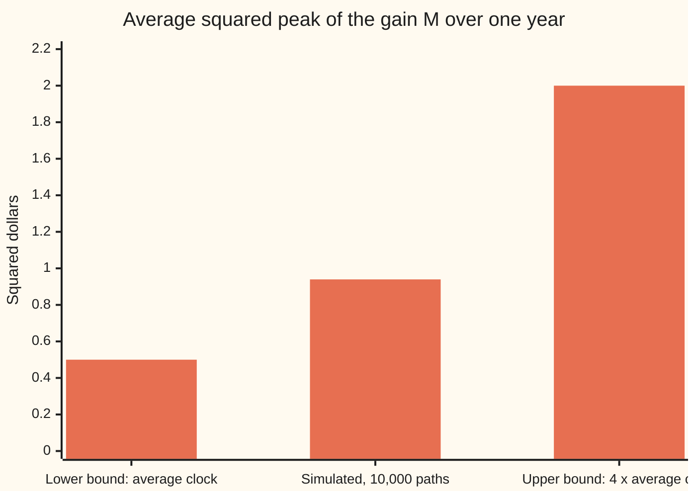

# Burkholder-Davis-Gundy: the peak of a martingale is controlled by its clock

[Syllabus](../../../SYLLABUS.md) → [Stochastic processes and calculus](../README.md) → [Continuous Martingales](../README.md#s10) → Burkholder-Davis-Gundy

---

## General Overview

A price wanders like Brownian motion: after one year it has moved up or down by about $1. A trader holds as many units as the price stands above its start, and goes short when it is below. After half a year with the price up $0.80, she holds 0.8 units. Her running gain, in dollars, is the Ito integral of the price against itself:

```math
M_t = \int_0^t B_s\,dB_s = \frac{B_t^2 - t}{2}.
```

This gain is a fair game: on average it stays at zero. But it does not move at a steady pace. When the price is far from its start she holds a lot, and her gain swings hard. When the price is near its start she holds almost nothing, and her gain barely moves. The game has its own **clock**, $`\langle M\rangle_t`$, that ticks at speed $`B_t^2`$. Over the year that clock averages 0.5.

How far can her gain swing at its worst moment? The Burkholder-Davis-Gundy inequalities (BDG for short) answer from the clock alone. With nothing but the average clock of 0.5, they say the average squared peak swing lies between 0.5 and 2. A simulation of 10,000 one-year paths gives 0.94, a little low because its grid misses peaks between steps; corrected for that, about 0.97.

**The size of a fair game's largest swing, raised to any power p, averages within fixed factors of its clock raised to the power p/2; the factors depend on p and on nothing else.**

**What kind of fact this is:** a theorem. The upper bound for p of 2 or more is proved on this card in Why it works; the two-sided form for every p above 0 is stated, with its proof given in outline and named in Sources.

### The picture: the simulated squared peak sits between the two bounds



The left bar is the average clock, 0.5, computed exactly. The middle bar is the simulated average of the squared peak, 0.9395, give or take 0.0245. Its grid of 1,000 steps misses peaks between steps, so it reads low: corrected for the grid, the continuous value is about 0.9740 ± 0.0252. The right bar is BDG's upper bound for p = 2, four times the clock. Both checks print all three.

---

## The formula

Notation first, in words.

- $`B_t`$ is Brownian motion ([Brownian motion](../05-Brownian%20Motion/01-brownian-motion.md)), time $`t`$ in years. $`E[\cdot]`$ is an average over all paths.
- $`M_t`$ is a continuous **local martingale** that starts at 0: a fair game with no jumps, possibly fair only up to a sequence of stopping times ([Continuous martingales and local martingales](01-continuous-martingales-and-local-martingales.md)).
- $`\langle M\rangle_t`$ is its **clock**, called its bracket, and for a continuous game equal to its quadratic variation: the process that makes $`M_t^2 - \langle M\rangle_t`$ a martingale ([Doob-Meyer](02-doob-meyer-decomposition.md)). It equals the sum of the squared small steps of $`M`$ up to $`t`$. For an Ito integral $`M_t = \int_0^t H_s\,dB_s`$, the clock is $`\int_0^t H_s^2\,ds`$ ([The Ito integral](../06-Ito%20Calculus/01-ito-integral.md)).
- The **peak** up to time $`T`$ is the largest swing so far, written with a star: $`M^*_T = \sup_{t \le T} \lvert M_t\rvert`$. Here sup ("supremum") means the largest value.

**The theorem.** For every power $`p > 0`$ there are numbers $`0 < c_p \le C_p < \infty`$, depending only on $`p`$, such that for every continuous local martingale $`M`$ with $`M_0 = 0`$ and every stopping time $`T`$:

```math
c_p\,E\big[\langle M\rangle_T^{p/2}\big] \;\le\; E\big[(M^*_T)^p\big] \;\le\; C_p\,E\big[\langle M\rangle_T^{p/2}\big]
```

**Read it aloud:** the average of the peak to the power p lies between two fixed multiples of the average of the clock to the power p over 2.

For $`p \ge 2`$, the proof on this card gives the upper constant

```math
C_p = \Big(\tfrac{p(p-1)}{2}\Big(\tfrac{p}{p-1}\Big)^{p}\Big)^{p/2},
```

which is 4 at $`p = 2`$, 32.2176 at $`p = 3`$ and 359.5940 at $`p = 4`$. At $`p = 2`$ the lower constant is exactly 1.

The house example has $`H_s = B_s`$, so its clock is

```math
\langle M\rangle_t = \int_0^t B_s^2\,ds, \qquad E\big[\langle M\rangle_1\big] = \int_0^1 s\,ds = \tfrac12 .
```

| Symbol | Plain meaning | In our example | Push it up and the answer… |
| --- | --- | --- | --- |
| $`B_t`$, $`dB_s`$, $`Z`$ | Brownian motion: the price's move from its start, in dollars; its step inside an Ito integral; $`Z = B_1`$, a standard bell-curve draw | about ±$1 after one year | — |
| $`t`$, $`s`$, $`u`$, $`T`$ | time in years; a time inside an integral; a clock reading or earlier time; the horizon, which may be a stopping time | $`T = 1`$ | the clock grows, and the peak with it |
| $`H_s`$ | the holding: units held at time $`s`$, fixed before the step | $`H_s = B_s`$ | the clock runs faster, as $`H^2`$ |
| $`M_t`$, $`M_0`$ | the fair game: the gain so far; its start, 0 | $`(B_t^2 - t)/2`$ | — |
| $`\langle M\rangle_t`$ | the clock: the summed squared steps of $`M`$ | $`\int_0^t B_s^2\,ds`$, average 0.5 at $`t = 1`$ | both bounds grow as its power p/2 |
| $`M^*_T`$, sup | the peak: the largest swing $`\lvert M_t\rvert`$ up to $`T`$ | squared, it averages 0.9395 on the grid, about 0.9740 corrected | — |
| $`p`$, $`f`$ | the power at which sizes are compared; $`f(x) = \lvert x\rvert^p`$, the function Ito's lemma is applied to | 2, and 0.5 to 4 in the table below | both constants grow |
| $`c_p`$, $`C_p`$, $`A`$, $`D`$ | the lower and upper constants, which depend only on $`p`$; in the proof, the peak's p-th moment and the clock's (p/2)-th moment | 1 and 4 at $`p = 2`$ | — |
| $`E[\cdot]`$, $`P(\cdot)`$ | an average over all paths; a chance | — | — |
| $`X_t`$, $`b`$, $`\sigma`$, $`K`$, $`C`$ | an SDE solution; its drift and noise-size functions; their growth constant; the moment bound's constant, used in Step 4 | not in the house example | larger $`K`$, larger moment bound |
| $`\tau_n`$, $`n`$ | the first time the swing reaches size $`n`$; used to keep averages finite in the proof | — | — |
| $`\lambda`$, $`\beta`$, $`\delta`$ | a level, and two tuning factors in the good-lambda outline | — | — |

### When it holds

- **A fair game, with no drift.** Add a steady drift of $`2t`$ to the gain and its clock does not change, but its average squared value at one year becomes 4.5, above the bound of 2. A drift moves the game without ticking the clock.
- **No jumps.** For a fair game with jumps, the clock must count the jumps' squares (the quadratic variation $`[M]`$), and then the two-sided form holds only for $`p \ge 1`$. Below that, or with a clock that smooths the jumps out, it can fail: a rare large jump makes a peak that a smooth clock barely registers.
- **Start at zero.** The theorem bounds the swing away from the start. For a game that starts at $`M_0 \ne 0`$, apply it to $`M_t - M_0`$.
- **Averages, not single paths.** It says nothing about one path. On 745 of the 10,000 simulated paths, the squared peak exceeds four times that path's own clock.
- **A stopping time, not any random time.** $`T`$ may be random, but it must be decided by the past. At the time of the peak, which needs the future to locate, the identity $`E[M_T^2] = E[\langle M\rangle_T]`$ fails: 0.9395 against 0.3325.

---

## Why it works

### Step 0: the clock sets the scale of the swings

For a Brownian motion over a fixed time $`u`$, the peak grows like $`\sqrt{u}`$: double the time and swings grow by $`\sqrt 2`$ ([Brownian motion](../05-Brownian%20Motion/01-brownian-motion.md)). A continuous fair game has its clock in place of time: over any stretch, its average squared travel equals the time its clock ticks off ([Doob-Meyer](02-doob-meyer-decomposition.md)). So the peak to the power p should grow like the clock to the power p/2. A later card on this shelf makes this picture exact: the game is a Brownian motion read on its own clock.

The clock is random, and it can be long exactly on the paths where the game swings hard. BDG is the statement that, on average, this scaling survives the randomness, with constants that do not depend on the game.

### Step 1: p = 2, from two facts already proved

Two facts give the whole case $`p = 2`$.

1. **The clock is the variance.** $`M_t^2 - \langle M\rangle_t`$ is a martingale ([Doob-Meyer](02-doob-meyer-decomposition.md)), so it averages 0 at time $`T`$: $`E[M_T^2] = E[\langle M\rangle_T]`$. For an Ito integral this is the Ito isometry.
2. **Doob's L2 inequality.** The average squared peak is at most 4 times the average squared endpoint ([Doob's inequalities](../02-Martingales/05-doob-inequalities.md)).

The peak is at least the endpoint, so

```math
E\big[\langle M\rangle_T\big] = E\big[M_T^2\big] \;\le\; E\big[(M^*_T)^2\big] \;\le\; 4\,E\big[M_T^2\big] = 4\,E\big[\langle M\rangle_T\big].
```

For the trader: $`0.5 \le 0.9395 \le 2`$. The simulated peak sits at 1.879 times the lower bound, well inside the factor of 4.

### Step 2: p ≥ 2, by Ito's lemma on the p-th power

For higher powers, the endpoint's p-th moment is not the clock's. Ito's lemma builds the bridge ([Ito's lemma](../06-Ito%20Calculus/02-itos-lemma.md)). The function $`f(x) = \lvert x\rvert^p`$ has a continuous second derivative when $`p \ge 2`$, with $`f''(x) = p(p-1)\lvert x\rvert^{p-2}`$. So

```math
\lvert M_T\rvert^p = \int_0^T f'(M_t)\,dM_t + \tfrac12\,p(p-1)\int_0^T \lvert M_t\rvert^{p-2}\,d\langle M\rangle_t .
```

The first term is a fair game and averages 0. In the second, each $`\lvert M_t\rvert`$ is at most the peak. So the endpoint's p-th moment is at most $`\tfrac12 p(p-1)`$ times the average of peak to the power $`p - 2`$ times the clock.

Then three moves close the loop:

1. **Split the product.** Hölder's inequality (an average of a product is at most the product of suitable power averages) bounds it by $`(E[(M^*_T)^p])^{1 - 2/p}`$ times $`(E[\langle M\rangle_T^{p/2}])^{2/p}`$.
2. **Climb from the endpoint to the peak.** Doob's $`L^p`$ inequality: $`E[(M^*_T)^p] \le (p/(p-1))^p\,E[\lvert M_T\rvert^p]`$.
3. **Solve.** The peak's moment now appears on both sides, once to the power 1 and once to the power $`1 - 2/p`$. Divide, raise to the power $`p/2`$, and out comes $`C_p`$.

At $`p = 2`$ the Ito term is exactly the clock and $`C_2 = 4`$, the same as Step 1.

<details>
<summary>Detailed proof of the upper bound for p ≥ 2</summary>

**Localise.** Let $`\tau_n`$ be the first time $`\lvert M_t\rvert \ge n`$ or $`\langle M\rangle_t \ge n`$. The stopped game $`M_{t \wedge \tau_n}`$ (the game read at the earlier of $`t`$ and $`\tau_n`$) is bounded by $`n`$, so it is a true martingale and every average below is finite. Prove the bound for it, then let $`n \to \infty`$: both sides increase to their limits by monotone convergence.

**Ito.** For $`p \ge 2`$, $`f(x) = \lvert x\rvert^p`$ is twice continuously differentiable with $`f'(x) = p\lvert x\rvert^{p-1}\mathrm{sgn}(x)`$, where sgn is the sign, +1 or −1, and $`f''(x) = p(p-1)\lvert x\rvert^{p-2}`$. Ito's lemma for the continuous martingale $`M`$ gives

$`\displaystyle \lvert M_T\rvert^p = \int_0^T f'(M_t)\,dM_t + \frac{p(p-1)}{2}\int_0^T \lvert M_t\rvert^{p-2}\,d\langle M\rangle_t .`$

The stochastic integral has a bounded integrand on the stopped game, so it averages 0. Writing $`A = E[(M^*_T)^p]`$ and $`D = E[\langle M\rangle_T^{p/2}]`$,

$`\displaystyle E\lvert M_T\rvert^p \le \frac{p(p-1)}{2}\,E\big[(M^*_T)^{p-2}\langle M\rangle_T\big] \le \frac{p(p-1)}{2}\,A^{1-2/p}\,D^{2/p},`$

by Hölder's inequality with exponents $`p/(p-2)`$ and $`p/2`$ (at $`p = 2`$ the first factor is 1).

**Doob.** $`A \le (p/(p-1))^p\,E\lvert M_T\rvert^p`$. Combining,

$`\displaystyle A \le \Big(\frac{p}{p-1}\Big)^p \frac{p(p-1)}{2}\,A^{1-2/p}\,D^{2/p}.`$

If $`A = 0`$ there is nothing to prove. Otherwise divide by $`A^{1-2/p}`$, which is finite after localising, and raise both sides to the power $`p/2`$:

$`\displaystyle A \le \Big(\frac{p(p-1)}{2}\Big(\frac{p}{p-1}\Big)^p\Big)^{p/2} D = C_p\,D.`$

**Stopping times.** Nothing used a fixed $`T`$: the same steps hold at any stopping time, since the stopped game is again a continuous martingale.

</details>

### Step 3: the lower bound, and powers below 2, in outline

Ito's lemma needs $`\lvert x\rvert^p`$ to bend smoothly, which fails for $`p < 2`$. Doob's inequality fails at $`p = 1`$ and below. A different argument, the **good-lambda inequality**, covers every $`p > 0`$ in both directions. Its idea: a big peak with a small clock is rare.

1. Fix a level $`\lambda`$. Wait until the swing first reaches $`\lambda`$. To go on and reach $`\beta\lambda`$ (with $`\beta > 1`$), the game must travel a further $`(\beta - 1)\lambda`$.
2. If its clock stays below $`\delta^2\lambda^2`$ meanwhile (with $`\delta`$ small), the clock identity of Step 1 (average squared travel equals the clock time it uses) and Chebyshev's bound (a chance of a large size is at most the average square divided by the size squared) say the chance of that much travel is at most $`\delta^2/(\beta - 1)^2`$.
3. So the peak passes $`\beta\lambda`$ with a short clock only on a small fraction, $`\delta^2/(\beta - 1)^2`$, of the paths that reached $`\lambda`$.
4. Multiply by $`p\lambda^{p-1}`$ and add over all levels. A small enough $`\delta`$ moves the peak's moment to one side and leaves $`C_p`$ times the clock's moment on the other.

Swapping the roles of peak and clock, using that $`M^2 - \langle M\rangle`$ is a fair game, gives the lower bound the same way. The full argument is in the 1972 paper of Burkholder, Davis and Gundy and in Revuz and Yor, both in Sources.

<details>
<summary>The good-lambda inequality, stated</summary>

For a continuous local martingale with $`M_0 = 0`$, every $`\lambda > 0`$, $`\beta > 1`$ and $`0 < \delta < \beta - 1`$:

$`\displaystyle P\big(M^*_\infty > \beta\lambda,\ \langle M\rangle_\infty^{1/2} \le \delta\lambda\big) \le \frac{\delta^2}{(\beta - 1)^2}\,P\big(M^*_\infty > \lambda\big).`$

Integrating against $`p\lambda^{p-1}\,d\lambda`$ turns it into

$`\displaystyle \beta^{-p}\,E\big[(M^*_\infty)^p\big] \le \delta^{-p}\,E\big[\langle M\rangle_\infty^{p/2}\big] + \frac{\delta^2}{(\beta-1)^2}\,E\big[(M^*_\infty)^p\big].`$

Choose $`\delta`$ so the last factor is below $`\beta^{-p}`$, after localising so the averages are finite, and rearrange.

</details>

### Step 4: what it is for: moments of stochastic integrals and SDE solutions

**Stochastic integrals.** For $`M_t = \int_0^t H_s\,dB_s`$ the clock is $`\int_0^t H_s^2\,ds`$, so

```math
E\Big[\sup_{t \le T}\Big\lvert \int_0^t H_s\,dB_s\Big\rvert^p\Big] \le C_p\,E\Big[\Big(\int_0^T H_s^2\,ds\Big)^{p/2}\Big].
```

The right side needs only the holding, never the integral itself. For the trader at $`p = 4`$: the clock's square averages $`7/12 = 0.583333`$, so the bound is $`359.5940 \times 0.583333 = 209.7631`$. The simulated value is 6.8928 ± 0.8100, read low by the grid as at p = 2. Doob's inequality, which needs the endpoint's exact fourth moment of 3.75, gives 11.8519. The constant is generous, but the bound is finite and was computed without knowing anything about $`M`$ except its holding.

**SDE solutions.** Take $`dX_t = b(X_t)\,dt + \sigma(X_t)\,dB_t`$ with $`\lvert b(x)\rvert + \lvert\sigma(x)\rvert \le K(1 + \lvert x\rvert)`$ ([When an SDE has one solution](../06-Ito%20Calculus/07-existence-and-uniqueness-for-sdes.md)). Split $`X_t`$ into start, drift integral and noise integral. Bound the drift by Hölder's inequality and the noise by BDG, whose clock is $`\int_0^t \sigma(X_s)^2\,ds`$. Both are at most a constant times $`\int_0^t (1 + E\sup_{u \le s}\lvert X_u\rvert^p)\,ds`$. Gronwall's lemma (if a quantity grows at most in proportion to its own past total, it grows at most exponentially) then gives, for every $`p \ge 2`$,

```math
E\Big[\sup_{t \le T}\lvert X_t\rvert^p\Big] \le C\,\big(1 + E\lvert X_0\rvert^p\big)\,e^{CT},
```

with $`C`$ depending only on $`p`$, $`K`$ and $`T`$. The existence card did this for $`p = 2`$ with Doob's inequality; BDG gives every $`p`$ at once.

### The other road: simulate and compare

The checks simulate 10,000 paths on a grid of 1,000 steps and add up holding times step, the left-point Ito sum. Four independent roads meet, and both checks assert each meeting:

- **Exact moments.** $`E[\langle M\rangle_1] = 1/2`$ and $`E[\langle M\rangle_1^2] = 7/12`$ come from averaging products of $`B_s^2`$; $`E[M_1^2] = 1/2`$ and $`E[M_1^4] = 3.75`$ from the bell curve's moments. Simpson's rule over the bell curve agrees to six decimals.
- **Ito sums.** The simulated clock averages 0.4941 ± 0.0057, its square 0.5653 ± 0.0166 against 7/12, and the squared endpoint 0.4836 ± 0.0176: each within 4 standard errors of the exact value.
- **The closed form.** The peak read from $`(B_t^2 - t)/2`$ on the same paths differs from the Ito-sum peak by 0.01607 on average, the grid's rounding. Squared, it averages 0.9409 against the Ito sums' 0.9395.
- **The clock as squared steps.** The sum of the squared steps of $`M`$ differs from $`\int B^2\,dt`$ by 0.02370 on average.

**Grid bias.** A grid sees the path only at its steps, so it misses peaks between them and reads the peak low. Read every 4th step, the same paths give 0.9050. This error shrinks like the square root of the step, so quartering the step halves it: the gap from the 1,000-step reading up to the continuous value about equals the gap from the 250-step reading up to the 1,000-step one. That puts the continuous value at 2 × 0.9395 − 0.9050 = 0.9740 ± 0.0252, roughly twice the average squared endpoint.

---

## Worked numbers, by hand

The trader, one year, $`p = 2`$.

| Step | Arithmetic | Value |
| --- | --- | --- |
| average clock | $`\int_0^1 E[B_s^2]\,ds = \int_0^1 s\,ds`$ | 0.5 |
| average squared endpoint | $`E[(Z^2 - 1)^2]/4 = (3 - 2 + 1)/4`$, with $`Z = B_1`$ | 0.5 |
| lower bound | $`1 \times 0.5`$ | 0.5 |
| upper bound | $`4 \times 0.5`$ | 2.0 |
| simulated squared peak | 10,000 paths, 1,000 steps | 0.9395 ± 0.0245 |
| corrected for the grid | 2 × 0.9395 − 0.9050, from the same paths read every 4th step | 0.9740 ± 0.0252 |
| ratio of peak to clock | 0.9395 / 0.5 | 1.879 |
| **two-sided bound** | **0.5 ≤ E[(M*)²] ≤ 2** | **holds, with 0.9395** |

The simulation reads the trader's worst squared swing over the year at 0.94 squared dollars; corrected for its grid, about 0.97, roughly twice her average squared final gain. BDG predicted a number between 0.5 and 2 from the clock alone.

The same comparison at other powers, with the clock's moment also simulated:

| $`p`$ | average peak to the p | average clock to the p/2 | ratio |
| --- | ---: | ---: | ---: |
| 0.5 | 0.8160 | 0.7614 | 1.072 |
| 1 | 0.7418 | 0.6196 | 1.197 |
| 2 | 0.9395 | 0.4941 | 1.901 |
| 3 | 2.0853 | 0.4866 | 4.285 |
| 4 | 6.8928 | 0.5653 | 12.194 |

Each ratio stays between fixed bounds; the bounds widen as $`p`$ grows. At $`p = 3`$ and $`p = 4`$ the ratio sits far below $`C_3 = 32.2176`$ and $`C_4 = 359.5940`$.

### What breaks if you drop a piece

| Mistake | Comes out at | What went wrong |
| --- | --- | --- |
| Use the endpoint instead of the peak | 0.4836 against a peak of 0.9395 | The peak is often well above the end; the factor 4 pays for that. |
| Apply the clock identity at the time of the peak | $`E[M^2]`$ 0.9395 but $`E\langle M\rangle`$ 0.3325 | The time of the peak needs the future, so it is not a stopping time. |
| Add a drift of 2t, keeping the clock | 4.5000, above the bound 2.0000 | A drift is not a fair game; the clock does not see it. |
| Read the bound path by path | 745 of 10,000 paths break it | BDG compares averages, not single paths. |

---

## Code, from first principles, and it actually runs

The code computes the exact moments by algebra and checks two of them by Simpson's rule over the bell curve. It then simulates 10,000 one-year paths on 1,000 steps, builds the gain as a left-point Ito sum, and compares its peak with its clock at five powers. Two more roads run on the same paths: the closed form $`(B_t^2 - t)/2`$, and the clock rebuilt as summed squared steps of $`M`$. Reading the same paths every 4th step measures how low the grid reads the peak. Random numbers come from SplitMix64 with seed 20261123 and Box–Muller normals, written out in both languages. Asserts on simulated averages allow 4 standard errors; comparisons on the same paths allow a multiple of the square root of the time step, the size of the grid's rounding.

### Python

```python
# Burkholder-Davis-Gundy -- the check behind the card.  Standard library only.
# House example: M_t = int_0^t B dB = (B_t^2 - t)/2 on [0, 1], a fair game whose
# clock is <M>_t = int_0^t B_s^2 ds.  Roads: exact Gaussian moments by algebra and
# by Simpson's rule; 10,000 simulated paths of left-point Ito sums; the closed
# form (B_t^2 - t)/2 along the same paths; the clock as M's summed squared steps.
# The same paths read every 4th step show how low the grid reads the peak.
import math
PATHS, STEPS, SEED, PS = 10000, 1000, 20261123, (0.5, 1, 2, 3, 4)
MASK, DT = (1 << 64) - 1, 1.0 / STEPS
state, spare = SEED, []
def uniform():  # SplitMix64, a uniform number strictly between 0 and 1
    global state
    state = (state + 0x9E3779B97F4A7C15) & MASK
    z = state
    z = ((z ^ (z >> 30)) * 0xBF58476D1CE4E5B9) & MASK
    z = ((z ^ (z >> 27)) * 0x94D049BB133111EB) & MASK
    return (((z ^ (z >> 31)) >> 11) + 0.5) / 2.0 ** 53
def normal():  # Box-Muller, both outputs used
    if spare: return spare.pop()
    r, a = math.sqrt(-2.0 * math.log(uniform())), 2.0 * math.pi * uniform()
    spare.append(r * math.sin(a)); return r * math.cos(a)
def simpson(f, lo, hi, n=4000):
    h = (hi - lo) / n
    return h / 3 * sum((1 if k in (0, n) else 4 if k % 2 else 2) * f(lo + k * h) for k in range(n + 1))
def gauss_moment(f): return simpson(lambda z: f(z) * math.exp(-z * z / 2) / math.sqrt(2 * math.pi), -12, 12)
def bdg_upper(p): return (p * (p - 1) / 2 * (p / (p - 1)) ** p) ** (p / 2)  # Ito + Doob + Hoelder
def mean_se(xs):
    m = sum(xs) / len(xs)
    return m, math.sqrt(sum((x - m) ** 2 for x in xs) / (len(xs) - 1) / len(xs))

# ---- road 1: exact moments ----
EC1, EC2 = 0.5, 0.25 + 2 * (1 / 6)            # E<M>_1 = int s ds; E<M>_1^2 = int int (su + 2 min^2)
EM2, EM4 = (3 - 2 + 1) / 4, (105 - 60 + 18 - 4 + 1) / 16   # E((Z^2-1)/2)^k from normal moments
sm2, sm4 = gauss_moment(lambda z: ((z * z - 1) / 2) ** 2), gauss_moment(lambda z: ((z * z - 1) / 2) ** 4)
print(f"exact  E<M>_1 = {EC1:.6f}   E<M>_1^2 = {EC2:.6f}   E M_1^2 = {EM2:.6f}   E M_1^4 = {EM4:.6f}")
print(f"Simpson over the bell curve:          E M_1^2 = {sm2:.6f}   E M_1^4 = {sm4:.6f}")
assert abs(sm2 - EM2) < 1e-9 and abs(sm4 - EM4) < 1e-9

# ---- road 2: 10,000 paths, Ito sums on 1,000 steps ----
peak, clock, end, gap, qvgap, atpeak, ends4, peakc, peak4 = [], [], [], [], [], [], [], [], []
for _ in range(PATHS):
    b = m = c = qv = top = topc = top4 = c_at = 0.0
    for k in range(STEPS):
        db = normal() * math.sqrt(DT)
        dm = b * db                            # holding b, chosen before the step
        c += b * b * DT; qv += dm * dm; b += db; m += dm
        if abs(m) > top: top, c_at = abs(m), c
        if k % 4 == 3: top4 = max(top4, abs(m))   # the same path, read every 4th step
        topc = max(topc, abs((b * b - (k + 1) * DT) / 2))
    peak.append(top); clock.append(c); end.append(m); gap.append(abs(topc - top))
    qvgap.append(abs(qv - c)); atpeak.append((top * top, c_at)); ends4.append(m ** 4)
    peakc.append(topc); peak4.append(top4)
sc, sc_se = mean_se(clock); se2, se2_se = mean_se([x * x for x in end])
sp2, sp2_se = mean_se([x * x for x in peak]); sp4, sp4_se = mean_se([x ** 4 for x in peak])
sc2, sc2_se = mean_se([x * x for x in clock]); spc = sum(x * x for x in peakc) / PATHS
sp2q = sum(x * x for x in peak4) / PATHS       # the peak read every 4th step: a coarser grid
ext, ext_se = mean_se([2 * x * x - y * y for x, y in zip(peak, peak4)])   # grid error ~ sqrt(step)
print(f"simulated E<M>_1  = {sc:.4f} +- {sc_se:.4f}   (exact 0.5)")
print(f"simulated E<M>_1^2 = {sc2:.4f} +- {sc2_se:.4f}   (exact 7/12)")
print(f"simulated E M_1^2 = {se2:.4f} +- {se2_se:.4f}   (exact 0.5)")
print(f"simulated E M_1^4 = {mean_se(ends4)[0]:.4f} +- {mean_se(ends4)[1]:.4f}   (exact 3.75)")
print(f"mean |sum of squared steps of M - clock| = {sum(qvgap) / PATHS:.5f}")
print(f"mean |peak from (B^2-t)/2 - peak from Ito sums| = {sum(gap) / PATHS:.5f}")
print(f"E sup M^2 from (B^2-t)/2 = {spc:.4f}, from Ito sums = {sp2:.4f}")
print(f"p = 2:  lower bound E<M>_1 = {EC1:.4f}   E sup M^2 = {sp2:.4f} +- {sp2_se:.4f}   upper bound 4 x 0.5 = {4 * EC1:.4f}")
print(f"        ratio E sup M^2 / E<M>_1 = {sp2 / EC1:.4f}")
print(f"grid: E sup M^2 read every 4th step = {sp2q:.4f}; continuous, 2 x {sp2:.4f} - {sp2q:.4f} = {ext:.4f} +- {ext_se:.4f}")
assert abs(sc - EC1) < 4 * sc_se and abs(se2 - EM2) < 4 * se2_se and abs(sc2 - EC2) < 4 * sc2_se
assert sum(qvgap) / PATHS < 2 * math.sqrt(DT) and sum(gap) / PATHS < 2 * math.sqrt(DT)
assert abs(spc - sp2) < math.sqrt(DT)          # same paths: the two forms differ by the grid's rounding
assert EC1 < sp2 - 4 * sp2_se and sp2 + 4 * sp2_se < 4 * EC1

# ---- every p: the peak against the clock ----
print("    p   E sup|M|^p   E <M>_1^(p/2)   ratio")
ratios = []
for p in PS:
    a = sum(x ** p for x in peak) / PATHS; c = sum(x ** (p / 2) for x in clock) / PATHS
    ratios.append(a / c); print(f"{p:5}   {a:10.4f}   {c:13.4f}   {a / c:5.3f}")
for p in (2, 3, 4): print(f"upper constant from the proof, p = {p}: C_p = {bdg_upper(p):.4f}")
print(f"p = 4:  E sup M^4 = {sp4:.4f} +- {sp4_se:.4f}   bound C_4 x 7/12 = {bdg_upper(4) * EC2:.4f}   Doob (4/3)^4 x 3.75 = {(4 / 3) ** 4 * EM4:.4f}")
print(f"chart, ratio by p: " + ", ".join(f"{r:.3f}" for r in ratios))
assert abs(bdg_upper(2) - 4) < 1e-12 and abs(bdg_upper(3) - (81 / 8) ** 1.5) < 1e-9   # hand forms
assert 1 < ratios[2] < 4 and ratios[3] < bdg_upper(3) and ratios[4] < bdg_upper(4) and sp4 < (4 / 3) ** 4 * EM4

# ---- what breaks ----
peak_at = sum(x for x, _ in atpeak) / PATHS; clock_at = sum(c for _, c in atpeak) / PATHS
print(f"mistake, endpoint for peak: E M_1^2 = {se2:.4f} against E sup M^2 = {sp2:.4f}")
print(f"mistake, isometry at the time of the peak: E M^2 = {peak_at:.4f} but E<M> = {clock_at:.4f}")
drift = EM2 + 2.0 ** 2                          # X = M + 2t: same clock, E X_1^2 = 0.5 + 4
print(f"mistake, a drift 2t added, same clock: E X_1^2 = {drift:.4f}, above the bound {4 * EC1:.4f}")
bad = [(x * x, c) for x, c in zip(peak, clock) if x * x > 4 * c]
print(f"mistake, path by path: {len(bad)} of {PATHS} paths have sup M^2 > 4 <M>_1")
assert peak_at > clock_at + 0.1 and se2 < sp2 - 0.1 and len(bad) > 0
print("ALL CHECKS PASS")
```

**Ran 2026-11-23 on macOS, Python 3.14.10, standard library only. All checks passed. Output, pasted from the run:**

```
exact  E<M>_1 = 0.500000   E<M>_1^2 = 0.583333   E M_1^2 = 0.500000   E M_1^4 = 3.750000
Simpson over the bell curve:          E M_1^2 = 0.500000   E M_1^4 = 3.750000
simulated E<M>_1  = 0.4941 +- 0.0057   (exact 0.5)
simulated E<M>_1^2 = 0.5653 +- 0.0166   (exact 7/12)
simulated E M_1^2 = 0.4836 +- 0.0176   (exact 0.5)
simulated E M_1^4 = 3.3138 +- 0.4679   (exact 3.75)
mean |sum of squared steps of M - clock| = 0.02370
mean |peak from (B^2-t)/2 - peak from Ito sums| = 0.01607
E sup M^2 from (B^2-t)/2 = 0.9409, from Ito sums = 0.9395
p = 2:  lower bound E<M>_1 = 0.5000   E sup M^2 = 0.9395 +- 0.0245   upper bound 4 x 0.5 = 2.0000
        ratio E sup M^2 / E<M>_1 = 1.8790
grid: E sup M^2 read every 4th step = 0.9050; continuous, 2 x 0.9395 - 0.9050 = 0.9740 +- 0.0252
    p   E sup|M|^p   E <M>_1^(p/2)   ratio
  0.5       0.8160          0.7614   1.072
    1       0.7418          0.6196   1.197
    2       0.9395          0.4941   1.901
    3       2.0853          0.4866   4.285
    4       6.8928          0.5653   12.194
upper constant from the proof, p = 2: C_p = 4.0000
upper constant from the proof, p = 3: C_p = 32.2176
upper constant from the proof, p = 4: C_p = 359.5940
p = 4:  E sup M^4 = 6.8928 +- 0.8100   bound C_4 x 7/12 = 209.7631   Doob (4/3)^4 x 3.75 = 11.8519
chart, ratio by p: 1.072, 1.197, 1.901, 4.285, 12.194
mistake, endpoint for peak: E M_1^2 = 0.4836 against E sup M^2 = 0.9395
mistake, isometry at the time of the peak: E M^2 = 0.9395 but E<M> = 0.3325
mistake, a drift 2t added, same clock: E X_1^2 = 4.5000, above the bound 2.0000
mistake, path by path: 745 of 10000 paths have sup M^2 > 4 <M>_1
ALL CHECKS PASS
```

### Rust

Same numbers, same labels, built with `rustc --edition 2021 -O`.

```rust
// Burkholder-Davis-Gundy -- the same check as the Python, in Rust.  No crates.
// House example: M_t = int_0^t B dB = (B_t^2 - t)/2 on [0, 1], a fair game whose
// clock is <M>_t = int_0^t B_s^2 ds.  Roads: exact Gaussian moments by algebra and
// by Simpson's rule; 10,000 simulated paths of left-point Ito sums; the closed
// form (B_t^2 - t)/2 along the same paths; the clock as M's summed squared steps.
// The same paths read every 4th step show how low the grid reads the peak.
const PATHS: usize = 10000;
const STEPS: usize = 1000;
const SEED: u64 = 20261123;
const PS: [f64; 5] = [0.5, 1.0, 2.0, 3.0, 4.0];
struct Rng { state: u64, spare: Option<f64> }
impl Rng {
    fn uniform(&mut self) -> f64 { // SplitMix64, a uniform number strictly between 0 and 1
        self.state = self.state.wrapping_add(0x9E3779B97F4A7C15);
        let mut z = self.state;
        z = (z ^ (z >> 30)).wrapping_mul(0xBF58476D1CE4E5B9);
        z = (z ^ (z >> 27)).wrapping_mul(0x94D049BB133111EB);
        (((z ^ (z >> 31)) >> 11) as f64 + 0.5) / 2f64.powf(53.0)
    }
    fn normal(&mut self) -> f64 { // Box-Muller, both outputs used
        if let Some(x) = self.spare.take() { return x; }
        let r = (-2.0 * self.uniform().ln()).sqrt();
        let a = 2.0 * std::f64::consts::PI * self.uniform();
        self.spare = Some(r * a.sin());
        r * a.cos()
    }
}
fn simpson(f: &dyn Fn(f64) -> f64, lo: f64, hi: f64, n: usize) -> f64 {
    let h = (hi - lo) / n as f64;
    let mut s = 0.0;
    for k in 0..=n {
        let w = if k == 0 || k == n { 1.0 } else if k % 2 == 1 { 4.0 } else { 2.0 };
        s += w * f(lo + k as f64 * h);
    }
    h / 3.0 * s
}
fn gauss_moment(f: &dyn Fn(f64) -> f64) -> f64 {
    simpson(&|z: f64| f(z) * (-z * z / 2.0).exp() / (2.0 * std::f64::consts::PI).sqrt(), -12.0, 12.0, 4000)
}
fn bdg_upper(p: f64) -> f64 { (p * (p - 1.0) / 2.0 * (p / (p - 1.0)).powf(p)).powf(p / 2.0) }
fn mean_se(xs: &[f64]) -> (f64, f64) {
    let n = xs.len() as f64;
    let m = xs.iter().sum::<f64>() / n;
    let v = xs.iter().map(|x| (x - m) * (x - m)).sum::<f64>() / (n - 1.0) / n;
    (m, v.sqrt())
}
fn main() {
    let dt = 1.0 / STEPS as f64;
    let mut rng = Rng { state: SEED, spare: None };
    // ---- road 1: exact moments ----
    let (ec1, ec2) = (0.5, 0.25 + 2.0 * (1.0 / 6.0));
    let (em2, em4) = ((3.0 - 2.0 + 1.0) / 4.0, (105.0 - 60.0 + 18.0 - 4.0 + 1.0) / 16.0);
    let sm2 = gauss_moment(&|z: f64| ((z * z - 1.0) / 2.0).powf(2.0));
    let sm4 = gauss_moment(&|z: f64| ((z * z - 1.0) / 2.0).powf(4.0));
    println!("exact  E<M>_1 = {:.6}   E<M>_1^2 = {:.6}   E M_1^2 = {:.6}   E M_1^4 = {:.6}", ec1, ec2, em2, em4);
    println!("Simpson over the bell curve:          E M_1^2 = {:.6}   E M_1^4 = {:.6}", sm2, sm4);
    assert!((sm2 - em2).abs() < 1e-9 && (sm4 - em4).abs() < 1e-9);
    // ---- road 2: 10,000 paths, Ito sums on 1,000 steps ----
    let (mut peak, mut clock, mut end, mut gap) = (vec![], vec![], vec![], vec![]);
    let (mut qvgap, mut atpeak, mut ends4, mut peakc, mut peak4) = (vec![], vec![], vec![], vec![], vec![]);
    for _ in 0..PATHS {
        let (mut b, mut m, mut c, mut qv, mut top, mut topc, mut c_at) = (0.0f64, 0.0f64, 0.0, 0.0, 0.0f64, 0.0f64, 0.0);
        let mut top4 = 0.0f64;
        for k in 0..STEPS {
            let db = rng.normal() * dt.sqrt();
            let dm = b * db; // holding b, chosen before the step
            c += b * b * dt; qv += dm * dm; b += db; m += dm;
            if m.abs() > top { top = m.abs(); c_at = c; }
            if k % 4 == 3 { top4 = top4.max(m.abs()); } // the same path, read every 4th step
            topc = topc.max(((b * b - (k + 1) as f64 * dt) / 2.0).abs());
        }
        peak.push(top); clock.push(c); end.push(m); gap.push((topc - top).abs());
        qvgap.push((qv - c).abs()); atpeak.push((top * top, c_at)); ends4.push(m.powf(4.0));
        peakc.push(topc); peak4.push(top4);
    }
    let n = PATHS as f64;
    let (sc, sc_se) = mean_se(&clock);
    let (se2, se2_se) = mean_se(&end.iter().map(|x| x * x).collect::<Vec<_>>());
    let (sp2, sp2_se) = mean_se(&peak.iter().map(|x| x * x).collect::<Vec<_>>());
    let (sp4, sp4_se) = mean_se(&peak.iter().map(|x| x.powf(4.0)).collect::<Vec<_>>());
    let (e4, e4_se) = mean_se(&ends4);
    let (sc2, sc2_se) = mean_se(&clock.iter().map(|x| x * x).collect::<Vec<_>>());
    let spc = peakc.iter().map(|x| x * x).sum::<f64>() / n;
    let sp2q = peak4.iter().map(|x| x * x).sum::<f64>() / n; // the peak read every 4th step: a coarser grid
    let (ext, ext_se) = mean_se(&peak.iter().zip(peak4.iter()).map(|(x, y)| 2.0 * x * x - y * y).collect::<Vec<_>>()); // grid error ~ sqrt(step)
    println!("simulated E<M>_1  = {:.4} +- {:.4}   (exact 0.5)", sc, sc_se);
    println!("simulated E<M>_1^2 = {:.4} +- {:.4}   (exact 7/12)", sc2, sc2_se);
    println!("simulated E M_1^2 = {:.4} +- {:.4}   (exact 0.5)", se2, se2_se);
    println!("simulated E M_1^4 = {:.4} +- {:.4}   (exact 3.75)", e4, e4_se);
    println!("mean |sum of squared steps of M - clock| = {:.5}", qvgap.iter().sum::<f64>() / n);
    println!("mean |peak from (B^2-t)/2 - peak from Ito sums| = {:.5}", gap.iter().sum::<f64>() / n);
    println!("E sup M^2 from (B^2-t)/2 = {:.4}, from Ito sums = {:.4}", spc, sp2);
    println!("p = 2:  lower bound E<M>_1 = {:.4}   E sup M^2 = {:.4} +- {:.4}   upper bound 4 x 0.5 = {:.4}", ec1, sp2, sp2_se, 4.0 * ec1);
    println!("        ratio E sup M^2 / E<M>_1 = {:.4}", sp2 / ec1);
    println!("grid: E sup M^2 read every 4th step = {:.4}; continuous, 2 x {:.4} - {:.4} = {:.4} +- {:.4}", sp2q, sp2, sp2q, ext, ext_se);
    assert!((sc - ec1).abs() < 4.0 * sc_se && (se2 - em2).abs() < 4.0 * se2_se && (sc2 - ec2).abs() < 4.0 * sc2_se);
    assert!(qvgap.iter().sum::<f64>() / n < 2.0 * dt.sqrt() && gap.iter().sum::<f64>() / n < 2.0 * dt.sqrt());
    assert!((spc - sp2).abs() < dt.sqrt()); // same paths: the two forms differ by the grid's rounding
    assert!(ec1 < sp2 - 4.0 * sp2_se && sp2 + 4.0 * sp2_se < 4.0 * ec1);
    // ---- every p: the peak against the clock ----
    println!("    p   E sup|M|^p   E <M>_1^(p/2)   ratio");
    let mut ratios = vec![];
    for &p in PS.iter() {
        let a = peak.iter().map(|x| x.powf(p)).sum::<f64>() / n;
        let c = clock.iter().map(|x| x.powf(p / 2.0)).sum::<f64>() / n;
        ratios.push(a / c);
        let label = if p.fract() == 0.0 { format!("{}", p as i64) } else { format!("{}", p) };
        println!("{:>5}   {:10.4}   {:13.4}   {:5.3}", label, a, c, a / c);
    }
    for p in [2.0, 3.0, 4.0] { println!("upper constant from the proof, p = {}: C_p = {:.4}", p as i64, bdg_upper(p)); }
    println!("p = 4:  E sup M^4 = {:.4} +- {:.4}   bound C_4 x 7/12 = {:.4}   Doob (4/3)^4 x 3.75 = {:.4}",
             sp4, sp4_se, bdg_upper(4.0) * ec2, (4.0f64 / 3.0).powf(4.0) * em4);
    println!("chart, ratio by p: {}", ratios.iter().map(|r| format!("{:.3}", r)).collect::<Vec<_>>().join(", "));
    assert!((bdg_upper(2.0) - 4.0).abs() < 1e-12 && (bdg_upper(3.0) - (81.0f64 / 8.0).powf(1.5)).abs() < 1e-9); // hand forms
    assert!(1.0 < ratios[2] && ratios[2] < 4.0 && ratios[3] < bdg_upper(3.0) && ratios[4] < bdg_upper(4.0) && sp4 < (4.0f64 / 3.0).powf(4.0) * em4);
    // ---- what breaks ----
    let peak_at = atpeak.iter().map(|&(x, _)| x).sum::<f64>() / n;
    let clock_at = atpeak.iter().map(|&(_, c)| c).sum::<f64>() / n;
    println!("mistake, endpoint for peak: E M_1^2 = {:.4} against E sup M^2 = {:.4}", se2, sp2);
    println!("mistake, isometry at the time of the peak: E M^2 = {:.4} but E<M> = {:.4}", peak_at, clock_at);
    let drift = em2 + 2.0f64.powf(2.0); // X = M + 2t: same clock, E X_1^2 = 0.5 + 4
    println!("mistake, a drift 2t added, same clock: E X_1^2 = {:.4}, above the bound {:.4}", drift, 4.0 * ec1);
    let bad = peak.iter().zip(clock.iter()).filter(|&(x, c)| x * x > 4.0 * c).count();
    println!("mistake, path by path: {} of {} paths have sup M^2 > 4 <M>_1", bad, PATHS);
    assert!(peak_at > clock_at + 0.1 && se2 < sp2 - 0.1 && bad > 0);
    println!("ALL CHECKS PASS");
}
```

**Ran 2026-11-23 on macOS, rustc 1.98.1, no crates. All checks passed. Output, pasted from the run:**

```
exact  E<M>_1 = 0.500000   E<M>_1^2 = 0.583333   E M_1^2 = 0.500000   E M_1^4 = 3.750000
Simpson over the bell curve:          E M_1^2 = 0.500000   E M_1^4 = 3.750000
simulated E<M>_1  = 0.4941 +- 0.0057   (exact 0.5)
simulated E<M>_1^2 = 0.5653 +- 0.0166   (exact 7/12)
simulated E M_1^2 = 0.4836 +- 0.0176   (exact 0.5)
simulated E M_1^4 = 3.3138 +- 0.4679   (exact 3.75)
mean |sum of squared steps of M - clock| = 0.02370
mean |peak from (B^2-t)/2 - peak from Ito sums| = 0.01607
E sup M^2 from (B^2-t)/2 = 0.9409, from Ito sums = 0.9395
p = 2:  lower bound E<M>_1 = 0.5000   E sup M^2 = 0.9395 +- 0.0245   upper bound 4 x 0.5 = 2.0000
        ratio E sup M^2 / E<M>_1 = 1.8790
grid: E sup M^2 read every 4th step = 0.9050; continuous, 2 x 0.9395 - 0.9050 = 0.9740 +- 0.0252
    p   E sup|M|^p   E <M>_1^(p/2)   ratio
  0.5       0.8160          0.7614   1.072
    1       0.7418          0.6196   1.197
    2       0.9395          0.4941   1.901
    3       2.0853          0.4866   4.285
    4       6.8928          0.5653   12.194
upper constant from the proof, p = 2: C_p = 4.0000
upper constant from the proof, p = 3: C_p = 32.2176
upper constant from the proof, p = 4: C_p = 359.5940
p = 4:  E sup M^4 = 6.8928 +- 0.8100   bound C_4 x 7/12 = 209.7631   Doob (4/3)^4 x 3.75 = 11.8519
chart, ratio by p: 1.072, 1.197, 1.901, 4.285, 12.194
mistake, endpoint for peak: E M_1^2 = 0.4836 against E sup M^2 = 0.9395
mistake, isometry at the time of the peak: E M^2 = 0.9395 but E<M> = 0.3325
mistake, a drift 2t added, same clock: E X_1^2 = 4.5000, above the bound 2.0000
mistake, path by path: 745 of 10000 paths have sup M^2 > 4 <M>_1
ALL CHECKS PASS
```

The two outputs match line for line.

### Lean

Lean proves the case $`p = 2`$ in discrete time, where the clock is the summed squared steps, plus the closing algebra of Step 2.

- Suppose $`M`$ is a fair game in discrete time that starts at 0, stopped at any stopping time. Then its average squared peak lies between its average clock and 4 times its average clock.
- Suppose such a game, not stopped, has a finite average square at every step. Then its average squared value at any step equals its average clock there.
- Take $`p \ge 2`$ and any numbers $`A, D \ge 0`$ that meet the bound Hölder and Doob give in Step 2. Then $`A \le C_p\,D`$.
- The worked numbers check exactly, among them the bound 2, the average squared clock 7/12 and the drift's 4.5.

The continuous-time game, the other powers and the simulation are left to the Python and Rust checks.

```lean
-- Burkholder-Davis-Gundy: in discrete time, a fair game that starts at 0 and is stopped at any stopping time has an average squared peak between one and four times the average of its clock (its summed squared steps), and for every power p ≥ 2 the closing step of the proof turns its bound into the constant C_p.
import Mathlib.Probability.Martingale.Basic
import Mathlib.Probability.Process.Stopping
import Mathlib.MeasureTheory.Integral.Lebesgue.Basic
import Mathlib.Analysis.SpecialFunctions.Pow.Real
import Mathlib.Algebra.BigOperators.Intervals
import Mathlib.Probability.Martingale.OptionalStopping
import Mathlib.MeasureTheory.Integral.Bochner.Basic
import Mathlib.MeasureTheory.Function.ConditionalExpectation.PullOut
import Mathlib.MeasureTheory.Function.L2Space

open MeasureTheory ProbabilityTheory Finset
open scoped ENNReal

/-! Setting. Mathlib has no continuous local martingales and no bracket `⟨M⟩`, so the card's
theorem is stated here in discrete time, where every step is exact. `M n ω` is the fair game after
`n` rounds on path `ω`; `ℱ` is what is known after each round. The game's clock up to round `N` is
the sum of its squared steps, `[M]_N = ∑_{k < N} (M (k+1) - M k)^2` (the card's "sum of the squared
small steps of M"), and its peak is `M*_N = max_{0 ≤ n ≤ N} |M n|`. The card's horizon `T` is any
stopping time: the game read at the earlier of round `n` and `τ` is Mathlib's
`stoppedProcess M τ n`. Averages are Lebesgue integrals in `[0, ∞]`, so they may be infinite,
as on the card. -/

/-- The peak of a game up to round `N`: `M*_N = max_{0 ≤ n ≤ N} |M n|`. -/
noncomputable def peak {Ω : Type*} (M : ℕ → Ω → ℝ) (N : ℕ) (ω : Ω) : ℝ :=
  (range (N + 1)).sup' nonempty_range_add_one (fun n => |M n ω|)

/-- The clock of a game up to round `N`: its summed squared steps `∑_{k < N} (M (k+1) - M k)^2`. -/
noncomputable def clock {Ω : Type*} (M : ℕ → Ω → ℝ) (N : ℕ) (ω : Ω) : ℝ :=
  ∑ k ∈ range N, (M (k + 1) ω - M k ω) ^ 2

/-- The card's upper constant for `p ≥ 2`: `C_p = (p(p-1)/2 · (p/(p-1))^p)^(p/2)`. -/
noncomputable def bdgUpperConstant (p : ℝ) : ℝ :=
  (p * (p - 1) / 2 * (p / (p - 1)) ^ p) ^ (p / 2)

/-! Helper facts used by the proofs below. -/

theorem bdg_peak_zero {Ω : Type*} (M : ℕ → Ω → ℝ) (ω : Ω) : peak M 0 ω = |M 0 ω| := by
  simp [peak]

theorem bdg_le_peak {Ω : Type*} (M : ℕ → Ω → ℝ) {k n : ℕ} (h : k ≤ n) (ω : Ω) :
    |M k ω| ≤ peak M n ω :=
  Finset.le_sup' (fun j => |M j ω|) (by simp; omega)

theorem bdg_peak_nonneg {Ω : Type*} (M : ℕ → Ω → ℝ) (n : ℕ) (ω : Ω) : 0 ≤ peak M n ω :=
  (abs_nonneg _).trans (bdg_le_peak M (Nat.zero_le n) ω)

theorem bdg_peak_succ {Ω : Type*} (M : ℕ → Ω → ℝ) (n : ℕ) (ω : Ω) :
    peak M (n + 1) ω = max (peak M n ω) |M (n + 1) ω| := by
  apply le_antisymm
  · refine Finset.sup'_le _ _ (fun k hk => ?_)
    rw [Finset.mem_range] at hk
    rcases Nat.lt_succ_iff_lt_or_eq.1 hk with h | h
    · exact (bdg_le_peak M (Nat.lt_succ_iff.1 h) ω).trans (le_max_left _ _)
    · subst h; exact le_max_right _ _
  · refine max_le ?_ (bdg_le_peak M le_rfl ω)
    exact Finset.sup'_le _ _ (fun k hk => bdg_le_peak M
      (by rw [Finset.mem_range] at hk; omega) ω)

theorem bdg_pathwise_aux {Ω : Type*} (M : ℕ → Ω → ℝ) (ω : Ω) (n : ℕ) :
    ∑ k ∈ range n, peak M k ω * (|M (k + 1) ω| - |M k ω|) ≤
      peak M n ω * |M n ω| - peak M n ω ^ 2 / 2 := by
  induction n with
  | zero =>
    simp only [range_zero, sum_empty, bdg_peak_zero]
    nlinarith [abs_nonneg (M 0 ω)]
  | succ n ih =>
    rw [sum_range_succ, bdg_peak_succ]
    rcases le_total (peak M n ω) |M (n + 1) ω| with h | h
    · rw [max_eq_right h]
      nlinarith [sq_nonneg (|M (n + 1) ω| - peak M n ω)]
    · rw [max_eq_left h]
      nlinarith

theorem bdg_pathwise {Ω : Type*} (M : ℕ → Ω → ℝ) (ω : Ω) (n : ℕ) :
    peak M n ω ^ 2 ≤ 4 * M n ω ^ 2 -
      4 * ∑ k ∈ range n, peak M k ω * (|M (k + 1) ω| - |M k ω|) := by
  have h := bdg_pathwise_aux M ω n
  have h2 : M n ω ^ 2 = |M n ω| ^ 2 := (sq_abs _).symm
  nlinarith [sq_nonneg (peak M n ω / 2 - |M n ω|)]

theorem bdg_clock_succ {Ω : Type*} (M : ℕ → Ω → ℝ) (n : ℕ) (ω : Ω) :
    clock M (n + 1) ω = clock M n ω + (M (n + 1) ω - M n ω) ^ 2 := by
  simp [clock, sum_range_succ]

theorem bdg_sq_le_clock {Ω : Type*} (M : ℕ → Ω → ℝ) {k N : ℕ} (hk : k < N) (ω : Ω) :
    (M (k + 1) ω - M k ω) ^ 2 ≤ clock M N ω :=
  Finset.single_le_sum (f := fun k => (M (k + 1) ω - M k ω) ^ 2)
    (fun _ _ => sq_nonneg _) (Finset.mem_range.2 hk)

theorem bdg_clock_nonneg {Ω : Type*} (M : ℕ → Ω → ℝ) (N : ℕ) (ω : Ω) : 0 ≤ clock M N ω :=
  Finset.sum_nonneg (fun _ _ => sq_nonneg _)

theorem bdg_peak_stronglyMeasurable {Ω : Type*} {m0 : MeasurableSpace Ω} (ℱ : Filtration ℕ m0)
    (M : ℕ → Ω → ℝ) (hM : StronglyAdapted ℱ M) (n : ℕ) :
    StronglyMeasurable[ℱ n] (peak M n) := by
  induction n with
  | zero =>
    have : peak M 0 = fun ω => |M 0 ω| := funext (bdg_peak_zero M)
    rw [this]
    exact continuous_abs.comp_stronglyMeasurable (hM 0)
  | succ n ih =>
    have : peak M (n + 1) = fun ω => max (peak M n ω) |M (n + 1) ω| := funext (bdg_peak_succ M n)
    rw [this]
    exact continuous_max.comp_stronglyMeasurable
      ((ih.mono (ℱ.mono (Nat.le_succ n))).prodMk
        (continuous_abs.comp_stronglyMeasurable (hM (n + 1))))

theorem bdg_integrable_mul {Ω : Type*} {m0 : MeasurableSpace Ω} {P : Measure Ω}
    {f g : Ω → ℝ} (hf : MemLp f 2 P) (hg : MemLp g 2 P) : Integrable (f * g) P := by
  refine Integrable.mono' (hf.integrable_sq.add hg.integrable_sq)
    (hf.aestronglyMeasurable.mul hg.aestronglyMeasurable) (ae_of_all _ (fun ω => ?_))
  simp only [Pi.mul_apply, Pi.add_apply, Real.norm_eq_abs, abs_mul]
  nlinarith [sq_nonneg (|f ω| - |g ω|), sq_abs (f ω), sq_abs (g ω)]

theorem bdg_memLp_peak {Ω : Type*} {m0 : MeasurableSpace Ω} (P : Measure Ω)
    (ℱ : Filtration ℕ m0) (M : ℕ → Ω → ℝ) (hM : StronglyAdapted ℱ M) (n : ℕ)
    (hL2 : ∀ j ≤ n, MemLp (M j) 2 P) : MemLp (peak M n) 2 P := by
  have hmeas : AEStronglyMeasurable (peak M n) P :=
    ((bdg_peak_stronglyMeasurable ℱ M hM n).mono (ℱ.le n)).aestronglyMeasurable
  rw [memLp_two_iff_integrable_sq hmeas]
  refine Integrable.mono' (integrable_finsetSum (range (n + 1))
    (fun j hj => (hL2 j (by rw [Finset.mem_range] at hj; omega)).integrable_sq))
    (hmeas.pow 2) (ae_of_all _ (fun ω => ?_))
  rw [Real.norm_eq_abs, abs_of_nonneg (sq_nonneg _)]
  obtain ⟨k, hk, hkeq⟩ := Finset.exists_mem_eq_sup' nonempty_range_add_one (fun j => |M j ω|)
  have : peak M n ω = |M k ω| := hkeq
  rw [this, sq_abs]
  exact Finset.single_le_sum (f := fun j => M j ω ^ 2) (fun _ _ => sq_nonneg _) hk

/-- Pulling a known factor out of a martingale step: `E[g M_{k+1}] = E[g M_k]`. -/
theorem bdg_integral_mul_succ {Ω : Type*} {m0 : MeasurableSpace Ω}
    (P : Measure Ω) [IsProbabilityMeasure P] (ℱ : Filtration ℕ m0) (M : ℕ → Ω → ℝ)
    (hM : Martingale M ℱ P) (k : ℕ) (g : Ω → ℝ) (hg : StronglyMeasurable[ℱ k] g)
    (h1 : Integrable (g * M (k + 1)) P) :
    ∫ ω, g ω * M (k + 1) ω ∂P = ∫ ω, g ω * M k ω ∂P := by
  have hce := condExp_mul_of_stronglyMeasurable_left hg h1 (hM.integrable (k + 1))
  have hm := hM.condExp_ae_eq (Nat.le_succ k)
  calc ∫ ω, g ω * M (k + 1) ω ∂P = ∫ ω, (P[g * M (k + 1) | ℱ k]) ω ∂P :=
        (integral_condExp (ℱ.le k)).symm
    _ = ∫ ω, g ω * M k ω ∂P := by
        refine integral_congr_ae (hce.trans ?_)
        filter_upwards [hm] with ω h
        simp [h]

/-- The submartingale version, for a nonnegative known factor: `E[g Y_k] ≤ E[g Y_{k+1}]`. -/
theorem bdg_integral_mul_succ_le {Ω : Type*} {m0 : MeasurableSpace Ω}
    (P : Measure Ω) [IsProbabilityMeasure P] (ℱ : Filtration ℕ m0) (Y : ℕ → Ω → ℝ)
    (hY : Submartingale Y ℱ P) (k : ℕ) (g : Ω → ℝ) (hg : StronglyMeasurable[ℱ k] g)
    (hg0 : ∀ ω, 0 ≤ g ω) (h1 : Integrable (g * Y (k + 1)) P) (h0 : Integrable (g * Y k) P) :
    ∫ ω, g ω * Y k ω ∂P ≤ ∫ ω, g ω * Y (k + 1) ω ∂P := by
  have hce := condExp_mul_of_stronglyMeasurable_left hg h1 (hY.integrable (k + 1))
  have hm := hY.ae_le_condExp (Nat.le_succ k)
  calc ∫ ω, g ω * Y k ω ∂P ≤ ∫ ω, (P[g * Y (k + 1) | ℱ k]) ω ∂P := by
        refine integral_mono_ae h0 integrable_condExp ?_
        filter_upwards [hce, hm] with ω h1 h2
        rw [h1]
        exact mul_le_mul_of_nonneg_left h2 (hg0 ω)
    _ = ∫ ω, g ω * Y (k + 1) ω ∂P := integral_condExp (ℱ.le k)

theorem bdg_integrable_clock {Ω : Type*} {m0 : MeasurableSpace Ω} (P : Measure Ω)
    (M : ℕ → Ω → ℝ) (N : ℕ) (hL2 : ∀ n ≤ N, MemLp (M n) 2 P) :
    Integrable (clock M N) P := by
  have : clock M N = fun ω => ∑ k ∈ range N, (M (k + 1) ω - M k ω) ^ 2 := rfl
  rw [this]
  refine integrable_finsetSum _ (fun k hk => ?_)
  rw [Finset.mem_range] at hk
  exact ((hL2 (k + 1) (by omega)).sub (hL2 k (by omega))).integrable_sq

/-- The clock is the variance, needing square-integrability only up to round `N`. -/
theorem bdg_sq_mean_eq_clock_mean_aux {Ω : Type*} {m0 : MeasurableSpace Ω}
    (P : Measure Ω) [IsProbabilityMeasure P] (ℱ : Filtration ℕ m0) (M : ℕ → Ω → ℝ)
    (hM : Martingale M ℱ P) (h0 : ∀ ω, M 0 ω = 0) (N : ℕ) (hL2 : ∀ n ≤ N, MemLp (M n) 2 P) :
    ∫ ω, (M N ω) ^ 2 ∂P = ∫ ω, clock M N ω ∂P := by
  induction N with
  | zero => simp [clock, h0]
  | succ n ih =>
    have hn := hL2 n (by omega)
    have hn1 := hL2 (n + 1) le_rfl
    have ih' := ih (fun j hj => hL2 j (by omega))
    have horth := bdg_integral_mul_succ P ℱ M hM n (M n) (hM.stronglyMeasurable n)
      (bdg_integrable_mul hn hn1)
    have hint_inc : Integrable (fun ω => (M (n + 1) ω - M n ω) ^ 2) P :=
      (hn1.sub hn).integrable_sq
    simp_rw [bdg_clock_succ]
    rw [integral_add (bdg_integrable_clock P M n (fun j hj => hL2 j (by omega))) hint_inc, ← ih']
    have hexp : ∀ ω, (M (n + 1) ω - M n ω) ^ 2 =
        M (n + 1) ω ^ 2 - 2 * (M n ω * M (n + 1) ω) + M n ω * M n ω := fun ω => by ring
    simp_rw [hexp]
    have i1 : Integrable (fun ω => M (n + 1) ω ^ 2) P := hn1.integrable_sq
    have i2 : Integrable (fun ω => M n ω * M (n + 1) ω) P := bdg_integrable_mul hn hn1
    have i3 : Integrable (fun ω => M n ω * M n ω) P := bdg_integrable_mul hn hn
    have i4 : Integrable (fun ω => M (n + 1) ω ^ 2 - 2 * (M n ω * M (n + 1) ω)) P :=
      i1.sub (i2.const_mul 2)
    rw [integral_add i4 i3, integral_sub i1 (i2.const_mul 2), integral_const_mul, horth]
    have : ∫ ω, M n ω ^ 2 ∂P = ∫ ω, M n ω * M n ω ∂P := by simp_rw [sq]
    rw [this]
    ring

/-- Doob's L² inequality with constant 4, for a martingale square-integrable up to round `N`. -/
theorem bdg_doob_L2 {Ω : Type*} {m0 : MeasurableSpace Ω}
    (P : Measure Ω) [IsProbabilityMeasure P] (ℱ : Filtration ℕ m0) (M : ℕ → Ω → ℝ)
    (hM : Martingale M ℱ P) (N : ℕ) (hL2 : ∀ n ≤ N, MemLp (M n) 2 P) :
    ∫ ω, peak M N ω ^ 2 ∂P ≤ 4 * ∫ ω, M N ω ^ 2 ∂P := by
  have hY : Submartingale (fun n ω => |M n ω|) ℱ P := by
    have := hM.submartingale.sup hM.neg.submartingale
    convert this using 1
    funext n ω
    simp [abs_eq_max_neg]
  have hpk : ∀ k ≤ N, MemLp (peak M k) 2 P := fun k hk =>
    bdg_memLp_peak P ℱ M hM.stronglyAdapted k (fun j hj => hL2 j (by omega))
  have habs : ∀ k ≤ N, MemLp (fun ω => |M k ω|) 2 P := fun k hk => (hL2 k hk).abs
  have hterm : ∀ k ∈ range N, Integrable (fun ω => peak M k ω * |M (k + 1) ω|) P ∧
      Integrable (fun ω => peak M k ω * |M k ω|) P := fun k hk => by
    rw [Finset.mem_range] at hk
    exact ⟨bdg_integrable_mul (hpk k (by omega)) (habs (k + 1) (by omega)),
      bdg_integrable_mul (hpk k (by omega)) (habs k (by omega))⟩
  set S : Ω → ℝ := fun ω => ∑ k ∈ range N, peak M k ω * (|M (k + 1) ω| - |M k ω|) with hS
  have hSint : Integrable S P := by
    refine integrable_finsetSum _ (fun k hk => ?_)
    simp_rw [mul_sub]
    exact (hterm k hk).1.sub (hterm k hk).2
  have hS0 : 0 ≤ ∫ ω, S ω ∂P := by
    rw [hS, integral_finsetSum _ (fun k hk => by
      simp_rw [mul_sub]; exact (hterm k hk).1.sub (hterm k hk).2)]
    refine Finset.sum_nonneg (fun k hk => ?_)
    simp_rw [mul_sub]
    rw [integral_sub (hterm k hk).1 (hterm k hk).2, sub_nonneg]
    exact bdg_integral_mul_succ_le P ℱ _ hY k (peak M k)
      (bdg_peak_stronglyMeasurable ℱ M hM.stronglyAdapted k) (bdg_peak_nonneg M k)
      (hterm k hk).1 (hterm k hk).2
  have hN2 : Integrable (fun ω => M N ω ^ 2) P := (hL2 N le_rfl).integrable_sq
  calc ∫ ω, peak M N ω ^ 2 ∂P ≤ ∫ ω, (4 * M N ω ^ 2 - 4 * S ω) ∂P :=
        integral_mono (hpk N le_rfl).integrable_sq ((hN2.const_mul 4).sub (hSint.const_mul 4))
          (fun ω => bdg_pathwise M ω N)
    _ = 4 * ∫ ω, M N ω ^ 2 ∂P - 4 * ∫ ω, S ω ∂P := by
        rw [integral_sub (hN2.const_mul 4) (hSint.const_mul 4), integral_const_mul,
          integral_const_mul]
    _ ≤ 4 * ∫ ω, M N ω ^ 2 ∂P := by linarith

/-- BDG at p = 2 for any fair game that starts at 0 (no stopping needed). -/
theorem bdg_two_sided_of_martingale {Ω : Type*} {m0 : MeasurableSpace Ω}
    (P : Measure Ω) [IsProbabilityMeasure P] (ℱ : Filtration ℕ m0) (M : ℕ → Ω → ℝ)
    (hM : Martingale M ℱ P) (h0 : ∀ ω, M 0 ω = 0) (N : ℕ) :
    ∫⁻ ω, ENNReal.ofReal (clock M N ω) ∂P ≤ ∫⁻ ω, ENNReal.ofReal (peak M N ω ^ 2) ∂P ∧
      ∫⁻ ω, ENNReal.ofReal (peak M N ω ^ 2) ∂P ≤
        4 * ∫⁻ ω, ENNReal.ofReal (clock M N ω) ∂P := by
  have hmeas : ∀ n, Measurable (M n) := fun n =>
    ((hM.stronglyMeasurable n).mono (ℱ.le n)).measurable
  have hpm : AEStronglyMeasurable (peak M N) P :=
    ((bdg_peak_stronglyMeasurable ℱ M hM.stronglyAdapted N).mono (ℱ.le N)).aestronglyMeasurable
  have hcm : AEStronglyMeasurable (clock M N) P := by
    have : clock M N = fun ω => ∑ k ∈ range N, (M (k + 1) ω - M k ω) ^ 2 := rfl
    rw [this]
    exact (Finset.measurable_sum _ (fun k _ =>
      ((hmeas (k + 1)).sub (hmeas k)).pow_const 2)).aestronglyMeasurable
  constructor
  · by_cases hfin : ∫⁻ ω, ENNReal.ofReal (peak M N ω ^ 2) ∂P = ⊤
    · rw [hfin]; exact le_top
    have hpi : Integrable (fun ω => peak M N ω ^ 2) P :=
      ⟨hpm.pow 2, (hasFiniteIntegral_iff_ofReal (ae_of_all _ (fun ω => sq_nonneg _))).2
        (lt_top_iff_ne_top.2 hfin)⟩
    have hL2 : ∀ n ≤ N, MemLp (M n) 2 P := fun n hn =>
      (memLp_two_iff_integrable_sq (hM.integrable n).1).2
        (hpi.mono' ((hM.integrable n).1.pow 2) (ae_of_all _ (fun ω => by
          rw [Real.norm_eq_abs, abs_of_nonneg (sq_nonneg _), ← sq_abs]
          exact pow_le_pow_left₀ (abs_nonneg _) (bdg_le_peak M hn ω) 2)))
    rw [← ofReal_integral_eq_lintegral_ofReal (bdg_integrable_clock P M N hL2)
        (ae_of_all _ (bdg_clock_nonneg M N)),
      ← ofReal_integral_eq_lintegral_ofReal hpi (ae_of_all _ (fun ω => sq_nonneg _))]
    refine ENNReal.ofReal_le_ofReal ?_
    rw [← bdg_sq_mean_eq_clock_mean_aux P ℱ M hM h0 N hL2]
    refine integral_mono (hL2 N le_rfl).integrable_sq hpi (fun ω => ?_)
    rw [← sq_abs]
    exact pow_le_pow_left₀ (abs_nonneg _) (bdg_le_peak M le_rfl ω) 2
  · by_cases hfin : ∫⁻ ω, ENNReal.ofReal (clock M N ω) ∂P = ⊤
    · rw [hfin, ENNReal.mul_top (by norm_num)]; exact le_top
    have hci : Integrable (clock M N) P :=
      ⟨hcm, (hasFiniteIntegral_iff_ofReal (ae_of_all _ (bdg_clock_nonneg M N))).2
        (lt_top_iff_ne_top.2 hfin)⟩
    have hinc : ∀ k < N, MemLp (M (k + 1) - M k) 2 P := fun k hk =>
      (memLp_two_iff_integrable_sq ((hmeas (k + 1)).sub (hmeas k)).aestronglyMeasurable).2
        (hci.mono' (((hmeas (k + 1)).sub (hmeas k)).pow_const 2).aestronglyMeasurable
          (ae_of_all _ (fun ω => by
            rw [Real.norm_eq_abs, abs_of_nonneg (sq_nonneg _)]
            exact bdg_sq_le_clock M hk ω)))
    have hL2 : ∀ n ≤ N, MemLp (M n) 2 P := by
      intro n
      induction n with
      | zero =>
        intro _
        have : M 0 = 0 := funext h0
        rw [this]
        exact MemLp.zero
      | succ n ih =>
        intro hn
        have := (ih (by omega)).add (hinc n (by omega))
        simpa using this
    have hpi : Integrable (fun ω => peak M N ω ^ 2) P :=
      (bdg_memLp_peak P ℱ M hM.stronglyAdapted N hL2).integrable_sq
    rw [← ofReal_integral_eq_lintegral_ofReal hci (ae_of_all _ (bdg_clock_nonneg M N)),
      ← ofReal_integral_eq_lintegral_ofReal hpi (ae_of_all _ (fun ω => sq_nonneg _))]
    calc ENNReal.ofReal (∫ ω, peak M N ω ^ 2 ∂P)
        ≤ ENNReal.ofReal (4 * ∫ ω, clock M N ω ∂P) := by
          refine ENNReal.ofReal_le_ofReal ?_
          rw [← bdg_sq_mean_eq_clock_mean_aux P ℱ M hM h0 N hL2]
          exact bdg_doob_L2 P ℱ M hM N hL2
      _ = 4 * ENNReal.ofReal (∫ ω, clock M N ω ∂P) := by
          rw [ENNReal.ofReal_mul (by norm_num)]
          norm_num

/-- A stopped fair game is a fair game. -/
theorem bdg_martingale_stoppedProcess {Ω : Type*} {m0 : MeasurableSpace Ω}
    (P : Measure Ω) [IsProbabilityMeasure P] (ℱ : Filtration ℕ m0) (M : ℕ → Ω → ℝ)
    (hM : Martingale M ℱ P) (τ : Ω → WithTop ℕ) (hτ : IsStoppingTime ℱ τ) :
    Martingale (stoppedProcess M τ) ℱ P := by
  refine martingale_iff.2 ⟨?_, hM.submartingale.stoppedProcess hτ⟩
  have h := (hM.neg.submartingale.stoppedProcess hτ).neg
  have : -stoppedProcess (-M) τ = stoppedProcess M τ := by
    funext n ω; simp [stoppedProcess]
  rwa [this] at h

/-- **BDG at p = 2, with lower constant 1 and upper constant 4.** Let `M` be a fair game
(a martingale) that starts at 0, and stop it at any stopping time `τ`. Then for every horizon `N`,
the average clock is at most the average squared peak, and the average squared peak is at most four
times the average clock:
`E[[M^τ]_N] ≤ E[(M^τ*_N)^2] ≤ 4 · E[[M^τ]_N]`. -/
theorem bdg_peak_squared_between_clock_and_four_clock {Ω : Type*} {m0 : MeasurableSpace Ω}
    (P : Measure Ω) [IsProbabilityMeasure P] (ℱ : Filtration ℕ m0) (M : ℕ → Ω → ℝ)
    (hM : Martingale M ℱ P) (h0 : ∀ ω, M 0 ω = 0)
    (τ : Ω → WithTop ℕ) (hτ : IsStoppingTime ℱ τ) (N : ℕ) :
    ∫⁻ ω, ENNReal.ofReal (clock (stoppedProcess M τ) N ω) ∂P ≤
        ∫⁻ ω, ENNReal.ofReal (peak (stoppedProcess M τ) N ω ^ 2) ∂P ∧
      ∫⁻ ω, ENNReal.ofReal (peak (stoppedProcess M τ) N ω ^ 2) ∂P ≤
        4 * ∫⁻ ω, ENNReal.ofReal (clock (stoppedProcess M τ) N ω) ∂P := by
  exact bdg_two_sided_of_martingale P ℱ (stoppedProcess M τ)
    (bdg_martingale_stoppedProcess P ℱ M hM τ hτ)
    (fun ω => by simp [stoppedProcess, h0]) N

/-- **The clock is the variance** (Step 1, fact 1): for a fair game that starts at 0 and whose
values have finite average squares, the average squared value after `N` rounds equals the
average clock: `E[M_N^2] = E[[M]_N]`. -/
theorem martingale_sq_mean_eq_clock_mean {Ω : Type*} {m0 : MeasurableSpace Ω}
    (P : Measure Ω) [IsProbabilityMeasure P] (ℱ : Filtration ℕ m0) (M : ℕ → Ω → ℝ)
    (hM : Martingale M ℱ P) (h0 : ∀ ω, M 0 ω = 0) (hL2 : ∀ n, MemLp (M n) 2 P) (N : ℕ) :
    ∫ ω, (M N ω) ^ 2 ∂P = ∫ ω, clock M N ω ∂P := by
  exact bdg_sq_mean_eq_clock_mean_aux P ℱ M hM h0 N (fun n _ => hL2 n)

/-- **The closing step of the proof for p ≥ 2** (Step 2, "Solve"): write `A` for the peak's
p-th moment and `D` for the clock's (p/2)-th moment. If Ito, Hölder and Doob give
`A ≤ (p/(p-1))^p · p(p-1)/2 · A^(1 - 2/p) · D^(2/p)`, then `A ≤ C_p · D`. -/
theorem bdg_upper_closing_step (p A D : ℝ) (hp : 2 ≤ p) (hA : 0 ≤ A) (hD : 0 ≤ D)
    (h : A ≤ (p / (p - 1)) ^ p * (p * (p - 1) / 2) * A ^ (1 - 2 / p) * D ^ (2 / p)) :
    A ≤ bdgUpperConstant p * D := by
  have hp0 : 0 < p := by linarith
  have hp1 : 0 < p - 1 := by linarith
  have hK0 : 0 ≤ p * (p - 1) / 2 * (p / (p - 1)) ^ p := by positivity
  unfold bdgUpperConstant
  rcases hA.eq_or_lt with h0 | hpos
  · rw [← h0]; exact mul_nonneg (Real.rpow_nonneg hK0 _) hD
  · have hApos : 0 < A ^ (2 / p) := Real.rpow_pos_of_pos hpos _
    have hsplit : A ^ (1 - 2 / p) = A / A ^ (2 / p) := by rw [Real.rpow_sub hpos, Real.rpow_one]
    rw [hsplit] at h
    have h1 : A * A ^ (2 / p) ≤ A * (p * (p - 1) / 2 * (p / (p - 1)) ^ p * D ^ (2 / p)) := by
      calc A * A ^ (2 / p) ≤ (p / (p - 1)) ^ p * (p * (p - 1) / 2) * (A / A ^ (2 / p)) *
            D ^ (2 / p) * A ^ (2 / p) := mul_le_mul_of_nonneg_right h hApos.le
        _ = A * (p * (p - 1) / 2 * (p / (p - 1)) ^ p * D ^ (2 / p)) := by
            field_simp
    have h2 := le_of_mul_le_mul_left h1 hpos
    have h3 := Real.rpow_le_rpow (Real.rpow_nonneg hA _) h2 (by linarith : (0 : ℝ) ≤ p / 2)
    have he : 2 / p * (p / 2) = 1 := by field_simp
    rwa [← Real.rpow_mul hA, Real.mul_rpow hK0 (Real.rpow_nonneg hD _), ← Real.rpow_mul hD, he,
      Real.rpow_one, Real.rpow_one] at h3

/-! The card's exact worked numbers (house example `M_t = (B_t^2 - t)/2` on one year). -/

-- Average clock: ∫_0^1 s ds = 1/2; the upper bound at p = 2 is 4 × 1/2 = 2.
example : (4 : ℚ) * (1 / 2) = 2 := by norm_num
-- Average squared endpoint: E[(Z^2 - 1)^2]/4 = (3 - 2 + 1)/4 = 1/2, equal to the average clock.
example : ((3 : ℚ) - 2 + 1) / 4 = 1 / 2 := by norm_num
-- Average squared clock: 1/4 + 2 × 1/6 = 7/12.
example : (1 : ℚ) / 4 + 2 * (1 / 6) = 7 / 12 := by norm_num
-- Fourth moment of the endpoint: E[(Z^2 - 1)^4]/16 = (105 - 60 + 18 - 4 + 1)/16 = 15/4.
example : ((105 : ℚ) - 4 * 15 + 6 * 3 - 4 * 1 + 1) / 16 = 15 / 4 := by norm_num
-- The constant's inner base: p = 2 gives 4 (so C_2 = 4^1 = 4), p = 3 gives 81/8, p = 4 gives 512/27.
example : (2 : ℚ) * (2 - 1) / 2 * (2 / (2 - 1)) ^ 2 = 4 := by norm_num
example : (3 : ℚ) * (3 - 1) / 2 * (3 / (3 - 1)) ^ 3 = 81 / 8 := by norm_num
example : (4 : ℚ) * (4 - 1) / 2 * (4 / (4 - 1)) ^ 4 = 512 / 27 := by norm_num
-- C_4 = (512/27)^2 = 262144/729, and the p = 4 bound C_4 × 7/12 = 458752/2187.
example : ((512 : ℚ) / 27) ^ 2 = 262144 / 729 ∧ (262144 : ℚ) / 729 * (7 / 12) = 458752 / 2187 := by
  norm_num
-- Doob at p = 4: (4/3)^4 × 15/4 = 320/27.
example : ((4 : ℚ) / 3) ^ 4 * (15 / 4) = 320 / 27 := by norm_num
-- What breaks: a drift 2t keeps the clock but gives E[X_1^2] = 1/2 + 2^2 = 9/2, above the bound 2.
example : (1 : ℚ) / 2 + 2 ^ 2 = 9 / 2 ∧ (2 : ℚ) < 9 / 2 := by norm_num

#print axioms bdg_peak_squared_between_clock_and_four_clock
#print axioms martingale_sq_mean_eq_clock_mean
#print axioms bdg_upper_closing_step
#print axioms bdg_peak_zero
#print axioms bdg_le_peak
#print axioms bdg_peak_nonneg
#print axioms bdg_peak_succ
#print axioms bdg_pathwise_aux
#print axioms bdg_pathwise
#print axioms bdg_clock_succ
#print axioms bdg_sq_le_clock
#print axioms bdg_clock_nonneg
#print axioms bdg_peak_stronglyMeasurable
#print axioms bdg_integrable_mul
#print axioms bdg_memLp_peak
#print axioms bdg_integral_mul_succ
#print axioms bdg_integral_mul_succ_le
#print axioms bdg_integrable_clock
#print axioms bdg_sq_mean_eq_clock_mean_aux
#print axioms bdg_doob_L2
#print axioms bdg_two_sided_of_martingale
#print axioms bdg_martingale_stoppedProcess
```

**Checked 2026-11-23 on macOS, Lean 4.36.0-rc2, Mathlib v4.36.0-rc2. Every proof is complete and uses only Lean's standard axioms. Output, pasted from the run:**

```
'bdg_peak_squared_between_clock_and_four_clock' depends on axioms: [propext, Classical.choice, Quot.sound]
'martingale_sq_mean_eq_clock_mean' depends on axioms: [propext, Classical.choice, Quot.sound]
'bdg_upper_closing_step' depends on axioms: [propext, Classical.choice, Quot.sound]
'bdg_peak_zero' depends on axioms: [propext, Classical.choice, Quot.sound]
'bdg_le_peak' depends on axioms: [propext, Classical.choice, Quot.sound]
'bdg_peak_nonneg' depends on axioms: [propext, Classical.choice, Quot.sound]
'bdg_peak_succ' depends on axioms: [propext, Classical.choice, Quot.sound]
'bdg_pathwise_aux' depends on axioms: [propext, Classical.choice, Quot.sound]
'bdg_pathwise' depends on axioms: [propext, Classical.choice, Quot.sound]
'bdg_clock_succ' depends on axioms: [propext, Classical.choice, Quot.sound]
'bdg_sq_le_clock' depends on axioms: [propext, Classical.choice, Quot.sound]
'bdg_clock_nonneg' depends on axioms: [propext, Classical.choice, Quot.sound]
'bdg_peak_stronglyMeasurable' depends on axioms: [propext, Classical.choice, Quot.sound]
'bdg_integrable_mul' depends on axioms: [propext, Classical.choice, Quot.sound]
'bdg_memLp_peak' depends on axioms: [propext, Classical.choice, Quot.sound]
'bdg_integral_mul_succ' depends on axioms: [propext, Classical.choice, Quot.sound]
'bdg_integral_mul_succ_le' depends on axioms: [propext, Classical.choice, Quot.sound]
'bdg_integrable_clock' depends on axioms: [propext, Classical.choice, Quot.sound]
'bdg_sq_mean_eq_clock_mean_aux' depends on axioms: [propext, Classical.choice, Quot.sound]
'bdg_doob_L2' depends on axioms: [propext, Classical.choice, Quot.sound]
'bdg_two_sided_of_martingale' depends on axioms: [propext, Classical.choice, Quot.sound]
'bdg_martingale_stoppedProcess' depends on axioms: [propext, Classical.choice, Quot.sound]
```

> [!TIP]
> **Try changing**
> Guess first, then run it.
> - **Coarser grid.** Set `STEPS` to `100`. Guess: does the simulated peak rise or fall? It falls, to 0.8619: a coarse grid misses the highest moments between steps. All checks still pass.
> - **Another seed.** Change `20261123` to `7`. Guess how far the squared peak moves. It becomes 0.9529, within one standard error of 0.9395.
> - **Add a drift.** Change `m += dm` to `m += dm + 2 * DT`. Guess whether BDG's bound of 2 survives. It does not: the squared peak becomes 5.3736 and an assert stops the run.
> - **Fewer paths.** Set `PATHS` to `1000`. The squared peak reads 0.9048 ± 0.0686: the error bar is about three times wider.

---

## The usual mistake

> [!warning]
> **Reading BDG as a bound on each path.** It compares averages. One path can swing far on a short clock: when the price hugs its start, the trader holds almost nothing, yet her gain $`(B_t^2 - t)/2`$ still slides down toward $`-t/2`$. On 745 of 10,000 paths, the squared peak exceeds four times that path's own clock.
>
> - **Using the endpoint for the peak.** The average squared endpoint is 0.4836; the average squared peak is 0.9395, nearly twice as large.
> - **Applying it to a process with drift.** A drift of $`2t`$ leaves the clock at 0.5 but lifts the average squared value to 4.5, above the bound of 2.
> - **Stopping at a time that looks ahead.** At the time of the peak, the average squared gain is 0.9395 but the average clock only 0.3325. The theorem allows random times only when they are stopping times.
> - **Reaching for Doob at p = 1.** Doob's constant $`p/(p-1)`$ is infinite at $`p = 1`$. BDG still holds there: the simulated ratio is 1.197.

---

## Where you meet it in real life

- **Simulation error for SDEs.** Proofs that the Euler-Maruyama scheme converges bound the largest path error over the whole run, not only at the end. BDG turns that into a bound on the scheme's step-by-step noise ([Euler-Maruyama](../08-Generators%2C%20Densities%20and%20Simulation/04-euler-maruyama-scheme.md)).
- **Hedging error in finance.** A hedge rebalanced at discrete times leaves a tracking error that is a stochastic integral. BDG bounds its worst moment by the integrated squared mis-hedge, which can be computed from the strategy.
- **Smooth paths from rough noise.** Kolmogorov's continuity test needs high moments of increments. BDG with large $`p`$ supplies them for SDE solutions, which shows those solutions have continuous paths with a known roughness.
- **Sums of bets in discrete time.** The discrete-time ancestor, Burkholder's square-function inequality, bounds a betting gain by the root of its summed squared steps, with no Brownian motion in sight. It is where the inequality was first proved.

> **Say it back**
> A continuous fair game has a clock, the running sum of its squared steps. BDG says the average peak to any power p is within fixed factors of the average clock to the power p/2. For p = 2 this is the variance identity plus Doob's factor of 4: the trader's simulated squared peak, 0.9395, sits between 0.5 and 2. For larger p, Ito's lemma on the p-th power, Hölder and Doob give the upper constant; the good-lambda argument covers every p and the lower bound. It is a statement about averages, it needs a fair game started at zero, and it bounds stochastic integrals and SDE solutions using only their integrands.

---

## What this builds on

- [Doob-Meyer](02-doob-meyer-decomposition.md): the clock $`\langle M\rangle`$, as the part that turns $`M^2`$ into a fair game.
- [Doob's inequalities](../02-Martingales/05-doob-inequalities.md): the factor $`(p/(p-1))^p`$ from endpoint to peak, which both proofs here climb with.
- [Ito's lemma](../06-Ito%20Calculus/02-itos-lemma.md): the change formula for $`\lvert M\rvert^p`$ that makes the clock appear in Step 2.
- [When an SDE has one solution](../06-Ito%20Calculus/07-existence-and-uniqueness-for-sdes.md): the second-moment bound for SDE solutions, built with Doob's inequality, which Step 4 extends to every power.

## Where this goes next

- [Levy's characterisation and Dubins-Schwarz](04-levys-characterisation-and-dubins-schwarz.md): why every continuous fair game is Brownian motion on its own clock, the picture behind Step 0.
- [Local time and Tanaka's formula](05-local-time-and-tanakas-formula.md): Ito's lemma for $`\lvert x\rvert`$, the kinked function that Step 2 had to avoid.
- [Weak solutions and the martingale problem](06-weak-solutions-and-the-martingale-problem.md): SDEs solved in law, where the moment bounds of Step 4 give the tightness the construction needs.

Left open: the best constants are known only for some powers; what are they for every p?

---

## Sources

Verified 2026-11-23: every link below resolves to the publisher's page.

- Burkholder, D. L. "Martingale Transforms." *Annals of Mathematical Statistics* 37, no. 6 (1966): 1494–1504. [doi:10.1214/aoms/1177699141](https://doi.org/10.1214/aoms/1177699141). The discrete-time square-function inequality for p > 1, the starting point.
- Davis, Burgess. "On the Integrability of the Martingale Square Function." *Israel Journal of Mathematics* 8 (1970): 187–190. [doi:10.1007/BF02771313](https://doi.org/10.1007/BF02771313). The case p = 1, where Doob's inequality fails.
- Burkholder, D. L., B. J. Davis, and R. F. Gundy. "Integral Inequalities for Convex Functions of Operators on Martingales." *Proceedings of the Sixth Berkeley Symposium on Mathematical Statistics and Probability*, vol. 2 (1972): 223–240. [doi:10.1525/9780520423671-018](https://doi.org/10.1525/9780520423671-018). The inequalities for every p, and for convex functions in general.
- Revuz, Daniel, and Marc Yor. *Continuous Martingales and Brownian Motion*, 3rd ed. Springer, 1999. [doi:10.1007/978-3-662-06400-9](https://doi.org/10.1007/978-3-662-06400-9). Section IV.4: the continuous-time statement and the good-lambda proof outlined in Step 3.
- Karatzas, Ioannis, and Steven E. Shreve. *Brownian Motion and Stochastic Calculus*, 2nd ed. Springer, 1991; the DOI is its 1998 printing. [doi:10.1007/978-1-4612-0949-2](https://doi.org/10.1007/978-1-4612-0949-2). Section 3.3.D: the Ito-and-Doob proof of the upper bound for p ≥ 2, as in Step 2.
