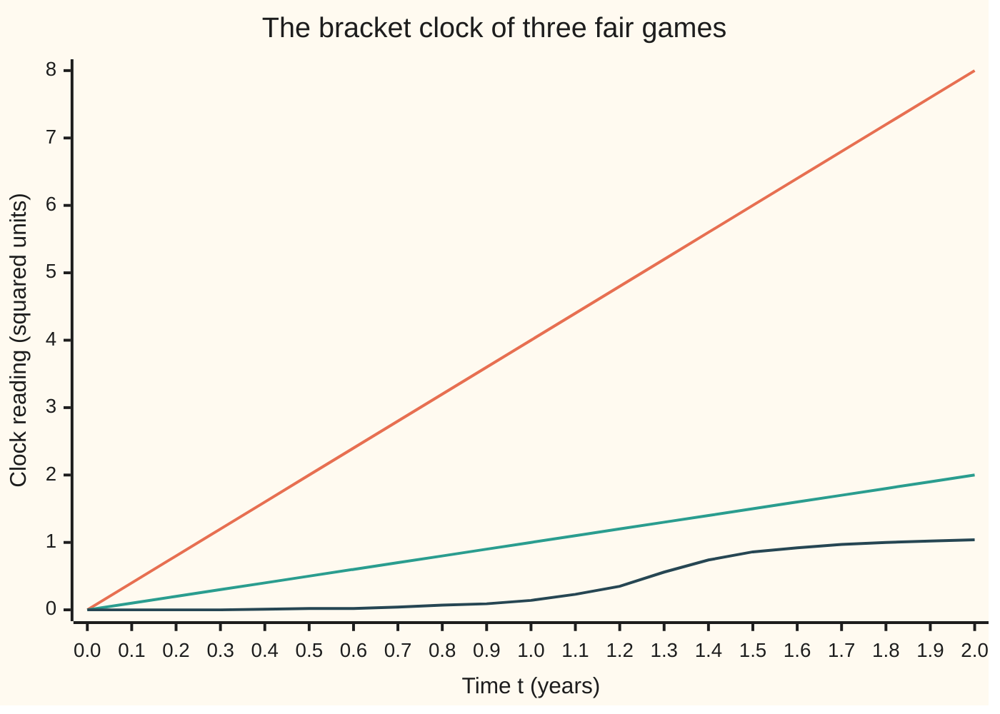

# Levy's characterisation and Dubins-Schwarz: every continuous martingale is Brownian motion on its own clock

[Syllabus](../../../SYLLABUS.md) → [Stochastic processes and calculus](../README.md) → [Continuous Martingales](../README.md#s10) → Levy's characterisation and Dubins-Schwarz

---

## General Overview

A share costs \$100 and wanders with no drift. A year from now its standard deviation is \$20. Measure the price in steps of \$20 away from \$100, and its path is a Brownian motion $`W_t`$, with time $`t`$ in years.

Three traders watch it:

- **The holder** keeps one share. Her gain after $`t`$ years is $`W_t`$ units of \$20.
- **The switcher** holds one share while the price is at or above \$100 and is short one share below it. She flips every time the price crosses \$100.
- **The doubler** keeps two shares. His gain is $`2W_t`$.

The switcher's gain looks like a new kind of object. It depends on the whole path, and her flips are timed by the price itself. Yet the theorem on this card says her gain is a Brownian motion: the same law as the holder's. Over one year her gain beats one unit (\$20) with chance 0.158655, exactly the holder's chance.

The reason is a clock. Every continuous fair game carries a **bracket**: the running total of its squared small moves, its own clock ([Doob-Meyer](02-doob-meyer-decomposition.md)). The switcher's moves are always one share's worth, so her clock reads $`t`$, like the holder's. The doubler's moves are twice as big, so his clock runs at 4 per year. His gain is the holder's gain with time run four times as fast.

**A continuous fair game whose clock reads exactly the time is a Brownian motion, and any continuous fair game is a Brownian motion read on its own clock.**

**What kind of fact this is:** two theorems. Levy's characterisation is proved on this card in Why it works, from Ito's lemma and characteristic functions. The Dubins-Schwarz time change is proved in its key steps, with one lemma cited: a continuous fair game does not move while its clock stands still.

### The picture: three clocks



Orange, the steepest line: the doubler's clock, $`4t`$. Green: the holder's and the switcher's clock, $`t`$. Dark blue: one simulated path of the clock of the shelf's house example, below (seed 20261125 in the code).

The house example is the trader who holds $`W_t`$ shares: one share for every \$20 the price stands above \$100, short below. Her gain is $`X_t = (W_t^2 - t)/2`$ units. Her clock ticks at speed $`W_t^2`$: on this path it barely moves while the price sits near \$100, then speeds up. Its average is $`t^2/2`$, which is 0.50 at one year and 2.00 at two.

---

## The formula

Notation first, with one-line reminders.

- $`\mathcal{F}_t`$ is what is known at time $`t`$: the price path so far.
- A **local martingale** is a fair game that may need to be stopped before large values to have finite averages ([Continuous martingales and local martingales](01-continuous-martingales-and-local-martingales.md)). Every Ito integral $`\int_0^t H_s\,dW_s`$ is one.
- The **bracket** $`\langle M\rangle_t`$ is the rising process that makes $`M_t^2 - \langle M\rangle_t`$ a local martingale. For continuous $`M`$ it is the sum of squared small moves. For an Ito integral it is $`\langle M\rangle_t = \int_0^t H_s^2\,ds`$ ([Doob-Meyer](02-doob-meyer-decomposition.md)).

**Levy's characterisation.** Let $`M`$ be a continuous local martingale with $`M_0 = 0`$. Then

```math
\langle M\rangle_t = t \text{ for every } t \quad\Longrightarrow\quad M \text{ is a Brownian motion.}
```

**Read it aloud:** if a continuous fair game's clock reads the time, the game is a Brownian motion.

**Dubins-Schwarz.** Let $`M`$ be a continuous local martingale with $`M_0 = 0`$ whose clock runs forever: $`\langle M\rangle_t \to \infty`$. Read $`M`$ at the first moment its clock passes $`s`$:

```math
\tau_s = \inf\{t : \langle M\rangle_t > s\}, \qquad \beta_s = M_{\tau_s}, \qquad M_t = \beta_{\langle M\rangle_t}.
```

**Read it aloud:** stop the game when its clock shows s; the stopped values form a Brownian motion beta, and the game at time t is beta at clock reading bracket of M at t.

The three examples, with $`\mathrm{sgn}(x)`$ meaning +1 for $`x \ge 0`$ and −1 below:

| Fair game | Clock $`\langle\cdot\rangle_t`$ | What the theorems say |
| --- | --- | --- |
| switcher, $`M_t = \int_0^t \mathrm{sgn}(W_s)\,dW_s`$ | $`\int_0^t 1\,ds = t`$ | a Brownian motion |
| doubler, $`Y_t = \int_0^t 2\,dW_s = 2W_t`$ | $`4t`$ | $`Y_t = \beta_{4t}`$: Brownian motion four times as fast |
| house, $`X_t = \int_0^t W_s\,dW_s`$ | $`A_t = \int_0^t W_s^2\,ds`$ | $`X_t = \beta_{A_t}`$: Brownian motion on a random clock |

| Symbol | Plain meaning | In our example | Push it up and the answer… |
| --- | --- | --- | --- |
| $`W_t`$, $`t`$, $`T`$ | Brownian motion: the price in units of \$20 from \$100; time in years; a fixed horizon | $`W_0 = 0`$ | — |
| $`M_t`$, $`M_0`$, $`M^j`$ | a continuous local martingale; in the example, the switcher's gain; $`M^j`$ is the j-th of d games in Step 4 | $`P(M_1 > 1)`$ = 0.158655 | — |
| $`\langle M\rangle_t`$, $`H_s`$ | the bracket: the game's clock; the holding inside an Ito integral, whose square sets the clock's speed | switcher: $`\langle M\rangle_1`$ = 1 | a faster clock: more spread at the same time |
| $`\mathrm{sgn}(x)`$ | the sign: +1 for $`x \ge 0`$, −1 below | the switcher's holding | — |
| $`Y_t`$, $`N_t`$ | the doubler's gain, $`2W_t`$; in When it holds, a count of calls arriving at 4 an hour | doubler: clock 4 at one year | — |
| $`X_t`$, $`A_t`$ | the house gain $`(W_t^2 - t)/2`$, and its clock $`\int_0^t W_s^2\,ds`$ | $`E[A_1]`$ = 0.5 | — |
| $`s`$, $`u`$, $`\tau_s`$ | a clock reading, and an earlier one u; the first time the clock passes s | s = 0.5: mean $`\tau_s`$ 1.4793 years (1.4889 on the grid) | later stopping times |
| $`\beta_s`$ | the Brownian motion read off the clock | $`\beta_{0.5}`$ is normal, variance 0.5 | — |
| $`\theta`$, $`i`$, $`Z_t`$ | a fixed real number (a frequency); the square root of −1; the exponential martingale of Why it works, written $`f(t, M_t)`$ in a fold | θ = 1: $`E[\cos M_1]`$ = 0.606531 | — |
| $`\mathcal{F}_t`$, $`F`$, $`\mathcal{G}_s`$, $`E[\,\cdot \mid \mathcal{F}_s]`$, $`P`$ | what is known at time t; an event known at time s; what is known at the stop $`\tau_s`$; the best forecast given time s; probability | — | — |
| $`\Phi(x)`$, $`N(0, v)`$, $`D`$ | the normal CDF: chance a standard normal is below x; a normal law with mean 0 and variance v; a move with that law | $`1 - \Phi(1)`$ = 0.158655 | — |
| $`S_k`$, $`\xi_k`$, $`k`$, $`n`$ | in Step 0 and the code: a coin-flip walk after k flips, the k-th flip (±1), the number of flips | n = 12 | — |

### When it holds

- **Continuous paths.** The switchboard of [Doob-Meyer](02-doob-meyer-decomposition.md) takes calls at 4 an hour. Its count minus its trend, $`N_t - 4t`$, is fair with bracket $`4t`$, the doubler's clock. It is not a Brownian motion: with chance $`e^{-4}`$ = 0.018316 no call comes in the first hour, and it sits at exactly −4. A normal law has no such lump.
- **A fair game.** The drifting price $`W_t + t`$ has the clock $`t`$, but it averages 1 at one year, not 0. Levy's theorem needs the local martingale property first.
- **A clock that reads exactly $`t`$, not $`t`$ on average.** The house gain has a clock that averages $`t^2/2`$, random path by path. At a fixed time it is not normal (see Step 6).
- **A clock that runs forever, for Dubins-Schwarz.** The gain from holding one share for one year and then selling, $`W_{\min(t,1)}`$, has a clock that stops at 1. Then $`\beta`$ is defined only up to clock reading 1. The theorem still holds after adding an independent Brownian motion to supply the missing stretch.
- **One filtration throughout.** $`M`$ must be a local martingale for the same information $`\mathcal{F}_t`$ that its clock uses. The conclusion is that $`M`$ is a Brownian motion for that information: its future moves are independent of all of $`\mathcal{F}_t`$, not just of its own past.

---

## Why it works

### Step 0: a fair coin times a known sign is a fair coin

Take a coin-flip walk: $`S_k`$ is the total after k flips $`\xi_1, \dots, \xi_k`$ of ±1. The switcher's version adds $`\mathrm{sgn}(S_{k-1})\,\xi_k`$ instead: the next flip, times a sign fixed before the flip.

Given the past, that product is +1 or −1 with chance one half each. So the switcher's walk is again a fair coin-flip walk, flip by flip. Its paths differ from the plain walk, but its law is the same.

The code checks this on all 4096 paths of 12 flips. The two totals differ on 2886 paths, yet their counts at −12, −10, …, 12 are the same: 1, 12, 66, 220, 495, 792, 924, 792, 495, 220, 66, 12, 1.

In continuous time the argument needs more. A continuous fair game is described by two things only: it is fair, and its moves have a size, which the bracket records. Continuity forbids jumps. Once the size is the Brownian one, $`dt`$ per $`dt`$, nothing is left to choose. The proof makes that exact with one exponential.

### Step 1: the exponential martingale, with an imaginary tilt

[Brownian martingales](../05-Brownian%20Motion/06-brownian-martingales-and-exponential-martingale.md) showed that $`e^{\theta W_t - \theta^2 t/2}`$ is fair. Use the same shape with $`i\theta`$ in place of θ. Here $`e^{ix} = \cos x + i\sin x`$, a point on the unit circle, so it never blows up.

```math
Z_t = \exp\big(i\theta M_t + \tfrac12\theta^2 t\big), \qquad dZ_t = i\theta\, Z_t\, dM_t + \tfrac12\theta^2 Z_t\,\big(dt - d\langle M\rangle_t\big).
```

**Read it aloud:** Z changes by i theta Z times the game's move, plus a correction proportional to the clock time minus the bracket's growth.

With $`\langle M\rangle_t = t`$ the correction is zero. So $`Z`$ is an Ito integral against $`M`$: a local martingale.

<details>
<summary>Ito's lemma for Z, term by term</summary>

Write $`Z_t = f(t, M_t)`$ with $`f(t, m) = \exp(i\theta m + \tfrac12\theta^2 t)`$. Ito's lemma for a continuous local martingale ([Ito's lemma](../06-Ito%20Calculus/02-itos-lemma.md)) uses the bracket where Brownian motion used $`dt`$. Apply it to the real part and the imaginary part separately; both are smooth real functions.

The slopes are $`f_t = \tfrac12\theta^2 f`$, $`f_m = i\theta f`$ and $`f_{mm} = (i\theta)^2 f = -\theta^2 f`$. So

$`\displaystyle dZ_t = f_t\,dt + f_m\,dM_t + \tfrac12 f_{mm}\,d\langle M\rangle_t = Z_t\Big(\tfrac12\theta^2\,dt + i\theta\,dM_t - \tfrac12\theta^2\,d\langle M\rangle_t\Big).`$

When $`d\langle M\rangle_t = dt`$, the first and last terms cancel.

</details>

### Step 2: bounded, so truly fair

The size of $`Z_t`$ is $`e^{\theta^2 t/2}`$, because $`|e^{i\theta M_t}| = 1`$. Up to a fixed horizon T it never exceeds $`e^{\theta^2 T/2}`$. A bounded local martingale is a martingale: stop it on the usual sequence and pass to the limit by bounded convergence ([Continuous martingales and local martingales](01-continuous-martingales-and-local-martingales.md)). So $`E[Z_t \mid \mathcal{F}_s] = Z_s`$ for $`s \le t`$.

### Step 3: the forecast of the move is the normal one

Divide both sides by $`Z_s`$, a known number at time s:

```math
E\big[e^{i\theta (M_t - M_s)} \,\big|\, \mathcal{F}_s\big] = e^{-\theta^2 (t-s)/2} \quad \text{for every real } \theta.
```

**Read it aloud:** given everything known at time s, the average of e to the i theta times the move is e to the minus theta squared times the elapsed time over two.

The right side is the **characteristic function** of $`N(0, t-s)`$: the average of $`e^{i\theta D}`$ for a normal $`D`$ with variance $`t - s`$. A characteristic function pins down the law ([Characteristic functions](../../10-Measure%20and%20integration/10-The%20Limit%20Theorems%2C%20Proved/06-characteristic-functions.md)).

The right side also does not depend on the past. So the move is normal and independent of everything known at time s.

<details>
<summary>Why a forecast that ignores the past gives independence</summary>

Fix an event F known at time s, with $`P(F) > 0`$. Multiply the identity by the indicator of F (1 on F, 0 off it) and average:

$`\displaystyle E\big[\mathbf{1}_F\, e^{i\theta(M_t - M_s)}\big] = P(F)\, e^{-\theta^2 (t-s)/2}.`$

Divide by $`P(F)`$. Under the conditional law given F, the move has the characteristic function of $`N(0, t-s)`$, so it has that law. Hence $`P(M_t - M_s \le x,\ F) = \Phi\big(x/\sqrt{t-s}\big)\,P(F)`$ for every x: the move is independent of F.

For several moves over $`s_0 < s_1 < \dots < s_m`$, apply this at $`s_{m-1}`$, then $`s_{m-2}`$, and so on back. Each move is normal and independent of all earlier ones.

</details>

### Step 4: that is the definition of Brownian motion

$`M_0 = 0`$; its paths are continuous; its moves over separate stretches are independent and normal, with variance equal to the length of the stretch. Those are the defining properties of a Brownian motion ([Brownian motion](../05-Brownian%20Motion/01-brownian-motion.md)). Levy's characterisation is proved.

The switcher's clock is $`\int_0^t \mathrm{sgn}(W_s)^2\,ds = t`$, so her gain is a Brownian motion. The simulation agrees: $`E[M_1^2]`$ = 0.9902 (standard error 0.0070) and $`P(M_1 > 1)`$ = 0.1572 (0.0018), against 1 and 0.158655.

**Several games at once.** If $`M^1, \dots, M^d`$ have $`\langle M^j\rangle_t = t`$ and cross-brackets $`\langle M^j, M^k\rangle_t = 0`$ for $`j \ne k`$, they are independent Brownian motions. The proof is the same, with $`\theta_1 M^1 + \dots + \theta_d M^d`$ in place of $`\theta M`$ and the covariation rule of [Several Brownian motions](../06-Ito%20Calculus/06-multidimensional-ito-and-correlation.md).

The switcher and the holder fail that test. Their cross-bracket is $`\int_0^t \mathrm{sgn}(W_s)\,ds`$, random. So each is a Brownian motion, but the pair is not a pair of independent ones. The code finds $`M_1`$ and $`W_1`$ uncorrelated (−0.0040) yet strongly tied through the size of the price move: the correlation of $`M_1`$ with $`|W_1|`$ is 0.8246 on the grid (0.8294 in continuous time).

### Step 5: any clock can be undone

Now let the clock be anything that runs forever. Stop the game at $`\tau_s`$, the first time its clock passes s. Three facts make $`\beta_s = M_{\tau_s}`$ a Brownian motion:

1. **It is continuous in s.** The clock may stand still for a while; then $`\tau_s`$ jumps over that stretch. But a continuous local martingale does not move while its clock stands still, so $`\beta`$ does not jump.
2. **It is fair.** $`E[M_{\tau_s}^2] = E[\langle M\rangle_{\tau_s}] = s`$, finite, so stopping at $`\tau_s`$ keeps the game fair.
3. **Its own clock reads s.** $`M_{\tau_s}^2 - \langle M\rangle_{\tau_s} = \beta_s^2 - s`$ is fair for the same reason, so $`\langle\beta\rangle_s = s`$.

Levy's characterisation then makes $`\beta`$ a Brownian motion. Finally, at clock reading $`s = \langle M\rangle_t`$, the game has not moved between t and $`\tau_s`$, so $`M_t = \beta_{\langle M\rangle_t}`$.

The doubler is the simplest case: $`\beta_s = Y_{s/4}`$, and $`Y_t = \beta_{4t}`$. Beating 2 units in one year has chance $`P(\beta_4 > 2) = 1 - \Phi(1)`$ = 0.158655; the simulation gives 0.1568 (0.0018).

<details>
<summary>Detailed proof of the three facts</summary>

**Stopping times.** $`\{\tau_s < t\} = \{\langle M\rangle_t > s\}`$ uses only the path up to t, so each $`\tau_s`$ is a stopping time. It rises with s, and $`\langle M\rangle_{\tau_s} = s`$ because the clock is continuous. Write $`\mathcal{G}_s = \mathcal{F}_{\tau_s}`$: what is known at the stopping time $`\tau_s`$.

**The lemma.** On every interval where $`\langle M\rangle`$ is constant, M is constant, for almost every path. The idea: on such an interval M's squared moves add up to zero, so M has no room to move. The full proof is in Revuz and Yor, chapter IV, Proposition 1.13. It makes $`s \mapsto \beta_s`$ continuous even where $`\tau_s`$ jumps.

**Fairness.** For fixed s, the stopped game $`M_{\min(t, \tau_s)}`$ has bracket at most s, so its mean square is at most s for every t. A continuous martingale bounded in mean square can be stopped at any stopping time ([Burkholder-Davis-Gundy](03-burkholder-davis-gundy-inequalities.md) controls its peak). So, for $`u \le s`$:

$`\displaystyle E[\beta_s \mid \mathcal{G}_u] = \beta_u, \qquad E[\beta_s^2 - s \mid \mathcal{G}_u] = \beta_u^2 - u.`$

So $`\beta`$ is a continuous martingale for $`\mathcal{G}`$ with bracket s, and Steps 1 to 4 apply.

**Undoing the clock.** Let $`s = \langle M\rangle_t`$. Then $`\tau_s \ge t`$, and the clock is constant on $`[t, \tau_s]`$, so by the lemma $`M_t = M_{\tau_s} = \beta_s`$.

</details>

### Step 6: the house example, normal on its clock and not on the calendar

The house gain $`X_t = (W_t^2 - t)/2`$ has clock $`A_t = \int_0^t W_s^2\,ds`$. Stop each path when $`A`$ reaches 0.5. Dubins-Schwarz says the stopped gain is $`N(0, 0.5)`$.

The simulation of 40,000 paths agrees. The mean stopping time is 1.4793 years; the grid, which stops late, gives 1.4889. The stopped gain has mean square 0.5019 (0.0036) and fourth-moment ratio 3.0363, near the normal law's 3. It falls below −0.5 with chance 0.2401 (0.0021), against the normal 0.239750.

Now read the same game at the fixed time of one year. Its mean square is also 0.5, since $`E[A_1] = 0.5`$. But $`X_1 = (W_1^2 - 1)/2`$ can never fall below −0.5, and its fourth-moment ratio is 15, not 3. The calendar mixes many clock readings; only the game's own clock shows the normal law.

---

## Worked numbers, by hand

| Step | Arithmetic | Value |
| --- | --- | --- |
| switcher's clock at one year | $`\int_0^1 \mathrm{sgn}(W_s)^2\,ds = \int_0^1 1\,ds`$ | 1 |
| her chance of beating one unit | $`1 - \Phi(1)`$ | 0.158655 |
| the characteristic function at θ = 1 | $`E[\cos M_1] = e^{-1/2}`$ | 0.606531 |
| coin version, 12 flips, total at least 4 | (495 + 220 + 66 + 12 + 1) / 4096 = 794 / 4096 | 0.193848 |
| doubler's clock at one year | $`\int_0^1 2^2\,ds`$ | 4 |
| his chance of beating 2 units | $`P(\beta_4 > 2) = 1 - \Phi(2/\sqrt{4})`$ | 0.158655 |
| house clock, average at one year | $`E[A_1] = \int_0^1 E[W_s^2]\,ds = \int_0^1 s\,ds`$ | 0.5 |
| house gain at clock 0.5, below −0.5 | $`\Phi(-0.5/\sqrt{0.5}) = \Phi(-0.7071)`$ | 0.239750 |
| house gain at one year, below −0.5 | $`(W_1^2 - 1)/2 \ge -0.5`$ always | 0 |
| **fourth-moment ratio at one year** | $`E[(W_1^2-1)^4]/16 = (105 - 60 + 18 - 4 + 1)/16 = 3.75`$, over $`0.5^2`$ | **15** |

The switcher and the doubler are Brownian motions on the clocks t and 4t. The house gain is a Brownian motion only on its own random clock; on the calendar its fourth-moment ratio is 15, five times the normal law's 3: heavy tails.

### What breaks if you drop a piece

| Mistake | Comes out at | What went wrong |
| --- | --- | --- |
| Read Dubins-Schwarz at a fixed time: house $`X_1 \sim N(0, 0.5)`$ | $`P(X_1 < -0.5)`$ = 0.239750 claimed; true 0 (simulation 0.0000) | the normal law holds at clock readings, not calendar times |
| Clock 4t read as "twice as fast": $`Y_1`$ like $`W_2`$ | $`P(Y_1 > 2)`$ = 0.078650 claimed; true 0.158655 (simulation 0.1568) | the clock adds squared moves, so doubling the holding quadruples the speed |
| Drop the clock correction: treat $`e^{i\theta M_t}`$ as fair | $`E[\cos M_1]`$ = 1 claimed; true 0.606531 (simulation 0.6099) | the tilt must be paid for by $`\tfrac12\theta^2 t`$, exactly as in the real exponential martingale |
| Match only the variance: house $`X_1`$ has mean square 0.5, so call it normal | fourth-moment ratio 3 claimed; true 15.0000 (simulation 15.0101) | a clock equal to t on average is not a clock equal to t |

---

## Code, from first principles, and it actually runs

The code takes four roads to the same facts.

- **Road 1, formulas.** The normal CDF by Simpson's rule, cross-checked against its Taylor series; the fourth-moment ratio 15 by numerical integration.
- **Road 2, exact enumeration.** All 4096 coin-flip paths of 12 steps: the switcher's total has exactly the plain walk's law, and the house sum equals $`(S_n^2 - n)/2`$ on every path.
- **Road 3, simulation of the switcher and the doubler.** 40,000 paths on a grid of 0.005 years. Each step of the switcher's sum is a normal move times a known sign, so the grid adds no bias to her own law.
- **Road 4, the time change.** 40,000 house paths, each stopped when its clock reaches 0.5, compared with the same game at the fixed time of one year, and with that gain divided by the square root of its clock.

Random numbers come from SplitMix64, with Box-Muller normals written out. Both languages use the same seeds and print the same lines.

### Python

```python
# Levy's characterisation and Dubins-Schwarz: four roads, standard library only.
import math

MASK = (1 << 64) - 1
class Rng:  # SplitMix64 uniforms, Box-Muller normals (one per call)
    def __init__(self, seed): self.s = seed
    def u(self):
        self.s = (self.s + 0x9E3779B97F4A7C15) & MASK
        z = self.s
        z = ((z ^ (z >> 30)) * 0xBF58476D1CE4E5B9) & MASK
        z = ((z ^ (z >> 27)) * 0x94D049BB133111EB) & MASK
        return ((z ^ (z >> 31)) >> 11) / 9007199254740992.0
    def n(self):
        u1 = 1.0 - self.u()
        return math.sqrt(-2.0 * math.log(u1)) * math.cos(2.0 * math.pi * self.u())

def simpson(f, a, b, m=2000):
    h = (b - a) / m
    s = f(a) + f(b) + sum((4 if k % 2 else 2) * f(a + k * h) for k in range(1, m))
    return s * h / 3
phi = lambda z: math.exp(-z * z / 2) / math.sqrt(2 * math.pi)
def Phi(x): return 0.5 + simpson(phi, 0.0, x)
def Phi_series(x):  # 0.5 + sum of the Taylor series of the integral of phi
    s, k, term = 0.0, 0, x
    while abs(term) > 1e-17:
        s += term / (2 * k + 1); k += 1; term *= -x * x / (2 * k)
    return 0.5 + s / math.sqrt(2 * math.pi)
def mean(v): return sum(v) / len(v)
def se(v):
    m = mean(v); return math.sqrt(sum((x - m) ** 2 for x in v) / (len(v) - 1) / len(v))
def corr(x, y):
    mx, my = mean(x), mean(y)
    c = sum((a - mx) * (b - my) for a, b in zip(x, y))
    return c / math.sqrt(sum((a - mx) ** 2 for a in x) * sum((b - my) ** 2 for b in y))

# Road 1: formulas
p1, p2w, pneg = 1 - Phi(1.0), 1 - Phi(2 / math.sqrt(2)), Phi(-0.5 / math.sqrt(0.5))
kurt = simpson(lambda z: ((z * z - 1) / 2) ** 4 * phi(z), -12, 12, 4000) / 0.25
print(f"formula   P(N(0,1) > 1) = {p1:.6f}   series {Phi_series(-1.0):.6f}   E[cos W_1] = e^-1/2 = {math.exp(-0.5):.6f}")
print(f"formula   twice-as-fast P(W_2 > 2) = {p2w:.6f}   P(N(0,0.5) < -0.5) = {pneg:.6f}   Poisson P(N_1 - 4 = -4) = e^-4 = {math.exp(-4):.6f}")
print(f"formula   house X_1 = (W_1^2 - 1)/2: E[X_1^2] = 0.5, E[X_1^4]/E[X_1^2]^2 = {kurt:.4f} (normal: 3)")
mom = [simpson(lambda z, j=j: z ** j * phi(z), -12, 12, 4000) for j in (8, 6, 4, 2)]
print(f"formula   E[(W_1^2 - 1)^4] = {mom[0]:.4f} - {4 * mom[1]:.4f} + {6 * mom[2]:.4f} - {4 * mom[3]:.4f} + 1; over 16, E[X_1^4] = {kurt / 4:.4f}")
assert abs(Phi(1.0) - Phi_series(1.0)) < 1e-10 and abs(kurt - 15) < 1e-6
assert all(abs(m - math.prod(range(j - 1, 0, -2))) < 1e-6 for m, j in zip(mom, (8, 6, 4, 2)))  # 7!!, 5!!, 3!!, 1!!

# Road 2: coin flips, every one of the 4096 paths of 12 steps
n = 12; lawS, lawM, differ = {}, {}, 0
for code in range(1 << n):
    S = M = H = 0
    for k in range(n):
        x = 1 if (code >> k) & 1 else -1
        M += (1 if S >= 0 else -1) * x; H += S * x; S += x
    assert 2 * H == S * S - n
    lawS[S] = lawS.get(S, 0) + 1; lawM[M] = lawM.get(M, 0) + 1; differ += M != S
assert lawS == lawM
print(f"coins     12 steps: sign-strategy total has the walk's law exactly; totals differ on {differ} of 4096 paths")
print("coins     counts at -12..12 step 2:", " ".join(str(lawM[v]) for v in range(-12, 13, 2)))
print(f"coins     P(total >= 4) = {sum(c for v, c in lawM.items() if v >= 4)}/4096 = {sum(c for v, c in lawM.items() if v >= 4)/4096:.6f}")

# Road 3: simulate M_t = int sgn(W) dW and Y_t = int 2 dW on [0, 1]
rng = Rng(20261123); P, steps = 40000, 200; dt = 1.0 / steps
Mh, M1, W1 = [], [], []
for _ in range(P):
    W = M = 0.0
    for k in range(steps):
        dW = math.sqrt(dt) * rng.n(); M += (1.0 if W >= 0 else -1.0) * dW; W += dW
        if k == steps // 2 - 1: Mh.append(M)
    M1.append(M); W1.append(W)
sq = [m * m for m in M1]; q4 = [m ** 4 for m in M1]; big = [1.0 if m > 1 else 0.0 for m in M1]
cs = [math.cos(m) for m in M1]; sn = [math.sin(m) for m in M1]
N1 = [2 * b for b in W1]; bigN = [1.0 if v > 2 else 0.0 for v in N1]
print(f"simulate  sign integral, {P} paths, dt {dt}, bracket = steps x dt, since sgn^2 = 1: {steps * dt:.4f}")
print(f"  E[M_1] {mean(M1):.4f} se {se(M1):.4f}   E[M_1^2] {mean(sq):.4f} se {se(sq):.4f}   E[M_1^4] {mean(q4):.4f} se {se(q4):.4f}")
print(f"  P(M_1 > 1) {mean(big):.4f} se {se(big):.4f}   E[cos M_1] {mean(cs):.4f} se {se(cs):.4f}   E[sin M_1] {mean(sn):.4f}")
print(f"  E[Z_1] = E[cos M_1] e^(1/2) = {mean(cs) * math.exp(0.5):.4f}")
inc = [b - a for a, b in zip(Mh, M1)]
print(f"  corr(M_0.5^2, (M_1 - M_0.5)^2) {corr([a * a for a in Mh], [b * b for b in inc]):.4f}   corr(M_1, W_1) {corr(M1, W1):.4f}   corr(M_1, |W_1|) {corr(M1, [abs(b) for b in W1]):.4f} (continuous time {0.5 / math.sqrt(1 - 2 / math.pi):.4f})")
print(f"  constant 2, Y = 2W: E[Y_1^2] {mean([v * v for v in N1]):.4f}   P(Y_1 > 2) {mean(bigN):.4f} se {se(bigN):.4f}")
assert abs(mean(sq) - 1) < 4 * se(sq) and abs(mean(big) - p1) < 4 * se(big)
assert abs(mean(cs) - math.exp(-0.5)) < 4 * se(cs) and abs(mean(bigN) - p1) < 4 * se(bigN)

# Road 4: Dubins-Schwarz on the house example X = int W dW, clock A = int W^2 dt
rng = Rng(20261124); P2, s, cap = 40000, 0.5, 4000
beta, Atau, tau, Mfix, Afix = [], [], [], [], []
for _ in range(P2):
    W = M = A = 0.0; k = 0; done = False
    while k < cap and (not done or k < steps):
        if not done and A >= s: beta.append(M); Atau.append(A); tau.append(k * dt); done = True
        dW = math.sqrt(dt) * rng.n(); M += W * dW; A += W * W * dt; W += dW; k += 1
        if k == steps: Mfix.append((W * W - 1.0) / 2); Afix.append(A)
b2 = [b * b for b in beta]; b4 = [b ** 4 for b in beta]
up = [1.0 if b > math.sqrt(s) else 0.0 for b in beta]; dn = [1.0 if b < -0.5 else 0.0 for b in beta]
f2 = [m * m for m in Mfix]; zr = [m / math.sqrt(a) for m, a in zip(Mfix, Afix)]; lo = [1.0 if z < -1 else 0.0 for z in zr]
etau = math.sqrt(2 * s / math.pi) * simpson(lambda u: 1 / math.sqrt(math.cosh(u)), 0.0, 60.0, 4000)  # sqrt(s) E[A_1^(-1/2)]
print(f"time change  house example, {P2} paths, stop when the clock A reaches s = {s}: reached on {len(beta)}")
print(f"  mean stopping time {mean(tau):.4f} years (exact {etau:.4f})   mean clock at the stop {mean(Atau):.4f}")
print(f"  E[beta_s^2] {mean(b2):.4f} se {se(b2):.4f}   E[beta^4]/E[beta^2]^2 {mean(b4) / mean(b2) ** 2:.4f}   P(beta_s > sqrt s) {mean(up):.4f} se {se(up):.4f}")
print(f"  P(beta_s < -0.5) {mean(dn):.4f} se {se(dn):.4f}")
print(f"  fixed time 1: E[X_1^2] {mean(f2):.4f}  E[X_1^4]/E[X_1^2]^2 {mean([m ** 4 for m in Mfix]) / mean(f2) ** 2:.4f}  P(X_1 < -0.5) {mean([1.0 if m < -0.5 else 0.0 for m in Mfix]):.4f}")
assert len(beta) == P2 and abs(mean(b2) - mean(Atau)) < 4 * se(b2)
assert abs(mean(up) - p1) < 4 * se(up) and abs(mean(dn) - pneg) < 4 * se(dn)
print(f"  X_1/sqrt(A_1): mean square {mean([z * z for z in zr]):.4f}   P(< -1) {mean(lo):.4f} se {se(lo):.4f}   P(> 1) {mean([1.0 if z > 1 else 0.0 for z in zr]):.4f}   normal: 1, {p1:.6f}")
assert mean(lo) - p1 > 4 * se(lo)  # dividing by a random clock does not give a normal law

# the chart: one path's clock A_t against the clocks t and 4t
rng = Rng(20261125); W = A = 0.0; pts = ["0.00"]
for k in range(1, 401):
    dW = math.sqrt(dt) * rng.n(); A += W * W * dt; W += dW
    if k % 20 == 0: pts.append(f"{A:.2f}")
print("chart, A_t at t = 0, 0.1, ..., 2:", " ".join(pts))
print("chart, clock t:                ", " ".join(f"{j / 10:.2f}" for j in range(21)))
print("chart, clock 4t:               ", " ".join(f"{4 * j / 10:.2f}" for j in range(21)))
print("chart, t^2/2 at the same times:  ", " ".join(f"{(j / 10) ** 2 / 2:.2f}" for j in range(21)))
print("ALL CHECKS PASS")
```

**Ran 2026-11-23 on macOS, Python 3.14.10, standard library only. All checks passed. Output, pasted from the run:**

```
formula   P(N(0,1) > 1) = 0.158655   series 0.158655   E[cos W_1] = e^-1/2 = 0.606531
formula   twice-as-fast P(W_2 > 2) = 0.078650   P(N(0,0.5) < -0.5) = 0.239750   Poisson P(N_1 - 4 = -4) = e^-4 = 0.018316
formula   house X_1 = (W_1^2 - 1)/2: E[X_1^2] = 0.5, E[X_1^4]/E[X_1^2]^2 = 15.0000 (normal: 3)
formula   E[(W_1^2 - 1)^4] = 105.0000 - 60.0000 + 18.0000 - 4.0000 + 1; over 16, E[X_1^4] = 3.7500
coins     12 steps: sign-strategy total has the walk's law exactly; totals differ on 2886 of 4096 paths
coins     counts at -12..12 step 2: 1 12 66 220 495 792 924 792 495 220 66 12 1
coins     P(total >= 4) = 794/4096 = 0.193848
simulate  sign integral, 40000 paths, dt 0.005, bracket = steps x dt, since sgn^2 = 1: 1.0000
  E[M_1] 0.0006 se 0.0050   E[M_1^2] 0.9902 se 0.0070   E[M_1^4] 2.9533 se 0.0478
  P(M_1 > 1) 0.1572 se 0.0018   E[cos M_1] 0.6099 se 0.0022   E[sin M_1] 0.0004
  E[Z_1] = E[cos M_1] e^(1/2) = 1.0055
  corr(M_0.5^2, (M_1 - M_0.5)^2) 0.0064   corr(M_1, W_1) -0.0040   corr(M_1, |W_1|) 0.8246 (continuous time 0.8294)
  constant 2, Y = 2W: E[Y_1^2] 3.9904   P(Y_1 > 2) 0.1568 se 0.0018
time change  house example, 40000 paths, stop when the clock A reaches s = 0.5: reached on 40000
  mean stopping time 1.4889 years (exact 1.4793)   mean clock at the stop 0.5037
  E[beta_s^2] 0.5019 se 0.0036   E[beta^4]/E[beta^2]^2 3.0363   P(beta_s > sqrt s) 0.1583 se 0.0018
  P(beta_s < -0.5) 0.2401 se 0.0021
  fixed time 1: E[X_1^2] 0.5004  E[X_1^4]/E[X_1^2]^2 15.0101  P(X_1 < -0.5) 0.0000
  X_1/sqrt(A_1): mean square 1.1430   P(< -1) 0.2857 se 0.0023   P(> 1) 0.0832   normal: 1, 0.158655
chart, A_t at t = 0, 0.1, ..., 2: 0.00 0.00 0.00 0.00 0.01 0.02 0.02 0.04 0.07 0.09 0.14 0.23 0.35 0.56 0.74 0.86 0.92 0.97 1.00 1.02 1.04
chart, clock t:                 0.00 0.10 0.20 0.30 0.40 0.50 0.60 0.70 0.80 0.90 1.00 1.10 1.20 1.30 1.40 1.50 1.60 1.70 1.80 1.90 2.00
chart, clock 4t:                0.00 0.40 0.80 1.20 1.60 2.00 2.40 2.80 3.20 3.60 4.00 4.40 4.80 5.20 5.60 6.00 6.40 6.80 7.20 7.60 8.00
chart, t^2/2 at the same times:   0.00 0.01 0.02 0.04 0.08 0.12 0.18 0.24 0.32 0.41 0.50 0.61 0.72 0.85 0.98 1.12 1.28 1.44 1.62 1.80 2.00
ALL CHECKS PASS
```

Reading the run:

- The switcher matches a Brownian motion on every printed test. Her squared first-half move and squared second-half move are uncorrelated (0.0064), as independence requires.
- $`E[Z_1]`$ = 1.0055: the exponential martingale keeps its starting value 1, within the simulation's error.
- The house clock overshoots 0.5 by a little at the grid stop (mean 0.5037). The mean square of the stopped gain matches the mean clock at the stop, as optional stopping says it must.

### Rust

```rust
// Levy's characterisation and Dubins-Schwarz: four roads, std only.
struct Rng { s: u64 }
impl Rng { // SplitMix64 uniforms, Box-Muller normals (one per call)
    fn u(&mut self) -> f64 {
        self.s = self.s.wrapping_add(0x9E3779B97F4A7C15);
        let mut z = self.s;
        z = (z ^ (z >> 30)).wrapping_mul(0xBF58476D1CE4E5B9);
        z = (z ^ (z >> 27)).wrapping_mul(0x94D049BB133111EB);
        ((z ^ (z >> 31)) >> 11) as f64 / 9007199254740992.0
    }
    fn n(&mut self) -> f64 {
        let u1 = 1.0 - self.u();
        (-2.0 * u1.ln()).sqrt() * (2.0 * std::f64::consts::PI * self.u()).cos()
    }
}

fn simpson(f: &dyn Fn(f64) -> f64, a: f64, b: f64, m: usize) -> f64 {
    let h = (b - a) / m as f64;
    let mut s = f(a) + f(b);
    for k in 1..m { s += (if k % 2 == 1 { 4.0 } else { 2.0 }) * f(a + k as f64 * h); }
    s * h / 3.0
}
fn phi(z: f64) -> f64 { (-z * z / 2.0).exp() / (2.0 * std::f64::consts::PI).sqrt() }
fn big_phi(x: f64) -> f64 { 0.5 + simpson(&phi, 0.0, x, 2000) }
fn phi_series(x: f64) -> f64 { // 0.5 + sum of the Taylor series of the integral of phi
    let (mut s, mut k, mut term) = (0.0, 0.0, x);
    while term.abs() > 1e-17 {
        s += term / (2.0 * k + 1.0); k += 1.0; term *= -x * x / (2.0 * k);
    }
    0.5 + s / (2.0 * std::f64::consts::PI).sqrt()
}
fn mean(v: &[f64]) -> f64 { v.iter().sum::<f64>() / v.len() as f64 }
fn se(v: &[f64]) -> f64 {
    let m = mean(v); let n = v.len() as f64;
    (v.iter().map(|x| (x - m) * (x - m)).sum::<f64>() / (n - 1.0) / n).sqrt()
}
fn corr(x: &[f64], y: &[f64]) -> f64 {
    let (mx, my) = (mean(x), mean(y));
    let c: f64 = x.iter().zip(y).map(|(a, b)| (a - mx) * (b - my)).sum();
    let sx: f64 = x.iter().map(|a| (a - mx) * (a - mx)).sum();
    let sy: f64 = y.iter().map(|b| (b - my) * (b - my)).sum();
    c / (sx * sy).sqrt()
}
fn ind(v: &[f64], f: &dyn Fn(f64) -> bool) -> Vec<f64> { v.iter().map(|&x| if f(x) { 1.0 } else { 0.0 }).collect() }
fn sq(v: &[f64]) -> Vec<f64> { v.iter().map(|x| x * x).collect() }
fn q4(v: &[f64]) -> Vec<f64> { v.iter().map(|x| x.powi(4)).collect() }

fn main() {
    // Road 1: formulas
    let (p1, p2w, pneg) = (1.0 - big_phi(1.0), 1.0 - big_phi(2.0 / 2f64.sqrt()), big_phi(-0.5 / 0.5f64.sqrt()));
    let kurt = simpson(&|z: f64| ((z * z - 1.0) / 2.0).powi(4) * phi(z), -12.0, 12.0, 4000) / 0.25;
    println!("formula   P(N(0,1) > 1) = {:.6}   series {:.6}   E[cos W_1] = e^-1/2 = {:.6}", p1, phi_series(-1.0), (-0.5f64).exp());
    println!("formula   twice-as-fast P(W_2 > 2) = {:.6}   P(N(0,0.5) < -0.5) = {:.6}   Poisson P(N_1 - 4 = -4) = e^-4 = {:.6}", p2w, pneg, (-4.0f64).exp());
    println!("formula   house X_1 = (W_1^2 - 1)/2: E[X_1^2] = 0.5, E[X_1^4]/E[X_1^2]^2 = {:.4} (normal: 3)", kurt);
    let mom: Vec<f64> = [8, 6, 4, 2].iter().map(|&j| simpson(&|z: f64| z.powi(j) * phi(z), -12.0, 12.0, 4000)).collect();
    println!("formula   E[(W_1^2 - 1)^4] = {:.4} - {:.4} + {:.4} - {:.4} + 1; over 16, E[X_1^4] = {:.4}", mom[0], 4.0 * mom[1], 6.0 * mom[2], 4.0 * mom[3], kurt / 4.0);
    assert!((big_phi(1.0) - phi_series(1.0)).abs() < 1e-10 && (kurt - 15.0).abs() < 1e-6);
    let dfact = |j: i32| (1..j).rev().step_by(2).map(|i| i as f64).product::<f64>(); // 7!!, 5!!, 3!!, 1!!
    assert!(mom.iter().zip([8, 6, 4, 2]).all(|(m, j)| (m - dfact(j)).abs() < 1e-6));

    // Road 2: coin flips, every one of the 4096 paths of 12 steps
    let n = 12i64; let (mut law_s, mut law_m, mut differ) = ([0u32; 25], [0u32; 25], 0);
    for code in 0..(1u32 << n) {
        let (mut s, mut m, mut h) = (0i64, 0i64, 0i64);
        for k in 0..n {
            let x = if (code >> k) & 1 == 1 { 1 } else { -1 };
            m += (if s >= 0 { 1 } else { -1 }) * x; h += s * x; s += x;
        }
        assert!(2 * h == s * s - n);
        law_s[(s + 12) as usize] += 1; law_m[(m + 12) as usize] += 1; if m != s { differ += 1; }
    }
    assert!(law_s == law_m);
    println!("coins     12 steps: sign-strategy total has the walk's law exactly; totals differ on {} of 4096 paths", differ);
    let counts: Vec<String> = (0..25).step_by(2).map(|i| law_m[i].to_string()).collect();
    println!("coins     counts at -12..12 step 2: {}", counts.join(" "));
    let ge4: u32 = law_m[16..].iter().sum();
    println!("coins     P(total >= 4) = {}/4096 = {:.6}", ge4, ge4 as f64 / 4096.0);

    // Road 3: simulate M_t = int sgn(W) dW and Y_t = int 2 dW on [0, 1]
    let mut rng = Rng { s: 20261123 }; let (pp, steps) = (40000, 200); let dt = 1.0 / steps as f64;
    let (mut mh, mut m1, mut b1) = (vec![], vec![], vec![]);
    for _ in 0..pp {
        let (mut b, mut m) = (0.0f64, 0.0f64);
        for k in 0..steps {
            let db = dt.sqrt() * rng.n(); m += (if b >= 0.0 { 1.0 } else { -1.0 }) * db; b += db;
            if k == steps / 2 - 1 { mh.push(m); }
        }
        m1.push(m); b1.push(b);
    }
    let (s2, s4, big) = (sq(&m1), q4(&m1), ind(&m1, &|m| m > 1.0));
    let cs: Vec<f64> = m1.iter().map(|m| m.cos()).collect(); let sn: Vec<f64> = m1.iter().map(|m| m.sin()).collect();
    let n1: Vec<f64> = b1.iter().map(|b| 2.0 * b).collect(); let big_n = ind(&n1, &|v| v > 2.0);
    println!("simulate  sign integral, {} paths, dt {}, bracket = steps x dt, since sgn^2 = 1: {:.4}", pp, dt, steps as f64 * dt);
    println!("  E[M_1] {:.4} se {:.4}   E[M_1^2] {:.4} se {:.4}   E[M_1^4] {:.4} se {:.4}", mean(&m1), se(&m1), mean(&s2), se(&s2), mean(&s4), se(&s4));
    println!("  P(M_1 > 1) {:.4} se {:.4}   E[cos M_1] {:.4} se {:.4}   E[sin M_1] {:.4}", mean(&big), se(&big), mean(&cs), se(&cs), mean(&sn));
    println!("  E[Z_1] = E[cos M_1] e^(1/2) = {:.4}", mean(&cs) * 0.5f64.exp());
    let inc: Vec<f64> = mh.iter().zip(&m1).map(|(a, b)| b - a).collect();
    let ab: Vec<f64> = b1.iter().map(|b| b.abs()).collect();
    println!("  corr(M_0.5^2, (M_1 - M_0.5)^2) {:.4}   corr(M_1, W_1) {:.4}   corr(M_1, |W_1|) {:.4} (continuous time {:.4})", corr(&sq(&mh), &sq(&inc)), corr(&m1, &b1), corr(&m1, &ab),
             0.5 / (1.0 - 2.0 / std::f64::consts::PI).sqrt());
    println!("  constant 2, Y = 2W: E[Y_1^2] {:.4}   P(Y_1 > 2) {:.4} se {:.4}", mean(&sq(&n1)), mean(&big_n), se(&big_n));
    assert!((mean(&s2) - 1.0).abs() < 4.0 * se(&s2) && (mean(&big) - p1).abs() < 4.0 * se(&big));
    assert!((mean(&cs) - (-0.5f64).exp()).abs() < 4.0 * se(&cs) && (mean(&big_n) - p1).abs() < 4.0 * se(&big_n));

    // Road 4: Dubins-Schwarz on the house example X = int W dW, clock A = int W^2 dt
    let mut rng = Rng { s: 20261124 }; let (p2, s, cap) = (40000, 0.5f64, 4000);
    let (mut beta, mut atau, mut tau, mut mfix, mut afix) = (vec![], vec![], vec![], vec![], vec![]);
    for _ in 0..p2 {
        let (mut b, mut m, mut a) = (0.0f64, 0.0f64, 0.0f64); let mut k = 0; let mut done = false;
        while k < cap && (!done || k < steps) {
            if !done && a >= s { beta.push(m); atau.push(a); tau.push(k as f64 * dt); done = true; }
            let db = dt.sqrt() * rng.n(); m += b * db; a += b * b * dt; b += db; k += 1;
            if k == steps { mfix.push((b * b - 1.0) / 2.0); afix.push(a); }
        }
    }
    let (b2, b4) = (sq(&beta), q4(&beta));
    let up = ind(&beta, &|b| b > s.sqrt()); let dn = ind(&beta, &|b| b < -0.5);
    let f2 = sq(&mfix);
    let zr: Vec<f64> = mfix.iter().zip(&afix).map(|(m, a)| m / a.sqrt()).collect(); let lo = ind(&zr, &|z| z < -1.0);
    let etau = (2.0 * s / std::f64::consts::PI).sqrt() * simpson(&|u: f64| 1.0 / u.cosh().sqrt(), 0.0, 60.0, 4000); // sqrt(s) E[A_1^(-1/2)]
    println!("time change  house example, {} paths, stop when the clock A reaches s = {}: reached on {}", p2, s, beta.len());
    println!("  mean stopping time {:.4} years (exact {:.4})   mean clock at the stop {:.4}", mean(&tau), etau, mean(&atau));
    println!("  E[beta_s^2] {:.4} se {:.4}   E[beta^4]/E[beta^2]^2 {:.4}   P(beta_s > sqrt s) {:.4} se {:.4}", mean(&b2), se(&b2), mean(&b4) / mean(&b2).powi(2), mean(&up), se(&up));
    println!("  P(beta_s < -0.5) {:.4} se {:.4}", mean(&dn), se(&dn));
    println!("  fixed time 1: E[X_1^2] {:.4}  E[X_1^4]/E[X_1^2]^2 {:.4}  P(X_1 < -0.5) {:.4}", mean(&f2), mean(&q4(&mfix)) / mean(&f2).powi(2), mean(&ind(&mfix, &|m| m < -0.5)));
    assert!(beta.len() == p2 && (mean(&b2) - mean(&atau)).abs() < 4.0 * se(&b2));
    assert!((mean(&up) - p1).abs() < 4.0 * se(&up) && (mean(&dn) - pneg).abs() < 4.0 * se(&dn));
    println!("  X_1/sqrt(A_1): mean square {:.4}   P(< -1) {:.4} se {:.4}   P(> 1) {:.4}   normal: 1, {:.6}", mean(&sq(&zr)), mean(&lo), se(&lo), mean(&ind(&zr, &|z| z > 1.0)), p1);
    assert!(mean(&lo) - p1 > 4.0 * se(&lo)); // dividing by a random clock does not give a normal law

    // the chart: one path's clock A_t against the clocks t and 4t
    let mut rng = Rng { s: 20261125 }; let (mut b, mut a) = (0.0f64, 0.0f64); let mut pts = vec!["0.00".to_string()];
    for k in 1..=400 {
        let db = dt.sqrt() * rng.n(); a += b * b * dt; b += db;
        if k % 20 == 0 { pts.push(format!("{:.2}", a)); }
    }
    println!("chart, A_t at t = 0, 0.1, ..., 2: {}", pts.join(" "));
    let tt: Vec<String> = (0..21).map(|j| format!("{:.2}", j as f64 / 10.0)).collect();
    println!("chart, clock t:                 {}", tt.join(" "));
    let t4: Vec<String> = (0..21).map(|j| format!("{:.2}", 4.0 * j as f64 / 10.0)).collect();
    println!("chart, clock 4t:                {}", t4.join(" "));
    let half: Vec<String> = (0..21).map(|j| format!("{:.2}", (j as f64 / 10.0).powi(2) / 2.0)).collect();
    println!("chart, t^2/2 at the same times:   {}", half.join(" "));
    println!("ALL CHECKS PASS");
}
```

**Ran 2026-11-23 on macOS, rustc 1.98.1, no crates. All checks passed. Output, pasted from the run:**

```
formula   P(N(0,1) > 1) = 0.158655   series 0.158655   E[cos W_1] = e^-1/2 = 0.606531
formula   twice-as-fast P(W_2 > 2) = 0.078650   P(N(0,0.5) < -0.5) = 0.239750   Poisson P(N_1 - 4 = -4) = e^-4 = 0.018316
formula   house X_1 = (W_1^2 - 1)/2: E[X_1^2] = 0.5, E[X_1^4]/E[X_1^2]^2 = 15.0000 (normal: 3)
formula   E[(W_1^2 - 1)^4] = 105.0000 - 60.0000 + 18.0000 - 4.0000 + 1; over 16, E[X_1^4] = 3.7500
coins     12 steps: sign-strategy total has the walk's law exactly; totals differ on 2886 of 4096 paths
coins     counts at -12..12 step 2: 1 12 66 220 495 792 924 792 495 220 66 12 1
coins     P(total >= 4) = 794/4096 = 0.193848
simulate  sign integral, 40000 paths, dt 0.005, bracket = steps x dt, since sgn^2 = 1: 1.0000
  E[M_1] 0.0006 se 0.0050   E[M_1^2] 0.9902 se 0.0070   E[M_1^4] 2.9533 se 0.0478
  P(M_1 > 1) 0.1572 se 0.0018   E[cos M_1] 0.6099 se 0.0022   E[sin M_1] 0.0004
  E[Z_1] = E[cos M_1] e^(1/2) = 1.0055
  corr(M_0.5^2, (M_1 - M_0.5)^2) 0.0064   corr(M_1, W_1) -0.0040   corr(M_1, |W_1|) 0.8246 (continuous time 0.8294)
  constant 2, Y = 2W: E[Y_1^2] 3.9904   P(Y_1 > 2) 0.1568 se 0.0018
time change  house example, 40000 paths, stop when the clock A reaches s = 0.5: reached on 40000
  mean stopping time 1.4889 years (exact 1.4793)   mean clock at the stop 0.5037
  E[beta_s^2] 0.5019 se 0.0036   E[beta^4]/E[beta^2]^2 3.0363   P(beta_s > sqrt s) 0.1583 se 0.0018
  P(beta_s < -0.5) 0.2401 se 0.0021
  fixed time 1: E[X_1^2] 0.5004  E[X_1^4]/E[X_1^2]^2 15.0101  P(X_1 < -0.5) 0.0000
  X_1/sqrt(A_1): mean square 1.1430   P(< -1) 0.2857 se 0.0023   P(> 1) 0.0832   normal: 1, 0.158655
chart, A_t at t = 0, 0.1, ..., 2: 0.00 0.00 0.00 0.00 0.01 0.02 0.02 0.04 0.07 0.09 0.14 0.23 0.35 0.56 0.74 0.86 0.92 0.97 1.00 1.02 1.04
chart, clock t:                 0.00 0.10 0.20 0.30 0.40 0.50 0.60 0.70 0.80 0.90 1.00 1.10 1.20 1.30 1.40 1.50 1.60 1.70 1.80 1.90 2.00
chart, clock 4t:                0.00 0.40 0.80 1.20 1.60 2.00 2.40 2.80 3.20 3.60 4.00 4.40 4.80 5.20 5.60 6.00 6.40 6.80 7.20 7.60 8.00
chart, t^2/2 at the same times:   0.00 0.01 0.02 0.04 0.08 0.12 0.18 0.24 0.32 0.41 0.50 0.61 0.72 0.85 0.98 1.12 1.28 1.44 1.62 1.80 2.00
ALL CHECKS PASS
```

The two outputs agree line for line.

### Lean

Lean proves Levy's characterisation from the exponential martingale, Step 0 for every number of flips, and the doubler's clock change.

- Take a game $`M`$ with continuous paths, known at each time, with $`M_0 = 0`$. Suppose $`Z_t`$ is a martingale for $`\mathcal{F}_t`$, for every real θ. Then $`M`$ is a Brownian motion.
- Under the same conditions, take times $`s \le t`$. Then the move $`M_t - M_s`$ is independent of everything known at time s.
- Take any number n of flips and any total. Then as many flip sequences give that total to the switcher as to the plain walk.
- Suppose $`W`$ is a Brownian motion. Then the doubler read on his own clock, $`\beta_s = 2W_{s/4}`$, is a Brownian motion.
- The 12-flip counts, the chance 794 / 4096, the doubler's clock 4 and the fourth-moment ratio 15 check exactly.

Lean has no Ito integral or bracket, so Steps 1, 2, 5 and 6 and every simulation are left to the Python and Rust checks.

```lean
-- Levy's characterisation and Dubins-Schwarz: a continuous process starting at 0 whose exponential exp(i θ M_t + θ² t / 2) is a fair game for every θ is a Brownian motion with moves independent of the past, a known sign times a fair coin walk has the plain walk's law, and the doubler's gain 2 W read on the clock 4t is a Brownian motion.
import Mathlib.Probability.BrownianMotion.Basic
import Mathlib.Probability.Martingale.Basic
import Mathlib.Probability.Independence.Basic
import Mathlib.Analysis.SpecialFunctions.Complex.Circle
import Mathlib.Data.Nat.Factorial.DoubleFactorial

open MeasureTheory ProbabilityTheory
open scoped NNReal ENNReal

lemma levy_aux_integral
    {Ω : Type*} {mΩ : MeasurableSpace Ω} {P : Measure Ω} [IsProbabilityMeasure P]
    {ℱ : Filtration ℝ≥0 mΩ} {M : ℝ≥0 → Ω → ℝ}
    (hadapt : StronglyAdapted ℱ M)
    (hexp : ∀ θ : ℝ, Martingale
      (fun t ω ↦ Complex.exp (Complex.I * θ * M t ω + (θ ^ 2 * t / 2 : ℝ))) ℱ P)
    {s t : ℝ≥0} (hst : s ≤ t) {A : Set Ω} (hA : MeasurableSet[ℱ s] A) (θ : ℝ) :
    ∫ ω in A, Complex.exp (θ * ((M t ω - M s ω : ℝ) : ℂ) * Complex.I) ∂P
      = (P.real A) * Complex.exp (- (((t : ℝ) - s) * θ ^ 2 / 2)) := by
  have hmart := hexp θ
  set Z : ℝ≥0 → Ω → ℂ :=
    fun t ω ↦ Complex.exp (Complex.I * θ * M t ω + (θ ^ 2 * t / 2 : ℝ)) with hZ
  set g : Ω → ℂ := A.indicator
    (fun ω ↦ Complex.exp (-(Complex.I * θ * M s ω) - (θ ^ 2 * t / 2 : ℝ))) with hg
  have hg_meas : StronglyMeasurable[ℱ s] g := by
    refine StronglyMeasurable.indicator ?_ hA
    exact (by fun_prop : Continuous fun x : ℝ ↦
      Complex.exp (-(Complex.I * θ * x) - (θ ^ 2 * t / 2 : ℝ))).comp_stronglyMeasurable (hadapt s)
  have hg_bound : ∀ ω, ‖g ω‖ ≤ 1 := by
    intro ω
    by_cases h : ω ∈ A
    · simp only [hg, Set.indicator_of_mem h, Complex.norm_exp]
      rw [Real.exp_le_one_iff]
      simp
      rw [← Complex.ofReal_pow, Complex.ofReal_re]
      positivity
    · simp [hg, Set.indicator_of_notMem h]
  have hint_t : Integrable (fun ω ↦ g ω * Z t ω) P :=
    (hmart.integrable t).bdd_mul ((hg_meas.mono (ℱ.le s)).aestronglyMeasurable)
      (ae_of_all _ hg_bound)
  have key : ∫ ω, g ω * Z t ω ∂P = ∫ ω, g ω * Z s ω ∂P := by
    rw [← integral_condExp (ℱ.le s) (f := fun ω ↦ g ω * Z t ω)]
    have h1 := condExp_bilin_of_stronglyMeasurable_left (m := ℱ s) (μ := P)
      (ContinuousLinearMap.mul ℝ ℂ) hg_meas (g := Z t) (by simpa using hint_t)
      (hmart.integrable t)
    simp only [ContinuousLinearMap.mul_apply'] at h1
    rw [integral_congr_ae h1]
    apply integral_congr_ae
    filter_upwards [hmart.condExp_ae_eq hst] with ω hω
    rw [hω]
  have hAm : MeasurableSet A := ℱ.le s A hA
  have e1 : (fun ω ↦ g ω * Z t ω) =
      A.indicator (fun ω ↦ Complex.exp (θ * ((M t ω - M s ω : ℝ) : ℂ) * Complex.I)) := by
    funext ω
    by_cases h : ω ∈ A
    · simp only [hg, hZ, Set.indicator_of_mem h, ← Complex.exp_add]
      congr 1
      push_cast
      ring
    · simp [hg, Set.indicator_of_notMem h]
  have e2 : (fun ω ↦ g ω * Z s ω) =
      A.indicator (fun _ ↦ Complex.exp (- (((t : ℝ) - s) * θ ^ 2 / 2))) := by
    funext ω
    by_cases h : ω ∈ A
    · simp only [hg, hZ, Set.indicator_of_mem h, ← Complex.exp_add]
      congr 1
      push_cast
      ring
    · simp [hg, Set.indicator_of_notMem h]
  rw [e1, e2, integral_indicator hAm, integral_indicator hAm, setIntegral_const] at key
  rw [key, Complex.real_smul]

#print axioms levy_aux_integral

lemma levy_aux_cond
    {Ω : Type*} {mΩ : MeasurableSpace Ω} {P : Measure Ω} [IsProbabilityMeasure P]
    {ℱ : Filtration ℝ≥0 mΩ} {M : ℝ≥0 → Ω → ℝ}
    (hadapt : StronglyAdapted ℱ M)
    (hexp : ∀ θ : ℝ, Martingale
      (fun t ω ↦ Complex.exp (Complex.I * θ * M t ω + (θ ^ 2 * t / 2 : ℝ))) ℱ P)
    {s t : ℝ≥0} (hst : s ≤ t) {A : Set Ω} (hA : MeasurableSet[ℱ s] A) (hA0 : P A ≠ 0) :
    (ProbabilityTheory.cond P A).map (fun ω ↦ M t ω - M s ω) = gaussianReal 0 (t - s) := by
  have hmeas : ∀ u, Measurable (M u) := fun u ↦ (hadapt u).measurable.mono (ℱ.le u) le_rfl
  have hX : Measurable (fun ω ↦ M t ω - M s ω) := (hmeas t).sub (hmeas s)
  apply Measure.ext_of_charFun
  funext θ
  rw [charFun_apply_real, charFun_gaussianReal,
    integral_map hX.aemeasurable (by fun_prop), ProbabilityTheory.cond, integral_smul_measure,
    levy_aux_integral hadapt hexp hst hA θ]
  have hreal : P.real A ≠ 0 := by
    rw [measureReal_def, ENNReal.toReal_ne_zero]
    exact ⟨hA0, measure_ne_top _ _⟩
  rw [Complex.real_smul, ENNReal.toReal_inv, ← mul_assoc, ← measureReal_def, ← Complex.ofReal_mul,
    inv_mul_cancel₀ hreal, Complex.ofReal_one, one_mul]
  congr 1
  push_cast [NNReal.coe_sub hst]
  ring

#print axioms levy_aux_cond

lemma levy_aux_incr
    {Ω : Type*} {mΩ : MeasurableSpace Ω} {P : Measure Ω} [IsProbabilityMeasure P]
    {ℱ : Filtration ℝ≥0 mΩ} {M : ℝ≥0 → Ω → ℝ}
    (hmeasF : ∀ u, Measurable[ℱ u] (M u))
    (hind : ∀ s t : ℝ≥0, s ≤ t →
        Indep (MeasurableSpace.comap (fun ω ↦ M t ω - M s ω) inferInstance) (ℱ s) P) :
    HasIndepIncrements M P := by
  intro n τ hτ
  rw [iIndepFun_iff_measure_inter_preimage_eq_mul]
  intro S
  induction S using Finset.induction_on_max with
  | empty => intro sets _; simp
  | insert a S hlt ih =>
    intro sets H
    have haS : a ∉ S := fun h ↦ lt_irrefl a (hlt a h)
    have hS : MeasurableSet[ℱ (τ a.castSucc)]
        (⋂ i ∈ S, (fun ω ↦ M (τ i.succ) ω - M (τ i.castSucc) ω) ⁻¹' sets i) := by
      refine Finset.measurableSet_biInter S (fun i hi ↦ ?_)
      have hle : τ i.succ ≤ τ a.castSucc := hτ (Fin.succ_le_castSucc_iff.2 (hlt i hi))
      have hm : Measurable[ℱ (τ i.succ)] (fun ω ↦ M (τ i.succ) ω - M (τ i.castSucc) ω) :=
        (hmeasF _).sub ((hmeasF _).mono (ℱ.mono (hτ (Fin.castSucc_le_succ i))) le_rfl)
      exact (hm.mono (ℱ.mono hle) le_rfl) (H i (Finset.mem_insert_of_mem hi))
    rw [Finset.set_biInter_insert, Finset.prod_insert haS,
      (Indep_iff _ _ P).1 (hind _ _ (hτ (Fin.castSucc_le_succ a))) _ _
        ⟨sets a, H a (Finset.mem_insert_self a S), rfl⟩ hS,
      ih (fun i hi ↦ H i (Finset.mem_insert_of_mem hi))]

#print axioms levy_aux_incr

/-- **Levy's characterisation, from the exponential martingale (Steps 1 to 4).** Let `M` be a
process adapted to the information `ℱ`, with continuous paths and `M_0 = 0`, such that for every
real frequency `θ` the tilted exponential `Z_t = exp(i θ M_t + θ² t / 2)` is a fair game
(a martingale) for that same information. This is what a clock reading exactly `t` gives
(Steps 1 and 2). Then `M` is a Brownian motion, and each move `M_t - M_s` is independent of
everything known at time `s`, not just of the game's own past. -/
theorem levy_characterisation_of_exponential_martingale
    {Ω : Type*} {mΩ : MeasurableSpace Ω} {P : Measure Ω} [IsProbabilityMeasure P]
    {ℱ : Filtration ℝ≥0 mΩ} {M : ℝ≥0 → Ω → ℝ}
    (hadapt : StronglyAdapted ℱ M) (hcont : ∀ ω, Continuous (fun t ↦ M t ω))
    (hzero : ∀ ω, M 0 ω = 0)
    (hexp : ∀ θ : ℝ, Martingale
      (fun t ω ↦ Complex.exp (Complex.I * θ * M t ω + (θ ^ 2 * t / 2 : ℝ))) ℱ P) :
    IsBrownianReal M P ∧
      ∀ s t : ℝ≥0, s ≤ t →
        Indep (MeasurableSpace.comap (fun ω ↦ M t ω - M s ω) inferInstance) (ℱ s) P := by
  have hmeasF : ∀ u, Measurable[ℱ u] (M u) := fun u ↦ (hadapt u).measurable
  have hmeas : ∀ u, Measurable (M u) := fun u ↦ (hmeasF u).mono (ℱ.le u) le_rfl
  have hX : ∀ s t, Measurable (fun ω ↦ M t ω - M s ω) := fun s t ↦ (hmeas t).sub (hmeas s)
  have key : ∀ s t, s ≤ t → ∀ A, MeasurableSet[ℱ s] A → ∀ B, MeasurableSet B →
      P (A ∩ (fun ω ↦ M t ω - M s ω) ⁻¹' B) = P A * gaussianReal 0 (t - s) B := by
    intro s t hst A hA B hB
    by_cases hA0 : P A = 0
    · rw [hA0, zero_mul]
      exact measure_mono_null Set.inter_subset_left hA0
    · have h2 := congrArg (fun μ : Measure ℝ ↦ μ B) (levy_aux_cond hadapt hexp hst hA hA0)
      rw [Measure.map_apply (hX s t) hB, ProbabilityTheory.cond_apply (ℱ.le s A hA)] at h2
      rw [← h2, ← mul_assoc, ENNReal.mul_inv_cancel hA0 (measure_ne_top _ _), one_mul]
  have law : ∀ s t, s ≤ t → P.map (fun ω ↦ M t ω - M s ω) = gaussianReal 0 (t - s) := by
    intro s t hst
    refine Measure.ext fun B hB ↦ ?_
    rw [Measure.map_apply (hX s t) hB]
    simpa using key s t hst Set.univ MeasurableSet.univ B hB
  have indep : ∀ s t : ℝ≥0, s ≤ t →
      Indep (MeasurableSpace.comap (fun ω ↦ M t ω - M s ω) inferInstance) (ℱ s) P := by
    intro s t hst
    rw [Indep_iff]
    rintro _ A ⟨B, hB, rfl⟩ hA
    rw [Set.inter_comm, key s t hst A hA B hB, mul_comm, ← Measure.map_apply (hX s t) hB,
      law s t hst]
  refine ⟨⟨?_, ae_of_all _ hcont⟩, indep⟩
  apply HasIndepIncrements.isPreBrownianReal_of_hasLaw
  · intro t
    refine ⟨(hmeas t).aemeasurable, ?_⟩
    have h0 := law 0 t zero_le
    simpa [hzero] using h0
  · exact levy_aux_incr hmeasF indep

/-- One coin flip as a move of `+1` (heads) or `-1` (tails). -/
def coinMove (b : Bool) : ℤ := if b then 1 else -1

/-- The plain coin-flip walk after the first `k` flips: `S_k = ξ_1 + ... + ξ_k`. -/
def coinWalk {n : ℕ} (ξ : Fin n → Bool) (k : ℕ) : ℤ :=
  ∑ j : Fin n, if (j : ℕ) < k then coinMove (ξ j) else 0

/-- The switcher's total: each flip times the sign of the walk just before it,
`+1` when `S_{k-1} ≥ 0` and `-1` below. -/
def switcherTotal {n : ℕ} (ξ : Fin n → Bool) : ℤ :=
  ∑ j : Fin n, (if 0 ≤ coinWalk ξ j then 1 else -1) * coinMove (ξ j)

/-- The switching map: flip coin `j` exactly when the walk before it is below zero. -/
def switchFlip {n : ℕ} (ξ : Fin n → Bool) (j : Fin n) : Bool :=
  if 0 ≤ coinWalk ξ j then ξ j else !(ξ j)

lemma coinWalk_switchFlip {n : ℕ} (ξ : Fin n → Bool) :
    coinWalk (switchFlip ξ) n = switcherTotal ξ := by
  unfold coinWalk switcherTotal
  refine Finset.sum_congr rfl (fun j _ ↦ ?_)
  simp only [j.isLt, ite_true, switchFlip]
  split_ifs <;> cases ξ j <;> simp [coinMove]

#print axioms coinWalk_switchFlip

lemma switchFlip_injective (n : ℕ) : Function.Injective (switchFlip (n := n)) := by
  intro ξ ξ' h
  have hk : ∀ k : ℕ, ∀ j : Fin n, (j : ℕ) < k → ξ j = ξ' j := by
    intro k
    induction k with
    | zero => intro j hj; omega
    | succ k ih =>
      intro j hj
      rcases Nat.lt_succ_iff_lt_or_eq.1 hj with hj | hj
      · exact ih j hj
      · have hw : coinWalk ξ j = coinWalk ξ' j := by
          unfold coinWalk
          refine Finset.sum_congr rfl (fun i _ ↦ ?_)
          split_ifs with hi
          · rw [ih i (hj ▸ hi)]
          · rfl
        have := congrFun h j
        simp only [switchFlip, hw] at this
        split_ifs at this
        · exact this
        · simpa using this
  funext j
  exact hk (j + 1) j (Nat.lt_succ_self _)

#print axioms switchFlip_injective

/-- **A fair coin times a known sign is a fair coin (Step 0).** For every number of flips `n`
and every total `m`, the number of the `2^n` flip sequences on which the switcher's total
equals `m` is the same as the number on which the plain walk's total equals `m`: the two
totals have exactly the same law. -/
theorem switcher_total_has_walk_law (n : ℕ) (m : ℤ) :
    (Finset.univ.filter (fun ξ : Fin n → Bool ↦ switcherTotal ξ = m)).card =
      (Finset.univ.filter (fun ξ : Fin n → Bool ↦ coinWalk ξ n = m)).card := by
  have hinj := switchFlip_injective n
  have hsurj : Function.Surjective (switchFlip (n := n)) := Finite.surjective_of_injective hinj
  refine Finset.card_nbij (switchFlip (n := n)) ?_ hinj.injOn ?_
  · intro ξ hξ
    simp only [Finset.coe_filter, Finset.mem_univ, true_and, Set.mem_ofPred_eq] at hξ ⊢
    rw [coinWalk_switchFlip, hξ]
  · intro η hη
    obtain ⟨ξ, rfl⟩ := hsurj η
    refine ⟨ξ, ?_, rfl⟩
    simp only [Finset.coe_filter, Finset.mem_univ, true_and, Set.mem_ofPred_eq] at hη ⊢
    rw [← coinWalk_switchFlip, hη]

/-- **The doubler on his own clock (Step 5).** If `W` is a Brownian motion, the doubler's gain
is `Y_t = 2 W_t`, whose clock reads `4t`. Read at the first moment its clock passes `s`,
that is at time `s / 4`, it gives `β_s = Y_{s/4} = 2 W_{s/4}`, and `β` is a Brownian motion. -/
theorem doubler_on_its_clock_is_brownian
    {Ω : Type*} {mΩ : MeasurableSpace Ω} {P : Measure Ω}
    {W : ℝ≥0 → Ω → ℝ} (hW : IsBrownianReal W P) :
    IsBrownianReal (fun s ω ↦ 2 * W (s / 4) ω) P := by
  have h := hW.smul (c := 1 / 4) (by norm_num)
  have hsq : (√((1 / 4 : ℝ≥0) : ℝ))⁻¹ = 2 := by
    have : ((1 / 4 : ℝ≥0) : ℝ) = (1 / 2) ^ 2 := by norm_num
    rw [this, Real.sqrt_sq (by norm_num)]
    norm_num
  have hfun : (fun s ω ↦ 2 * W (s / 4) ω) =
      (fun t ω ↦ (√((1 / 4 : ℝ≥0) : ℝ))⁻¹ * W (1 / 4 * t) ω) := by
    funext s ω
    rw [hsq, one_div_mul_eq_div]
  rw [hfun]
  exact h

/-! The card's whole-number worked examples, checked exactly. -/

-- Twelve flips: 4096 paths, and the walk's counts at totals -12, -10, ..., 12.
example : 2 ^ 12 = 4096 := by norm_num
example : (List.range 13).map (Nat.choose 12) =
    [1, 12, 66, 220, 495, 792, 924, 792, 495, 220, 66, 12, 1] := by decide
-- Total at least 4: (495 + 220 + 66 + 12 + 1) / 4096 = 794 / 4096.
example : 495 + 220 + 66 + 12 + 1 = 794 := by norm_num
example : (Finset.range 5).sum (Nat.choose 12) = 794 := by decide
-- The doubler's clock at one year: the holding 2, squared, over one year.
example : (2 : ℚ) ^ 2 * 1 = 4 := by norm_num
-- Normal moments E[Z^8], E[Z^6], E[Z^4], E[Z^2] are 7!!, 5!!, 3!!, 1!!.
example : Nat.doubleFactorial 7 = 105 ∧ Nat.doubleFactorial 5 = 15 ∧
    Nat.doubleFactorial 3 = 3 ∧ Nat.doubleFactorial 1 = 1 := by decide
-- E[(W_1^2 - 1)^4] = 105 - 60 + 18 - 4 + 1 = 60; over 16 it is E[X_1^4] = 3.75;
-- over E[X_1^2]^2 = 0.5^2 the fourth-moment ratio is 15.
example : (105 : ℚ) - 4 * 15 + 6 * 3 - 4 * 1 + 1 = 60 := by norm_num
example : (60 : ℚ) / 16 = 15 / 4 := by norm_num
example : ((15 : ℚ) / 4) / (1 / 2) ^ 2 = 15 := by norm_num

#print axioms levy_characterisation_of_exponential_martingale
#print axioms switcher_total_has_walk_law
#print axioms doubler_on_its_clock_is_brownian
```

**Checked 2026-11-23 on macOS, Lean 4.36.0-rc2, Mathlib v4.36.0-rc2. Every proof is complete and uses only Lean's standard axioms. Output, pasted from the run:**

```
'levy_aux_integral' depends on axioms: [propext, Classical.choice, Quot.sound]
'levy_aux_cond' depends on axioms: [propext, Classical.choice, Quot.sound]
'levy_aux_incr' depends on axioms: [propext, Classical.choice, Quot.sound]
'coinWalk_switchFlip' depends on axioms: [propext, Classical.choice, Quot.sound]
'switchFlip_injective' depends on axioms: [propext, Classical.choice, Quot.sound]
'levy_characterisation_of_exponential_martingale' depends on axioms: [propext, Classical.choice, Quot.sound]
'switcher_total_has_walk_law' depends on axioms: [propext, Classical.choice, Quot.sound]
'doubler_on_its_clock_is_brownian' depends on axioms: [propext, Classical.choice, Quot.sound]
```

> [!TIP]
> **Try changing**
> - Guess first: in Road 4, change `s = 0.5` to `s = 2.0`. The stopped gain's mean square moves to about 2, and `P(beta_s > sqrt s)` stays near 0.158655: a Brownian motion read at clock s is $`N(0, s)`$. The mean stopping time grows. The assert on `P(beta_s < -0.5)` now fails, because that target was computed for s = 0.5.
> - Guess first: in Road 2, change the sign rule to `1 if S > 0 else -1`, so a walk at 0 goes short. The law check still passes: any sign fixed before the flip keeps the flip fair. The count of paths that differ changes.
> - Guess first: in Road 3, make the switcher hold 1 share above \$100 and none below: `(1.0 if W >= 0 else 0.0)`. Her clock is now the time spent above \$100, random, with average 0.5 at one year. `E[M_1^2]` falls to about 0.5 and the assert against 1 fails.
> - Guess first: in Road 4, set `cap = 200`, one year. Some paths never reach clock 0.5 within the year, and the assert on the count of stopped paths fails.

---

## The usual mistake

> [!warning]
> **Reading "Brownian motion on its own clock" as "normal at every time".** Dubins-Schwarz makes the game normal at each clock reading, not at each calendar time. The house gain at one year has mean square 0.5, like $`N(0, 0.5)`$, but it is never below −0.5, where the normal law puts 0.239750 of its weight. Its fourth-moment ratio is 15, not 3. A random clock makes heavy tails.
>
> Smaller traps:
> - **Forgetting continuity.** The switchboard's $`N_t - 4t`$ has the doubler's clock, 4t, but with chance 0.018316 it sits at exactly −4 after an hour. Jumps break Levy's theorem.
> - **Squaring the speed the wrong way.** Doubling the holding quadruples the clock. Treating it as doubled gives 0.078650 for the doubler's chance of beating 2 units in a year, not 0.158655.
> - **"Uncorrelated, so independent."** The switcher's gain is uncorrelated with the price at one year (−0.0040), yet not independent of it: its correlation with the price's size $`|W_1|`$ is 0.8246.
> - **Each a Brownian motion, so jointly Brownian.** Two Brownian motions form an independent pair only if their cross-bracket is zero. The switcher's and holder's cross-bracket is random, so the pair is not a two-dimensional Brownian motion.

---

## Where you meet it in real life

- **Trading rules that only flip a sign.** In a driftless model, a rule that is always long or short one unit, like the switcher, has gains with exactly the buy-and-hold law. Timing the flips with the price adds no edge and no extra risk.
- **Business time in markets.** Clark measured returns against trading volume, and later Ané and Geman against the number of trades, instead of calendar time. On that trading clock the returns look close to normal; over calendar time their tails are heavy. Dubins-Schwarz is the exact statement: the clock is the bracket, and trading activity tracks it.
- **Realised volatility.** Dividing a day's return by the square root of its measured bracket (the sum of its squared intraday moves) brings it close to a standard normal in market data, because the day's clock is nearly independent of the direction of its moves. Without that independence it fails: the house gain divided by the square root of its clock falls below −1 with chance 0.2857, not 0.158655.
- **Proofs elsewhere in the wing.** [Girsanov](../07-Changing%20Measure/02-girsanov-theorem.md) can be finished in two lines with Levy's characterisation: the shifted process is a local martingale under the new weights, and a drift does not change its bracket. Weak solutions of SDEs build their driving Brownian motion the same way.
- **The absolute value of Brownian motion.** The switcher's gain is the Brownian part of $`|W_t|`$, which is why it tracks $`|W_1|`$ so closely. The rest is a local time, the subject of [Local time and Tanaka's formula](05-local-time-and-tanakas-formula.md).

> **Say it back**
> A continuous fair game has a clock, its bracket: the running total of its squared small moves. If that clock reads exactly the time, the exponential $`e^{i\theta M_t + \theta^2 t/2}`$ is a bounded fair game, so every move is normal and independent of the past: the game is a Brownian motion. The switcher, who is always long or short one share, has clock t, so her gain is a Brownian motion with chance 0.158655 of beating one unit in a year. Any continuous fair game whose clock runs forever is a Brownian motion read at its clock: the doubler is Brownian motion at 4t. The house gain is normal when stopped at a clock reading, but at a fixed calendar time its random clock gives it heavy tails, a fourth-moment ratio of 15.

---

## What this builds on

- [Doob-Meyer](02-doob-meyer-decomposition.md): the bracket, the rising process that makes the square of a fair game fair, which is the clock on this card.
- [Brownian martingales](../05-Brownian%20Motion/06-brownian-martingales-and-exponential-martingale.md): the exponential martingale, used here with an imaginary tilt.
- [Several Brownian motions](../06-Ito%20Calculus/06-multidimensional-ito-and-correlation.md): cross-brackets and the multidimensional Ito formula, which give the version for several games at once.
- [Girsanov](../07-Changing%20Measure/02-girsanov-theorem.md): the change of measure whose two-line proof by Levy's characterisation it mentions; this card supplies that proof's missing theorem.

## Where this goes next

- [Local time and Tanaka's formula](05-local-time-and-tanakas-formula.md): splits $`|W_t|`$ into the switcher's Brownian motion plus a rising local time at 0.
- [Weak solutions and the martingale problem](06-weak-solutions-and-the-martingale-problem.md): builds solutions of SDEs in law, with Levy's characterisation recognising the driving Brownian motion.

Every continuous fair game is a Brownian motion on its own clock; what happens to a function of Brownian motion with a kink, such as $`|W_t|`$, where Ito's lemma does not apply, is the question [Local time and Tanaka's formula](05-local-time-and-tanakas-formula.md) answers.

---

## Sources

Verified 2026-11-23: every link below resolves to the publisher's page.

- Karatzas, Ioannis, and Steven E. Shreve. *Brownian Motion and Stochastic Calculus*, 2nd ed. Springer, 1998. [doi:10.1007/978-1-4612-0949-2](https://doi.org/10.1007/978-1-4612-0949-2). Levy's characterisation (section 3.3) and the time change of continuous martingales (section 3.4).
- Revuz, Daniel, and Marc Yor. *Continuous Martingales and Brownian Motion*, 3rd ed. Springer, 1999. [doi:10.1007/978-3-662-06400-9](https://doi.org/10.1007/978-3-662-06400-9). Continuous martingales as time-changed Brownian motions (chapter V, section 1), including the case of a clock that stops, and the lemma that a continuous local martingale is constant where its bracket is (chapter IV, Proposition 1.13).
- Dubins, Lester E., and Gideon Schwarz. "On Continuous Martingales." *Proceedings of the National Academy of Sciences* 53, no. 5 (1965): 913–916. [doi:10.1073/pnas.53.5.913](https://doi.org/10.1073/pnas.53.5.913). The original time-change theorem.
- Clark, Peter K. "A Subordinated Stochastic Process Model with Finite Variance for Speculative Prices." *Econometrica* 41, no. 1 (1973): 135–155. [doi:10.2307/1913889](https://doi.org/10.2307/1913889). Prices as a process run on a random clock set by trading activity.
- Ané, Thierry, and Hélyette Geman. "Order Flow, Transaction Clock, and Normality of Asset Returns." *The Journal of Finance* 55, no. 5 (2000): 2259–2284. [doi:10.1111/0022-1082.00286](https://doi.org/10.1111/0022-1082.00286). Asset returns measured on a transaction clock come close to normal.
