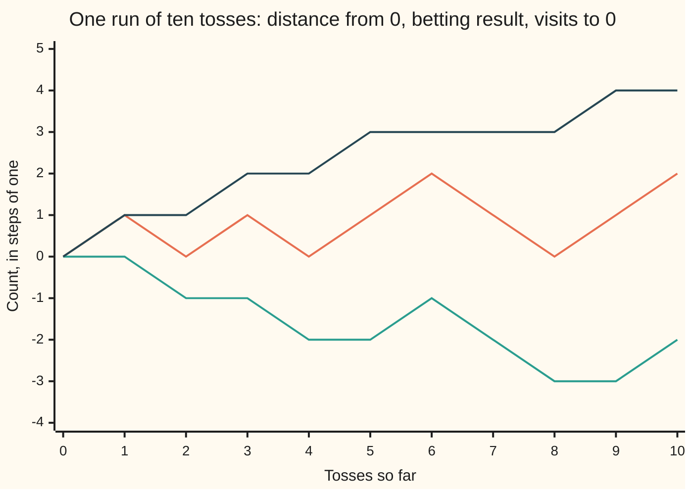
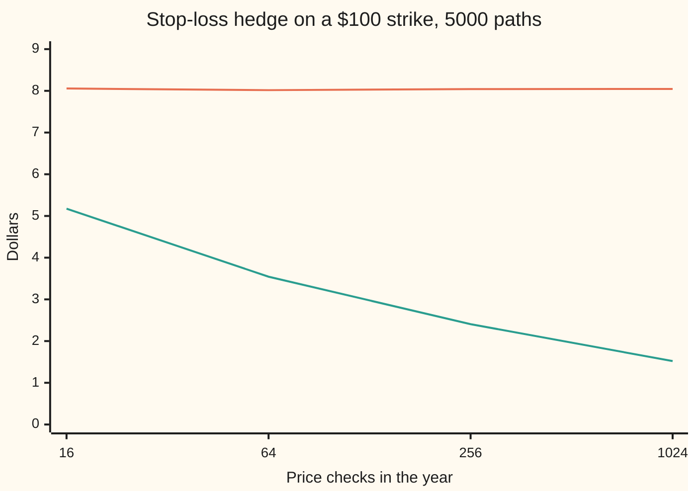

# Local time and Tanaka's formula: Ito's rule for a function with a kink

[Syllabus](../../../SYLLABUS.md) → [Stochastic processes and calculus](../README.md) → [Continuous Martingales](../README.md#s10) → Local time and Tanaka's formula

---

## General Overview

Toss a fair coin ten times. Heads moves a counter up one, tails moves it down one. The counter starts at 0. This run reads up, down, down, up, up, up, down, down, down, down, so the counter visits 1, 0, −1, 0, 1, 2, 1, 0, −1 and ends at −2.

Now a betting game on the same tosses. Before each toss, bet one dollar that the counter moves away from 0: on heads when it stands above 0, on tails when it stands below 0, and nothing when it stands at 0. The game is fair, so on average it wins nothing. On this run it loses $2.

The distance from 0 at the end is 2. The bet lost 2. The gap, 4, is exactly the number of times the counter stood at 0 before a toss: at tosses 1, 3, 5 and 9. Each time the counter sits at 0, the next toss pushes the distance up by one whichever way it falls, and no bet can capture that. Counted this way, the distance is the betting result plus the visits to 0, on every one of the 1,024 possible runs.

For Brownian motion (the random walk seen from far away), the visits to 0 become **local time**: the time the path spends near a level, measured per unit of distance. The same split holds. The distance from 0 is a fair bet plus local time, and that is **Tanaka's formula**. On average the bet gives nothing, so after one year the average local time at 0 equals the average distance, $`\sqrt{2/\pi}`$ = 0.7979.

**At a kink, Ito's rule gets one extra term: local time, the time the path spends at the kink per unit of distance; for the distance from 0 it reads $`\lvert B_t\rvert`$ = (a fair bet) + $`L_t`$.**

**What kind of fact this is:** a theorem, proved on this card in Why it works: exactly for the coin walk, and for Brownian motion by rounding off the kink and letting the rounding shrink. Local time itself is a definition, made possible by that proof.

### The picture: ten tosses, distance = bet + visits



The orange line is the distance from 0. The green line is the betting result, which drifts down on this run. The dark line is the visits to 0 before each toss; it climbs one step each time the orange line touches 0, and only then. At every toss, orange equals green plus dark.

---

## The formula

Reminders first. $`B_t`$ is Brownian motion at time $`t`$, in years, started at 0. An integral $`\int_0^t h_s\,dB_s`$ is an Ito integral ([The Ito integral](../06-Ito%20Calculus/01-ito-integral.md)): the gain from holding $`h_s`$ units, chosen before each move, so it is a fair game with average 0.

New notation:

- $`\mathrm{sgn}(x)`$, the sign of $`x`$: +1 above 0, −1 below 0, and 0 at 0.
- $`L_t^a`$, the **local time at level $`a`$ by time $`t`$**. Watch the path, count the time it spends within $`\varepsilon`$ of $`a`$, divide by the window's width $`2\varepsilon`$, and let $`\varepsilon`$ shrink. At level 0 it is written $`L_t`$.

```math
L_t^a = \lim_{\varepsilon \to 0} \frac{1}{2\varepsilon} \int_0^t \mathbf{1}\{\lvert B_s - a\rvert < \varepsilon\}\, ds
```

**Read it aloud:** local time at a level is the time spent within a small window around it, divided by the window's width, as the window closes.

Here $`\mathbf{1}\{\dots\}`$ is 1 when the statement in braces is true and 0 when it is false. Tanaka's formula is then:

```math
\lvert B_t\rvert = \int_0^t \mathrm{sgn}(B_s)\, dB_s + L_t
```

**Read it aloud:** the distance from 0 is the gain from betting on moves away from 0, plus the local time at 0.

The coin walk has the same shape, exactly. With $`S_k`$ the counter after $`k`$ tosses and $`X_k`$ = ±1 the $`k`$-th toss:

```math
\lvert S_n\rvert = \sum_{k=1}^{n} \mathrm{sgn}(S_{k-1})\, X_k + N_n, \qquad N_n = \text{number of } k \text{ from } 0 \text{ to } n-1 \text{ with } S_k = 0
```

On the run above: 2 = −2 + 4.

For a call option's payoff $`(x - K)^+`$, the larger of $`x - K`$ and 0, the same rule gives

```math
(B_t - K)^+ = (B_0 - K)^+ + \int_0^t \mathbf{1}\{B_s > K\}\, dB_s + \tfrac12 L_t^K
```

**Read it aloud:** the call's payoff is its starting value, plus the gain from holding one unit whenever the path is above the strike, plus half the local time at the strike.

| Symbol | Plain meaning | In our example | Push it up and the answer… |
| --- | --- | --- | --- |
| $`B_t`$, $`B_s`$, $`dB_s`$, $`\Delta B`$, $`h_s`$ | Brownian motion at time $`t`$ (or $`s`$); its step inside an Ito integral; one simulated step; units held at time $`s`$ | $`B_0`$ = 0 | — |
| $`t`$, $`s`$ | time in years; a time between 0 and $`t`$ | $`t`$ = 1 | average local time grows like $`\sqrt{t}`$ |
| $`S_k`$, $`X_k`$, $`n`$, $`k`$ | the coin counter after $`k`$ tosses; the $`k`$-th toss, +1 or −1; number of tosses | $`S_{10}`$ = −2, $`n`$ = 10 | average visits grow like $`\sqrt{n}`$ |
| $`E`$, $`\Pr`$ | the average over all paths; the probability (chance) | $`E\lvert B_1\rvert`$ = 0.7979 | — |
| $`N_n`$ | visits to 0 before toss $`n`$: the walk's local time | 4 on our run; 2.4609 on average | — |
| $`\mathrm{sgn}(x)`$, $`\mathbf{1}\{\dots\}`$ | sign of $`x`$; 1 if true, 0 if false | $`\mathrm{sgn}(-1)`$ = −1 | — |
| $`L_t^a`$, $`L_t`$, $`a`$ | local time at level $`a`$; at level 0; a level the path may visit | average $`L_1`$ = 0.7979 | — |
| $`\varepsilon`$ | half-width of the window around the level | 0.05 in the simulation, where the window count aims at 0.7732 | a coarser estimate, aimed lower |
| $`f`$, $`f'`$, $`f''`$, $`f_\varepsilon`$, $`D_\varepsilon`$ | a function of the path; its slope; its curvature; $`\lvert x\rvert`$ with the corner rounded over width $`2\varepsilon`$; the gap between the two slopes | $`f(x) = \lvert x\rvert`$ | bigger kink, bigger extra term |
| $`K`$ | strike: the level where the payoff bends | $100 | — |
| $`P_t`$, $`\sigma`$ | a share price, $`P_t = 100 + \sigma B_t`$ dollars; its spread per square-root year | $`\sigma`$ = $20 | slippage grows one for one |
| $`M_t`$, $`V_t`$ | the house Ito integral $`\int_0^t B_s\,dB_s = (B_t^2 - t)/2`$; the bet with its sign flipped, $`-\int_0^t \mathrm{sgn}(B_s)\,dB_s`$ | — | — |

### When it holds

- **A continuous path with quadratic variation (summed squared steps) equal to time.** Brownian motion has it. For a path with jumps the walk's neat count fails: a jump can cross 0 without stopping there, and the formula needs jump terms.
- **The bet uses the sign before the move.** Read the sign after the move and the bet peeks ahead. It is no longer a fair game, and the leftover is no longer local time.
- **The function is convex (bending upward everywhere, like a bowl) or a difference of two convex functions.** Then $`f''`$ makes sense as a spread of kinks and the general rule below holds. A function like $`\sqrt{\lvert x\rvert}`$, whose slope blows up at 0, is outside it.
- **The window is divided by its full width $`2\varepsilon`$.** Divide by $`\varepsilon`$ and every local time doubles: 1.5667 instead of 0.7834 in the simulation.
- **What happens at exactly 0 matters for the walk, not for Brownian motion.** The walk uses $`\mathrm{sgn}(0) = 0`$. Brownian motion spends zero total time exactly at 0, so any value there gives the same integral.

---

## Why it works

### Step 0: a kink is curvature packed into one point

Ito's lemma ([Ito's lemma](../06-Ito%20Calculus/02-itos-lemma.md)) says a smooth function of the path changes by its slope times the step, plus half its curvature times the elapsed time. The function $`\lvert x\rvert`$ has zero curvature everywhere except at 0, where its slope jumps from −1 to +1. All its bending sits at one point.

Round the corner off over a small width. Now the bending is spread over that width, and Ito's lemma applies. Its curvature term counts the time the path spends inside the rounded part, scaled up by how sharp the rounding is. Shrink the width. Everything else in the formula converges, so this term must converge too. Its limit is local time.

### Step 1: the walk, case by case

For the coin counter, look at one toss. Two cases cover everything.

- **The counter is away from 0**, say at 3. One toss moves it to 2 or 4; it cannot cross 0. The distance changes by exactly $`\mathrm{sgn}(S_{k-1})\,X_k`$: up when the toss points away from 0. The visit count does not change.
- **The counter is at 0.** Whichever way the toss goes, the distance rises from 0 to 1. The bet term is $`\mathrm{sgn}(0)\,X_k = 0`$, and the visit count rises by 1.

Add the changes over $`n`$ tosses and the middle values cancel: $`\lvert S_n\rvert = \sum \mathrm{sgn}(S_{k-1})X_k + N_n`$. The code confirms it on all 1,024 ten-toss runs.

Each bet term has average 0, because the toss is independent of the sign chosen before it. So the average number of visits equals the average distance. For ten tosses both are 2.4609. That is the discrete version of "average local time equals $`E\lvert B_t\rvert`$", where $`E`$ means the average over all paths.

### Step 2: round off the corner and apply Ito's lemma

Let $`f_\varepsilon`$ equal $`\lvert x\rvert`$ outside the window $`(-\varepsilon, \varepsilon)`$ and the parabola $`x^2/(2\varepsilon) + \varepsilon/2`$ inside it. The two pieces meet with matching height and slope. Its slope is $`\mathrm{sgn}(x)`$ outside the window and $`x/\varepsilon`$ inside. Its curvature is 0 outside and $`1/\varepsilon`$ inside.

Ito's lemma, applied to $`f_\varepsilon(B_t)`$, gives

```math
f_\varepsilon(B_t) = \frac{\varepsilon}{2} + \int_0^t f_\varepsilon'(B_s)\, dB_s + \frac{1}{2\varepsilon} \int_0^t \mathbf{1}\{\lvert B_s\rvert < \varepsilon\}\, ds
```

The last term is half the curvature, $`1/(2\varepsilon)`$, times the time spent in the window. It is exactly the quantity in local time's definition.

(Ito's lemma as proved there needs a continuous curvature; $`f_\varepsilon''`$ jumps at $`\pm\varepsilon`$. Smoothing those two small corners as well changes nothing below; the sources do it in full.)

### Step 3: let the window close

As $`\varepsilon`$ shrinks, three things happen.

1. The left side converges: $`f_\varepsilon`$ is never more than $`\varepsilon/2`$ away from $`\lvert x\rvert`$.
2. The bet converges to $`\int \mathrm{sgn}(B_s)\,dB_s`$. The two slopes differ only inside the window, by at most 1 there. By the Ito isometry (an Ito integral's average square is the average of the squared holding, summed over time), the gap has average square at most the average time spent in the window, which goes to 0.
3. So the last term converges too, to $`\lvert B_t\rvert - \int_0^t \mathrm{sgn}(B_s)\,dB_s`$.

This proves two things at once: the limit defining $`L_t`$ exists, and Tanaka's formula holds. The same argument at any level $`a`$ gives $`\lvert B_t - a\rvert = \lvert a\rvert + \int_0^t \mathrm{sgn}(B_s - a)\,dB_s + L_t^a`$.

<details>
<summary>Detailed proof of the limit in Step 3</summary>

Write $`D_\varepsilon(x) = f_\varepsilon'(x) - \mathrm{sgn}(x)`$. It is 0 for $`\lvert x\rvert \ge \varepsilon`$ and at most 1 in size inside the window. By the Ito isometry,

$`\displaystyle E\Big[\Big(\int_0^t D_\varepsilon(B_s)\,dB_s\Big)^2\Big] = E\int_0^t D_\varepsilon(B_s)^2\,ds \le \int_0^t \Pr(\lvert B_s\rvert < \varepsilon)\,ds.`$

For each $`s > 0`$, $`\Pr(\lvert B_s\rvert < \varepsilon) \le 2\varepsilon/\sqrt{2\pi s}`$, because the bell-curve density of $`B_s`$ is at most $`1/\sqrt{2\pi s}`$. Integrating, the right side is at most $`2\varepsilon\sqrt{2t/\pi}`$, which tends to 0.

So $`\int f_\varepsilon'(B_s)\,dB_s \to \int \mathrm{sgn}(B_s)\,dB_s`$ in mean square. Together with $`\lvert f_\varepsilon(B_t) - \lvert B_t\rvert\rvert \le \varepsilon/2`$, the formula of Step 2 shows that

$`\displaystyle \frac{1}{2\varepsilon}\int_0^t \mathbf{1}\{\lvert B_s\rvert < \varepsilon\}\,ds \to \lvert B_t\rvert - \int_0^t \mathrm{sgn}(B_s)\,dB_s`$

in mean square. Along a sequence of $`\varepsilon`$ that shrinks fast enough, a mean-square limit also holds path by path for almost every path, and one more argument (in Karatzas and Shreve, section 3.6) gives a version continuous in $`t`$ and $`a`$ together.

</details>

### Step 4: any convex function, and the call

A call payoff is half the sum of a straight line and a kink: $`(x - K)^+ = \tfrac12\big((x - K) + \lvert x - K\rvert\big)`$. Apply Tanaka at level $`K`$ to the kink and Ito's lemma to the line. The two bets add to $`\int \mathbf{1}\{B_s > K\}\,dB_s`$, and the local-time term arrives halved: the call formula in The formula.

Every convex function bends in a combination of kinks, with $`f''`$ saying how much bending sits at each level. Adding Tanaka's formula over the levels gives the **Ito–Tanaka rule**, also called the Meyer–Ito formula:

```math
f(B_t) = f(B_0) + \int_0^t f'(B_s)\, dB_s + \frac12 \int L_t^a\, f''(a)\, da
```

**Read it aloud:** a convex function of the path changes by its slope times the steps, plus half of each level's bending times the local time at that level.

Here $`f'`$ is the left-hand slope where $`f`$ has a kink, and $`f''(a)\,da`$ puts a point mass of size "jump in slope" at each kink. For $`\lvert x\rvert`$ that mass is 2 at 0, so the last term is $`L_t`$: Tanaka.

The house example checks the rule from the smooth side. For $`f(x) = x^2/2`$, the curvature is 1 at every level. The local times over all levels add up to the total time, $`\int L_t^a\,da = t`$, because every moment is spent at some level. So the last term is $`t/2`$, and the rule gives $`B_t^2/2 = M_t + t/2`$: the house integral $`M_t = (B_t^2 - t)/2`$ again.

### Step 5: what local time looks like: Lévy's theorem

Let $`V_t = -\int_0^t \mathrm{sgn}(B_s)\,dB_s`$, the bet with its sign flipped. It is a continuous fair game whose quadratic variation is $`\int \mathrm{sgn}^2\,ds = t`$, so by [Levy's characterisation and Dubins-Schwarz](04-levys-characterisation-and-dubins-schwarz.md) it is itself a Brownian motion.

Tanaka now reads $`\lvert B_t\rvert = L_t - V_t`$. Two facts pin $`L_t`$ down:

- $`L_t \ge V_t`$ at every time, because the distance is never negative.
- $`L_t`$ grows only while $`B`$ is at 0, which is where $`L_t = V_t`$.

The smallest growing process that stays above $`V`$ is its running maximum. So $`L_t = \max_{s \le t} V_s`$, and $`\lvert B_t\rvert`$ = (running maximum of $`V`$) − $`V_t`$. This is **Lévy's theorem**: distance from 0 behaves exactly like distance below the running maximum.

By the [Reflection principle](../05-Brownian%20Motion/04-reflection-principle-and-running-maximum.md), a running maximum has the same law (probability distribution) as $`\lvert B_t\rvert`$. So $`\Pr(L_1 > 0.5) = 2\Pr(B_1 > 0.5)`$ = 0.6171; the simulation finds 0.6194 (standard error 0.0069). The standard error (se) is the typical size of the chance error in a simulated average.

---

## Worked numbers, by hand

The run: up, down, down, up, up, up, down, down, down, down. The bet on toss $`k`$ is $`\mathrm{sgn}(S_{k-1})\,X_k`$.

| Step | Arithmetic | Value |
| --- | --- | --- |
| tosses at 0 (1, 3, 5, 9) | sign 0, so no bet | 0 each |
| toss 2, from 1, down | (+1) × (−1) | −1 |
| toss 4, from −1, up | (−1) × (+1) | −1 |
| toss 6, from 1, up | (+1) × (+1) | +1 |
| tosses 7 and 8, from 2 and 1, down | (+1) × (−1), twice | −2 |
| toss 10, from −1, down | (−1) × (−1) | +1 |
| betting result | −1 − 1 + 1 − 2 + 1 | −2 |
| visits to 0 before toss 10 | counter at 0 before tosses 1, 3, 5, 9 | 4 |
| bet + visits | −2 + 4 | **2**, the distance $`\lvert S_{10}\rvert`$ |
| average visits, ten tosses | sum of the chances the counter is at 0 after 0, 2, 4, 6, 8 tosses | 2.4609 |
| scaled by $`\sqrt{10}`$ | 2.4609 ÷ the square root of 10 | 0.778217 |
| Brownian limit | $`E\lvert B_1\rvert = \sqrt{2/\pi}`$ | **0.7979** |

Over one year, a Brownian path spends on average 0.7979 units of time per unit of distance at 0. Scaled walks approach it: 0.778217 at 10 tosses, 0.795892 at 100, 0.797685 at 1,000 and 0.797865 at 10,000.

The hedging version. A share trades at $100, with price $`P_t = 100 + 20B_t`$ dollars over one year (a "normal" model: the price moves by a bell curve with spread $20). Interest is zero. A call with strike $100 pays $`(P_1 - 100)^+`$.

- The payoff is $`(P_1 - 100)^+ = 20\,B_1^+`$, so it is 20 times the call formula at strike 0 for $`B`$.
- That reads: payoff = gain from holding one share whenever $`P > 100`$ (each share gains $`dP = 20\,dB`$) + $`\tfrac12 \times 20 \times L_1`$, that is $`10\,L_1`$, with $`L_1`$ the local time of $`B`$ at 0.
- The gain is a fair game, average 0. So the average payoff, the call's fair value, is half of 20 × 0.7979 = **$7.9788**.

That $7.98 is the whole value of an at-the-money call in this model, and all of it is local time.

### What breaks if you drop a piece

| Mistake | Comes out at | What went wrong |
| --- | --- | --- |
| Ordinary Ito's lemma on $`\lvert x\rvert`$, using its zero curvature away from 0 | average $`\lvert B_1\rvert`$ of 0; it is 0.7979 | the kink's curvature was thrown away |
| Time near 0 divided by $`\varepsilon`$, not $`2\varepsilon`$ | local time 1.5667; it is 0.7834 at $`\varepsilon`$ = 0.05 | the window is $`2\varepsilon`$ wide |
| All of the local time in the call formula, not half | call worth $15.9577; it is $7.9788 | the call is half a kink plus a line |
| "Trade more often and the slippage goes away" | still $8.0453 on average with 1,024 checks a year, not 0 | local time does not shrink with the grid |

---

## Code, from first principles, and it actually runs

Both programs take five roads. Road 1 checks the walk identity on the hand run and on all 1,024 ten-toss runs. Road 2 gets the average visit count two ways, by enumeration and by binomial counts, and scales it to 10,000 tosses. Road 3 computes $`E\lvert B_1\rvert`$ by Simpson's rule (adding up thin slices under the curve) and compares it with $`\sqrt{2/\pi}`$. Road 4 runs 5,000 seeded Brownian paths of 4,096 steps each (SplitMix64 random numbers, bell-curve draws by the Box–Muller formula). On each path it finds local time twice: as Tanaka's leftover $`\lvert B_1\rvert - \sum \mathrm{sgn}(B)\,\Delta B`$, and as time within 0.05 of 0 divided by 0.1. It also checks the reflection law. Road 5 runs the stop-loss hedge on the same paths, checking the price 16, 64, 256 and 1,024 times a year.

### Python

```python
# Local time and Tanaka's formula -- the check behind the card.  Only math is imported.
# Roads: the coin-walk identity |S_n| = sum sgn(S_{k-1}) X_k + (visits to 0) on one path
# and on all 1024 ten-step paths; its average two ways (enumeration, binomials) and its
# scaling limit against E|B_1| by Simpson's rule; 5000 seeded Brownian paths where the
# Tanaka leftover, the time-near-0 limit and the reflection law agree; a stop-loss hedge.
import math

MASK = (1 << 64) - 1
SEED, PATHS, FINE, GRIDS, EPS = 20261123, 5000, 4096, (16, 64, 256, 1024), 0.05
S0, K, SIG = 100.0, 100.0, 20.0           # share price, strike, dollars per root-year

class SplitMix64:                         # the wing's generator, written out
    def __init__(self, seed):
        self.s = seed & MASK
    def uniform(self):
        self.s = (self.s + 0x9E3779B97F4A7C15) & MASK
        z = self.s
        z = ((z ^ (z >> 30)) * 0xBF58476D1CE4E5B9) & MASK
        z = ((z ^ (z >> 27)) * 0x94D049BB133111EB) & MASK
        return ((z ^ (z >> 31)) >> 11) / 9007199254740992.0
    def normal_pair(self):                # Box-Muller, both halves
        u1, u2 = self.uniform(), self.uniform()
        r = math.sqrt(-2.0 * math.log(1.0 - u1))
        return r * math.cos(2.0 * math.pi * u2), r * math.sin(2.0 * math.pi * u2)

def sgn(x):
    return (x > 0) - (x < 0)

def simpson(f, a, b, n):
    h = (b - a) / n
    s = f(a) + f(b)
    for i in range(1, n):
        s += (4 if i % 2 else 2) * f(a + i * h)
    return s * h / 3.0

phi = lambda z: math.exp(-0.5 * z * z) / math.sqrt(2.0 * math.pi)

def walk(steps):                          # positions, hedge sum, visits to 0 before k
    s, beta, vis = [0], [0], [0]
    for x in steps:
        beta.append(beta[-1] + sgn(s[-1]) * x)
        vis.append(vis[-1] + (s[-1] == 0))
        s.append(s[-1] + x)
    return s, beta, vis

# 1. the hand path
STEPS = [1, -1, -1, 1, 1, 1, -1, -1, -1, -1]
s, beta, vis = walk(STEPS)
print("walk, k        " + "".join(f"{k:4d}" for k in range(11)))
print("walk, S_k      " + "".join(f"{v:4d}" for v in s))
print("walk, |S_k|    " + "".join(f"{abs(v):4d}" for v in s))
print("walk, hedge    " + "".join(f"{v:4d}" for v in beta))
print("walk, visits   " + "".join(f"{v:4d}" for v in vis))
print(f"hand path: |S_10| = {abs(s[10])} = hedge sum {beta[10]} + visits {vis[10]}")
assert abs(s[10]) == beta[10] + vis[10]
assert vis[10] == s[:10].count(0) == 4    # counted a second way: zeros among S_0..S_9

# 2. all 1024 ten-step paths
tot_abs = tot_vis = bad = 0
for m in range(1 << 10):
    p, b, v = walk([1 if (m >> i) & 1 else -1 for i in range(10)])
    tot_abs += abs(p[10]); tot_vis += v[10]; bad += abs(p[10]) != b[10] + v[10]
binom_abs = sum(abs(2 * j - 10) * math.comb(10, j) for j in range(11)) / 1024
binom_vis = sum(math.comb(k, k // 2) / 2 ** k for k in range(0, 10, 2))
print(f"all 1024 paths: identity fails on {bad}; mean |S_10| {tot_abs / 1024:.4f}, "
      f"mean visits {tot_vis / 1024:.4f}")
print(f"binomials: E|S_10| {binom_abs:.4f}; sum of P(S_k = 0), k < 10, {binom_vis:.4f}")
assert bad == 0 and abs(tot_vis / 1024 - binom_abs) < 1e-12 and abs(binom_vis - binom_abs) < 1e-12

# 3. scaling: visits / sqrt(n) -> E|B_1|
target = 2.0 * simpson(lambda x: x * phi(x), 0.0, 12.0, 4000)
print(f"E|B_1| by Simpson {target:.6f}; sqrt(2/pi) {math.sqrt(2 / math.pi):.6f}")
p0, acc, last = 1.0, 0.0, {}
for k in range(0, 10001, 2):              # P(S_k = 0) by p_k = p_{k-2} (k-1)/k
    if k > 0:
        p0 *= (k - 1) / k
    if k in (10, 100, 1000, 10000):
        last[k] = (acc / math.sqrt(k), k * p0 / math.sqrt(k))
    acc += p0
for n, (a, b) in last.items():
    print(f"n {n:5d}: mean visits / sqrt(n) {a:.6f}; E|S_n| / sqrt(n) {b:.6f}")
assert abs(target - math.sqrt(2 / math.pi)) < 1e-9 and abs(last[10000][0] - target) < 1e-4
assert all(abs(a - b) < 1e-12 for a, b in last.values())

# 4. Brownian paths and the stop-loss hedge, price P = 100 + 20 B, strike 100
rng, dt = SplitMix64(SEED), 1.0 / FINE
L_tan, L_occ, over = [], [], 0
slip = {g: [] for g in GRIDS}; gap = {g: 0.0 for g in GRIDS}
for _ in range(PATHS):
    B = [0.0]
    for _ in range(FINE // 2):
        z1, z2 = rng.normal_pair()
        B.append(B[-1] + z1 * math.sqrt(dt)); B.append(B[-1] + z2 * math.sqrt(dt))
    hedge, near = 0.0, 0
    for k in range(FINE):
        hedge += sgn(B[k]) * (B[k + 1] - B[k]); near += abs(B[k]) < EPS
    lt = abs(B[FINE]) - hedge
    L_tan.append(lt); L_occ.append(near * dt / (2 * EPS)); over += lt > 0.5
    pay = max(S0 + SIG * B[FINE] - K, 0.0)
    for g in GRIDS:
        st, gain = FINE // g, 0.0
        for j in range(0, FINE, st):
            if S0 + SIG * B[j] > K:
                gain += SIG * (B[j + st] - B[j])
        slip[g].append(pay - gain); gap[g] += abs(pay - gain - SIG * lt / 2) / PATHS

def mse(xs):
    m = 0.0
    for x in xs:
        m += x / len(xs)
    v = 0.0
    for x in xs:
        v += (x - m) * (x - m) / (len(xs) - 1)
    return m, math.sqrt(v / len(xs))

mt, st_ = mse(L_tan); mo, so = mse(L_occ); pd = 0.0
for a, b in zip(L_tan, L_occ):
    pd += abs(a - b) / PATHS
law = 2.0 * (0.5 - simpson(phi, 0.0, 0.5, 2000))
fr = over / PATHS; fse = math.sqrt(fr * (1 - fr) / PATHS)
occ = simpson(lambda a: 2 * phi(a) + 2 * a * simpson(phi, 0.0, a, 200) - abs(a), -EPS, EPS, 200) / (2 * EPS)  # mean of E|B_1 - a| - |a|
print(f"Brownian, {PATHS} paths of {FINE} steps, seed {SEED}:")
print(f"  Tanaka leftover |B_1| - sum sgn(B) dB: mean {mt:.4f} (se {st_:.4f})")
print(f"  time within {EPS} of 0, over 2 eps: mean {mo:.4f} (se {so:.4f}), exact {occ:.4f} at this eps; path gap {pd:.4f}")
print(f"  share with L_1 > 0.5: {fr:.4f} (se {fse:.4f}); reflection law 2 P(B_1 > 0.5) {law:.4f}")
call = SIG * simpson(lambda x: x * phi(x), 0.0, 12.0, 4000)
print(f"call, P = {S0:g} + {SIG:g} B, strike {K:g}, one year: value {call:.4f} = half of {SIG:g} x {target:.4f}")
for g in GRIDS:
    m, e = mse(slip[g])
    print(f"  stop-loss hedge checked {g:4d} times: mean slippage {m:.4f} (se {e:.4f}); "
          f"path gap to {SIG / 2:g} L {gap[g]:.4f}")
    assert abs(m - call) < 4 * e
assert abs(mt - target) < 4 * st_ and abs(mo - occ) < 4 * so and abs(fr - law) < 4 * fse
assert gap[16] > gap[64] > gap[256] > gap[1024]
print("what breaks:")
print(f"  ordinary Ito on |x| (no curvature off 0): E|B_1| would be 0; it is {target:.4f}")
print(f"  time near 0 divided by eps, not 2 eps: {2 * mo:.4f}; it is {mo:.4f}")
print(f"  slippage as all of {SIG:g} L, not half: {2 * call:.4f}; it is {call:.4f}")
print(f"  check {GRIDS[-1]} times to kill slippage: still {mse(slip[GRIDS[-1]])[0]:.4f}, not 0")
print("ALL CHECKS PASS")
```

**Ran 2026-11-23 on macOS, Python 3.14.10, standard library only. All checks passed. Output, pasted from the run:**

```
walk, k           0   1   2   3   4   5   6   7   8   9  10
walk, S_k         0   1   0  -1   0   1   2   1   0  -1  -2
walk, |S_k|       0   1   0   1   0   1   2   1   0   1   2
walk, hedge       0   0  -1  -1  -2  -2  -1  -2  -3  -3  -2
walk, visits      0   1   1   2   2   3   3   3   3   4   4
hand path: |S_10| = 2 = hedge sum -2 + visits 4
all 1024 paths: identity fails on 0; mean |S_10| 2.4609, mean visits 2.4609
binomials: E|S_10| 2.4609; sum of P(S_k = 0), k < 10, 2.4609
E|B_1| by Simpson 0.797885; sqrt(2/pi) 0.797885
n    10: mean visits / sqrt(n) 0.778217; E|S_n| / sqrt(n) 0.778217
n   100: mean visits / sqrt(n) 0.795892; E|S_n| / sqrt(n) 0.795892
n  1000: mean visits / sqrt(n) 0.797685; E|S_n| / sqrt(n) 0.797685
n 10000: mean visits / sqrt(n) 0.797865; E|S_n| / sqrt(n) 0.797865
Brownian, 5000 paths of 4096 steps, seed 20261123:
  Tanaka leftover |B_1| - sum sgn(B) dB: mean 0.8082 (se 0.0087)
  time within 0.05 of 0, over 2 eps: mean 0.7834 (se 0.0080), exact 0.7732 at this eps; path gap 0.1279
  share with L_1 > 0.5: 0.6194 (se 0.0069); reflection law 2 P(B_1 > 0.5) 0.6171
call, P = 100 + 20 B, strike 100, one year: value 7.9788 = half of 20 x 0.7979
  stop-loss hedge checked   16 times: mean slippage 8.0561 (se 0.0940); path gap to 10 L 5.1759
  stop-loss hedge checked   64 times: mean slippage 8.0165 (se 0.0881); path gap to 10 L 3.5438
  stop-loss hedge checked  256 times: mean slippage 8.0426 (se 0.0865); path gap to 10 L 2.4055
  stop-loss hedge checked 1024 times: mean slippage 8.0453 (se 0.0866); path gap to 10 L 1.5210
what breaks:
  ordinary Ito on |x| (no curvature off 0): E|B_1| would be 0; it is 0.7979
  time near 0 divided by eps, not 2 eps: 1.5667; it is 0.7834
  slippage as all of 20 L, not half: 15.9577; it is 7.9788
  check 1024 times to kill slippage: still 8.0453, not 0
ALL CHECKS PASS
```

### Rust

```rust
// Local time and Tanaka's formula -- the same check as local_time_and_tanakas_formula_check.py,
// in Rust.  Std only, no crates.  Same roads, same seed, same printed lines.
const SEED: u64 = 20261123; const PATHS: usize = 5000; const FINE: usize = 4096;
const GRIDS: [usize; 4] = [16, 64, 256, 1024]; const EPS: f64 = 0.05;
const S0: f64 = 100.0; const K: f64 = 100.0; const SIG: f64 = 20.0; // price, strike, $ per root-year

struct SplitMix64 { s: u64 }
impl SplitMix64 {
    fn uniform(&mut self) -> f64 {
        self.s = self.s.wrapping_add(0x9E3779B97F4A7C15);
        let mut z = self.s;
        z = (z ^ (z >> 30)).wrapping_mul(0xBF58476D1CE4E5B9);
        z = (z ^ (z >> 27)).wrapping_mul(0x94D049BB133111EB);
        ((z ^ (z >> 31)) >> 11) as f64 / 9007199254740992.0
    }
    fn normal_pair(&mut self) -> (f64, f64) {
        let (u1, u2) = (self.uniform(), self.uniform());
        let r = (-2.0 * (1.0 - u1).ln()).sqrt();
        let a = 2.0 * std::f64::consts::PI * u2;
        (r * a.cos(), r * a.sin())
    }
}

fn sgn(x: f64) -> f64 { if x > 0.0 { 1.0 } else if x < 0.0 { -1.0 } else { 0.0 } }
fn isgn(x: i64) -> i64 { if x > 0 { 1 } else if x < 0 { -1 } else { 0 } }

fn simpson(f: &dyn Fn(f64) -> f64, a: f64, b: f64, n: usize) -> f64 {
    let h = (b - a) / n as f64;
    let mut s = f(a) + f(b);
    for i in 1..n { s += (if i % 2 == 1 { 4.0 } else { 2.0 }) * f(a + i as f64 * h); }
    s * h / 3.0
}

fn phi(z: f64) -> f64 { (-0.5 * z * z).exp() / (2.0 * std::f64::consts::PI).sqrt() }

fn walk(steps: &[i64]) -> (Vec<i64>, Vec<i64>, Vec<i64>) {
    let (mut s, mut beta, mut vis) = (vec![0i64], vec![0i64], vec![0i64]);
    for &x in steps {
        let last = *s.last().unwrap();
        beta.push(beta.last().unwrap() + isgn(last) * x);
        vis.push(vis.last().unwrap() + (last == 0) as i64);
        s.push(last + x);
    }
    (s, beta, vis)
}

fn comb(n: u64, k: u64) -> u64 {
    let mut c = 1u64; for i in 0..k { c = c * (n - i) / (i + 1); } c
}

fn mse(xs: &[f64]) -> (f64, f64) {
    let n = xs.len() as f64;
    let mut m = 0.0; for &x in xs { m += x / n; }
    let mut v = 0.0; for &x in xs { v += (x - m) * (x - m) / (n - 1.0); }
    (m, (v / n).sqrt())
}

fn row(label: &str, v: &[i64]) {
    let cells: String = v.iter().map(|x| format!("{:4}", x)).collect();
    println!("{}{}", label, cells);
}

fn main() {
    // 1. the hand path
    let steps = [1, -1, -1, 1, 1, 1, -1, -1, -1, -1];
    let (s, beta, vis) = walk(&steps);
    let ks: Vec<i64> = (0..11).collect();
    row("walk, k        ", &ks);
    row("walk, S_k      ", &s);
    row("walk, |S_k|    ", &s.iter().map(|x| x.abs()).collect::<Vec<_>>());
    row("walk, hedge    ", &beta);
    row("walk, visits   ", &vis);
    println!("hand path: |S_10| = {} = hedge sum {} + visits {}", s[10].abs(), beta[10], vis[10]);
    assert!(s[10].abs() == beta[10] + vis[10]);
    assert!(vis[10] == s[..10].iter().filter(|&&x| x == 0).count() as i64 && vis[10] == 4);

    // 2. all 1024 ten-step paths
    let (mut tot_abs, mut tot_vis, mut bad) = (0i64, 0i64, 0i64);
    for m in 0..1024u32 {
        let st: Vec<i64> = (0..10).map(|i| if (m >> i) & 1 == 1 { 1 } else { -1 }).collect();
        let (p, b, v) = walk(&st);
        tot_abs += p[10].abs(); tot_vis += v[10]; bad += (p[10].abs() != b[10] + v[10]) as i64;
    }
    let binom_abs = (0..11u64).map(|j| ((2 * j as i64 - 10).abs() as u64) * comb(10, j)).sum::<u64>() as f64 / 1024.0;
    let mut binom_vis = 0.0;
    for k in (0..10u64).step_by(2) { binom_vis += comb(k, k / 2) as f64 / 2f64.powi(k as i32); }
    println!("all 1024 paths: identity fails on {}; mean |S_10| {:.4}, mean visits {:.4}",
             bad, tot_abs as f64 / 1024.0, tot_vis as f64 / 1024.0);
    println!("binomials: E|S_10| {:.4}; sum of P(S_k = 0), k < 10, {:.4}", binom_abs, binom_vis);
    assert!(bad == 0 && (tot_vis as f64 / 1024.0 - binom_abs).abs() < 1e-12 && (binom_vis - binom_abs).abs() < 1e-12);

    // 3. scaling: visits / sqrt(n) -> E|B_1|
    let xphi = |x: f64| x * phi(x);
    let target = 2.0 * simpson(&xphi, 0.0, 12.0, 4000);
    let r2pi = (2.0 / std::f64::consts::PI).sqrt();
    println!("E|B_1| by Simpson {:.6}; sqrt(2/pi) {:.6}", target, r2pi);
    let (mut p0, mut acc) = (1.0f64, 0.0f64);
    let mut last: Vec<(usize, f64, f64)> = Vec::new();
    for k in (0..=10000usize).step_by(2) {
        if k > 0 { p0 *= (k - 1) as f64 / k as f64; }
        if [10, 100, 1000, 10000].contains(&k) {
            let r = (k as f64).sqrt();
            last.push((k, acc / r, k as f64 * p0 / r));
        }
        acc += p0;
    }
    for &(n, a, b) in &last { println!("n {:5}: mean visits / sqrt(n) {:.6}; E|S_n| / sqrt(n) {:.6}", n, a, b); }
    assert!((target - r2pi).abs() < 1e-9 && (last[3].1 - target).abs() < 1e-4);
    assert!(last.iter().all(|&(_, a, b)| (a - b).abs() < 1e-12));

    // 4. Brownian paths and the stop-loss hedge, price P = 100 + 20 B, strike 100
    let mut rng = SplitMix64 { s: SEED };
    let dt = 1.0 / FINE as f64;
    let (mut l_tan, mut l_occ, mut over) = (Vec::new(), Vec::new(), 0usize);
    let mut slip: Vec<Vec<f64>> = vec![Vec::new(); 4];
    let mut gap = [0.0f64; 4];
    for _ in 0..PATHS {
        let mut b = vec![0.0f64];
        for _ in 0..FINE / 2 {
            let (z1, z2) = rng.normal_pair();
            let x = b[b.len() - 1] + z1 * dt.sqrt(); b.push(x);
            let y = b[b.len() - 1] + z2 * dt.sqrt(); b.push(y);
        }
        let (mut hedge, mut near) = (0.0f64, 0usize);
        for k in 0..FINE { hedge += sgn(b[k]) * (b[k + 1] - b[k]); near += (b[k].abs() < EPS) as usize; }
        let lt = b[FINE].abs() - hedge;
        l_tan.push(lt); l_occ.push(near as f64 * dt / (2.0 * EPS));
        if lt > 0.5 { over += 1; }
        let pay = (S0 + SIG * b[FINE] - K).max(0.0);
        for (gi, &g) in GRIDS.iter().enumerate() {
            let st = FINE / g;
            let (mut gain, mut j) = (0.0, 0);
            while j < FINE {
                if S0 + SIG * b[j] > K { gain += SIG * (b[j + st] - b[j]); }
                j += st;
            }
            slip[gi].push(pay - gain);
            gap[gi] += (pay - gain - SIG * lt / 2.0).abs() / PATHS as f64;
        }
    }
    let (mt, st_) = mse(&l_tan);
    let (mo, so) = mse(&l_occ);
    let mut pd = 0.0;
    for (a, b) in l_tan.iter().zip(l_occ.iter()) { pd += (a - b).abs() / PATHS as f64; }
    let law = 2.0 * (0.5 - simpson(&phi, 0.0, 0.5, 2000));
    let fr = over as f64 / PATHS as f64;
    let fse = (fr * (1.0 - fr) / PATHS as f64).sqrt();
    let occ = simpson(&|a: f64| 2.0 * phi(a) + 2.0 * a * simpson(&phi, 0.0, a, 200) - a.abs(), -EPS, EPS, 200) / (2.0 * EPS); // mean of E|B_1 - a| - |a|
    println!("Brownian, {} paths of {} steps, seed {}:", PATHS, FINE, SEED);
    println!("  Tanaka leftover |B_1| - sum sgn(B) dB: mean {:.4} (se {:.4})", mt, st_);
    println!("  time within {} of 0, over 2 eps: mean {:.4} (se {:.4}), exact {:.4} at this eps; path gap {:.4}", EPS, mo, so, occ, pd);
    println!("  share with L_1 > 0.5: {:.4} (se {:.4}); reflection law 2 P(B_1 > 0.5) {:.4}", fr, fse, law);
    let call = SIG * simpson(&xphi, 0.0, 12.0, 4000);
    println!("call, P = {} + {} B, strike {}, one year: value {:.4} = half of {} x {:.4}", S0, SIG, K, call, SIG, target);
    for (gi, &g) in GRIDS.iter().enumerate() {
        let (m, e) = mse(&slip[gi]);
        println!("  stop-loss hedge checked {:4} times: mean slippage {:.4} (se {:.4}); path gap to {} L {:.4}",
                 g, m, e, SIG / 2.0, gap[gi]);
        assert!((m - call).abs() < 4.0 * e);
    }
    assert!((mt - target).abs() < 4.0 * st_ && (mo - occ).abs() < 4.0 * so && (fr - law).abs() < 4.0 * fse);
    assert!(gap[0] > gap[1] && gap[1] > gap[2] && gap[2] > gap[3]);
    println!("what breaks:");
    println!("  ordinary Ito on |x| (no curvature off 0): E|B_1| would be 0; it is {:.4}", target);
    println!("  time near 0 divided by eps, not 2 eps: {:.4}; it is {:.4}", 2.0 * mo, mo);
    println!("  slippage as all of {} L, not half: {:.4}; it is {:.4}", SIG, 2.0 * call, call);
    println!("  check {} times to kill slippage: still {:.4}, not 0", GRIDS[3], mse(&slip[3]).0);
    println!("ALL CHECKS PASS");
}
```

**Ran 2026-11-23 on macOS, rustc 1.98.1, no crates. All checks passed. Output, pasted from the run:**

```
walk, k           0   1   2   3   4   5   6   7   8   9  10
walk, S_k         0   1   0  -1   0   1   2   1   0  -1  -2
walk, |S_k|       0   1   0   1   0   1   2   1   0   1   2
walk, hedge       0   0  -1  -1  -2  -2  -1  -2  -3  -3  -2
walk, visits      0   1   1   2   2   3   3   3   3   4   4
hand path: |S_10| = 2 = hedge sum -2 + visits 4
all 1024 paths: identity fails on 0; mean |S_10| 2.4609, mean visits 2.4609
binomials: E|S_10| 2.4609; sum of P(S_k = 0), k < 10, 2.4609
E|B_1| by Simpson 0.797885; sqrt(2/pi) 0.797885
n    10: mean visits / sqrt(n) 0.778217; E|S_n| / sqrt(n) 0.778217
n   100: mean visits / sqrt(n) 0.795892; E|S_n| / sqrt(n) 0.795892
n  1000: mean visits / sqrt(n) 0.797685; E|S_n| / sqrt(n) 0.797685
n 10000: mean visits / sqrt(n) 0.797865; E|S_n| / sqrt(n) 0.797865
Brownian, 5000 paths of 4096 steps, seed 20261123:
  Tanaka leftover |B_1| - sum sgn(B) dB: mean 0.8082 (se 0.0087)
  time within 0.05 of 0, over 2 eps: mean 0.7834 (se 0.0080), exact 0.7732 at this eps; path gap 0.1279
  share with L_1 > 0.5: 0.6194 (se 0.0069); reflection law 2 P(B_1 > 0.5) 0.6171
call, P = 100 + 20 B, strike 100, one year: value 7.9788 = half of 20 x 0.7979
  stop-loss hedge checked   16 times: mean slippage 8.0561 (se 0.0940); path gap to 10 L 5.1759
  stop-loss hedge checked   64 times: mean slippage 8.0165 (se 0.0881); path gap to 10 L 3.5438
  stop-loss hedge checked  256 times: mean slippage 8.0426 (se 0.0865); path gap to 10 L 2.4055
  stop-loss hedge checked 1024 times: mean slippage 8.0453 (se 0.0866); path gap to 10 L 1.5210
what breaks:
  ordinary Ito on |x| (no curvature off 0): E|B_1| would be 0; it is 0.7979
  time near 0 divided by eps, not 2 eps: 1.5667; it is 0.7834
  slippage as all of 20 L, not half: 15.9577; it is 7.9788
  check 1024 times to kill slippage: still 8.0453, not 0
ALL CHECKS PASS
```

The two outputs agree line for line. Both programs add numbers one at a time in the same order, so even the simulated values match to every printed digit.

What the simulation shows:

- **Two roads to local time agree.** Tanaka's leftover averages 0.8082 (se 0.0087), within two standard errors of 0.7979. The window count averages 0.7834 (se 0.0080). At $`\varepsilon`$ = 0.05 it aims a little lower, at 0.7732: it averages the local times at the levels from −0.05 to 0.05, and by Step 3 the local time at level $`a`$ averages $`E\lvert B_1 - a\rvert - \lvert a\rvert`$, less than at 0. It reaches 0.7979 only as $`\varepsilon`$ shrinks. Path by path the two differ by 0.1279 on average, the window's own blur at this grid.
- **The hedge's average slippage is the call value on every grid:** $8.0561, $8.0165, $8.0426 and $8.0453, each within one standard error of $7.9788.
- **Path by path, the slippage approaches $`10\,L_1`$, slowly.** The average gap is $5.1759 at 16 checks and $1.5210 at 1,024: it falls steadily, but slowly.

### The picture: slippage against local time, path by path



The flat upper line is the average slippage: it stays at the call's value, $7.98, however often the trader checks. The falling lower line is the average gap, path by path, between the slippage and $`10\,L_1`$. Checking more often does not remove the cost; it makes the cost equal local time.

### Lean

Lean proves the walk identity on every path, its average over all runs, and the call's split into a line and a kink.

- Suppose every toss $`X_k`$ is +1 or −1. Then the distance $`\lvert S_n\rvert`$ equals the betting result plus $`N_n`$, on every path and for every $`n`$.
- Take $`n`$ fair tosses. Then the total of $`\lvert S_n\rvert`$ over all $`2^n`$ runs equals the total of $`N_n`$.
- So the average distance equals the average number of visits: $`E\lvert S_n\rvert = E N_n`$.
- Take any price $`x`$ and strike $`K`$. Then $`(x - K)^+`$ is half the line $`x - K`$ plus half the kink $`\lvert x - K\rvert`$.
- On the hand run, the counter ends at −2, the betting result is −2, and the visits number 4, so 2 = −2 + 4.
- Over all 1,024 ten-toss runs, the total distance and the total visits are both 2,520, so both averages are 2.4609.
- The chances the counter is at 0 after 0, 2, 4, 6 and 8 tosses add to 315/128, the same 2.4609.
- At a $100 strike, a price of $120 pays $20 and a price of $90 pays nothing.

Brownian motion, its local time, the Ito–Tanaka rule, Lévy's theorem and the hedge simulation are left to the Python and Rust checks.

```lean
-- Local time and Tanaka's formula: for a ±1 coin walk, the distance from 0 equals the bet on moves away from 0 plus the visits to 0, on every path, so average distance equals average visits; and a call payoff is half a line plus half a kink.
import Mathlib.Algebra.Order.BigOperators.Group.Finset
import Mathlib.Basic.Real.Basic
import Mathlib.Data.Fintype.Pi
import Mathlib.Data.Fintype.BigOperators
import Mathlib.Tactic.NormNum
import Mathlib.Tactic.Ring
import Mathlib.Tactic.Linarith

open Finset

/-- The coin counter after `k` tosses, `S_k = X_0 + X_1 + ... + X_{k-1}`, started at 0.
(The card numbers the tosses from 1; here toss `k + 1` is `X k`.) -/
def walk (X : ℕ → ℤ) (k : ℕ) : ℤ := ∑ j ∈ range k, X j

/-- The betting result after `n` tosses: before each toss, bet `sgn(S_k)` units on the toss,
with the sign read before the move and `sgn 0 = 0` (`Int.sign`). -/
def bet (X : ℕ → ℤ) (n : ℕ) : ℤ := ∑ k ∈ range n, Int.sign (walk X k) * X k

/-- The walk's local time `N_n`: the number of `k` from `0` to `n - 1` with `S_k = 0`. -/
def visits (X : ℕ → ℤ) (n : ℕ) : ℕ := #{k ∈ range n | walk X k = 0}

/-- The tosses of one path `ω` of `n` fair coin tosses: `+1` for heads (`true`), `-1` for tails;
no tosses after the `n`-th. -/
def coinStep {n : ℕ} (ω : Fin n → Bool) (k : ℕ) : ℤ :=
  if h : k < n then (if ω ⟨k, h⟩ then 1 else -1) else 0

/-- One step of the discrete Tanaka formula: for an integer `s` and a step `x = ±1`,
`|s + x| = |s| + sgn(s) x + [s = 0]`. -/
theorem abs_add_step (s x : ℤ) (hx : x = 1 ∨ x = -1) :
    |s + x| = |s| + Int.sign s * x + (if s = 0 then 1 else 0) := by
  rcases lt_trichotomy s 0 with hs | hs | hs
  · have h1 : Int.sign s = -1 := Int.sign_eq_neg_one_of_neg hs
    have h0 : s ≠ 0 := hs.ne
    rw [h1, abs_of_neg hs]
    simp only [h0, ite_false]
    rcases hx with rfl | rfl
    · rw [abs_of_nonpos (by omega)]; ring
    · rw [abs_of_neg (by omega)]; ring
  · subst hs
    rcases hx with rfl | rfl <;> simp
  · have h1 : Int.sign s = 1 := Int.sign_eq_one_of_pos hs
    have h0 : s ≠ 0 := hs.ne'
    rw [h1, abs_of_pos hs]
    simp only [h0, ite_false]
    rcases hx with rfl | rfl
    · rw [abs_of_pos (by omega)]; ring
    · rw [abs_of_nonneg (by omega)]; ring

/-- Flipping toss `k` of a path leaves the counter before toss `k` unchanged and flips the
sign of toss `k`, so each bet term sums to zero over all paths. -/
theorem sum_sign_walk_mul_coinStep (n k : ℕ) :
    ∑ ω : Fin n → Bool, Int.sign (walk (coinStep ω) k) * coinStep ω k = 0 := by
  by_cases hk : k < n
  · set i : Fin n := ⟨k, hk⟩
    let f : (Fin n → Bool) → (Fin n → Bool) := fun ω => Function.update ω i (!ω i)
    have hinv : Function.Involutive f := by
      intro ω
      funext j
      by_cases hj : j = i
      · subst hj; simp [f]
      · simp [f, Function.update_of_ne hj]
    have hwalk : ∀ ω, walk (coinStep (f ω)) k = walk (coinStep ω) k := by
      intro ω
      unfold walk
      refine Finset.sum_congr rfl fun j hj => ?_
      have hjk : j < k := Finset.mem_range.mp hj
      have hjn : j < n := lt_trans hjk hk
      unfold coinStep
      rw [dif_pos hjn, dif_pos hjn]
      have hne : (⟨j, hjn⟩ : Fin n) ≠ i := by
        intro h; have := congrArg Fin.val h; simp [i] at this; omega
      simp [f, Function.update_of_ne hne]
    have hstep : ∀ ω, coinStep (f ω) k = - coinStep ω k := by
      intro ω
      unfold coinStep
      rw [dif_pos hk, dif_pos hk]
      have : (⟨k, hk⟩ : Fin n) = i := rfl
      rw [this]
      cases h : ω i <;> simp [f, h]
    have hsum := Equiv.sum_comp hinv.toPerm
      (fun ω => Int.sign (walk (coinStep ω) k) * coinStep ω k)
    simp only [Function.Involutive.coe_toPerm, hwalk, hstep] at hsum
    simp only [mul_neg, Finset.sum_neg_distrib] at hsum
    linarith
  · refine Finset.sum_eq_zero fun ω _ => ?_
    simp [coinStep, hk]

/-- Discrete Tanaka formula. For a walk whose every step is `+1` or `-1`, on every path and
after every number of tosses `n`, the distance from 0 is the bet on moves away from 0 plus
the number of visits to 0 before toss `n`: `|S_n| = Σ sgn(S_{k-1}) X_k + N_n`. -/
theorem abs_walk_eq_bet_add_visits (X : ℕ → ℤ) (hX : ∀ k, X k = 1 ∨ X k = -1) (n : ℕ) :
    |walk X n| = bet X n + visits X n := by
  induction n with
  | zero => simp [walk, bet, visits]; rfl
  | succ n ih =>
    have hw : walk X (n + 1) = walk X n + X n := by simp [walk, Finset.sum_range_succ]
    have hb : bet X (n + 1) = bet X n + Int.sign (walk X n) * X n := by
      simp [bet, Finset.sum_range_succ]
    have hv : (visits X (n + 1) : ℤ) = visits X n + (if walk X n = 0 then 1 else 0) := by
      unfold visits
      rw [Finset.range_add_one, Finset.filter_insert]
      split_ifs with h
      · rw [Finset.card_insert_of_notMem (by simp)]; push_cast; ring
      · simp
    rw [hw, hb, hv, abs_add_step _ _ (hX n), ih]
    ring

/-- Average visits equal average distance. Over all `2^n` equally likely runs of `n` fair
coin tosses, the total distance from 0 at the end equals the total number of visits to 0
before toss `n`; dividing both by `2^n`, `E|S_n| = E N_n`. -/
theorem sum_abs_walk_eq_sum_visits (n : ℕ) :
    ∑ ω : Fin n → Bool, |walk (coinStep ω) n| = ∑ ω : Fin n → Bool, (visits (coinStep ω) n : ℤ) := by
  have hX : ∀ ω : Fin n → Bool, ∀ k < n, coinStep ω k = 1 ∨ coinStep ω k = -1 := by
    intro ω k hk
    unfold coinStep
    rw [dif_pos hk]
    split_ifs <;> simp
  -- Modify the tosses after `n` to be `+1`, which does not change anything up to `n`.
  let Y : (Fin n → Bool) → ℕ → ℤ := fun ω k => if k < n then coinStep ω k else 1
  have hYX : ∀ ω k, k ≤ n → walk (Y ω) k = walk (coinStep ω) k := by
    intro ω k hk
    unfold walk
    refine Finset.sum_congr rfl fun j hj => ?_
    have : j < n := lt_of_lt_of_le (Finset.mem_range.mp hj) hk
    simp [Y, this]
  have hY : ∀ ω k, Y ω k = 1 ∨ Y ω k = -1 := by
    intro ω k
    by_cases hk : k < n
    · simp only [Y, if_pos hk]; exact hX ω k hk
    · simp [Y, hk]
  have hbet : ∀ ω, bet (Y ω) n = bet (coinStep ω) n := by
    intro ω
    unfold bet
    refine Finset.sum_congr rfl fun k hk => ?_
    have hkn : k < n := Finset.mem_range.mp hk
    rw [hYX ω k hkn.le]
    simp [Y, hkn]
  have hvis : ∀ ω, visits (Y ω) n = visits (coinStep ω) n := by
    intro ω
    unfold visits
    congr 1
    refine Finset.filter_congr fun k hk => ?_
    rw [hYX ω k (Finset.mem_range.mp hk).le]
  have key : ∀ ω : Fin n → Bool,
      |walk (coinStep ω) n| = bet (coinStep ω) n + visits (coinStep ω) n := by
    intro ω
    rw [← hYX ω n le_rfl, ← hbet, ← hvis]
    exact abs_walk_eq_bet_add_visits (Y ω) (hY ω) n
  have hzero : ∑ ω : Fin n → Bool, bet (coinStep ω) n = 0 := by
    unfold bet
    rw [Finset.sum_comm]
    exact Finset.sum_eq_zero fun k _ => sum_sign_walk_mul_coinStep n k
  rw [Finset.sum_congr rfl fun ω _ => key ω, Finset.sum_add_distrib, hzero, zero_add]

/-- A call payoff is half a straight line plus half a kink at the strike:
`(x - K)^+ = ((x - K) + |x - K|) / 2`. This is why the call's local-time term arrives halved. -/
theorem call_payoff_eq_half_line_add_half_kink (x K : ℝ) :
    max (x - K) 0 = ((x - K) + |x - K|) / 2 := by
  rcases le_total 0 (x - K) with h | h
  · rw [max_eq_left h, abs_of_nonneg h]; ring
  · rw [max_eq_right h, abs_of_nonpos h]; ring

/-- The card's hand run: up, down, down, up, up, up, down, down, down, down. -/
def handStep (k : ℕ) : ℤ := [1, -1, -1, 1, 1, 1, -1, -1, -1, -1].getD k 0

-- The counter ends at -2, so the distance is 2.
example : walk handStep 10 = -2 := by decide
example : |walk handStep 10| = 2 := by decide
-- The betting result is -2.
example : bet handStep 10 = -2 := by decide
-- The counter stands at 0 before tosses 1, 3, 5 and 9: four visits.
example : visits handStep 10 = 4 := by decide
-- 2 = -2 + 4.
example : |walk handStep 10| = bet handStep 10 + visits handStep 10 := by decide

-- All 1,024 ten-toss runs: total distance 2520 and total visits 2520, so both averages are
-- 2520 / 1024 = 2.4609375.
example : ∑ ω : Fin 10 → Bool, |walk (coinStep ω) 10| = 2520 := by decide +kernel
example : ∑ ω : Fin 10 → Bool, (visits (coinStep ω) 10 : ℤ) = 2520 := by decide +kernel
-- The binomial count: the chances the counter is at 0 after 0, 2, 4, 6, 8 tosses add to
-- 1 + 1/2 + 3/8 + 5/16 + 35/128 = 315/128 = 2520/1024.
example : ∑ m ∈ range 5, ((Nat.choose (2 * m) m : ℚ) / 4 ^ m) = 315 / 128 := by
  norm_num [Finset.sum_range_succ, Nat.choose]

-- The call in the card at strike 100: a price of 120 pays 20, a price of 90 pays 0.
example : max ((120 : ℝ) - 100) 0 = 20 := by norm_num
example : max ((90 : ℝ) - 100) 0 = 0 := by norm_num

#print axioms abs_add_step
#print axioms sum_sign_walk_mul_coinStep
#print axioms abs_walk_eq_bet_add_visits
#print axioms sum_abs_walk_eq_sum_visits
#print axioms call_payoff_eq_half_line_add_half_kink
```

**Checked 2026-11-23 on macOS, Lean 4.36.0-rc2, Mathlib v4.36.0-rc2. Every proof is complete and uses only Lean's standard axioms. Output, pasted from the run:**

```
'abs_add_step' depends on axioms: [propext, Classical.choice, Quot.sound]
'sum_sign_walk_mul_coinStep' depends on axioms: [propext, Classical.choice, Quot.sound]
'abs_walk_eq_bet_add_visits' depends on axioms: [propext, Classical.choice, Quot.sound]
'sum_abs_walk_eq_sum_visits' depends on axioms: [propext, Classical.choice, Quot.sound]
'call_payoff_eq_half_line_add_half_kink' depends on axioms: [propext, Classical.choice, Quot.sound]
```

> [!TIP]
> **Try changing**
> - Guess first: flip the hand run's last toss to up. Does the identity still balance? (`STEPS`, last entry to 1.) Yes: the distance becomes 0, the bet falls by 2, to −4, the visits stay at 4, and −4 + 4 = 0. The asserts on all 1,024 runs already cover it.
> - Guess first: double the price's spread. What is the call worth? (`SIG = 40.0`.) Twice as much: local time of the price scales with the spread, so the value is twice $7.9788.
> - Guess first: widen the window. (`EPS = 0.2`.) The window count drops to 0.7068, because it now counts time at levels away from 0, where local time is smaller. Its exact target drops with it, to 0.7032, so every check still passes. Tanaka's leftover is unchanged.
> - Guess first: hedge only 4 times a year. (Add 4 to `GRIDS`, in front.) The average slippage still matches the call value. The path-by-path gap grows above $5.1759.

---

## The usual mistake

> [!warning]
> **Treating $`\lvert x\rvert`$ or a call payoff as having zero curvature, so Ito's lemma says it is a fair game plus nothing.** The curvature is not zero; it is all packed at the kink. Drop it and the average distance after a year comes out at 0 instead of 0.7979, and an at-the-money call comes out worth nothing instead of $7.98.
>
> - **Thinking frequent rebalancing removes the slippage.** It does not, on average: $8.0453 with 1,024 checks, against $8.0561 with 16. Each crossing of the strike costs a little, and a continuous path crosses infinitely often near each touch.
> - **Getting the factor of two wrong.** Local time divides by the window's full width $`2\varepsilon`$. Some books use half this quantity, so check the definition: dividing by $`\varepsilon`$ gives 1.5667 instead of 0.7834.
> - **Reading local time as time.** It is time per unit of distance, so it is not in years. On the price it must be read off Tanaka's formula for $`P`$ itself, where $`\lvert P_t - 100\rvert = 20\lvert B_t\rvert`$ makes it $`20\,L_t`$ dollars. Plugging in $`L_1`$ alone, with no 20, prices the call 20 times too low.
> - **Forgetting the half in the call.** The call is half a kink, so its correction is half the local time: $7.98, not $15.96.

---

## Where you meet it in real life

- **Option desks: the stop-loss start-gain paradox.** Holding one share above the strike and none below looks like a free copy of the call. Carr and Jarrow showed that the cost hidden at the strike crossings is half the local time, and that it equals the option's time value: $7.98 here.
- **Local volatility models.** Applying the Ito–Tanaka rule to a call payoff and taking averages leads to Dupire's equation, which reads the volatility at each price level from the prices of calls at every strike.
- **Queues and inventories held at zero.** A queue length cannot go negative. Its Brownian approximation is $`\lvert B\rvert`$-like motion pushed up at 0, and the total push is local time: for a server, it measures the idle time.
- **Diffusion near a surface.** A molecule wandering near a cell membrane reacts in proportion to how long it lingers at the membrane. That lingering, per unit of distance, is local time at the boundary.

> **Say it back**
> A function with a kink has all its curvature at one point, so Ito's lemma needs one extra term there. That term is local time: the time the path spends near the kink, divided by the width of the window, as the window shrinks. For the distance from 0, Tanaka's formula says the distance is a fair bet plus local time; for the coin walk, the same count is exact, with visits to 0 in place of local time. Any convex function, a call payoff among them, gets half its bending at each level times the local time there. For a hedger who holds a share only above the strike, that half local time is the unavoidable slippage, and on average it is the call's whole value: $7.98 for a $100 share with a $20 yearly spread.

---

## What this builds on

- [Ito's lemma](../06-Ito%20Calculus/02-itos-lemma.md): the rule for smooth functions, applied to the rounded corner in Step 2.
- [The Ito integral](../06-Ito%20Calculus/01-ito-integral.md): the fair-game integral for the bet, and its isometry, which closes the window in Step 3.
- [Doob-Meyer](02-doob-meyer-decomposition.md): $`\lvert B\rvert`$ is a submartingale (a game tilted upward), and Tanaka's formula is its split into a fair game plus a growing part; local time is that growing part.
- [Levy's characterisation and Dubins-Schwarz](04-levys-characterisation-and-dubins-schwarz.md): shows the flipped bet $`V`$ is a Brownian motion, the key to Lévy's theorem in Step 5.
- [Reflection principle](../05-Brownian%20Motion/04-reflection-principle-and-running-maximum.md): the running maximum has the law of $`\lvert B_t\rvert`$, which gives local time's law.

## Where this goes next

- [Weak solutions and the martingale problem](06-weak-solutions-and-the-martingale-problem.md): the next card on this shelf. The equation $`dX = \mathrm{sgn}(X)\,dB`$ is its standard example, and Tanaka's formula is how it is analysed: $`X`$ is a Brownian motion, yet no solution can be built from $`B`$ alone.
- [Black–Scholes call](../../12-Financial%20mathematics/08-The%20Black-Scholes%20call%20and%20put/01-black-scholes-call.md): the call priced in the lognormal model. There the hedge holds a smoothly varying number of shares, not all or nothing at the strike, so no local-time slippage appears.

The other cards on this shelf: [Continuous martingales and local martingales](01-continuous-martingales-and-local-martingales.md), [Doob-Meyer](02-doob-meyer-decomposition.md), [Burkholder-Davis-Gundy](03-burkholder-davis-gundy-inequalities.md), [Levy's characterisation and Dubins-Schwarz](04-levys-characterisation-and-dubins-schwarz.md), [Weak solutions and the martingale problem](06-weak-solutions-and-the-martingale-problem.md).

Local time here is for one-dimensional Brownian motion; how far it extends to other diffusions and to paths in the plane, which never hit a given point at all, is the question this card leaves open.

---

## Sources

Verified 2026-11-23: every link below resolves to the publisher's page.

- Tanaka, Hiroshi. "Note on continuous additive functional of the 1-dimensional Brownian path." *Zeitschrift für Wahrscheinlichkeitstheorie und verwandte Gebiete* 1 (1963): 251–257. [doi:10.1007/BF00532497](https://doi.org/10.1007/BF00532497). The original paper behind the formula for the distance from 0.
- Karatzas, Ioannis, and Steven E. Shreve. *Brownian Motion and Stochastic Calculus*, 2nd ed. Springer, Graduate Texts in Mathematics 113, 1998. [doi:10.1007/978-1-4612-0949-2](https://doi.org/10.1007/978-1-4612-0949-2). Sections 3.6 and 3.7: local time, Tanaka's formula, the Ito–Tanaka rule and Lévy's theorem, with full proofs.
- Revuz, Daniel, and Marc Yor. *Continuous Martingales and Brownian Motion*, 3rd ed. Springer, Grundlehren 293, 1999. [doi:10.1007/978-3-662-06400-9](https://doi.org/10.1007/978-3-662-06400-9). Chapter VI: local times of continuous semimartingales and the occupation-times formula.
- Mörters, Peter, and Yuval Peres. *Brownian Motion*. Cambridge University Press, 2010. [doi:10.1017/CBO9780511750489](https://doi.org/10.1017/CBO9780511750489). Chapter 6, Brownian local time: local time built from random walks embedded in the Brownian path, the road this card's coin walk takes.
- Carr, Peter P., and Robert A. Jarrow. "The Stop-Loss Start-Gain Paradox and Option Valuation: A New Decomposition into Intrinsic and Time Value." *The Review of Financial Studies* 3, no. 3 (1990): 469–492. [doi:10.1093/rfs/3.3.469](https://doi.org/10.1093/rfs/3.3.469). Local time at the strike as the time value of an option and the hidden cost of the stop-loss hedge.
