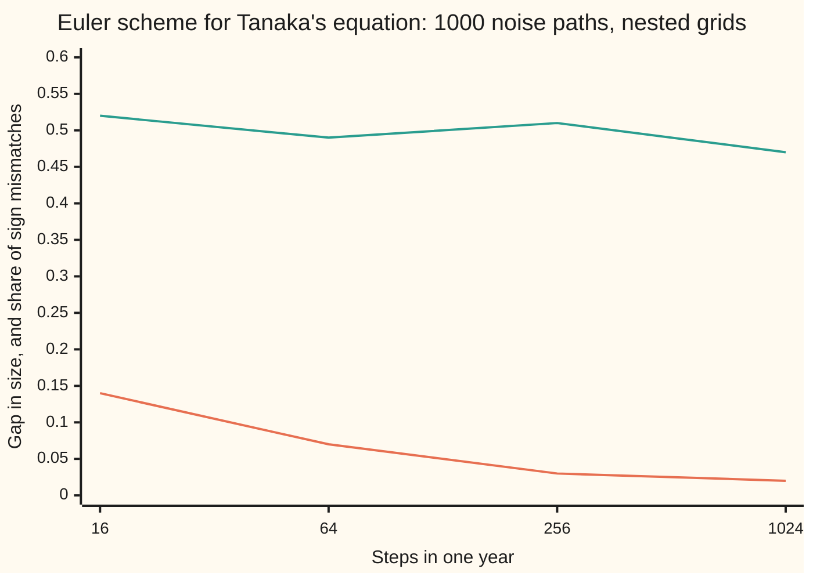

# Weak solutions and the martingale problem: an SDE solved in law, not path by path

[Syllabus](../../../SYLLABUS.md) → [Stochastic processes and calculus](../README.md) → [Continuous Martingales](../README.md#s10) → Weak solutions and the martingale problem

---

## General Overview

Take the simplest rule with a switch in it. A quantity starts at 0. While it is above zero it moves exactly with a noise path $`W`$. While it is at or below zero it moves exactly against it. This is **Tanaka's equation**, $`dX = \mathrm{sgn}(X)\,dW`$, where $`\mathrm{sgn}`$ (the sign function) is +1 for a positive number and −1 otherwise.

Ask the question from [When an SDE has one solution](../06-Ito%20Calculus/07-existence-and-uniqueness-for-sdes.md): given the noise path, is the path of $`X`$ fixed? Here the answer is no. Take one sample year at quarter-year steps: a Brownian path $`B`$ (the random walk seen from far away) goes 0, 0.30, −0.20, 0.20, 0.80. Build the noise from it, $`W = \int \mathrm{sgn}(B)\,dB`$. Then $`X = B`$ solves the equation, ending at 0.80, and in continuous time so does $`X = -B`$, ending at −0.80, with the same noise. (On this coarse grid the rebuild of $`-B`$ misses by twice the first step; Step 2 shows why.) Two paths, one noise.

Yet every solution has the same statistics. Each one is a Brownian motion, so the chance it ends the year at or below 1 is 0.841345, whichever solution is used. The equation fixes the **law** (the probabilities of all path events), not the path. Worse, no solution at all can be built from the noise alone: the noise records only the size $`\lvert X\rvert`$, never its sign.

That is what a **weak solution** is: a solution where the noise is chosen along with the path. It is enough for any question about probabilities, such as a price, a hitting chance or a simulation average. The **martingale problem** of Stroock and Varadhan goes one step further. It drops the noise altogether and describes the law by the generator alone, the drift-and-noise operator of [The generator](../08-Generators%2C%20Densities%20and%20Simulation/01-infinitesimal-generator.md).

**An SDE can pin down the law of its solution without pinning down the path: Tanaka's equation has two solutions on one noise, none built from the noise alone, and one law, Brownian motion; one path per noise always gives one law (Yamada–Watanabe), and the law alone solves a martingale problem for the generator (Stroock–Varadhan).**

**What kind of fact this is:** theorems. The Tanaka facts are proved on this card in Why it works, with the hardest step in a fold. The Yamada–Watanabe theorem and the Stroock–Varadhan theorem are stated with their sources, with the proof idea in words.

### The picture: the size settles, the sign never does



Each path runs the step-by-step rule $`X \to X + \mathrm{sgn}(X)\,\Delta W`$ on grids of 16 to 1024 steps, all cut from the same 4096-step noise path. Orange: the average gap between the size $`\lvert X_1\rvert`$ at year end and a size computed from the noise alone; it halves with every fourfold refinement. Green: the share of paths whose year-end sign differs from the 4096-step run; it stays near one half. A finer grid fixes the size and leaves the sign a fair coin.

---

## The formula

Reminders. $`W_t`$ is a Brownian motion, the driving noise, at time $`t`$ in years. An SDE $`dX_t = \mu(X_t)\,dt + \sigma(X_t)\,dW_t`$ means the integral equation $`X_t = X_0 + \int_0^t \mu(X_s)\,ds + \int_0^t \sigma(X_s)\,dW_s`$, with $`\mu`$ the drift and $`\sigma`$ the noise size ([When an SDE has one solution](../06-Ito%20Calculus/07-existence-and-uniqueness-for-sdes.md)). The example is Tanaka's equation from 0, with no drift:

```math
X_t = \int_0^t \mathrm{sgn}(X_s)\,dW_s, \qquad \mathrm{sgn}(x) = \begin{cases} +1 & x > 0 \\ -1 & x \le 0 \end{cases}
```

**Read it aloud:** X is the running total of the noise steps, each taken with X's own sign, and a step taken at zero counts as negative.

**Four definitions.** $`F^W_t`$ is the information in the noise path up to time $`t`$.

- **Strong solution:** the noise $`W`$ is given first, and $`X`$ is built from it: each $`X_t`$ is a function of the start and the noise path up to $`t`$.
- **Weak solution:** a pair $`(X, W)`$ on some probability space, with $`W`$ a Brownian motion that the information so far does not help predict, solving the equation. The noise is part of the answer.
- **Pathwise uniqueness:** any two solutions on one space, with the same noise and the same start, agree at all times with probability 1.
- **Uniqueness in law:** any two weak solutions from the same start have the same law, even on different spaces.

**The Yamada–Watanabe theorem (1971).**

```math
\text{weak existence} \;+\; \text{pathwise uniqueness} \;\Longrightarrow\; \text{a strong solution exists} \;+\; \text{uniqueness in law}
```

**Read it aloud:** if some solution exists and two solutions with one noise always agree, then the solution can be built from the noise, and its law is unique.

**The martingale problem (Stroock and Varadhan).** The generator of the SDE is $`Lf(x) = \mu(x)\,f'(x) + \tfrac12\,\sigma(x)^2 f''(x)`$, where $`f`$ is a smooth test function with slope $`f'`$ and curvature $`f''`$. A law $`P`$ on continuous paths **solves the martingale problem for $`L`$ from $`x`$** when, under $`P`$, $`X_0 = x`$ and for every such $`f`$ the process

```math
M^f_t = f(X_t) - f(X_0) - \int_0^t Lf(X_s)\,ds \quad \text{is a martingale.}
```

**Read it aloud:** the measurement f along the path, minus the generator's predicted drift of f added up so far, is a fair game.

The problem is **well posed** when it has exactly one solution from each start. Weak solutions of the SDE and solutions of the martingale problem are the same laws. For Tanaka, $`\sigma^2 = \mathrm{sgn}^2 = 1`$, so $`Lf = \tfrac12 f''`$: the generator of Brownian motion.

| Symbol | Plain meaning | In our example | Push it up and the answer… |
| --- | --- | --- | --- |
| $`t`$, $`s`$, $`n`$, $`\Delta`$ | time in years; a time before $`t`$; grid steps in one year; a change over one step | one year; quarter-year steps by hand; 16 to 4096 | finer grids shrink the gap of the −B rebuild like 2/√n |
| $`W_t`$, $`dW`$ | the driving Brownian motion, and its step inside an Ito integral | $`W = \int \mathrm{sgn}(B)\,dB`$, ending at −0.60 by hand | — |
| $`B_t`$ | a Brownian motion we start from, to build a solution | 0, 0.30, −0.20, 0.20, 0.80 | — |
| $`X_t`$, $`Y_t`$ | solutions of the SDE | $`X = B`$ and $`Y = -B`$ | — |
| $`\mathrm{sgn}(x)`$ | +1 for $`x > 0`$, −1 for $`x \le 0`$ | the noise size of Tanaka's equation | — |
| $`\mu`$, $`\sigma`$ | drift and noise size of a general SDE | 0 and $`\mathrm{sgn}`$ | — |
| $`F^W_t`$ | the information in the noise path up to $`t`$ | it holds $`\lvert X\rvert`$ but not the sign | — |
| $`L`$, $`f`$, $`f'`$, $`f''`$, $`M^f`$ | the generator; a test function, its slope and curvature; the process the martingale problem asks to be fair | $`Lf = \tfrac12 f''`$; $`f = x^2`$ and $`x^4`$ | — |
| $`\ell_t`$ | local time at 0: how much time near zero the path has collected, per unit width, read through a small width $`\varepsilon`$ (written $`\ell`$ here, so $`L`$ stays the generator) | $`E[\ell_1] = E\lvert B_1\rvert`$ = 0.7979 | — |
| $`\langle M\rangle_t`$ | the bracket of a continuous fair game $`M`$, equal to its quadratic variation $`[M]_t`$: the limit of its summed squared steps ([Doob-Meyer](02-doob-meyer-decomposition.md)) | $`\langle W\rangle_t = t`$; squared steps summing to 0.8600 on the hand path | the clock of the fair game runs faster |
| $`G`$, $`H`$, $`\mathbf{1}\{\cdot\}`$ | in the fold of Step 4, a rule reading $`X_t`$ off the noise and a rule reading the noise off the size $`\lvert X\rvert`$; the indicator: 1 when the statement in braces holds, 0 otherwise | $`\mathbf{1}\{B_s = 0\}`$ in Step 2 | — |
| $`P`$, $`E`$ | a law on paths, or a chance under it; an average under it | Brownian motion | — |

### When it holds

- **Weak existence needs only mild coefficients.** Continuous $`\mu`$ and $`\sigma`$ that grow at most linearly give a weak solution (Skorokhod's theorem). Tanaka's $`\mathrm{sgn}`$ is not continuous; its weak solution comes from Step 1 instead.
- **Uniqueness in law needs the law to be pinned by $`\sigma^2`$.** Stroock and Varadhan: if $`\sigma^2`$ is continuous, bounded and bounded away from zero, and $`\mu`$ is bounded, the martingale problem is well posed. Let $`\sigma^2`$ touch zero and it can fail: with $`\mathrm{sgn}(0) = 0`$ instead, $`X \equiv 0`$ is a second solution, and the code finds $`E[X_1^2]`$ = 0.0000, not 1. The value at 0 does not matter in an integral against $`B`$, as on [Local time and Tanaka's formula](05-local-time-and-tanakas-formula.md); it does matter in the equation's own coefficient, where the solution can sit at 0.
- **Pathwise uniqueness needs more than the law.** It sees the sign of $`\sigma`$, not just its square. Tanaka's equation passes the law test and fails this one.
- **A strong solution needs the noise to carry all the information.** Here the noise carries only $`\lvert X\rvert`$, so no strong solution exists.

---

## Why it works

### Step 0: the law sees only the square of the noise size, the path sees its sign

A path built from the noise with step $`\sigma\,dW`$ moves the way $`\sigma`$ points. Its statistics depend only on the size of each step, which is $`\sigma^2\,dt`$ in variance. Flip the sign of $`\sigma`$ and every statistic stays the same, while each path turns into a different one. Tanaka's $`\mathrm{sgn}`$ has square 1 everywhere, so the law is Brownian, but its sign switches exactly where the path sits at zero.

### Step 1: X = B is a weak solution

Start from a Brownian motion $`B`$ and define the noise $`W_t = \int_0^t \mathrm{sgn}(B_s)\,dB_s`$. It is an Ito integral of a bounded integrand, so it is a continuous martingale ([The Ito integral](../06-Ito%20Calculus/01-ito-integral.md)). Its quadratic variation is $`\int_0^t \mathrm{sgn}(B_s)^2\,ds = t`$. By [Levy's characterisation and Dubins-Schwarz](04-levys-characterisation-and-dubins-schwarz.md), a continuous martingale from 0 with quadratic variation $`t`$ is a Brownian motion. So $`W`$ is a legitimate noise.

Now integrate the sign of $`B`$ against it. Since $`dW = \mathrm{sgn}(B)\,dB`$,

```math
\int_0^t \mathrm{sgn}(B_s)\,dW_s = \int_0^t \mathrm{sgn}(B_s)^2\,dB_s = B_t .
```

**Read it aloud:** sign times sign is 1, so the steps of W, re-signed by B, add back up to B.

So $`(X, W) = (B, W)`$ is a weak solution. By hand, the four steps of $`W`$ are −0.30, −0.50, −0.40 and 0.60, and re-signing them gives back 0.8000, exactly $`B_1`$. On 1000 simulated paths the rebuild matches $`B_1`$ to within $`10^{-9}`$ every time.

### Step 2: Y = −B solves it too, with the same noise

Put $`Y = -B`$ into the equation. For $`x \ne 0`$, $`\mathrm{sgn}(-x) = -\mathrm{sgn}(x)`$, so $`\mathrm{sgn}(-x)\,\mathrm{sgn}(x) = -1`$. At $`x = 0`$ the product is +1. So

```math
\int_0^t \mathrm{sgn}(-B_s)\,dW_s = -B_t + 2\int_0^t \mathbf{1}\{B_s = 0\}\,dB_s .
```

**Read it aloud:** the rebuild of minus B is minus B, plus twice the steps B takes while sitting exactly at zero. Here $`\mathbf{1}\{B_s = 0\}`$ is the indicator: 1 when $`B_s = 0`$, 0 otherwise.

The last integral has mean square $`4\,E\int_0^t \mathbf{1}\{B_s = 0\}\,ds`$ by the Ito isometry. Brownian motion spends zero total time at any one point, so this is 0, and $`Y = -B`$ solves the equation with the same $`W`$. Two different paths, one noise: pathwise uniqueness fails.

A grid shows the leftover term. There the path sits at zero for the whole first step, so the rebuild of $`-B`$ is off by twice the first step. By hand that gap is 2 × 0.30 = 0.6000: the rebuild gives −0.2000, not −0.8000. On simulated paths the typical gap is 0.4990 at 16 steps and 0.0313 at 4096, against $`2/\sqrt{n}`$ = 0.5000 and 0.0312. In continuous time it is zero.

### Step 3: every solution is a Brownian motion, so the law is unique

Let $`X`$ be any weak solution, with any noise. Then $`X`$ is an Ito integral with bounded integrand, so a continuous martingale from 0, with quadratic variation $`\int_0^t \mathrm{sgn}(X_s)^2\,ds = t`$. Levy's characterisation again: $`X`$ is a Brownian motion. Every solution has the same law, so uniqueness in law holds.

The code tests this on the noise itself. Over 1000 paths, $`W_1`$ has mean −0.0258 ± 0.0304, mean square 0.9243 ± 0.0422 and $`P(W_1 \le 1)`$ = 0.8520 ± 0.0112, against 0, 1 and 0.841345 for a standard normal. The ± values are standard errors, the typical size of the sampling noise in an average.

### Step 4: no solution can be built from the noise alone

Tanaka's formula ([Local time and Tanaka's formula](05-local-time-and-tanakas-formula.md)) splits the size of any solution:

```math
\lvert X_t\rvert = \int_0^t \mathrm{sgn}(X_s)\,dX_s + \ell_t = W_t + \ell_t .
```

**Read it aloud:** the size of X is the noise plus the local time at zero.

The middle step uses $`dX = \mathrm{sgn}(X)\,dW`$ and $`\mathrm{sgn}^2 = 1`$. The local time $`\ell_t`$ is read off the size alone, as the time $`\lvert X\rvert`$ spends below a small $`\varepsilon`$, divided by $`2\varepsilon`$. So $`W = \lvert X\rvert - \ell`$ is built from $`\lvert X\rvert`$ alone: the noise knows the size of the path and nothing else.

A strong solution would make $`X_t`$ a function of the noise, hence of $`\lvert X\rvert`$. But $`X`$ and $`-X`$ are both Brownian motions with the same size, so whatever rule recovers $`X_t`$ from the size also recovers $`-X_t`$. Then $`X_t = -X_t`$, so $`X_t = 0`$, which a normal variable with variance $`t`$ is not. No strong solution exists.

<details>
<summary>Detailed proof: the symmetry argument, written out</summary>

Suppose $`X`$ is a strong solution. Then for each $`t > 0`$ there is a function $`G`$ of paths with $`X_t = G(W)`$ with probability 1, using the noise up to $`t`$.

By Tanaka's formula, $`W = \lvert X\rvert - \ell`$, and $`\ell`$ is a limit of time averages of $`\lvert X\rvert`$. So $`W = H(\lvert X\rvert)`$ for a fixed function $`H`$ of paths, and

$`\displaystyle X_t = G\big(H(\lvert X\rvert)\big) \quad \text{with probability } 1 .`$

By Step 3, $`X`$ is a Brownian motion, so $`-X`$ is one too, and the pairs $`(X, \lvert X\rvert)`$ and $`(-X, \lvert -X\rvert) = (-X, \lvert X\rvert)`$ have the same law. The event that the first coordinate at time $`t`$ equals $`G(H(\cdot))`$ of the second has probability 1 for the first pair, so also for the second:

$`\displaystyle -X_t = G\big(H(\lvert X\rvert)\big) \quad \text{with probability } 1 .`$

Subtracting, $`X_t = 0`$ with probability 1. But $`X_t`$ is normal with variance $`t > 0`$. The contradiction shows no strong solution exists.

</details>

The code makes this visible. It drives the step-by-step (Euler) rule with one noise path on grids from 16 to 4096 steps. The size at year end settles: its average gap to $`W_1 - \min_{s \le 1} W_s`$, the size the noise alone predicts, falls from 0.1357 to 0.0092. The sign does not settle: against the 4096-step run it disagrees on 0.5200, 0.4900, 0.5100 and 0.4740 of paths. The discrete local time $`\lvert B_1\rvert - W_1`$ averages 0.8169 ± 0.0187, against $`E\lvert B_1\rvert = \sqrt{2/\pi}`$ = 0.7979.

### Step 5: Yamada–Watanabe, and why Tanaka does not contradict it

The theorem runs one way. Weak existence plus pathwise uniqueness gives a strong solution and one law. The idea of the proof: take two weak solutions, put them on one space with the same noise so that, given the noise, they are independent. Pathwise uniqueness forces them to be equal. Two independent copies that are always equal must both be fixed by the noise, so the solution is a function of the noise, and its law is unique.

Tanaka's equation shows the converse fails. It has one law and no pathwise uniqueness. Pathwise uniqueness is the stronger property.

This is how the CIR rate of [When an SDE has one solution](../06-Ito%20Calculus/07-existence-and-uniqueness-for-sdes.md) gets a strong solution. Skorokhod's theorem gives a weak solution, the Yamada–Watanabe square-root condition gives pathwise uniqueness, and this theorem joins them. This card states the theorem; it does not prove it.

### Step 6: the martingale problem is the law's own description

**From weak solution to martingale problem.** If $`X`$ solves the SDE, [Ito's lemma](../06-Ito%20Calculus/02-itos-lemma.md) gives $`f(X_t) - f(X_0) - \int_0^t Lf(X_s)\,ds = \int_0^t f'(X_s)\,\sigma(X_s)\,dW_s`$. For $`f`$ with bounded support the right side is an Ito integral with bounded integrand, so a martingale. The law of $`X`$ solves the martingale problem.

**Back again.** Take $`f(x) = x`$ and $`f(x) = x^2`$, cut off far away. The first makes $`M_t = X_t - X_0 - \int_0^t \mu(X_s)\,ds`$ a continuous martingale. The second makes its quadratic variation $`\langle M\rangle_t = \int_0^t \sigma(X_s)^2\,ds`$. Where $`\sigma`$ is not zero, $`W = \int \sigma(X)^{-1}\,dM`$ has quadratic variation $`t`$, so by Levy it is a Brownian motion, and $`X`$ solves the SDE with it. So weak solutions and martingale-problem solutions are the same laws, and only $`\mu`$ and $`\sigma^2`$ enter.

**For Tanaka.** $`Lf = \tfrac12 f''`$, the generator of $`dX = dW`$. The two equations have different paths but one martingale problem, so one law. The code averages $`M^f_1`$ over 1000 Euler paths: −0.0617 ± 0.0414 for $`f = x^2`$, with $`Lf = 1`$, and −0.2638 ± 0.1745 for $`f = x^4`$, with $`Lf = 6x^2`$. Both are within sampling noise of 0. The $`x^4`$ test is loose, with standard error 0.1745, and can miss a slip in $`Lf`$ (see Try changing); the $`x^2`$ test is the sharp one. These two test functions grow, but Brownian motion has all moments finite, so the cut-off is not needed here.

---

## Worked numbers, by hand

One path of $`B`$ at quarter-year steps, with $`\Delta B`$ = 0.30, −0.50, 0.40, 0.60 and $`\mathrm{sgn}(0) = -1`$.

| Step | Arithmetic | Value |
| --- | --- | --- |
| path $`B`$ | running totals from 0 | 0, 0.30, −0.20, 0.20, 0.80 |
| signs at the step starts | $`\mathrm{sgn}`$ of 0, 0.30, −0.20, 0.20 | −1, 1, −1, 1 |
| noise steps $`\Delta W = \mathrm{sgn}(B)\,\Delta B`$ | −1 × 0.30, 1 × (−0.50), −1 × 0.40, 1 × 0.60 | −0.30, −0.50, −0.40, 0.60 |
| noise at year end $`W_1`$ | −0.30 − 0.50 − 0.40 + 0.60 | −0.60 |
| quadratic variation of $`W`$ | 0.09 + 0.25 + 0.16 + 0.36 | 0.8600, the same as for $`B`$ |
| rebuild $`X = B`$ | (−1)(−0.30) + (1)(−0.50) + (−1)(−0.40) + (1)(0.60) | **0.8000 = $`B_1`$** |
| rebuild $`Y = -B`$ on the grid | (−1)(−0.30) + (−1)(−0.50) + (1)(−0.40) + (−1)(0.60) | −0.2000, against −0.8000 |
| grid gap | 2 × first step 0.30 | 0.6000 |

The noise $`W`$ ends at −0.60 while $`B`$ ends at 0.80, yet re-signing the noise rebuilds $`B`$ exactly. The −B rebuild misses only because the grid holds the path at zero for a whole quarter-year; the miss shrinks like $`2/\sqrt{n}`$.

### What breaks if you drop a piece

| Mistake | Comes out at | What went wrong |
| --- | --- | --- |
| Read uniqueness in law as one path per noise | the 1024-step and 4096-step Euler paths disagree in sign on 0.4740 of paths | the law is unique, the path is not |
| Set $`\mathrm{sgn}(0) = 0`$ | $`X_1`$ = 0.0000 on every path, $`E[X_1^2]`$ = 0.0000, not 1 | $`\sigma^2`$ vanishes at the start, so the path never leaves and the law is lost |
| Write the generator without the half, $`Lf = f''`$ | $`M^f_1`$ for $`f = x^2`$ averages −1.0617 ± 0.0414, not 0 | the martingale problem then describes a process with twice the variance |
| Trust the grid rebuild of $`-B`$ | −0.2000 instead of −0.8000 on the hand path | the grid holds the path at zero for a whole step |

The code prints every row.

---

## Code, from first principles, and it actually runs

The script takes four roads. Road 1 is the hand path. Road 2 builds $`W`$ from 1000 simulated Brownian paths on grids of 16 to 4096 steps, rebuilds $`B`$ and $`-B`$ from it, and tests the law of $`W`$ against a normal CDF computed two ways, by its series and by Simpson's rule. Road 3 drives the Euler rule with one noise path on nested grids and compares sizes and signs. Road 4 tests the martingale problem for $`f = x^2`$ and $`x^4`$. Draws come from SplitMix64 with seed 20261123 and Box–Muller normals. Asserts on simulated numbers allow 4 standard errors.

### Python

```python
# Weak solutions and the martingale problem -- the check behind the card.  Only math is imported.
# Tanaka's equation dX = sgn(X) dW from X0 = 0 over one year, with sgn(0) = -1.
# Roads: a four-step path by hand; X = B and Y = -B rebuilt from W = sum sgn(B) dB on
# simulated paths; the law of W against the normal CDF (Levy); the Euler scheme driven by
# one W on nested grids (the size settles, the sign never does); and the martingale
# problem for L f = f''/2 on f = x^2 and x^4.  SplitMix64 and Box-Muller, seed 20261123.
# Each simulated path serves as B in road 2 and as W in roads 3 and 4.
import math

def sgn(x, s0=-1.0):
    return 1.0 if x > 0 else (-1.0 if x < 0 else s0)

def noise(x):  # the noise size in road 3's Euler scheme
    return sgn(x)

def Phi_series(z):  # the erf Taylor series
    s, term, k = 0.0, z / math.sqrt(2), 0
    while abs(term) > 1e-17:
        s += term / (2 * k + 1)
        k += 1
        term *= -z * z / 2 / k
    return 0.5 + s / math.sqrt(math.pi)

def Phi_simpson(z, m=2000):  # Simpson's rule on the bell curve from 0 to z
    h = z / m
    f = lambda x: math.exp(-x * x / 2) / math.sqrt(2 * math.pi)
    s = f(0) + f(z) + sum((4 if i % 2 else 2) * f(i * h) for i in range(1, m))
    return 0.5 + s * h / 3

M64 = (1 << 64) - 1
state = 20261123
def unif():
    global state
    state = (state + 0x9E3779B97F4A7C15) & M64
    z = state
    z = ((z ^ (z >> 30)) * 0xBF58476D1CE4E5B9) & M64
    z = ((z ^ (z >> 27)) * 0x94D049BB133111EB) & M64
    return (((z ^ (z >> 31)) >> 11) + 0.5) / 9007199254740992.0
def gauss():
    return math.sqrt(-2 * math.log(unif())) * math.cos(2 * math.pi * unif())

# ---- road 1: one path by hand, four quarter-year steps ----
dB = [0.3, -0.5, 0.4, 0.6]
B = [0.0]
for d in dB: B.append(B[-1] + d)
dW = [sgn(B[k]) * dB[k] for k in range(4)]
xb = sum(sgn(B[k]) * dW[k] for k in range(4))
yb = sum(sgn(-B[k]) * dW[k] for k in range(4))
print("hand: B at t = 0, 0.25, 0.5, 0.75, 1:", " ".join(f"{b:.2f}" for b in B))
print("hand: sgn(B) at the step starts:", " ".join(f"{sgn(b):.0f}" for b in B[:4]))
print("hand: dW = sgn(B) dB:", " ".join(f"{d:.2f}" for d in dW), "; W_1", f"{sum(dW):.2f}")
print(f"hand: sum sgn(B) dW {xb:.4f} against B_1 {B[4]:.4f}")
print(f"hand: sum sgn(-B) dW {yb:.4f} against -B_1 {-B[4]:.4f}; gap {yb + B[4]:.4f} = 2 x first step")
print("hand: dW^2:", " ".join(f"{d * d:.2f}" for d in dW))
print(f"hand: sum dW^2 {sum(d * d for d in dW):.4f} = sum dB^2 {sum(d * d for d in dB):.4f}")
assert abs(xb - B[4]) < 1e-12 and abs((yb + B[4]) - 2 * dB[0]) < 1e-12

# ---- roads 2 to 4: PATHS Brownian paths of NF steps, read at nested grids ----
PATHS, NF, LEVELS = 1000, 4096, [16, 64, 256, 1024, 4096]
gap2 = {n: 0.0 for n in LEVELS}; maxerr = 0.0; minloc = 0.0
w1, wb, loc, s_gap, s_dis = [], [], [], {n: 0.0 for n in LEVELS}, {n: 0 for n in LEVELS}
mp2, mp4, zx = [], [], []
for p in range(PATHS):
    fine = [gauss() / math.sqrt(NF) for _ in range(NF)]
    xend = {}
    for n in LEVELS:
        r = NF // n
        d = [sum(fine[k * r:(k + 1) * r]) for k in range(n)]
        # road 2: this path as B; W = sum sgn(B) dB; rebuild B and -B from W
        b, w, x, y = 0.0, 0.0, 0.0, 0.0
        for k in range(n):
            dw = sgn(b) * d[k]
            x += sgn(b) * dw; y += sgn(-b) * dw
            minloc = min(minloc, abs(b + d[k]) - abs(b) - dw)
            b += d[k]; w += dw
        maxerr = max(maxerr, abs(x - b)); gap2[n] += (y + b) * (y + b)
        if n == NF: w1.append(w); wb.append(w * b); loc.append(abs(b) - w)
        # road 3: this path as W; Euler X_{k+1} = X_k + noise(X_k) dW_k
        X, W, Wmin, sx2, Z = 0.0, 0.0, 0.0, 0.0, 0.0  # Z: the same Euler rule with sgn(0) = 0
        for k in range(n):
            sx2 += X * X / n
            X += noise(X) * d[k]; Z += sgn(Z, 0.0) * d[k]; W += d[k]; Wmin = min(Wmin, W)
        xend[n] = X
        s_gap[n] += abs(abs(X) - (W - Wmin))
        if n == NF: mp2.append(X * X - 1.0); mp4.append(X * X * X * X - 6 * sx2); zx.append(Z)
    for n in LEVELS: s_dis[n] += (xend[n] > 0) != (xend[NF] > 0)

def mean_se(v):
    m = sum(v) / len(v)
    return m, math.sqrt(sum((a - m) * (a - m) for a in v) / (len(v) - 1) / len(v))

print(f"paths {PATHS}, finest grid {NF} steps in one year; errors are standard errors")
print("road 2: n steps | RMS gap of the -B rebuild | 2/sqrt(n)")
for n in LEVELS:
    rms = math.sqrt(gap2[n] / PATHS)
    print(f"  {n:5d} | {rms:.4f} | {2 / math.sqrt(n):.4f}")
    assert abs(rms / (2 / math.sqrt(n)) - 1) < 0.1
print(f"road 2: B rebuilt from W within 1e-9: {maxerr < 1e-9}; every step of |B| - W at least 0: {minloc > -1e-12}")
assert maxerr < 1e-9 and minloc > -1e-12
mw, sw = mean_se(w1); mv, sv = mean_se([a * a for a in w1])
pw, sp = mean_se([1.0 if a <= 1 else 0.0 for a in w1])
mwb, swb = mean_se(wb); ml, sl = mean_se(loc)
p1, p2 = Phi_series(1.0), Phi_simpson(1.0)
print(f"normal CDF at 1: series {p1:.6f}, Simpson {p2:.6f}")
print(f"law of W_1: mean {mw:.4f} +- {sw:.4f}; mean square {mv:.4f} +- {sv:.4f}; P(W_1 <= 1) {pw:.4f} +- {sp:.4f}")
print(f"E[W_1 B_1] {mwb:.4f} +- {swb:.4f} (exact 0); E|B_1| - E W_1 {ml:.4f} +- {sl:.4f} (exact {math.sqrt(2 / math.pi):.4f})")
assert abs(p1 - p2) < 1e-9 and abs(mw) < 4 * sw and abs(mv - 1) < 4 * sv and abs(pw - p1) < 4 * sp
assert abs(mwb) < 4 * swb and abs(ml - math.sqrt(2 / math.pi)) < 4 * sl
print("road 3: n steps | mean gap |X_1| to W_1 - min W | share of signs unlike the 4096-step X_1")
for n in LEVELS:
    print(f"  {n:5d} | {s_gap[n] / PATHS:.4f} | {s_dis[n] / PATHS:.4f}")
    assert n == NF or abs(s_dis[n] / PATHS - 0.5) < 4 * math.sqrt(0.25 / PATHS)
assert s_gap[16] > 4 * s_gap[1024]
a2, e2 = mean_se(mp2); a4, e4 = mean_se(mp4); wrong, ew = mean_se([v - 1.0 for v in mp2])
print("road 4: martingale problem, L f = f''/2, mean of f(X_1) - f(0) - (sum of L f(X_t) dt):")
print(f"  f = x^2: {a2:.4f} +- {e2:.4f}; f = x^4: {a4:.4f} +- {e4:.4f}; both exact 0")
assert abs(a2) < 4 * e2 and abs(a4) < 4 * e4
zmax = max(abs(z) for z in zx); mz = sum(z * z for z in zx) / PATHS
mx, ex = mean_se([v + 1.0 for v in mp2])  # E[X_1^2] with sgn(0) = -1
print(f"mistake: L f = f'' (no half), f = x^2: {wrong:.4f} +- {ew:.4f}, should be 0")
print(f"mistake: sgn(0) = 0 on the same noise: largest |X_1| {zmax:.4f}, so E[X_1^2] = {mz:.4f}, not {mx:.4f} +- {ex:.4f}")
print(f"mistake: hand path, -B rebuilt on the grid: {yb:.4f}, not {-B[4]:.4f}")
assert abs(wrong) > 4 * ew  # the mistake is detectably wrong
assert zmax == 0.0; assert abs(mx - mz) > 4 * ex  # sgn(0) = 0 never leaves 0; sgn(0) = -1 spreads out
print("chart, size gap:", " ".join(f"{s_gap[n] / PATHS:.2f}" for n in LEVELS[:4]))
print("chart, signs unlike:", " ".join(f"{s_dis[n] / PATHS:.2f}" for n in LEVELS[:4]))
print("ALL CHECKS PASS")
```

**Ran 2026-11-23 on macOS, Python 3.14.10, standard library only. All checks passed. Output, pasted from the run:**

```
hand: B at t = 0, 0.25, 0.5, 0.75, 1: 0.00 0.30 -0.20 0.20 0.80
hand: sgn(B) at the step starts: -1 1 -1 1
hand: dW = sgn(B) dB: -0.30 -0.50 -0.40 0.60 ; W_1 -0.60
hand: sum sgn(B) dW 0.8000 against B_1 0.8000
hand: sum sgn(-B) dW -0.2000 against -B_1 -0.8000; gap 0.6000 = 2 x first step
hand: dW^2: 0.09 0.25 0.16 0.36
hand: sum dW^2 0.8600 = sum dB^2 0.8600
paths 1000, finest grid 4096 steps in one year; errors are standard errors
road 2: n steps | RMS gap of the -B rebuild | 2/sqrt(n)
     16 | 0.4990 | 0.5000
     64 | 0.2511 | 0.2500
    256 | 0.1229 | 0.1250
   1024 | 0.0613 | 0.0625
   4096 | 0.0313 | 0.0312
road 2: B rebuilt from W within 1e-9: True; every step of |B| - W at least 0: True
normal CDF at 1: series 0.841345, Simpson 0.841345
law of W_1: mean -0.0258 +- 0.0304; mean square 0.9243 +- 0.0422; P(W_1 <= 1) 0.8520 +- 0.0112
E[W_1 B_1] 0.0083 +- 0.0415 (exact 0); E|B_1| - E W_1 0.8169 +- 0.0187 (exact 0.7979)
road 3: n steps | mean gap |X_1| to W_1 - min W | share of signs unlike the 4096-step X_1
     16 | 0.1357 | 0.5200
     64 | 0.0696 | 0.4900
    256 | 0.0350 | 0.5100
   1024 | 0.0175 | 0.4740
   4096 | 0.0092 | 0.0000
road 4: martingale problem, L f = f''/2, mean of f(X_1) - f(0) - (sum of L f(X_t) dt):
  f = x^2: -0.0617 +- 0.0414; f = x^4: -0.2638 +- 0.1745; both exact 0
mistake: L f = f'' (no half), f = x^2: -1.0617 +- 0.0414, should be 0
mistake: sgn(0) = 0 on the same noise: largest |X_1| 0.0000, so E[X_1^2] = 0.0000, not 0.9383 +- 0.0414
mistake: hand path, -B rebuilt on the grid: -0.2000, not -0.8000
chart, size gap: 0.14 0.07 0.03 0.02
chart, signs unlike: 0.52 0.49 0.51 0.47
ALL CHECKS PASS
```

### Rust

```rust
// Weak solutions and the martingale problem -- the check behind the card.  std only.
// Tanaka's equation dX = sgn(X) dW from X0 = 0 over one year, with sgn(0) = -1.
// Roads: a four-step path by hand; X = B and Y = -B rebuilt from W = sum sgn(B) dB on
// simulated paths; the law of W against the normal CDF (Levy); the Euler scheme driven by
// one W on nested grids (the size settles, the sign never does); and the martingale
// problem for L f = f''/2 on f = x^2 and x^4.  SplitMix64 and Box-Muller, seed 20261123.
// Each simulated path serves as B in road 2 and as W in roads 3 and 4.
use std::f64::consts::PI;

fn sgn0(x: f64, s0: f64) -> f64 {
    if x > 0.0 { 1.0 } else if x < 0.0 { -1.0 } else { s0 }
}
fn sgn(x: f64) -> f64 { sgn0(x, -1.0) }
fn noise(x: f64) -> f64 { sgn(x) } // the noise size in road 3's Euler scheme

fn phi_series(z: f64) -> f64 { // the erf Taylor series
    let (mut s, mut term, mut k) = (0.0, z / 2f64.sqrt(), 0.0);
    while term.abs() > 1e-17 {
        s += term / (2.0 * k + 1.0);
        k += 1.0;
        term *= -z * z / 2.0 / k;
    }
    0.5 + s / PI.sqrt()
}
fn phi_simpson(z: f64, m: usize) -> f64 { // Simpson's rule on the bell curve from 0 to z
    let h = z / m as f64;
    let f = |x: f64| (-x * x / 2.0).exp() / (2.0 * PI).sqrt();
    let mut inner = 0.0;
    for i in 1..m { inner += (if i % 2 == 1 { 4.0 } else { 2.0 }) * f(i as f64 * h); }
    0.5 + (f(0.0) + f(z) + inner) * h / 3.0
}

struct Rng(u64);
impl Rng {
    fn unif(&mut self) -> f64 {
        self.0 = self.0.wrapping_add(0x9E3779B97F4A7C15);
        let mut z = self.0;
        z = (z ^ (z >> 30)).wrapping_mul(0xBF58476D1CE4E5B9);
        z = (z ^ (z >> 27)).wrapping_mul(0x94D049BB133111EB);
        (((z ^ (z >> 31)) >> 11) as f64 + 0.5) / 9007199254740992.0
    }
    fn gauss(&mut self) -> f64 {
        let (u1, u2) = (self.unif(), self.unif());
        (-2.0 * u1.ln()).sqrt() * (2.0 * PI * u2).cos()
    }
}

fn mean_se(v: &[f64]) -> (f64, f64) {
    let n = v.len() as f64;
    let (mut m, mut s) = (0.0, 0.0);
    for a in v { m += a; }
    m /= n;
    for a in v { s += (a - m) * (a - m); }
    (m, (s / (n - 1.0) / n).sqrt())
}
fn py(b: bool) -> &'static str { if b { "True" } else { "False" } }
fn join(v: &[f64], p: usize) -> String {
    v.iter().map(|x| format!("{:.*}", p, x)).collect::<Vec<_>>().join(" ")
}

fn main() {
    // ---- road 1: one path by hand, four quarter-year steps ----
    let db = [0.3, -0.5, 0.4, 0.6];
    let mut b = vec![0.0];
    for d in db { let l = *b.last().unwrap(); b.push(l + d); }
    let dw: Vec<f64> = (0..4).map(|k| sgn(b[k]) * db[k]).collect();
    let (mut xb, mut yb) = (0.0, 0.0);
    let sgns: Vec<f64> = b[..4].iter().map(|&x| sgn(x)).collect();
    let (mut w1h, mut q1, mut q2) = (0.0, 0.0, 0.0);
    for k in 0..4 { xb += sgn(b[k]) * dw[k]; yb += sgn(-b[k]) * dw[k]; }
    for k in 0..4 { w1h += dw[k]; q1 += dw[k] * dw[k]; q2 += db[k] * db[k]; }
    println!("hand: B at t = 0, 0.25, 0.5, 0.75, 1: {}", join(&b, 2));
    println!("hand: sgn(B) at the step starts: {}", join(&sgns, 0));
    println!("hand: dW = sgn(B) dB: {} ; W_1 {:.2}", join(&dw, 2), w1h);
    println!("hand: sum sgn(B) dW {:.4} against B_1 {:.4}", xb, b[4]);
    println!("hand: sum sgn(-B) dW {:.4} against -B_1 {:.4}; gap {:.4} = 2 x first step", yb, -b[4], yb + b[4]);
    println!("hand: dW^2: {}", join(&dw.iter().map(|d| d * d).collect::<Vec<_>>(), 2));
    println!("hand: sum dW^2 {:.4} = sum dB^2 {:.4}", q1, q2);
    assert!((xb - b[4]).abs() < 1e-12 && ((yb + b[4]) - 2.0 * db[0]).abs() < 1e-12);

    // ---- roads 2 to 4: PATHS Brownian paths of NF steps, read at nested grids ----
    const PATHS: usize = 1000;
    const NF: usize = 4096;
    let levels = [16usize, 64, 256, 1024, 4096];
    let mut rng = Rng(20261123);
    let (mut gap2, mut s_gap, mut s_dis) = ([0.0f64; 5], [0.0f64; 5], [0usize; 5]);
    let (mut maxerr, mut minloc) = (0.0f64, 0.0f64);
    let (mut w1, mut wb, mut loc, mut mp2, mut mp4, mut zx) = (vec![], vec![], vec![], vec![], vec![], vec![]);
    for _ in 0..PATHS {
        let fine: Vec<f64> = (0..NF).map(|_| rng.gauss() / (NF as f64).sqrt()).collect();
        let mut xend = [0.0f64; 5];
        for (li, &n) in levels.iter().enumerate() {
            let r = NF / n;
            let d: Vec<f64> = (0..n).map(|k| {
                let mut s = 0.0;
                for v in &fine[k * r..(k + 1) * r] { s += v; }
                s
            }).collect();
            // road 2: this path as B; W = sum sgn(B) dB; rebuild B and -B from W
            let (mut bb, mut w, mut x, mut y) = (0.0f64, 0.0f64, 0.0f64, 0.0f64);
            for k in 0..n {
                let dwk = sgn(bb) * d[k];
                x += sgn(bb) * dwk; y += sgn(-bb) * dwk;
                minloc = minloc.min((bb + d[k]).abs() - bb.abs() - dwk);
                bb += d[k]; w += dwk;
            }
            maxerr = maxerr.max((x - bb).abs());
            gap2[li] += (y + bb) * (y + bb);
            if n == NF { w1.push(w); wb.push(w * bb); loc.push(bb.abs() - w); }
            // road 3: this path as W; Euler X_{k+1} = X_k + noise(X_k) dW_k
            let (mut xx, mut ww, mut wmin, mut sx2, mut zz) = (0.0f64, 0.0f64, 0.0f64, 0.0f64, 0.0f64); // zz: sgn(0) = 0
            for k in 0..n {
                sx2 += xx * xx / n as f64;
                xx += noise(xx) * d[k]; zz += sgn0(zz, 0.0) * d[k];
                ww += d[k]; wmin = wmin.min(ww);
            }
            xend[li] = xx;
            s_gap[li] += (xx.abs() - (ww - wmin)).abs();
            if n == NF { mp2.push(xx * xx - 1.0); mp4.push(xx * xx * xx * xx - 6.0 * sx2); zx.push(zz); }
        }
        for li in 0..5 { if (xend[li] > 0.0) != (xend[4] > 0.0) { s_dis[li] += 1; } }
    }
    let pf = PATHS as f64;
    println!("paths {}, finest grid {} steps in one year; errors are standard errors", PATHS, NF);
    println!("road 2: n steps | RMS gap of the -B rebuild | 2/sqrt(n)");
    for (li, &n) in levels.iter().enumerate() {
        let rms = (gap2[li] / pf).sqrt();
        let ex = 2.0 / (n as f64).sqrt();
        println!("  {:5} | {:.4} | {:.4}", n, rms, ex);
        assert!((rms / ex - 1.0).abs() < 0.1);
    }
    println!("road 2: B rebuilt from W within 1e-9: {}; every step of |B| - W at least 0: {}",
             py(maxerr < 1e-9), py(minloc > -1e-12));
    assert!(maxerr < 1e-9 && minloc > -1e-12);
    let (mw, sw) = mean_se(&w1);
    let (mv, sv) = mean_se(&w1.iter().map(|a| a * a).collect::<Vec<_>>());
    let (pw, sp) = mean_se(&w1.iter().map(|&a| if a <= 1.0 { 1.0 } else { 0.0 }).collect::<Vec<_>>());
    let ((mwb, swb), (ml, sl)) = (mean_se(&wb), mean_se(&loc));
    let (p1, p2) = (phi_series(1.0), phi_simpson(1.0, 2000));
    let ebs = (2.0 / PI).sqrt();
    println!("normal CDF at 1: series {:.6}, Simpson {:.6}", p1, p2);
    println!("law of W_1: mean {:.4} +- {:.4}; mean square {:.4} +- {:.4}; P(W_1 <= 1) {:.4} +- {:.4}", mw, sw, mv, sv, pw, sp);
    println!("E[W_1 B_1] {:.4} +- {:.4} (exact 0); E|B_1| - E W_1 {:.4} +- {:.4} (exact {:.4})", mwb, swb, ml, sl, ebs);
    assert!((p1 - p2).abs() < 1e-9 && mw.abs() < 4.0 * sw && (mv - 1.0).abs() < 4.0 * sv && (pw - p1).abs() < 4.0 * sp);
    assert!(mwb.abs() < 4.0 * swb && (ml - ebs).abs() < 4.0 * sl);
    println!("road 3: n steps | mean gap |X_1| to W_1 - min W | share of signs unlike the 4096-step X_1");
    for (li, &n) in levels.iter().enumerate() {
        let dis = s_dis[li] as f64 / pf;
        println!("  {:5} | {:.4} | {:.4}", n, s_gap[li] / pf, dis);
        assert!(n == NF || (dis - 0.5).abs() < 4.0 * (0.25 / pf).sqrt());
    }
    assert!(s_gap[0] > 4.0 * s_gap[3]);
    let ((a2, e2), (a4, e4)) = (mean_se(&mp2), mean_se(&mp4));
    let (wrong, ew) = mean_se(&mp2.iter().map(|v| v - 1.0).collect::<Vec<_>>());
    println!("road 4: martingale problem, L f = f''/2, mean of f(X_1) - f(0) - (sum of L f(X_t) dt):");
    println!("  f = x^2: {:.4} +- {:.4}; f = x^4: {:.4} +- {:.4}; both exact 0", a2, e2, a4, e4);
    assert!(a2.abs() < 4.0 * e2 && a4.abs() < 4.0 * e4);
    let (zmax, mz) = (zx.iter().fold(0.0f64, |m, z| m.max(z.abs())), zx.iter().map(|z| z * z).sum::<f64>() / pf);
    let (mx, ex) = mean_se(&mp2.iter().map(|v| v + 1.0).collect::<Vec<_>>()); // E[X_1^2] with sgn(0) = -1
    println!("mistake: L f = f'' (no half), f = x^2: {:.4} +- {:.4}, should be 0", wrong, ew);
    println!("mistake: sgn(0) = 0 on the same noise: largest |X_1| {:.4}, so E[X_1^2] = {:.4}, not {:.4} +- {:.4}", zmax, mz, mx, ex);
    println!("mistake: hand path, -B rebuilt on the grid: {:.4}, not {:.4}", yb, -b[4]);
    assert!(wrong.abs() > 4.0 * ew); // the mistake is detectably wrong
    assert!(zmax == 0.0); assert!((mx - mz).abs() > 4.0 * ex); // sgn(0) = 0 never leaves 0; sgn(0) = -1 spreads out
    let g: Vec<f64> = (0..4).map(|li| s_gap[li] / pf).collect();
    let u: Vec<f64> = (0..4).map(|li| s_dis[li] as f64 / pf).collect();
    println!("chart, size gap: {}", join(&g, 2));
    println!("chart, signs unlike: {}", join(&u, 2));
    println!("ALL CHECKS PASS");
}
```

**Ran 2026-11-23 on macOS, rustc 1.98.1, no crates. All checks passed. Output, pasted from the run:**

```
hand: B at t = 0, 0.25, 0.5, 0.75, 1: 0.00 0.30 -0.20 0.20 0.80
hand: sgn(B) at the step starts: -1 1 -1 1
hand: dW = sgn(B) dB: -0.30 -0.50 -0.40 0.60 ; W_1 -0.60
hand: sum sgn(B) dW 0.8000 against B_1 0.8000
hand: sum sgn(-B) dW -0.2000 against -B_1 -0.8000; gap 0.6000 = 2 x first step
hand: dW^2: 0.09 0.25 0.16 0.36
hand: sum dW^2 0.8600 = sum dB^2 0.8600
paths 1000, finest grid 4096 steps in one year; errors are standard errors
road 2: n steps | RMS gap of the -B rebuild | 2/sqrt(n)
     16 | 0.4990 | 0.5000
     64 | 0.2511 | 0.2500
    256 | 0.1229 | 0.1250
   1024 | 0.0613 | 0.0625
   4096 | 0.0313 | 0.0312
road 2: B rebuilt from W within 1e-9: True; every step of |B| - W at least 0: True
normal CDF at 1: series 0.841345, Simpson 0.841345
law of W_1: mean -0.0258 +- 0.0304; mean square 0.9243 +- 0.0422; P(W_1 <= 1) 0.8520 +- 0.0112
E[W_1 B_1] 0.0083 +- 0.0415 (exact 0); E|B_1| - E W_1 0.8169 +- 0.0187 (exact 0.7979)
road 3: n steps | mean gap |X_1| to W_1 - min W | share of signs unlike the 4096-step X_1
     16 | 0.1357 | 0.5200
     64 | 0.0696 | 0.4900
    256 | 0.0350 | 0.5100
   1024 | 0.0175 | 0.4740
   4096 | 0.0092 | 0.0000
road 4: martingale problem, L f = f''/2, mean of f(X_1) - f(0) - (sum of L f(X_t) dt):
  f = x^2: -0.0617 +- 0.0414; f = x^4: -0.2638 +- 0.1745; both exact 0
mistake: L f = f'' (no half), f = x^2: -1.0617 +- 0.0414, should be 0
mistake: sgn(0) = 0 on the same noise: largest |X_1| 0.0000, so E[X_1^2] = 0.0000, not 0.9383 +- 0.0414
mistake: hand path, -B rebuilt on the grid: -0.2000, not -0.8000
chart, size gap: 0.14 0.07 0.03 0.02
chart, signs unlike: 0.52 0.49 0.51 0.47
ALL CHECKS PASS
```

### Lean

Lean proves the grid sums behind Steps 1, 2 and 4 for every grid path, the generator of Step 6, and the hand table.

- Take any grid path $`B`$ from 0, with noise steps $`\Delta W = \mathrm{sgn}(B)\,\Delta B`$. Then re-signing the noise by $`B`$ rebuilds $`B`$ exactly.
- Take the same path and noise. Then re-signing the noise by $`-B`$ gives $`-B`$, plus twice the steps $`B`$ takes while sitting at zero.
- Take any grid path $`B`$. Then its noise has the same summed squared steps as $`B`$, so the noise keeps the clock of $`B`$.
- Take any grid path $`B`$. Then every step of $`\lvert B\rvert - W`$, the discrete local time, is at least 0.
- Take Tanaka's equation, with no drift and noise size $`\mathrm{sgn}`$. Then its generator is $`Lf = \tfrac12 f''`$ for every test function $`f`$.
- Take the test functions $`x^2`$ and $`x^4`$. Then $`L`$ gives 1 and $`6x^2`$.
- On the hand path, the signs, the noise steps, $`W_1`$ = −0.60 and the summed squared steps 0.8600 match the table.
- On the hand path, the rebuild of $`B`$ gives 0.8000, and the grid rebuild of $`-B`$ gives −0.2000, a gap of 2 × 0.30.

The simulated paths, the law of $`W`$, the Euler runs and the martingale-problem averages are left to the Python and Rust checks.

```lean
-- Weak solutions and the martingale problem: on any grid path B from 0, re-signing the noise W = ∑ sgn(B) ΔB rebuilds B exactly while the rebuild of −B misses by twice the steps taken at zero, the noise keeps B's clock and sees only |B|, and Tanaka's generator is f''/2.
import Mathlib.Analysis.Calculus.Deriv.Pow
import Mathlib.Analysis.Calculus.Deriv.Mul
import Mathlib.Algebra.BigOperators.Intervals
import Mathlib.Algebra.Order.BigOperators.Group.Finset
import Mathlib.Tactic.NormNum
import Mathlib.Tactic.Linarith

open Finset

/-! Setting. Mathlib has no Brownian motion and no Ito integral, so the card's weak existence,
uniqueness in law, the lack of a strong solution, Yamada–Watanabe and Stroock–Varadhan cannot be
stated here. What can be stated exactly is the algebra under Steps 1, 2 and 4 on a time grid,
which is also what the card's code and hand table check, and the generator of Step 6.
A grid path is `B : ℕ → ℝ`, with `B k` its value after `k` steps and `B (k+1) - B k` its step.
Mathlib's `SignType.sign` and `Real.sign` give 0 at 0; the card's sign gives −1 at 0 (and
warns that `sgn(0) = 0` breaks the equation), so it is defined here. -/

/-- The card's sign: `sgn x = +1` for `x > 0` and `−1` for `x ≤ 0`. -/
noncomputable def tanakaSgn (x : ℝ) : ℝ := if 0 < x then 1 else -1

/-- One step of the card's noise built from a grid path: `ΔW_k = sgn(B_k) ΔB_k`. -/
noncomputable def noiseStep (B : ℕ → ℝ) (k : ℕ) : ℝ := tanakaSgn (B k) * (B (k + 1) - B k)

/-- The generator of `dX = μ(X) dt + σ(X) dW` on a test function `f`:
`Lf(x) = μ(x) f'(x) + ½ σ(x)² f''(x)`. -/
noncomputable def generator (μ σ f : ℝ → ℝ) (x : ℝ) : ℝ :=
  μ x * deriv f x + 1 / 2 * σ x ^ 2 * deriv (deriv f) x

/-- The card's sign squares to one. -/
theorem tanakaSgn_sq (x : ℝ) : tanakaSgn x ^ 2 = 1 := by
  unfold tanakaSgn; split_ifs <;> norm_num

/-- `x ↦ x ^ n` has derivative `n x ^ (n-1)`, as a function equality. -/
theorem deriv_fun_pow_eq (n : ℕ) : deriv (fun y : ℝ => y ^ n) = fun y => (n : ℝ) * y ^ (n - 1) := by
  funext y; simp

/-- **Two paths, one noise, on a grid** (Why it works, Steps 1 and 2; Worked numbers). Let `B` be
any grid path from 0 and build the noise from it, `ΔW_k = sgn(B_k) ΔB_k`. Re-signing the noise
by `B` rebuilds `B` exactly: `∑_{k<n} sgn(B_k) ΔW_k = B_n`. Re-signing it by `−B` rebuilds `−B`
up to twice the steps `B` takes while sitting at zero:
`∑_{k<n} sgn(−B_k) ΔW_k = −B_n + 2 ∑_{k<n, B_k = 0} ΔB_k`. -/
theorem tanaka_grid_rebuild_of_B_and_minus_B (B : ℕ → ℝ) (h0 : B 0 = 0) (n : ℕ) :
    ∑ k ∈ range n, tanakaSgn (B k) * noiseStep B k = B n ∧
      ∑ k ∈ range n, tanakaSgn (-B k) * noiseStep B k
        = -B n + 2 * ∑ k ∈ (range n).filter (fun k => B k = 0), (B (k + 1) - B k) := by
  have k1 : ∀ k, tanakaSgn (B k) * noiseStep B k = B (k + 1) - B k := by
    intro k
    have h := tanakaSgn_sq (B k)
    unfold noiseStep
    linear_combination (B (k + 1) - B k) * h
  have k2 : ∀ k, tanakaSgn (-B k) * noiseStep B k
      = -(B (k + 1) - B k) + 2 * (if B k = 0 then B (k + 1) - B k else 0) := by
    intro k
    unfold noiseStep tanakaSgn
    rcases lt_trichotomy (B k) 0 with h | h | h
    · have h1 : B k ≠ 0 := ne_of_lt h
      have h2 : 0 < -B k := by linarith
      have h3 : ¬ 0 < B k := by linarith
      simp only [h1, h2, h3, ite_true, ite_false]; ring
    · simp only [h, neg_zero, lt_irrefl, ite_true, ite_false]; ring
    · have h1 : B k ≠ 0 := ne_of_gt h
      have h2 : ¬ 0 < -B k := by linarith
      simp only [h1, h2, h, ite_true, ite_false]; ring
  constructor
  · rw [sum_congr rfl (fun k _ => k1 k), sum_range_sub, h0, sub_zero]
  · rw [sum_congr rfl (fun k _ => k2 k), sum_add_distrib, ← mul_sum, sum_filter,
      sum_neg_distrib, sum_range_sub, h0, sub_zero]

/-- **The noise keeps the clock and sees only the size** (Step 1 on the grid; Step 4; road 2 of
the code). For any grid path `B`, the noise built from it has the same summed squared steps,
`∑_{k<n} (ΔW_k)² = ∑_{k<n} (ΔB_k)²`, and every step of `|B| − W` (the discrete local time) is at
least 0: `sgn(B_k) ΔB_k ≤ |B_{k+1}| − |B_k|`. -/
theorem tanaka_noise_keeps_clock_and_local_time_grows (B : ℕ → ℝ) (n : ℕ) :
    ∑ k ∈ range n, noiseStep B k ^ 2 = ∑ k ∈ range n, (B (k + 1) - B k) ^ 2 ∧
      ∀ k, noiseStep B k ≤ |B (k + 1)| - |B k| := by
  constructor
  · refine sum_congr rfl (fun k _ => ?_)
    have h := tanakaSgn_sq (B k)
    unfold noiseStep
    linear_combination (B (k + 1) - B k) ^ 2 * h
  · intro k
    unfold noiseStep tanakaSgn
    split_ifs with h
    · rw [abs_of_pos h]; have := le_abs_self (B (k + 1)); linarith
    · rw [abs_of_nonpos (not_lt.mp h)]; have := neg_abs_le (B (k + 1)); linarith

/-- **Tanaka's generator is Brownian motion's** (The formula; Step 6). With no drift and noise
size `sgn`, `σ² = 1` everywhere, so `Lf = ½ f''` for every test function `f`; on the card's test
functions, `L(x²) = 1` and `L(x⁴) = 6x²`. -/
theorem tanaka_generator_eq_half_second_derivative :
    (∀ (f : ℝ → ℝ) (x : ℝ), generator (fun _ => 0) tanakaSgn f x = 1 / 2 * deriv (deriv f) x) ∧
      (∀ x : ℝ, generator (fun _ => 0) tanakaSgn (fun y => y ^ 2) x = 1) ∧
      (∀ x : ℝ, generator (fun _ => 0) tanakaSgn (fun y => y ^ 4) x = 6 * x ^ 2) := by
  have hg : ∀ (f : ℝ → ℝ) (x : ℝ), generator (fun _ => 0) tanakaSgn f x = 1 / 2 * deriv (deriv f) x := by
    intro f x
    unfold generator
    rw [tanakaSgn_sq]; ring
  refine ⟨hg, fun x => ?_, fun x => ?_⟩
  · rw [hg, deriv_fun_pow_eq]
    norm_num
  · rw [hg, deriv_fun_pow_eq]
    norm_num
    ring

/-! The card's hand path, exactly: quarter-year steps 0.30, −0.50, 0.40, 0.60 from 0. -/

/-- The hand path: 0, 0.30, −0.20, 0.20, 0.80. -/
noncomputable def handB : ℕ → ℝ
  | 0 => 0
  | 1 => 3 / 10
  | 2 => -1 / 5
  | 3 => 1 / 5
  | _ => 4 / 5

-- Signs at the step starts: −1, 1, −1, 1.
example : tanakaSgn (handB 0) = -1 ∧ tanakaSgn (handB 1) = 1 ∧ tanakaSgn (handB 2) = -1 ∧
    tanakaSgn (handB 3) = 1 := by
  norm_num [tanakaSgn, handB]
-- Noise steps −0.30, −0.50, −0.40, 0.60.
example : noiseStep handB 0 = -3 / 10 ∧ noiseStep handB 1 = -1 / 2 ∧ noiseStep handB 2 = -2 / 5 ∧
    noiseStep handB 3 = 3 / 5 := by
  norm_num [noiseStep, tanakaSgn, handB]
-- The noise ends the year at W_1 = −0.60.
example : ∑ k ∈ range 4, noiseStep handB k = -3 / 5 := by
  norm_num [sum_range_succ, noiseStep, tanakaSgn, handB]
-- Summed squared steps: 0.8600 for W and for B.
example : ∑ k ∈ range 4, noiseStep handB k ^ 2 = 43 / 50 ∧
    ∑ k ∈ range 4, (handB (k + 1) - handB k) ^ 2 = 43 / 50 := by
  norm_num [sum_range_succ, noiseStep, tanakaSgn, handB]
-- Rebuild of B: 0.8000 = B_1.
example : ∑ k ∈ range 4, tanakaSgn (handB k) * noiseStep handB k = 4 / 5 := by
  norm_num [sum_range_succ, noiseStep, tanakaSgn, handB]
-- Rebuild of −B on the grid: −0.2000 against −0.8000, a gap of 0.6000 = 2 × 0.30.
example : ∑ k ∈ range 4, tanakaSgn (-handB k) * noiseStep handB k = -1 / 5 ∧
    (-1 / 5 : ℝ) - (-4 / 5) = 2 * (3 / 10) := by
  norm_num [sum_range_succ, noiseStep, tanakaSgn, handB]

#print axioms tanakaSgn_sq
#print axioms deriv_fun_pow_eq
#print axioms tanaka_grid_rebuild_of_B_and_minus_B
#print axioms tanaka_noise_keeps_clock_and_local_time_grows
#print axioms tanaka_generator_eq_half_second_derivative
```

**Checked 2026-11-23 on macOS, Lean 4.36.0-rc2, Mathlib v4.36.0-rc2. Every proof is complete and uses only Lean's standard axioms. Output, pasted from the run:**

```
'tanakaSgn_sq' depends on axioms: [propext, Classical.choice, Quot.sound]
'deriv_fun_pow_eq' depends on axioms: [propext, Classical.choice, Quot.sound]
'tanaka_grid_rebuild_of_B_and_minus_B' depends on axioms: [propext, Classical.choice, Quot.sound]
'tanaka_noise_keeps_clock_and_local_time_grows' depends on axioms: [propext, Classical.choice, Quot.sound]
'tanaka_generator_eq_half_second_derivative' depends on axioms: [propext, Classical.choice, Quot.sound]
```

> [!TIP]
> **Try changing**
> Guess first, then run it.
> - **Give the Euler rule a Lipschitz noise.** Change `noise` to return `1.0 + 0.5 * math.sin(x)`, a smooth noise size that never changes sign. Guess whether the year-end signs still disagree half the time. They do not: at 16 steps only 0.0240 of paths disagree with the 4096-step run, and the assert that expects one half stops the run. This equation has a strong solution.
> - **Break the tie at zero the other way.** Change `noise` to return `sgn(x, 1.0)`, so a step at zero counts as positive. Guess what the table does. Nothing changes: every Euler path turns into its mirror image, sizes and sign mismatches are identical, and every check passes.
> - **Shrink the first step of the hand path.** Change `dB` to `[0.2, -0.5, 0.4, 0.6]`. Guess the grid gap of the −B rebuild first. It is 0.4000, twice the new first step: the rebuild gives −0.3000 against −0.7000, and every check passes.
> - **Slip in the generator.** In road 4, change `6 * sx2` to `4 * sx2`, so $`Lf`$ for $`x^4`$ reads $`4x^2`$. Guess whether a check catches it. None does: the $`x^4`$ test averages 0.6884 ± 0.1914, within 4 standard errors of 0, though its true mean is no longer 0. A loose test needs more paths.

---

## The usual mistake

> [!warning]
> **Thinking a solution of an SDE is a function of its noise.** That is a strong solution, and it need not exist. Tanaka's equation has a solution and exactly one law, Brownian motion, yet the noise records only $`\lvert X\rvert`$. On a grid, the year-end sign of the Euler path disagrees with a finer run on about half the paths, 0.4740 at 1024 steps. Any question about probabilities is still answered; any question about "the" path given the noise is not.
>
> - **Thinking one law means one path.** It is the other way round: by Yamada–Watanabe, one path per noise gives one law. Tanaka has one law and two paths, $`B`$ and $`-B`$.
> - **Choosing $`\mathrm{sgn}(0) = 0`$.** Then $`\sigma^2 = 0`$ at the start, $`X \equiv 0`$ solves the equation, and $`E[X_1^2]`$ = 0.0000 on that solution instead of 1. Even the law stops being unique.
> - **Dropping the half in the generator.** The martingale test for $`f = x^2`$ then averages −1.0617 instead of 0.
> - **Trusting a grid to show zero time at zero.** On a grid the path sits at 0 for a whole step, which puts a gap of 0.6000 into the hand rebuild of $`-B`$. Only the limit has zero time at zero.

---

## Where you meet it in real life

- **A trader whose profit hides the side.** The switcher of [Levy's characterisation and Dubins-Schwarz](04-levys-characterisation-and-dubins-schwarz.md) is long one share at or above \$100 and short below. With the price measured as $`B`$, in steps of \$20 from \$100, her profit is this card's noise, $`W = \int \mathrm{sgn}(B)\,dB`$, and the price solves Tanaka's equation driven by it. Her profit record reveals how far the price is from \$100, $`\lvert B_t\rvert = W_t - \min_{s \le t} W_s`$, but never which side: no strong solution, in trading terms.
- **Monte Carlo pricing.** A price is an average, so it depends only on the law. Schemes built for average error, not path error, are judged against the weak solution ([Milstein and the two kinds of error](../08-Generators%2C%20Densities%20and%20Simulation/05-milstein-and-strong-weak-convergence.md)).
- **Interest-rate and volatility models.** The square-root rate of [Mean reversion](../06-Ito%20Calculus/05-ornstein-uhlenbeck-and-cir-processes.md) gets its strong solution from a weak one plus pathwise uniqueness, by Yamada–Watanabe.
- **Population genetics.** The share of a gene variant in a large population is a limit of a random-mating chain. The limit is identified by its generator, $`\tfrac12 x(1-x)f''`$, through the martingale problem, with no noise path in sight.
- **Diffusion limits of queues and chains.** Proving that a scaled Markov chain tends to a diffusion is usually done by showing every limit solves one well-posed martingale problem.

> **Say it back**
> A strong solution is built from a given noise; a weak solution chooses its noise along with its path. Tanaka's equation $`dX = \mathrm{sgn}(X)\,dW`$ from 0 has the weak solution $`X = B`$ with $`W = \int \mathrm{sgn}(B)\,dB`$, and $`-B`$ solves it with the same noise. Every solution is a Brownian motion, so the law is unique, but the noise records only $`\lvert X\rvert`$, so no strong solution exists. Yamada and Watanabe show that weak existence plus pathwise uniqueness gives a strong solution and one law, never the reverse. Stroock and Varadhan describe the law with no noise at all: $`f(X_t)`$ minus the added-up generator $`Lf`$ is a martingale for every smooth $`f`$.

---

## What this builds on

- [Levy's characterisation and Dubins-Schwarz](04-levys-characterisation-and-dubins-schwarz.md): a continuous martingale with quadratic variation $`t`$ is a Brownian motion, which makes $`W`$ a noise in Step 1 and every solution Brownian in Step 3.
- [Local time and Tanaka's formula](05-local-time-and-tanakas-formula.md): $`\lvert X\rvert = \int \mathrm{sgn}(X)\,dX + \ell`$, which shows in Step 4 that the noise sees only the size.
- [When an SDE has one solution](../06-Ito%20Calculus/07-existence-and-uniqueness-for-sdes.md): strong solutions under Lipschitz conditions, and the Yamada–Watanabe condition that this card's theorem completes.
- [The generator](../08-Generators%2C%20Densities%20and%20Simulation/01-infinitesimal-generator.md): the operator $`Lf = \mu f' + \tfrac12\sigma^2 f''`$ that the martingale problem is posed for.

## Where this goes next

This is the last card of the wing. The generator as an operator in its own right continues in wing 18, Functional analysis, and the equations it produces are studied in wing 19, Partial differential equations.

- [Hille-Yosida](../../18-Functional%20analysis/05-Unbounded%20Operators%20and%20Semigroups/05-hille-yosida-and-generators.md): which operators generate a well-behaved evolution, the operator theory behind $`L`$.
- [Feller semigroups](../../18-Functional%20analysis/05-Unbounded%20Operators%20and%20Semigroups/08-feller-semigroups-and-markov-processes.md): the averages of a Markov process as a family of operators, whose rate of change at time zero is the generator.

The question this card leaves open is which tests decide that the martingale problem still has exactly one solution when the noise size is discontinuous or touches zero; for an equation with no drift in one dimension, the Engelbert–Schmidt test answers it.

---

## Sources

Verified 2026-11-23: every link below resolves to the publisher's page.

- Karatzas, Ioannis, and Steven E. Shreve. *Brownian Motion and Stochastic Calculus*, 2nd ed. Springer, 1998. [DOI](https://doi.org/10.1007/978-1-4612-0949-2). Sections 5.3 and 5.4: weak solutions, Tanaka's example, the Yamada–Watanabe theorem and the martingale problem.
- Stroock, Daniel W., and S. R. S. Varadhan. *Multidimensional Diffusion Processes*. Springer, 1979; Classics in Mathematics reprint. [DOI](https://doi.org/10.1007/3-540-28999-2). The martingale formulation and the conditions under which it has exactly one solution.
- Yamada, Toshio, and Shinzo Watanabe. "On the uniqueness of solutions of stochastic differential equations." *Journal of Mathematics of Kyoto University* 11, no. 1 (1971): 155–167. [DOI](https://doi.org/10.1215/kjm/1250523691). Pathwise uniqueness plus weak existence gives a strong solution and one law.
- Revuz, Daniel, and Marc Yor. *Continuous Martingales and Brownian Motion*, 3rd ed. Springer, 1999. [DOI](https://doi.org/10.1007/978-3-662-06400-9). Chapter IX on stochastic differential equations, with Tanaka's equation as the example of uniqueness in law without pathwise uniqueness.
