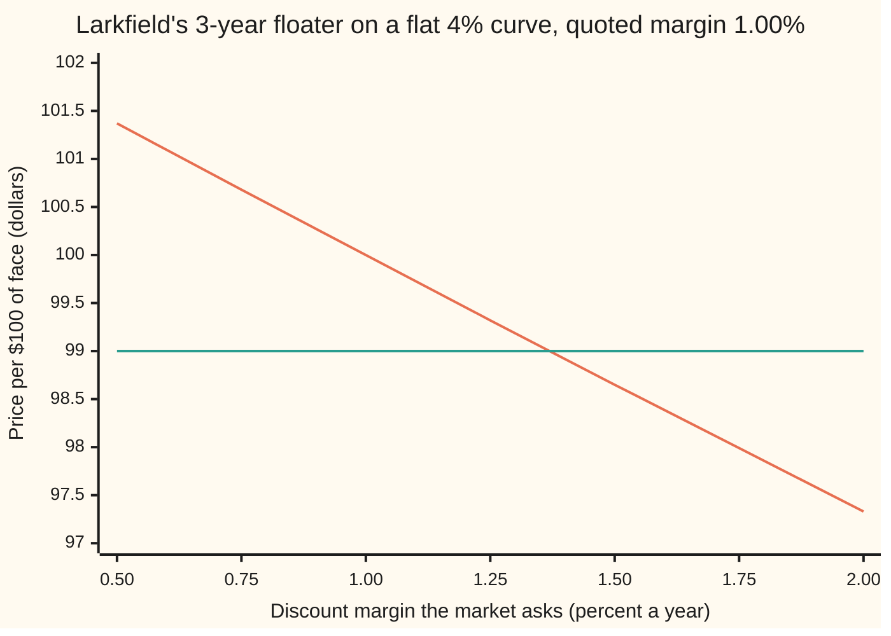

# Floating-rate notes: why a floater sits at par on a reset date, and the discount margin that prices it when it does not

[Syllabus](../../../SYLLABUS.md) → [Financial mathematics](../README.md) → [Curves](../README.md#s02) → Floating-rate notes

---

## General Overview

Larkfield Bank, a made-up lender, sells a three-year note with a face of $100. The face is the amount repaid at the end. The coupon is not fixed. Each year it pays whatever the one-year rate is at the start of that year, plus 1.00%, and the payment arrives at the end of the year.

A note like this is a **floating-rate note**, or **floater**. The rate it follows is its **index** (here the one-year rate). The fixed extra on top, 1.00%, is the **quoted margin**, written into the contract on the day the note is sold. Each date on which the next coupon is read off the index is a **reset date**.

Today is a reset date, and the curve is flat at 4%: money lent for one, two or three years earns 4% a year. If buyers still want exactly 1.00% over the index for lending to Larkfield, the note is worth **$100.00**. That is true on any curve, rising or falling, and the card proves it.

Now a dealer quotes the note at **$99.00**. The coupons are what the contract says, so the buyers must want more than 1.00% over the index. How much more? The rate that answers is the **discount margin**: the extra rate over the index which, used to discount the note's projected payments, gives back the quoted price. At $99.00 it is **1.3698%**.

**A floater resets its coupon to the going rate every year, so on a reset date it is worth its face exactly when the market's margin equals the note's own; when the price is off its face, the discount margin is the one margin that explains the gap.**

**What kind of fact this is:** a theorem (par on a reset date), proved on this card in Why it works, and a definition (the discount margin), whose uniqueness is also proved there.

### The picture: the price falls as the market's margin rises



The falling line is the note's price at each discount margin. It passes through $100.00 exactly where the market asks 1.00%, the note's own margin. The flat line is the dealer's $99.00. The two cross between 1.25% and 1.50%, at 1.3698%, and that crossing is the discount margin.

---

## The formula

Notation first, in plain words. The note pays once a year for $`n`$ years; $`i`$ counts the years, 1 to $`n`$. $`f_i`$ is the **forward rate** for year $`i`$: the one-year rate that today's curve locks in for that year ([Spot, forward and par rates](01-spot-forward-and-par-rates.md)). It stands in for the index $`L_i`$, which is not known until year $`i`$ starts. $`m`$ is the quoted margin and $`d`$ the discount margin.

```math
P(d) \;=\; \sum_{i=1}^{n} \frac{F\,(f_i + m)}{\prod_{j=1}^{i}(1 + f_j + d)} \;+\; \frac{F}{\prod_{j=1}^{n}(1 + f_j + d)}
```

The sign $`\prod`$ means "multiply all of these together", the way $`\sum`$ adds them. So the bottom of each fraction grows each year by one factor $`1 + f_j + d`$: that year's forward rate plus the discount margin.

**Read it aloud:** project each coupon as the forward rate plus the quoted margin, discount it back one year at a time at the forward rate plus the discount margin, add the discounted face, and that is the price.

On Larkfield's flat 4% curve every forward rate is 4%, every projected coupon is $5.00, and the formula shrinks to one line:

```math
P(d) \;=\; \frac{5}{1.04 + d} + \frac{5}{(1.04 + d)^2} + \frac{105}{(1.04 + d)^3}
```

**Read it aloud:** three payments of five dollars and the hundred back at the end, each discounted at 4% plus the discount margin.

Two facts make the formula useful.

```math
P(m) = F \qquad\text{and}\qquad P(d) = P_{\text{quote}} \;\text{ has exactly one solution } d
```

**Read it aloud:** when the discount margin equals the quoted margin the note is worth its face, on any curve; and for any quoted price there is exactly one discount margin.

| Symbol | Plain meaning | In our example | Push it up and the answer… |
| --- | --- | --- | --- |
| $`P`$, $`P(d)`$, $`P'(d)`$ | the note's price per $100 of face at discount margin $`d`$, and its slope | 100.000000 at $`d = 1.00\%`$ | — |
| $`P_{\text{quote}}`$ | the price a dealer quotes | 99.00 | the discount margin falls |
| $`F`$ | the face: repaid at the end, and the amount the coupons are paid on | 100 | every price scales with it |
| $`n`$; $`i`$, $`j`$, $`t`$ | the number of annual coupons left; counters for the years, 1 to $`n`$ | 3; 1, 2, 3 | more years: the price moves further for each step in $`d`$ |
| $`L_i`$ | the index: the one-year rate actually read at the start of year $`i`$ | known today for year 1 only, 4% | that year's coupon rises; today's price does not move (Why it works) |
| $`f_i`$ | the forward rate for year $`i`$, read off today's curve | 4.0000% each year | coupons and discounting rise together, and cancel at par |
| $`m`$ | the quoted margin, fixed in the contract | 1.00% | the price rises |
| $`d`$ | the discount margin: the margin over the index the market asks today | 1.3698% at a price of 99 | the price falls |
| $`s_t`$ | the spot rate: one rate from today to year $`t`$, compounded yearly | 4% flat; 3%, 4%, 5% on the rising curve | — |
| $`z`$ | the z-spread: one extra rate added to every spot rate ([Spreads over the curve](06-z-spread-and-asset-swap-spread.md)) | 1.3720% on the rising curve at 99 | — |
| $`G_i`$, $`V_i`$ | what a dollar grows to over the first $`i`$ years at forward plus $`d`$ ($`G_0 = 1`$); the note's value at the end of year $`i`$ | $`G_3 = 1.05^3`$ at $`d = 1.00\%`$; $`V_2 = 100`$ | — |
| $`C_i`$ | the payment in year $`i`$: the coupon, plus the face in the last year | 5.00, 5.00, 105.00 | the price rises |

**Conventions verified 2026-11-23.** This card pays once a year, counts every year as exactly 1, and compounds every rate once a year. Most corporate dollar floaters pay quarterly, and their index is SOFR, the Secured Overnight Financing Rate, compounded day by day over the period and known only at its end ([Money markets](03-money-market-instruments-and-sofr.md)). The par argument below survives that change, because compounded overnight rates still grow a dollar from one payment date to the next by the ratio of the two discount factors. Some desks project every coupon at today's index rather than at the forwards; on a flat curve, as here, both give the same discount margin.

### When it holds

- **Today is a reset date.** Par holds on the day the next coupon is read. Just after the fixing, that coupon is locked; if rates then move, the note leaves par until the next reset (How the price moves).
- **The coupon rate matches its period and is paid at the period's end.** A one-year rate read at the start of the year and paid at its end telescopes cleanly. Pay it late, or pay a rate for a different length of time, and the terms stop cancelling.
- **The index and the discounting come from one curve.** The proof needs the coupons projected off the same forwards that discount them. When the index curve and the discount curve differ, the two stop cancelling exactly, and that gap is the basis between curves ([Multi-curve](../28-Swaps/04-basis-swaps-and-the-multi-curve-framework.md)).
- **No option inside the note.** A floor (a minimum coupon), a cap (a maximum) or the issuer's right to repay early changes the payments. The discount margin would then soak up the option's value as if it were credit.
- **One constant margin.** The market's true charge for Larkfield's credit may differ year by year. A single $`d`$ is the flat margin that fits the whole price, as a yield is the flat rate that fits a fixed bond's.

---

## Why it works

### Step 0: a coupon that resets is a fresh loan every year

At each reset, the note pays the going one-year rate plus 1.00% for the coming year. A one-year loan at exactly the rate the market charges for that loan is worth what is lent. So if the market charges Larkfield the index plus 1.00%, each year of the note is a fair one-year loan of $100, and the whole note is a chain of fair one-year loans. A chain of fair loans is worth $100.

The rest of the card turns that sentence into arithmetic, then asks what happens when the market charges something else.

### Step 1: walk back from the last year

Stand at the start of year 3, the last reset. What remains is one payment: $100 back plus the coupon $`100\,(L_3 + m)`$, a year later. The market discounts it at its own rate for that year, $`L_3 + d`$. So the note's value then, $`V_2`$, is

```math
V_2 \;=\; \frac{100\,(1 + L_3 + m)}{1 + L_3 + d}
```

**Read it aloud:** the value at the last reset is the hundred and its last coupon, discounted one year at the index plus the discount margin.

If $`d = m`$ the top and bottom match, and $`V_2 = 100`$ whatever $`L_3`$ turns out to be. Step back to the start of year 2: what remains is the year-2 coupon plus a note worth 100 a year later. The same cancellation gives 100 again. One more step gives 100 today. The index never had to be forecast; it cancels at every step.

The code takes this road: it starts at the face and walks back one reset at a time.

### Step 2: the same fact as one sum

The other road prices each payment separately, using the forward rates. Write $`G_i = \prod_{j \le i}(1 + f_j + d)`$ for the growth of a dollar over the first $`i`$ years, so $`G_0 = 1`$. With $`d = m`$, each coupon splits into two pieces:

```math
\frac{F\,(f_i + m)}{G_i} \;=\; \frac{F\,(1 + f_i + m)}{G_i} - \frac{F}{G_i} \;=\; \frac{F}{G_{i-1}} - \frac{F}{G_i}
```

**Read it aloud:** each discounted coupon is the face discounted to the year before, less the face discounted to its own year.

Add over the years and the middle terms cancel in pairs, a **telescoping** sum: the same cancellation that values a floating leg on [Spreads over the curve](06-z-spread-and-asset-swap-spread.md), now with the margin inside. What is left is $`F/G_0 - F/G_n`$. The face repaid at the end adds back $`F/G_n`$, so the price is $`F/G_0 = F`$, exactly 100, on any curve.

<details>
<summary>Why forward rates are the right coupons to project</summary>

The year-2 coupon depends on a rate nobody knows yet. It can still be priced today, because it can be copied today. Lend for two years and borrow for one at today's spot rates; the cash you repay a year from now and the cash that comes back two years from now are fixed today. That copy pays the forward rate $`f_2`$ on year 2, and it is the same trade a forward rate agreement packages ([Forward rate agreements](02-forward-rate-agreements.md)).

A payment that can be copied for a known cost is worth that cost. So replacing each unknown index $`L_i`$ by its forward $`f_i`$ is not a forecast. It is the price of the copy. No view on where rates are going enters.

Step 1 and Step 2 are the same argument. Step 1 discounts the realised index one year at a time; Step 2 discounts the forwards down the chain. On one curve, both give

$`\displaystyle P(m) = \sum_{i=1}^{n}\left(\frac{F}{G_{i-1}} - \frac{F}{G_i}\right) + \frac{F}{G_n} = \frac{F}{G_0} = F.`$

</details>

On the rising curve of 3%, 4% and 5% spot rates, the forwards are 3.0000%, 5.0097% and 7.0289%. The projected coupons climb to $4.0000, $6.0097 and $8.0289. Both roads still price the note at **100.000000**.

### Step 3: when the price is not par, one margin explains it

The quote is $99.00, not $100.00. The coupons are fixed by the contract at index plus 1.00%, so only the discounting can explain the gap: the market must be discounting at the index plus more than 1.00%.

Every term of $`P(d)`$ has $`d`$ in its denominator, so raising $`d`$ shrinks every term at once. The price falls, always, with no flat spots. As $`d`$ runs from far below zero to very large, the price slides from huge to near zero. A price that slides that way, never turning back, passes each value in between exactly once. So there is exactly one discount margin for each quoted price, and a search cannot land on the wrong one.

<details>
<summary>Detailed proof: exactly one discount margin fits any positive price</summary>

Take the forwards $`f_j`$ and the quoted margin $`m`$ with every projected coupon $`f_i + m \ge 0`$, and look at margins $`d`$ above $`-1 - \min_j f_j`$, so every factor $`1 + f_j + d`$ is positive.

**Continuity.** Each term is a fixed number divided by a product of positive factors, each continuous in $`d`$.

**Strictly falling.** Each factor $`1 + f_j + d`$ rises with $`d`$, so each product $`G_i`$ rises, and each term with a positive top falls. The face term always has a positive top, $`F`$, so the sum falls strictly. The slope, used by Newton's method, is

$`\displaystyle P'(d) = -\sum_{i=1}^{n} \frac{C_i}{G_i}\sum_{j=1}^{i}\frac{1}{1 + f_j + d},`$

where $`C_i`$ is the year-$`i`$ payment: the coupon, plus the face in the last year.

**The full range.** As $`d`$ falls towards the lowest allowed value, one factor goes to zero and the face term grows without bound. As $`d`$ grows, every term goes to zero. A continuous, strictly falling function with those two ends takes every positive value exactly once, by the intermediate value theorem.

So any price $`P_{\text{quote}} > 0`$ has exactly one discount margin, and $`P_{\text{quote}} = F`$ gives $`d = m`$.

</details>

Two searches find it, the way [Yield from price](../01-Money%2C%20Dates%20and%20Discounting/07-yield-from-price.md) finds a yield. **Bisection** keeps a pair of margins whose prices straddle 99 and halves the gap 200 times. **Newton's method** steps along the slope $`P'(d)`$ from the fold. Both land on **1.3698%**.

A hand estimate comes first and tells the searches where to look. The note is $1.00 short of par. Paying an extra margin on $100 for three years is worth $100 times that margin times an **annuity**: the sum of the three discount factors at 5% (the 4% curve plus the 1.00% margin), about 2.723248. So

```math
d \;\approx\; m + \frac{F - P_{\text{quote}}}{F \times \text{annuity}} \;=\; 1.00\% + \frac{1.00}{100 \times 2.723248} \;=\; 1.3672\%
```

**Read it aloud:** the discount margin is the quoted margin plus the price shortfall spread over the note's life as a yearly payment.

The estimate is within 0.003% of the answer. The search only polishes it. The estimate falls short only because it takes the annuity at 5%. Take the annuity at 4% plus the true margin instead, and on a flat curve the formula is exact, a check the code makes.

### Step 4: the discount margin is not the z-spread, though here it nearly is

[Spreads over the curve](06-z-spread-and-asset-swap-spread.md) measured a fixed-coupon bond by its **z-spread**: one extra rate added to every spot rate. A floater can be measured that way too. Keep the projected coupons, and discount the year-$`t`$ payment at $`(1 + s_t + z)^{-t}`$: compounded once a year here, like the discount margin. That card compounds continuously, and its version reads 1.3085% for Larkfield's note at $99.00.

The two measures put the spread in different places:

| | Discount margin $`d`$ | z-spread $`z`$ |
| --- | --- | --- |
| Added to | each year's forward rate, one year at a time | each date's spot rate, once per date |
| Measured over | the index the note pays | whichever curve the desk discounts with |
| At par on a reset date | exactly the quoted margin, on any curve | close to it, not exactly |

On a flat curve, spot and forward rates are equal, and the two measures are identical. On the rising 3%, 4%, 5% curve at a price of 99, the discount margin is 1.3718% and the z-spread 1.3720%: **0.0160 basis points** apart, where a basis point is 0.01%. The par note itself, worth exactly 100 at a discount margin of 1.00% (100 basis points), has a z-spread of **100.0117 basis points**.

So on one curve, compounded the same way, the two numbers almost agree. The gap comes from where the spread sits: added to a chain of one-year rates, or to one long rate per date. On a 10-year note on a curve rising from 3% to 7.5%, the gap is still only 0.0335 basis points.

What separates them in practice is the curve, not the arithmetic. The discount margin is defined against the note's own index, which is why it gives back the quoted margin exactly at par. A z-spread taken over a government curve, or compounded continuously as on [Spreads over the curve](06-z-spread-and-asset-swap-spread.md), is a different number for the same note.

---

## Worked numbers, by hand

Larkfield's note on the flat 4% curve, quoted at $99.00.

| Step | Arithmetic | Value |
| --- | --- | --- |
| the forward rates | flat curve: each year's forward equals the 4% spot rate | 4.0000%, 4.0000%, 4.0000% |
| projected coupons | $`100 \times (4\% + 1.00\%)`$ each year | 5.00, 5.00, 5.00 |
| price at the note's own margin | $`5/1.05 + 5/1.05^2 + 105/1.05^3`$ | 100.000000 |
| price on the curve alone | the same payments discounted at 4%, $`d = 0`$ | 102.775091 |
| bracket the margin | $`d = 1.25\%`$ gives 99.32, above 99; $`d = 1.50\%`$ gives 98.65, below | between the two |
| hand estimate | $`1.00\% + 1.00 / (100 \times 2.723248)`$ | 1.3672% |
| solve, bisection then Newton | both searches land on the same root | **1.3698%** |
| check | the note repriced at that margin | 99.000000 |

The market wants Larkfield to pay 1.3698% a year over the one-year rate, not the 1.00% the note promises, and the $1.00 discount is how a buyer collects the difference.

### What breaks if you drop a piece

The right discount margin is 1.3698%, and the right price at the note's own margin is 100.000000.

| Mistake | Comes out at | What went wrong |
| --- | --- | --- |
| Discount on the curve alone, no margin | 102.775091 | The coupons carry the 1.00% for Larkfield's credit; the discounting must charge for it too, or the note looks dearer than par |
| Spread the $1.00 discount evenly over three years, undiscounted | 1.3333% | Later years' extra margin is worth less today, so it takes more of it to make up $1.00 |
| Leave the quoted margin out of the coupons | 0.3628% | That is roughly how far the market's margin sits above the quoted margin, not the margin itself |
| Read a continuously compounded z-spread as the discount margin | 1.3085% | The same discounting written in a different compounding basis; the two numbers are not comparable |

Every number in that table is printed by the code below.

---

## How the price moves: rates against the margin

A floater and a fixed-coupon bond react to rates very differently. Interest-rate moves barely touch the floater. Margin moves hit it as hard as they hit a fixed bond of the same length.

Four moves from Larkfield's starting point, a flat 4% curve with the market at the note's own 1.00% margin:

| What moves | The floater | A 3-year 5% fixed bond |
| --- | --- | --- |
| nothing | 100.000000 | 100.000000 at a 5% yield |
| the curve rises to 5%, margin unchanged | 100.000000 | 97.326988 (its yield goes to 6%) |
| the margin widens to 2.00%, curve unchanged | 97.326988 | — |
| the curve jumps to 5% just after this year's fixing | 99.056604 | — |

```
price per $100 of face; each block is 10 cents above $96.00
start, at par                     ████████████████████████████████████████  100.00
curve up 1%: the floater          ████████████████████████████████████████  100.00
curve up 1%: the fixed bond       █████████████                              97.33
margin up 1%: the floater         █████████████                              97.33
curve up 1% after the fixing      ███████████████████████████████            99.06
```

Three things show.

- **Rate risk lasts only until the next reset.** When the curve rises the coupons rise with it, and on a reset date the note stays at 100.000000. If the curve jumps just after this year's coupon was fixed at 5.00, that one coupon is stuck below the market for a year, and the note dips to 99.056604. At the next reset it is back at par.
- **Margin risk lasts the whole life.** Widen the market's margin by 1.00% and the floater falls to 97.326988, the same price as a 3-year 5% fixed bond whose yield rises from 5% to 6%. On a flat curve the two calculations are the same calculation.
- **So a floater separates the two risks.** A buyer who wants Larkfield's credit without a bet on interest rates buys the floater. Its price then moves almost only with the margin.

---

## Code, from first principles, and it actually runs

Nothing imported knows an answer: the forward rates, both pricings and both root finders are written out. The note is priced payment by payment down the chain of forward rates, and again by walking back from maturity one reset at a time. The walk back is the same sum regrouped, so comparing the two catches slips in the code, not in the maths. Three pairs of independent roads meet. Both pricings are checked against the telescoping identity, which says the price at the note's own margin is exactly 100. On the flat curve the price is exactly $`F + F(m - d)`$ times the annuity at 4% plus $`d`$, and the solved margin must satisfy that formula. The discount margin comes by bisection on the first pricing and by Newton's method on the second, and the hand estimate must land within 0.003% of it.

### Python

```python
# Floating-rate notes and the discount margin -- the check behind the card.
# Standard library only; the forward rates, the two pricings and both root
# finders are written out here.  The note: 3 years, annual, pays the 1-year rate
# plus a quoted margin of 1.00% on a face of 100.  Every rate compounds once a year.
# Independent roads: the telescoping identity (par, exactly 100) against both
# pricings; on the flat curve, the bond formula F + F(m - d) x annuity against the
# solved margin; bisection against Newton's method.  The backward walk is the
# payment-by-payment sum regrouped, so comparing the two catches coding slips.
from math import exp, log

FACE, QM, YEARS = 100.0, 0.01, 3
FLAT = [0.04, 0.04, 0.04]                  # spot rates, 1 to 3 years: a flat 4% curve
SLOPED = [0.03, 0.04, 0.05]                # spot rates on a rising curve, for the contrast

def forwards(spot):                        # the 1-year rate each later year is priced at
    out, prev = [], 1.0
    for t, s in enumerate(spot, start=1):
        grow = (1.0 + s) ** t
        out.append(grow / prev - 1.0)
        prev = grow
    return out

def price_sum(fwd, dm, qm=QM):             # road one: each payment, discounted down the chain
    pv, chain = 0.0, 1.0
    for f in fwd:
        chain *= 1.0 + f + dm
        pv += FACE * (f + qm) / chain
    return pv + FACE / chain

def price_back(fwd, dm, qm=QM):            # road two: start at maturity, step back a reset at a time
    value = FACE
    for f in reversed(fwd):
        value = (FACE * (f + qm) + value) / (1.0 + f + dm)
    return value

def slope(fwd, dm, qm=QM):                 # d price / d dm, differentiated by hand, for Newton
    total, chain, run = 0.0, 1.0, 0.0
    for i, f in enumerate(fwd):
        chain *= 1.0 + f + dm
        run += 1.0 / (1.0 + f + dm)
        cash = FACE * (f + qm) + (FACE if i == len(fwd) - 1 else 0.0)
        total -= cash / chain * run
    return total

def bisect(g, lo=-0.5, hi=1.0):            # g falls from positive at lo to negative at hi
    for _ in range(200):
        mid = 0.5 * (lo + hi)
        lo, hi = (mid, hi) if g(mid) > 0.0 else (lo, mid)
    return 0.5 * (lo + hi)

def newton(g, gp, x=0.0):
    for _ in range(60):
        x -= g(x) / gp(x)
    return x

def zspread(spot, fwd, p, cont=False):     # one extra rate on each date's own spot rate
    def pv(z):
        out = 0.0
        for t, (s, f) in enumerate(zip(spot, fwd), start=1):
            d = exp(-(log(1.0 + s) + z) * t) if cont else (1.0 + s + z) ** -t
            out += (FACE * (f + QM) + (FACE if t == len(spot) else 0.0)) * d
        return out
    return bisect(lambda z: pv(z) - p)

ff, fs = forwards(FLAT), forwards(SLOPED)
dm_bis = bisect(lambda d: price_sum(ff, d) - 99.0)
dm_new = newton(lambda d: price_back(ff, d) - 99.0, lambda d: slope(ff, d))
annuity5 = sum(1.05 ** -t for t in range(1, YEARS + 1))
hand = QM + (FACE - 99.0) / (FACE * annuity5)
annuity_dm = sum((1.0 + FLAT[0] + dm_bis) ** -t for t in range(1, YEARS + 1))   # at 4% plus the answer
dm_s = bisect(lambda d: price_sum(fs, d) - 99.0)
z_s = zspread(SLOPED, fs, 99.0)
z_par = zspread(SLOPED, fs, 100.0)
simple = QM + (FACE - 99.0) / FACE / YEARS
no_qm = bisect(lambda d: price_sum(ff, d, qm=0.0) - 99.0)
z_cont = zspread(FLAT, ff, 99.0, cont=True)
fixed = lambda y: sum(5.0 / (1.0 + y) ** t for t in range(1, 4)) + FACE / (1.0 + y) ** 3
after_fix = (FACE * (0.04 + QM) + price_back([0.05, 0.05], QM)) / (1.0 + 0.05 + QM)
pct = lambda x: f"{x * 100:.4f}%"
def show(label, v, unit=""): print(f"{label:<50}{v:>12}{unit}")

print("flat 4% curve: forwards " + ", ".join(pct(f) for f in ff)
      + "; projected coupons " + ", ".join(f"{FACE * (f + QM):.2f}" for f in ff))
show("price at DM 1.00%, payment by payment", f"{price_sum(ff, QM):.6f}")
show("price at DM 1.00%, backwards from maturity", f"{price_back(ff, QM):.6f}")
show("price on the curve alone, DM 0", f"{price_sum(ff, 0.0):.6f}")
show("DM at a price of 99, bisection", pct(dm_bis))
show("DM at a price of 99, Newton", pct(dm_new))
show("the note repriced at that DM", f"{price_back(ff, dm_bis):.6f}")
show("hand estimate: annuity at 5%", f"{annuity5:.6f}")
show("hand estimate: 1.00% + 1.00 / (100 x annuity)", pct(hand))
print()
print("rising curve 3%, 4%, 5%: forwards " + ", ".join(pct(f) for f in fs)
      + "; coupons " + ", ".join(f"{FACE * (f + QM):.4f}" for f in fs))
show("price at DM 1.00%, payment by payment", f"{price_sum(fs, QM):.6f}")
show("price at DM 1.00%, backwards from maturity", f"{price_back(fs, QM):.6f}")
show("DM at a price of 99", pct(dm_s))
show("z-spread at a price of 99", pct(z_s))
show("z-spread minus DM", f"{(z_s - dm_s) * 10000:.4f}", " bp")
show("z-spread of the same note at 100", f"{z_par * 10000:.4f}", " bp")
print()
print("what breaks (the right DM is " + pct(dm_bis) + ")")
show("the 1.00 discount spread evenly, undiscounted", pct(simple))
show("quoted margin left out of the coupons", pct(no_qm))
show("continuously compounded z-spread read as DM", pct(z_cont))
print()
print("how it moves")
show("curve up to 5%, DM still 1.00%: the floater", f"{price_back(forwards([0.05] * 3), QM):.6f}")
show("a 3-year 5% fixed bond at a 5% yield", f"{fixed(0.05):.6f}")
show("curve up to 5%: a 3-year 5% fixed bond, yield 6%", f"{fixed(0.06):.6f}")
show("curve at 4%, DM widens to 2.00%: the floater", f"{price_back(ff, 0.02):.6f}")
show("curve jumps to 5% just after the fixing", f"{after_fix:.6f}")
dms = [0.0050, 0.0075, 0.0100, 0.0125, 0.0150, 0.0175, 0.0200]
print(f"{'chart, DM in percent':<26}" + "".join(f"{d * 100:>8.2f}" for d in dms))
print(f"{'chart, price':<26}" + "".join(f"{price_sum(ff, d):>8.2f}" for d in dms))
print()
print("try changing")
show("price 98 instead of 99: DM", pct(bisect(lambda d: price_sum(ff, d) - 98.0)))
show("quoted margin 0.50%, market DM 1.00%: price", f"{price_sum(ff, QM, qm=0.005):.6f}")
long = [0.03 + 0.005 * k for k in range(10)]                    # 10 years, 3.0% up to 7.5%
gap = zspread(long, forwards(long), 99.0) - bisect(lambda d: price_sum(forwards(long), d) - 99.0)
show("10-year note, rising 3% to 7.5%, price 99: z - DM", f"{gap * 10000:.4f}", " bp")
assert abs(price_sum(ff, QM) - FACE) < 1e-9 and abs(price_sum(fs, QM) - FACE) < 1e-9   # telescoping: par
assert abs(price_sum(fs, 0.0137) - price_back(fs, 0.0137)) < 1e-10   # forward sum against backward walk
assert abs(slope(fs, 0.0137) - (price_back(fs, 0.013701) - price_back(fs, 0.013699)) / 2e-6) < 1e-5  # P'(d)
assert abs(dm_bis - dm_new) < 1e-12                                  # bisection against Newton
assert round(dm_bis * 1e6) == 13698 and abs(hand - dm_bis) < 3e-5    # the card's 1.3698%, and the hand road
assert 0.0 < z_s - dm_s < 1e-5 and abs(z_par - QM) > 1e-7            # close to DM, but not the same measure
assert abs(FACE + FACE * (QM - dm_bis) * annuity_dm - 99.0) < 1e-9   # flat curve: the bond formula
print("ALL CHECKS PASS")
```

**Ran 2026-11-23 on macOS, Python 3.14.10, standard library only. All checks passed. Output, pasted from the run:**

```
flat 4% curve: forwards 4.0000%, 4.0000%, 4.0000%; projected coupons 5.00, 5.00, 5.00
price at DM 1.00%, payment by payment               100.000000
price at DM 1.00%, backwards from maturity          100.000000
price on the curve alone, DM 0                      102.775091
DM at a price of 99, bisection                         1.3698%
DM at a price of 99, Newton                            1.3698%
the note repriced at that DM                         99.000000
hand estimate: annuity at 5%                          2.723248
hand estimate: 1.00% + 1.00 / (100 x annuity)          1.3672%

rising curve 3%, 4%, 5%: forwards 3.0000%, 5.0097%, 7.0289%; coupons 4.0000, 6.0097, 8.0289
price at DM 1.00%, payment by payment               100.000000
price at DM 1.00%, backwards from maturity          100.000000
DM at a price of 99                                    1.3718%
z-spread at a price of 99                              1.3720%
z-spread minus DM                                       0.0160 bp
z-spread of the same note at 100                      100.0117 bp

what breaks (the right DM is 1.3698%)
the 1.00 discount spread evenly, undiscounted          1.3333%
quoted margin left out of the coupons                  0.3628%
continuously compounded z-spread read as DM            1.3085%

how it moves
curve up to 5%, DM still 1.00%: the floater         100.000000
a 3-year 5% fixed bond at a 5% yield                100.000000
curve up to 5%: a 3-year 5% fixed bond, yield 6%     97.326988
curve at 4%, DM widens to 2.00%: the floater         97.326988
curve jumps to 5% just after the fixing              99.056604
chart, DM in percent          0.50    0.75    1.00    1.25    1.50    1.75    2.00
chart, price                101.37  100.68  100.00   99.32   98.65   97.99   97.33

try changing
price 98 instead of 99: DM                             1.7447%
quoted margin 0.50%, market DM 1.00%: price          98.638376
10-year note, rising 3% to 7.5%, price 99: z - DM       0.0335 bp
ALL CHECKS PASS
```

### Rust

The same numbers under the same labels, built with `rustc --edition 2021 -O`.

```rust
// Floating-rate notes and the discount margin -- the same check as the Python,
// in Rust, std only and no crates.  The forward rates, the two pricings and both
// root finders are written out here.  The note: 3 years, annual, pays the 1-year
// rate plus a quoted margin of 1.00% on a face of 100.  Every rate compounds once
// a year.  Independent roads: the telescoping identity (par, exactly 100) against
// both pricings; on the flat curve, the bond formula F + F(m - d) x annuity
// against the solved margin; bisection against Newton's method.  The backward walk
// is the payment-by-payment sum regrouped, so comparing the two catches coding slips.
const FACE: f64 = 100.0;
const QM: f64 = 0.01;
const YEARS: usize = 3;
const FLAT: [f64; 3] = [0.04, 0.04, 0.04];     // spot rates, 1 to 3 years: a flat 4% curve
const SLOPED: [f64; 3] = [0.03, 0.04, 0.05];   // spot rates on a rising curve, for the contrast

fn forwards(spot: &[f64]) -> Vec<f64> {        // the 1-year rate each later year is priced at
    let (mut out, mut prev) = (Vec::new(), 1.0);
    for (i, s) in spot.iter().enumerate() {
        let grow = (1.0 + s).powi(i as i32 + 1);
        out.push(grow / prev - 1.0);
        prev = grow;
    }
    out
}

fn price_sum(fwd: &[f64], dm: f64, qm: f64) -> f64 {   // road one: each payment, down the chain
    let (mut pv, mut chain) = (0.0, 1.0);
    for f in fwd {
        chain *= 1.0 + f + dm;
        pv += FACE * (f + qm) / chain;
    }
    pv + FACE / chain
}

fn price_back(fwd: &[f64], dm: f64, qm: f64) -> f64 {  // road two: from maturity, a reset at a time
    let mut value = FACE;
    for f in fwd.iter().rev() {
        value = (FACE * (f + qm) + value) / (1.0 + f + dm);
    }
    value
}

fn slope(fwd: &[f64], dm: f64, qm: f64) -> f64 {       // d price / d dm, by hand, for Newton
    let (mut total, mut chain, mut run) = (0.0, 1.0, 0.0);
    for (i, f) in fwd.iter().enumerate() {
        chain *= 1.0 + f + dm;
        run += 1.0 / (1.0 + f + dm);
        let cash = FACE * (f + qm) + if i == fwd.len() - 1 { FACE } else { 0.0 };
        total -= cash / chain * run;
    }
    total
}

fn bisect<G: Fn(f64) -> f64>(g: G) -> f64 {   // g falls from positive at -0.5 to negative at 1.0
    let (mut lo, mut hi) = (-0.5, 1.0);
    for _ in 0..200 {
        let mid = 0.5 * (lo + hi);
        if g(mid) > 0.0 { lo = mid } else { hi = mid }
    }
    0.5 * (lo + hi)
}

fn newton<G: Fn(f64) -> f64, H: Fn(f64) -> f64>(g: G, gp: H) -> f64 {
    let mut x = 0.0;
    for _ in 0..60 { x -= g(x) / gp(x) }
    x
}

fn zspread(spot: &[f64], fwd: &[f64], p: f64, cont: bool) -> f64 {   // one extra rate per date
    let pv = |z: f64| {
        let mut out = 0.0;
        for (i, (s, f)) in spot.iter().zip(fwd).enumerate() {
            let t = (i + 1) as f64;
            let d = if cont { (-((1.0 + s).ln() + z) * t).exp() } else { (1.0 + s + z).powf(-t) };
            out += (FACE * (f + QM) + if i == spot.len() - 1 { FACE } else { 0.0 }) * d;
        }
        out
    };
    bisect(|z| pv(z) - p)
}

fn pct(x: f64) -> String { format!("{:.4}%", x * 100.0) }
fn show(label: &str, v: String, unit: &str) { println!("{:<50}{:>12}{}", label, v, unit) }
fn list(v: &[f64], f: &dyn Fn(f64) -> String) -> String {
    v.iter().map(|x| f(*x)).collect::<Vec<_>>().join(", ")
}

fn main() {
    let (ff, fs) = (forwards(&FLAT), forwards(&SLOPED));
    let dm_bis = bisect(|d| price_sum(&ff, d, QM) - 99.0);
    let dm_new = newton(|d| price_back(&ff, d, QM) - 99.0, |d| slope(&ff, d, QM));
    let annuity5: f64 = (1..=YEARS).map(|t| 1.05f64.powi(-(t as i32))).sum();
    let hand = QM + (FACE - 99.0) / (FACE * annuity5);
    let annuity_dm: f64 = (1..=YEARS).map(|t| (1.0 + FLAT[0] + dm_bis).powi(-(t as i32))).sum();   // 4% plus the answer
    let dm_s = bisect(|d| price_sum(&fs, d, QM) - 99.0);
    let z_s = zspread(&SLOPED, &fs, 99.0, false);
    let z_par = zspread(&SLOPED, &fs, 100.0, false);
    let simple = QM + (FACE - 99.0) / FACE / YEARS as f64;
    let no_qm = bisect(|d| price_sum(&ff, d, 0.0) - 99.0);
    let z_cont = zspread(&FLAT, &ff, 99.0, true);
    let fixed = |y: f64| (1..=3).map(|t| 5.0 / (1.0 + y).powi(t)).sum::<f64>() + FACE / (1.0 + y).powi(3);
    let after_fix = (FACE * (0.04 + QM) + price_back(&[0.05, 0.05], QM, QM)) / (1.0 + 0.05 + QM);

    println!("flat 4% curve: forwards {}; projected coupons {}",
             list(&ff, &|f| pct(f)), list(&ff, &|f| format!("{:.2}", FACE * (f + QM))));
    show("price at DM 1.00%, payment by payment", format!("{:.6}", price_sum(&ff, QM, QM)), "");
    show("price at DM 1.00%, backwards from maturity", format!("{:.6}", price_back(&ff, QM, QM)), "");
    show("price on the curve alone, DM 0", format!("{:.6}", price_sum(&ff, 0.0, QM)), "");
    show("DM at a price of 99, bisection", pct(dm_bis), "");
    show("DM at a price of 99, Newton", pct(dm_new), "");
    show("the note repriced at that DM", format!("{:.6}", price_back(&ff, dm_bis, QM)), "");
    show("hand estimate: annuity at 5%", format!("{:.6}", annuity5), "");
    show("hand estimate: 1.00% + 1.00 / (100 x annuity)", pct(hand), "");
    println!();
    println!("rising curve 3%, 4%, 5%: forwards {}; coupons {}",
             list(&fs, &|f| pct(f)), list(&fs, &|f| format!("{:.4}", FACE * (f + QM))));
    show("price at DM 1.00%, payment by payment", format!("{:.6}", price_sum(&fs, QM, QM)), "");
    show("price at DM 1.00%, backwards from maturity", format!("{:.6}", price_back(&fs, QM, QM)), "");
    show("DM at a price of 99", pct(dm_s), "");
    show("z-spread at a price of 99", pct(z_s), "");
    show("z-spread minus DM", format!("{:.4}", (z_s - dm_s) * 10000.0), " bp");
    show("z-spread of the same note at 100", format!("{:.4}", z_par * 10000.0), " bp");
    println!();
    println!("what breaks (the right DM is {})", pct(dm_bis));
    show("the 1.00 discount spread evenly, undiscounted", pct(simple), "");
    show("quoted margin left out of the coupons", pct(no_qm), "");
    show("continuously compounded z-spread read as DM", pct(z_cont), "");
    println!();
    println!("how it moves");
    show("curve up to 5%, DM still 1.00%: the floater", format!("{:.6}", price_back(&forwards(&[0.05; 3]), QM, QM)), "");
    show("a 3-year 5% fixed bond at a 5% yield", format!("{:.6}", fixed(0.05)), "");
    show("curve up to 5%: a 3-year 5% fixed bond, yield 6%", format!("{:.6}", fixed(0.06)), "");
    show("curve at 4%, DM widens to 2.00%: the floater", format!("{:.6}", price_back(&ff, 0.02, QM)), "");
    show("curve jumps to 5% just after the fixing", format!("{:.6}", after_fix), "");
    let dms = [0.0050, 0.0075, 0.0100, 0.0125, 0.0150, 0.0175, 0.0200];
    println!("{:<26}{}", "chart, DM in percent", dms.iter().map(|d| format!("{:>8.2}", d * 100.0)).collect::<String>());
    println!("{:<26}{}", "chart, price", dms.iter().map(|d| format!("{:>8.2}", price_sum(&ff, *d, QM))).collect::<String>());
    println!();
    println!("try changing");
    show("price 98 instead of 99: DM", pct(bisect(|d| price_sum(&ff, d, QM) - 98.0)), "");
    show("quoted margin 0.50%, market DM 1.00%: price", format!("{:.6}", price_sum(&ff, QM, 0.005)), "");
    let long: Vec<f64> = (0..10).map(|k| 0.03 + 0.005 * k as f64).collect();   // 10 years, 3.0% to 7.5%
    let fl = forwards(&long);
    let gap = zspread(&long, &fl, 99.0, false) - bisect(|d| price_sum(&fl, d, QM) - 99.0);
    show("10-year note, rising 3% to 7.5%, price 99: z - DM", format!("{:.4}", gap * 10000.0), " bp");
    assert!((price_sum(&ff, QM, QM) - FACE).abs() < 1e-9 && (price_sum(&fs, QM, QM) - FACE).abs() < 1e-9);
    assert!((price_sum(&fs, 0.0137, QM) - price_back(&fs, 0.0137, QM)).abs() < 1e-10);   // two roads
    assert!((slope(&fs, 0.0137, QM) - (price_back(&fs, 0.013701, QM) - price_back(&fs, 0.013699, QM)) / 2e-6).abs() < 1e-5);   // P'(d)
    assert!((dm_bis - dm_new).abs() < 1e-12);                                         // two solvers
    assert!((dm_bis * 1e6).round() == 13698.0 && (hand - dm_bis).abs() < 3e-5);      // 1.3698%, by hand
    assert!(z_s - dm_s > 0.0 && z_s - dm_s < 1e-5 && (z_par - QM).abs() > 1e-7);      // close, not equal
    assert!((FACE + FACE * (QM - dm_bis) * annuity_dm - 99.0).abs() < 1e-9);         // flat curve: bond formula
    println!("ALL CHECKS PASS");
}
```

**Ran 2026-11-23 on macOS, rustc 1.98.1, no crates. All checks passed. Output, pasted from the run:**

```
flat 4% curve: forwards 4.0000%, 4.0000%, 4.0000%; projected coupons 5.00, 5.00, 5.00
price at DM 1.00%, payment by payment               100.000000
price at DM 1.00%, backwards from maturity          100.000000
price on the curve alone, DM 0                      102.775091
DM at a price of 99, bisection                         1.3698%
DM at a price of 99, Newton                            1.3698%
the note repriced at that DM                         99.000000
hand estimate: annuity at 5%                          2.723248
hand estimate: 1.00% + 1.00 / (100 x annuity)          1.3672%

rising curve 3%, 4%, 5%: forwards 3.0000%, 5.0097%, 7.0289%; coupons 4.0000, 6.0097, 8.0289
price at DM 1.00%, payment by payment               100.000000
price at DM 1.00%, backwards from maturity          100.000000
DM at a price of 99                                    1.3718%
z-spread at a price of 99                              1.3720%
z-spread minus DM                                       0.0160 bp
z-spread of the same note at 100                      100.0117 bp

what breaks (the right DM is 1.3698%)
the 1.00 discount spread evenly, undiscounted          1.3333%
quoted margin left out of the coupons                  0.3628%
continuously compounded z-spread read as DM            1.3085%

how it moves
curve up to 5%, DM still 1.00%: the floater         100.000000
a 3-year 5% fixed bond at a 5% yield                100.000000
curve up to 5%: a 3-year 5% fixed bond, yield 6%     97.326988
curve at 4%, DM widens to 2.00%: the floater         97.326988
curve jumps to 5% just after the fixing              99.056604
chart, DM in percent          0.50    0.75    1.00    1.25    1.50    1.75    2.00
chart, price                101.37  100.68  100.00   99.32   98.65   97.99   97.33

try changing
price 98 instead of 99: DM                             1.7447%
quoted margin 0.50%, market DM 1.00%: price          98.638376
10-year note, rising 3% to 7.5%, price 99: z - DM       0.0335 bp
ALL CHECKS PASS
```

The two outputs match line for line.

### Lean

Lean proves par on a reset date, the one discount margin and the flat-curve formula, for every note meeting the conditions below.

- Take every factor $`1 + f_j + m`$ positive. Then $`P(m) = F`$, whatever the forward rates are.
- Take a positive face $`F`$, at least one coupon, and every projected coupon $`f_i + m`$ at or above zero. Then each price above zero has exactly one discount margin $`d`$ keeping every factor $`1 + f_j + d`$ positive.
- Take a flat curve with every factor $`1 + f_i + d`$ positive. Then $`P(d) = F + F(m - d)`$ times the annuity at the curve plus $`d`$.
- The worked prices hold exactly: 100 at the note's own margin, on the flat 4%, flat 5% and rising curves.
- The bracket holds: at 1.25% the price is above 99, and at 1.50% it is below.
- At a 2.00% margin on the flat 4% curve, the floater is priced exactly like a 3-year 5% fixed bond at a 6% yield.

The value 1.3698%, both searches, the z-spread and the price just after a fixing are left to the Python and Rust checks.

```lean
-- Floating-rate notes: on a reset date a floater discounted at its own quoted margin is worth exactly its face on any curve, and any positive price has exactly one discount margin.
import Mathlib.Algebra.BigOperators.Intervals
import Mathlib.Algebra.BigOperators.Field
import Mathlib.Topology.Order.IntermediateValue
import Mathlib.Topology.Algebra.Order.Field
import Mathlib.Topology.Instances.Real.Lemmas
import Mathlib.Tactic.NormNum
import Mathlib.Tactic.FieldSimp

open Finset

/-! The note pays once a year for `n` years on a face `F`. Year `i` runs from 1 to `n`.
`f i` is the forward rate for year `i`, read off today's curve; it is the projected index.
`m` is the quoted margin in the contract and `d` the discount margin the market asks.

`frnGrowth f d i = ∏ j ∈ Icc 1 i, (1 + f j + d)` is `G_i` on the card: what one dollar grows to
over the first `i` years at forward plus `d` (so `G_0 = 1`).

`frnPrice F f m d n` is the card's `P(d)`: each projected coupon `F (f i + m)` discounted by `G_i`,
plus the face discounted by `G_n`. -/

/-- `G_i`: one dollar grown over the first `i` years at each year's forward rate plus `d`. -/
noncomputable def frnGrowth (f : ℕ → ℝ) (d : ℝ) (i : ℕ) : ℝ :=
  ∏ j ∈ Icc 1 i, (1 + f j + d)

/-- `P(d) = ∑_{i=1}^{n} F (f_i + m) / G_i + F / G_n`: the floater's price at discount margin `d`. -/
noncomputable def frnPrice (F : ℝ) (f : ℕ → ℝ) (m d : ℝ) (n : ℕ) : ℝ :=
  (∑ i ∈ Icc 1 n, F * (f i + m) / frnGrowth f d i) + F / frnGrowth f d n


lemma frnGrowth_succ (f : ℕ → ℝ) (d : ℝ) (n : ℕ) :
    frnGrowth f d (n + 1) = frnGrowth f d n * (1 + f (n + 1) + d) := by
  unfold frnGrowth
  rw [Finset.prod_Icc_succ_top (by omega)]

lemma frnGrowth_pos (f : ℕ → ℝ) (d : ℝ) (n i : ℕ)
    (hpos : ∀ j ∈ Icc 1 n, 0 < 1 + f j + d) (hi : i ≤ n) : 0 < frnGrowth f d i := by
  unfold frnGrowth
  apply Finset.prod_pos
  intro j hj
  apply hpos
  simp only [Finset.mem_Icc] at hj ⊢
  omega

lemma frnGrowth_const (r d : ℝ) (i : ℕ) : frnGrowth (fun _ => r) d i = (1 + r + d) ^ i := by
  simp [frnGrowth, Finset.prod_const, Nat.card_Icc]

lemma frn_par_aux (F : ℝ) (f : ℕ → ℝ) (m : ℝ) (n : ℕ) :
    (∀ j ∈ Icc 1 n, 0 < 1 + f j + m) →
    (∑ i ∈ Icc 1 n, F * (f i + m) / frnGrowth f m i) + F / frnGrowth f m n = F := by
  induction n with
  | zero => intro _; simp [frnGrowth]
  | succ n ih =>
    intro hpos
    have hpos' : ∀ j ∈ Icc 1 n, 0 < 1 + f j + m := by
      intro j hj; apply hpos; simp only [Finset.mem_Icc] at hj ⊢; omega
    have hG : 0 < frnGrowth f m n := frnGrowth_pos f m n n hpos' le_rfl
    have hx : 0 < 1 + f (n + 1) + m := hpos (n + 1) (by simp)
    rw [Finset.sum_Icc_succ_top (by omega), frnGrowth_succ]
    have h1 := ih hpos'
    have key : F * (f (n + 1) + m) / (frnGrowth f m n * (1 + f (n + 1) + m))
        + F / (frnGrowth f m n * (1 + f (n + 1) + m)) = F / frnGrowth f m n := by
      rw [← add_div, div_eq_div_iff (mul_pos hG hx).ne' hG.ne']
      ring
    linarith

/-- Par on a reset date. Project each coupon as the forward rate plus the quoted margin `m`,
discount it year by year at the forward rate plus the same margin `m`, add the discounted face,
and the price is exactly the face `F`, whatever the forward rates are (every growth factor
`1 + f j + m` positive, so every discount is defined). -/
theorem par_on_reset (F : ℝ) (f : ℕ → ℝ) (m : ℝ) (n : ℕ)
    (hpos : ∀ j ∈ Icc 1 n, 0 < 1 + f j + m) :
    frnPrice F f m m n = F := by
  unfold frnPrice
  exact frn_par_aux F f m n hpos

/-- Exactly one discount margin fits any positive price. For a note with a positive face, at least
one coupon, and every projected coupon `f i + m` at or above zero, each quoted price `q > 0` is
matched by exactly one discount margin `d` among those that keep every factor `1 + f j + d`
positive. -/
theorem discount_margin_exists_unique (F : ℝ) (f : ℕ → ℝ) (m : ℝ) (n : ℕ)
    (hF : 0 < F) (hn : 1 ≤ n) (hcoupon : ∀ i ∈ Icc 1 n, 0 ≤ f i + m)
    (q : ℝ) (hq : 0 < q) :
    ∃! d : ℝ, (∀ j ∈ Icc 1 n, 0 < 1 + f j + d) ∧ frnPrice F f m d n = q := by
  have hne : (Icc 1 n).Nonempty := ⟨1, by simp; omega⟩
  obtain ⟨j0, hj0, hmin⟩ := Finset.exists_min_image (Icc 1 n) f hne
  obtain ⟨L, hLdef⟩ : ∃ L : ℝ, L = -(1 + f j0) := ⟨_, rfl⟩
  have hfac : ∀ d : ℝ, ∀ j ∈ Icc 1 n, d - L ≤ 1 + f j + d := by
    intro d j hj
    have := hmin j hj
    rw [hLdef]; linarith
  have hdom : ∀ d : ℝ, (∀ j ∈ Icc 1 n, 0 < 1 + f j + d) ↔ L < d := by
    intro d
    constructor
    · intro h; have := h j0 hj0; rw [hLdef]; linarith
    · intro h j hj; have := hfac d j hj; linarith
  -- strictly decreasing on the domain
  have hanti : ∀ d1 d2 : ℝ, L < d1 → d1 < d2 → frnPrice F f m d2 n < frnPrice F f m d1 n := by
    intro d1 d2 h1 h12
    have hp1 := (hdom d1).2 h1
    unfold frnPrice
    have hsum : ∑ i ∈ Icc 1 n, F * (f i + m) / frnGrowth f d2 i
        ≤ ∑ i ∈ Icc 1 n, F * (f i + m) / frnGrowth f d1 i := by
      apply Finset.sum_le_sum
      intro i hi
      have hin : i ≤ n := (Finset.mem_Icc.1 hi).2
      apply div_le_div_of_nonneg_left (mul_nonneg hF.le (hcoupon i hi))
        (frnGrowth_pos f d1 n i hp1 hin)
      unfold frnGrowth
      apply Finset.prod_le_prod₀
      · intro j hj
        exact (hp1 j (by simp only [Finset.mem_Icc] at hj ⊢; omega)).le
      · intro j _; linarith
    have hlast : F / frnGrowth f d2 n < F / frnGrowth f d1 n := by
      apply div_lt_div_of_pos_left hF (frnGrowth_pos f d1 n n hp1 le_rfl)
      unfold frnGrowth
      apply Finset.prod_lt_prod_of_nonempty₀
      · intro j hj; exact hp1 j hj
      · intro j _; linarith
      · exact hne
    linarith
  -- continuity
  have hGcont : ∀ i, Continuous (fun d => frnGrowth f d i) := by
    intro i; unfold frnGrowth; fun_prop
  have hPcont : ContinuousOn (fun d => frnPrice F f m d n) (Set.Ioi L) := by
    unfold frnPrice
    apply ContinuousOn.add
    · apply continuousOn_finsetSum
      intro i hi
      apply ContinuousOn.div continuousOn_const (hGcont i).continuousOn
      intro d hd
      exact (frnGrowth_pos f d n i ((hdom d).2 hd) (Finset.mem_Icc.1 hi).2).ne'
    · apply ContinuousOn.div continuousOn_const (hGcont n).continuousOn
      intro d hd
      exact (frnGrowth_pos f d n n ((hdom d).2 hd) le_rfl).ne'
  -- a point a just above L where the price is above q
  have hGL : frnGrowth f L n = 0 := by
    unfold frnGrowth
    exact Finset.prod_eq_zero hj0 (by rw [hLdef]; ring)
  have htend : Filter.Tendsto (fun d => frnGrowth f d n) (nhdsWithin L (Set.Ioi L)) (nhds 0) := by
    rw [← hGL]
    exact ((hGcont n).tendsto L).mono_left nhdsWithin_le_nhds
  have hev : ∀ᶠ d in nhdsWithin L (Set.Ioi L), frnGrowth f d n < F / q :=
    htend (Iio_mem_nhds (div_pos hF hq))
  obtain ⟨a, haG, haL⟩ := (hev.and self_mem_nhdsWithin).exists
  have haL' : L < a := haL
  have hpa : ∀ j ∈ Icc 1 n, 0 < 1 + f j + a := (hdom a).2 haL'
  have hGa := frnGrowth_pos f a n n hpa le_rfl
  have hPa : q < frnPrice F f m a n := by
    unfold frnPrice
    have hs : 0 ≤ ∑ i ∈ Icc 1 n, F * (f i + m) / frnGrowth f a i := by
      apply Finset.sum_nonneg
      intro i hi
      exact div_nonneg (mul_nonneg hF.le (hcoupon i hi))
        (frnGrowth_pos f a n i hpa (Finset.mem_Icc.1 hi).2).le
    have : q < F / frnGrowth f a n := by
      rw [lt_div_iff₀ hGa]
      rw [lt_div_iff₀ hq] at haG
      linarith
    linarith
  -- a point b far out where the price is below q
  obtain ⟨S, hS⟩ : ∃ S : ℝ, S = ∑ i ∈ Icc 1 n, F * (f i + m) := ⟨_, rfl⟩
  have hS0 : 0 ≤ S := by
    rw [hS]; exact Finset.sum_nonneg (fun i hi => mul_nonneg hF.le (hcoupon i hi))
  obtain ⟨t, ht⟩ : ∃ t : ℝ, t = max 1 ((S + F) / q + 1) := ⟨_, rfl⟩
  obtain ⟨b, hb⟩ : ∃ b : ℝ, b = max (L + t) (a + 1) := ⟨_, rfl⟩
  have hab : a < b := by
    have := le_max_right (L + t) (a + 1); rw [← hb] at this; linarith
  have htb : t ≤ b - L := by
    have := le_max_left (L + t) (a + 1); rw [← hb] at this; linarith
  have ht1 : 1 ≤ t := by rw [ht]; exact le_max_left _ _
  have htq : (S + F) / q < t := by
    have := le_max_right 1 ((S + F) / q + 1); rw [← ht] at this; linarith
  have ht0 : 0 < t := by linarith
  have hGb : ∀ i ∈ Icc 1 n, t ≤ frnGrowth f b i := by
    intro i hi
    have hi1 := Finset.mem_Icc.1 hi
    calc t ≤ t ^ i := le_self_pow₀ ht1 (by omega)
      _ = ∏ _j ∈ Icc 1 i, t := by simp [Finset.prod_const, Nat.card_Icc]
      _ ≤ frnGrowth f b i := by
            unfold frnGrowth
            apply Finset.prod_le_prod₀
            · intro j _; exact ht0.le
            · intro j hj
              have := hfac b j (by simp only [Finset.mem_Icc] at hj ⊢; omega)
              linarith
  have hPb : frnPrice F f m b n < q := by
    unfold frnPrice
    have h1 : ∑ i ∈ Icc 1 n, F * (f i + m) / frnGrowth f b i
        ≤ ∑ i ∈ Icc 1 n, F * (f i + m) / t := by
      apply Finset.sum_le_sum
      intro i hi
      exact div_le_div_of_nonneg_left (mul_nonneg hF.le (hcoupon i hi)) ht0 (hGb i hi)
    have h2 : F / frnGrowth f b n ≤ F / t :=
      div_le_div_of_nonneg_left hF.le ht0 (hGb n (by simp only [Finset.mem_Icc]; omega))
    have h3 : ∑ i ∈ Icc 1 n, F * (f i + m) / t = S / t := by
      rw [hS, Finset.sum_div]
    have h4 : (S + F) / t < q := by
      rw [div_lt_iff₀ ht0]
      rw [div_lt_iff₀ hq] at htq
      linarith
    have h5 : S / t + F / t = (S + F) / t := by rw [add_div]
    linarith
  -- intermediate value theorem on [a, b]
  have hcont_ab : ContinuousOn (fun d => frnPrice F f m d n) (Set.Icc a b) :=
    hPcont.mono (fun x hx => lt_of_lt_of_le haL' hx.1)
  obtain ⟨d, hd, hdq⟩ := intermediate_value_Icc' hab.le hcont_ab ⟨hPb.le, hPa.le⟩
  have hdq' : frnPrice F f m d n = q := hdq
  have hLd : L < d := lt_of_lt_of_le haL' hd.1
  refine ⟨d, ⟨(hdom d).2 hLd, hdq'⟩, ?_⟩
  rintro d' ⟨hd'pos, hd'q⟩
  have hL' := (hdom d').1 hd'pos
  rcases lt_trichotomy d' d with h | h | h
  · have := hanti d' d hL' h; linarith
  · exact h
  · have := hanti d d' hLd h; linarith

/-- On a flat curve, with every forward rate equal to `r`, the floater is the bond formula:
its price is the face plus `F (m - d)` times the annuity, the sum of the `n` discount factors at
`r + d`. So a floater whose market margin moves is priced like a fixed bond whose yield moves. -/
theorem flat_curve_price_eq_face_plus_margin_annuity (F r m d : ℝ) (n : ℕ)
    (hpos : 0 < 1 + r + d) :
    frnPrice F (fun _ => r) m d n
      = F + F * (m - d) * ∑ t ∈ Icc 1 n, 1 / (1 + r + d) ^ t := by
  have hpar := frn_par_aux F (fun _ => r) d n (fun _ _ => hpos)
  unfold frnPrice
  simp only [frnGrowth_const] at hpar ⊢
  have hsplit : ∑ i ∈ Icc 1 n, F * (r + m) / (1 + r + d) ^ i
      = ∑ i ∈ Icc 1 n, F * (r + d) / (1 + r + d) ^ i
        + F * (m - d) * ∑ i ∈ Icc 1 n, 1 / (1 + r + d) ^ i := by
    rw [Finset.mul_sum, ← Finset.sum_add_distrib]
    apply Finset.sum_congr rfl
    intro i _
    ring
  rw [hsplit]
  linarith

/-! The card's exact worked numbers: Larkfield's 3-year annual note on a face of 100,
quoted margin 1/100. -/

-- On the flat 4% curve, at the note's own 1.00% margin, the price is exactly 100.
example : frnPrice 100 (fun _ => 4 / 100) (1 / 100) (1 / 100) 3 = 100 := by
  norm_num [frnPrice, frnGrowth, Finset.sum_Icc_succ_top, Finset.prod_Icc_succ_top]

-- The curve rises to 5%, margin still 1.00%: the floater stays at exactly 100.
example : frnPrice 100 (fun _ => 5 / 100) (1 / 100) (1 / 100) 3 = 100 := by
  norm_num [frnPrice, frnGrowth, Finset.sum_Icc_succ_top, Finset.prod_Icc_succ_top]

-- The rising 3%, 4%, 5% spot curve: forwards 3%, 1.04^2/1.03 - 1 and 1.05^3/1.04^2 - 1.
-- At the note's own margin both roads give exactly 100.
example :
    frnPrice 100
      (fun j => if j = 1 then 3 / 100 else if j = 2 then (104 / 100) ^ 2 / (103 / 100) - 1
        else (105 / 100) ^ 3 / (104 / 100) ^ 2 - 1)
      (1 / 100) (1 / 100) 3 = 100 := by
  norm_num [frnPrice, frnGrowth, Finset.sum_Icc_succ_top, Finset.prod_Icc_succ_top]

-- Bracketing the discount margin at a price of 99: at 1.25% the price is above 99,
-- at 1.50% it is below.
example : 99 < frnPrice 100 (fun _ => 4 / 100) (1 / 100) (125 / 10000) 3 := by
  norm_num [frnPrice, frnGrowth, Finset.sum_Icc_succ_top, Finset.prod_Icc_succ_top]

example : frnPrice 100 (fun _ => 4 / 100) (1 / 100) (150 / 10000) 3 < 99 := by
  norm_num [frnPrice, frnGrowth, Finset.sum_Icc_succ_top, Finset.prod_Icc_succ_top]

-- The margin widens to 2.00% on the flat 4% curve: the floater is priced exactly like a
-- 3-year 5% fixed bond at a 6% yield.
example : frnPrice 100 (fun _ => 4 / 100) (1 / 100) (2 / 100) 3
    = 5 / (106 / 100) + 5 / (106 / 100) ^ 2 + 105 / (106 / 100) ^ 3 := by
  norm_num [frnPrice, frnGrowth, Finset.sum_Icc_succ_top, Finset.prod_Icc_succ_top]

#print axioms frnGrowth_succ
#print axioms frnGrowth_pos
#print axioms frnGrowth_const
#print axioms frn_par_aux
#print axioms par_on_reset
#print axioms discount_margin_exists_unique
#print axioms flat_curve_price_eq_face_plus_margin_annuity
```

**Checked 2026-11-23 on macOS, Lean 4.36.0-rc2, Mathlib v4.36.0-rc2. Every proof is complete and uses only Lean's standard axioms. Output, pasted from the run:**

```
'frnGrowth_succ' depends on axioms: [propext, Classical.choice, Quot.sound]
'frnGrowth_pos' depends on axioms: [propext, Classical.choice, Quot.sound]
'frnGrowth_const' depends on axioms: [propext, Classical.choice, Quot.sound]
'frn_par_aux' depends on axioms: [propext, Classical.choice, Quot.sound]
'par_on_reset' depends on axioms: [propext, Classical.choice, Quot.sound]
'discount_margin_exists_unique' depends on axioms: [propext, Classical.choice, Quot.sound]
'flat_curve_price_eq_face_plus_margin_annuity' depends on axioms: [propext, Classical.choice, Quot.sound]
```

> [!TIP]
> **Try changing**
> Guess the direction first, then check. Three of these are printed by the code. Two of them change it, and an assert stops the program, which is the check proving it can fail.
> - **Quote the note at 98 instead of 99.** Change `99.0` to `98.0` in the line that sets `dm_bis`. The discount margin goes to **1.7447%** (the code also prints it): a second dollar off the price costs a little more margin than the first. Newton's method is still solving for 99, so the fourth assert stops the program.
> - **Sell the note with a 0.50% margin when the market wants 1.00%.** The code prints it: the note is worth **98.638376** on a reset date, below par, because it pays less than the market asks.
> - **Make the note longer and the curve steeper.** The code prices a 10-year note on a curve rising from 3% to 7.5%. The z-spread and the discount margin are still only **0.0335 basis points** apart.
> - **Forget the margin in the backward walk.** In `price_back`, change `FACE * (f + qm)` to `FACE * f`. The note no longer telescopes to par, the two pricing roads disagree, and the second assert stops the program.

---

## The usual mistake

> [!warning]
> **Reading the quoted margin as the note's spread.** The quoted margin, 1.00%, was fixed in the contract on the day Larkfield sold the note. It never changes. The discount margin, 1.3698% at $99.00, is what the market asks today. The two agree only when the note trades at par on a reset date. A screen that compares floaters by their quoted margins compares old contracts, not today's credit.
>
> - **Thinking a floater has no price risk.** It has almost no interest-rate risk, but its margin risk is that of a fixed bond of the same length: a 1.00% wider margin takes Larkfield's note to 97.326988.
> - **Spreading the discount evenly without discounting.** $1.00 over three years reads as 1.3333%, short of the true 1.3698%, because later years' margin is worth less today.
> - **Discounting at the index alone.** The note then prices at 102.775091. The 1.00% in the coupons pays for Larkfield's credit; the discounting must charge for the same credit.
> - **Comparing across compounding bases.** A continuously compounded z-spread on the same note reads 1.3085%. Convert both numbers to one basis before comparing them.

---

## Where you meet it in real life

- **Bank and corporate funding.** Banks and companies sell floaters that pay SOFR plus a quoted margin. Investors who want credit exposure without interest-rate exposure buy them, and dealers quote them by discount margin.
- **Government floaters.** The US Treasury has sold two-year floating-rate notes since 2014, indexed to the 13-week bill rate. Money-market funds hold them because their price barely moves with rates.
- **Loans and the securities built from them.** Leveraged loans pay a floating rate plus a margin. Securitised pools of them are quoted by discount margin for the same reason a floater is.
- **Swap valuation.** A swap's floating leg, with its notional added back at the end, is a floater with no margin, so it is worth par on a reset date; that one fact values the whole swap ([Interest rate swaps](../28-Swaps/01-interest-rate-swaps.md)).
- **Asset swaps.** Swapping a fixed bond's coupons into floating turns it into a synthetic floater, and its spread is the asset-swap spread ([Spreads over the curve](06-z-spread-and-asset-swap-spread.md)).

> **Say it back**
> A floating-rate note pays the index plus a quoted margin, and the coupon resets to the going rate every year. On a reset date each year is a fresh loan at the market rate, so the note is worth its face exactly when the market's margin equals the note's own, on any curve. When the price is off its face, the discount margin is the single margin over the index that discounts the projected coupons back to the price; Larkfield's note at $99.00 has a discount margin of 1.3698%. The price falls steadily as the margin rises, so only one margin fits, and bisection and Newton's method both find it. On one curve the z-spread nearly agrees with it; the discount margin is the one measured over the note's own index.

---

## What this builds on

- [Spreads over the curve](06-z-spread-and-asset-swap-spread.md): the z-spread, the measure this card sets the discount margin against, and the floating leg worth par minus the discounted face.
- [Spot, forward and par rates](01-spot-forward-and-par-rates.md): the forward rates that stand in for the unknown future index.
- [Money markets](03-money-market-instruments-and-sofr.md): SOFR compounded in arrears, the index most corporate dollar floaters pay.
- [Yield from price](../01-Money%2C%20Dates%20and%20Discounting/07-yield-from-price.md): solving one rate out of a price by bisection and Newton's method, and why one answer exists.

## Where this goes next

- [Interest rate swaps](../28-Swaps/01-interest-rate-swaps.md): uses par on a reset date as a pricing device, valuing a swap as a floater against a fixed bond.
- [Caps and floors](../29-Caps%2C%20Floors%20and%20Swaptions/02-caps-floors-and-parity.md): a floater with a minimum coupon has a floor inside it, which this card's discount margin cannot see.
- [Multi-curve](../28-Swaps/04-basis-swaps-and-the-multi-curve-framework.md): what happens to par when the index curve and the discount curve differ.

Larkfield's discount margin says how much the market charges, not why; how much of 1.3698% is the chance Larkfield fails to pay, and how much is the price of bearing that chance, is the next question.

---

## Sources

Verified 2026-11-23: every link below resolves to the publisher's page.

- Cox, John C., Jonathan E. Ingersoll, and Stephen A. Ross. "An Analysis of Variable Rate Loan Contracts." *The Journal of Finance* 35, no. 2 (1980): 389–403. [doi:10.1111/j.1540-6261.1980.tb02169.x](https://doi.org/10.1111/j.1540-6261.1980.tb02169.x). Loans whose rate follows a market index, valued from first principles, including what a lag between the index and the reset does to their value.
- Ramaswamy, Krishna, and Suresh M. Sundaresan. "The Valuation of Floating-Rate Instruments: Theory and Evidence." *Journal of Financial Economics* 17, no. 2 (1986): 251–272. [doi:10.1016/0304-405X(86)90066-8](https://doi.org/10.1016/0304-405X(86)90066-8). Floating-rate notes valued in a model with default risk, and the model tested against market prices.
- Tuckman, Bruce, and Angel Serrat. *Fixed Income Securities: Tools for Today's Markets*, 4th ed. Wiley, 2022. [Publisher page](https://www.wiley.com/en-us/Fixed+Income+Securities%3A+Tools+for+Today%27s+Markets%2C+4th+Edition-p-9781119835554). Chapters 2 (swap, spot and forward rates), 3 (returns, yields and spreads) and 13 (interest rate swaps): the forward rates, spread measures and swap market this card's floater rests on.
