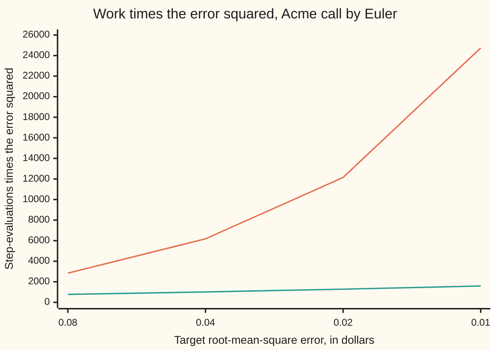

# Multilevel Monte Carlo: most paths on a coarse grid, a few on fine grids, and a telescoping sum that keeps the fine-grid answer

[Syllabus](../../../SYLLABUS.md) → [Financial mathematics](../README.md) → [Numerical Methods for Pricing](../README.md#s06) → Multilevel Monte Carlo

---

## General Overview

Acme shares trade at $100. A one-year call struck at $100 is worth 9.227006 by the formula on [Black–Scholes call](../08-The%20Black-Scholes%20call%20and%20put/01-black-scholes-call.md). Pretend no formula exists. The price must then come from simulated years, each walked in small Euler steps ([Stepping an SDE](05-discretisation-schemes-for-sdes.md)).

Two errors stand in the way. Coarse steps give a biased price, and too few paths give a noisy one. A **step-evaluation** is one Euler step applied to one path: the unit of computer work on this card. Plain Monte Carlo on a 64-step grid needs 247,405,824 of them for a root-mean-square error (the typical distance of the estimate from the true price) of one cent, $`\varepsilon = 0.01`$.

**Multilevel Monte Carlo** splits the job. The 64-step price equals the one-step price plus six corrections: the 2-step price minus the 1-step price, the 4-step minus the 2-step, and so on up to 64 minus 32. Each correction is measured on paths that share their random kicks, so the two prices in it almost agree. A difference that scatters little needs few paths.

So the run spends millions of paths on the one-step grid, where a path costs one step-evaluation. It spends about seventeen thousand on the 64-step grid, where a path costs 96: 64 fine steps plus 32 coarse ones. The total is 15,913,818 step-evaluations: 15.5 times less work than plain Monte Carlo on the same 64-step grid. The estimate is 9.236279 with a standard error of 0.007082, and the bias is still the 64-step bias.

This mild call does not need 64 steps: 4 already meet a one-cent target, and on 4 steps the saving is smaller. The 64-step grid stands in for products whose bias does force fine steps. Worked numbers shows both.

**Write the fine-grid price as the coarse-grid price plus a ladder of corrections, each measured on paired paths that share their kicks: the sum keeps the fine grid's answer, and the work for an error $`\varepsilon`$ falls from about $`\varepsilon^{-3}`$ to about $`\varepsilon^{-2}`$.**

**What kind of fact this is:** a method. The telescoping identity and the best path counts are proved on this card in Why it works. The general cost theorem is Giles's; its shape is argued here and the full proof is cited.

### The picture: where the paths go

```
paths on each level, for a root-mean-square error of 0.01
level 0    1 step   ████████████████████████████████████████  6735774
level 1    2 steps  ███                                         469658
level 2    4 steps  █                                           246589
level 3    8 steps  █                                           124966
level 4   16 steps  ▏                                            65483
level 5   32 steps  ▏                                            33163
level 6   64 steps  ▏                                            16943
```

Above level 1, each level up halves the path count, near enough. Most paths sit on the one-step grid. The last correction, the only part that needs 64 steps, rests on 16,943 paths.

---

## The formula

Notation first, in words. A **level** is a grid. Level $`l`$ walks the year in $`2^l`$ steps of length $`h_l = T/2^l`$, from level 0 (one step) to the finest level $`L = 6`$ (64 steps). $`P_l`$ is the discounted payoff of one path walked on level $`l`$'s grid. Each step is Euler's rule from [Stepping an SDE](05-discretisation-schemes-for-sdes.md):

```math
Y_{k+1} = Y_k \left( 1 + \mu h + \sigma \Delta W_{k+1} \right)
```

One **correction sample** on level $`l`$ draws $`2^l`$ kicks and walks the fine path. It adds the kicks in pairs to walk the coarse path on level $`l-1`$'s grid. Then it records $`P_l - P_{l-1}`$. On level 0 there is no coarse path, so $`P_{-1} = 0`$.

The multilevel estimate averages each level's corrections and adds the averages:

```math
\widehat{P} = \sum_{l=0}^{L} \frac{1}{N_l} \sum_{i=1}^{N_l} \left( P_l^{(i)} - P_{l-1}^{(i)} \right)
```

**Read it aloud:** on each level, average the differences between the fine and the coarse payoff over that level's own paths, then add the seven averages.

The path counts come from measured variances. For a target root-mean-square error $`\varepsilon`$, half of $`\varepsilon^2`$ goes to sampling noise and half is left for grid bias:

```math
N_l = \left\lceil \frac{2}{\varepsilon^2} \sqrt{\frac{V_l}{C_l}} \; \sum_{k=0}^{L} \sqrt{V_k C_k} \right\rceil, \qquad \text{total work} \approx \frac{2}{\varepsilon^2} \Big( \sum_{k=0}^{L} \sqrt{V_k C_k} \Big)^2
```

**Read it aloud:** a level gets more paths when its corrections scatter more, and fewer when each path costs more. The total work is the summed square roots, squared, times the error budget's factor.

| Symbol | Plain meaning | In our example | Push it up and the answer… |
| --- | --- | --- | --- |
| $`S`$, $`K`$, $`r`$, $`q`$, $`\sigma`$, $`T`$, $`C_{\mathrm{BS}}`$ | Acme's price, strike, bank rate, dividend yield, volatility, years; the call's true price, by Black–Scholes | 100, 100, 5%, 2%, 20%, 1; 9.227006 | the call's price moves; the method does not change |
| $`\mu`$, $`Y_k`$, $`\Delta W`$ | drift $`r - q`$; the Euler reading after $`k`$ steps; one step's random kick, spread $`\sqrt{h}`$ | 3%; starts at 100 | — |
| $`l`$, $`L`$ | the level number; the finest level | 0 to 6; 6 | a higher $`L`$ means less bias and more work |
| $`h_l`$, $`h`$ | step length on level $`l`$, in years; a step length in general | 1, 1/2, …, 1/64 | a longer step means more bias |
| $`P_l`$ | discounted payoff of one path walked on level $`l`$'s grid | path 2: 24.755166 on level 0 | — |
| $`P_l - P_{l-1}`$ | the correction on level $`l`$: both payoffs on one shared set of kicks | path 2, level 6: 0.694486 | — |
| $`N_l`$, $`i`$ | paths on level $`l`$; the number of one path | 6,735,774 down to 16,943 | the level's noise falls |
| $`V_l`$ | variance of one correction sample | 142.5522 on level 0, 0.0866 on level 6 | that level needs more paths |
| $`C_l`$ | work for one sample: $`2^l + 2^{l-1}`$ step-evaluations, and 1 on level 0 | 1, 3, 6, …, 96 | that level gets fewer paths |
| $`\varepsilon`$, RMSE | target root-mean-square error: the typical distance of $`\widehat{P}`$ from $`C_{\mathrm{BS}}`$ | 0.01; the run's is 0.007083 | work falls like $`\varepsilon^{-2}`$ |
| $`\alpha`$, $`\beta`$, $`\gamma`$, $`\lambda`$ | rates at which bias, variance and work change with $`h_l`$; the plan's multiplier | 1, 1, 1; 564157.6 | — |
| $`\widehat{P}`$, $`E[\cdot]`$ | the multilevel estimate; an average over all possible paths | 9.236279 | — |

The **root-mean-square error** has two parts, and the plan sizes each one:

```math
\mathrm{RMSE}^2 = \underbrace{\sum_{l=0}^{L} \frac{V_l}{N_l}}_{\text{sampling noise}} + \underbrace{\left( E[P_L] - C_{\mathrm{BS}} \right)^2}_{\text{grid bias}}
```

### When it holds

- **The coarse path must use the same kicks, added in pairs.** Two kicks of spread $`\sqrt{h/2}`$ add to one kick of spread $`\sqrt{h}`$, so the coarse path has exactly level $`l-1`$'s law (its probability distribution). Fresh kicks keep the law but lose the pairing: the plan's cost jumps to 6,634,489,710 step-evaluations.
- **The payoff must not jump.** The call changes by at most a dollar per dollar of Acme, so a small path gap gives a small payoff gap. A digital payoff jumps at the strike, its corrections shrink more slowly, and the saving is smaller.
- **Each level uses its own random numbers.** The variance of the sum is the sum of the level variances only when the levels are independent.
- **The variances are estimates.** A pilot run of 20,000 paths a level measures them. A wrong $`V_l`$ makes the plan cost more than it needs to, or miss the error target, but it never biases the price.
- **The method removes no bias.** It makes the finest grid cheap. The answer still carries the 64-step bias, here 0.000149.

---

## Why it works

### Step 0: one hard average becomes seven easy ones

An average of a sum is the sum of the averages. So the 64-step price can be cut into pieces, and each piece can be sampled on its own, with its own number of paths. The trick is to cut it into pieces that scatter little.

### Step 1: the telescoping sum keeps the fine-grid answer exactly

Write the 64-step average as a chain in which every middle term appears once with a plus and once with a minus:

```math
E[P_L] = E[P_0] + \sum_{l=1}^{L} E\left[ P_l - P_{l-1} \right]
```

The middle terms cancel in pairs, like the tubes of a telescope sliding shut. That is why it is called a **telescoping sum**.

One condition makes the identity hold for the estimator. Inside a correction on level $`l`$, the coarse payoff $`P_{l-1}`$ must have exactly the same average as the fine payoff on level $`l-1`$'s own paths. It does, because the coarse kicks are sums of two independent fine kicks, and that sum has the right spread. So the estimator's average is $`E[P_L]`$: the 64-step price, with no extra bias.

Path 2 of the seed shows the bookkeeping. Its seven payoffs are 24.755166 on one step and 26.126542 on 64 steps. The six corrections between them, from 0.893631 to 0.694486, add up the gap.

### Step 2: a correction on shared kicks scatters little

On shared kicks, the 2-step and 1-step readings of Acme land close together. The gap between two Euler readings on the same kicks has a typical size that shrinks like $`\sqrt{h}`$: Euler's path error, from [Milstein and the two kinds of error](../../11-Stochastic%20processes%20and%20calculus/08-Generators%2C%20Densities%20and%20Simulation/05-milstein-and-strong-weak-convergence.md).

The call changes by at most a dollar per dollar of Acme. So the payoff gap is at most the discount factor times the reading gap. Square it and average: $`V_l`$ is at most a constant times $`h_l`$. Each level halves $`h_l`$, so $`V_l`$ should halve.

The pilot comes close to that. $`V_l`$ runs 2.0791, 1.1463, 0.5888, 0.3233, 0.1659, 0.0866, and each ratio to the next lies between 1.814 and 1.950. Compare level 0, with no pairing: one Euler step's payoff has variance 145.676434 in closed form.

### Step 3: the best path counts follow from one inequality

The levels are independent, so the estimate's variance is $`\sum V_l / N_l`$, and the work is $`\sum N_l C_l`$. The best plan makes the work as small as possible with the variance held at $`\varepsilon^2/2`$.

The Cauchy–Schwarz inequality says: for two lists of numbers, the sum of products, squared, is at most the product of the sums of squares. It gives a floor on work times variance that no plan can beat. The floor is reached exactly when $`N_l`$ is proportional to $`\sqrt{V_l / C_l}`$. Fixing the variance at $`\varepsilon^2/2`$ fixes the constant, and that is the formula for $`N_l`$.

<details>
<summary>Detailed proof: the floor, and the plan that reaches it</summary>

Apply Cauchy–Schwarz to the two lists $`\sqrt{N_l C_l}`$ and $`\sqrt{V_l / N_l}`$:

$`\displaystyle \Big( \sum_l N_l C_l \Big) \Big( \sum_l \frac{V_l}{N_l} \Big) \;\ge\; \Big( \sum_l \sqrt{V_l C_l} \Big)^2 .`$

Equality holds when the two lists are proportional: $`N_l C_l = \lambda^2 V_l / N_l`$ for one constant $`\lambda`$, that is $`N_l = \lambda \sqrt{V_l / C_l}`$. Put that into the variance and set it to $`\varepsilon^2/2`$:

$`\displaystyle \sum_l \frac{V_l}{\lambda \sqrt{V_l/C_l}} = \frac{1}{\lambda} \sum_l \sqrt{V_l C_l} = \frac{\varepsilon^2}{2}, \qquad \lambda = \frac{2}{\varepsilon^2} \sum_l \sqrt{V_l C_l} .`$

The work is then $`\sum_l N_l C_l = \lambda \sum_l \sqrt{V_l C_l} = \frac{2}{\varepsilon^2} \big( \sum_l \sqrt{V_l C_l} \big)^2`$, the floor itself. Rounding each $`N_l`$ up adds at most one path a level. Any other plan with the same variance costs more, because it sits above the floor.

</details>

### Step 4: why the work falls from about ε⁻³ to about ε⁻²

**Plain Monte Carlo.** The noise needs about $`\varepsilon^{-2}`$ paths. Euler's price bias shrinks in proportion to $`h`$, so the bias needs $`h`$ proportional to $`\varepsilon`$, which is about $`\varepsilon^{-1}`$ steps a path. Multiply: about $`\varepsilon^{-3}`$.

**Multilevel with Euler.** $`V_l`$ halves per level while $`C_l`$ doubles. So every term $`\sqrt{V_l C_l}`$ is about the same: the pilot measures 2.4975 to 2.8830 on levels 1 to 6. The sum is then about the number of levels times one term. The number of levels grows like $`\log_2(1/\varepsilon)`$, because each halving of $`\varepsilon`$ needs one more halving of $`h`$. The work is $`2/\varepsilon^2`$ times that sum squared: about $`\varepsilon^{-2} (\log \varepsilon)^2`$.

**Multilevel with Milstein.** Milstein's path error shrinks like $`h`$, so $`V_l`$ falls by four per level while $`C_l`$ doubles. The terms $`\sqrt{V_l C_l}`$ then shrink geometrically, their sum stays bounded, and the work is about $`\varepsilon^{-2}`$: the cost of averaging with no grid at all.

Giles's theorem states the general case. Suppose the bias shrinks like $`h_l^{\alpha}`$, the variance like $`h_l^{\beta}`$, and the work grows like $`h_l^{-\gamma}`$, and suppose the bias does not shrink too slowly: $`\alpha`$ is at least half of the smaller of $`\beta`$ and $`\gamma`$. Then the work for error $`\varepsilon`$ is about $`\varepsilon^{-2}`$ when $`\beta > \gamma`$, about $`\varepsilon^{-2}(\log \varepsilon)^2`$ when $`\beta = \gamma`$, and about $`\varepsilon^{-2-(\gamma-\beta)/\alpha}`$ when $`\beta < \gamma`$. Euler on the call has $`\alpha = \beta = \gamma = 1`$: the middle case. Giles (2008), Theorem 3.1, proves it for $`\gamma = 1`$, the case here; Giles (2015), Theorem 2.1, proves it for any $`\gamma`$. Both are in Sources.

---

## Worked numbers, by hand

Acme: $`S = 100`$, $`K = 100`$, $`r = 5\%`$, $`q = 2\%`$, $`\sigma = 20\%`$, $`T = 1`$, so $`\mu = 3\%`$. Levels 0 to 6, a pilot of 20,000 paths a level, and a target $`\varepsilon = 0.01`$.

| Step | Arithmetic | Value |
| --- | --- | --- |
| path 2, level 0 payoff | one step to 126.0244, less 100, discounted | 24.755166 |
| path 2, level 6 payoff | 24.755166 + 0.893631 + 0.976453 − 1.878242 + 1.105628 − 0.420579 + 0.694486 | 26.126542 |
| sampling budget | $`0.01^2 / 2`$ | 0.000050 |
| sum of $`\sqrt{V_l C_l}`$ | 11.9395 + 2.4975 + 2.6226 + 2.6581 + 2.7857 + 2.8215 + 2.8830 | 28.2079 |
| the multiplier | $`2 / 0.01^2 \times 28.2079`$ | 564157.6 |
| paths on level 0 | $`564157.6 \times \sqrt{142.5522 / 1}`$, rounded up | 6,735,774 |
| paths on level 6 | $`564157.6 \times \sqrt{0.0866 / 96}`$, rounded up | 16,943 |
| work, multilevel | $`\sum N_l C_l`$ | 15,913,818 |
| the estimate | 9.105207 + 0.094535 + 0.023556 + 0.007352 + 0.002925 + 0.002444 + 0.000260 | 9.236279 |
| its standard error | $`\sqrt{\sum V_l / N_l}`$ | 0.007082 |
| grid bias at 64 steps | exact Euler price 9.227155 less 9.227006 | 0.000149 |
| root-mean-square error | $`\sqrt{0.007082^2 + 0.000149^2}`$ | 0.007083 |
| work, plain Monte Carlo | $`2 \times 193.285760 / 0.01^2`$ paths, times 64 steps | 247,405,824 |
| **plain over multilevel** | 247,405,824 ÷ 15,913,818 | **15.546604** |

So the multilevel run prices the Acme call within one cent, root-mean-square, on 15.5 times less work than plain sampling on the same 64-step grid. Its estimate sits 0.009274 above the formula: between one and two standard errors, ordinary noise.

That ratio is for the 64-step grid, and this call does not need it. Four steps already meet the target, because their bias, −0.005459, is inside the allowance $`\varepsilon/\sqrt{2}`$. On 4 steps plain Monte Carlo costs 14,305,212 step-evaluations and multilevel 5,820,573: a real saving, but far short of 15.5 times. The 64-step comparison stands in for products whose bias does force fine grids, such as barrier and lookback options, or options under Heston. There the gap widens as the target tightens, as the cost table below shows.

### The picture: the work is spread almost evenly

```
step-evaluations on each level, same run
level 0   ████████████████████████████████████████  6735774
level 1   ████████                                  1408974
level 2   █████████                                 1479534
level 3   █████████                                 1499592
level 4   █████████                                 1571592
level 5   █████████                                 1591824
level 6   ██████████                                1626528
```

Above level 0 each level costs about the same, because the path count halves as the cost per path doubles. That flat profile is the $`\beta = \gamma`$ case of Step 4, and it is where the squared logarithm comes from.

### The picture: work against the target error



The steep line is plain Monte Carlo, the flat one multilevel. Multiplying the work by $`\varepsilon^2`$ removes the $`\varepsilon^{-2}`$ that any sampling pays. What is left doubles at each halving for plain Monte Carlo: the extra $`\varepsilon^{-1}`$ of a finer grid. For multilevel it creeps up slowly: the squared logarithm.

Each row moves the finest level with the target, from $`L = 3`$ at 0.08 up to $`L = 6`$ at 0.01. Each halving of the error gets one more halving of the step, as if the bias forced $`h`$ in proportion to $`\varepsilon`$, which is Step 4's rule when the bias sets the grid.

| Target $`\varepsilon`$ | Finest level | Grid bias | Multilevel work | Plain work |
| --- | --- | --- | --- | --- |
| 0.08 | 3 | −0.000579 | 121,503 | 443,944 |
| 0.04 | 4 | 0.000224 | 633,012 | 3,860,560 |
| 0.02 | 5 | 0.000237 | 3,206,815 | 30,361,120 |
| 0.01 | 6 | 0.000149 | 15,913,818 | 247,405,824 |
| 0.01, on 4 steps | 2 | −0.005459 | 5,820,573 | 14,305,212 |

For this call the bias does not set the grid. Every bias here is inside its allowance of $`\varepsilon/\sqrt{2}`$, and Euler's bias is small after a few steps: the exact Euler prices are 9.101781, 9.198108, 9.221547, 9.226427, 9.227230, 9.227242 and 9.227155 on levels 0 to 6. The last row is the fair one-cent comparison for this call.

### What breaks if you drop a piece

| Mistake | Comes out at | What went wrong |
| --- | --- | --- |
| Keep the corrections, drop level 0 | 0.131072 | The corrections only refine the grid; the price itself lives on level 0 |
| Stop at level 0, one step a path | 9.101781, a bias of −0.125224 | The work is tiny, but one Euler step's bias is far larger than the 0.01 target |
| Fresh kicks for the coarse path | 6,634,489,710 step-evaluations | Unpaired, a correction's variance is two whole payoff variances added, not 0.0866 |
| The same path count on every level | 558,380,550 step-evaluations | Level 0's variance then sets the count for all levels; this costs more than plain Monte Carlo's 247,405,824 |

---

## Code, from first principles, and it actually runs

The scripts draw their kicks from the same recurrence and seed as [Monte Carlo pricing](01-monte-carlo-pricing.md), with Box-Muller turning pairs of uniform numbers into pairs of bell-curve draws. They print one path on all seven grids, run the pilot, plan the path counts, run the multilevel estimate and price the cost table. The answer is reached by **four independent roads**:

- the Black–Scholes formula;
- the multilevel run itself;
- the exact Euler price on every level, with no random numbers: the density of one Euler step's log-factor, convolved with itself on a grid, then integrated against the payoff;
- a closed form for one Euler step, whose ending is a bell curve, giving level 0's price and variance.

The asserts compare five pairs:

- road 3 on its grid of 640 points against a grid of 1,280 points, which guards its six decimals;
- the pilot's corrections against road 3's exact differences;
- the run against road 3's 64-step price;
- road 3 against road 4 on level 0;
- road 1 against the house number.

They also check the variance ratios, the error budget and the cost growth.

### Python

```python
# Multilevel Monte Carlo -- the check behind the card.  Standard library only.  Nothing imported
# knows an answer: uniforms from the recurrence of the Monte Carlo pricing card, normals by Box-Muller,
# every integral by Simpson's rule, exact Euler prices from a density convolved with itself on a grid.
from math import ceil, cos, exp, log, pi, sin, sqrt
S0, K, R, Q, SIG, T = 100.0, 100.0, 0.05, 0.02, 0.20, 1.0   # the house Acme call
MU, DISC, MOD = R - Q, exp(-R * T), 1 << 32
SEED, PILOT, L, EPS = 20260914, 20000, 6, 0.01               # levels 0..6: h = 1 .. 1/64
EXACT = 9.227005508154                                       # the call card's price
def simpson(f, a, b, n):                 # every integral on this card
    h, s = (b - a) / n, f(a) + f(b)
    for i in range(1, n):
        s += (4.0 if i % 2 else 2.0) * f(a + i * h)
    return s * h / 3.0
def row(name, v): print(f"{name:<44}{v:>12.6f}" if isinstance(v, float) else f"{name:<44}{v:>12}")
def phi(x): return exp(-0.5 * x * x) / sqrt(2.0 * pi)     # bell-curve height
def ncdf(x): return 0.5 + simpson(phi, 0.0, x, 4000)      # bell-curve area to the left
def bs_call():                           # road 1: Black-Scholes
    vt = SIG * sqrt(T)
    d1 = (log(S0 / K) + (MU + 0.5 * SIG * SIG) * T) / vt
    return S0 * exp(-Q * T) * ncdf(d1) - K * exp(-R * T) * ncdf(d1 - vt)
def normals(st, count):                  # the recurrence, then Box-Muller, in pairs
    out = []
    while len(out) < count:
        st = (1664525 * st + 1013904223) % MOD
        rad = sqrt(-2.0 * log((st + 0.5) / MOD))
        st = (1664525 * st + 1013904223) % MOD
        ang = 2.0 * pi * (st + 0.5) / MOD
        out += [rad * cos(ang), rad * sin(ang)]
    return st, out
def cost(l): return 1 if l == 0 else 3 << (l - 1)         # fine steps plus coarse steps
def euler_end(dws, h):                   # Euler's terminal reading along given increments
    y = S0
    for dw in dws:
        y *= 1.0 + MU * h + SIG * dw
    return y
def level(l, n, st):                     # n samples of P_l - P_(l-1) on shared increments
    nf, s = 1 << l, [0.0] * 6            # sums of y, y^2, fine payoff and its square, coarse ditto
    hf, done = T / nf, 0
    while done < n:
        st, zs = normals(st, nf)
        for j in range(0, len(zs), nf):  # level 0 uses both draws of a pair
            fine = [z * sqrt(hf) for z in zs[j:j + nf]]
            pf = DISC * max(euler_end(fine, hf) - K, 0.0)
            pc = 0.0
            if l > 0:                    # the coarse path sums the fine increments in pairs
                coarse = [fine[i] + fine[i + 1] for i in range(0, nf, 2)]
                pc = DISC * max(euler_end(coarse, 2.0 * hf) - K, 0.0)
            y = pf - pc
            s = [u + w for u, w in zip(s, (y, y * y, pf, pf * pf, pc, pc * pc))]
            done += 1
    return st, s, done
def exact_euler(l, n=640, lo=-1.6, hi=1.6):   # road 3: E[P_l] with no random numbers
    h, dx = T / (1 << l), (hi - lo) / n       # density of log of one Euler factor ...
    def one(x):
        z = (exp(x) - 1.0 - MU * h) / (SIG * sqrt(h))
        return phi(z) * exp(x) / (SIG * sqrt(h))
    f, mid = [one(lo + i * dx) for i in range(n + 1)], n // 2
    for _ in range(l):                        # ... convolved with itself: 2, 4, ... steps
        f = [dx * sum(f[i] * f[k - i + mid] for i in range(max(0, k - mid), min(n, k + mid) + 1))
             for k in range(n + 1)]
    g = lambda i: f[i] * max(S0 * exp(lo + i * dx) - K, 0.0)
    pay = dx / 3.0 * sum((1 if i in (mid, n) else 4 if (i - mid) % 2 else 2) * g(i) for i in range(mid, n + 1))
    return DISC * pay
def plan(vs, eps):                       # path counts that meet the variance budget eps^2/2 at least cost
    lam = 2.0 / (eps * eps) * sum(sqrt(v * cost(l)) for l, v in enumerate(vs))
    ns = [ceil(lam * sqrt(v / cost(l))) for l, v in enumerate(vs)]
    return ns, sum(m * cost(l) for l, m in enumerate(ns))

bs = bs_call()
a, b = S0 * (1.0 + MU * T) - K, S0 * SIG * sqrt(T)        # one Euler step: a + b Z, a normal ending
p0 = DISC * (a * ncdf(a / b) + b * phi(a / b))
v0 = DISC * DISC * ((a * a + b * b) * ncdf(a / b) + a * b * phi(a / b)) - p0 * p0
ex = [exact_euler(l) for l in range(L + 1)]
print(f"Acme call: S={S0:.0f} K={K:.0f} r={R:.2f} q={Q:.2f} sigma={SIG:.2f} T={T:.0f}; Euler steps h = 1 .. 1/{1 << L}")
for name, v in [("Black-Scholes price", bs), ("one Euler step, closed form: price", p0),
                ("one Euler step, closed form: payoff variance", v0)]: row(name, v)
st, k, h6 = SEED, 0, T / (1 << L)                         # one path, read on all seven grids:
while True:                                                # the seed's first one in the money on both
    st, zs = normals(st, 1 << L)                           # the coarsest and the finest grid
    fine, prev, k = [z * sqrt(h6) for z in zs], 0.0, k + 1
    if min(euler_end([sum(fine)], T), euler_end(fine, h6)) > K: break
print(f"path {k} of the seed, read on every grid\ngrid      steps    ending      payoff   correction")
for l in range(L + 1):
    blk = (1 << L) >> l
    y = euler_end([sum(fine[i:i + blk]) for i in range(0, 1 << L, blk)], T / (1 << l))
    p = DISC * max(y - K, 0.0)
    print(f"{'level ' + str(l):<10}{1 << l:>6}{y:>10.4f}{p:>12.6f}{p - prev:>13.6f}")
    prev = p
pil, vs = [], []
print("pilot, 20000 paths a level")
print("level  h         exact E[P_l]  exact dE   pilot mean   std err    V_l       V ratio  cost  sqrt(V C)")
for l in range(L + 1):
    st, s, n = level(l, PILOT, st)
    m, v = s[0] / n, s[1] / n - (s[0] / n) ** 2
    pil.append((m, v, s[3] / n - (s[2] / n) ** 2, s[5] / n - (s[4] / n) ** 2)); vs.append(v)
    d = ex[l] - (ex[l - 1] if l else 0.0)
    rt = f"{vs[l - 1] / v:>8.3f}" if l > 1 else f"{'':>8}"
    print(f"{l:<6} {T / (1 << l):<9.6f}{ex[l]:>12.6f}{d:>11.6f}{m:>12.6f}{sqrt(v / n):>10.6f}{v:>10.4f}{rt}{cost(l):>6}{sqrt(v * cost(l)):>11.4f}")
ns, tot = plan(vs, EPS)[0], sum(sqrt(v * cost(l)) for l, v in enumerate(vs))
print(f"eps = {EPS}: budget eps^2/2 = {EPS * EPS / 2:.6f}, sum sqrt(V C) = {tot:.4f}, 2/eps^2 x sum = {2 / EPS / EPS * tot:.1f}")
print("level  paths N_l   mean        variance    N_l x cost")
means, var, work = [], 0.0, 0
for l in range(L + 1):
    st, s, n = level(l, ns[l], st)
    m, v = s[0] / n, s[1] / n - (s[0] / n) ** 2
    means.append(m); var, work = var + v / n, work + n * cost(l)
    print(f"{l:<6} {n:>9}  {m:>10.6f}  {v:>10.4f}  {n * cost(l):>11}")
est, bias, se = sum(means), ex[L] - bs, sqrt(var)
plain = ceil(2.0 * pil[L][2] / (EPS * EPS)) * (1 << L)
for name, v in [("multilevel estimate", est), ("  its standard error", se), ("  exact Euler bias at h = 1/64", bias),
                ("  root-mean-square error", sqrt(var + bias * bias)), ("  gap to Black-Scholes", est - bs),
                ("step-evaluations, multilevel", work), ("payoff variance at h = 1/64, pilot", pil[L][2]),
                ("step-evaluations, plain MC at h = 1/64", plain), ("  ratio, plain over multilevel", plain / work)]: row(name, v)
print("cost for a target error: L = 6 - log2(0.01/eps) as if the bias forced it, then L kept at 6, then L = 2")
print("eps      L   bias        multilevel   x eps^2    plain        x eps^2")
rows = []
for e, lv in ((0.08, 3), (0.04, 4), (0.02, 5), (0.01, 6), (0.005, 6), (0.01, 2)):
    c = plan(vs[:lv + 1], e)[1]
    p = ceil(2.0 * pil[lv][2] / (e * e)) * (1 << lv)
    rows.append((e, lv, c, p))
    print(f"{e:<8} {lv:<3}{ex[lv] - bs:>9.6f}{c:>13}{c * e * e:>10.1f}{p:>13}{p * e * e:>10.1f}")
indep = plan([vs[0]] + [pil[l][2] + pil[l][3] for l in range(1, L + 1)], EPS)[1]
same = ceil(2.0 * sum(vs) / (EPS * EPS)) * sum(cost(l) for l in range(L + 1))
print("what breaks")
for name, v in [("  drop level 0, keep only the corrections", sum(means[1:])),
                ("  stop at level 0: one step, exact price", ex[0]), ("    its bias", ex[0] - bs),
                ("  fresh draws for the coarse path: cost", indep), ("  the same N on every level: cost", same)]: row(name, v)
assert abs(bs - EXACT) < 1e-9                                   # road 1 against the house number
assert abs(ex[0] - p0) < 1e-6                                    # road 3 against the one-step closed form
assert all(abs(exact_euler(l, 1280) - ex[l]) < 1e-7 for l in range(L + 1))   # road 3 on a grid twice as fine
assert abs(pil[0][0] - p0) < 4.0 * sqrt(v0 / PILOT) and abs(pil[0][1] / v0 - 1.0) < 0.05
assert all(abs(pil[l][0] - (ex[l] - ex[l - 1])) < 4.0 * sqrt(vs[l] / PILOT) for l in range(1, L + 1))
assert all(1.5 < vs[l - 1] / vs[l] < 2.5 for l in range(2, L + 1))   # the correction variance roughly halves
assert abs(est - ex[L]) < 4.0 * se                               # road 2 against road 3
assert se < 1.05 * EPS / sqrt(2.0) and sqrt(var + bias * bias) < EPS
assert all(abs(ex[lv] - bs) < e / sqrt(2.0) for e, lv, c, p in rows)
for (e1, l1, c1, p1), (e2, l2, c2, p2) in zip(rows, rows[1:4]):   # halving eps: x8 plain, under x6 multilevel
    assert p2 / p1 > 7.0 and c2 / c1 < 6.0
assert plain / work > 5.0 and same > plain and indep > plain
print("ALL CHECKS PASS")
```

**Ran 2026-11-23 on macOS, Python 3.14.10, standard library only. All checks passed. Output, pasted from the run:**

```
Acme call: S=100 K=100 r=0.05 q=0.02 sigma=0.20 T=1; Euler steps h = 1 .. 1/64
Black-Scholes price                             9.227006
one Euler step, closed form: price              9.101781
one Euler step, closed form: payoff variance  145.676434
path 2 of the seed, read on every grid
grid      steps    ending      payoff   correction
level 0        1  126.0244   24.755166    24.755166
level 1        2  126.9638   25.648796     0.893631
level 2        4  127.9904   26.625249     0.976453
level 3        8  126.0158   24.747008    -1.878242
level 4       16  127.1781   25.852636     1.105628
level 5       32  126.7360   25.432056    -0.420579
level 6       64  127.4661   26.126542     0.694486
pilot, 20000 paths a level
level  h         exact E[P_l]  exact dE   pilot mean   std err    V_l       V ratio  cost  sqrt(V C)
0      1.000000     9.101781   9.101781    8.965942  0.084425  142.5522             1    11.9395
1      0.500000     9.198108   0.096327    0.106354  0.010196    2.0791             3     2.4975
2      0.250000     9.221547   0.023438    0.024304  0.007571    1.1463   1.814     6     2.6226
3      0.125000     9.226427   0.004880    0.001516  0.005426    0.5888   1.947    12     2.6581
4      0.062500     9.227230   0.000803    0.004902  0.004021    0.3233   1.821    24     2.7857
5      0.031250     9.227242   0.000013   -0.002744  0.002880    0.1659   1.950    48     2.8215
6      0.015625     9.227155  -0.000088    0.004079  0.002081    0.0866   1.916    96     2.8830
eps = 0.01: budget eps^2/2 = 0.000050, sum sqrt(V C) = 28.2079, 2/eps^2 x sum = 564157.6
level  paths N_l   mean        variance    N_l x cost
0        6735774    9.105207    145.6649      6735774
1         469658    0.094535      2.0480      1408974
2         246589    0.023556      1.1273      1479534
3         124966    0.007352      0.6066      1499592
4          65483    0.002925      0.3188      1571592
5          33163    0.002444      0.1621      1591824
6          16943    0.000260      0.0844      1626528
multilevel estimate                             9.236279
  its standard error                            0.007082
  exact Euler bias at h = 1/64                  0.000149
  root-mean-square error                        0.007083
  gap to Black-Scholes                          0.009274
step-evaluations, multilevel                    15913818
payoff variance at h = 1/64, pilot            193.285760
step-evaluations, plain MC at h = 1/64         247405824
  ratio, plain over multilevel                 15.546604
cost for a target error: L = 6 - log2(0.01/eps) as if the bias forced it, then L kept at 6, then L = 2
eps      L   bias        multilevel   x eps^2    plain        x eps^2
0.08     3  -0.000579       121503     777.6       443944    2841.2
0.04     4   0.000224       633012    1012.8      3860560    6176.9
0.02     5   0.000237      3206815    1282.7     30361120   12144.4
0.01     6   0.000149     15913818    1591.4    247405824   24740.6
0.005    6   0.000149     63654907    1591.4    989623104   24740.6
0.01     2  -0.005459      5820573     582.1     14305212    1430.5
what breaks
  drop level 0, keep only the corrections       0.131072
  stop at level 0: one step, exact price        9.101781
    its bias                                   -0.125224
  fresh draws for the coarse path: cost       6634489710
  the same N on every level: cost              558380550
ALL CHECKS PASS
```

### Rust

Same recurrence, same draws, same labels, built with `rustc --edition 2021 -O`. Both programs build the bell-curve area by Simpson's rule, so neither borrows it from a library.

```rust
// Multilevel Monte Carlo -- the same check as the Python, in Rust.  No crates.  Nothing imported
// knows an answer: uniforms from the recurrence of the Monte Carlo pricing card, normals by Box-Muller,
// every integral by Simpson's rule, exact Euler prices from a density convolved with itself on a grid.
use std::f64::consts::PI;
const S0: f64 = 100.0; const K: f64 = 100.0; const R: f64 = 0.05; const Q: f64 = 0.02;
const SIG: f64 = 0.20; const T: f64 = 1.0; const MU: f64 = R - Q; const MOD: u64 = 1 << 32;
const SEED: u64 = 20260914; const PILOT: usize = 20000; const L: usize = 6; const EPS: f64 = 0.01;
const EXACT: f64 = 9.227005508154;                         // the call card's price
fn simpson(f: &dyn Fn(f64) -> f64, a: f64, b: f64, n: usize) -> f64 {   // every integral on this card
    let h = (b - a) / n as f64;
    let mut s = f(a) + f(b);
    for i in 1..n { s += if i % 2 == 1 { 4.0 } else { 2.0 } * f(a + i as f64 * h); }
    s * h / 3.0
}
fn row(name: &str, v: f64) { println!("{:<44}{:>12.6}", name, v); } fn rowi(name: &str, v: u64) { println!("{:<44}{:>12}", name, v); }
fn phi(x: f64) -> f64 { (-0.5 * x * x).exp() / (2.0 * PI).sqrt() }      // bell-curve height
fn ncdf(x: f64) -> f64 { 0.5 + simpson(&phi, 0.0, x, 4000) }           // bell-curve area to the left
fn disc() -> f64 { (-R * T).exp() }
fn bs_call() -> f64 {                                      // road 1: Black-Scholes
    let vt = SIG * T.sqrt();
    let d1 = ((S0 / K).ln() + (MU + 0.5 * SIG * SIG) * T) / vt;
    S0 * (-Q * T).exp() * ncdf(d1) - K * (-R * T).exp() * ncdf(d1 - vt)
}
fn normals(st: &mut u64, count: usize) -> Vec<f64> {      // the recurrence, then Box-Muller, in pairs
    let mut out = Vec::new();
    while out.len() < count {
        *st = (1664525 * *st + 1013904223) % MOD;
        let rad = (-2.0 * ((*st as f64 + 0.5) / MOD as f64).ln()).sqrt();
        *st = (1664525 * *st + 1013904223) % MOD;
        let ang = 2.0 * PI * (*st as f64 + 0.5) / MOD as f64;
        out.push(rad * ang.cos()); out.push(rad * ang.sin());
    }
    out
}
fn cost(l: usize) -> u64 { if l == 0 { 1 } else { 3 << (l - 1) } }   // fine steps plus coarse steps
fn euler_end(dws: &[f64], h: f64) -> f64 {                // Euler's terminal reading along given increments
    let mut y = S0;
    for dw in dws { y *= 1.0 + MU * h + SIG * dw; }
    y
}
fn level(l: usize, n: usize, st: &mut u64) -> ([f64; 6], usize) {   // n samples of P_l - P_(l-1), shared increments
    let nf = 1usize << l;
    let (hf, mut s, mut done) = (T / nf as f64, [0.0f64; 6], 0usize);
    while done < n {
        let zs = normals(st, nf);
        let mut j = 0;
        while j < zs.len() {                              // level 0 uses both draws of a pair
            let fine: Vec<f64> = zs[j..j + nf].iter().map(|z| z * hf.sqrt()).collect();
            let pf = disc() * (euler_end(&fine, hf) - K).max(0.0);
            let mut pc = 0.0;
            if l > 0 {                                    // the coarse path sums the fine increments in pairs
                let coarse: Vec<f64> = (0..nf).step_by(2).map(|i| fine[i] + fine[i + 1]).collect();
                pc = disc() * (euler_end(&coarse, 2.0 * hf) - K).max(0.0);
            }
            let y = pf - pc;
            for (u, w) in s.iter_mut().zip([y, y * y, pf, pf * pf, pc, pc * pc]) { *u += w; }
            done += 1; j += nf;
        }
    }
    (s, done)
}
fn exact_euler(l: usize, n: usize) -> f64 {                // road 3: E[P_l] with no random numbers
    let (lo, hi) = (-1.6f64, 1.6f64);
    let (h, dx, mid) = (T / (1u64 << l) as f64, (hi - lo) / n as f64, n / 2);
    let one = |x: f64| {                                  // density of log of one Euler factor ...
        let z = (x.exp() - 1.0 - MU * h) / (SIG * h.sqrt());
        phi(z) * x.exp() / (SIG * h.sqrt())
    };
    let mut f: Vec<f64> = (0..=n).map(|i| one(lo + i as f64 * dx)).collect();
    for _ in 0..l {                                       // ... convolved with itself: 2, 4, ... steps
        f = (0..=n).map(|k| {
            let (a, b) = (k.saturating_sub(mid), n.min(k + mid));
            dx * (a..=b).map(|i| f[i] * f[k + mid - i]).sum::<f64>()
        }).collect();
    }
    let g = |i: usize| f[i] * (S0 * (lo + i as f64 * dx).exp() - K).max(0.0);
    let pay = dx / 3.0 * (mid..=n).map(|i| {
        (if i == mid || i == n { 1.0 } else if (i - mid) % 2 == 1 { 4.0 } else { 2.0 }) * g(i)
    }).sum::<f64>();
    disc() * pay
}
fn plan(vs: &[f64], eps: f64) -> (Vec<u64>, u64) {       // path counts meeting the budget eps^2/2 at least cost
    let lam = 2.0 / (eps * eps) * vs.iter().enumerate().map(|(l, v)| (v * cost(l) as f64).sqrt()).sum::<f64>();
    let ns: Vec<u64> = vs.iter().enumerate().map(|(l, v)| (lam * (v / cost(l) as f64).sqrt()).ceil() as u64).collect();
    let c = ns.iter().enumerate().map(|(l, m)| m * cost(l)).sum();
    (ns, c)
}
fn main() {
    let bs = bs_call();
    let (a, b) = (S0 * (1.0 + MU * T) - K, S0 * SIG * T.sqrt());   // one Euler step: a + b Z, a normal ending
    let p0 = disc() * (a * ncdf(a / b) + b * phi(a / b));
    let v0 = disc() * disc() * ((a * a + b * b) * ncdf(a / b) + a * b * phi(a / b)) - p0 * p0;
    let ex: Vec<f64> = (0..=L).map(|l| exact_euler(l, 640)).collect();
    println!("Acme call: S={:.0} K={:.0} r={:.2} q={:.2} sigma={:.2} T={:.0}; Euler steps h = 1 .. 1/{}", S0, K, R, Q, SIG, T, 1 << L);
    row("Black-Scholes price", bs); row("one Euler step, closed form: price", p0);
    row("one Euler step, closed form: payoff variance", v0);
    let (mut st, mut k, h6, mut prev) = (SEED, 0, T / (1 << L) as f64, 0.0);   // one path, read on all seven grids:
    let fine = loop {                                     // the seed's first one in the money on both
        let zs = normals(&mut st, 1 << L);                // the coarsest and the finest grid
        let fine: Vec<f64> = zs.iter().map(|z| z * h6.sqrt()).collect(); k += 1;
        if euler_end(&[fine.iter().sum::<f64>()], T).min(euler_end(&fine, h6)) > K { break fine; }
    };
    println!("path {} of the seed, read on every grid\ngrid      steps    ending      payoff   correction", k);
    for l in 0..=L {
        let blk = (1usize << L) >> l;
        let inc: Vec<f64> = (0..1usize << L).step_by(blk).map(|i| fine[i..i + blk].iter().sum::<f64>()).collect();
        let y = euler_end(&inc, T / (1u64 << l) as f64);
        let p = disc() * (y - K).max(0.0);
        println!("{:<10}{:>6}{:>10.4}{:>12.6}{:>13.6}", format!("level {}", l), 1 << l, y, p, p - prev);
        prev = p;
    }
    let (mut pil, mut vs) = (Vec::new(), Vec::new());
    println!("pilot, 20000 paths a level");
    println!("level  h         exact E[P_l]  exact dE   pilot mean   std err    V_l       V ratio  cost  sqrt(V C)");
    for l in 0..=L {
        let (s, n) = level(l, PILOT, &mut st);
        let nf = n as f64;
        let (m, v) = (s[0] / nf, s[1] / nf - (s[0] / nf) * (s[0] / nf));
        pil.push((m, v, s[3] / nf - (s[2] / nf) * (s[2] / nf), s[5] / nf - (s[4] / nf) * (s[4] / nf))); vs.push(v);
        let d = ex[l] - if l > 0 { ex[l - 1] } else { 0.0 };
        let rt = if l > 1 { format!("{:>8.3}", vs[l - 1] / v) } else { format!("{:>8}", "") };
        println!("{:<6} {:<9.6}{:>12.6}{:>11.6}{:>12.6}{:>10.6}{:>10.4}{}{:>6}{:>11.4}", l, T / (1u64 << l) as f64, ex[l], d, m,
                 (v / nf).sqrt(), v, rt, cost(l), (v * cost(l) as f64).sqrt());
    }
    let (ns, tot) = (plan(&vs, EPS).0, vs.iter().enumerate().map(|(l, v)| (v * cost(l) as f64).sqrt()).sum::<f64>());
    println!("eps = {}: budget eps^2/2 = {:.6}, sum sqrt(V C) = {:.4}, 2/eps^2 x sum = {:.1}", EPS, EPS * EPS / 2.0, tot, 2.0 / EPS / EPS * tot);
    println!("level  paths N_l   mean        variance    N_l x cost");
    let (mut means, mut var, mut work) = (Vec::new(), 0.0, 0u64);
    for l in 0..=L {
        let (s, n) = level(l, ns[l] as usize, &mut st);
        let nf = n as f64;
        let (m, v) = (s[0] / nf, s[1] / nf - (s[0] / nf) * (s[0] / nf));
        means.push(m); var += v / nf; work += n as u64 * cost(l);
        println!("{:<6} {:>9}  {:>10.6}  {:>10.4}  {:>11}", l, n, m, v, n as u64 * cost(l));
    }
    let (est, bias, se) = (means.iter().sum::<f64>(), ex[L] - bs, var.sqrt());
    let plain = (2.0 * pil[L].2 / (EPS * EPS)).ceil() as u64 * (1u64 << L);
    row("multilevel estimate", est); row("  its standard error", se); row("  exact Euler bias at h = 1/64", bias);
    row("  root-mean-square error", (var + bias * bias).sqrt()); row("  gap to Black-Scholes", est - bs);
    rowi("step-evaluations, multilevel", work); row("payoff variance at h = 1/64, pilot", pil[L].2);
    rowi("step-evaluations, plain MC at h = 1/64", plain); row("  ratio, plain over multilevel", plain as f64 / work as f64);
    println!("cost for a target error: L = 6 - log2(0.01/eps) as if the bias forced it, then L kept at 6, then L = 2");
    println!("eps      L   bias        multilevel   x eps^2    plain        x eps^2");
    let mut rows = Vec::new();
    for (e, lv) in [(0.08f64, 3usize), (0.04, 4), (0.02, 5), (0.01, 6), (0.005, 6), (0.01, 2)] {
        let c = plan(&vs[..=lv], e).1;
        let p = (2.0 * pil[lv].2 / (e * e)).ceil() as u64 * (1u64 << lv);
        rows.push((e, lv, c, p));
        println!("{:<8} {:<3}{:>9.6}{:>13}{:>10.1}{:>13}{:>10.1}", e, lv, ex[lv] - bs, c, c as f64 * e * e, p, p as f64 * e * e);
    }
    let vi: Vec<f64> = (0..=L).map(|l| if l == 0 { vs[0] } else { pil[l].2 + pil[l].3 }).collect();
    let indep = plan(&vi, EPS).1;
    let same = (2.0 * vs.iter().sum::<f64>() / (EPS * EPS)).ceil() as u64 * (0..=L).map(cost).sum::<u64>();
    println!("what breaks");
    row("  drop level 0, keep only the corrections", means[1..].iter().sum::<f64>());
    row("  stop at level 0: one step, exact price", ex[0]); row("    its bias", ex[0] - bs);
    rowi("  fresh draws for the coarse path: cost", indep); rowi("  the same N on every level: cost", same);
    assert!((bs - EXACT).abs() < 1e-9);                   // road 1 against the house number
    assert!((ex[0] - p0).abs() < 1e-6);                   // road 3 against the one-step closed form
    for l in 0..=L { assert!((exact_euler(l, 1280) - ex[l]).abs() < 1e-7); }   // road 3 on a grid twice as fine
    assert!((pil[0].0 - p0).abs() < 4.0 * (v0 / PILOT as f64).sqrt() && (pil[0].1 / v0 - 1.0).abs() < 0.05);
    for l in 1..=L { assert!((pil[l].0 - (ex[l] - ex[l - 1])).abs() < 4.0 * (vs[l] / PILOT as f64).sqrt()); }
    for l in 2..=L { assert!(1.5 < vs[l - 1] / vs[l] && vs[l - 1] / vs[l] < 2.5); }   // variance roughly halves
    assert!((est - ex[L]).abs() < 4.0 * se);              // road 2 against road 3
    assert!(se < 1.05 * EPS / 2f64.sqrt() && (var + bias * bias).sqrt() < EPS);
    for &(e, lv, _, _) in &rows { assert!((ex[lv] - bs).abs() < e / 2f64.sqrt()); }
    for w in rows[..4].windows(2) { assert!(w[1].3 as f64 / w[0].3 as f64 > 7.0 && (w[1].2 as f64 / w[0].2 as f64) < 6.0); }
    assert!(plain as f64 / work as f64 > 5.0 && same > plain && indep > plain);
    println!("ALL CHECKS PASS");
}
```

**Ran 2026-11-23 on macOS, rustc 1.98.1, no crates. All checks passed. Output, pasted from the run:**

```
Acme call: S=100 K=100 r=0.05 q=0.02 sigma=0.20 T=1; Euler steps h = 1 .. 1/64
Black-Scholes price                             9.227006
one Euler step, closed form: price              9.101781
one Euler step, closed form: payoff variance  145.676434
path 2 of the seed, read on every grid
grid      steps    ending      payoff   correction
level 0        1  126.0244   24.755166    24.755166
level 1        2  126.9638   25.648796     0.893631
level 2        4  127.9904   26.625249     0.976453
level 3        8  126.0158   24.747008    -1.878242
level 4       16  127.1781   25.852636     1.105628
level 5       32  126.7360   25.432056    -0.420579
level 6       64  127.4661   26.126542     0.694486
pilot, 20000 paths a level
level  h         exact E[P_l]  exact dE   pilot mean   std err    V_l       V ratio  cost  sqrt(V C)
0      1.000000     9.101781   9.101781    8.965942  0.084425  142.5522             1    11.9395
1      0.500000     9.198108   0.096327    0.106354  0.010196    2.0791             3     2.4975
2      0.250000     9.221547   0.023438    0.024304  0.007571    1.1463   1.814     6     2.6226
3      0.125000     9.226427   0.004880    0.001516  0.005426    0.5888   1.947    12     2.6581
4      0.062500     9.227230   0.000803    0.004902  0.004021    0.3233   1.821    24     2.7857
5      0.031250     9.227242   0.000013   -0.002744  0.002880    0.1659   1.950    48     2.8215
6      0.015625     9.227155  -0.000088    0.004079  0.002081    0.0866   1.916    96     2.8830
eps = 0.01: budget eps^2/2 = 0.000050, sum sqrt(V C) = 28.2079, 2/eps^2 x sum = 564157.6
level  paths N_l   mean        variance    N_l x cost
0        6735774    9.105207    145.6649      6735774
1         469658    0.094535      2.0480      1408974
2         246589    0.023556      1.1273      1479534
3         124966    0.007352      0.6066      1499592
4          65483    0.002925      0.3188      1571592
5          33163    0.002444      0.1621      1591824
6          16943    0.000260      0.0844      1626528
multilevel estimate                             9.236279
  its standard error                            0.007082
  exact Euler bias at h = 1/64                  0.000149
  root-mean-square error                        0.007083
  gap to Black-Scholes                          0.009274
step-evaluations, multilevel                    15913818
payoff variance at h = 1/64, pilot            193.285760
step-evaluations, plain MC at h = 1/64         247405824
  ratio, plain over multilevel                 15.546604
cost for a target error: L = 6 - log2(0.01/eps) as if the bias forced it, then L kept at 6, then L = 2
eps      L   bias        multilevel   x eps^2    plain        x eps^2
0.08     3  -0.000579       121503     777.6       443944    2841.2
0.04     4   0.000224       633012    1012.8      3860560    6176.9
0.02     5   0.000237      3206815    1282.7     30361120   12144.4
0.01     6   0.000149     15913818    1591.4    247405824   24740.6
0.005    6   0.000149     63654907    1591.4    989623104   24740.6
0.01     2  -0.005459      5820573     582.1     14305212    1430.5
what breaks
  drop level 0, keep only the corrections       0.131072
  stop at level 0: one step, exact price        9.101781
    its bias                                   -0.125224
  fresh draws for the coarse path: cost       6634489710
  the same N on every level: cost              558380550
ALL CHECKS PASS
```

### Lean

Lean proves the telescoping sum, the floor on work, and the best path counts, for any finest level and any positive variances and costs.

- Suppose the payoffs have averages, each fine payoff on level $`l`$ has $`P_l`$'s law, and each coarse payoff has $`P_{l-1}`$'s law. Then the multilevel estimate $`\widehat{P}`$ has average $`E[P_L]`$, with no extra bias.
- Take path counts $`N_l`$ of at least one, and $`V_l`$ and $`C_l`$ of at least zero. Then the work $`\sum N_l C_l`$ times $`\sum V_l / N_l`$ is at least $`(\sum \sqrt{V_l C_l})^2`$.
- Take positive $`V_l`$ and $`C_l`$, and the unrounded path counts $`N_l = \lambda \sqrt{V_l / C_l}`$ for a target $`\varepsilon`$. Then the sampling noise $`\sum V_l / N_l`$ is $`\varepsilon^2/2`$, and the work $`\sum N_l C_l`$ equals the floor.
- The work per sample $`C_l`$ on levels 0 to 6 is 1, 3, 6, 12, 24, 48 and 96.
- Each level's $`N_l C_l`$ in the one-cent run is right, and the seven add up to 15,913,818 step-evaluations.
- Plain Monte Carlo on 64 steps costs 247,405,824 step-evaluations, between 15 and 16 times the multilevel work.
- The same path count on every level costs 558,380,550, and plain Monte Carlo on 4 steps costs 14,305,212.

The variances, the cost growth and every simulated or exact Euler price are left to the Python and Rust checks.

```lean
-- Multilevel Monte Carlo: the multilevel estimate, a coarse-grid average plus a telescoping ladder of paired corrections, has exactly the finest grid's average, and the path counts N_l proportional to √(V_l / C_l) meet the noise budget ε²/2 at the Cauchy–Schwarz floor on work.
import Mathlib.Probability.IdentDistrib
import Mathlib.Analysis.SpecialFunctions.Sqrt
import Mathlib.Algebra.BigOperators.Field
import Mathlib.Tactic.NormNum
import Mathlib.Tactic.FieldSimp
import Mathlib.Tactic.Ring

open MeasureTheory ProbabilityTheory Finset

/-- The telescoping sum keeps the fine-grid answer (Step 1 of the card).
`P l` is the discounted payoff of one path walked on level `l`'s grid (`2^l` steps), for
`l = 0, …, L`. On level `l` the run draws `N l ≥ 1` correction samples; sample `i` records a
fine payoff `fine l i` and a coarse payoff `coarse l i`, and on level 0 there is no coarse
path (`coarse 0 i = 0`). Each fine payoff has level `l`'s law, and, because the coarse path
uses the same kicks added in pairs, each coarse payoff on level `l + 1` has exactly level `l`'s
law. Then the multilevel estimate
`P̂ = ∑_{l=0}^{L} (1/N_l) ∑_{i} (fine l i − coarse l i)` has average `E[P_L]`: the finest
grid's price, with no extra bias. (The payoffs are integrable, so every average exists.) -/
theorem multilevel_estimate_mean_eq_finest_grid_price
    {Ω : Type*} {mΩ : MeasurableSpace Ω} {μ : Measure Ω} [IsProbabilityMeasure μ]
    (L : ℕ) (P : ℕ → Ω → ℝ) (hP : ∀ l, Integrable (P l) μ)
    (N : ℕ → ℕ) (hN : ∀ l, 0 < N l)
    (fine coarse : ℕ → ℕ → Ω → ℝ)
    (hfine : ∀ l i, IdentDistrib (fine l i) (P l) μ μ)
    (hcoarse0 : ∀ i, coarse 0 i = 0)
    (hcoarse : ∀ l i, IdentDistrib (coarse (l + 1) i) (P l) μ μ) :
    ∫ ω, (∑ l ∈ range (L + 1),
        (1 / (N l : ℝ)) * ∑ i ∈ range (N l), (fine l i ω - coarse l i ω)) ∂μ
      = ∫ ω, P L ω ∂μ := by
  have hfi : ∀ l i, Integrable (fine l i) μ := fun l i => (hfine l i).integrable_iff.mpr (hP l)
  have hci : ∀ l i, Integrable (coarse l i) μ := by
    intro l i
    cases l with
    | zero => rw [hcoarse0]; exact integrable_zero _ _ _
    | succ l => exact (hcoarse l i).integrable_iff.mpr (hP l)
  have hterm : ∀ l, ∫ ω, (1 / (N l : ℝ)) * ∑ i ∈ range (N l), (fine l i ω - coarse l i ω) ∂μ
      = ∫ ω, P l ω ∂μ - (if l = 0 then 0 else ∫ ω, P (l - 1) ω ∂μ) := by
    intro l
    have hNl : (N l : ℝ) ≠ 0 := by exact_mod_cast (hN l).ne'
    have hc : ∀ i, ∫ ω, coarse l i ω ∂μ = (if l = 0 then 0 else ∫ ω, P (l - 1) ω ∂μ) := by
      intro i
      cases l with
      | zero => simp [hcoarse0]
      | succ l => simpa using (hcoarse l i).integral_eq
    rw [integral_const_mul, integral_finsetSum (f := fun i ω => fine l i ω - coarse l i ω) _ (fun i _ => (hfi l i).sub (hci l i))]
    simp_rw [integral_sub (hfi l _) (hci l _), (hfine l _).integral_eq, hc]
    rw [sum_const, card_range, nsmul_eq_mul]
    field_simp
  rw [integral_finsetSum (f := fun l ω => (1 / (N l : ℝ)) * ∑ i ∈ range (N l), (fine l i ω - coarse l i ω)) _ (fun l _ => (integrable_finsetSum _
    (fun i _ => (hfi l i).sub (hci l i))).const_mul _)]
  simp_rw [hterm]
  induction L with
  | zero => simp
  | succ L ih => rw [sum_range_succ, ih]; simp

/-- The floor no plan can beat (Step 3, by Cauchy–Schwarz). For levels `l = 0, …, L` with
correction variances `V_l ≥ 0`, work per sample `C_l ≥ 0` and path counts `N_l ≥ 1`, the total
work `∑ N_l C_l` times the estimate's variance `∑ V_l / N_l` is at least `(∑ √(V_l C_l))²`. -/
theorem plan_work_times_variance_ge_floor
    (L : ℕ) (V C : ℕ → ℝ) (hV : ∀ l, 0 ≤ V l) (hC : ∀ l, 0 ≤ C l)
    (N : ℕ → ℕ) (hN : ∀ l, 0 < N l) :
    (∑ l ∈ range (L + 1), √(V l * C l)) ^ 2
      ≤ (∑ l ∈ range (L + 1), (N l : ℝ) * C l) * (∑ l ∈ range (L + 1), V l / (N l : ℝ)) := by
  apply sum_sq_le_sum_mul_sum_of_sq_le_mul
  · intro l _; exact mul_nonneg (Nat.cast_nonneg _) (hC l)
  · intro l _; exact div_nonneg (hV l) (Nat.cast_nonneg _)
  · intro l _
    have hNl : (N l : ℝ) ≠ 0 := by exact_mod_cast (hN l).ne'
    rw [Real.sq_sqrt (mul_nonneg (hV l) (hC l))]
    apply le_of_eq
    field_simp

/-- The best path counts (Step 3, the plan that reaches the floor). With variances `V_l > 0`,
costs `C_l > 0` and a target root-mean-square error `ε > 0`, set
`λ = (2/ε²) ∑ √(V_k C_k)` and `N_l = λ √(V_l / C_l)`. Then the sampling noise `∑ V_l / N_l`
is exactly the budget `ε²/2`, and the work `∑ N_l C_l` is `(2/ε²) (∑ √(V_k C_k))²`, the floor. -/
theorem optimal_plan_meets_budget_at_floor
    (L : ℕ) (V C : ℕ → ℝ) (hV : ∀ l, 0 < V l) (hC : ∀ l, 0 < C l) (ε : ℝ) (hε : 0 < ε) :
    let lam := 2 / ε ^ 2 * ∑ k ∈ range (L + 1), √(V k * C k)
    let N : ℕ → ℝ := fun l => lam * √(V l / C l)
    (∑ l ∈ range (L + 1), V l / N l = ε ^ 2 / 2) ∧
      (∑ l ∈ range (L + 1), N l * C l = 2 / ε ^ 2 * (∑ k ∈ range (L + 1), √(V k * C k)) ^ 2) := by
  intro lam N
  have hS : 0 < ∑ k ∈ range (L + 1), √(V k * C k) :=
    sum_pos (fun k _ => Real.sqrt_pos.mpr (mul_pos (hV k) (hC k))) nonempty_range_add_one
  have hlam : 0 < lam := mul_pos (by positivity) hS
  have h1 : ∀ l, V l / N l = √(V l * C l) / lam := by
    intro l
    have hv := Real.sqrt_pos.mpr (hV l)
    have hc := Real.sqrt_pos.mpr (hC l)
    simp only [N]
    rw [Real.sqrt_div' _ (hC l).le, Real.sqrt_mul (hV l).le]
    have : √(V l) ^ 2 = V l := Real.sq_sqrt (hV l).le
    field_simp
    exact this.symm
  have h2 : ∀ l, N l * C l = lam * √(V l * C l) := by
    intro l
    have hv := Real.sqrt_pos.mpr (hV l)
    have hc := Real.sqrt_pos.mpr (hC l)
    simp only [N]
    rw [Real.sqrt_div' _ (hC l).le, Real.sqrt_mul (hV l).le]
    have : C l = √(C l) ^ 2 := (Real.sq_sqrt (hC l).le).symm
    nth_rewrite 2 [this]
    field_simp
  constructor
  · simp_rw [h1, ← sum_div]
    simp only [lam]
    field_simp
  · simp_rw [h2, ← mul_sum]
    simp only [lam]
    ring

/-! The card's whole-number worked examples. -/

-- work per correction sample, C_l = 2^l + 2^(l-1) (and 1 on level 0): 1, 3, 6, 12, 24, 48, 96
example : (List.range 7).map (fun l => if l = 0 then 1 else 2 ^ l + 2 ^ (l - 1))
    = [1, 3, 6, 12, 24, 48, 96] := by decide

-- step-evaluations on each level of the one-cent run, N_l × C_l
example : 6735774 * 1 = 6735774 ∧ 469658 * 3 = 1408974 ∧ 246589 * 6 = 1479534 ∧
    124966 * 12 = 1499592 ∧ 65483 * 24 = 1571592 ∧ 33163 * 48 = 1591824 ∧
    16943 * 96 = 1626528 := by norm_num

-- total multilevel work: ∑ N_l C_l = 15,913,818 step-evaluations
example : 6735774 * 1 + 469658 * 3 + 246589 * 6 + 124966 * 12 + 65483 * 24 + 33163 * 48 +
    16943 * 96 = 15913818 := by norm_num

-- plain Monte Carlo at h = 1/64: 3,865,716 paths times 64 steps
example : 3865716 * 64 = 247405824 := by norm_num

-- plain over multilevel lies between 15 and 16 (the card's 15.5 times)
example : 15 * 15913818 < 247405824 ∧ 247405824 < 16 * 15913818 := by norm_num

-- the same path count on every level: 2,938,845 paths times 1 + 3 + 6 + 12 + 24 + 48 + 96 = 190
example : 2938845 * (1 + 3 + 6 + 12 + 24 + 48 + 96) = 558380550 := by norm_num

-- on 4 steps, plain Monte Carlo: 3,576,303 paths times 4 steps
example : 3576303 * 4 = 14305212 := by norm_num

#print axioms multilevel_estimate_mean_eq_finest_grid_price
#print axioms plan_work_times_variance_ge_floor
#print axioms optimal_plan_meets_budget_at_floor
```

**Checked 2026-11-23 on macOS, Lean 4.36.0-rc2, Mathlib v4.36.0-rc2. Every proof is complete and uses only Lean's standard axioms. Output, pasted from the run:**

```
'multilevel_estimate_mean_eq_finest_grid_price' depends on axioms: [propext, Classical.choice, Quot.sound]
'plan_work_times_variance_ge_floor' depends on axioms: [propext, Classical.choice, Quot.sound]
'optimal_plan_meets_budget_at_floor' depends on axioms: [propext, Classical.choice, Quot.sound]
```

> [!TIP]
> **Try changing**
> - Guess first: halve the target from 0.02 to 0.01 and add one level. How much does each method's work grow? Read the cost table: multilevel goes from 3,206,815 to 15,913,818, about five times; plain goes from 30,361,120 to 247,405,824, about eight times.
> - Guess first: set `EPS` to 0.005 and keep `L = 6`. The printed cost table's 0.005 row answers: multilevel 63,654,907 and plain 989,623,104. With the grid held fixed, both grow by four, like $`\varepsilon^{-2}`$. The extra factor for plain Monte Carlo comes only from refining the grid.
> - Guess first: in `level`, build the coarse kicks from fresh draws in place of `fine[i] + fine[i + 1]`. The check prices that plan without running it: 6,634,489,710 step-evaluations. Running it to the end would take most of an hour in Python.
> - Guess first: change the coarse step `2.0 * hf` to `hf`. The coarse path then has the wrong law, the telescoping sum no longer lands on the 64-step price, and the assert comparing the pilot's corrections with the exact differences fails.

---

## The usual mistake

> [!warning]
> **Pairing the paths but building the coarse path with the wrong law.** The coarse path inside a correction must be an honest level $`l-1`$ path. It uses the same kicks, added in pairs, and the coarse step. Get the step or the kick size wrong and the corrections can still scatter far less than plain payoffs do, so the run looks cheap. But the corrections no longer cancel, so the sum lands on a price that no grid gives. The tell is that they stop shrinking. Check that the mean of $`P_l - P_{l-1}`$ falls toward zero level by level, as the exact differences 0.096327, 0.023438 and 0.004880 do, and that $`V_l`$ keeps roughly halving. A small variance on its own proves only the pairing.
>
> - **Believing the method removes bias.** It removes none. The answer carries the finest grid's bias: 0.000149 here. To shrink it, add a level.
> - **Dropping level 0.** The corrections alone sum to 0.131072, not 9.236279. Level 0 carries the price; the levels above only refine it.
> - **Equal paths on every level.** Sized to the same error, that costs 558,380,550 step-evaluations, more than plain Monte Carlo's 247,405,824.
> - **Quoting the pilot's error bar.** The pilot only plans the run. Its level 0 variance came out at 142.5522 against the exact 145.676434, about 2% low, which is close enough for choosing path counts. The standard error must come from the main run's own variances: 0.007082.

---

## Where you meet it in real life

- **Path-dependent exotics.** Asian, barrier and lookback options are priced by walking paths, so the step count matters. Multilevel runs make the fine grid affordable on an overnight batch.
- **Models with no cheap exact step.** Heston has no cheap exact step: an exact scheme exists but is slow. So desks step it on a grid and live with a grid bias, and multilevel sampling pays most there.
- **Risk on a whole book.** The chance of a large loss needs the book's value in each simulated future, and each value is itself an inner simulation. Multilevel nested simulation makes the levels the number of inner paths: most futures get a few, and only a few futures get many.
- **Beyond finance.** The same ladder of grids serves flow through porous rock and equations with random inputs. It helps wherever each sample needs a fine grid to be accurate.

> **Say it back**
> The price on a fine grid equals the price on the coarsest grid plus a chain of corrections, each finer grid minus the one below it. Each correction is measured on a fine path and a coarse path that share their random kicks, so it scatters little and needs few paths. Each level gets paths in proportion to the square root of its variance over its cost, which is the cheapest plan for a given error. For the Acme call by Euler, a root-mean-square error of 0.01 costs 15,913,818 step-evaluations against 247,405,824 for plain Monte Carlo on the 64-step grid. The saving grows as the target tightens and forces finer grids, because the work falls from about $`\varepsilon^{-3}`$ to about $`\varepsilon^{-2}`$, with a squared logarithm for Euler.

---

## What this builds on

- [Monte Carlo pricing](01-monte-carlo-pricing.md): the price as an average of discounted payoffs, the standard error, and the seeded recurrence this card reuses.
- [Stepping an SDE](05-discretisation-schemes-for-sdes.md): Euler's step for Acme and the grid bias that each level of this card trades against work.
- [Cheaper Monte Carlo](02-variance-reduction-for-pricing.md): the control-variate idea. A multilevel correction is a control: the coarse payoff, whose average another level supplies.
- [Milstein and the two kinds of error](../../11-Stochastic%20processes%20and%20calculus/08-Generators%2C%20Densities%20and%20Simulation/05-milstein-and-strong-weak-convergence.md): the path error that sets how fast the correction variances fall, and why Milstein reaches the $`\varepsilon^{-2}`$ case.

## Where this goes next

- Randomised multilevel Monte Carlo (planned): draw the level at random with chosen chances, which removes the grid bias completely and keeps the estimate unbiased.
- Multi-index Monte Carlo (planned): refine two grids at once, such as time steps and an asset grid, with corrections taken in both directions.

The finest level here was fixed in advance. The open question is how to choose it from the run itself, and stop as soon as the measured corrections show the bias is small enough.

---

## Sources

Verified 2026-11-23: every link below resolves to the publisher's page.

- Giles, Michael B. "Multilevel Monte Carlo Path Simulation." *Operations Research* 56, no. 3 (2008): 607–617. [doi:10.1287/opre.1070.0496](https://doi.org/10.1287/opre.1070.0496). The method for option pricing, the optimal path counts, and Theorem 3.1 on the cost for a target error.
- Giles, Michael B. "Multilevel Monte Carlo methods." *Acta Numerica* 24 (2015): 259–328. [doi:10.1017/S096249291500001X](https://doi.org/10.1017/S096249291500001X). A survey of the method, its complexity theorem for any cost rate (Theorem 2.1) and its extensions, including Milstein steps.
- Heinrich, Stefan. "Multilevel Monte Carlo Methods." In *Large-Scale Scientific Computing*, Lecture Notes in Computer Science 2179 (2001): 58–67. [doi:10.1007/3-540-45346-6_5](https://doi.org/10.1007/3-540-45346-6_5). The earlier multilevel idea for integral equations and parametric integration.
- Kebaier, Ahmed. "Statistical Romberg extrapolation: A new variance reduction method and applications to option pricing." *The Annals of Applied Probability* 15, no. 4 (2005): 2681–2705. [doi:10.1214/105051605000000511](https://doi.org/10.1214/105051605000000511). The two-level version for option pricing that the multilevel method extends.
- Glasserman, Paul. *Monte Carlo Methods in Financial Engineering*. Springer, 2003. [Publisher page](https://link.springer.com/book/10.1007/978-0-387-21617-1). The standard reference for discretisation bias and the trade between steps and paths.
