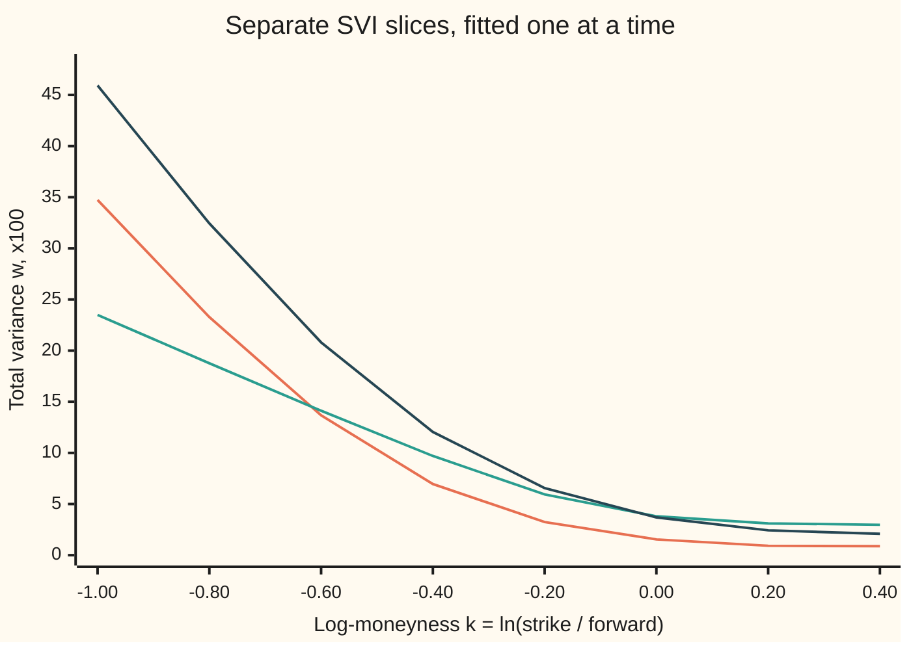
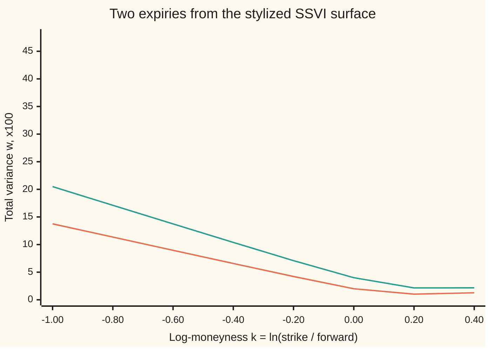

# SSVI: one formula for every expiry, and the inequalities that keep the whole surface free of arbitrage

[Syllabus](../../../SYLLABUS.md) → [Financial mathematics](../README.md) → [The smile and the surface](../README.md#s12) → SSVI

---

## General Overview

Take the 6-month Acme row of [The volatility surface](03-volatility-surface-and-its-arbitrage-rules.md), nine quotes from $80 to $120, and the 1-year crash-market quotes of [The SVI smile](04-svi-smile-fit.md): two different examples, read here as one imagined desk's book. Fit one SVI smile to each expiry on its own. Inside the quoted strikes both fits are excellent: the 6-month curve misses its nine quotes by at most 0.0015 of a volatility point, and the 1-year curve sits above it throughout.

Far below the quotes the two curves cross. At log-moneyness −0.6228 (the log of strike over forward), a strike near $55, the 6-month curve climbs above the 1-year curve. Past that point a 6-month put costs more than a 1-year put at the same forward-relative strike. That is a calendar arbitrage: sell the short option, buy the long one, collect money today and never owe anything later. Swap in the surface card's own 1-year row, fitted the same way, and nothing crosses. Separate fits can land either way, and nothing in the method says which.

**SSVI** ("surface SVI", from Jim Gatheral and Antoine Jacquier, 2014) avoids this by writing every expiry with one formula. Each expiry enters only through its at-the-money total variance: volatility squared times years, at the strike equal to the forward. Three shape numbers serve the whole surface, and a few inequalities on them rule out both kinds of static arbitrage at every strike and every expiry. Fitted to the surface card's 18 Acme quotes with one skew number, SSVI's largest miss is 1.00 volatility point. On the card's rounder, stylized example the inequalities read 1.7 ≤ 2 for butterflies and "$`\sqrt{\theta}`$ rises" for calendars, and the two SSVI slices stay apart everywhere.

**SSVI gives every expiry the same SVI shape, scaled by that expiry's at-the-money total variance, so one skew number and one curvature rule describe the whole surface; two checkable inequalities then guarantee that no butterfly has a negative price and no two expiries ever cross.**

**What kind of fact this is:** a model, a surface shape chosen because it fits markets well and is safe by construction. The calendar condition is a theorem, proved on this card in Why it works for the case used here. The butterfly condition is a theorem of Gatheral and Jacquier, stated here and checked numerically; its necessary half is proved here.

### The picture: separate fits may cross, the surface does not



Orange: the 6-month SVI slice. Green: the SVI card's 1-year slice. Dark blue: the surface card's own 1-year row, fitted the same way. Up is total variance, volatility squared times years. The quotes cover only $`k`$ from −0.24 to +0.17. Left of −0.6228 orange passes above green: the 6-month slice holds more variance. Dark blue stays above orange at every $`k`$ from −3 to 1.5.



Orange: the 6-month SSVI slice. Green: the 1-year SSVI slice. Same axes. The 1-year line stays above the 6-month line at every $`k`$; the smallest gap on $`k`$ from −1.5 to 1.5 is 0.009013.

---

## The formula

Two coordinates from [The volatility surface](03-volatility-surface-and-its-arbitrage-rules.md) carry the whole card. **Log-moneyness** $`k = \ln(K/F_t)`$ measures a strike $`K`$ against the forward price $`F_t`$ for that expiry. **Total variance** $`w = \sigma^2 t`$ is implied volatility $`\sigma`$ squared times years $`t`$.

One more quantity labels each expiry. $`\theta_t`$ (theta) is the **at-the-money total variance** at expiry $`t`$: the total variance at $`k = 0`$. On the Acme quotes it is 0.015384 at 6 months and 0.036936 at 1 year (Step 1). The card's stylized running example has 20% at the forward at every expiry, so $`\theta_t = 0.04\,t`$: 0.02 and 0.04.

SSVI writes the total variance at every strike and expiry as

```math
w(k, \theta_t) = \frac{\theta_t}{2}\left(1 + \rho\,\varphi(\theta_t)\,k + \sqrt{\big(\varphi(\theta_t)\,k + \rho\big)^2 + 1 - \rho^2}\right), \qquad \varphi(\theta) = \eta\,\theta^{-\gamma}
```

**Read it aloud:** at each expiry, total variance is half the at-the-money total variance times a tilted, rounded V in the stretched coordinate $`\varphi k`$; the tilt $`\rho`$ is the same at every expiry, and the stretch $`\varphi`$ shrinks as the at-the-money variance grows.

The function $`\varphi`$ (phi) is the **curvature rule**. This card uses the **power law** $`\varphi(\theta) = \eta\,\theta^{-\gamma}`$ with $`\eta = 1`$ and $`\gamma = 1/2`$. Then $`\varphi = 1/\sqrt{\theta}`$: 7.0711 at 6 months and 5.0000 at 1 year.

Put $`k = 0`$ into the formula. The square root becomes $`\sqrt{\rho^2 + 1 - \rho^2} = 1`$, so $`w(0, \theta) = \theta`$ for every choice of $`\rho`$ and $`\varphi`$. The surface passes exactly through the at-the-money quotes.

The two arbitrage conditions on this example (Gatheral and Jacquier's Theorems 4.1 and 4.2):

```math
\text{butterfly: } \eta\,(1 + \lvert\rho\rvert) = 1.7 \le 2, \qquad \text{calendar: } \theta\,\varphi(\theta) = \sqrt{\theta} \text{ rises with } \theta
```

| Symbol | Plain meaning | In our example | Push it up and the answer… |
| --- | --- | --- | --- |
| $`K`$, $`F_t`$ | strike; forward price for delivery at expiry $`t`$, $`100\,e^{0.03t}`$ | $54.45 to $120; $101.51 at 6 months | — |
| $`k`$ | log-moneyness, $`\ln(K/F_t)`$; 0 at the forward | −1.5 to 1.5 | further into the call wing |
| $`t`$ | time to expiry, in years | 0.5 and 1 | $`\theta_t`$ rises |
| $`w`$, $`\sigma`$ | total variance, $`\sigma^2 t`$, from implied volatility $`\sigma`$ | 0.101595 and 0.154206 at $`k = -0.7`$ | option prices rise |
| $`\theta_t`$ | at-the-money total variance at expiry $`t`$; $`w(0, \theta_t) = \theta_t`$ | stylized $`0.04\,t`$: 0.02 and 0.04; Acme 0.015384 and 0.036936 | whole slice lifts, smile flattens in $`k`$ |
| $`\rho`$ | skew: the tilt of the V, between −1 and 1, the same at every expiry | −0.7; Acme fit −0.6092 | skew flattens toward a symmetric smile |
| $`\varphi(\theta)`$ | curvature rule: stretches $`k`$ so short expiries have steeper smiles | $`1/\sqrt{\theta}`$: 7.0711 and 5.0000 | smiles bend harder |
| $`\eta`$, $`\gamma`$ | size and decay of the power law $`\eta\,\theta^{-\gamma}`$ | 1 and 1/2 | $`\eta`$ up: steeper smiles; $`\gamma`$ up: curvature fades faster with expiry |
| $`g`$ | Gatheral's butterfly function; the density of $`k`$ is $`g`$ times a positive factor | smallest 0.277024 on the test grid; 0.1597 far out at $`\theta = 2`$ | density thicker |
| $`x`$, $`R`$, $`h(x)`$ | the stretched coordinate $`\varphi k`$; the root $`R = \sqrt{(x + \rho)^2 + 1 - \rho^2}`$; the bracket $`h = 1 + \rho x + R`$, so $`w = \tfrac{\theta}{2} h`$ | $`x = -3.5`$ at $`k = -0.7`$, 1 year | — |
| $`b`$ | an SVI slice's wing steepness, from [The SVI smile](04-svi-smile-fit.md); its left wing slope is $`b(1-\rho)`$ with the slice's own tilt | 0.37232 at 6 months, 0.126769 at 1 year (SVI card's quotes) | wings climb faster |
| $`u`$ | the calendar ratio $`\partial_\theta(\theta\varphi)/\varphi`$; for the power law $`u = 1 - \gamma`$ | 0.5 | above 1 needs Gatheral and Jacquier's finer bound |

### When it holds

- **The at-the-money term structure never falls: $`\theta_t`$ rises with $`t`$.** This is the at-the-money calendar test of [Term structure and forward volatility](02-term-structure-and-forward-volatility.md). If $`\theta_t`$ fell, the two slices would cross at $`k = 0`$ itself, whatever the shape numbers.
- **$`\theta\varphi(\theta)`$ rises with $`\theta`$, but not too fast.** Gatheral and Jacquier's condition is $`0 \le \partial_\theta(\theta\varphi) \le \tfrac{1}{\rho^2}\big(1 + \sqrt{1-\rho^2}\big)\varphi`$. If $`\theta\varphi`$ falls, as with $`\gamma = 1.2`$, the wings of the longer slice drop under the shorter one: the gap reaches −0.343859 at $`k = -1.5`$.
- **Butterfly inequalities hold at every $`\theta`$:** $`\theta\varphi(\theta)(1+\lvert\rho\rvert) < 4`$ and $`\theta\varphi(\theta)^2(1+\lvert\rho\rvert) \le 4`$. With $`\eta = 3`$ the second reads 15.30 and $`g`$ falls to −0.1127 near $`k = -0.11`$: a negative probability.
- **The pure power law has a horizon.** With $`\gamma = 1/2`$ the first butterfly inequality reads $`1.7\sqrt{\theta} < 4`$, true while $`\theta < 5.5363`$: 138.4 years on this term structure. Gatheral and Jacquier's variant $`\varphi = \eta/\big(\theta^{\gamma}(1+\theta)^{1-\gamma}\big)`$ removes the horizon, and for it $`\eta(1+\lvert\rho\rvert) \le 2`$ alone is enough.
- **One skew number for all expiries.** A market whose skew changes sign or size between expiries more than $`\varphi`$ allows will not fit. SSVI then trades fit for safety; richer surfaces (extended SSVI with an expiry-dependent $`\rho`$) exist, with longer conditions.

---

## Why it works

### Step 0: one shape, scaled, cannot cross itself if the scaling is tame

Two separately fitted slices are two unrelated curves. Nothing stops them crossing where no quote pins them down. SSVI ties them: the 1-year slice is the 6-month slice with a larger $`\theta`$ plugged in. So "no crossing" becomes one question about one formula: does $`w(k, \theta)`$ rise with $`\theta`$ at every fixed $`k`$? If it does, and $`\theta_t`$ rises with $`t`$, no two expiries can ever cross.

Likewise "no butterfly arbitrage" becomes a question about one slice shape, answered once for all $`\theta`$ by inequalities on $`\theta\varphi`$ and $`\theta\varphi^2`$.

### Step 1: fitting is reading, plus one skew number

**Existence and uniqueness, before fitting.** The at-the-money part has exactly one answer: $`w(0, \theta) = \theta`$, so $`\theta_t`$ is the market's total variance at the forward, nothing to solve. The Acme forwards fall between quoted strikes, so the check reads each expiry's SVI fit at $`k = 0`$: $`\theta`$ is 0.015384 at 6 months and 0.036936 at 1 year, volatilities of 17.54% and 19.22%.

The skew part also has one answer, once $`\eta`$ and $`\gamma`$ are fixed. Differentiate at $`k = 0`$. The square root's slope there is $`\varphi\rho`$, so

```math
\frac{\partial w}{\partial k}(0, \theta) = \rho\,\theta\,\varphi(\theta) = \rho\,\eta\,\sqrt{\theta}
```

In words: the at-the-money slope of total variance is the skew number times $`\theta\varphi`$, so one slope gives $`\rho`$. On the stylized surface below, the 1-year slope is −0.14, and $`\rho = -0.14/(1 \times 0.2) = -0.7`$. In volatility terms, $`\partial\sigma/\partial k = (\partial w/\partial k)/(2\sigma t) = -0.35`$: 3.5 volatility points per 10% of strike, an index-like skew. The check reads $`\rho`$ back from a finite difference of the surface: −0.7000.

**Boundary cases.** A slope with $`\lvert\rho\rvert \ge 1`$ has no legal SSVI: one wing goes flat or negative. With many quotes per expiry, the same one-number fit becomes one-dimensional least squares in $`\rho`$, a search over one interval, against SVI's five numbers per expiry on [The SVI smile](04-svi-smile-fit.md).

**The Acme fit.** On the 18 Acme quotes, with those two $`\theta`$ values, $`\eta = 1`$ and $`\gamma = 1/2`$, least squares gives $`\rho = -0.6092`$. Its largest misses are 0.89 volatility points at 6 months and 1.00 at 1 year, and its headline butterfly test reads 1.6092 ≤ 2. One skew number cannot match every quote; that is the price of safety by construction.

**The running example is stylized.** To keep the hand arithmetic short, the rest of the card uses $`\theta_t = 0.04\,t`$ (20% at the forward at every expiry) and $`\rho = -0.7`$, a steeper index-like skew. It is not a mark of Acme: it misses the Acme quotes by up to 3.86 volatility points at 6 months and 1.36 at 1 year.

### Step 2: the slope of total variance in $`\theta`$ is never negative

Write $`x = \varphi(\theta)k`$ and $`h(x) = 1 + \rho x + R`$, with $`R = \sqrt{(x+\rho)^2 + 1 - \rho^2}`$. Then $`w = \tfrac{\theta}{2}h(x)`$.

Two facts about $`h`$ come from one identity. Expanding, $`R^2 = (1 + \rho x)^2 + (1-\rho^2)x^2 \ge (1+\rho x)^2`$, so $`R \ge |1 + \rho x|`$. Hence:

- $`h = 1 + \rho x + R \ge 0`$;
- $`h - x h' = 1 + (1 + \rho x)/R \ge 0`$, where $`h' = \rho + (x+\rho)/R`$ is the slope of $`h`$.

Now differentiate $`w`$ in $`\theta`$ at fixed $`k`$. Write $`u = \partial_\theta(\theta\varphi)/\varphi`$, the calendar ratio. The chain rule gives

```math
\frac{\partial w}{\partial \theta} = \frac12\Big[(1-u)\big(h - x h'\big) + u\,h\Big]
```

In words: the slope is a blend of two quantities that are never negative. For $`0 \le u \le 1`$ both weights are non-negative too, so $`\partial w/\partial\theta \ge 0`$ at every $`k`$. **The surface cannot cross itself.**

For the power law, $`\theta\varphi = \eta\theta^{1-\gamma}`$, so $`u = 1 - \gamma`$: here 0.5. "$`\theta\varphi`$ rises" is exactly $`u \ge 0`$. Gatheral and Jacquier push the upper limit from 1 to $`(1+\sqrt{1-\rho^2})/\rho^2`$, which is 3.4983 at $`\rho = -0.7`$; the card proves the simpler range, which covers every power law with $`0 \le \gamma \le 1`$.

<details>
<summary>Detailed proof: the slope in theta</summary>

The coordinate $`x = \varphi(\theta)k`$ moves with $`\theta`$: $`\partial x/\partial\theta = \varphi'(\theta)k = x\,\varphi'/\varphi`$. Since $`(\theta\varphi)' = \varphi + \theta\varphi'`$, we have $`\theta\varphi'/\varphi = u - 1`$.

$`\displaystyle \frac{\partial w}{\partial\theta} = \frac{h}{2} + \frac{\theta}{2}h'(x)\,\frac{x\,\varphi'}{\varphi} = \frac12\big[h + (u-1)\,x h'\big] = \frac12\big[(1-u)(h - xh') + u\,h\big]`$

The last step adds and subtracts $`u\,h`$. For the two signs: $`h' = \rho + (x+\rho)/R`$, so $`x h' = \rho x + (x^2 + \rho x)/R`$ and $`h - xh' = 1 + (R^2 - x^2 - \rho x)/R = 1 + (1 + \rho x)/R`$, using $`R^2 = x^2 + 2\rho x + 1`$. Since $`R \ge |1 + \rho x|`$, $`h \ge 1 + \rho x + |1 + \rho x| \ge 0`$, and $`(1 + \rho x)/R \ge -1`$ gives $`h - xh' \ge 0`$. Finally, $`w(k, \theta_{t})`$ rises in $`t`$ because it rises in $`\theta`$ and $`\theta_t`$ rises in $`t`$. The check compares the formula with a finite difference at $`k = -0.7`$, $`\theta = 0.03`$: 2.605626 both ways.

</details>

### Step 3: why rising total variance is the calendar test

[The volatility surface](03-volatility-surface-and-its-arbitrage-rules.md) proves that at a fixed $`k`$ a call per unit of forward rises strictly with total variance, and that a later expiry must be worth at least an earlier one. So $`w(k, \theta_{t_2}) \ge w(k, \theta_{t_1})`$ for $`t_2 > t_1`$ at every $`k`$ is the same as no calendar arbitrage at every forward-relative strike. Step 2 delivers exactly that.

The variance between the two expiries is the forward variance of [Term structure and forward volatility](02-term-structure-and-forward-volatility.md), now at every $`k`$, not only at the money. At $`k = -0.7`$ the stylized SSVI surface gives 0.052610, a forward volatility of 32.44%.

### Step 4: the butterfly test for the whole family

The density test is Gatheral's $`g`$ from [The SVI smile](04-svi-smile-fit.md): the probability density of $`k`$ is $`g`$ times a positive factor, so the density is non-negative exactly where $`g`$ is. For SSVI the slope and bend of one slice are

```math
w' = \frac{\theta\varphi}{2}\left(\rho + \frac{\varphi k + \rho}{R}\right), \qquad w'' = \frac{\theta\varphi^2}{2}\,\frac{1-\rho^2}{R^3}
```

In words: the slope scales with $`\theta\varphi`$ and the bend with $`\theta\varphi^2`$. That is why the conditions are on those two products.

**The necessary half (proved here).** Far out, $`R \approx |\varphi k|`$, so the slices are straight lines with slopes $`\theta\varphi(1-\rho)/2`$ on the left and $`\theta\varphi(1+\rho)/2`$ on the right. Lee's bound on [The SVI smile](04-svi-smile-fit.md) caps each wing slope at 2. Both together read $`\theta\varphi(1+\lvert\rho\rvert) \le 4`$. Here the 1-year slopes are 0.1700 and 0.0300, and the 6-month slopes 0.1202 and 0.0212.

**The sufficient half (Gatheral and Jacquier's Theorem 4.2, stated).** If $`\theta\varphi(1+\lvert\rho\rvert) < 4`$ and $`\theta\varphi^2(1+\lvert\rho\rvert) \le 4`$ at every $`\theta`$, then $`g \ge 0`$ everywhere. Their proof bounds each term of $`g`$ using the two products; it runs several pages and is in their Section 4.

For the power law with $`\gamma = 1/2`$, $`\theta\varphi^2 = \eta^2`$, a constant. The second condition reads $`\eta^2(1+\lvert\rho\rvert) = 1.7 \le 4`$. The headline test, $`\eta(1+\lvert\rho\rvert) = 1.7 \le 2`$, implies it, since then $`\eta^2(1+\lvert\rho\rvert) \le 4/(1+\lvert\rho\rvert) \le 4`$. The first condition, $`1.7\sqrt{\theta} < 4`$, holds for $`\theta < 5.5363`$.

The check computes $`g`$ on $`k`$ from −1.5 to 1.5 at $`\theta`$ = 0.02, 0.04, 0.4 and 2. The smallest value is 0.277024. That value sits at the grid's edge; further out $`g`$ keeps falling, toward one quarter minus the wing slope squared over 16, positive while the slope is under Lee's 2. At $`\theta = 2`$ the left slope is 1.2021 and the limit 0.1597, which $`g`$ matches to four decimals at $`k = -10000`$. A second road builds the density from call prices alone by second differences; at three strikes the two roads agree to five decimals.

### Step 5: why separate SVI fits can cross

The 6-month SVI slice, fitted on its own to the 6-month row of [The volatility surface](03-volatility-surface-and-its-arbitrage-rules.md), has left wing slope $`b(1-\rho)`$ = 0.6960. The 1-year slice from [The SVI smile](04-svi-smile-fit.md) was fitted to that card's crash-market quotes, a different smile from the surface card's 1-year row (it misses that row by up to 1.68 volatility points); its left wing slope is 0.2424. Both wing slopes are below Lee's 2, and inside the quotes the 1-year slice sits at least 0.021991 above the 6-month one. Lee's bound is only necessary, though. The 6-month slice's own $`g`$ turns negative for $`k`$ from about −2.29 to −0.67, reaching −0.1501 at $`k = -1.06`$; its density from call prices there is −0.0362. So that slice also has butterfly arbitrage far out, while the 1-year slice stays clean (smallest $`g`$ 0.1828).

A steeper left wing on the shorter expiry must overtake eventually. A bisection finds the crossing at $`k = -0.6228`$: strike $54.45 at 6 months and $55.28 at 1 year, far below the lowest quote of $80. Neither fit saw that region.

The same fitter on the surface card's own 1-year row (largest miss 0.0027 of a volatility point) gives the opposite outcome. Its left wing slope, 0.8196, is steeper than the 6-month 0.6960, and it stays above the 6-month slice at every $`k`$ from −3 to 1.5 (smallest gap 0.011047, at $`k = +0.65`$). Nothing in the slice-by-slice method links the wings, so nothing in it says which outcome a desk gets.

SSVI links them by construction: its left wing slopes are 0.1202 and 0.1700, so the longer expiry has the steeper wing and the larger level.

---

## Worked numbers, by hand

At $`k = -0.7`$, deep in the put wing, on the stylized surface: $`\rho = -0.7`$ and $`\eta = 1`$. Values come from the check at full precision.

| Step | Arithmetic | Value |
| --- | --- | --- |
| 6-month $`\theta`$, $`\varphi`$ | $`0.04 \times 0.5`$; $`1/\sqrt{0.02}`$ | 0.02; 7.0711 |
| stretched $`x = \varphi k`$ | $`7.0711 \times (-0.7)`$ | −4.9497 |
| $`\rho x`$ | $`(-0.7)(-4.9497)`$ | 3.4648 |
| root $`R`$ | $`\sqrt{(-4.9497 - 0.7)^2 + 1 - 0.49}`$ | 5.6947 |
| 6-month $`w`$ | $`0.01 \times (1 + 3.4648 + 5.6947)`$ | 0.101595 |
| 1-year $`\theta`$, $`\varphi`$, $`x`$ | $`0.04`$; $`1/\sqrt{0.04}`$; $`5 \times (-0.7)`$ | 0.04; 5.0000; −3.5000 |
| root $`R`$ | $`\sqrt{(-3.5 - 0.7)^2 + 0.51}`$ | 4.2603 |
| 1-year $`w`$ | $`0.02 \times (1 + 2.45 + 4.2603)`$ | 0.154206 |
| forward variance | $`0.154206 - 0.101595`$ | +0.052610 |
| forward volatility | $`\sqrt{0.052610 / 0.5}`$ | **32.44%** |

The longer expiry carries more variance at this strike, as it must. The crossed SVI pair of the overview gives the opposite: 0.181745 at 6 months against 0.164225 at 1 year, a forward variance of −0.017520 that no volatility can produce. With the surface card's own 1-year row the gap is +0.081566.

The arbitrage conditions, by hand:

| Step | Arithmetic | Value |
| --- | --- | --- |
| butterfly headline $`\eta(1+\lvert\rho\rvert)`$ | $`1 \times 1.7`$ | 1.7000 ≤ 2 |
| $`\theta\varphi^2(1+\lvert\rho\rvert)`$ | $`\eta^2 \times 1.7`$ | 1.7000 ≤ 4 |
| $`\theta\varphi(1+\lvert\rho\rvert)`$ at 1 year | $`\sqrt{0.04} \times 1.7`$ | 0.3400 < 4 |
| horizon of the pure power law | $`(4/1.7)^2`$, then $`/0.04`$ | θ < 5.5363, 138.4 years |
| calendar ratio $`u`$ | $`1 - \gamma`$ | 0.5000, inside [0, 3.4983] |

In prices: per unit of forward, the 6-month SVI put at $`k = -0.7`$ costs 0.006214 and the 1-year SVI put 0.004809. Selling the first and buying the second collects 0.001405 today and cannot lose. On the stylized SSVI surface the same spread costs +0.002968.

### What breaks if you drop a piece

| Mistake | Comes out at | What went wrong |
| --- | --- | --- |
| Fit each expiry on its own (the overview's pair) and check only inside the quotes | passes inside (gap at least 0.021991), crosses at $`k = -0.6228`$; forward variance −0.017520 at $`k = -0.7`$ | nothing ties the two wings together where no quote pins them; the 6-month slice's own $`g`$ also dips to −0.1501 |
| Curvature rule with $`\theta\varphi`$ falling ($`\gamma = 1.2`$) | 1-year minus 6-month total variance −0.343859 at $`k = -1.5`$ | the calendar ratio $`u = -0.2`$ is negative: the long slice's wings shrink |
| Steep smiles, $`\eta = 3`$: $`\theta\varphi^2(1+\lvert\rho\rvert) = 15.30 > 4`$ | $`g = -0.1127`$ at $`k = -0.11`$; density from call prices −0.1448 | the bend term outgrows the slope terms; a butterfly near the money has negative price |

---

## Code, from first principles, and it actually runs

The script builds the stylized SSVI surface and reads $`\theta`$ and $`\rho`$ back from it. It asserts every Gatheral–Jacquier inequality it prints and checks each wing slope against the surface far out. Butterflies get two roads: Gatheral's $`g`$ in closed form, and densities from second differences of call prices. Calendars get two: the slope formula of Step 2 against a finite difference, and the slice gap scanned over $`k`$. It fits SVI slices to the surface card's two rows with the linear trick of [The SVI smile](04-svi-smile-fit.md), tests each slice's $`g`$ against its price density, finds the crossing with that card's 1-year slice by bisection, and checks each put against the direct put formula. Last, it reads Acme's $`\theta`$ off the fits, checks it against a straight line between quotes, and fits $`\rho`$ by least squares. The normal distribution, the solver and the fitters are written from scratch.

### Python

```python
# SSVI surface -- the check behind the card.  Standard library only.  Power-law SSVI on a stylized at-the-money
# term structure, its arbitrage tests by two roads, SSVI fitted to the Acme quotes, and separate SVI slices.
from math import log, sqrt, exp, pi

def N(x):                         # normal CDF from its own series, as on the SVI card
    if abs(x) > 9.0: return 1.0 if x > 0 else 0.0
    y = abs(x) / sqrt(2.0); term = y; s = y; n = 0
    while term > 1e-17 * s:
        n += 1; term *= 2.0 * y * y / (2 * n + 1); s += term
    e = 2.0 / sqrt(pi) * exp(-y * y) * s
    return 0.5 * (1.0 + e) if x >= 0 else 0.5 * (1.0 - e)

ETA, GAM, RHO = 1.0, 0.5, -0.7    # power law phi(theta) = eta * theta^-gamma, one skew number rho
def theta(t): return 0.04 * t     # stylized at-the-money total variance: 20% vol at the forward at every expiry
def phi(th, eta=ETA, gam=GAM): return eta * th ** -gam
def ssvi(k, th, rho=RHO, eta=ETA, gam=GAM):
    x = phi(th, eta, gam) * k
    return th / 2 * (1 + rho * x + sqrt((x + rho) ** 2 + 1 - rho * rho))
def g_ssvi(k, th, rho=RHO, eta=ETA, gam=GAM):     # Gatheral's g from w, w', w'' in closed form
    f = phi(th, eta, gam); R = sqrt((f * k + rho) ** 2 + 1 - rho * rho); w = ssvi(k, th, rho, eta, gam)
    w1, w2 = th * f / 2 * (rho + (f * k + rho) / R), th * f * f / 2 * (1 - rho * rho) / R ** 3   # w' and w''
    return (1 - k * w1 / (2 * w)) ** 2 - w1 * w1 / 4 * (1 / w + 0.25) + w2 / 2
def dw_dtheta(k, th, rho=RHO, gam=GAM):           # calendar road A: 1/2 [gam (h - x h') + (1 - gam) h]
    x = phi(th, gam=gam) * k; R = sqrt((x + rho) ** 2 + 1 - rho * rho)
    h, h1 = 1 + rho * x + R, rho + (x + rho) / R; return 0.5 * (gam * (h - x * h1) + (1 - gam) * h)
def call(k, w):                   # call per unit of forward, undiscounted: N(d1) - e^k N(d2)
    d1 = -k / sqrt(w) + sqrt(w) / 2; return N(d1) - exp(k) * N(d1 - sqrt(w))
def put(k, w): return call(k, w) - 1 + exp(k)     # put-call parity per unit of forward
def dens_g(k, w, g): return g * exp(-0.5 * (-k / sqrt(w) - sqrt(w) / 2) ** 2) / sqrt(2 * pi * w)
def dens_fd(wf, k, h=1e-3):       # butterfly road B: e^-k (c'' - c') from call prices alone
    c = lambda x: call(x, wf(x))
    c2, c1 = (c(k + h) - 2 * c(k) + c(k - h)) / h ** 2, (c(k + h) - c(k - h)) / (2 * h); return exp(-k) * (c2 - c1)

t6, t1 = theta(0.5), theta(1.0)
print(f"theta at 6 months, 1 year     {t6:.4f} {t1:.4f};  SSVI at k = 0 returns {ssvi(0, t6):.4f} {ssvi(0, t1):.4f}")
print(f"phi at 6 months, 1 year       {phi(t6):.4f} {phi(t1):.4f}")
sk = (ssvi(1e-5, t1) - ssvi(-1e-5, t1)) / 2e-5
print(f"1-year ATM skew dw/dk: rho*theta*phi, finite difference  {RHO * t1 * phi(t1):.6f} {sk:.6f}")
print(f"  as vol skew dsigma/dk = skew / (2 sigma t)  {sk / (2 * sqrt(t1)):.4f};  rho read back  {sk / (t1 * phi(t1)):.4f}")
lee, c2, cap = ETA * (1 + abs(RHO)), ETA ** 2 * (1 + abs(RHO)), (4 / (ETA * (1 + abs(RHO)))) ** 2; ub = (1 + sqrt(1 - RHO ** 2)) / RHO ** 2
print(f"butterfly: eta(1+|rho|) {lee:.4f} <= 2;  theta phi^2 (1+|rho|) {c2:.4f} <= 4")
print(f"  theta phi (1+|rho|) at 1 year {t1 * phi(t1) * (1 + abs(RHO)):.4f} < 4, holds while theta < {cap:.4f}, t < {cap / 0.04:.1f} years")
print(f"calendar: d(theta phi)/dtheta / phi = 1 - gamma = {1 - GAM:.4f}, inside [0, {ub:.4f}]")
for lab, th in (("6 months", t6), ("1 year", t1)):
    f = th * phi(th); sl, sr = f * (1 - RHO) / 2, f * (1 + RHO) / 2      # road 2: the slice's own slope far out
    assert abs(sl - ssvi(-1e3 - 1, th) + ssvi(-1e3, th)) < 1e-6 and abs(sr - ssvi(1e3 + 1, th) + ssvi(1e3, th)) < 1e-6, "wing slopes"
    assert abs(lee - 2 * max(sl, sr) / th ** (1 - GAM)) < 1e-9 and abs(c2 - th * phi(th) ** 2 * (1 + abs(RHO))) < 1e-9, "eta(1+|rho|) from the wing slopes"
    print(f"wing slopes {lab:<8} left theta phi (1-rho)/2, right (1+rho)/2  {sl:.4f} {sr:.4f}")
KG = [-1.5 + 0.01 * i for i in range(301)]; KW = [-3 + 0.001 * i for i in range(4501)]
gm, s2 = min((g_ssvi(k, th), k, th) for th in (t6, t1, 0.4, 2.0) for k in KG), 2.0 * phi(2.0) * (1 - RHO) / 2; lim = 0.25 - s2 * s2 / 16
print(f"min g over k in [-1.5, 1.5], theta in 0.02 0.04 0.4 2:  {gm[0]:.6f} at k {gm[1]:+.2f}, theta {gm[2]:.2f}")
print(f"  far left wing at theta 2: slope {s2:.4f}, g tends to 1/4 - slope^2/16 = {lim:.4f};  g at k -10000 {g_ssvi(-1e4, 2.0):.4f}")
for k in (-0.7, 0.0, 0.3):
    print(f"1-year density of k at {k:+.1f}: from g, from call prices  {dens_g(k, ssvi(k, t1), g_ssvi(k, t1)):.6f} {dens_fd(lambda x: ssvi(x, t1), k):.6f}")
TH = [0.005 * 1.25 ** j for j in range(25)]; dmin = min(dw_dtheta(k, th) for k in KG for th in TH)
fd = (ssvi(-0.7, 0.03 + 1e-6) - ssvi(-0.7, 0.03 - 1e-6)) / 2e-6
print(f"calendar: min dw/dtheta on the grid {dmin:.6f};  at k -0.7, theta 0.03: formula, difference  {dw_dtheta(-0.7, 0.03):.6f} {fd:.6f}")
fd3, cmin = (ssvi(-0.7, 0.03 + 1e-6, gam=0.3) - ssvi(-0.7, 0.03 - 1e-6, gam=0.3)) / 2e-6, min(ssvi(k, t1) - ssvi(k, t6) for k in KG)
print(f"  same at gamma 0.3 (u = {1 - 0.3:.1f}): formula, difference  {dw_dtheta(-0.7, 0.03, gam=0.3):.6f} {fd3:.6f};  u at gamma 1.2 {1 - 1.2:+.1f}")
print(f"calendar: min over k of w(1 year) - w(6 months)  {cmin:.6f}")
def solve(A, y):                  # Gaussian elimination with partial pivoting
    n = len(y); M = [A[i][:] + [y[i]] for i in range(n)]
    for c in range(n):
        piv = max(range(c, n), key=lambda i: abs(M[i][c])); M[c], M[piv] = M[piv], M[c]
        for i in range(c + 1, n):
            f = M[i][c] / M[c][c]; M[i][c:] = [u - f * v for u, v in zip(M[i][c:], M[c][c:])]
    x = [0.0] * n
    for i in reversed(range(n)): x[i] = (M[i][n] - sum(M[i][j] * x[j] for j in range(i + 1, n))) / M[i][i]
    return x
def svi(p, k): a, b, rho, m, s = p; return a + b * (rho * (k - m) + sqrt((k - m) ** 2 + s * s))
def bis(f, lo, hi):               # bisection: f changes sign once on [lo, hi]
    for _ in range(100): mid = 0.5 * (lo + hi); lo, hi = (mid, hi) if f(mid) * f(hi) < 0 else (lo, mid)
    return 0.5 * (lo + hi)
def fit_svi(Q, T):                # nine quotes at $80..$120; spot 100, rate 5%, dividend yield 2%
    ks = [log((80 + 5 * i) / (100 * exp(0.03 * T))) for i in range(9)]; ws = [T * (v / 100) ** 2 for v in Q]
    sse = lambda p: sum((svi(p, k) - w) ** 2 for k, w in zip(ks, ws))
    def inner(m, s):              # SVI card's trick: for fixed (m, s) the fit is linear in (a, b rho, b)
        cols = [[1.0] * 9, [k - m for k in ks], [sqrt((k - m) ** 2 + s * s) for k in ks]]
        a, c, b = solve([[sum(u * v for u, v in zip(ci, cj)) for cj in cols] for ci in cols], [sum(u * v for u, v in zip(ci, ws)) for ci in cols])
        return (a, b, c / b, m, s)
    P, cm, cs, hm, hs = None, 0.0, 0.3, 0.5, 0.29
    for _ in range(60):
        for p in [inner(cm + hm * i / 5, cs + hs * j / 5) for i in range(-5, 6) for j in range(-5, 6) if cs + hs * j / 5 > 0]:
            if P is None or sse(p) < sse(P): P = p
        cm, cs, hm, hs = P[3], P[4], hm * 0.6, hs * 0.6
    return P, ks, max(abs(100 * sqrt(svi(P, k) / T) - v) for k, v in zip(ks, Q))
Q6 = [27.43, 24.38, 21.84, 19.73, 18.00, 16.59, 15.47, 14.60, 13.95]   # the surface card's 6-month row
QH = [27.79, 25.33, 23.24, 21.48, 20.00, 18.76, 17.74, 16.90, 16.22]   # the surface card's 1-year row
(P6, ks, miss), (PH, kh, missh), F6, F1 = fit_svi(Q6, 0.5), fit_svi(QH, 1.0), 100 * exp(0.03 * 0.5), 100 * exp(0.03)
P1 = (0.016719, 0.126769, -0.912282, -0.118207, 0.248954)    # the SVI card's 1-year fit, to its own crash-market quotes
print("6-month SVI a b rho m s  " + " ".join(f"{x:+.5f}" for x in P6) + f"  max miss {miss:.4f} vol points")
print(f"6-month SVI left slope b(1-rho) {P6[1] * (1 - P6[2]):.4f};  1-year SVI left slope {P1[1] * (1 - P1[2]):.4f}")
kx, KS = bis(lambda k: svi(P1, k) - svi(P6, k), -1.0, -0.3), bis(lambda K: svi(P1, log(K / F1)) - svi(P6, log(K / F6)), 40.0, 80.0)
K6, K1 = F6 * exp(kx), F1 * exp(kx)  # the crossing's strikes at the two expiries' own forwards
print(f"SVI slices cross at k {kx:.4f}: strikes {K6:.2f} (6 months), {K1:.2f} (1 year);  compared at the same strike instead {KS:.2f}")
qmin = min(svi(P1, k) - svi(P6, k) for k in [ks[0] + 0.001 * i for i in range(int((ks[-1] - ks[0]) / 0.001) + 1)])
print(f"inside the quoted range k {ks[0]:.4f} to {ks[-1]:.4f}: min w(1y) - w(6m) {qmin:.6f}")
def g_svi(p, k):                  # Gatheral's g for one raw SVI slice, closed form
    a, b, r, m, s = p; q = sqrt((k - m) ** 2 + s * s); w = svi(p, k); w1, w2 = b * (r + (k - m) / q), b * s * s / q ** 3
    return (1 - k * w1 / (2 * w)) ** 2 - w1 * w1 / 4 * (1 / w + 0.25) + w2 / 2
g6, g1, kn = min((g_svi(P6, k), k) for k in KG), min(g_svi(P1, k) for k in KG), [k for k in KW if g_svi(P6, k) < 0]; d6 = dens_fd(lambda x: svi(P6, x), g6[1])
print(f"SVI slices alone: min g 6m {g6[0]:.4f} at k {g6[1]:+.2f} (below 0 for k from {kn[0]:+.2f} to {kn[-1]:+.2f}), density from prices {d6:.4f}; min g 1y {g1:.4f}")
hg = min((svi(PH, k) - svi(P6, k), k) for k in KW); m1 = max(abs(100 * sqrt(svi(P1, k)) - v) for k, v in zip(kh, QH))
print(f"surface card's 1-year row, same fitter: max miss {missh:.4f}, left slope {PH[1] * (1 - PH[2]):.4f};  SVI card's 1-year curve misses it by up to {m1:.2f}")
print(f"  against the 6-month slice on k -3 to 1.5: min w(1y) - w(6m) {hg[0]:.6f} at k {hg[1]:+.2f};  at k -0.7 {svi(PH, -0.7) - svi(P6, -0.7):+.6f}")
th6, th1, ra = svi(P6, 0), svi(PH, 0), -0.5   # Acme's at-the-money total variances: each SVI fit read at k = 0
fq = lambda r: sum((ssvi(k, th, r) - T * (v / 100) ** 2) ** 2 for th, T, kq, Q in ((th6, 0.5, ks, Q6), (th1, 1.0, kh, QH)) for k, v in zip(kq, Q))
for h in (0.05, 0.005, 5e-4, 5e-5, 5e-6): ra = min((ra + h * i for i in range(-9, 10)), key=fq)   # one skew number, eta 1
mq = lambda r, a, b: " ".join(f"{max(abs(100 * sqrt(ssvi(k, th, r) / T) - v) for k, v in zip(kq, Q)):.2f}" for th, T, kq, Q in ((a, 0.5, ks, Q6), (b, 1.0, kh, QH)))
print(f"SSVI fitted to Acme: theta 6m, 1y {th6:.6f} {th1:.6f} (vols {100 * sqrt(th6 / 0.5):.2f}% {100 * sqrt(th1):.2f}%), rho {ra:.4f}, eta(1+|rho|) {ETA * (1 + abs(ra)):.4f}")
print(f"  max miss in vol points, 6m 1y: fitted SSVI {mq(ra, th6, th1)};  stylized SSVI {mq(RHO, t6, t1)}")
print(f"forwards 6m, 1y {F6:.2f} {F1:.2f};  1-year SVI b {P1[1]:.6f};  eta 1.5: eta(1+|rho|) {1.5 * (1 + abs(RHO)):.2f}, eta^2(1+|rho|) {1.5 ** 2 * (1 + abs(RHO)):.3f}")
k7 = -0.7; a6, a1, s6, s1 = svi(P6, k7), svi(P1, k7), ssvi(k7, t6), ssvi(k7, t1); fv = 100 * sqrt((s1 - s6) / 0.5)
print(f"at k -0.7: SVI w 6m, 1y, forward variance  {a6:.6f} {a1:.6f} {a1 - a6:+.6f}")
print(f"at k -0.7: SSVI w 6m, 1y, forward variance {s6:.6f} {s1:.6f} {s1 - s6:+.6f}, forward vol {fv:.2f}%")
print(f"at k -0.7: puts per unit forward, SVI 6m, 1y, spread  {put(k7, a6):.6f} {put(k7, a1):.6f} {put(k7, a1) - put(k7, a6):+.6f}")
print(f"at k -0.7: puts per unit forward, SSVI 6m, 1y, spread {put(k7, s6):.6f} {put(k7, s1):.6f} {put(k7, s1) - put(k7, s6):+.6f}")
hand = lambda th: " ".join(f"{v:.4f}" for v in (phi(th) * k7, RHO * phi(th) * k7, sqrt((phi(th) * k7 + RHO) ** 2 + 1 - RHO ** 2)))
print(f"by hand 6m: x = phi k, rho x, root  {hand(t6)};  1y: {hand(t1)}")
gb = min((g_ssvi(k, t1, eta=3.0), k) for k in KG); db = dens_fd(lambda x: ssvi(x, t1, eta=3.0), gb[1])
cb = min((ssvi(k, t1, gam=1.2) - ssvi(k, t6, gam=1.2), k) for k in KG)
print(f"wrong: eta 3, theta phi^2 (1+|rho|) {3.0 ** 2 * (1 + abs(RHO)):.2f}: min g at 1 year {gb[0]:.4f} at k {gb[1]:+.2f}, density from prices {db:.4f}")
print(f"wrong: gamma 1.2 (theta phi falls): min w(1y) - w(6m) {cb[0]:.6f} at k {cb[1]:+.2f}")
for lab, kw in (("rho -0.95", {"rho": -0.95}), ("eta 1.5", {"eta": 1.5}), ("gamma 0.3", {"gam": 0.3})):
    gt = min(g_ssvi(k, th, **kw) for th in (t6, t1) for k in KG)
    ct = min(ssvi(k, t1, **kw) - ssvi(k, t6, **kw) for k in KG)
    print(f"try: {lab:<10} min g {gt:.4f}  min w(1y) - w(6m) {ct:.6f}  vol at k -0.7, 1y {100 * sqrt(ssvi(k7, t1, **kw)):.2f}%")
KC = [-1.0 + 0.2 * i for i in range(8)]
print("chart, k              " + " ".join(f"{k:6.2f}" for k in KC))
for lab, fn in (("SVI 6m", lambda k: svi(P6, k)), ("SVI 1y", lambda k: svi(P1, k)), ("SVI 1y row", lambda k: svi(PH, k)), ("SSVI 6m", lambda k: ssvi(k, t6)), ("SSVI 1y", lambda k: ssvi(k, t1))):
    print(f"chart, 100 w {lab:<10}" + " ".join(f"{100 * fn(k):6.2f}" for k in KC))
assert abs(sk - RHO * t1 * phi(t1)) < 1e-6 and abs(ssvi(0, t1) - t1) < 1e-12 and miss < 0.05 and missh < 0.05 and fq(ra) < min(fq(ra - 1e-4), fq(ra + 1e-4)), "read-backs; fits tight; SSVI fit at a minimum"
assert all(abs(th - T * (Q[4] ** 2 + (Q[5] ** 2 - Q[4] ** 2) * kq[4] / (kq[4] - kq[5])) / 1e4) < 3e-4 for th, T, kq, Q in ((th6, 0.5, ks, Q6), (th1, 1.0, kh, QH))), "theta = straight line between the quotes either side of the forward"
assert lee <= 2 and c2 <= 4 and t1 * phi(t1) * (1 + abs(RHO)) < 4 and 0 <= 1 - GAM <= ub and abs(ub - 1 / (1 - sqrt(1 - RHO ** 2))) < 1e-12 and abs(cap * phi(cap) * (1 + abs(RHO)) - 4) < 1e-9, "Gatheral-Jacquier inequalities"
assert gm[0] > 0 and all(abs(dens_g(k, ssvi(k, t1), g_ssvi(k, t1)) - dens_fd(lambda x: ssvi(x, t1), k)) < 1e-4 for k in (-0.7, 0.0, 0.3)) and 0 < lim < gm[0] and abs(g_ssvi(-1e4, 2.0) - lim) < 1e-3, "g road = price road; far-wing limit"
assert dmin > 0 and cmin > 0 and abs(fd - dw_dtheta(-0.7, 0.03)) < 1e-6 and abs(fd3 - dw_dtheta(-0.7, 0.03, gam=0.3)) < 1e-6, "SSVI never crosses: formula and difference agree"
assert abs(svi(P1, kx) - svi(P6, kx)) < 1e-9 and a6 > a1 and qmin > 0 and g6[0] < 0 and abs(dens_g(g6[1], svi(P6, g6[1]), g6[0]) - d6) < 1e-4 and g1 > 0 and hg[0] > 0, "SVI slices cross; 6m slice has negative density; Acme's own 1-year row does not cross"
assert abs(svi(P6, log(K6 / F6)) - svi(P1, log(K1 / F1))) < 1e-9 and abs(svi(P1, log(KS / F1)) - svi(P6, log(KS / F6))) < 1e-9 and abs(s6 + 0.5 * (fv / 100) ** 2 - s1) < 1e-12, "crossing strikes; forward vol"
assert all(abs(put(k7, w) - exp(k7) * N(k7 / sqrt(w) + sqrt(w) / 2) + N(k7 / sqrt(w) - sqrt(w) / 2)) < 1e-12 for w in (a6, a1, s6, s1)) and gb[0] < 0 and db < 0 and cb[0] < 0, "puts: parity = direct formula; broken surfaces fail"
print("ALL CHECKS PASS")
```

**Ran 2026-11-23 on macOS, Python 3.14.10, standard library only. All checks passed. Output, pasted from the run:**

```
theta at 6 months, 1 year     0.0200 0.0400;  SSVI at k = 0 returns 0.0200 0.0400
phi at 6 months, 1 year       7.0711 5.0000
1-year ATM skew dw/dk: rho*theta*phi, finite difference  -0.140000 -0.140000
  as vol skew dsigma/dk = skew / (2 sigma t)  -0.3500;  rho read back  -0.7000
butterfly: eta(1+|rho|) 1.7000 <= 2;  theta phi^2 (1+|rho|) 1.7000 <= 4
  theta phi (1+|rho|) at 1 year 0.3400 < 4, holds while theta < 5.5363, t < 138.4 years
calendar: d(theta phi)/dtheta / phi = 1 - gamma = 0.5000, inside [0, 3.4983]
wing slopes 6 months left theta phi (1-rho)/2, right (1+rho)/2  0.1202 0.0212
wing slopes 1 year   left theta phi (1-rho)/2, right (1+rho)/2  0.1700 0.0300
min g over k in [-1.5, 1.5], theta in 0.02 0.04 0.4 2:  0.277024 at k -1.50, theta 0.02
  far left wing at theta 2: slope 1.2021, g tends to 1/4 - slope^2/16 = 0.1597;  g at k -10000 0.1597
1-year density of k at -0.7: from g, from call prices  0.096705 0.096705
1-year density of k at +0.0: from g, from call prices  1.992255 1.992261
1-year density of k at +0.3: from g, from call prices  0.274945 0.274952
calendar: min dw/dtheta on the grid 0.448490;  at k -0.7, theta 0.03: formula, difference  2.605626 2.605626
  same at gamma 0.3 (u = 0.7): formula, difference  2.098873 2.098873;  u at gamma 1.2 -0.2
calendar: min over k of w(1 year) - w(6 months)  0.009013
6-month SVI a b rho m s  -0.07533 +0.37232 -0.86932 -0.48499 +0.45535  max miss 0.0015 vol points
6-month SVI left slope b(1-rho) 0.6960;  1-year SVI left slope 0.2424
SVI slices cross at k -0.6228: strikes 54.45 (6 months), 55.28 (1 year);  compared at the same strike instead 53.56
inside the quoted range k -0.2381 to 0.1673: min w(1y) - w(6m) 0.021991
SVI slices alone: min g 6m -0.1501 at k -1.06 (below 0 for k from -2.29 to -0.67), density from prices -0.0362; min g 1y 0.1828
surface card's 1-year row, same fitter: max miss 0.0027, left slope 0.8196;  SVI card's 1-year curve misses it by up to 1.68
  against the 6-month slice on k -3 to 1.5: min w(1y) - w(6m) 0.011047 at k +0.65;  at k -0.7 +0.081566
SSVI fitted to Acme: theta 6m, 1y 0.015384 0.036936 (vols 17.54% 19.22%), rho -0.6092, eta(1+|rho|) 1.6092
  max miss in vol points, 6m 1y: fitted SSVI 0.89 1.00;  stylized SSVI 3.86 1.36
forwards 6m, 1y 101.51 103.05;  1-year SVI b 0.126769;  eta 1.5: eta(1+|rho|) 2.55, eta^2(1+|rho|) 3.825
at k -0.7: SVI w 6m, 1y, forward variance  0.181745 0.164225 -0.017520
at k -0.7: SSVI w 6m, 1y, forward variance 0.101595 0.154206 +0.052610, forward vol 32.44%
at k -0.7: puts per unit forward, SVI 6m, 1y, spread  0.006214 0.004809 -0.001405
at k -0.7: puts per unit forward, SSVI 6m, 1y, spread 0.001098 0.004067 +0.002968
by hand 6m: x = phi k, rho x, root  -4.9497 3.4648 5.6947;  1y: -3.5000 2.4500 4.2603
wrong: eta 3, theta phi^2 (1+|rho|) 15.30: min g at 1 year -0.1127 at k -0.11, density from prices -0.1448
wrong: gamma 1.2 (theta phi falls): min w(1y) - w(6m) -0.343859 at k -1.50
try: rho -0.95  min g 0.2730  min w(1y) - w(6m) 0.001667  vol at k -0.7, 1y 41.92%
try: eta 1.5    min g 0.2507  min w(1y) - w(6m) 0.009015  vol at k -0.7, 1y 46.19%
try: gamma 0.3  min g 0.3398  min w(1y) - w(6m) 0.009773  vol at k -0.7, 1y 31.38%
chart, k               -1.00  -0.80  -0.60  -0.40  -0.20   0.00   0.20   0.40
chart, 100 w SVI 6m     34.73  23.28  13.68   6.96   3.24   1.54   0.92   0.88
chart, 100 w SVI 1y     23.49  18.76  14.12   9.70   5.94   3.80   3.11   2.97
chart, 100 w SVI 1y row 45.92  32.44  20.81  12.05   6.56   3.69   2.43   2.09
chart, 100 w SSVI 6m    13.75  11.36   8.96   6.58   4.22   2.00   1.02   1.27
chart, 100 w SSVI 1y    20.49  17.11  13.74  10.39   7.09   4.00   2.15   2.17
ALL CHECKS PASS
```

### Rust

```rust
// SSVI surface -- the check behind the card.  Rust std only.  Power-law SSVI on a stylized at-the-money
// term structure, its arbitrage tests by two roads, SSVI fitted to the Acme quotes, and separate SVI slices.
use std::f64::consts::PI;
const ETA: f64 = 1.0; const GAM: f64 = 0.5; const RHO: f64 = -0.7; // phi = eta theta^-gamma; one skew number
type P = [f64; 5];

fn n_cdf(x: f64) -> f64 { // normal CDF from its own series, as on the SVI card
    if x.abs() > 9.0 { return if x > 0.0 { 1.0 } else { 0.0 }; }
    let y = x.abs() / 2f64.sqrt(); let (mut term, mut s, mut n) = (y, y, 0.0);
    while term > 1e-17 * s { n += 1.0; term *= 2.0 * y * y / (2.0 * n + 1.0); s += term; }
    let e = 2.0 / PI.sqrt() * (-y * y).exp() * s;
    if x >= 0.0 { 0.5 * (1.0 + e) } else { 0.5 * (1.0 - e) }
}
fn theta(t: f64) -> f64 { 0.04 * t } // stylized at-the-money total variance: 20% vol at the forward at every expiry
fn phi(th: f64, eta: f64, gam: f64) -> f64 { eta * th.powf(-gam) }
fn ssvi(k: f64, th: f64, rho: f64, eta: f64, gam: f64) -> f64 {
    let x = phi(th, eta, gam) * k; th / 2.0 * (1.0 + rho * x + ((x + rho).powi(2) + 1.0 - rho * rho).sqrt())
}
fn w0(k: f64, th: f64) -> f64 { ssvi(k, th, RHO, ETA, GAM) }
fn g_ssvi(k: f64, th: f64, rho: f64, eta: f64, gam: f64) -> f64 { // Gatheral's g from w, w', w'' in closed form
    let f = phi(th, eta, gam); let r = ((f * k + rho).powi(2) + 1.0 - rho * rho).sqrt(); let w = ssvi(k, th, rho, eta, gam);
    let (w1, w2) = (th * f / 2.0 * (rho + (f * k + rho) / r), th * f * f / 2.0 * (1.0 - rho * rho) / r.powi(3)); // w' and w''
    (1.0 - k * w1 / (2.0 * w)).powi(2) - w1 * w1 / 4.0 * (1.0 / w + 0.25) + w2 / 2.0
}
fn dw_dtheta(k: f64, th: f64, gam: f64) -> f64 { // calendar road A: 1/2 [gam (h - x h') + (1 - gam) h]
    let x = phi(th, ETA, gam) * k; let r = ((x + RHO).powi(2) + 1.0 - RHO * RHO).sqrt();
    let (h, h1) = (1.0 + RHO * x + r, RHO + (x + RHO) / r); 0.5 * (gam * (h - x * h1) + (1.0 - gam) * h)
}
fn call(k: f64, w: f64) -> f64 { // call per unit of forward, undiscounted: N(d1) - e^k N(d2)
    let d1 = -k / w.sqrt() + w.sqrt() / 2.0; n_cdf(d1) - k.exp() * n_cdf(d1 - w.sqrt())
}
fn put(k: f64, w: f64) -> f64 { call(k, w) - 1.0 + k.exp() } // put-call parity per unit of forward
fn dens_g(k: f64, w: f64, g: f64) -> f64 { g * (-0.5 * (-k / w.sqrt() - w.sqrt() / 2.0).powi(2)).exp() / (2.0 * PI * w).sqrt() }
fn dens_fd(wf: &dyn Fn(f64) -> f64, k: f64) -> f64 { // butterfly road B: e^-k (c'' - c') from call prices alone
    let h = 1e-3; let c = |x: f64| call(x, wf(x));
    let (c2, c1) = ((c(k + h) - 2.0 * c(k) + c(k - h)) / (h * h), (c(k + h) - c(k - h)) / (2.0 * h)); (-k).exp() * (c2 - c1)
}
fn solve(a: &Vec<Vec<f64>>, y: &[f64]) -> Vec<f64> { // Gaussian elimination with partial pivoting
    let n = y.len(); let mut m: Vec<Vec<f64>> = (0..n).map(|i| { let mut r = a[i].clone(); r.push(y[i]); r }).collect();
    for c in 0..n {
        let piv = (c..n).max_by(|&i, &j| m[i][c].abs().partial_cmp(&m[j][c].abs()).unwrap()).unwrap(); m.swap(c, piv);
        for i in c + 1..n { let f = m[i][c] / m[c][c]; for j in c..=n { m[i][j] -= f * m[c][j]; } }
    }
    let mut x = vec![0.0; n];
    for i in (0..n).rev() { x[i] = (m[i][n] - (i + 1..n).map(|j| m[i][j] * x[j]).sum::<f64>()) / m[i][i]; }
    x
}
fn svi(p: &P, k: f64) -> f64 { let [a, b, rho, m, s] = *p; a + b * (rho * (k - m) + ((k - m).powi(2) + s * s).sqrt()) }
fn dot(u: &[f64], v: &[f64]) -> f64 { u.iter().zip(v).map(|(a, b)| a * b).sum() }
fn minby<I: Iterator<Item = (f64, f64)>>(it: I) -> (f64, f64) { it.fold((f64::MAX, 0.0), |b, x| if x.0 < b.0 { x } else { b }) }
fn row(v: &[f64]) -> String { v.iter().map(|x| format!("{:6.2}", x)).collect::<Vec<_>>().join(" ") }
fn bis(f: &dyn Fn(f64) -> f64, mut lo: f64, mut hi: f64) -> f64 { // bisection: f changes sign once on [lo, hi]
    for _ in 0..100 { let mid = 0.5 * (lo + hi); if f(mid) * f(hi) < 0.0 { lo = mid } else { hi = mid } } 0.5 * (lo + hi)
}
fn fit_svi(q: &[f64], t: f64) -> (P, Vec<f64>, f64) { // nine quotes at $80..$120; spot 100, rate 5%, dividend yield 2%
    let ks: Vec<f64> = (0..9).map(|i| ((80.0 + 5.0 * i as f64) / (100.0 * (0.03 * t).exp())).ln()).collect();
    let ws: Vec<f64> = q.iter().map(|v| t * (v / 100.0f64).powi(2)).collect();
    let sse = |p: &P| -> f64 { ks.iter().zip(&ws).map(|(&k, &w)| (svi(p, k) - w).powi(2)).sum() };
    let inner = |m: f64, s: f64| -> P { // SVI card's trick: for fixed (m, s) the fit is linear in (a, b rho, b)
        let cols = vec![vec![1.0; 9], ks.iter().map(|k| k - m).collect::<Vec<f64>>(), ks.iter().map(|k| ((k - m).powi(2) + s * s).sqrt()).collect()];
        let a: Vec<Vec<f64>> = cols.iter().map(|ci| cols.iter().map(|cj| dot(ci, cj)).collect()).collect();
        let x = solve(&a, &cols.iter().map(|ci| dot(ci, &ws)).collect::<Vec<f64>>()); [x[0], x[2], x[1] / x[2], m, s]
    };
    let (mut pp, mut first, mut cm, mut cs, mut hm, mut hs) = ([0.0; 5], true, 0.0, 0.3, 0.5, 0.29);
    for _ in 0..60 {
        for i in -5..=5 { for j in -5..=5 { if cs + hs * j as f64 / 5.0 > 0.0 {
            let p = inner(cm + hm * i as f64 / 5.0, cs + hs * j as f64 / 5.0); if first || sse(&p) < sse(&pp) { pp = p; first = false; } } } }
        cm = pp[3]; cs = pp[4]; hm *= 0.6; hs *= 0.6;
    }
    let miss = ks.iter().zip(q).map(|(&k, &v)| (100.0 * (svi(&pp, k) / t).sqrt() - v).abs()).fold(0.0, f64::max); (pp, ks, miss)
}

fn main() {
    let (t6, t1) = (theta(0.5), theta(1.0));
    println!("theta at 6 months, 1 year     {:.4} {:.4};  SSVI at k = 0 returns {:.4} {:.4}", t6, t1, w0(0.0, t6), w0(0.0, t1));
    println!("phi at 6 months, 1 year       {:.4} {:.4}", phi(t6, ETA, GAM), phi(t1, ETA, GAM));
    let sk = (w0(1e-5, t1) - w0(-1e-5, t1)) / 2e-5; let p1 = phi(t1, ETA, GAM);
    println!("1-year ATM skew dw/dk: rho*theta*phi, finite difference  {:.6} {:.6}", RHO * t1 * p1, sk);
    println!("  as vol skew dsigma/dk = skew / (2 sigma t)  {:.4};  rho read back  {:.4}", sk / (2.0 * t1.sqrt()), sk / (t1 * p1));
    let (lee, c2) = (ETA * (1.0 + RHO.abs()), ETA * ETA * (1.0 + RHO.abs())); let cap = (4.0 / lee).powi(2);
    println!("butterfly: eta(1+|rho|) {:.4} <= 2;  theta phi^2 (1+|rho|) {:.4} <= 4", lee, c2);
    println!("  theta phi (1+|rho|) at 1 year {:.4} < 4, holds while theta < {:.4}, t < {:.1} years", t1 * p1 * (1.0 + RHO.abs()), cap, cap / 0.04);
    let ub = (1.0 + (1.0 - RHO * RHO).sqrt()) / (RHO * RHO);
    println!("calendar: d(theta phi)/dtheta / phi = 1 - gamma = {:.4}, inside [0, {:.4}]", 1.0 - GAM, ub);
    for (lab, th) in [("6 months", t6), ("1 year", t1)] {
        let f = th * phi(th, ETA, GAM); let (sl, sr) = (f * (1.0 - RHO) / 2.0, f * (1.0 + RHO) / 2.0); // road 2: the slice's own slope far out
        assert!((sl - w0(-1e3 - 1.0, th) + w0(-1e3, th)).abs() < 1e-6 && (sr - w0(1e3 + 1.0, th) + w0(1e3, th)).abs() < 1e-6, "wing slopes");
        assert!((lee - 2.0 * sl.max(sr) / th.powf(1.0 - GAM)).abs() < 1e-9 && (c2 - th * phi(th, ETA, GAM).powi(2) * (1.0 + RHO.abs())).abs() < 1e-9, "eta(1+|rho|) from the wing slopes");
        println!("wing slopes {:<8} left theta phi (1-rho)/2, right (1+rho)/2  {:.4} {:.4}", lab, sl, sr);
    }
    let kg: Vec<f64> = (0..301).map(|i| -1.5 + 0.01 * i as f64).collect(); let kw: Vec<f64> = (0..4501).map(|i| -3.0 + 0.001 * i as f64).collect();
    let mut gm = (f64::MAX, 0.0, 0.0);
    for th in [t6, t1, 0.4, 2.0] { for &k in &kg { let g = g_ssvi(k, th, RHO, ETA, GAM); if g < gm.0 { gm = (g, k, th); } } }
    let s2 = 2.0 * phi(2.0, ETA, GAM) * (1.0 - RHO) / 2.0; let lim = 0.25 - s2 * s2 / 16.0;
    println!("min g over k in [-1.5, 1.5], theta in 0.02 0.04 0.4 2:  {:.6} at k {:+.2}, theta {:.2}", gm.0, gm.1, gm.2);
    println!("  far left wing at theta 2: slope {:.4}, g tends to 1/4 - slope^2/16 = {:.4};  g at k -10000 {:.4}", s2, lim, g_ssvi(-1e4, 2.0, RHO, ETA, GAM));
    let wf1 = |x: f64| w0(x, t1);
    for k in [-0.7, 0.0, 0.3] {
        println!("1-year density of k at {:+.1}: from g, from call prices  {:.6} {:.6}", k, dens_g(k, w0(k, t1), g_ssvi(k, t1, RHO, ETA, GAM)), dens_fd(&wf1, k));
    }
    let ths: Vec<f64> = (0..25).map(|j| 0.005 * 1.25f64.powi(j)).collect();
    let dmin = kg.iter().flat_map(|&k| ths.iter().map(move |&th| dw_dtheta(k, th, GAM))).fold(f64::MAX, f64::min);
    let fd = (w0(-0.7, 0.03 + 1e-6) - w0(-0.7, 0.03 - 1e-6)) / 2e-6;
    println!("calendar: min dw/dtheta on the grid {:.6};  at k -0.7, theta 0.03: formula, difference  {:.6} {:.6}", dmin, dw_dtheta(-0.7, 0.03, GAM), fd);
    let fd3 = (ssvi(-0.7, 0.03 + 1e-6, RHO, ETA, 0.3) - ssvi(-0.7, 0.03 - 1e-6, RHO, ETA, 0.3)) / 2e-6;
    println!("  same at gamma 0.3 (u = {:.1}): formula, difference  {:.6} {:.6};  u at gamma 1.2 {:+.1}", 1.0 - 0.3, dw_dtheta(-0.7, 0.03, 0.3), fd3, 1.0 - 1.2);
    let cmin = kg.iter().map(|&k| w0(k, t1) - w0(k, t6)).fold(f64::MAX, f64::min);
    println!("calendar: min over k of w(1 year) - w(6 months)  {:.6}", cmin);
    let q6 = [27.43, 24.38, 21.84, 19.73, 18.00, 16.59, 15.47, 14.60, 13.95]; // the surface card's 6-month row
    let qh = [27.79, 25.33, 23.24, 21.48, 20.00, 18.76, 17.74, 16.90, 16.22]; // the surface card's 1-year row
    let ((p6, ks, miss), (ph, kh, missh), f6, f1) = (fit_svi(&q6, 0.5), fit_svi(&qh, 1.0), 100.0 * (0.03f64 * 0.5).exp(), 100.0 * 0.03f64.exp());
    let q1: P = [0.016719, 0.126769, -0.912282, -0.118207, 0.248954]; // the SVI card's 1-year fit, to its own crash-market quotes
    println!("6-month SVI a b rho m s  {}  max miss {:.4} vol points", p6.iter().map(|x| format!("{:+.5}", x)).collect::<Vec<_>>().join(" "), miss);
    println!("6-month SVI left slope b(1-rho) {:.4};  1-year SVI left slope {:.4}", p6[1] * (1.0 - p6[2]), q1[1] * (1.0 - q1[2]));
    let (kx, kss) = (bis(&|k: f64| svi(&q1, k) - svi(&p6, k), -1.0, -0.3), bis(&|kk: f64| svi(&q1, (kk / f1).ln()) - svi(&p6, (kk / f6).ln()), 40.0, 80.0));
    let (k6s, k1s) = (f6 * kx.exp(), f1 * kx.exp()); // the crossing's strikes at the two expiries' own forwards
    println!("SVI slices cross at k {:.4}: strikes {:.2} (6 months), {:.2} (1 year);  compared at the same strike instead {:.2}", kx, k6s, k1s, kss);
    let nq = ((ks[8] - ks[0]) / 0.001) as usize + 1; let qmin = (0..nq).map(|i| { let k = ks[0] + 0.001 * i as f64; svi(&q1, k) - svi(&p6, k) }).fold(f64::MAX, f64::min);
    println!("inside the quoted range k {:.4} to {:.4}: min w(1y) - w(6m) {:.6}", ks[0], ks[8], qmin);
    let g_svi = |p: &P, k: f64| -> f64 { // Gatheral's g for one raw SVI slice, closed form
        let [_a, b, r, m, s] = *p; let q = ((k - m).powi(2) + s * s).sqrt(); let w = svi(p, k); let (w1, w2) = (b * (r + (k - m) / q), b * s * s / q.powi(3));
        (1.0 - k * w1 / (2.0 * w)).powi(2) - w1 * w1 / 4.0 * (1.0 / w + 0.25) + w2 / 2.0 };
    let g6 = minby(kg.iter().map(|&k| (g_svi(&p6, k), k))); let g1 = kg.iter().map(|&k| g_svi(&q1, k)).fold(f64::MAX, f64::min);
    let kn: Vec<f64> = kw.iter().cloned().filter(|&k| g_svi(&p6, k) < 0.0).collect(); let d6 = dens_fd(&|x: f64| svi(&p6, x), g6.1);
    println!("SVI slices alone: min g 6m {:.4} at k {:+.2} (below 0 for k from {:+.2} to {:+.2}), density from prices {:.4}; min g 1y {:.4}", g6.0, g6.1, kn[0], kn[kn.len() - 1], d6, g1);
    let hg = minby(kw.iter().map(|&k| (svi(&ph, k) - svi(&p6, k), k))); let m1 = kh.iter().zip(&qh).map(|(&k, &v)| (100.0 * svi(&q1, k).sqrt() - v).abs()).fold(0.0, f64::max);
    println!("surface card's 1-year row, same fitter: max miss {:.4}, left slope {:.4};  SVI card's 1-year curve misses it by up to {:.2}", missh, ph[1] * (1.0 - ph[2]), m1);
    println!("  against the 6-month slice on k -3 to 1.5: min w(1y) - w(6m) {:.6} at k {:+.2};  at k -0.7 {:+.6}", hg.0, hg.1, svi(&ph, -0.7) - svi(&p6, -0.7));
    let (th6, th1) = (svi(&p6, 0.0), svi(&ph, 0.0)); // Acme's at-the-money total variances: each SVI fit read at k = 0
    let sets = [(th6, 0.5, &ks, &q6), (th1, 1.0, &kh, &qh)];
    let fq = |r: f64| -> f64 { sets.iter().map(|&(th, t, kq, q)| kq.iter().zip(q).map(|(&k, &v)| (ssvi(k, th, r, ETA, GAM) - t * (v / 100.0f64).powi(2)).powi(2)).sum::<f64>()).sum() };
    let mut ra = -0.5; // one skew number by least squares on the 18 quotes, eta 1, gamma 1/2
    for h in [0.05, 0.005, 5e-4, 5e-5, 5e-6] { let c = ra; for i in -9..=9 { let x = c + h * i as f64; if i == -9 || fq(x) < fq(ra) { ra = x; } } }
    let mq = |r: f64, a: f64, b: f64| -> String { [(a, 0.5, &ks, &q6), (b, 1.0, &kh, &qh)].iter().map(|&(th, t, kq, q)|
        format!("{:.2}", kq.iter().zip(q).map(|(&k, &v)| (100.0 * (ssvi(k, th, r, ETA, GAM) / t).sqrt() - v).abs()).fold(0.0, f64::max))).collect::<Vec<_>>().join(" ") };
    println!("SSVI fitted to Acme: theta 6m, 1y {:.6} {:.6} (vols {:.2}% {:.2}%), rho {:.4}, eta(1+|rho|) {:.4}", th6, th1, 100.0 * (th6 / 0.5).sqrt(), 100.0 * th1.sqrt(), ra, ETA * (1.0 + ra.abs()));
    println!("  max miss in vol points, 6m 1y: fitted SSVI {};  stylized SSVI {}", mq(ra, th6, th1), mq(RHO, t6, t1));
    println!("forwards 6m, 1y {:.2} {:.2};  1-year SVI b {:.6};  eta 1.5: eta(1+|rho|) {:.2}, eta^2(1+|rho|) {:.3}", f6, f1, q1[1], 1.5 * (1.0 + RHO.abs()), 1.5f64.powi(2) * (1.0 + RHO.abs()));
    let k7 = -0.7; let (a6, a1, s6, s1) = (svi(&p6, k7), svi(&q1, k7), w0(k7, t6), w0(k7, t1)); let fv = 100.0 * ((s1 - s6) / 0.5).sqrt();
    println!("at k -0.7: SVI w 6m, 1y, forward variance  {:.6} {:.6} {:+.6}", a6, a1, a1 - a6);
    println!("at k -0.7: SSVI w 6m, 1y, forward variance {:.6} {:.6} {:+.6}, forward vol {:.2}%", s6, s1, s1 - s6, fv);
    println!("at k -0.7: puts per unit forward, SVI 6m, 1y, spread  {:.6} {:.6} {:+.6}", put(k7, a6), put(k7, a1), put(k7, a1) - put(k7, a6));
    println!("at k -0.7: puts per unit forward, SSVI 6m, 1y, spread {:.6} {:.6} {:+.6}", put(k7, s6), put(k7, s1), put(k7, s1) - put(k7, s6));
    let hand = |th: f64| { let x = phi(th, ETA, GAM) * k7; format!("{:.4} {:.4} {:.4}", x, RHO * x, ((x + RHO).powi(2) + 1.0 - RHO * RHO).sqrt()) };
    println!("by hand 6m: x = phi k, rho x, root  {};  1y: {}", hand(t6), hand(t1));
    let gb = minby(kg.iter().map(|&k| (g_ssvi(k, t1, RHO, 3.0, GAM), k))); let db = dens_fd(&|x: f64| ssvi(x, t1, RHO, 3.0, GAM), gb.1);
    let cb = minby(kg.iter().map(|&k| (ssvi(k, t1, RHO, ETA, 1.2) - ssvi(k, t6, RHO, ETA, 1.2), k)));
    println!("wrong: eta 3, theta phi^2 (1+|rho|) {:.2}: min g at 1 year {:.4} at k {:+.2}, density from prices {:.4}", 3.0f64.powi(2) * (1.0 + RHO.abs()), gb.0, gb.1, db);
    println!("wrong: gamma 1.2 (theta phi falls): min w(1y) - w(6m) {:.6} at k {:+.2}", cb.0, cb.1);
    for (lab, rho, eta, gam) in [("rho -0.95", -0.95, ETA, GAM), ("eta 1.5", RHO, 1.5, GAM), ("gamma 0.3", RHO, ETA, 0.3)] {
        let gt = [t6, t1].iter().flat_map(|&th| kg.iter().map(move |&k| g_ssvi(k, th, rho, eta, gam))).fold(f64::MAX, f64::min);
        let ct = kg.iter().map(|&k| ssvi(k, t1, rho, eta, gam) - ssvi(k, t6, rho, eta, gam)).fold(f64::MAX, f64::min);
        println!("try: {:<10} min g {:.4}  min w(1y) - w(6m) {:.6}  vol at k -0.7, 1y {:.2}%", lab, gt, ct, 100.0 * ssvi(k7, t1, rho, eta, gam).sqrt());
    }
    let kc: Vec<f64> = (0..8).map(|i| -1.0 + 0.2 * i as f64).collect();
    println!("chart, k              {}", row(&kc));
    let fns: [(&str, Box<dyn Fn(f64) -> f64>); 5] = [("SVI 6m", Box::new(|k| svi(&p6, k))), ("SVI 1y", Box::new(|k| svi(&q1, k))), ("SVI 1y row", Box::new(|k| svi(&ph, k))),
        ("SSVI 6m", Box::new(move |k| w0(k, t6))), ("SSVI 1y", Box::new(move |k| w0(k, t1)))];
    for (lab, f) in fns.iter() { println!("chart, 100 w {:<10}{}", lab, row(&kc.iter().map(|&k| 100.0 * f(k)).collect::<Vec<_>>())); }
    assert!((sk - RHO * t1 * p1).abs() < 1e-6 && (w0(0.0, t1) - t1).abs() < 1e-12 && miss < 0.05 && missh < 0.05 && fq(ra) < fq(ra - 1e-4).min(fq(ra + 1e-4)), "read-backs; fits tight; SSVI fit at a minimum");
    assert!(sets.iter().all(|&(th, t, kq, q)| (th - t * (q[4] * q[4] + (q[5] * q[5] - q[4] * q[4]) * kq[4] / (kq[4] - kq[5])) / 1e4).abs() < 3e-4), "theta = straight line between the quotes either side of the forward");
    assert!(lee <= 2.0 && c2 <= 4.0 && t1 * p1 * (1.0 + RHO.abs()) < 4.0 && 0.0 <= 1.0 - GAM && 1.0 - GAM <= ub && (ub - 1.0 / (1.0 - (1.0 - RHO * RHO).sqrt())).abs() < 1e-12 && (cap * phi(cap, ETA, GAM) * (1.0 + RHO.abs()) - 4.0).abs() < 1e-9, "Gatheral-Jacquier inequalities");
    assert!(gm.0 > 0.0 && [-0.7, 0.0, 0.3].iter().all(|&k| (dens_g(k, w0(k, t1), g_ssvi(k, t1, RHO, ETA, GAM)) - dens_fd(&wf1, k)).abs() < 1e-4) && 0.0 < lim && lim < gm.0 && (g_ssvi(-1e4, 2.0, RHO, ETA, GAM) - lim).abs() < 1e-3, "g road = price road; far-wing limit");
    assert!(dmin > 0.0 && cmin > 0.0 && (fd - dw_dtheta(-0.7, 0.03, GAM)).abs() < 1e-6 && (fd3 - dw_dtheta(-0.7, 0.03, 0.3)).abs() < 1e-6, "SSVI never crosses: formula and difference agree");
    assert!((svi(&q1, kx) - svi(&p6, kx)).abs() < 1e-9 && a6 > a1 && qmin > 0.0 && g6.0 < 0.0 && (dens_g(g6.1, svi(&p6, g6.1), g6.0) - d6).abs() < 1e-4 && g1 > 0.0 && hg.0 > 0.0, "SVI slices cross; 6m slice has negative density; Acme's own 1-year row does not cross");
    assert!((svi(&p6, (k6s / f6).ln()) - svi(&q1, (k1s / f1).ln())).abs() < 1e-9 && (svi(&q1, (kss / f1).ln()) - svi(&p6, (kss / f6).ln())).abs() < 1e-9 && (s6 + 0.5 * (fv / 100.0).powi(2) - s1).abs() < 1e-12, "crossing strikes; forward vol");
    assert!([a6, a1, s6, s1].iter().all(|&w| (put(k7, w) - k7.exp() * n_cdf(k7 / w.sqrt() + w.sqrt() / 2.0) + n_cdf(k7 / w.sqrt() - w.sqrt() / 2.0)).abs() < 1e-12) && gb.0 < 0.0 && db < 0.0 && cb.0 < 0.0, "puts: parity = direct formula; broken surfaces fail");
    println!("ALL CHECKS PASS");
}
```

**Ran 2026-11-23 on macOS, rustc 1.98.1, no crates. All checks passed. Output, pasted from the run:**

```
theta at 6 months, 1 year     0.0200 0.0400;  SSVI at k = 0 returns 0.0200 0.0400
phi at 6 months, 1 year       7.0711 5.0000
1-year ATM skew dw/dk: rho*theta*phi, finite difference  -0.140000 -0.140000
  as vol skew dsigma/dk = skew / (2 sigma t)  -0.3500;  rho read back  -0.7000
butterfly: eta(1+|rho|) 1.7000 <= 2;  theta phi^2 (1+|rho|) 1.7000 <= 4
  theta phi (1+|rho|) at 1 year 0.3400 < 4, holds while theta < 5.5363, t < 138.4 years
calendar: d(theta phi)/dtheta / phi = 1 - gamma = 0.5000, inside [0, 3.4983]
wing slopes 6 months left theta phi (1-rho)/2, right (1+rho)/2  0.1202 0.0212
wing slopes 1 year   left theta phi (1-rho)/2, right (1+rho)/2  0.1700 0.0300
min g over k in [-1.5, 1.5], theta in 0.02 0.04 0.4 2:  0.277024 at k -1.50, theta 0.02
  far left wing at theta 2: slope 1.2021, g tends to 1/4 - slope^2/16 = 0.1597;  g at k -10000 0.1597
1-year density of k at -0.7: from g, from call prices  0.096705 0.096705
1-year density of k at +0.0: from g, from call prices  1.992255 1.992261
1-year density of k at +0.3: from g, from call prices  0.274945 0.274952
calendar: min dw/dtheta on the grid 0.448490;  at k -0.7, theta 0.03: formula, difference  2.605626 2.605626
  same at gamma 0.3 (u = 0.7): formula, difference  2.098873 2.098873;  u at gamma 1.2 -0.2
calendar: min over k of w(1 year) - w(6 months)  0.009013
6-month SVI a b rho m s  -0.07533 +0.37232 -0.86932 -0.48499 +0.45535  max miss 0.0015 vol points
6-month SVI left slope b(1-rho) 0.6960;  1-year SVI left slope 0.2424
SVI slices cross at k -0.6228: strikes 54.45 (6 months), 55.28 (1 year);  compared at the same strike instead 53.56
inside the quoted range k -0.2381 to 0.1673: min w(1y) - w(6m) 0.021991
SVI slices alone: min g 6m -0.1501 at k -1.06 (below 0 for k from -2.29 to -0.67), density from prices -0.0362; min g 1y 0.1828
surface card's 1-year row, same fitter: max miss 0.0027, left slope 0.8196;  SVI card's 1-year curve misses it by up to 1.68
  against the 6-month slice on k -3 to 1.5: min w(1y) - w(6m) 0.011047 at k +0.65;  at k -0.7 +0.081566
SSVI fitted to Acme: theta 6m, 1y 0.015384 0.036936 (vols 17.54% 19.22%), rho -0.6092, eta(1+|rho|) 1.6092
  max miss in vol points, 6m 1y: fitted SSVI 0.89 1.00;  stylized SSVI 3.86 1.36
forwards 6m, 1y 101.51 103.05;  1-year SVI b 0.126769;  eta 1.5: eta(1+|rho|) 2.55, eta^2(1+|rho|) 3.825
at k -0.7: SVI w 6m, 1y, forward variance  0.181745 0.164225 -0.017520
at k -0.7: SSVI w 6m, 1y, forward variance 0.101595 0.154206 +0.052610, forward vol 32.44%
at k -0.7: puts per unit forward, SVI 6m, 1y, spread  0.006214 0.004809 -0.001405
at k -0.7: puts per unit forward, SSVI 6m, 1y, spread 0.001098 0.004067 +0.002968
by hand 6m: x = phi k, rho x, root  -4.9497 3.4648 5.6947;  1y: -3.5000 2.4500 4.2603
wrong: eta 3, theta phi^2 (1+|rho|) 15.30: min g at 1 year -0.1127 at k -0.11, density from prices -0.1448
wrong: gamma 1.2 (theta phi falls): min w(1y) - w(6m) -0.343859 at k -1.50
try: rho -0.95  min g 0.2730  min w(1y) - w(6m) 0.001667  vol at k -0.7, 1y 41.92%
try: eta 1.5    min g 0.2507  min w(1y) - w(6m) 0.009015  vol at k -0.7, 1y 46.19%
try: gamma 0.3  min g 0.3398  min w(1y) - w(6m) 0.009773  vol at k -0.7, 1y 31.38%
chart, k               -1.00  -0.80  -0.60  -0.40  -0.20   0.00   0.20   0.40
chart, 100 w SVI 6m     34.73  23.28  13.68   6.96   3.24   1.54   0.92   0.88
chart, 100 w SVI 1y     23.49  18.76  14.12   9.70   5.94   3.80   3.11   2.97
chart, 100 w SVI 1y row 45.92  32.44  20.81  12.05   6.56   3.69   2.43   2.09
chart, 100 w SSVI 6m    13.75  11.36   8.96   6.58   4.22   2.00   1.02   1.27
chart, 100 w SSVI 1y    20.49  17.11  13.74  10.39   7.09   4.00   2.15   2.17
ALL CHECKS PASS
```

### Lean

Lean proves Steps 1 and 2 for every SSVI surface allowed by When it holds, up to Gatheral and Jacquier's full calendar bound.

- Take any $`\rho`$ and $`\varphi`$. Then $`w(0, \theta) = \theta`$, and the slope $`\partial w/\partial k`$ at $`k = 0`$ is $`\rho\,\theta\,\varphi(\theta)`$.
- Suppose $`\lvert\rho\rvert < 1`$, $`\varphi > 0`$ has a slope, $`\theta_t > 0`$ rises with $`t`$, and $`\theta\varphi`$ rises within Gatheral and Jacquier's bound. Then $`w(k, \theta_t)`$ never falls as $`t`$ grows, at every $`k`$: no two expiries cross.
- Take the power law with $`\eta > 0`$, $`0 \le \gamma \le 1`$ and $`\lvert\rho\rvert < 1`$. Then $`w(k, \theta)`$ never falls as $`\theta`$ grows, at every $`k`$.
- Lean also checks the hand numbers exactly: $`\eta(1+\lvert\rho\rvert) = 1.7 \le 2`$, $`\varphi = 5`$ at 1 year, skew −0.14, wing slopes 0.17 and 0.03.
- It checks the horizon $`\theta = 1600/289`$, 138.4 years, and that $`\eta = 3`$ gives 15.30, above 4.

The butterfly half of Step 4, the fits, the SVI crossing and the density values are left to the Python and Rust checks.

```lean
-- SSVI: if the at-the-money total variance never falls and θφ(θ) rises with θ but not too fast, the SSVI total variance at every log-moneyness never falls with expiry, so no two expiries cross.
import Mathlib.Analysis.SpecialFunctions.Pow.Real
import Mathlib.Analysis.SpecialFunctions.Sqrt
import Mathlib.Analysis.Calculus.Deriv.Basic
import Mathlib.Analysis.SpecialFunctions.Pow.Deriv
import Mathlib.Analysis.Calculus.Deriv.MeanValue

open Set

/-- The SSVI total variance at log-moneyness `k` on the slice with at-the-money total variance
`θ`, skew `ρ` and curvature rule `φ`:
`w(k, θ) = θ/2 · (1 + ρ φ(θ) k + √((φ(θ) k + ρ)² + 1 − ρ²))`. -/
noncomputable def ssviW (ρ : ℝ) (φ : ℝ → ℝ) (k θ : ℝ) : ℝ :=
  θ / 2 * (1 + ρ * (φ θ * k) + Real.sqrt ((φ θ * k + ρ) ^ 2 + 1 - ρ ^ 2))

lemma ssvi_slope_nonneg_aux (ρ f D k : ℝ) (hρ : ρ ^ 2 < 1) (hf : 0 < f) (hP : 0 ≤ f + D)
    (hslow : ρ ^ 2 * (f + D) ≤ (1 + Real.sqrt (1 - ρ ^ 2)) * f) :
    0 ≤ 1 + ρ * (f * k) + Real.sqrt ((f * k + ρ) ^ 2 + 1 - ρ ^ 2) +
      D * k * (ρ + (f * k + ρ) / Real.sqrt ((f * k + ρ) ^ 2 + 1 - ρ ^ 2)) := by
  have hpos : 0 < (f * k + ρ) ^ 2 + 1 - ρ ^ 2 := by nlinarith [sq_nonneg (f * k + ρ)]
  have hRpos : 0 < Real.sqrt ((f * k + ρ) ^ 2 + 1 - ρ ^ 2) := Real.sqrt_pos.mpr hpos
  have hR2 : Real.sqrt ((f * k + ρ) ^ 2 + 1 - ρ ^ 2) ^ 2 = (f * k + ρ) ^ 2 + 1 - ρ ^ 2 :=
    Real.sq_sqrt hpos.le
  have hRs : Real.sqrt (1 - ρ ^ 2) ≤ Real.sqrt ((f * k + ρ) ^ 2 + 1 - ρ ^ 2) :=
    Real.sqrt_le_sqrt (by nlinarith [sq_nonneg (f * k + ρ)])
  have hs2 : Real.sqrt (1 - ρ ^ 2) ^ 2 = 1 - ρ ^ 2 := Real.sq_sqrt (by linarith)
  have hs0 : 0 ≤ Real.sqrt (1 - ρ ^ 2) := Real.sqrt_nonneg _
  have hq : (f * k + ρ) / Real.sqrt ((f * k + ρ) ^ 2 + 1 - ρ ^ 2) *
      Real.sqrt ((f * k + ρ) ^ 2 + 1 - ρ ^ 2) = f * k + ρ := div_mul_cancel₀ _ hRpos.ne'
  generalize Real.sqrt ((f * k + ρ) ^ 2 + 1 - ρ ^ 2) = R at *
  generalize Real.sqrt (1 - ρ ^ 2) = s at *
  generalize (f * k + ρ) / R = q at *
  have h1 : 0 ≤ 1 + ρ * (f * k) + R := by
    have : (1 + ρ * (f * k)) ^ 2 ≤ R ^ 2 := by
      rw [hR2]; nlinarith [mul_nonneg (sq_nonneg (f * k)) (by linarith : (0:ℝ) ≤ 1 - ρ ^ 2)]
    linarith [(abs_le_of_sq_le_sq' this hRpos.le).1]
  have hPs : (1 - s) * (f + D) ≤ f := by
    have h' : (1 + s) * ((1 - s) * (f + D)) ≤ (1 + s) * f := by
      have : ρ ^ 2 = (1 + s) * (1 - s) := by nlinarith
      nlinarith
    exact le_of_mul_le_mul_left h' (by linarith)
  have h2 : 0 ≤ f + (f + D) * (R - 1) := by nlinarith
  have hkey : f * R * (1 + ρ * (f * k) + R + D * k * (ρ + q)) =
      (1 + ρ * (f * k) + R) * (f + (f + D) * (R - 1)) := by
    linear_combination (f * D * k) * hq - D * hR2
  have : 0 ≤ f * R * (1 + ρ * (f * k) + R + D * k * (ρ + q)) := by
    rw [hkey]; exact mul_nonneg h1 h2
  exact (mul_nonneg_iff_of_pos_left (mul_pos hf hRpos)).mp this

#print axioms ssvi_slope_nonneg_aux

lemma ssviW_hasDerivAt_theta (ρ : ℝ) (φ : ℝ → ℝ) (k θ φ' : ℝ) (hρ : ρ ^ 2 < 1)
    (hφ : HasDerivAt φ φ' θ) :
    HasDerivAt (fun x => ssviW ρ φ k x)
      (1 / 2 * (1 + ρ * (φ θ * k) + Real.sqrt ((φ θ * k + ρ) ^ 2 + 1 - ρ ^ 2) +
        θ * φ' * k * (ρ + (φ θ * k + ρ) / Real.sqrt ((φ θ * k + ρ) ^ 2 + 1 - ρ ^ 2)))) θ := by
  have hpos : 0 < (φ θ * k + ρ) ^ 2 + 1 - ρ ^ 2 := by nlinarith [sq_nonneg (φ θ * k + ρ)]
  have hRpos : 0 < Real.sqrt ((φ θ * k + ρ) ^ 2 + 1 - ρ ^ 2) := Real.sqrt_pos.mpr hpos
  have hA : HasDerivAt (fun x => φ x * k) (φ' * k) θ := hφ.mul_const k
  have hS : HasDerivAt (fun x => Real.sqrt ((φ x * k + ρ) ^ 2 + 1 - ρ ^ 2))
      ((↑2 * (φ θ * k + ρ) ^ (2 - 1) * (φ' * k)) /
        (2 * Real.sqrt ((φ θ * k + ρ) ^ 2 + 1 - ρ ^ 2))) θ :=
    ((((hA.add_const ρ).pow 2).add_const 1).sub_const (ρ ^ 2)).sqrt hpos.ne'
  have hH : HasDerivAt (fun x => 1 + ρ * (φ x * k) + Real.sqrt ((φ x * k + ρ) ^ 2 + 1 - ρ ^ 2))
      (ρ * (φ' * k) + (↑2 * (φ θ * k + ρ) ^ (2 - 1) * (φ' * k)) /
        (2 * Real.sqrt ((φ θ * k + ρ) ^ 2 + 1 - ρ ^ 2))) θ :=
    ((hA.const_mul ρ).const_add 1).add hS
  have h : HasDerivAt (fun x => x / 2 * (1 + ρ * (φ x * k) +
      Real.sqrt ((φ x * k + ρ) ^ 2 + 1 - ρ ^ 2)))
      (1 / 2 * (1 + ρ * (φ θ * k) + Real.sqrt ((φ θ * k + ρ) ^ 2 + 1 - ρ ^ 2)) +
        θ / 2 * (ρ * (φ' * k) + (↑2 * (φ θ * k + ρ) ^ (2 - 1) * (φ' * k)) /
        (2 * Real.sqrt ((φ θ * k + ρ) ^ 2 + 1 - ρ ^ 2)))) θ :=
    ((hasDerivAt_id θ).div_const 2).mul hH
  refine h.congr_deriv ?_
  field_simp
  ring

#print axioms ssviW_hasDerivAt_theta

/-- **SSVI has no calendar arbitrage (Gatheral and Jacquier, Theorem 4.1, sufficient half).**
Take a skew `ρ` strictly between −1 and 1, a curvature rule `φ` that is positive and
differentiable for `θ > 0`, and an at-the-money total variance `θ_t > 0` that never falls as the
expiry `t > 0` grows. Suppose `θ φ(θ)` rises with `θ`, but not too fast:
`0 ≤ ∂θ(θφ) ≤ (1 + √(1 − ρ²)) / ρ² · φ`, written here as `ρ² ∂θ(θφ) ≤ (1 + √(1 − ρ²)) φ` so
that `ρ = 0` puts no upper limit. Then at every log-moneyness `k` the SSVI total variance
`w(k, θ_t)` never falls as `t` grows: no two expiries of the surface cross. -/
theorem ssvi_surface_has_no_calendar_arbitrage (ρ : ℝ) (φ atm : ℝ → ℝ)
    (hρ : |ρ| < 1)
    (hφpos : ∀ θ, 0 < θ → 0 < φ θ)
    (hφdiff : DifferentiableOn ℝ φ (Ioi 0))
    (hrise : ∀ θ, 0 < θ → 0 ≤ deriv (fun s => s * φ s) θ)
    (hslow : ∀ θ, 0 < θ →
      ρ ^ 2 * deriv (fun s => s * φ s) θ ≤ (1 + Real.sqrt (1 - ρ ^ 2)) * φ θ)
    (hatm_pos : ∀ t, 0 < t → 0 < atm t)
    (hatm_mono : MonotoneOn atm (Ioi 0)) (k : ℝ) :
    MonotoneOn (fun t => ssviW ρ φ k (atm t)) (Ioi 0) := by
  have hρ2 : ρ ^ 2 < 1 := by
    have := abs_lt.mp hρ; nlinarith
  have hd : ∀ θ ∈ Ioi (0 : ℝ), HasDerivAt (fun x => ssviW ρ φ k x)
      (1 / 2 * (1 + ρ * (φ θ * k) + Real.sqrt ((φ θ * k + ρ) ^ 2 + 1 - ρ ^ 2) +
        θ * deriv φ θ * k * (ρ + (φ θ * k + ρ) / Real.sqrt ((φ θ * k + ρ) ^ 2 + 1 - ρ ^ 2)))) θ :=
    fun θ hθ => ssviW_hasDerivAt_theta ρ φ k θ (deriv φ θ) hρ2
      (hφdiff.differentiableAt (Ioi_mem_nhds hθ)).hasDerivAt
  have hg : MonotoneOn (fun x => ssviW ρ φ k x) (Ioi 0) := by
    apply monotoneOn_of_deriv_nonneg (convex_Ioi 0)
    · exact fun θ hθ => (hd θ hθ).continuousAt.continuousWithinAt
    · rw [interior_Ioi]
      exact fun θ hθ => (hd θ hθ).differentiableAt.differentiableWithinAt
    · rw [interior_Ioi]
      intro θ hθ
      rw [(hd θ hθ).deriv]
      have hψ : deriv (fun s => s * φ s) θ = φ θ + θ * deriv φ θ := by
        have h : HasDerivAt (fun s => s * φ s) (1 * φ θ + θ * deriv φ θ) θ :=
          (hasDerivAt_id' θ).mul (hφdiff.differentiableAt (Ioi_mem_nhds hθ)).hasDerivAt
        rw [h.deriv]; ring
      have hr := hrise θ hθ
      have hs := hslow θ hθ
      rw [hψ] at hr hs
      exact mul_nonneg (by norm_num)
        (ssvi_slope_nonneg_aux ρ (φ θ) (θ * deriv φ θ) k hρ2 (hφpos θ hθ) hr hs)
  intro a ha b hb hab
  exact hg (hatm_pos a ha) (hatm_pos b hb) (hatm_mono ha hb hab)

/-- **The power law: total variance rises with θ at every strike (the card's Step 2).** With the
curvature rule `φ(θ) = η θ^(−γ)`, `η > 0` and `0 ≤ γ ≤ 1` (so `θφ = η θ^(1−γ)` rises, with
calendar ratio `u = 1 − γ` between 0 and 1), and skew `|ρ| < 1`, the SSVI total variance
`w(k, θ)` never falls as `θ > 0` grows, at every log-moneyness `k`. -/
theorem power_law_ssvi_total_variance_rises_with_theta (ρ η γ : ℝ) (hρ : |ρ| < 1)
    (hη : 0 < η) (hγ0 : 0 ≤ γ) (hγ1 : γ ≤ 1) (k : ℝ) :
    MonotoneOn (fun θ => ssviW ρ (fun s => η * s ^ (-γ)) k θ) (Ioi 0) := by
  have hd : ∀ θ : ℝ, 0 < θ → deriv (fun s => s * (η * s ^ (-γ))) θ = η * (1 - γ) * θ ^ (-γ) := by
    intro θ hθ
    have h : HasDerivAt (fun s => s * (η * s ^ (-γ)))
        (1 * (η * θ ^ (-γ)) + θ * (η * (-γ * θ ^ (-γ - 1)))) θ :=
      (hasDerivAt_id' θ).mul ((Real.hasDerivAt_rpow_const (p := -γ) (Or.inl hθ.ne')).const_mul η)
    rw [h.deriv, Real.rpow_sub_one hθ.ne']
    field_simp
    ring
  refine ssvi_surface_has_no_calendar_arbitrage ρ (fun s => η * s ^ (-γ)) (fun t => t) hρ
    (fun θ hθ => mul_pos hη (Real.rpow_pos_of_pos hθ _)) ?_ ?_ ?_ (fun t ht => ht)
    (fun a _ b _ h => h) k
  · intro θ hθ
    exact ((Real.hasDerivAt_rpow_const (p := -γ) (Or.inl (ne_of_gt hθ))).const_mul
      η).differentiableAt.differentiableWithinAt
  · intro θ hθ
    rw [hd θ hθ]
    exact mul_nonneg (mul_nonneg hη.le (by linarith)) (Real.rpow_nonneg hθ.le _)
  · intro θ hθ
    rw [hd θ hθ]
    have hc : 0 < η * θ ^ (-γ) := mul_pos hη (Real.rpow_pos_of_pos hθ _)
    have hρ2 : ρ ^ 2 ≤ 1 := by
      have := abs_lt.mp hρ; nlinarith
    have hs : 0 ≤ Real.sqrt (1 - ρ ^ 2) := Real.sqrt_nonneg _
    have hu : ρ ^ 2 * (1 - γ) ≤ 1 + Real.sqrt (1 - ρ ^ 2) := by
      nlinarith [sq_nonneg ρ]
    calc ρ ^ 2 * (η * (1 - γ) * θ ^ (-γ)) = (ρ ^ 2 * (1 - γ)) * (η * θ ^ (-γ)) := by ring
      _ ≤ (1 + Real.sqrt (1 - ρ ^ 2)) * (η * θ ^ (-γ)) := mul_le_mul_of_nonneg_right hu hc.le

/-- **At the money: the surface passes through θ, and its slope there gives ρ.** For any skew
`ρ`, curvature rule `φ` and level `θ`, the SSVI total variance at `k = 0` is `θ` itself, and its
slope in `k` there is `ρ θ φ(θ)`, so one at-the-money skew reading fixes `ρ`. -/
theorem ssvi_at_the_money_value_and_skew (ρ : ℝ) (φ : ℝ → ℝ) (θ : ℝ) :
    ssviW ρ φ 0 θ = θ ∧
      HasDerivAt (fun k => ssviW ρ φ k θ) (ρ * θ * φ θ) 0 := by
  have h1 : (φ θ * 0 + ρ) ^ 2 + 1 - ρ ^ 2 = 1 := by ring
  constructor
  · unfold ssviW
    rw [h1, Real.sqrt_one]; ring
  · have hA : HasDerivAt (fun k => φ θ * k) (φ θ * 1) 0 := (hasDerivAt_id' 0).const_mul (φ θ)
    have hS : HasDerivAt (fun k => Real.sqrt ((φ θ * k + ρ) ^ 2 + 1 - ρ ^ 2))
        ((↑2 * (φ θ * 0 + ρ) ^ (2 - 1) * (φ θ * 1)) /
          (2 * Real.sqrt ((φ θ * 0 + ρ) ^ 2 + 1 - ρ ^ 2))) 0 :=
      ((((hA.add_const ρ).pow 2).add_const 1).sub_const (ρ ^ 2)).sqrt (by simp only [Pi.pow_apply]; rw [h1]; norm_num)
    have h : HasDerivAt (fun k => θ / 2 * (1 + ρ * (φ θ * k) +
        Real.sqrt ((φ θ * k + ρ) ^ 2 + 1 - ρ ^ 2)))
        (θ / 2 * (ρ * (φ θ * 1) + (↑2 * (φ θ * 0 + ρ) ^ (2 - 1) * (φ θ * 1)) /
          (2 * Real.sqrt ((φ θ * 0 + ρ) ^ 2 + 1 - ρ ^ 2)))) 0 :=
      (((hA.const_mul ρ).const_add 1).add hS).const_mul (θ / 2)
    refine h.congr_deriv ?_
    rw [h1, Real.sqrt_one]
    ring

-- Headline butterfly test on the stylized surface: η (1 + |ρ|) = 1 × 1.7 = 17/10 ≤ 2.
example : (1 : ℚ) * (1 + |(-7 / 10 : ℚ)|) = 17 / 10 ∧ (17 / 10 : ℚ) ≤ 2 := by norm_num
-- With γ = 1/2, θ φ² (1 + |ρ|) = η² × 1.7 = 17/10 ≤ 4.
example : (1 : ℚ) ^ 2 * (1 + |(-7 / 10 : ℚ)|) ≤ 4 := by norm_num
-- 1-year slice: φ(0.04) = 1/√(1/25) = 5.
example : 1 / Real.sqrt (1 / 25) = 5 := by
  rw [show (1 / 25 : ℝ) = (1 / 5) ^ 2 by norm_num, Real.sqrt_sq (by norm_num)]; norm_num
-- 1-year at-the-money skew ρ θ φ = (−7/10)(1/25)(5) = −7/50 (−0.14).
example : (-7 / 10 : ℚ) * (1 / 25) * 5 = -7 / 50 := by norm_num
-- 1-year wing slopes θφ(1 − ρ)/2 and θφ(1 + ρ)/2 with θφ = 1/5: 17/100 and 3/100.
example : (1 / 5 : ℚ) * (1 - (-7 / 10)) / 2 = 17 / 100 ∧
    (1 / 5 : ℚ) * (1 + (-7 / 10)) / 2 = 3 / 100 := by norm_num
-- Horizon of the pure power law: at θ = (4/1.7)² = 1600/289, √θ × 1.7 = 4 exactly,
-- which is 40000/289 years (138.4) on θ_t = t/25.
example : Real.sqrt (1600 / 289) * (17 / 10) = 4 := by
  rw [show (1600 / 289 : ℝ) = (40 / 17) ^ 2 by norm_num, Real.sqrt_sq (by norm_num)]; norm_num
example : (1600 / 289 : ℚ) / (1 / 25) = 40000 / 289 := by norm_num
-- Calendar ratio u = 1 − γ = 1/2 lies inside [0, (1 + √(1 − ρ²))/ρ²]: ρ² u ≤ 1 + √(51/100).
example : (0 : ℝ) ≤ 1 - 1 / 2 ∧
    (-7 / 10 : ℝ) ^ 2 * (1 - 1 / 2) ≤ 1 + Real.sqrt (1 - (-7 / 10) ^ 2) := by
  constructor
  · norm_num
  · nlinarith [Real.sqrt_nonneg (1 - (-7 / 10 : ℝ) ^ 2)]
-- What breaks: η = 3 gives θ φ² (1 + |ρ|) = 9 × 1.7 = 153/10 (15.30) > 4;
-- γ = 1.2 gives u = 1 − 6/5 = −1/5 < 0.
example : (3 : ℚ) ^ 2 * (1 + |(-7 / 10 : ℚ)|) = 153 / 10 ∧ (4 : ℚ) < 153 / 10 := by norm_num
example : (1 : ℚ) - 6 / 5 = -1 / 5 := by norm_num
-- Try η = 1.5: η (1 + |ρ|) = 51/20 (2.55) > 2, yet η² (1 + |ρ|) = 153/40 (3.825) ≤ 4.
example : (3 / 2 : ℚ) * (17 / 10) = 51 / 20 ∧ (3 / 2 : ℚ) ^ 2 * (17 / 10) = 153 / 40 ∧
    (153 / 40 : ℚ) ≤ 4 := by norm_num

#print axioms ssvi_surface_has_no_calendar_arbitrage
#print axioms power_law_ssvi_total_variance_rises_with_theta
#print axioms ssvi_at_the_money_value_and_skew
```

**Checked 2026-11-23 on macOS, Lean 4.36.0-rc2, Mathlib v4.36.0-rc2. Every proof is complete and uses only Lean's standard axioms. Output, pasted from the run:**

```
'ssvi_slope_nonneg_aux' depends on axioms: [propext, Classical.choice, Quot.sound]
'ssviW_hasDerivAt_theta' depends on axioms: [propext, Classical.choice, Quot.sound]
'ssvi_surface_has_no_calendar_arbitrage' depends on axioms: [propext, Classical.choice, Quot.sound]
'power_law_ssvi_total_variance_rises_with_theta' depends on axioms: [propext, Classical.choice, Quot.sound]
'ssvi_at_the_money_value_and_skew' depends on axioms: [propext, Classical.choice, Quot.sound]
```

> [!TIP]
> **Try changing**
> - **Make the skew steeper, $`\rho = -0.95`$.** Guess first: does the calendar test survive? Yes: the smallest gap between the slices shrinks to 0.001667 but stays positive, and the smallest $`g`$ is 0.2730. The 1-year volatility at $`k = -0.7`$ rises to 41.92%.
> - **Set $`\eta = 1.5`$.** Guess first: $`\eta(1+\lvert\rho\rvert) = 2.55`$ breaks the headline test, so is there butterfly arbitrage? No: the smallest $`g`$ is 0.2507. The headline test is sufficient, not necessary; the sharper condition $`\eta^2(1+\lvert\rho\rvert) = 3.825 \le 4`$ still holds.
> - **Set $`\gamma = 0.3`$.** Guess first: does curvature fading more slowly cause crossing? No: $`u = 0.7`$ is still inside [0, 1]; the smallest gap is 0.009773 and the smallest $`g`$ 0.3398.
> - **Set $`\gamma = 1.2`$.** Guess first: where does it fail? Not at the money, where $`w = \theta`$ still rises, but in the far left wing: the gap reaches −0.343859 at $`k = -1.5`$.

---

## The usual mistake

> [!warning]
> **Checking each fitted slice on its own and calling the surface arbitrage-free.** The overview's two SVI slices match their quotes and have wing slopes 0.6960 and 0.2424, far under Lee's 2. They still cross at $`k = -0.6228`$, and at $`k = -0.7`$ a 6-month put costs 0.001405 per unit of forward more than the 1-year put. (A full slice test would also have caught the 6-month slice's negative density for $`k`$ from about −2.29 to −0.67, but no single-slice test can see the crossing.) Calendar safety is a property of pairs of slices, and only a surface built as one object, like SSVI, has it everywhere by construction.
>
> - **Testing calendars only at the quoted strikes.** Inside the quotes the gap is at least 0.021991; the crossing sits near $55, below every quote.
> - **Reading $`\eta(1+\lvert\rho\rvert) \le 2`$ as necessary.** It is a convenient sufficient test. With $`\eta = 1.5`$ it reads 2.55 and there is still no butterfly arbitrage; the necessary bound is $`\theta\varphi(1+\lvert\rho\rvert) \le 4`$.
> - **Forgetting the pure power law's horizon.** With $`\gamma = 1/2`$ and no $`(1+\theta)`$ damping, $`\theta\varphi = \sqrt{\theta}`$ grows without limit and breaks Lee's bound once $`\theta`$ passes 5.5363. Harmless at 138.4 years; not harmless for a high-volatility asset with large $`\theta`$.
> - **Comparing slices at the same strike.** The test is at the same $`k`$; each expiry has its own forward, $101.51 at 6 months and $103.05 at 1 year. Compared strike by strike instead, the overview's pair seems to cross at $53.56, not at $54.45 and $55.28.

---

## Where you meet it in real life

- **Index option desks.** SSVI or one of its extensions is a common first surface for equity indices: one at-the-money curve plus two or three shape numbers, guaranteed clean before any exotic is priced on it.
- **Local volatility.** Dupire's formula divides the calendar slope of total variance by a butterfly factor. The SSVI conditions make both non-negative, not strictly positive: a flat $`\theta_t`$ gives a zero calendar slope, and $`g = 0`$ makes local volatility infinite. On this card's stylized surface both stay above zero, so local volatility is real and finite. Pricing with local volatility, on the next shelf, builds on the same shape.
- **Interpolating between expiries.** Desks fill dates between quoted expiries by interpolating $`\theta_t`$ alone; the shape follows, and no crossing can appear.
- **Risk reports.** Storing a surface as an at-the-money curve plus $`\rho`$, $`\eta`$ and $`\gamma`$ makes day-to-day changes readable: a move in $`\rho`$ is a change in crash pricing across all expiries at once.
- **Repairing slice-by-slice fits.** When SVI slices cross, Gatheral and Jacquier start from an SSVI fit, then refit each slice with a large penalty for crossing the slice before or after it.

> **Say it back**
> SSVI writes every expiry with one SVI shape, scaled by that expiry's at-the-money total variance $`\theta`$, with one skew number $`\rho`$ and a curvature rule $`\varphi`$. Fitting reads $`\theta`$ off the at-the-money quotes and $`\rho`$ off the skew. Total variance then rises with $`\theta`$ at every strike whenever $`\theta\varphi`$ rises (not too fast), so no two expiries can cross. Butterflies are safe when $`\theta\varphi(1+\lvert\rho\rvert) < 4`$ and $`\theta\varphi^2(1+\lvert\rho\rvert) \le 4`$, which for the stylized power law is $`1.7 \le 2`$. Separate SVI fits give no such promise: the overview's pair crosses at $`k = -0.6228`$, and nothing in the method says whether a pair will cross.

---

## What this builds on

- [The SVI smile](04-svi-smile-fit.md): the SVI shape, Gatheral's $`g`$, Lee's wing bound, the linear fitting trick, and the 1-year slice used in the crossing.
- [The volatility surface](03-volatility-surface-and-its-arbitrage-rules.md): the butterfly and calendar tests, proved; the 6-month and 1-year quotes fitted here.
- [Term structure and forward volatility](02-term-structure-and-forward-volatility.md): forward variance between two expiries, which SSVI keeps positive at every strike.

---

## Where this goes next

- [Local volatility in implied-vol terms](../13-Local%20volatility%20and%20jumps/02-local-volatility-from-implied-volatility.md): turns a clean surface into one volatility per price and date.
- [Pricing with local volatility](../13-Local%20volatility%20and%20jumps/03-pricing-under-local-volatility-and-the-forward-smile.md): uses the same SSVI shape, with $`\eta = 0.5`$, as its input surface.

SSVI makes a surface safe but says nothing about how it moves tomorrow; the question it leaves open is which dynamics, local or stochastic volatility, should carry today's clean surface forward.

---

## Sources

Verified 2026-11-23: every link below resolves to the publisher's page.

- Jim Gatheral and Antoine Jacquier, "Arbitrage-free SVI volatility surfaces", *Quantitative Finance* 14(1), 2014, pp. 59–71. [doi:10.1080/14697688.2013.819986](https://doi.org/10.1080/14697688.2013.819986); preprint [arXiv:1204.0646](https://arxiv.org/abs/1204.0646). SSVI (Definition 4.1), the calendar condition (Theorem 4.1), the butterfly conditions (Theorem 4.2 and Lemma 4.2), and the power-law curvature rule with its damped variant (Remark 4.4).
- Jim Gatheral, *The Volatility Surface: A Practitioner's Guide*, Wiley, 2006. [Publisher page](https://www.wiley.com/en-us/The+Volatility+Surface%3A+A+Practitioner%27s+Guide-p-9780471792512). Total variance in log-moneyness, SVI, and building surfaces on a desk.
- Peter Carr and Dilip B. Madan, "A note on sufficient conditions for no arbitrage", *Finance Research Letters* 2(3), 2005. [doi:10.1016/j.frl.2005.04.005](https://doi.org/10.1016/j.frl.2005.04.005). Calendar and butterfly conditions that together rule out static arbitrage.
- Roger W. Lee, "The moment formula for implied volatility at extreme strikes", *Mathematical Finance* 14(3), 2004, pp. 469–480. [doi:10.1111/j.0960-1627.2004.00200.x](https://doi.org/10.1111/j.0960-1627.2004.00200.x). The wing bound of 2 behind the necessary butterfly condition.
