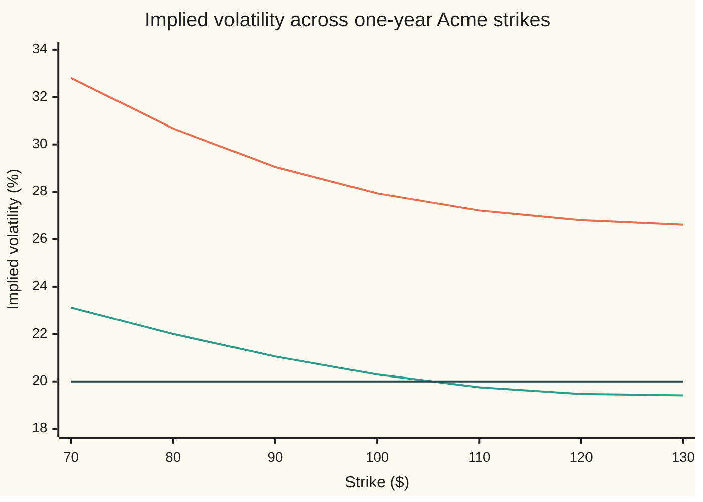

# Beyond Merton: Kou's double-exponential jumps and the variance gamma process, priced through their characteristic functions

[Syllabus](../../../SYLLABUS.md) → [Financial mathematics](../README.md) → [Local volatility and jumps](../README.md#s13) → Beyond Merton

---

## General Overview

Acme shares trade at $100. The house one-year call, struck at $100, costs $9.23 under Black-Scholes at 20% volatility ([Black–Scholes call](../08-The%20Black-Scholes%20call%20and%20put/01-black-scholes-call.md)). [Merton jump-diffusion](04-merton-jump-diffusion.md) added sudden gaps whose sizes follow a bell curve in logs. This card prices the same call under two other models that desks and researchers use.

**Kou's model** keeps the 20% wiggle (the continuous, jump-free Brownian part of the price path) and adds jumps, one a year on average. A jump is up with chance 0.4 and down with chance 0.6. Up jumps average 10% in log terms, down jumps 20%. Each side has an exponential tail: large jumps are rare, but far less rare than a bell curve allows. Under Kou the call costs $12.23.

**The variance gamma model** has no separate wiggle and no separate jumps. Acme's log price follows Brownian motion, but run on a random clock. In busy spells the clock runs fast, in quiet spells slowly. The clock's randomness gives fat tails, and a negative drift on that clock gives a left lean. Under variance gamma the call costs $9.34.

Neither model has Merton's quick series of Black-Scholes prices. Both have a short formula for their **characteristic function**: the average of $`e^{iuY}`$ for each frequency $`u`$, where $`Y`$ is the log of the price change and $`i`$ is the square root of −1. That formula is all the COS method (a sum of cosine terms) needs ([Transform pricing](../06-Numerical%20Methods%20for%20Pricing/09-carr-madan-fft-and-cos-methods.md)). Each model also needs one drift correction, so that the average future price is still the forward, $103.05 (today's fair price for delivery in a year).

**Each model is its characteristic function: write the exponent, fix the drift so the average price is the forward, and the COS method prices the call, $12.23 under Kou and $9.34 under variance gamma; the exponent's derivatives give the skew and kurtosis that shape each smile.**

**What kind of fact this is:** two models (assumptions that fit option prices well enough, not laws). Inside each, the characteristic function and its drift correction are theorems, proved on this card in Why it works. The prices are numerical sums whose error is shown shrinking to zero.

### The picture: the smile each model makes



Each point is a model price run back through Black-Scholes to the one volatility that reproduces it: the implied volatility ([Implied volatility](../11-Implied%20volatility%20and%20the%20vanilla%20inverses/01-implied-volatility.md)). The orange line is Kou, the green line variance gamma, and the dark line the flat 20% of Black-Scholes.

Both lines lean down to the right: low strikes cost more volatility than high ones. That lean is the skew. Kou sits higher because its jumps add variance on top of the 20% wiggle. Variance gamma stays near 20%, because its total variance is close to Black-Scholes's: a volatility of 20.96%.

---

## The formula

Notation first, in words. $`S`$ is Acme today and $`S_T`$ its price at expiry, $`T`$ years away. $`Y = \ln(S_T/S)`$ is the log of the price change. The riskless rate is $`r`$ and the dividend yield $`q`$. Both models are written through one function:

```math
\Phi(z) = E\big[e^{zY}\big]
```

Here $`E`$ is the average in the pricing world, where the share grows on average at $`r - q`$. The argument $`z`$ may be complex. At $`z = iu`$, with $`u`$ a real frequency, $`\Phi`$ is the characteristic function. At $`z = 1`$ it is the average of $`S_T/S`$.

**Kou.** Jumps arrive at rate $`\lambda`$ a year. A jump $`J`$ in the log price is up with chance $`p`$, with exponential size of mean $`1/\eta_1`$, or down with chance $`1 - p`$, with mean size $`1/\eta_2`$. The wiggle has volatility $`\sigma`$.

```math
\ln \Phi_{\text{Kou}}(z) = T\Big[\mu z + \tfrac12\sigma^2 z^2 + \lambda\Big(\frac{p\,\eta_1}{\eta_1 - z} + \frac{(1-p)\,\eta_2}{\eta_2 + z} - 1\Big)\Big], \qquad \mu = r - q - \tfrac12\sigma^2 - \lambda\zeta, \qquad \zeta = \frac{p\,\eta_1}{\eta_1 - 1} + \frac{(1-p)\,\eta_2}{\eta_2 + 1} - 1
```

**Read it aloud:** the log of Kou's transform is a straight-line drift, plus the wiggle's square term, plus the jump rate times how much one jump changes the average of $`e^{zY}`$; the drift carries $`-\lambda\zeta`$ to cancel the jumps' average pull on the price.

**Variance gamma.** A gamma clock $`G`$ runs over the year with average $`T`$ and variance $`\nu T`$. Acme's log price moves by $`\theta G + \sigma W(G)`$: a drift $`\theta`$ per unit of clock time, plus Brownian motion $`W`$ read at clock time $`G`$.

```math
\ln \Phi_{\text{VG}}(z) = (r - q + \omega)\,T z - \frac{T}{\nu}\ln\Big(1 - \theta\nu z - \tfrac12\sigma^2\nu z^2\Big), \qquad \omega = \frac{1}{\nu}\ln\Big(1 - \theta\nu - \tfrac12\sigma^2\nu\Big)
```

**Read it aloud:** the log of the variance gamma transform is a straight-line drift that includes the correction $`\omega`$, minus the clock's own term, which turns the Brownian part's square into a logarithm.

| Symbol | Plain meaning | In our example | Push it up and the answer… |
| --- | --- | --- | --- |
| $`C`$; $`S`$, $`S_T`$, $`K`$, $`F`$; $`P_1`$, $`P_2`$ | the call price; Acme today, at expiry; the strike; the forward $`Se^{(r-q)T}`$; the inversion road's two chances of ending above the strike | $12.23 Kou, $9.34 VG; $100; random; $100; $103.05; — | $`S`$ up: dearer; $`K`$ up: cheaper |
| $`r`$, $`q`$, $`T`$ | riskless rate, dividend yield, years to expiry | 5%, 2%, 1 | the house market |
| $`Y`$, $`\Phi`$, $`\psi`$, $`z`$, $`u`$, $`i`$ | log price change; average of $`e^{zY}`$; the one-year exponent, $`\ln\Phi = T\psi`$; its complex argument; a real frequency; the square root of −1 | $`\Phi(1) = 1.030455`$ in both models | — |
| $`\sigma`$ | Kou: the wiggle's volatility. VG: the Brownian scale on the clock | 0.20 in both | dearer |
| $`\lambda`$, $`J`$ | Kou's jump rate a year; one jump in the log price | 1; random | dearer |
| $`p`$ | chance a Kou jump is up | 0.4 | cheaper here: up jumps are the smaller ones ($11.77 at 0.6) |
| $`\eta_1`$, $`\eta_2`$ | Kou's tail rates: one over the mean up jump, one over the mean down jump | 10, 5 | smaller jumps: cheaper |
| $`\zeta`$, $`\mu`$ | Kou's average jump multiplier minus one; the corrected drift | −0.055556; 0.065556 | — |
| $`G`$, $`\nu`$, $`W`$ | the gamma clock; its variance per year of calendar time; Brownian motion read on the clock | average 1; 0.20; — | $`\nu`$ up: fatter tails |
| $`\theta`$ | VG drift per unit of clock time | −0.14 | more negative: a steeper left lean |
| $`\omega`$ | VG martingale correction: the drift fix that keeps the average future price on the forward | 0.118583 | — |
| $`\kappa_n`$ | the $`n`$-th cumulant of $`Y`$: variance at $`n = 2`$; skew is $`\kappa_3/\kappa_2^{3/2}`$ and excess kurtosis $`\kappa_4/\kappa_2^2`$ | Kou −0.8876, 2.6042; VG −0.3889, 0.7023 | — |

### When it holds

- **Independent, identically distributed increments.** Both log prices are Lévy processes: each week's change has the same law and ignores the others. Real markets have calm and stormy spells. Because the models have none, both smiles flatten with maturity faster than market smiles do (Step 5).
- **Kou needs $`\eta_1 > 1`$.** The mean up jump must be under 100% in log terms. Otherwise the average of $`e^J`$ is infinite, the share has no finite forward, and no call price exists.
- **Variance gamma needs $`1 - \theta\nu - \tfrac12\sigma^2\nu > 0`$.** Otherwise the logarithm in $`\omega`$ has no real value and the average price is infinite.
- **The pricing world is chosen, not forced.** No mix of shares and cash replicates a jump, so many pricing worlds fit the same share. The parameters are read off option prices, not off price history; a history fit prices jump risk at zero.
- **European exercise and a wide window.** The COS sum prices a payoff at expiry only, and it needs a log-price window that holds almost all the probability: here from −6 to 6.

---

## Why it works

### Step 0: a Lévy model is known by one exponent

Both log prices are Lévy processes, so their characteristic function at time $`T`$ is $`e^{T\psi}`$ for one fixed exponent $`\psi`$ ([Levy processes](../../11-Stochastic%20processes%20and%20calculus/09-Beyond%20Brownian/01-levy-processes.md)). The COS method turns that one function into prices at every strike ([Transform pricing](../06-Numerical%20Methods%20for%20Pricing/09-carr-madan-fft-and-cos-methods.md)). So each model needs three things: its exponent, a drift correction, and the COS sum.

### Step 1: Kou's exponent, one integral per side

The exponent of a jump stream is the jump rate times $`E[e^{zJ}] - 1`$ ([Jump diffusions](../../11-Stochastic%20processes%20and%20calculus/09-Beyond%20Brownian/02-jump-diffusions.md)). So only the average of $`e^{zJ}`$ for one jump is new. An up jump has density $`\eta_1 e^{-\eta_1 x}`$ for $`x > 0`$, and

```math
\int_0^\infty e^{zx}\,\eta_1 e^{-\eta_1 x}\,dx = \frac{\eta_1}{\eta_1 - z}, \qquad \text{for } \mathrm{Re}\, z < \eta_1
```

Here $`\mathrm{Re}\, z`$ is the real part of $`z`$; at or above $`\eta_1`$ the integral has no finite value. The down side is the mirror image, $`\eta_2/(\eta_2 + z)`$ for $`\mathrm{Re}\, z > -\eta_2`$. Weight the sides by $`p`$ and $`1 - p`$. The wiggle adds $`\tfrac12\sigma^2 z^2`$ and the drift adds $`\mu z`$. That is Kou's formula, line for line.

### Step 2: Kou's correction keeps the forward

In the pricing world the average of $`S_T`$ must be the forward, or buying the share with borrowed money would be a free bet. In symbols, $`\Phi(1) = e^{(r-q)T}`$. Put $`z = 1`$ in Kou's exponent:

```math
\mu + \tfrac12\sigma^2 + \lambda\zeta = r - q, \qquad \zeta = E\big[e^J\big] - 1
```

So $`\mu = r - q - \tfrac12\sigma^2 - \lambda\zeta`$. Here the up side gives 0.444444 and the down side 0.500000, so $`\zeta = -0.055556`$: an average jump takes 5.56% off the price. The drift rises by that much a year to compensate, to 0.065556.

The integral at $`z = 1`$ exists only when $`\eta_1 > 1`$. That is the first condition in When it holds.

Kou chose exponential tails on purpose. An exponential has no memory: given that a jump carries the price past a level, the overshoot beyond it is again exponential with the same rate. That gives first-passage times (when the price first crosses a level) and barrier prices closed-form Laplace transforms (the price summed over all expiries with exponentially falling weights). One numerical inversion then gives the barrier price, with no simulation. Merton's bell-curve jumps allow no such formulas.

### Step 3: variance gamma is Brownian motion on a random clock

Fix the clock at $`G = g`$. Then $`\theta g + \sigma W(g)`$ is a bell curve with mean $`\theta g`$ and variance $`\sigma^2 g`$, so

```math
E\big[e^{z(\theta G + \sigma W(G))} \,\big|\, G = g\big] = e^{g\,(\theta z + \frac12\sigma^2 z^2)}
```

Now average over the clock. A gamma variable with mean $`T`$ and variance $`\nu T`$ has $`E[e^{sG}] = (1 - \nu s)^{-T/\nu}`$, a one-line integral (fold below). Put $`s = \theta z + \tfrac12\sigma^2 z^2`$ and take logs: the $`-(T/\nu)\ln(\cdots)`$ term appears.

Here the clock has shape $`T/\nu = 5`$. So it is the sum of five independent waiting times, each exponential with mean 0.2 years. The simulation draws it exactly that way.

Why fat tails? The price change is a bell curve whose width depends on a random clock. A mixture of narrow and wide bell curves has more mass in the centre and in the tails than any single bell curve with the same variance. Why a lean? With $`\theta < 0`$, a long clock means both a wide bell curve and a large drift downward.

<details>
<summary>Detailed proof: the gamma clock's transform</summary>

The clock $`G`$ has the gamma density with shape $`a = T/\nu`$ and scale $`\nu`$:

$`\displaystyle f(g) = \frac{g^{a-1}e^{-g/\nu}}{\Gamma(a)\,\nu^{a}}, \qquad g > 0.`$

Its mean is $`a\nu = T`$ and its variance $`a\nu^2 = \nu T`$. For $`\mathrm{Re}\, s < 1/\nu`$,

$`\displaystyle E\big[e^{sG}\big] = \frac{1}{\Gamma(a)\,\nu^{a}}\int_0^\infty g^{a-1}e^{-g(1/\nu - s)}\,dg = \frac{1}{\Gamma(a)\,\nu^{a}}\cdot\frac{\Gamma(a)}{(1/\nu - s)^{a}} = (1 - \nu s)^{-a}.`$

The middle step is the gamma integral $`\int_0^\infty g^{a-1}e^{-cg}\,dg = \Gamma(a)/c^{a}`$ for $`\mathrm{Re}\, c > 0`$. With $`s = \theta z + \frac12\sigma^2 z^2`$, total expectation gives

$`\displaystyle E\big[e^{z(\theta G + \sigma W(G))}\big] = \big(1 - \theta\nu z - \tfrac12\sigma^2\nu z^2\big)^{-T/\nu}.`$

Multiplying by the drift's $`e^{(r-q+\omega)Tz}`$ and taking logs gives the formula. The clock ticks in independent, identically distributed pieces, and Brownian motion read along it does too, so the log price is a Lévy process, as Step 0 needs.

</details>

### Step 4: the variance gamma correction

Put $`z = 1`$ again and ask for $`\Phi(1) = e^{(r-q)T}`$:

```math
(r - q + \omega)T - \frac{T}{\nu}\ln\big(1 - \theta\nu - \tfrac12\sigma^2\nu\big) = (r - q)T \quad\Longrightarrow\quad \omega = \frac{1}{\nu}\ln\big(1 - \theta\nu - \tfrac12\sigma^2\nu\big)
```

Here the inside is $`1 + 0.028 - 0.004 = 1.024`$, so $`\omega = 5\ln 1.024 = 0.118583`$. It is positive. The negative clock drift $`\theta`$ drags the average price down more than the Brownian spread lifts it, so the correction pushes the drift up, to 0.148583 a year.

### Step 5: skew and kurtosis come from the exponent

The cumulants of $`Y`$ are the derivatives of $`\ln\Phi(z)`$ at $`z = 0`$. Variance is the second; skew and excess kurtosis are the third and fourth, scaled by powers of the variance. For Kou each jump adds its moments: $`\kappa_n = \lambda T\,E[J^n]`$ for $`n \ge 3`$, with $`E[J^n] = n!\,\big(p/\eta_1^n + (1-p)(-1)^n/\eta_2^n\big)`$. For variance gamma, differentiate the logarithm:

```math
\kappa_2 = (\sigma^2 + \theta^2\nu)T, \qquad \kappa_3 = (2\theta^3\nu^2 + 3\sigma^2\theta\nu)T, \qquad \kappa_4 = (3\sigma^4\nu + 12\sigma^2\theta^2\nu^2 + 6\theta^4\nu^3)T
```

| Model | Variance | Skew | Excess kurtosis | Skew at 3 months | Kurtosis at 3 months |
| --- | --- | --- | --- | --- | --- |
| Kou | 0.096000 | −0.8876 | 2.6042 | −1.7751 | 10.4167 |
| Variance gamma | 0.043920 | −0.3889 | 0.7023 | −0.7778 | 2.8093 |

How to read them:

- **Negative skew** means a longer left tail. Low strikes then pay off more often than Black-Scholes allows, so their implied volatility is higher: the lean in the picture. Kou's skew is larger in size, so its lean is steeper: 32.80% at $70 against 26.61% at $130.
- **Excess kurtosis** means more weight in the centre and both tails than a bell curve with the same variance. It lifts both ends of the smile against the middle.
- **Both scale with time in a fixed way.** Every cumulant grows in proportion to $`T`$, so skew falls like $`1/\sqrt{T}`$ and kurtosis like $`1/T`$. Cut the year to a quarter and skew doubles, kurtosis quadruples, exactly as the table shows. Market smiles flatten more slowly than that.

### Step 6: price by COS, and the rest of the family

Feed each $`\Phi`$ to the COS method: price the put from cosine terms on the log window from −6 to 6, then the call by put-call parity. Parity is exact only because Steps 2 and 4 put the average price on the forward. The sum settles by 128 to 256 terms: $12.234804 for Kou and $9.335661 for variance gamma.

The same recipe fits every model whose exponent is known. Two more are common; this card names them and builds neither.

| Model | $`\ln E[e^{zX_1}]`$, one year, drift left out | Jumps |
| --- | --- | --- |
| Merton | $`\frac12\sigma^2 z^2 + \lambda\big(e^{\mu_J z + \frac12\delta^2 z^2} - 1\big)`$ | few, bell-curve sizes in logs |
| Kou | $`\frac12\sigma^2 z^2 + \lambda\big(\frac{p\eta_1}{\eta_1 - z} + \frac{(1-p)\eta_2}{\eta_2 + z} - 1\big)`$ | few, exponential tails |
| Variance gamma | $`-\frac{1}{\nu}\ln\big(1 - \theta\nu z - \frac12\sigma^2\nu z^2\big)`$ | infinitely many small ones, no wiggle |
| Normal inverse Gaussian (NIG) | $`\delta\big(\sqrt{\alpha^2 - \beta^2} - \sqrt{\alpha^2 - (\beta + z)^2}\big)`$ | Brownian motion on an inverse Gaussian clock |
| CGMY | $`C\,\Gamma(-Y)\big[(M - z)^Y - M^Y + (G + z)^Y - G^Y\big]`$ | tail rates $`G`$ and $`M`$; $`Y`$ sets how busy the small jumps are |

Here $`X_1`$ is the log price change over one year, without its drift. In the Merton row, $`\mu_J`$ and $`\delta`$ are the mean and spread of one jump's log size. In the NIG row, $`\alpha`$ sets tail heaviness, $`\beta`$ the lean and $`\delta`$ the scale. In the CGMY row, $`C`$ sets the overall jump activity and $`\Gamma`$ is the gamma function. These letters belong to this table only: $`C`$, $`G`$ and $`Y`$ here are not the call, the clock or the log price. Variance gamma is the CGMY limit $`Y \to 0`$.

---

## Worked numbers, by hand

The house market: $`S = K = 100`$, $`r = 5\%`$, $`q = 2\%`$, $`T = 1`$. Kou: $`\sigma = 0.20`$, $`\lambda = 1`$, $`p = 0.4`$, $`\eta_1 = 10`$, $`\eta_2 = 5`$. Variance gamma: $`\sigma = 0.20`$, $`\nu = 0.20`$, $`\theta = -0.14`$.

| Step | Arithmetic | Value |
| --- | --- | --- |
| Kou up side of $`E[e^J]`$ | $`0.4 \times 10/9`$ | 0.444444 |
| Kou down side | $`0.6 \times 5/6`$ | 0.500000 |
| compensator $`\zeta`$ | $`0.444444 + 0.500000 - 1`$ | −0.055556 |
| Kou drift $`\mu`$ | $`0.05 - 0.02 - 0.02 + 1 \times 0.055556`$ | 0.065556 |
| VG inside the log | $`1 - (-0.14)(0.2) - \frac12(0.04)(0.2) = 1 + 0.028 - 0.004`$ | 1.024000 |
| correction $`\omega`$ | $`\ln(1.024)/0.2`$ | 0.118583 |
| VG drift | $`0.05 - 0.02 + 0.118583`$ | 0.148583 |
| check: $`\Phi(1)`$, both models | must equal $`e^{0.03}`$ | 1.030455 |
| Kou call, COS | 512 cosine terms | **12.234804** |
| VG call, COS | 512 cosine terms | **9.335661** |

The same Acme call costs $12.23 under Kou and $9.34 under variance gamma, against $9.23 under Black-Scholes. Kou's premium pays for jumps on top of a full 20% wiggle. Variance gamma's small premium comes from its slightly larger variance, a volatility of 20.96% against 20%. At equal variance its fat tails and lean make this call cheaper than Black-Scholes: $9.34 against $9.59.

### What breaks if you drop a piece

| Mistake | Comes out at | What went wrong |
| --- | --- | --- |
| Ignore the jumps and the clock | 9.227006 | plain Black-Scholes at 20%: no skew, no fat tails |
| Kou with no compensator | 9.106655 | the average jump drags the average price below the forward |
| Kou compensator from the mean log jump, $`p/\eta_1 - (1-p)/\eta_2`$ | 13.812263 | the drift needs the average of $`e^J`$, not of $`J`$ |
| VG with no $`\omega`$ | 3.808974 | the average price falls to $`e^{-\omega}`$ times the forward |
| VG with $`\omega`$ of the wrong sign | 1.213564 | the drift falls instead of rising |

The code computes each of these from the call itself, not through parity.

---

## Code, from first principles, and it actually runs

The scripts write out their own complex exponential and logarithm, bell-curve area, COS sum, inversion integral, Simpson's rule and random numbers. Kou's call takes three independent roads, and variance gamma four:

1. **COS sum:** the cosine series fed by $`\Phi`$.
2. **Inversion integral:** numerical integration of $`\Phi`$ recovers $`P_1`$ and $`P_2`$, the two chances of ending above the strike, each under its own weighting. The call is then $`C = Se^{-qT}P_1 - Ke^{-rT}P_2`$, the Black-Scholes shape.
3. **Gamma clock (variance gamma only):** fix the clock, price by Black-Scholes, and average over the gamma density by Simpson's rule. No transform is used.
4. **Simulation:** a million simulated years, with real jump counts and sizes, or a real gamma clock.

Skew and kurtosis are checked three ways: the closed forms, finite differences of $`\ln\Phi`$, and the simulated sample.

### Python

```python
# Kou and variance gamma -- the check behind the card.  Standard library only.  Written out here: complex
# exp and log, Marsaglia's bell-curve series, COS, the inversion integral, Simpson, the house recurrence, Box-Muller.
from math import atan2, cos, exp, hypot, log, pi, sin, sqrt
S, K, R, Q, T = 100.0, 100.0, 0.05, 0.02, 1.0               # the house market
SIG, LAM, P, E1, E2 = 0.20, 1.0, 0.4, 10.0, 5.0              # Kou
VS, NU, TH = 0.20, 0.20, -0.14                               # variance gamma
SEED, PATHS, MOD, STRIKES = 20261123, 1000000, 1 << 32, (70.0, 80.0, 90.0, 100.0, 110.0, 120.0, 130.0)
def cexp(z): return exp(z.real) * complex(cos(z.imag), sin(z.imag))
def clog(z): return complex(log(hypot(z.real, z.imag)), atan2(z.imag, z.real))
def cdiv(a, b): return complex(a * b.real / (b.real * b.real + b.imag * b.imag), -a * b.imag / (b.real * b.real + b.imag * b.imag))
def n_cdf(x):                               # area left of x, Marsaglia's series
    if abs(x) > 9.0: return 0.0 if x < 0.0 else 1.0
    s, t, b, i = x, 0.0, x, 1.0
    while s != t: t, i = s, i + 2.0; b *= x * x / i; s = t + b
    return 0.5 + s * exp(-0.5 * x * x) / sqrt(2.0 * pi)
def bs(k, sig, t=T):                        # Black-Scholes call, spot S, yield Q
    v = sig * sqrt(t); d1 = (log(S / k) + (R - Q + 0.5 * sig * sig) * t) / v
    return S * exp(-Q * t) * n_cdf(d1) - k * exp(-R * t) * n_cdf(d1 - v)
def zeta(p=P): return p * E1 / (E1 - 1.0) + (1.0 - p) * E2 / (E2 + 1.0) - 1.0   # E[e^J] - 1
def omega(th=TH, nu=NU): return log(1.0 - th * nu - 0.5 * VS * VS * nu) / nu
def kou(z, t=T, lam=LAM, p=P, comp=None):   # ln E[e^(zY)], Y = ln(S_T / S), z complex
    mu = R - Q - 0.5 * SIG * SIG - lam * (zeta(p) if comp is None else comp)
    return t * (z * mu + 0.5 * SIG * SIG * z * z + lam * (cdiv(p * E1, E1 - z) + cdiv((1.0 - p) * E2, E2 + z) - 1.0))
def vg(z, t=T, th=TH, nu=NU, w=None):       # ln E[e^(zY)] for variance gamma
    return z * ((R - Q + (omega(th, nu) if w is None else w)) * t) - t / nu * clog(1.0 - th * nu * z - 0.5 * VS * VS * nu * z * z)
def cos_call(f, k=K, t=T, a=-6.0, b=6.0, modes=512):   # road 1: COS put, then parity
    L, d, tot = b - a, min(b, log(k / S)), 0.0
    for n in range(modes if d > a else 0):
        w = n * pi / L
        fn = 2.0 / L * cexp(f(complex(0.0, w), t) - complex(0.0, w * a)).real
        psi = d - a if n == 0 else sin(w * (d - a)) / w
        chi = (exp(d) * (cos(w * (d - a)) + w * sin(w * (d - a))) - exp(a)) / (1.0 + w * w)
        tot += (0.5 if n == 0 else 1.0) * fn * 2.0 / L * (k * psi - S * chi)
    return exp(-R * t) * L / 2.0 * tot + S * exp(-Q * t) - k * exp(-R * t)
def gp_call(f, k=K, t=T, h=0.02, top=5000):  # road 2: invert for the two chances
    x, g1, p1, p2 = log(k / S), f(complex(1.0, 0.0), t).real, 0.0, 0.0
    for j in range(top):                    # Re[w / (iu)] = Im(w) / u
        u = (j + 0.5) * h
        p2 += cexp(complex(0.0, -u * x) + f(complex(0.0, u), t)).imag / u
        p1 += cexp(complex(0.0, -u * x) + f(complex(1.0, u), t) - g1).imag / u
    return S * exp(g1 - R * t) * (0.5 + p1 * h / pi) - k * exp(-R * t) * (0.5 + p2 * h / pi)
def simpson(f, lo, hi, n=4000):
    h = (hi - lo) / n
    return h / 3.0 * sum((1.0 if i in (0, n) else 4.0 if i % 2 else 2.0) * f(lo + i * h) for i in range(n + 1))
def vg_mix(k=K):                            # road 3: Black-Scholes on each gamma clock
    shape, w = T / NU, omega()
    dens = lambda g: g ** (shape - 1.0) * exp(-g / NU) / (24.0 * NU ** shape) if g > 0 else 0.0  # 24 = 4! = Gamma(T/NU): T/NU = 5 only
    fwd = lambda g: S * exp((R - Q + w) * T + TH * g + 0.5 * VS * VS * g)
    def call(g):
        v = VS * sqrt(g)
        d1 = (log(fwd(g) / k) + 0.5 * v * v) / v
        return exp(-R * T) * (fwd(g) * n_cdf(d1) - k * n_cdf(d1 - v))
    return simpson(lambda g: dens(g) * call(g) if g > 0 else 0.0, 0.0, 8.0), simpson(lambda g: dens(g) * fwd(g), 0.0, 8.0)
def cumulants(model, t=T):                  # closed form: variance, skew, excess kurtosis
    if model == "kou":
        m = lambda n, f: LAM * f * (P / E1 ** n + (1 - P) * (-1) ** n / E2 ** n)   # f = n!
        c2, c3, c4 = (SIG * SIG + m(2, 2)) * t, m(3, 6) * t, m(4, 24) * t
    else:
        c2, c3 = (VS ** 2 + TH ** 2 * NU) * t, (2 * TH ** 3 * NU ** 2 + 3 * VS ** 2 * TH * NU) * t
        c4 = (3 * VS ** 4 * NU + 12 * VS ** 2 * TH ** 2 * NU ** 2 + 6 * TH ** 4 * NU ** 3) * t
    return c2, c3 / c2 ** 1.5, c4 / c2 ** 2
def fd_cumulants(f, h=0.01):                # differences of ln E[e^(zY)] at real z
    g = [f(complex(j * h, 0.0)).real for j in (-2, -1, 0, 1, 2)]
    c2, c3 = (g[3] - 2 * g[2] + g[1]) / h ** 2, (g[4] - 2 * g[3] + 2 * g[1] - g[0]) / (2 * h ** 3)
    return c2, c3 / c2 ** 1.5, (g[4] - 4 * g[3] + 6 * g[2] - 4 * g[1] + g[0]) / h ** 4 / c2 ** 2
def implied(price, k, t=T):                 # bisection: Black-Scholes rises with vol
    lo, hi = 1e-4, 3.0
    for _ in range(100): mid = 0.5 * (lo + hi); lo, hi = (mid, hi) if bs(k, mid, t) < price else (lo, mid)
    return 0.5 * (lo + hi)
def uniform(state):                         # the house recurrence
    state = (1664525 * state + 1013904223) % MOD
    return state, (state + 0.5) / MOD
def simulate(model):                        # road 4: real jumps, or a real gamma clock
    state, disc, e0, sums = SEED, exp(-R * T), exp(-LAM * T), [0.0] * 8
    for _ in range(PATHS):
        state, u = uniform(state)
        state, v = uniform(state)
        z = sqrt(-2.0 * log(u)) * cos(2.0 * pi * v)        # Box-Muller, cosine half
        if model == "kou":
            x, prod = (R - Q - 0.5 * SIG * SIG - LAM * zeta()) * T + SIG * sqrt(T) * z, 1.0
            while True:                     # Knuth's Poisson count, one jump per pass
                state, u = uniform(state); prod *= u
                if prod <= e0: break
                state, u = uniform(state); x += -log(u / P) / E1 if u < P else log((u - P) / (1.0 - P)) / E2
        else:
            g = 0.0
            for _ in range(5): state, u = uniform(state); g -= NU * log(u)   # gamma clock: T/NU = 5 waits, mean nu
            x = (R - Q + omega()) * T + TH * g + VS * sqrt(g) * z
        pay, st = disc * max(S * exp(x) - K, 0.0), disc * S * exp(x)
        for i, v in enumerate((pay, pay * pay, st, st * st, x, x * x, x * x * x, x * x * x * x)): sums[i] += v
    m = [v / PATHS for v in sums]
    var, c3 = m[5] - m[4] ** 2, m[6] - 3 * m[4] * m[5] + 2 * m[4] ** 3
    c4 = m[7] - 4 * m[4] * m[6] + 6 * m[4] ** 2 * m[5] - 3 * m[4] ** 4
    return m[0], sqrt((m[1] - m[0] ** 2) / PATHS), m[2], sqrt((m[3] - m[2] ** 2) / PATHS), var, c3 / var ** 1.5, c4 / var ** 2 - 3.0
row = lambda name, v: print(f"{name:<46}{v:>12.6f}")
print("house: S 100, K 100, r 5%, q 2%, T 1; Kou: sigma 0.20, lambda 1, p 0.4, eta1 10, eta2 5; VG: sigma 0.20, nu 0.20, theta -0.14")
for name, v in (("Kou up part, p eta1/(eta1 - 1)", P * E1 / (E1 - 1)), ("Kou down part, (1 - p) eta2/(eta2 + 1)", (1 - P) * E2 / (E2 + 1)),
                ("Kou compensator zeta", zeta()), ("Kou drift r - q - sigma^2/2 - lambda zeta", R - Q - 0.5 * SIG * SIG - LAM * zeta()),
                ("VG inside the log, 1 - theta nu - sigma^2 nu/2", 1 - TH * NU - 0.5 * VS * VS * NU),
                ("VG martingale correction omega", omega()), ("VG drift r - q + omega", R - Q + omega())): row(name, v)
print(f"E[S_T]/S from the exponent at z = 1: Kou {cexp(kou(complex(1.0, 0.0))).real:.6f}, "
      f"VG {cexp(vg(complex(1.0, 0.0))).real:.6f}; forward factor e^(r - q)T {exp((R - Q) * T):.6f}")
sims = {m: simulate(m) for m in ("kou", "vg")}
print("model  how        variance      skew  ex. kurt")
for m, f in (("kou", kou), ("vg", vg)):
    for how, c in (("closed", cumulants(m)), ("differ", fd_cumulants(f)), ("simul", sims[m][4:]), ("3 months", cumulants(m, 0.25))):
        print(f"{m:<5}  {how:<8} {c[0]:>9.6f}  {c[1]:>8.4f}  {c[2]:>8.4f}")
print("COS modes      Kou call     VG call")
for M in (32, 64, 128, 256, 512): print(f"{M:>9}  {cos_call(kou, modes=M):>10.6f}  {cos_call(vg, modes=M):>10.6f}")
ck, cv, (cm, fm), gk, gv = cos_call(kou), cos_call(vg), vg_mix(), gp_call(kou), gp_call(vg)
kw, vw = lambda **a: lambda z, t: kou(z, t, **a), lambda **a: lambda z, t: vg(z, t, **a)   # one input changed
vk, vv = sqrt(cumulants("kou")[0]), sqrt(cumulants("vg")[0])
for name, v in (("Kou road 1  COS, 512 modes", ck), ("Kou road 2  inversion integral", gk),
                ("Kou road 4  simulation", sims["kou"][0]), ("            standard error", sims["kou"][1]),
                (f"Kou simulated e^-rT S_T (S e^-qT {S * exp(-Q * T):.6f})", sims["kou"][2]), ("            standard error", sims["kou"][3]),
                ("VG  road 1  COS, 512 modes", cv), ("VG  road 2  inversion integral", gv), ("VG  road 3  gamma-clock Black-Scholes", cm),
                ("VG  road 4  simulation", sims["vg"][0]), ("            standard error", sims["vg"][1]),
                ("VG simulated e^-rT S_T", sims["vg"][2]), ("            standard error", sims["vg"][3]), ("VG gamma clock: forward averaged", fm),
                ("Kou with lambda = 0 (house Black-Scholes)", cos_call(kw(lam=0.0))), ("wrong: Kou, no compensator", gp_call(kw(comp=0.0))),
                ("wrong: Kou, compensator from mean log jump", gp_call(kw(comp=P / E1 - (1 - P) / E2))),
                ("wrong: VG, no omega", gp_call(vw(w=0.0))), ("wrong: VG, omega with the sign flipped", gp_call(vw(w=-omega()))),
                ("wrong: VG no omega, call by parity", cos_call(vw(w=0.0))), (f"wrong: one vol for Kou, {vk * 100:.2f}%", bs(K, vk)),
                (f"wrong: one vol for VG, {vv * 100:.2f}%", bs(K, vv))): row(name, v)
ivk, ivv = [implied(cos_call(kou, k), k) for k in STRIKES], [implied(cos_call(vg, k), k) for k in STRIKES]
print("strike         " + "".join(f"{k:>8.0f}" for k in STRIKES))
print("Kou implied %  " + "".join(f"{v * 100:>8.2f}" for v in ivk))
print("VG implied %   " + "".join(f"{v * 100:>8.2f}" for v in ivv))
ks = [S * exp((R - Q) * T + x) for x in (-0.2, 0.0, 0.2)]   # strikes evenly spaced in log terms around the forward
print(f"try: Kou p = 0.6 call {cos_call(kw(p=0.6)):.6f}; VG theta = 0 implied % at " + ", ".join(f"{k:.2f}" for k in ks) + ": "
      + ", ".join(f"{implied(cos_call(vw(th=0.0), k), k) * 100:.2f}" for k in ks))
assert abs(cos_call(kw(lam=0.0)) - 9.227005508154) < 1e-8, "no jumps: the house call"
assert abs(gk - ck) < 1e-7 and abs(gv - cv) < 1e-7, "inversion integral lands on COS"
assert abs(cm - cv) < 1e-7 and abs(fm - S * exp((R - Q) * T)) < 1e-7, "gamma clock lands on COS and on the forward"
for m, c, f in (("kou", ck, kou), ("vg", cv, vg)):
    mc, se, fw, fse = sims[m][:4]
    assert abs(mc - c) < 3.0 * se and abs(fw - S * exp(-Q * T)) < 3.0 * fse, "simulation backs the transform"
    assert max(abs(a - b) for a, b in zip(cumulants(m), fd_cumulants(f))) < 1e-3, "cumulants from the exponent"
    assert abs(sims[m][5] - cumulants(m)[1]) < 0.05 and abs(sims[m][6] - cumulants(m)[2]) < 0.3, "simulated shape"
assert ivk[0] > ivk[3] > ivk[6] and ivv[0] > ivv[3] > ivv[6], "both lean to the left"
print("ALL CHECKS PASS")
```

**Ran 2026-11-23 on macOS, Python 3.14.10, standard library only. All checks passed. Output, pasted from the run:**

```
house: S 100, K 100, r 5%, q 2%, T 1; Kou: sigma 0.20, lambda 1, p 0.4, eta1 10, eta2 5; VG: sigma 0.20, nu 0.20, theta -0.14
Kou up part, p eta1/(eta1 - 1)                    0.444444
Kou down part, (1 - p) eta2/(eta2 + 1)            0.500000
Kou compensator zeta                             -0.055556
Kou drift r - q - sigma^2/2 - lambda zeta         0.065556
VG inside the log, 1 - theta nu - sigma^2 nu/2    1.024000
VG martingale correction omega                    0.118583
VG drift r - q + omega                            0.148583
E[S_T]/S from the exponent at z = 1: Kou 1.030455, VG 1.030455; forward factor e^(r - q)T 1.030455
model  how        variance      skew  ex. kurt
kou    closed    0.096000   -0.8876    2.6042
kou    differ    0.096000   -0.8876    2.6042
kou    simul     0.095687   -0.8967    2.6578
kou    3 months  0.024000   -1.7751   10.4167
vg     closed    0.043920   -0.3889    0.7023
vg     differ    0.043920   -0.3889    0.7025
vg     simul     0.043912   -0.3852    0.6995
vg     3 months  0.010980   -0.7778    2.8093
COS modes      Kou call     VG call
       32   12.326608    9.565591
       64   12.234910    9.335003
      128   12.234804    9.335659
      256   12.234804    9.335661
      512   12.234804    9.335661
Kou road 1  COS, 512 modes                       12.234804
Kou road 2  inversion integral                   12.234804
Kou road 4  simulation                           12.207887
            standard error                        0.018910
Kou simulated e^-rT S_T (S e^-qT 98.019867)      98.007316
            standard error                        0.028147
VG  road 1  COS, 512 modes                        9.335661
VG  road 2  inversion integral                    9.335661
VG  road 3  gamma-clock Black-Scholes             9.335661
VG  road 4  simulation                            9.346235
            standard error                        0.013472
VG simulated e^-rT S_T                           98.034683
            standard error                        0.020077
VG gamma clock: forward averaged                103.045453
Kou with lambda = 0 (house Black-Scholes)         9.227006
wrong: Kou, no compensator                        9.106655
wrong: Kou, compensator from mean log jump       13.812263
wrong: VG, no omega                               3.808974
wrong: VG, omega with the sign flipped            1.213564
wrong: VG no omega, call by parity               14.769710
wrong: one vol for Kou, 30.98%                   13.393098
wrong: one vol for VG, 20.96%                     9.589855
strike               70      80      90     100     110     120     130
Kou implied %     32.80   30.67   29.05   27.93   27.21   26.80   26.61
VG implied %      23.11   22.00   21.05   20.29   19.75   19.47   19.41
try: Kou p = 0.6 call 11.766588; VG theta = 0 implied % at 84.37, 103.05, 125.86: 19.87, 19.54, 20.24
ALL CHECKS PASS
```

The COS sum, the inversion integral and, for variance gamma, the gamma-clock road agree to six decimals. Each simulation lands within two standard errors of the transform price, and its average discounted share price lands within one standard error of $`Se^{-qT}`$ = 98.019867: the correction works.

### Rust

The same checks and labels, built with `rustc --edition 2021 -O`. The same recurrence drives the simulation, so it reproduces the Python's output digit for digit.

```rust
// Kou and variance gamma -- the same check as the Python, in Rust.  No crates.  Written out here: complex
// exp and log, Marsaglia's bell-curve series, COS, the inversion integral, Simpson, the house recurrence, Box-Muller.
use std::f64::consts::PI;
const S: f64 = 100.0; const K: f64 = 100.0; const R: f64 = 0.05; const Q: f64 = 0.02; const T: f64 = 1.0;
const SIG: f64 = 0.20; const LAM: f64 = 1.0; const P: f64 = 0.4; const E1: f64 = 10.0; const E2: f64 = 5.0;  // Kou
const VS: f64 = 0.20; const NU: f64 = 0.20; const TH: f64 = -0.14;                                          // VG
const SEED: u64 = 20261123; const PATHS: usize = 1000000; const STRIKES: [f64; 7] = [70.0, 80.0, 90.0, 100.0, 110.0, 120.0, 130.0];
#[derive(Clone, Copy)] struct C { re: f64, im: f64 }  fn c(re: f64, im: f64) -> C { C { re, im } }
impl C {
    fn add(self, o: C) -> C { c(self.re + o.re, self.im + o.im) }
    fn sub(self, o: C) -> C { c(self.re - o.re, self.im - o.im) }
    fn mul(self, o: C) -> C { c(self.re * o.re - self.im * o.im, self.re * o.im + self.im * o.re) }
    fn sc(self, a: f64) -> C { c(a * self.re, a * self.im) }
    fn exp(self) -> C { let m = self.re.exp(); c(m * self.im.cos(), m * self.im.sin()) }
    fn ln(self) -> C { c(self.re.hypot(self.im).ln(), self.im.atan2(self.re)) }
}
fn cdiv(a: f64, b: C) -> C { c(a * b.re / (b.re * b.re + b.im * b.im), -a * b.im / (b.re * b.re + b.im * b.im)) }
fn n_cdf(x: f64) -> f64 {                   // area left of x, Marsaglia's series
    if x.abs() > 9.0 { return if x < 0.0 { 0.0 } else { 1.0 }; }
    let (mut s, mut t, mut b, mut i) = (x, 0.0, x, 1.0);
    while s != t { t = s; i += 2.0; b *= x * x / i; s = t + b; }
    0.5 + s * (-0.5 * x * x).exp() / (2.0 * PI).sqrt()
}
fn bs(k: f64, sig: f64, t: f64) -> f64 {    // Black-Scholes call, spot S, yield Q
    let v = sig * t.sqrt(); let d1 = ((S / k).ln() + (R - Q + 0.5 * sig * sig) * t) / v;
    S * (-Q * t).exp() * n_cdf(d1) - k * (-R * t).exp() * n_cdf(d1 - v)
}
fn zeta(p: f64) -> f64 { p * E1 / (E1 - 1.0) + (1.0 - p) * E2 / (E2 + 1.0) - 1.0 }   // E[e^J] - 1
fn omega(th: f64, nu: f64) -> f64 { (1.0 - th * nu - 0.5 * VS * VS * nu).ln() / nu }
#[derive(Clone, Copy)] struct M { vg: bool, lam: f64, p: f64, comp: Option<f64>, th: f64, nu: f64, w: Option<f64> }
const KOU: M = M { vg: false, lam: LAM, p: P, comp: None, th: TH, nu: NU, w: None };
const VG: M = M { vg: true, ..KOU };
fn lnmgf(m: &M, z: C, t: f64) -> C {        // ln E[e^(zY)], Y = ln(S_T / S), z complex
    if m.vg {
        let (w, tz) = (m.w.unwrap_or(omega(m.th, m.nu)), z.sc(m.th * m.nu)); let inner = c(1.0 - tz.re, -tz.im).sub(z.sc(0.5 * VS * VS * m.nu).mul(z));
        return z.sc((R - Q + w) * t).sub(inner.ln().sc(t / m.nu));
    }
    let mu = R - Q - 0.5 * SIG * SIG - m.lam * m.comp.unwrap_or(zeta(m.p));
    let jump = cdiv(m.p * E1, c(E1 - z.re, -z.im)).add(cdiv((1.0 - m.p) * E2, c(E2 + z.re, z.im)));
    z.sc(mu).add(z.sc(0.5 * SIG * SIG).mul(z)).add(c(jump.re - 1.0, jump.im).sc(m.lam)).sc(t)
}
fn cos_call(m: &M, k: f64, t: f64, modes: usize) -> f64 {   // road 1: COS put, then parity
    let (a, b) = (-6.0f64, 6.0f64); let (l, d, mut tot) = (b - a, f64::min(b, (k / S).ln()), 0.0);
    for n in 0..(if d > a { modes } else { 0 }) {
        let w = n as f64 * PI / l;
        let fnn = 2.0 / l * lnmgf(m, c(0.0, w), t).sub(c(0.0, w * a)).exp().re;
        let psi = if n == 0 { d - a } else { (w * (d - a)).sin() / w };
        let chi = (d.exp() * ((w * (d - a)).cos() + w * (w * (d - a)).sin()) - (a as f64).exp()) / (1.0 + w * w);
        tot += (if n == 0 { 0.5 } else { 1.0 }) * fnn * 2.0 / l * (k * psi - S * chi);
    }
    (-R * t).exp() * l / 2.0 * tot + S * (-Q * t).exp() - k * (-R * t).exp()
}
fn gp_call(m: &M, k: f64, t: f64) -> f64 {  // road 2: invert for the two chances
    let (h, x, g1, mut p1, mut p2) = (0.02, (k / S).ln(), lnmgf(m, c(1.0, 0.0), t).re, 0.0, 0.0);
    for j in 0..5000 {                      // Re[w / (iu)] = Im(w) / u
        let u = (j as f64 + 0.5) * h;
        p2 += c(0.0, -u * x).add(lnmgf(m, c(0.0, u), t)).exp().im / u;
        p1 += c(0.0, -u * x).add(lnmgf(m, c(1.0, u), t)).sub(c(g1, 0.0)).exp().im / u;
    }
    S * (g1 - R * t).exp() * (0.5 + p1 * h / PI) - k * (-R * t).exp() * (0.5 + p2 * h / PI)
}
fn simpson<F: Fn(f64) -> f64>(f: F, lo: f64, hi: f64, n: usize) -> f64 {
    let h = (hi - lo) / n as f64;
    h / 3.0 * (0..=n).fold(0.0, |s, i| s + (if i == 0 || i == n { 1.0 } else if i % 2 == 1 { 4.0 } else { 2.0 }) * f(lo + i as f64 * h))
}
fn vg_mix(k: f64) -> (f64, f64) {           // road 3: Black-Scholes on each gamma clock
    let (shape, w) = (T / NU, omega(TH, NU));
    let dens = |g: f64| if g > 0.0 { g.powf(shape - 1.0) * (-g / NU).exp() / (24.0 * NU.powf(shape)) } else { 0.0 };  // 24 = 4! = Gamma(T/NU): T/NU = 5 only
    let fwd = |g: f64| S * ((R - Q + w) * T + TH * g + 0.5 * VS * VS * g).exp();
    let call = |g: f64| { let v = VS * g.sqrt(); let d1 = ((fwd(g) / k).ln() + 0.5 * v * v) / v;
                          (-R * T).exp() * (fwd(g) * n_cdf(d1) - k * n_cdf(d1 - v)) };
    (simpson(|g| if g > 0.0 { dens(g) * call(g) } else { 0.0 }, 0.0, 8.0, 4000), simpson(|g| dens(g) * fwd(g), 0.0, 8.0, 4000))
}
fn cumulants(vg: bool, t: f64) -> [f64; 3] {   // closed form: variance, skew, excess kurtosis
    let m = |n: f64, f: f64| LAM * f * (P / E1.powf(n) + (1.0 - P) * (-1.0f64).powf(n) / E2.powf(n));   // f = n!
    let (c2, c3, c4) = if !vg { ((SIG * SIG + m(2.0, 2.0)) * t, m(3.0, 6.0) * t, m(4.0, 24.0) * t) } else {
        ((VS.powf(2.0) + TH.powf(2.0) * NU) * t, (2.0 * TH.powf(3.0) * NU.powf(2.0) + 3.0 * VS.powf(2.0) * TH * NU) * t,
         (3.0 * VS.powf(4.0) * NU + 12.0 * VS.powf(2.0) * TH.powf(2.0) * NU.powf(2.0) + 6.0 * TH.powf(4.0) * NU.powf(3.0)) * t) };
    [c2, c3 / c2.powf(1.5), c4 / c2.powf(2.0)]
}
fn fd_cumulants(m: &M) -> [f64; 3] {        // differences of ln E[e^(zY)] at real z
    let (h, js) = (0.01, [-2.0, -1.0, 0.0, 1.0, 2.0]);
    let g: Vec<f64> = js.iter().map(|j: &f64| lnmgf(m, c(j * h, 0.0), T).re).collect();
    let (c2, c3) = ((g[3] - 2.0 * g[2] + g[1]) / h.powf(2.0), (g[4] - 2.0 * g[3] + 2.0 * g[1] - g[0]) / (2.0 * h.powf(3.0)));
    [c2, c3 / c2.powf(1.5), (g[4] - 4.0 * g[3] + 6.0 * g[2] - 4.0 * g[1] + g[0]) / h.powf(4.0) / c2.powf(2.0)]
}
fn implied(price: f64, k: f64, t: f64) -> f64 {   // bisection: Black-Scholes rises with vol
    let (mut lo, mut hi) = (1e-4, 3.0);
    for _ in 0..100 { let mid = 0.5 * (lo + hi); if bs(k, mid, t) < price { lo = mid } else { hi = mid } }
    0.5 * (lo + hi)
}
fn uniform(state: &mut u64) -> f64 {        // the house recurrence
    *state = (1664525 * *state + 1013904223) % (1u64 << 32); (*state as f64 + 0.5) / 4294967296.0
}
fn simulate(vg: bool) -> [f64; 7] {         // road 4: real jumps, or a real gamma clock
    let (mut state, disc, e0, mut sums) = (SEED, (-R * T).exp(), (-LAM * T).exp(), [0.0f64; 8]);
    for _ in 0..PATHS {
        let (u, v) = (uniform(&mut state), uniform(&mut state));
        let z = (-2.0 * u.ln()).sqrt() * (2.0 * PI * v).cos();         // Box-Muller, cosine half
        let x = if !vg {
            let (mut x, mut prod) = ((R - Q - 0.5 * SIG * SIG - LAM * zeta(P)) * T + SIG * T.sqrt() * z, 1.0);
            loop {                          // Knuth's Poisson count, one jump per pass; side and size from one uniform
                prod *= uniform(&mut state); if prod <= e0 { break; }
                let u = uniform(&mut state); x += if u < P { -(u / P).ln() / E1 } else { ((u - P) / (1.0 - P)).ln() / E2 };
            }
            x
        } else {
            let mut g = 0.0;
            for _ in 0..5 { g -= NU * uniform(&mut state).ln(); }      // gamma clock: T/NU = 5 waits, mean nu
            (R - Q + omega(TH, NU)) * T + TH * g + VS * g.sqrt() * z };
        let (pay, st) = (disc * (S * x.exp() - K).max(0.0), disc * S * x.exp());
        for (i, v) in [pay, pay * pay, st, st * st, x, x * x, x * x * x, x * x * x * x].iter().enumerate() { sums[i] += v; }
    }
    let m: Vec<f64> = sums.iter().map(|v| v / PATHS as f64).collect();
    let (var, c3) = (m[5] - m[4].powf(2.0), m[6] - 3.0 * m[4] * m[5] + 2.0 * m[4].powf(3.0));
    let c4 = m[7] - 4.0 * m[4] * m[6] + 6.0 * m[4].powf(2.0) * m[5] - 3.0 * m[4].powf(4.0);
    [m[0], ((m[1] - m[0].powf(2.0)) / PATHS as f64).sqrt(), m[2], ((m[3] - m[2].powf(2.0)) / PATHS as f64).sqrt(),
     var, c3 / var.powf(1.5), c4 / var.powf(2.0) - 3.0]
}
fn row(name: &str, v: f64) { println!("{:<46}{:>12.6}", name, v); }
fn main() {
    println!("house: S 100, K 100, r 5%, q 2%, T 1; Kou: sigma 0.20, lambda 1, p 0.4, eta1 10, eta2 5; VG: sigma 0.20, nu 0.20, theta -0.14");
    for (name, v) in [("Kou up part, p eta1/(eta1 - 1)", P * E1 / (E1 - 1.0)), ("Kou down part, (1 - p) eta2/(eta2 + 1)", (1.0 - P) * E2 / (E2 + 1.0)),
                      ("Kou compensator zeta", zeta(P)), ("Kou drift r - q - sigma^2/2 - lambda zeta", R - Q - 0.5 * SIG * SIG - LAM * zeta(P)),
                      ("VG inside the log, 1 - theta nu - sigma^2 nu/2", 1.0 - TH * NU - 0.5 * VS * VS * NU),
                      ("VG martingale correction omega", omega(TH, NU)), ("VG drift r - q + omega", R - Q + omega(TH, NU))] { row(name, v); }
    println!("E[S_T]/S from the exponent at z = 1: Kou {:.6}, VG {:.6}; forward factor e^(r - q)T {:.6}",
             lnmgf(&KOU, c(1.0, 0.0), T).exp().re, lnmgf(&VG, c(1.0, 0.0), T).exp().re, ((R - Q) * T).exp());
    let (sk, sv) = (simulate(false), simulate(true)); println!("model  how        variance      skew  ex. kurt");
    for (name, vg, sim, m) in [("kou", false, sk, KOU), ("vg", true, sv, VG)] {
        for (how, cc) in [("closed", cumulants(vg, T)), ("differ", fd_cumulants(&m)), ("simul", [sim[4], sim[5], sim[6]]),
                          ("3 months", cumulants(vg, 0.25))] { println!("{:<5}  {:<8} {:>9.6}  {:>8.4}  {:>8.4}", name, how, cc[0], cc[1], cc[2]); }
    }
    println!("COS modes      Kou call     VG call");
    for mm in [32, 64, 128, 256, 512] { println!("{:>9}  {:>10.6}  {:>10.6}", mm, cos_call(&KOU, K, T, mm), cos_call(&VG, K, T, mm)); }
    let (ck, cv, (cm, fm), gk, gv) = (cos_call(&KOU, K, T, 512), cos_call(&VG, K, T, 512), vg_mix(K), gp_call(&KOU, K, T), gp_call(&VG, K, T));
    let (vk, vv) = (cumulants(false, T)[0].sqrt(), cumulants(true, T)[0].sqrt());
    let (onek, onev, fwdl) = (format!("wrong: one vol for Kou, {:.2}%", vk * 100.0), format!("wrong: one vol for VG, {:.2}%", vv * 100.0), format!("Kou simulated e^-rT S_T (S e^-qT {:.6})", S * (-Q * T).exp()));
    for (name, v) in [("Kou road 1  COS, 512 modes", ck), ("Kou road 2  inversion integral", gk),
                      ("Kou road 4  simulation", sk[0]), ("            standard error", sk[1]),
                      (fwdl.as_str(), sk[2]), ("            standard error", sk[3]),
                      ("VG  road 1  COS, 512 modes", cv), ("VG  road 2  inversion integral", gv), ("VG  road 3  gamma-clock Black-Scholes", cm),
                      ("VG  road 4  simulation", sv[0]), ("            standard error", sv[1]),
                      ("VG simulated e^-rT S_T", sv[2]), ("            standard error", sv[3]), ("VG gamma clock: forward averaged", fm),
                      ("Kou with lambda = 0 (house Black-Scholes)", cos_call(&M { lam: 0.0, ..KOU }, K, T, 512)),
                      ("wrong: Kou, no compensator", gp_call(&M { comp: Some(0.0), ..KOU }, K, T)),
                      ("wrong: Kou, compensator from mean log jump", gp_call(&M { comp: Some(P / E1 - (1.0 - P) / E2), ..KOU }, K, T)),
                      ("wrong: VG, no omega", gp_call(&M { w: Some(0.0), ..VG }, K, T)),
                      ("wrong: VG, omega with the sign flipped", gp_call(&M { w: Some(-omega(TH, NU)), ..VG }, K, T)),
                      ("wrong: VG no omega, call by parity", cos_call(&M { w: Some(0.0), ..VG }, K, T, 512)),
                      (onek.as_str(), bs(K, vk, T)), (onev.as_str(), bs(K, vv, T))] { row(name, v); }
    let iv = |m: &M| STRIKES.iter().map(|&k| implied(cos_call(m, k, T, 512), k, T)).collect::<Vec<f64>>();
    let (ivk, ivv) = (iv(&KOU), iv(&VG));
    let line = |v: &Vec<f64>| v.iter().map(|x| format!("{:>8.2}", x * 100.0)).collect::<String>();
    println!("strike         {}", STRIKES.iter().map(|k| format!("{:>8.0}", k)).collect::<String>());
    println!("Kou implied %  {}\nVG implied %   {}", line(&ivk), line(&ivv));
    let (th0, ks) = (M { th: 0.0, ..VG }, [-0.2f64, 0.0, 0.2].map(|x| S * ((R - Q) * T + x).exp()));   // no clock drift; strikes even in log terms around F
    let ivs: Vec<f64> = ks.iter().map(|&k| implied(cos_call(&th0, k, T, 512), k, T) * 100.0).collect();
    println!("try: Kou p = 0.6 call {:.6}; VG theta = 0 implied % at {:.2}, {:.2}, {:.2}: {:.2}, {:.2}, {:.2}", cos_call(&M { p: 0.6, ..KOU }, K, T, 512), ks[0], ks[1], ks[2], ivs[0], ivs[1], ivs[2]);
    assert!((cos_call(&M { lam: 0.0, ..KOU }, K, T, 512) - 9.227005508154).abs() < 1e-8, "no jumps: the house call");
    assert!((gk - ck).abs() < 1e-7 && (gv - cv).abs() < 1e-7, "inversion integral lands on COS");
    assert!((cm - cv).abs() < 1e-7 && (fm - S * ((R - Q) * T).exp()).abs() < 1e-7, "gamma clock lands on COS and on the forward");
    for (vg, sim, cc, m) in [(false, sk, ck, KOU), (true, sv, cv, VG)] {
        assert!((sim[0] - cc).abs() < 3.0 * sim[1] && (sim[2] - S * (-Q * T).exp()).abs() < 3.0 * sim[3], "simulation backs the transform");
        let (a, b) = (cumulants(vg, T), fd_cumulants(&m)); assert!((0..3).all(|i| (a[i] - b[i]).abs() < 1e-3), "cumulants from the exponent");
        assert!((sim[5] - a[1]).abs() < 0.05 && (sim[6] - a[2]).abs() < 0.3, "simulated shape");
    }
    assert!(ivk[0] > ivk[3] && ivk[3] > ivk[6] && ivv[0] > ivv[3] && ivv[3] > ivv[6], "both lean to the left");
    println!("ALL CHECKS PASS");
}
```

**Ran 2026-11-23 on macOS, rustc 1.98.1, no crates. All checks passed. Output, pasted from the run:**

```
house: S 100, K 100, r 5%, q 2%, T 1; Kou: sigma 0.20, lambda 1, p 0.4, eta1 10, eta2 5; VG: sigma 0.20, nu 0.20, theta -0.14
Kou up part, p eta1/(eta1 - 1)                    0.444444
Kou down part, (1 - p) eta2/(eta2 + 1)            0.500000
Kou compensator zeta                             -0.055556
Kou drift r - q - sigma^2/2 - lambda zeta         0.065556
VG inside the log, 1 - theta nu - sigma^2 nu/2    1.024000
VG martingale correction omega                    0.118583
VG drift r - q + omega                            0.148583
E[S_T]/S from the exponent at z = 1: Kou 1.030455, VG 1.030455; forward factor e^(r - q)T 1.030455
model  how        variance      skew  ex. kurt
kou    closed    0.096000   -0.8876    2.6042
kou    differ    0.096000   -0.8876    2.6042
kou    simul     0.095687   -0.8967    2.6578
kou    3 months  0.024000   -1.7751   10.4167
vg     closed    0.043920   -0.3889    0.7023
vg     differ    0.043920   -0.3889    0.7025
vg     simul     0.043912   -0.3852    0.6995
vg     3 months  0.010980   -0.7778    2.8093
COS modes      Kou call     VG call
       32   12.326608    9.565591
       64   12.234910    9.335003
      128   12.234804    9.335659
      256   12.234804    9.335661
      512   12.234804    9.335661
Kou road 1  COS, 512 modes                       12.234804
Kou road 2  inversion integral                   12.234804
Kou road 4  simulation                           12.207887
            standard error                        0.018910
Kou simulated e^-rT S_T (S e^-qT 98.019867)      98.007316
            standard error                        0.028147
VG  road 1  COS, 512 modes                        9.335661
VG  road 2  inversion integral                    9.335661
VG  road 3  gamma-clock Black-Scholes             9.335661
VG  road 4  simulation                            9.346235
            standard error                        0.013472
VG simulated e^-rT S_T                           98.034683
            standard error                        0.020077
VG gamma clock: forward averaged                103.045453
Kou with lambda = 0 (house Black-Scholes)         9.227006
wrong: Kou, no compensator                        9.106655
wrong: Kou, compensator from mean log jump       13.812263
wrong: VG, no omega                               3.808974
wrong: VG, omega with the sign flipped            1.213564
wrong: VG no omega, call by parity               14.769710
wrong: one vol for Kou, 30.98%                   13.393098
wrong: one vol for VG, 20.96%                     9.589855
strike               70      80      90     100     110     120     130
Kou implied %     32.80   30.67   29.05   27.93   27.21   26.80   26.61
VG implied %      23.11   22.00   21.05   20.29   19.75   19.47   19.41
try: Kou p = 0.6 call 11.766588; VG theta = 0 implied % at 84.37, 103.05, 125.86: 19.87, 19.54, 20.24
ALL CHECKS PASS
```

The two outputs match line for line.

### Lean

Lean proves one Kou jump's transform and both drift corrections of Steps 1 to 4, for any inputs that meet When it holds.

- Take any complex $`z`$ with real part between $`-\eta_2`$ and $`\eta_1`$. Then one Kou jump averages $`e^{zJ}`$ to $`p\eta_1/(\eta_1 - z) + (1-p)\eta_2/(\eta_2 + z)`$.
- Take $`\eta_1 > 1`$, $`\eta_2 > 0`$ and $`T > 0`$. Then Kou's exponent at $`z = 1`$ equals $`(r - q)T`$ exactly when $`\mu = r - q - \tfrac12\sigma^2 - \lambda\zeta`$. Lean takes $`E[e^J]`$ from the jump density itself.
- Take $`\nu > 0`$, $`T > 0`$ and $`1 - \theta\nu - \tfrac12\sigma^2\nu > 0`$. Then $`\Phi(1) = e^{(r-q)T}`$ exactly when $`\omega = \frac{1}{\nu}\ln(1 - \theta\nu - \tfrac12\sigma^2\nu)`$. Lean averages over the clock's own gamma density.
- On the house inputs, $`\zeta`$, $`\mu`$, the inside of the logarithm and both variances come out exactly as on the card.

Averaging over the Brownian part, the COS sums, every decimal price and the skew table are left to the Python and Rust checks.

```lean
-- Beyond Merton: Kou's double-exponential jump transform, and the drift corrections that put the average Kou and variance gamma price on the forward.
import Mathlib.Probability.Distributions.Exponential
import Mathlib.Analysis.SpecialFunctions.ImproperIntegrals

open MeasureTheory ProbabilityTheory

/-- Kou's jump law: a jump in the log price is up with chance `p`, exponential with rate `η₁`,
or down with chance `1 - p`, minus an exponential with rate `η₂`. Built from Mathlib's
exponential density `exponentialPDFReal`. -/
noncomputable def kouJumpPDF (p η₁ η₂ x : ℝ) : ℝ :=
  p * exponentialPDFReal η₁ x + (1 - p) * exponentialPDFReal η₂ (-x)

lemma kou_exp_pdf_eq_indicator (η : ℝ) (z : ℂ) :
    (fun x : ℝ => Complex.exp (z * x) * (exponentialPDFReal η x : ℂ)) =
      (Set.Ici (0 : ℝ)).indicator (fun x : ℝ => (η : ℂ) * Complex.exp ((z - η) * x)) := by
  funext x
  by_cases hx : 0 ≤ x
  · simp only [Set.indicator, Set.mem_Ici, hx, ite_true, exponentialPDFReal, gammaPDFReal]
    simp only [Real.rpow_one, Real.Gamma_one, div_one, sub_self, Real.rpow_zero, mul_one]
    push_cast
    rw [mul_left_comm, ← Complex.exp_add]
    congr 2
    ring
  · simp [Set.indicator, hx, exponentialPDFReal, gammaPDFReal]

lemma kou_exp_pdf_integrable (η : ℝ) (z : ℂ) (h : z.re < η) :
    Integrable (fun x : ℝ => Complex.exp (z * x) * (exponentialPDFReal η x : ℂ)) := by
  rw [kou_exp_pdf_eq_indicator, integrable_indicator_iff measurableSet_Ici]
  refine (integrableOn_Ici_iff_integrableOn_Ioi).mpr ?_
  exact (integrableOn_exp_mul_complex_Ioi (a := z - η) (by simpa using h) 0).const_mul _

lemma kou_exp_pdf_integral (η : ℝ) (z : ℂ) (h : z.re < η) :
    ∫ x : ℝ, Complex.exp (z * x) * (exponentialPDFReal η x : ℂ) = η / (η - z) := by
  rw [kou_exp_pdf_eq_indicator, integral_indicator measurableSet_Ici,
    integral_Ici_eq_integral_Ioi, integral_const_mul,
    integral_exp_mul_complex_Ioi (a := z - η) (by simpa using h) 0]
  have hne : (η : ℂ) - z ≠ 0 := by
    intro h0
    have := congrArg Complex.re h0
    simp at this
    linarith
  have hne' : z - (η : ℂ) ≠ 0 := by
    intro h0; apply hne; rw [← neg_sub, h0, neg_zero]
  simp only [Complex.ofReal_zero, mul_zero, Complex.exp_zero]
  field_simp
  ring

lemma kou_exp_pdf_neg_integrable (η : ℝ) (z : ℂ) (h : -η < z.re) :
    Integrable (fun x : ℝ => Complex.exp (z * x) * (exponentialPDFReal η (-x) : ℂ)) := by
  have := (kou_exp_pdf_integrable η (-z) (by simp; linarith)).comp_neg
  refine this.congr (ae_of_all _ fun x => ?_)
  simp

lemma kou_exp_pdf_neg_integral (η : ℝ) (z : ℂ) (h : -η < z.re) :
    ∫ x : ℝ, Complex.exp (z * x) * (exponentialPDFReal η (-x) : ℂ) = η / (η + z) := by
  have := kou_exp_pdf_integral η (-z) (by simp; linarith)
  rw [← integral_neg_eq_self] at this
  rw [sub_neg_eq_add] at this
  rw [← this]
  congr 1
  funext x
  simp

lemma kou_jump_transform_aux (p η₁ η₂ : ℝ) (z : ℂ) (h₁ : z.re < η₁) (h₂ : -η₂ < z.re) :
    ∫ x : ℝ, Complex.exp (z * x) * (kouJumpPDF p η₁ η₂ x : ℂ)
      = p * η₁ / (η₁ - z) + (1 - p) * η₂ / (η₂ + z) := by
  have hfun : (fun x : ℝ => Complex.exp (z * x) * (kouJumpPDF p η₁ η₂ x : ℂ)) =
      fun x : ℝ => (p : ℂ) * (Complex.exp (z * x) * (exponentialPDFReal η₁ x : ℂ)) +
        ((1 - p : ℝ) : ℂ) * (Complex.exp (z * x) * (exponentialPDFReal η₂ (-x) : ℂ)) := by
    funext x
    simp only [kouJumpPDF]
    push_cast
    ring
  rw [hfun, integral_add ((kou_exp_pdf_integrable η₁ z h₁).const_mul _)
    ((kou_exp_pdf_neg_integrable η₂ z h₂).const_mul _), integral_const_mul, integral_const_mul,
    kou_exp_pdf_integral η₁ z h₁, kou_exp_pdf_neg_integral η₂ z h₂]
  push_cast
  ring

lemma gamma_mgf (a r c : ℝ) (ha : 0 < a) (hr : 0 < r) (hc : c < r) :
    ∫ g : ℝ, Real.exp (c * g) * gammaPDFReal a r g = (r / (r - c)) ^ a := by
  have hfun : (fun g : ℝ => Real.exp (c * g) * gammaPDFReal a r g) =
      (Set.Ici (0 : ℝ)).indicator
        (fun g : ℝ => r ^ a / Real.Gamma a * (g ^ (a - 1) * Real.exp (-((r - c) * g)))) := by
    funext g
    by_cases hg : 0 ≤ g
    · simp only [Set.indicator, Set.mem_Ici, hg, ite_true, gammaPDFReal]
      have : Real.exp (-((r - c) * g)) = Real.exp (c * g) * Real.exp (-(r * g)) := by
        rw [← Real.exp_add]; congr 1; ring
      rw [this]; ring
    · simp [Set.indicator, hg, gammaPDFReal]
  rw [hfun, integral_indicator measurableSet_Ici, integral_Ici_eq_integral_Ioi,
    integral_const_mul, Real.integral_rpow_mul_exp_neg_mul_Ioi ha (by linarith)]
  have hG : Real.Gamma a ≠ 0 := (Real.Gamma_pos_of_pos ha).ne'
  rw [Real.div_rpow hr.le (by linarith), one_div, Real.inv_rpow (by linarith)]
  field_simp

#print axioms kou_exp_pdf_eq_indicator
#print axioms kou_exp_pdf_integrable
#print axioms kou_exp_pdf_integral
#print axioms kou_exp_pdf_neg_integrable
#print axioms kou_exp_pdf_neg_integral
#print axioms kou_jump_transform_aux
#print axioms gamma_mgf

/-- Kou's compensator keeps the forward (Steps 1 and 2). When `η₁ > 1`, one jump's average
of `e^J` is finite, and Kou's exponent at `z = 1`, `T(μ + σ²/2 + λ(E[e^J] - 1))`, equals
`(r - q)T`, so the average future price is the forward, exactly when
`μ = r - q - σ²/2 - λζ` with `ζ = p η₁/(η₁ - 1) + (1 - p) η₂/(η₂ + 1) - 1`. -/
theorem kou_compensator_keeps_forward (r q σ lam p η₁ η₂ T μ : ℝ)
    (hη₁ : 1 < η₁) (hη₂ : 0 < η₂) (hT : 0 < T) :
    T * (μ + σ ^ 2 / 2 + lam * ((∫ x : ℝ, Real.exp x * kouJumpPDF p η₁ η₂ x) - 1)) = (r - q) * T ↔
      μ = r - q - σ ^ 2 / 2 - lam * (p * η₁ / (η₁ - 1) + (1 - p) * η₂ / (η₂ + 1) - 1) := by
  have hE : (∫ x : ℝ, Real.exp x * kouJumpPDF p η₁ η₂ x)
      = p * η₁ / (η₁ - 1) + (1 - p) * η₂ / (η₂ + 1) := by
    have hc := kou_jump_transform_aux p η₁ η₂ 1 (by simpa using hη₁) (by simp; linarith)
    apply Complex.ofReal_injective
    rw [← integral_complex_ofReal]
    simp only [one_mul] at hc
    push_cast
    rw [← hc]
  rw [hE]
  constructor
  · intro h
    have h' : T * (μ + σ ^ 2 / 2 + lam * (p * η₁ / (η₁ - 1) + (1 - p) * η₂ / (η₂ + 1) - 1))
        = T * (r - q) := by rw [h]; ring
    have := mul_left_cancel₀ hT.ne' h'
    linarith
  · intro h
    rw [h]
    ring

/-- One Kou jump's transform (Step 1): for every complex `z` with `-η₂ < Re z < η₁`,
the average of `e^(zJ)` over Kou's jump law is `p η₁/(η₁ - z) + (1 - p) η₂/(η₂ + z)`. -/
theorem kou_jump_transform (p η₁ η₂ : ℝ) (z : ℂ) (h₁ : z.re < η₁) (h₂ : -η₂ < z.re) :
    ∫ x : ℝ, Complex.exp (z * x) * (kouJumpPDF p η₁ η₂ x : ℂ)
      = p * η₁ / (η₁ - z) + (1 - p) * η₂ / (η₂ + z) := by
  exact kou_jump_transform_aux p η₁ η₂ z h₁ h₂

/-- The variance gamma correction (Steps 3 and 4). The clock `G` has Mathlib's gamma density
with shape `T/ν` and rate `1/ν` (mean `T`, variance `νT`); given the clock, the Brownian part
averages `e^(θG + σW(G))` to `e^((θ + σ²/2)G)`. When `1 - θν - σ²ν/2 > 0`, the average of
`S_T/S`, namely `e^((r - q + ω)T)` times the clock average, equals the forward factor
`e^((r - q)T)` exactly when `ω = (1/ν) ln(1 - θν - σ²ν/2)`. -/
theorem vg_correction_keeps_forward (r q ω θ σ ν T : ℝ) (hν : 0 < ν) (hT : 0 < T)
    (hVG : 0 < 1 - θ * ν - σ ^ 2 * ν / 2) :
    Real.exp ((r - q + ω) * T) *
        (∫ g : ℝ, Real.exp ((θ + σ ^ 2 / 2) * g) * gammaPDFReal (T / ν) (1 / ν) g)
      = Real.exp ((r - q) * T) ↔
      ω = 1 / ν * Real.log (1 - θ * ν - σ ^ 2 * ν / 2) := by
  set L := 1 - θ * ν - σ ^ 2 * ν / 2 with hL
  have hc : θ + σ ^ 2 / 2 < 1 / ν := by
    rw [lt_div_iff₀ hν]; nlinarith
  rw [gamma_mgf (T / ν) (1 / ν) (θ + σ ^ 2 / 2) (div_pos hT hν) (one_div_pos.mpr hν) hc]
  have hratio : 1 / ν / (1 / ν - (θ + σ ^ 2 / 2)) = 1 / L := by
    have hν0 : ν ≠ 0 := hν.ne'
    have hL0 : L ≠ 0 := hVG.ne'
    have hden : 1 / ν - (θ + σ ^ 2 / 2) = L / ν := by rw [hL]; field_simp; ring
    rw [hden]; field_simp
  rw [hratio, Real.rpow_def_of_pos (one_div_pos.mpr hVG), ← Real.exp_add,
    Real.exp_eq_exp, one_div, Real.log_inv]
  constructor
  · intro h
    have h' : (ω - 1 / ν * Real.log L) * T = 0 := by
      have : (ω - 1 / ν * Real.log L) * T = (r - q + ω) * T + -Real.log L * (T / ν) - (r - q) * T := by
        field_simp; ring
      rw [this, h]; ring
    rcases mul_eq_zero.mp h' with h0 | h0
    · linarith
    · exact absurd h0 hT.ne'
  · intro h
    rw [h]
    field_simp
    ring

/-- House compensator (Worked numbers): `0.4 × 10/9 + 0.6 × 5/6 - 1 = -1/18 = -0.055556`. -/
example : (2 / 5 : ℚ) * 10 / (10 - 1) + (3 / 5) * 5 / (5 + 1) - 1 = -1 / 18 := by norm_num

/-- House Kou drift: `0.05 - 0.02 - 0.02 + 1 × 1/18 = 59/900 = 0.065556`. -/
example : (1 / 20 : ℚ) - 1 / 50 - (1 / 5) ^ 2 / 2 - 1 * (-1 / 18) = 59 / 900 := by norm_num

/-- House inside of the variance gamma logarithm: `1 + 0.028 - 0.004 = 1.024 = 128/125`. -/
example : (1 : ℚ) - (-7 / 50) * (1 / 5) - (1 / 5) ^ 2 * (1 / 5) / 2 = 128 / 125 := by norm_num

/-- House variances (Step 5): Kou `σ² + 2λ(p/η₁² + (1 - p)/η₂²) = 0.096`,
variance gamma `σ² + θ²ν = 0.04392`. -/
example : (1 / 5 : ℚ) ^ 2 + 1 * 2 * (2 / 5 / 10 ^ 2 + 3 / 5 / 5 ^ 2) = 12 / 125 ∧
    (1 / 5 : ℚ) ^ 2 + (-7 / 50) ^ 2 * (1 / 5) = 549 / 12500 := by norm_num

#print axioms kou_compensator_keeps_forward
#print axioms kou_jump_transform
#print axioms vg_correction_keeps_forward
```

**Checked 2026-11-23 on macOS, Lean 4.36.0-rc2, Mathlib v4.36.0-rc2. Every proof is complete and uses only Lean's standard axioms. Output, pasted from the run:**

```
'kou_exp_pdf_eq_indicator' depends on axioms: [propext, Classical.choice, Quot.sound]
'kou_exp_pdf_integrable' depends on axioms: [propext, Classical.choice, Quot.sound]
'kou_exp_pdf_integral' depends on axioms: [propext, Classical.choice, Quot.sound]
'kou_exp_pdf_neg_integrable' depends on axioms: [propext, Classical.choice, Quot.sound]
'kou_exp_pdf_neg_integral' depends on axioms: [propext, Classical.choice, Quot.sound]
'kou_jump_transform_aux' depends on axioms: [propext, Classical.choice, Quot.sound]
'gamma_mgf' depends on axioms: [propext, Classical.choice, Quot.sound]
'kou_compensator_keeps_forward' depends on axioms: [propext, Classical.choice, Quot.sound]
'kou_jump_transform' depends on axioms: [propext, Classical.choice, Quot.sound]
'vg_correction_keeps_forward' depends on axioms: [propext, Classical.choice, Quot.sound]
```

> [!TIP]
> **Try changing**
> Guess the direction first, then check the output's `try:` line or the COS table.
> - **Make Kou's jumps more often up.** Set `p = 0.6`. Up jumps are the smaller ones here, so the jump variance falls: the call drops from $12.23 to **$11.77**.
> - **Take the lean out of the clock.** Set `theta = 0` in variance gamma. At strikes spaced evenly in log terms around the forward, $84.37, $103.05 and $125.86, implied volatility is now **19.87%**, **19.54%** and **20.24%**: the left lean is gone. What is left is a shallow smile from the kurtosis, lowest near the forward and slightly higher on the right.
> - **Starve the COS sum.** Use 32 terms instead of 512: Kou comes out at **$12.33** and variance gamma at **$9.57**, both too high. By 128 terms both have settled.

---

## The usual mistake

> [!warning]
> **Leaving out the martingale correction.** Without $`\omega`$, the variance gamma share averages only $`e^{-\omega}`$ times its forward, and the call priced directly comes out at $3.81 instead of $9.34. Worse, the COS route hides the error: it prices the put and adds put-call parity, which assumes the forward is right. That route returns $14.77. When the two routes disagree, the forward is wrong. Check $`\Phi(1) = e^{(r-q)T}`$ before pricing anything: 1.030455 here, in both models.
>
> - **Correcting with the mean log jump.** Kou's compensator is $`E[e^J] - 1`$, not $`E[J]`$. The slip gives $13.81 instead of $12.23.
> - **Reading $`\sigma`$ as the volatility.** In variance gamma, $`\sigma`$ is a scale on the clock. The total variance is $`\sigma^2 + \theta^2\nu`$, a volatility of 20.96%. In Kou, jumps add variance too: 30.98% in all.
> - **One volatility for the whole model.** Black-Scholes at 30.98% gives $13.39, against Kou's $12.23; at 20.96% it gives $9.59, against variance gamma's $9.34. The variance matches, the shape does not.
> - **Choosing $`\eta_1 \le 1`$.** The average of $`e^J`$ is then infinite, so no price exists. Below 1 the formula for $`\zeta`$ fails quietly: its up side turns negative but stays finite, and the code prints a price that means nothing.

---

## Where you meet it in real life

- **Index options with a steep short-dated skew.** Equity index smiles lean hard to the left at short maturities. Kou and variance gamma both make that lean from a handful of parameters.
- **Barrier and touch options.** Kou's exponential tails give first-passage chances and barrier prices as closed-form Laplace transforms, so one numerical inversion prices a barrier under jumps, without simulation ([Knock-out and knock-in options](../16-Barriers%2C%20touches%20and%20lookbacks/01-knock-out-and-knock-in-options.md) prices them without jumps).
- **Fat tails in daily returns.** Carr, Geman, Madan and Yor fitted the CGMY family to index and stock returns and to option prices. Index returns showed essentially no Brownian part, though single stocks may keep one; option prices tended to confirm a pure-jump model, with infinitely many small jumps and no Brownian part.
- **Transform pricers.** Each model is one short function with three parameters (variance gamma) or five (Kou), so it can be refitted to a whole strike strip quickly. Variance gamma and CGMY are standard test cases for transform methods, including the COS paper.
- **The limit of every Lévy model.** Skew that falls like $`1/\sqrt{T}`$ is too fast for real markets. Desks put jumps on a moving volatility instead, as Bates did ([The Heston model](../14-Stochastic%20volatility%20-%20Heston%2C%20SABR%20and%20their%20mix/01-heston-model.md)).

> **Say it back**
> Kou adds jumps with exponential tails, one rate for up jumps and one for down; variance gamma runs Brownian motion on a random gamma clock. Both have short characteristic functions, so the COS method prices them: $12.23 and $9.34 for the Acme call, against $9.23 under Black-Scholes. Each needs one drift correction, $`\zeta`$ = −0.055556 for Kou and $`\omega`$ = 0.118583 for variance gamma, so that the average price is the forward. The exponent's derivatives give skew and kurtosis, which set the smile's lean and curve. Both fall with maturity at a fixed rate, which is why these models fit one maturity better than a whole surface.

---

## What this builds on

- [Merton jump-diffusion](04-merton-jump-diffusion.md): the first jump model on this shelf, its compensator and its smile; Kou changes only the jump law.
- [Greeks under jumps](05-merton-greeks-hedge-error-and-calibration.md): how jump parameters are read back from a strike strip, the same calibration these models need.
- [Transform pricing](../06-Numerical%20Methods%20for%20Pricing/09-carr-madan-fft-and-cos-methods.md): the COS sum that turns each characteristic function into a price.
- [Levy processes](../../11-Stochastic%20processes%20and%20calculus/09-Beyond%20Brownian/01-levy-processes.md): why one exponent fixes the whole process, and the Lévy–Khintchine form both models fit.
- [Jump diffusions](../../11-Stochastic%20processes%20and%20calculus/09-Beyond%20Brownian/02-jump-diffusions.md): the jump-stream exponent and the price dynamics Kou builds on.

## Where this goes next

- Kou's first-passage and barrier formulas (planned): the memoryless overshoot of Step 2 turned into barrier prices under jumps, through closed-form Laplace transforms.
- [The Heston model](../14-Stochastic%20volatility%20-%20Heston%2C%20SABR%20and%20their%20mix/01-heston-model.md): volatility that moves, the other route to a smile, and the base on which jumps are later added.

Both models fit one maturity's smile with three to five numbers, but their skew fades like $`1/\sqrt{T}`$; what keeps a real surface's skew steep at long maturities is the question this card leaves open.

---

## Sources

Verified 2026-11-23: every link below resolves to the publisher's page.

- Kou, S. G. "A Jump-Diffusion Model for Option Pricing." *Management Science* 48, no. 8 (2002): 1086–1101. [doi:10.1287/mnsc.48.8.1086.166](https://doi.org/10.1287/mnsc.48.8.1086.166). The double-exponential jump law, its transform and why memoryless tails make path-dependent options such as barriers tractable.
- Madan, Dilip B., Peter P. Carr, and Eric C. Chang. "The Variance Gamma Process and Option Pricing." *European Finance Review* (now *Review of Finance*) 2, no. 1 (1998): 79–105. [doi:10.1023/A:1009703431535](https://doi.org/10.1023/A:1009703431535). Brownian motion on a gamma clock, its characteristic function and the drift correction.
- Fang, Fang, and Cornelis W. Oosterlee. "A Novel Pricing Method for European Options Based on Fourier-Cosine Series Expansions." *SIAM Journal on Scientific Computing* 31, no. 2 (2008): 826–848. [doi:10.1137/080718061](https://doi.org/10.1137/080718061). The COS method, tested on variance gamma and CGMY among other models.
- Carr, Peter, Hélyette Geman, Dilip B. Madan, and Marc Yor. "The Fine Structure of Asset Returns: An Empirical Investigation." *Journal of Business* 75, no. 2 (2002): 305–333. [doi:10.1086/338705](https://doi.org/10.1086/338705). The CGMY family, with variance gamma as a special case, fitted to returns and option prices.
- Cont, Rama, and Peter Tankov. *Financial Modelling with Jump Processes*. Chapman & Hall/CRC, 2003. [Publisher page](https://www.routledge.com/Financial-Modelling-with-Jump-Processes/Cont-Tankov/p/book/9781584884132). Exponents and cumulants of Kou, variance gamma, NIG and CGMY, and why their smiles flatten with maturity.
