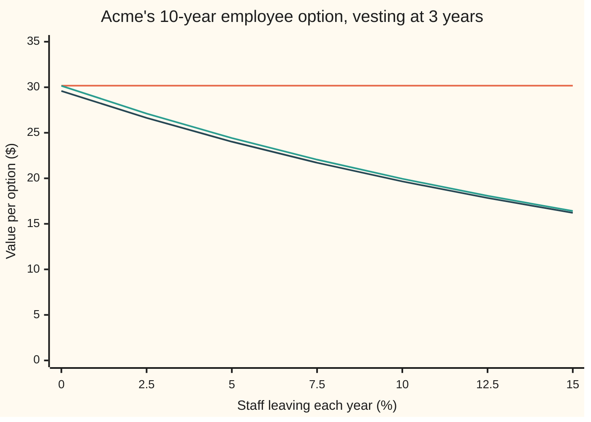

# Warrants and employee options: calls a company writes on its own shares, the dilution that shrinks them, and the early exercise employees cannot avoid

[Syllabus](../../../SYLLABUS.md) → [Financial mathematics](../README.md) → [American and Bermudan exercise](../README.md#s15) → Warrants and employee options

---

## General Overview

Acme has 1,000,000 shares, trading at $100.00. It writes 100,000 **warrants**: one-year calls on its own shares, strike $100.00. A warrant differs from a call traded between investors in one way. When it is exercised, Acme prints a new share and sells it to the holder for $100.00. No existing share changes hands.

That new share is **dilution**: one more share to split the company among. Say Acme's equity works out at $120 per old share at expiry. That counts the warrants' claim too, so it is not the share price. A plain call on $120 pays $20.00. After exercise, Acme holds $120M plus $10M of strike cash, split over 1,100,000 shares: $118.18 each. The holder paid $100.00, so the warrant pays $18.18, which is $20/1.1. So a warrant is worth 1/1.1 of a call: the $9.227006 house call becomes $8.388187.

**Employee stock options** (ESOs) are the same contract given to staff, with rules attached. Acme's grant runs 10 years at strike $100.00. It **vests** after 3 years: before then, an employee who leaves loses it. After that, a leaver must exercise at once or lose it. And employees cannot sell it, so many exercise early to cash in; here they exercise when the share reaches 2.0 times the strike. With 5% of staff leaving each year, a price tree that follows those rules values the option at $24.02. The plain 10-year [Black–Scholes call](../08-The%20Black-Scholes%20call%20and%20put/01-black-scholes-call.md) value is $30.17.

**A warrant is a call paid for in new shares, so it is worth N/(N+M) of a call on the company's equity per old share; an employee option is that call cut short by vesting, leaving and early exercise, and a tree that follows those rules values Acme's grant at $24.02, 79.6% of its Black–Scholes value.**

**What kind of fact this is:** the dilution formula is a theorem, proved on this card in Why it works, given the Black–Scholes model of the company's equity. The employee option value is a model of behaviour: the leaving rate and the exercise multiple are assumptions fitted to past staff, not laws.

### The picture: what the leaving rate does to the employee option



Top line: the plain 10-year Black–Scholes value, $30.17, which knows nothing about employees. Middle line: the tree with vesting and leaving but no early exercise. Bottom line: the tree with exercise at 2.0 times the strike as well. The leaving rate does most of the damage. At 5% leaving, the early-exercise rule takes the value from $24.42 to $24.02.

---

## The formula

Notation first, in words. $`N`$ is the number of old shares and $`M`$ the number of warrants. $`K`$ is the strike and $`T`$ the years to expiry. $`S`$ is the share price today and $`W`$ the value of one warrant. $`v`$ is the **equity per old share**: everything the shareholders and warrant holders own together, divided by $`N`$. $`C(v, K, T)`$ is the ordinary Black–Scholes call on something worth $`v`$, in the house market.

```math
W = \frac{N}{N+M}\, C(v, K, T), \qquad v = S + \frac{M}{N}\, W
```

**Read it aloud:** a warrant is worth the dilution factor times a call on the equity per old share, and that equity counts the warrants as well as the shares.

The employee option has no closed form. On a [Cox-Ross-Rubinstein](../04-Binomial%20Trees/04-crr-tree-and-convergence.md) tree, each node takes the rule its holder follows. $`V_{\text{node}}`$ is the option's value at a node. $`H`$ is the value of holding for one more step, the discounted average of the two nodes ahead, as in [Early exercise](../04-Binomial%20Trees/05-american-exercise-on-a-tree.md). $`\ell`$ is the chance the employee leaves during that step.

```math
V_{\text{node}} = \begin{cases} S - K & \text{vested and } S \ge mK \text{: exercise at the multiple} \\ (1-\ell)\,H + \ell\,\max(S-K,\,0) & \text{vested and } S < mK \text{: a leaver exercises or lets it lapse} \\ (1-\ell)\,H & \text{not vested: a leaver forfeits} \end{cases}
```

**Read it aloud:** after vesting, the employee cashes in at the multiple; otherwise the option is held, unless the employee leaves, which forces exercise after vesting and forfeits it before.

| Symbol | Plain meaning | In our example | Push it up and the answer… |
| --- | --- | --- | --- |
| $`N`$, $`M`$ | old shares, and warrants (each makes one new share) | 1,000,000 and 100,000 | more $`M`$: each warrant is worth less |
| $`K`$ | the strike, the price paid for each new share | 100.00 | falls |
| $`S`$ | the share price today | 100.00 | rises |
| $`v`$, $`v_T`$ | equity per old share (shares plus warrants, over $`N`$), today and at expiry | 100.00 or 100.886803; 120 in Step 1 | rises |
| $`W`$ | one warrant's value | 8.388187 or 8.868025 | — |
| $`C(v, K, T)`$ | the plain Black–Scholes call | 9.227006 at $`v = 100`$ | — |
| $`T`$ | years to expiry | 1 for the warrant, 10 for the ESO | rises |
| $`r`$, $`q`$, $`\sigma`$ | house market: riskless rate, dividend yield, volatility ("sigma") | 5%, 2%, 20% | $`\sigma`$ up: rises |
| $`t_v`$ | the vesting date: before it, a leaver forfeits | 3 years | ESO falls |
| $`m`$ | the exercise multiple: employees exercise once $`S \ge mK`$ | 2.0 | ESO rises at first ($24.62 at $`m = 3`$), then falls back to the no-multiple $24.42; while staff leave it never nears Black–Scholes |
| $`\lambda`$, $`\ell`$ | leaving rate per year ("lambda"); chance per step, $`\ell = 1 - e^{-\lambda \Delta t}`$ | 5% | ESO falls |
| $`\Delta t`$, $`n`$, $`i`$, $`p`$, $`V`$, $`H`$ | tree step in years, number of steps, step counter, up-weight, node value, hold value | 0.02, 500, 0 to 499, from the tree, 24.022149 at the root, per node | — |

### When it holds

- **The equity per old share moves like a Black–Scholes share.** The volatility $`\sigma`$ must be that of shares and warrants together, worked back from the share's own. The share is the equity minus the warrants, so its own volatility is lower: 19.07% here, against 20%. Plugging that in gives $8.53, not $8.87. That undoes nearly all of the $0.36 dilution correction.
- **The right input for $`v`$.** If warrants are already outstanding and the share trades at $100.00, solve for $`v`$: the warrant is $8.868025. Treating the $100.00 share price as $`v`$ gives $8.388187, too low.
- **Warrants exercised all at once, at expiry.** Many warrants are American. [Merton's theorem](02-mertons-no-early-exercise-theorem.md) rules out early exercise when there is no dividend; a 2% yield over one year leaves only a small premium, ignored here.
- **Leaving is independent of the share price.** Real staff leave more when their options are worth little. The model takes 5% a year in every state.
- **The ESO grant is small.** The tree ignores dilution from the grant itself. For a large grant, multiply by the dilution factor as for warrants.

---

## Why it works

### Step 0: the strike cash goes into the company

A traded call moves an existing share from a seller to the buyer. A warrant does not: the company creates a share and keeps the strike money. The new holder now owns a slice of a company that includes that cash. So the gain on exercise is spread over the old and new shares together. The warrant formula follows from that.

### Step 1: the warrant's payoff is a fraction of a call's

At expiry, let $`v_T`$ be the equity per old share. If the warrants are exercised, the company is worth $`N v_T + MK`$, split over $`N + M`$ shares. A holder pays $`K`$ for a share worth that much:

```math
\frac{N v_T + MK}{N+M} - K = \frac{N}{N+M}\,(v_T - K)
```

This is positive exactly when $`v_T > K`$, so holders exercise exactly when a plain call would. The warrant pays $`\frac{N}{N+M}\max(v_T - K, 0)`$: the payoff of $`N/(N+M)`$ calls on $`v`$. At $`v_T = 120`$: $`(120{,}000{,}000 + 10{,}000{,}000)/1{,}100{,}000 - 100 = 18.181818`$, which is $`20/1.1`$.

### Step 2: the same fraction holds today

Two contracts that pay the same in every future must cost the same today. Otherwise buying the cheap one and selling the dear one locks in a riskless profit. The warrant pays exactly $`N/(N+M)`$ calls on $`v`$, so it costs $`N/(N+M)`$ calls on $`v`$. Price that call by Black–Scholes and the formula follows.

The check reaches the same price without the factoring. It averages the post-exercise share price minus the strike over every possible $`v_T`$, weighted by the bell curve. That road gives $8.388187 too.

### Step 3: which number to plug in for v

The formula needs $`v`$, and $`v`$ depends on whether the warrants already exist.

| Case | Equity per old share $`v`$ | Warrant $`W`$ | Share price |
| --- | --- | --- | --- |
| Equity worth $100.00 per old share; warrants handed out free | 100.000000 | 8.388187 | falls to 99.161181 |
| Warrants outstanding; share trades at $100.00 | 100.886803 | 8.868025 | 100.00 |

**Free grant.** The warrants are a gift from the shareholders. Equity per old share stays $100.00, so nothing needs solving: $`W = 9.227006/1.1 = 8.388187`$. The old shares lose what was given away: $`100 - 0.1 \times 8.388187 = 99.161181`$.

**Share trading at $100.00 with warrants outstanding.** Now $`v = 100 + 0.1\,W`$ contains the unknown. Start from $`W = 0`$, compute $`v`$, price the call, divide by 1.1, and repeat. Each round shrinks the error by the dilution share $`M/(N+M)`$ times the call's **delta** (how far the call moves per dollar of $`v`$): 0.054862 here, so 60 rounds settle to $8.868025.

Both cases are one model. Solving the second case with the free-grant share price, $99.161181, returns $8.388187.

### Step 4: why employees exercise early

Merton's theorem says a holder who can sell a call never exercises it early on a share without a dividend. Selling beats exercising. Employees cannot sell their options, and company rules usually bar them from **hedging** (taking a bet against the share to offset the risk). Their wealth is tied to one company. So they exercise early to turn paper into cash, even though this throws value away. This fits the theorem: the market price of a call that can be sold does not change. What falls is the value of a claim that cannot be sold and is cashed in early, and that lower value is what the tree prices. Hull and White model this as an exercise multiple: exercise once the share reaches $`m`$ times the strike.

Leaving forces the issue. Before vesting, a leaver forfeits. After vesting, a leaver has a short window to exercise or lose the option. Either way, the option dies before its 10 years are up.

### Step 5: the tree follows the employee's rules

The tree is the ordinary CRR tree with 500 steps of 0.02 years. Working backwards from year 10, each node applies the three cases of The formula. The hold value $`H`$ is the usual discounted average. The leaving chance per step, $`\ell = 1 - e^{-0.05 \times 0.02}`$, blends what a stayer gets with what a leaver gets. The node never compares holding with exercising: the employee's behaviour is given, not chosen.

Switch every feature off and the tree should return the plain value. It gives $30.157255 against the formula's $30.166761, a lattice error of under a cent.

### Step 6: two more roads to the price

**Without the multiple, the option is a sum of plain calls.** An employee who leaves at step $`i`$ after vesting collects $`\max(S - K, 0)`$ at that date. That is worth a European call expiring then. Weight each date by the chance of leaving then:

```math
V = \sum_{t_v \,\le\, i\,\Delta t,\; i < n} (1-\ell)^{i}\,\ell\; C(S, K, i\,\Delta t) \;+\; (1-\ell)^{n}\, C(S, K, T)
```

This gives $24.429623; the tree gives $24.423388.

**With the multiple, simulate.** The check draws 100,000 share-price paths, 500 steps each, applies the same rules, and averages. It gives $23.985981 with a standard error (the typical size of the averaging error) of $0.057075. The tree's $24.022149 lies within one standard error.

<details>
<summary>Detailed proof: why the sum of plain calls is exact</summary>

Without the multiple, the employee never exercises by choice. The option ends in one of three ways: leaving at a step $`i`$ before vesting (worth nothing), leaving at a step $`i`$ after vesting (pays $`\max(S_{i\Delta t} - K, 0)`$ at that date), or staying to expiry (pays $`\max(S_T - K, 0)`$).

Leaving happens with chance $`\ell`$ at each step, independent of the share. The chance of first leaving at step $`i`$ is $`(1-\ell)^{i}\ell`$. The chance of staying all $`n`$ steps is $`(1-\ell)^{n}`$.

Because leaving and the share are independent, the risk-neutral value splits into chance times value. The value today of $`\max(S_t - K, 0)`$ paid at a fixed date $`t`$ is the European call $`C(S, K, t)`$. Adding the three kinds of ending gives the sum.

The tree computes the same sum with binomial share prices instead of the bell curve, so the two differ only by the lattice error.

</details>

---

## Worked numbers, by hand

| Step | Arithmetic | Value |
| --- | --- | --- |
| plain one-year call | Black–Scholes on $100.00, strike $100.00 | $9.227006 |
| dilution factor | $`1{,}000{,}000 / 1{,}100{,}000`$ | 0.909091 |
| warrant, equity per old share $100.00 | $`9.227006 \times 0.909091`$ | **$8.388187** |
| share price after a free grant | $`100 - 0.1 \times 8.388187`$ | $99.161181 |
| warrant, share trading at $100.00 | solve $`W = C(100 + 0.1W)/1.1`$ | **$8.868025** |
| equity per old share behind it | $`100 + 0.1 \times 8.868025`$ | $100.886803 |
| plain 10-year call | Black–Scholes, 10 years | $30.166761 |
| tree, exercise at 2.0 times strike only | no leaving | $29.586830 |
| tree, 5% leaving and 3-year vesting | no multiple | $24.423388 |
| tree, all three features | 500 steps | **$24.022149** |
| as a share of Black–Scholes | $`24.022149 / 30.166761`$ | 79.6% |

Acme's warrant is worth $8.39 or $8.87 depending on which number is observed. The employee option is worth $24.02 per option granted: valuing it at the full 10-year Black–Scholes price would overstate it by $6.14.

Feature by feature, one block per dollar:

```
Black-Scholes, ten years          ██████████████████████████████  30.17
exercise at 2.0 x strike only     ██████████████████████████████  29.59
5% leaving, no vesting            ██████████████████████████      25.91
5% leaving, 3-year vesting        ████████████████████████        24.42
all three features                ████████████████████████        24.02
```

### What breaks if you drop a piece

| Mistake | Comes out at | What went wrong |
| --- | --- | --- |
| Price the warrant as a plain call | $9.227006, not $8.868025 | Ignores the new shares; $0.358980 too high |
| Use the share price $100.00 as $`v`$ when warrants are outstanding | $8.388187, not $8.868025 | The equity also holds the warrants' value |
| Value the ESO at the full 10-year Black–Scholes price | $30.166761, not $24.022149 | Ignores leaving and early exercise; $6.144612 too high |
| Drop vesting: leavers in years 0–3 exercise at once | $25.909195, not $24.423388 | Forgets forfeiture in the first 3 years |
| Judge the 6.5-year Black–Scholes shortcut against the tree's $24.022149 | $25.017875 looks $0.995726 high | The tree already counts forfeiture, which the rules count in the number of options. Per vested option the tree gives $27.909756: the shortcut is $2.891881 low |

Every number in this table is printed by the checks below.

---

## Code, from first principles, and it actually runs

Nothing imported knows the answer. The bell-curve area is its own power series, averages are Simpson's rule (adding up thin slices under a curve), and the random numbers come from a generator written in the script. The warrant is reached two ways: the dilution factor times a call, and a direct average of the diluted payoff. The fixed point is checked against the free-grant case, and the share's own volatility is found twice: from the call's delta and by nudging the equity. The employee option is reached three ways: the tree, a simulation of 100,000 paths, and, without the multiple, the sum of plain calls. The tree with every feature off is checked against Black–Scholes. The value per vested option, times the chance of staying to year 3, must give back the tree's value.

### Python

```python
# Warrants and employee stock options -- the check behind the card.  Standard library
# only.  The bell-curve area is its own power series, the averages are Simpson's rule
# written out, the tree and the simulation are loops, the random numbers come from
# a 64-bit generator written here.  House market: r = 5%, q = 2%, sigma = 20%.
import math
R, Q, VOL, K = 0.05, 0.02, 0.20, 100.0
N_SH, M_W = 1_000_000, 100_000              # Acme's shares, the warrants it writes

def Phi(x):                                  # 1/2 + phi(x)(x + x^3/3 + x^5/15 + ...)
    term, total, n = x, x, 0
    while abs(term) > 1e-17 * max(1.0, abs(total)):
        n += 1; term *= x * x / (2 * n + 1); total += term
    return 0.5 + total * math.exp(-x * x / 2) / math.sqrt(2 * math.pi)

def bs_call(s, k, t, vol=VOL):
    if t <= 0: return max(s - k, 0.0)
    d1 = (math.log(s / k) + (R - Q + vol * vol / 2) * t) / (vol * math.sqrt(t))
    return s * math.exp(-Q * t) * Phi(d1) - k * math.exp(-R * t) * Phi(d1 - vol * math.sqrt(t))

def simpson(f, a, b, n=2000):
    h = (b - a) / n
    return h / 3 * sum((1 if i in (0, n) else 4 if i % 2 else 2) * f(a + i * h) for i in range(n + 1))

def warrant_by_average(v0, t=1.0):           # payoff from the diluted share price itself
    mu, sd = (R - Q - VOL * VOL / 2) * t, VOL * math.sqrt(t)
    def pay(z):
        v_t = v0 * math.exp(mu + sd * z)     # equity per old share at expiry
        price_after = (N_SH * v_t + M_W * K) / (N_SH + M_W)
        return max(price_after - K, 0.0) * math.exp(-z * z / 2) / math.sqrt(2 * math.pi)
    z_k = (math.log(K / v0) - mu) / sd       # below this the warrants lapse
    return math.exp(-R * t) * simpson(pay, z_k, 10.0)

def warrant_from_share_price(s, vol=VOL):    # W = N/(N+M) C(S + (M/N) W), by iteration
    w = 0.0
    for _ in range(60): w = N_SH / (N_SH + M_W) * bs_call(s + M_W / N_SH * w, K, 1.0, vol)
    return w

def eso_tree(steps, vest=3.0, mult=2.0, leave=0.05, t=10.0, forfeit=True):  # False: nobody leaves before vesting
    dt = t / steps; u = math.exp(VOL * math.sqrt(dt)); d = 1 / u
    p = (math.exp((R - Q) * dt) - d) / (u - d); df = math.exp(-R * dt)
    lv = 1 - math.exp(-leave * dt)           # chance of leaving in one step
    val = [max(100.0 * u ** (2 * j - steps) - K, 0.0) for j in range(steps + 1)]
    for i in range(steps - 1, -1, -1):
        vested = i * dt >= vest - 1e-9; li = lv if vested or forfeit else 0.0
        for j in range(i + 1):
            s = 100.0 * u ** (2 * j - i); x = max(s - K, 0.0)
            hold = df * (p * val[j + 1] + (1 - p) * val[j])
            if vested and s >= mult * K: val[j] = x                     # exercise at the multiple
            else: val[j] = (1 - li) * hold + li * (x if vested else 0.0)  # leave: exercise or forfeit
    return val[0]

def leave_sum(steps, vest=3.0, leave=0.05, t=10.0):  # no multiple: a sum of plain calls
    dt = t / steps; lv = 1 - math.exp(-leave * dt)
    tot = sum((1 - lv) ** i * lv * bs_call(100.0, K, i * dt) for i in range(steps) if i * dt >= vest - 1e-9)
    return tot + (1 - lv) ** steps * bs_call(100.0, K, t)

def eso_sim(pairs, steps=500, vest=3.0, mult=2.0, leave=0.05, t=10.0, seed=20261123):
    dt = t / steps; lv = 1 - math.exp(-leave * dt); vs = round(vest / dt)
    drift, sd, g = (R - Q - VOL * VOL / 2) * dt, VOL * math.sqrt(dt), math.exp(-R * dt)
    st, tot, tot2, mask = seed, 0.0, 0.0, (1 << 64) - 1
    for _ in range(pairs):
        z = []
        for _ in range(steps // 2):          # Box-Muller: two uniforms give two normals
            st = (st * 6364136223846793005 + 1442695040888963407) & mask; u1 = ((st >> 11) + 0.5) / 9007199254740992
            st = (st * 6364136223846793005 + 1442695040888963407) & mask; u2 = (st >> 11) / 9007199254740992
            rad = math.sqrt(-2 * math.log(u1)); z += [rad * math.cos(2 * math.pi * u2), rad * math.sin(2 * math.pi * u2)]
        pv = 0.0
        for sign in (1.0, -1.0):             # each path and its mirror image
            s, alive, disc, v, done = 100.0, 1.0, 1.0, 0.0, False
            for i in range(steps):
                x = max(s - K, 0.0)
                if i >= vs:
                    if s >= mult * K: v += alive * disc * x; done = True; break
                    v += alive * lv * disc * x
                alive *= 1 - lv; s *= math.exp(drift + sign * sd * z[i]); disc *= g
            if not done: v += alive * disc * max(s - K, 0.0)
            pv += v / 2
        tot += pv; tot2 += pv * pv
    mean = tot / pairs
    return mean, math.sqrt((tot2 / pairs - mean * mean) / pairs)

def out(label, x): print(f"{label:<44}{x:>12.6f}")

print("part 1: the warrant, one year, strike 100")
call = bs_call(100.0, K, 1.0); f = N_SH / (N_SH + M_W)
out("plain call on a share at 100", call)
out("dilution factor N/(N+M)", f)
w_free = f * call; out("warrant, equity per old share 100", w_free)
w_free_avg = warrant_by_average(100.0); out("  same, diluted payoff averaged", w_free_avg)
s_after = 100.0 - M_W / N_SH * w_free; out("  share price after a free grant", s_after)
out("  warrant solved from that share price", warrant_from_share_price(s_after))
w_cash = warrant_from_share_price(100.0); out("warrant, share trading at 100", w_cash)
v_c = 100.0 + M_W / N_SH * w_cash; out("  equity per old share behind it", v_c)
w_cash_avg = warrant_by_average(v_c); out("  same, diluted payoff averaged", w_cash_avg)
d1 = (math.log(v_c / K) + R - Q + VOL * VOL / 2) / VOL        # one year
shrink = M_W / (N_SH + M_W) * math.exp(-Q) * Phi(d1); out("  each round shrinks the error by", shrink)
share = lambda v: v - M_W / (N_SH + M_W) * bs_call(v, K, 1.0)   # share price behind equity v
vol_sh = VOL * v_c / share(v_c) * (share(v_c + 1e-4) - share(v_c - 1e-4)) / 2e-4
out("  the share's own volatility, %", 100 * vol_sh)
w_shvol = warrant_from_share_price(100.0, vol_sh); out("  warrant priced at the share's volatility", w_shvol)
after = (N_SH * 120.0 + M_W * K) / (N_SH + M_W); out("expiry at 120: each share after exercise", after)
out("expiry at 120: plain call pays", 20.0)
out("expiry at 120: warrant pays", after - K)
out("plain call overstates the warrant by", call - w_cash)
assert abs(w_free_avg - w_free) < 1e-6 and abs(w_cash_avg - w_cash) < 1e-6
assert abs(warrant_from_share_price(s_after) - w_free) < 1e-9
assert abs(vol_sh - VOL * v_c / 100.0 * (1 - shrink)) < 1e-6 and w_shvol < w_cash
assert abs(call - 9.227006) < 1e-6 and abs(w_free - 8.388187) < 1e-6   # the spec's anchors

print("part 2: the employee option, ten years, strike 100, 500-step tree")
bs10 = bs_call(100.0, K, 10.0); out("Black-Scholes, ten years", bs10)
plain = eso_tree(500, vest=0.0, mult=1e9, leave=0.0); out("tree, no employee features", plain)
only_mult = eso_tree(500, mult=2.0, leave=0.0); out("tree, exercise at 2.0 times strike only", only_mult)
no_vest = eso_tree(500, vest=0.0, mult=1e9); out("tree, 5% leaving, no vesting", no_vest)
lv_vest = eso_tree(500, mult=1e9); out("tree, 5% leaving, 3-year vesting", lv_vest)
lv_sum = leave_sum(500); out("  same, as a sum of plain calls", lv_sum)
eso = eso_tree(500); out("tree, all three features", eso)
for n in (250, 1000): out(f"  same on a {n}-step tree", eso_tree(n))
m3 = eso_tree(500, mult=3.0); out("  same, exercise at 3.0 times strike", m3)
sim, se = eso_sim(50000); out("simulation, 100,000 paths", sim); out("  its standard error", se)
out("ESO as a share of Black-Scholes, %", 100 * eso / bs10)
out("Black-Scholes overstates the ESO by", bs10 - eso)
short = bs_call(100.0, K, 6.5); out("accounting shortcut: Black-Scholes, 6.5 years", short)
out("  minus the tree, forfeiture counted twice", short - eso)
stay = math.exp(-0.05 * 3.0); out("chance of staying to vesting", stay)
per_vest = eso_tree(500, forfeit=False); out("tree, per vested option", per_vest)
out("  shortcut falls short per vested option by", per_vest - short)
assert abs(plain - bs10) < 0.02 and abs(lv_vest - lv_sum) < 0.02
assert abs(sim - eso) < 3 * se and eso < lv_vest < no_vest < bs10
assert abs(stay * per_vest - eso) < 1e-9 and eso < lv_vest < m3
rates = [0.0, 0.025, 0.05, 0.075, 0.10, 0.125, 0.15]
print("chart leaving %   " + "".join(f"{100 * e:>7.1f}" for e in rates))
print("chart multiple 2  " + "".join(f"{eso_tree(500, leave=e):>7.2f}" for e in rates))
print("chart no multiple " + "".join(f"{eso_tree(500, mult=1e9, leave=e):>7.2f}" for e in rates))
print("ALL CHECKS PASS")
```

**Ran 2026-11-23 on macOS, Python 3.14.10, standard library only. All checks passed. Output, pasted from the run:**

```
part 1: the warrant, one year, strike 100
plain call on a share at 100                    9.227006
dilution factor N/(N+M)                         0.909091
warrant, equity per old share 100               8.388187
  same, diluted payoff averaged                 8.388187
  share price after a free grant               99.161181
  warrant solved from that share price          8.388187
warrant, share trading at 100                   8.868025
  equity per old share behind it              100.886803
  same, diluted payoff averaged                 8.868025
  each round shrinks the error by               0.054862
  the share's own volatility, %                19.070384
  warrant priced at the share's volatility      8.530390
expiry at 120: each share after exercise      118.181818
expiry at 120: plain call pays                 20.000000
expiry at 120: warrant pays                    18.181818
plain call overstates the warrant by            0.358980
part 2: the employee option, ten years, strike 100, 500-step tree
Black-Scholes, ten years                       30.166761
tree, no employee features                     30.157255
tree, exercise at 2.0 times strike only        29.586830
tree, 5% leaving, no vesting                   25.909195
tree, 5% leaving, 3-year vesting               24.423388
  same, as a sum of plain calls                24.429623
tree, all three features                       24.022149
  same on a 250-step tree                      24.062788
  same on a 1000-step tree                     23.997749
  same, exercise at 3.0 times strike           24.622266
simulation, 100,000 paths                      23.985981
  its standard error                            0.057075
ESO as a share of Black-Scholes, %             79.631185
Black-Scholes overstates the ESO by             6.144612
accounting shortcut: Black-Scholes, 6.5 years   25.017875
  minus the tree, forfeiture counted twice      0.995726
chance of staying to vesting                    0.860708
tree, per vested option                        27.909756
  shortcut falls short per vested option by     2.891881
chart leaving %       0.0    2.5    5.0    7.5   10.0   12.5   15.0
chart multiple 2    29.59  26.63  24.02  21.71  19.66  17.84  16.21
chart no multiple   30.16  27.11  24.42  22.05  19.95  18.08  16.41
ALL CHECKS PASS
```

### Rust

The same checks, labels and inputs in Rust with no crates. Both programs use the same generator and grids, and the outputs agree line for line.

```rust
// Warrants and employee stock options -- the check behind the card, in Rust with no
// crates.  The same series, Simpson grids, tree, generator and labels as the Python
// check, so the two outputs agree line for line.  House market: r = 5%, q = 2%, sigma = 20%.
const R: f64 = 0.05; const Q: f64 = 0.02; const VOL: f64 = 0.20; const K: f64 = 100.0;
const N_SH: f64 = 1_000_000.0; const M_W: f64 = 100_000.0; // Acme's shares, the warrants it writes
const PI: f64 = std::f64::consts::PI;

fn phi(x: f64) -> f64 { // 1/2 + phi(x)(x + x^3/3 + x^5/15 + ...)
    let (mut term, mut total, mut n) = (x, x, 0.0);
    while term.abs() > 1e-17 * total.abs().max(1.0) { n += 1.0; term *= x * x / (2.0 * n + 1.0); total += term; }
    0.5 + total * (-x * x / 2.0).exp() / (2.0 * PI).sqrt()
}

fn bs_call(s: f64, k: f64, t: f64, vol: f64) -> f64 {
    if t <= 0.0 { return (s - k).max(0.0); }
    let d1 = ((s / k).ln() + (R - Q + vol * vol / 2.0) * t) / (vol * t.sqrt());
    s * (-Q * t).exp() * phi(d1) - k * (-R * t).exp() * phi(d1 - vol * t.sqrt())
}

fn simpson(f: &dyn Fn(f64) -> f64, a: f64, b: f64, n: usize) -> f64 {
    let h = (b - a) / n as f64;
    let w = |i: usize| if i == 0 || i == n { 1.0 } else if i % 2 == 1 { 4.0 } else { 2.0 };
    h / 3.0 * (0..=n).map(|i| w(i) * f(a + i as f64 * h)).sum::<f64>()
}

fn warrant_by_average(v0: f64) -> f64 { // payoff from the diluted share price itself, one year
    let (mu, sd) = (R - Q - VOL * VOL / 2.0, VOL);
    let pay = |z: f64| {
        let v_t = v0 * (mu + sd * z).exp(); // equity per old share at expiry
        let price_after = (N_SH * v_t + M_W * K) / (N_SH + M_W);
        (price_after - K).max(0.0) * (-z * z / 2.0).exp() / (2.0 * PI).sqrt()
    };
    let z_k = ((K / v0).ln() - mu) / sd; // below this the warrants lapse
    (-R).exp() * simpson(&pay, z_k, 10.0, 2000)
}

fn warrant_from_share_price(s: f64, vol: f64) -> f64 { // W = N/(N+M) C(S + (M/N) W), by iteration
    let mut w = 0.0;
    for _ in 0..60 { w = N_SH / (N_SH + M_W) * bs_call(s + M_W / N_SH * w, K, 1.0, vol); }
    w
}

fn eso_tree(steps: usize, vest: f64, mult: f64, leave: f64, forfeit: bool) -> f64 { // false: nobody leaves before vesting
    let dt = 10.0 / steps as f64; // ten years
    let (u, df) = ((VOL * dt.sqrt()).exp(), (-R * dt).exp());
    let p = (((R - Q) * dt).exp() - 1.0 / u) / (u - 1.0 / u);
    let lv = 1.0 - (-leave * dt).exp(); // chance of leaving in one step
    let mut val: Vec<f64> =
        (0..=steps).map(|j| (100.0 * u.powf(2.0 * j as f64 - steps as f64) - K).max(0.0)).collect();
    for i in (0..steps).rev() {
        let vested = i as f64 * dt >= vest - 1e-9; let li = if vested || forfeit { lv } else { 0.0 };
        for j in 0..=i {
            let s = 100.0 * u.powf(2.0 * j as f64 - i as f64);
            let x = (s - K).max(0.0);
            let hold = df * (p * val[j + 1] + (1.0 - p) * val[j]);
            val[j] = if vested && s >= mult * K { x } // exercise at the multiple
                else { (1.0 - li) * hold + li * (if vested { x } else { 0.0 }) }; // leave: exercise or forfeit
        }
    }
    val[0]
}

fn leave_sum(steps: usize, vest: f64, leave: f64) -> f64 { // no multiple: a sum of plain calls
    let (t, dt) = (10.0, 10.0 / steps as f64);
    let lv = 1.0 - (-leave * dt).exp();
    let mut tot = 0.0;
    for i in 0..steps {
        if i as f64 * dt >= vest - 1e-9 { tot += (1.0 - lv).powf(i as f64) * lv * bs_call(100.0, K, i as f64 * dt, VOL); }
    }
    tot + (1.0 - lv).powf(steps as f64) * bs_call(100.0, K, t, VOL)
}

fn eso_sim(pairs: usize) -> (f64, f64) {
    let (steps, vest, mult, leave, t) = (500usize, 3.0, 2.0, 0.05, 10.0);
    let (dt, lv) = (t / steps as f64, 1.0 - (-leave * t / steps as f64).exp());
    let vs = (vest / dt).round() as usize;
    let (drift, sd, g) = ((R - Q - VOL * VOL / 2.0) * dt, VOL * dt.sqrt(), (-R * dt).exp());
    let (mut st, mut tot, mut tot2) = (20261123u64, 0.0, 0.0);
    let mut z = vec![0.0; steps];
    let next = |st: &mut u64| {
        *st = st.wrapping_mul(6364136223846793005).wrapping_add(1442695040888963407);
        *st >> 11
    };
    for _ in 0..pairs {
        for i in 0..steps / 2 { // Box-Muller: two uniforms give two normals
            let u1 = (next(&mut st) as f64 + 0.5) / 9007199254740992.0;
            let u2 = next(&mut st) as f64 / 9007199254740992.0;
            let rad = (-2.0 * u1.ln()).sqrt();
            z[2 * i] = rad * (2.0 * PI * u2).cos();
            z[2 * i + 1] = rad * (2.0 * PI * u2).sin();
        }
        let mut pv = 0.0;
        for sign in [1.0, -1.0] { // each path and its mirror image
            let (mut s, mut alive, mut disc, mut v, mut done) = (100.0f64, 1.0, 1.0, 0.0, false);
            for i in 0..steps {
                let x = (s - K).max(0.0);
                if i >= vs {
                    if s >= mult * K { v += alive * disc * x; done = true; break; }
                    v += alive * lv * disc * x;
                }
                alive *= 1.0 - lv; s *= (drift + sign * sd * z[i]).exp(); disc *= g;
            }
            if !done { v += alive * disc * (s - K).max(0.0); }
            pv += v / 2.0;
        }
        tot += pv; tot2 += pv * pv;
    }
    let mean = tot / pairs as f64;
    (mean, ((tot2 / pairs as f64 - mean * mean) / pairs as f64).sqrt())
}

fn out(label: &str, x: f64) { println!("{:<44}{:>12.6}", label, x); }

fn main() {
    println!("part 1: the warrant, one year, strike 100");
    let (call, f) = (bs_call(100.0, K, 1.0, VOL), N_SH / (N_SH + M_W));
    out("plain call on a share at 100", call);
    out("dilution factor N/(N+M)", f);
    let w_free = f * call; out("warrant, equity per old share 100", w_free);
    let w_free_avg = warrant_by_average(100.0); out("  same, diluted payoff averaged", w_free_avg);
    let s_after = 100.0 - M_W / N_SH * w_free; out("  share price after a free grant", s_after);
    out("  warrant solved from that share price", warrant_from_share_price(s_after, VOL));
    let w_cash = warrant_from_share_price(100.0, VOL); out("warrant, share trading at 100", w_cash);
    let v_c = 100.0 + M_W / N_SH * w_cash; out("  equity per old share behind it", v_c);
    let w_cash_avg = warrant_by_average(v_c); out("  same, diluted payoff averaged", w_cash_avg);
    let d1 = ((v_c / K).ln() + R - Q + VOL * VOL / 2.0) / VOL; // one year
    let shrink = M_W / (N_SH + M_W) * (-Q).exp() * phi(d1); out("  each round shrinks the error by", shrink);
    let share = |v: f64| v - M_W / (N_SH + M_W) * bs_call(v, K, 1.0, VOL); // share price behind equity v
    let vol_sh = VOL * v_c / share(v_c) * (share(v_c + 1e-4) - share(v_c - 1e-4)) / 2e-4;
    out("  the share's own volatility, %", 100.0 * vol_sh);
    let w_shvol = warrant_from_share_price(100.0, vol_sh); out("  warrant priced at the share's volatility", w_shvol);
    let after = (N_SH * 120.0 + M_W * K) / (N_SH + M_W); out("expiry at 120: each share after exercise", after);
    out("expiry at 120: plain call pays", 20.0);
    out("expiry at 120: warrant pays", after - K);
    out("plain call overstates the warrant by", call - w_cash);
    assert!((w_free_avg - w_free).abs() < 1e-6 && (w_cash_avg - w_cash).abs() < 1e-6);
    assert!((warrant_from_share_price(s_after, VOL) - w_free).abs() < 1e-9);
    assert!((vol_sh - VOL * v_c / 100.0 * (1.0 - shrink)).abs() < 1e-6 && w_shvol < w_cash);
    assert!((call - 9.227006).abs() < 1e-6 && (w_free - 8.388187).abs() < 1e-6); // the spec's anchors

    println!("part 2: the employee option, ten years, strike 100, 500-step tree");
    let bs10 = bs_call(100.0, K, 10.0, VOL); out("Black-Scholes, ten years", bs10);
    let plain = eso_tree(500, 0.0, 1e9, 0.0, true); out("tree, no employee features", plain);
    out("tree, exercise at 2.0 times strike only", eso_tree(500, 3.0, 2.0, 0.0, true));
    let no_vest = eso_tree(500, 0.0, 1e9, 0.05, true); out("tree, 5% leaving, no vesting", no_vest);
    let lv_vest = eso_tree(500, 3.0, 1e9, 0.05, true); out("tree, 5% leaving, 3-year vesting", lv_vest);
    let lv_sum = leave_sum(500, 3.0, 0.05); out("  same, as a sum of plain calls", lv_sum);
    let eso = eso_tree(500, 3.0, 2.0, 0.05, true); out("tree, all three features", eso);
    for n in [250usize, 1000] { out(&format!("  same on a {}-step tree", n), eso_tree(n, 3.0, 2.0, 0.05, true)); }
    let m3 = eso_tree(500, 3.0, 3.0, 0.05, true); out("  same, exercise at 3.0 times strike", m3);
    let (sim, se) = eso_sim(50000);
    out("simulation, 100,000 paths", sim);
    out("  its standard error", se);
    out("ESO as a share of Black-Scholes, %", 100.0 * eso / bs10);
    out("Black-Scholes overstates the ESO by", bs10 - eso);
    let short = bs_call(100.0, K, 6.5, VOL); out("accounting shortcut: Black-Scholes, 6.5 years", short);
    out("  minus the tree, forfeiture counted twice", short - eso);
    let stay = (-0.05f64 * 3.0).exp(); out("chance of staying to vesting", stay);
    let per_vest = eso_tree(500, 3.0, 2.0, 0.05, false); out("tree, per vested option", per_vest);
    out("  shortcut falls short per vested option by", per_vest - short);
    assert!((plain - bs10).abs() < 0.02 && (lv_vest - lv_sum).abs() < 0.02);
    assert!((sim - eso).abs() < 3.0 * se && eso < lv_vest && lv_vest < no_vest && no_vest < bs10);
    assert!((stay * per_vest - eso).abs() < 1e-9 && eso < lv_vest && lv_vest < m3);
    let rates = [0.0, 0.025, 0.05, 0.075, 0.10, 0.125, 0.15];
    let row = |f: &dyn Fn(f64) -> String| rates.iter().map(|&e| f(e)).collect::<String>();
    println!("chart leaving %   {}", row(&|e| format!("{:>7.1}", 100.0 * e)));
    println!("chart multiple 2  {}", row(&|e| format!("{:>7.2}", eso_tree(500, 3.0, 2.0, e, true))));
    println!("chart no multiple {}", row(&|e| format!("{:>7.2}", eso_tree(500, 3.0, 1e9, e, true))));
    println!("ALL CHECKS PASS");
}
```

**Ran 2026-11-23 on macOS, rustc 1.98.1, no crates. All checks passed. Output, pasted from the run:**

```
part 1: the warrant, one year, strike 100
plain call on a share at 100                    9.227006
dilution factor N/(N+M)                         0.909091
warrant, equity per old share 100               8.388187
  same, diluted payoff averaged                 8.388187
  share price after a free grant               99.161181
  warrant solved from that share price          8.388187
warrant, share trading at 100                   8.868025
  equity per old share behind it              100.886803
  same, diluted payoff averaged                 8.868025
  each round shrinks the error by               0.054862
  the share's own volatility, %                19.070384
  warrant priced at the share's volatility      8.530390
expiry at 120: each share after exercise      118.181818
expiry at 120: plain call pays                 20.000000
expiry at 120: warrant pays                    18.181818
plain call overstates the warrant by            0.358980
part 2: the employee option, ten years, strike 100, 500-step tree
Black-Scholes, ten years                       30.166761
tree, no employee features                     30.157255
tree, exercise at 2.0 times strike only        29.586830
tree, 5% leaving, no vesting                   25.909195
tree, 5% leaving, 3-year vesting               24.423388
  same, as a sum of plain calls                24.429623
tree, all three features                       24.022149
  same on a 250-step tree                      24.062788
  same on a 1000-step tree                     23.997749
  same, exercise at 3.0 times strike           24.622266
simulation, 100,000 paths                      23.985981
  its standard error                            0.057075
ESO as a share of Black-Scholes, %             79.631185
Black-Scholes overstates the ESO by             6.144612
accounting shortcut: Black-Scholes, 6.5 years   25.017875
  minus the tree, forfeiture counted twice      0.995726
chance of staying to vesting                    0.860708
tree, per vested option                        27.909756
  shortcut falls short per vested option by     2.891881
chart leaving %       0.0    2.5    5.0    7.5   10.0   12.5   15.0
chart multiple 2    29.59  26.63  24.02  21.71  19.66  17.84  16.21
chart no multiple   30.16  27.11  24.42  22.05  19.95  18.08  16.41
ALL CHECKS PASS
```

### Lean

Lean proves Step 1's payoff identity and the leaving chances from the detailed proof, for any share counts, strike and leaving chance.

- Take $`N > 0`$ old shares, $`M`$ warrants, a strike $`K`$ and any $`v_T`$. Then the warrant pays exactly $`\frac{N}{N+M}\max(v_T - K, 0)`$.
- Take the same $`N`$, $`M`$, $`K`$ and $`v_T`$. Then a new share is worth more than $`K`$ exactly when $`v_T > K`$.
- Take any leaving chance $`\ell`$ per step and $`n`$ steps. Then $`\sum_{i<n}(1-\ell)^{i}\ell + (1-\ell)^{n} = 1`$: the endings cover every case.
- Exact fractions confirm Acme's dilution factor, 10/11. At $`v_T = 120`$ they give $118.18 as 1300/11 and $18.18 as 200/11.

The Black–Scholes prices, solving for $`v`$, the employee tree and the simulation are left to the Python and Rust checks.

```lean
-- Warrants and employee options: a warrant on N old shares with M new shares pays exactly N/(N+M) of a call's payoff on the equity per old share, and the employee's leaving chances add up to one.
import Mathlib.Algebra.Order.Field.Basic
import Mathlib.Algebra.Field.GeomSum
import Mathlib.Basic.Real.Basic
import Mathlib.Tactic.NormNum
import Mathlib.Tactic.FieldSimp
import Mathlib.Tactic.Ring
import Mathlib.Tactic.Linarith
import Mathlib.Tactic.LinearCombination

/-- The dilution theorem at expiry: with `N > 0` old shares and `M` warrants of strike `K`,
if the equity per old share at expiry is `v`, the warrant pays
`max ((N v + M K)/(N + M) - K) 0`, and this is exactly `N/(N+M)` times the payoff
`max (v - K) 0` of a plain call on `v`. -/
theorem warrant_payoff_eq_dilution_factor_mul_call_payoff
    (N M : ℕ) (hN : 0 < N) (K v : ℝ) :
    max (((N : ℝ) * v + (M : ℝ) * K) / ((N : ℝ) + M) - K) 0
      = (N : ℝ) / ((N : ℝ) + M) * max (v - K) 0 := by
  have hs : (0:ℝ) < (N:ℝ) + M := by positivity
  have hNs : (0:ℝ) ≤ (N:ℝ) / ((N:ℝ) + M) := by positivity
  have key : ((N : ℝ) * v + (M : ℝ) * K) / ((N : ℝ) + M) - K
      = (N : ℝ) / ((N : ℝ) + M) * (v - K) := by
    field_simp
    ring
  rw [key, mul_max_of_nonneg _ _ hNs, mul_zero]

/-- Warrant holders exercise exactly when a plain call holder would: the new share is worth
more than the strike, `(N v + M K)/(N + M) > K`, exactly when `v > K`. -/
theorem warrant_exercised_iff_call_in_the_money
    (N M : ℕ) (hN : 0 < N) (K v : ℝ) :
    K < ((N : ℝ) * v + (M : ℝ) * K) / ((N : ℝ) + M) ↔ K < v := by
  have hs : (0:ℝ) < (N:ℝ) + M := by positivity
  have hNpos : (0:ℝ) < (N:ℝ) := by exact_mod_cast hN
  rw [lt_div_iff₀ hs]
  constructor
  · intro h
    nlinarith
  · intro h
    nlinarith

/-- The employee option ends in exactly one way: first leaving at step `i < n`, with chance
`(1 - ℓ)^i ℓ`, or staying all `n` steps, with chance `(1 - ℓ)^n`; these chances add up to one,
which is why the option is a weighted sum of plain calls. -/
theorem leaving_chances_sum_to_one (ℓ : ℝ) (n : ℕ) :
    (∑ i ∈ Finset.range n, (1 - ℓ) ^ i * ℓ) + (1 - ℓ) ^ n = 1 := by
  induction n with
  | zero => simp
  | succ n ih =>
    rw [Finset.sum_range_succ]
    linear_combination ih

-- Acme: 1,000,000 shares, 100,000 warrants, strike 100; the dilution factor is 1/1.1 = 10/11.
example : ((1000000 : ℚ) / (1000000 + 100000)) = 10 / 11 := by norm_num

-- Equity per old share 120 at expiry: each share after exercise is worth 1300/11 (118.18...),
-- and the warrant pays 200/11 = 20/1.1 (18.18...), against the plain call's 20.
example : ((1000000 : ℚ) * 120 + 100000 * 100) / (1000000 + 100000) = 1300 / 11 := by norm_num
example : ((1000000 : ℚ) * 120 + 100000 * 100) / (1000000 + 100000) - 100 = 200 / 11 := by norm_num
example : max (((1000000 : ℚ) * 120 + 100000 * 100) / (1000000 + 100000) - 100) 0
    = (1000000 : ℚ) / (1000000 + 100000) * max (120 - 100) 0 := by norm_num

#print axioms warrant_payoff_eq_dilution_factor_mul_call_payoff
#print axioms warrant_exercised_iff_call_in_the_money
#print axioms leaving_chances_sum_to_one
```

**Checked 2026-11-23 on macOS, Lean 4.36.0-rc2, Mathlib v4.36.0-rc2. Every proof is complete and uses only Lean's standard axioms. Output, pasted from the run:**

```
'warrant_payoff_eq_dilution_factor_mul_call_payoff' depends on axioms: [propext, Classical.choice, Quot.sound]
'warrant_exercised_iff_call_in_the_money' depends on axioms: [propext, Classical.choice, Quot.sound]
'leaving_chances_sum_to_one' depends on axioms: [propext, Classical.choice, Quot.sound]
```

> [!TIP]
> **Try changing**
> - Guess first: with nobody leaving, how much does the 2.0 multiple alone cost? Call `eso_tree(500, leave=0.0)`. It gives $29.59, close to the $30.17 Black–Scholes value.
> - Guess first: what does 15% leaving a year do? Call `eso_tree(500, leave=0.15)`. It gives $16.21, about half the Black–Scholes value.
> - Guess first: does a finer tree settle the price? Call `eso_tree(1000)`. It gives $23.997749, against $24.062788 at 250 steps: the price wobbles by a few cents, because the exercise level $200 falls between nodes differently on each tree.
> - Guess first: how much is the multiple worth at 5% leaving? Call `eso_tree(500, mult=1e9)`. It gives $24.42, against $24.02 with the multiple.

---

## The usual mistake

> [!warning]
> **Valuing an employee option at its full-life Black–Scholes price.** Acme's 10-year grant is $30.17 by Black–Scholes and $24.02 on the tree. The formula assumes a holder who can sell, never leaves, and waits the full 10 years. Employees do none of these. The plain price overstates each option granted by $6.14.
>
> Smaller traps:
> - **Pricing a warrant as a traded call.** The new shares dilute the gain. $9.23 is $0.36 above the true $8.87.
> - **Plugging the share price in where the equity per old share belongs.** With warrants outstanding and the share at $100.00, using 100 as $`v`$ gives $8.39, not $8.87.
> - **Forgetting forfeiture.** A leaver before year 3 gets nothing. Without that rule the tree gives $25.91 instead of $24.42.
> - **Judging the shortcut life against the wrong value.** Black–Scholes with a 6.5-year life gives $25.02, which looks $1.00 high against the tree's $24.02. But the rules value one option as if it vests and count forfeiture in the number expected to vest, so using $24.02 counts it twice. Per vested option the tree gives $27.91, and the shortcut is $2.89 low.

---

## Where you meet it in real life

- **Company accounts.** US rules (ASC 718) and the international standard (IFRS 2) make companies measure employee options at fair value on the grant date and spread that cost over the vesting period. Each option is valued as if it vests; options expected to be forfeited before vesting come out of the count, not the price. For simple grants, US practice allows a shortcut life: halfway between vesting and expiry, 6.5 years for Acme. Convention as of 2026-11-23; check current rules before relying on it.
- **Tree models in audits.** Larger companies value grants on a tree with leaving after vesting and an exercise multiple, like this card's but with nobody leaving before vesting: $27.91 per vested option for Acme. The leaving rate and the multiple come from the company's own staff history.
- **Warrants with new debt or shares.** Companies attach warrants to bonds or share issues to make them easier to sell. The dilution factor decides what the sweetener costs the old shareholders.
- **Rescue funding.** In 2008 the US Treasury took warrants in the banks it supported, so taxpayers shared any recovery.
- **Bank-issued "warrants".** Many listed warrants in Europe and Asia are written by banks, which hedge them in the market. No new shares are created, so they are plain calls: the dilution factor does not apply.

> **Say it back**
> A warrant is a call written by the company itself, and exercising it creates a new share. The strike cash joins the company, so the gain is spread over old and new shares. That makes a warrant worth N/(N+M) of a call on the equity per old share, $8.39 or $8.87 for Acme depending on whether the warrants already exist. An employee option adds vesting, forced exercise or forfeiture on leaving, and early exercise by holders who cannot sell. A tree that follows those rules values Acme's 10-year grant at $24.02, against $30.17 by Black–Scholes.

---

## What this builds on

- [Black–Scholes call](../08-The%20Black-Scholes%20call%20and%20put/01-black-scholes-call.md): the plain call $`C(v, K, T)`$, $9.227006 for one year and $30.166761 for ten.
- [Cox-Ross-Rubinstein](../04-Binomial%20Trees/04-crr-tree-and-convergence.md): the up and down sizes and the up-weight $`p`$ of the employee option's tree.
- [Early exercise](../04-Binomial%20Trees/05-american-exercise-on-a-tree.md): working back through a tree with a rule at every node, here the employee's rule.
- [Merton's theorem](02-mertons-no-early-exercise-theorem.md): a holder who can sell never exercises a call early, which is why employees, who cannot, are the exception.

## Where this goes next

- [Merton's model](../43-Structural%20Models%20-%20Default%20from%20the%20Balance%20Sheet/01-merton-model-equity-as-a-call.md): the same move one level down. Shares are a call on the company's assets, as the warrant is a call on its equity.
- [Backing out the unobservable](../43-Structural%20Models%20-%20Default%20from%20the%20Balance%20Sheet/04-asset-value-and-volatility-from-the-share-price.md): solving for a hidden company value from the share price, the fixed point of Step 3 in a bigger form.

The shelf's other cards cover the exercise decision for traded options: [American options](01-american-options-and-early-exercise.md), [Bermudan options](03-bermudan-options.md), [The exercise boundary and smooth pasting](04-exercise-boundary-and-smooth-pasting.md), [The perpetual American put](05-perpetual-american-put.md), [Barone-Adesi-Whaley](06-barone-adesi-whaley-approximation.md) and [American Greeks and implied volatility](07-american-greeks-and-implied-volatility.md).

This card takes the employee's behaviour as given; what it leaves open is how to estimate the leaving rate and the exercise multiple from a company's records, and how much the price depends on getting them right.

---

## Sources

Verified 2026-11-23: every link below resolves to the publisher's page.

- Galai, Dan, and Meir I. Schneller. "Pricing of Warrants and the Value of the Firm." *Journal of Finance* 33, no. 5 (1978): 1333–1342. [doi:10.1111/j.1540-6261.1978.tb03423.x](https://doi.org/10.1111/j.1540-6261.1978.tb03423.x). The warrant as a fraction of a call on the firm's equity.
- Hull, John, and Alan White. "How to Value Employee Stock Options." *Financial Analysts Journal* 60, no. 1 (2004): 114–119. [doi:10.2469/faj.v60.n1.2596](https://doi.org/10.2469/faj.v60.n1.2596). The tree with vesting, a leaving rate and an exercise multiple.
- Black, Fischer, and Myron Scholes. "The Pricing of Options and Corporate Liabilities." *Journal of Political Economy* 81, no. 3 (1973): 637–654. [doi:10.1086/260062](https://doi.org/10.1086/260062). The plain call the card compares against; the paper also treats warrants.
- Cox, John C., Stephen A. Ross, and Mark Rubinstein. "Option Pricing: A Simplified Approach." *Journal of Financial Economics* 7, no. 3 (1979): 229–263. [doi:10.1016/0304-405X(79)90015-1](https://doi.org/10.1016/0304-405X(79)90015-1). The tree used for the employee option.
- Hull, John C. *Options, Futures, and Other Derivatives*, 11th ed. Pearson. [Publisher page](https://www.pearson.com/en-us/subject-catalog/p/options-futures-and-other-derivatives/P200000005938). Textbook treatment of warrants, dilution and employee stock options.
