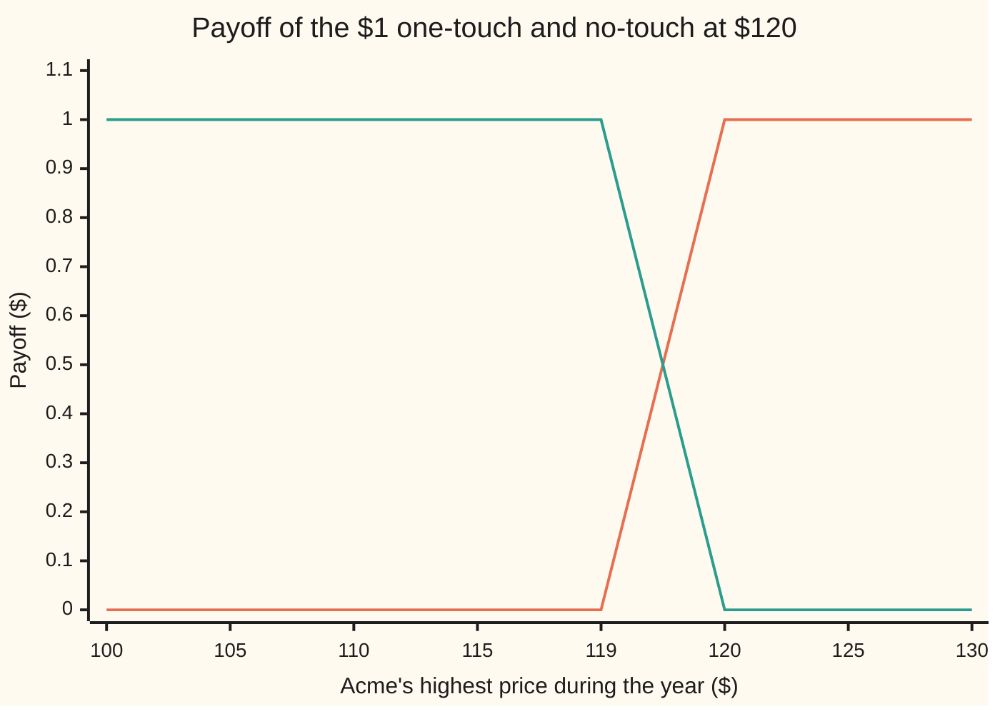
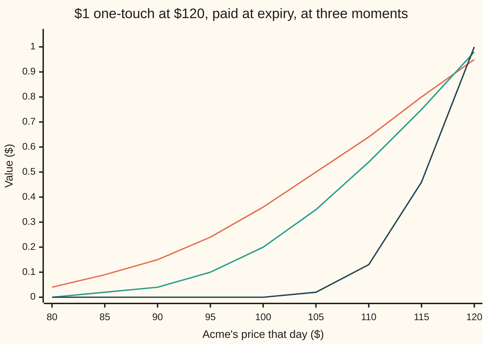

# One-touch and no-touch: a fixed sum if the line is ever reached, priced from the chance of touching

[Syllabus](../../../SYLLABUS.md) → [Financial mathematics](../README.md) → [Barriers, touches and lookbacks](../README.md#s16) → One-touch and no-touch

---

## General Overview

Acme shares trade at $100 today. A contract says: if Acme trades at $120 or higher at any moment in the next year, the holder is paid $1. It does not matter where Acme finishes. A spike to $120 in March followed by a slide to $90 by December still pays. A year spent between $101 and $119.99 pays nothing.

That contract is a **one-touch**: one touch of the line is enough. The $120 line is the **barrier**. Its mirror image pays $1 only if Acme never reaches $120 all year, and is called a **no-touch**. Holding both guarantees the dollar, because every year either contains a touch or does not.

The one-touch comes in two versions. One pays the dollar on the expiry date, a year from now, whenever the touch happened. The other pays the moment the line is hit. The second is worth more, because an early dollar is worth more than a late one.

In the house market (interest 5 percent a year, dividends 2 percent, volatility 20 percent) the one-touch paid at expiry costs **$0.360156**, the one paid at the hit costs **$0.369391**, and the no-touch costs **$0.591073**. The one-touch and the no-touch together cost **$0.951229**: exactly a dollar due in a year, discounted to today.

Under the prices sits one number: the chance that Acme touches $120 within the year, counted in the pretend world where every asset grows at the bank rate. That chance is **0.378622**. It is nearly double the chance that Acme *finishes* above $120, and the reason it doubles is a mirror.

**A one-touch is a digital (a fixed sum paid on an event) whose event is "the running high reached the line", so its price is the discounted chance of touching, and that chance is the chance of finishing past the line plus a mirror-image term that counts the paths which touched and came back.**

**What kind of fact this is:** a model: Acme's price is taken to wander as geometric Brownian motion with one fixed volatility, an assumption, not a law. Inside it the pricing formulas are theorems, proved on this card in Why it works. The rule that one-touch plus no-touch equals a discounted dollar is model-free.

### The picture: what each contract pays

The payoff of a touch contract depends on the year's highest price, not the final one. Along the bottom runs Acme's highest price during the year.



Orange: the one-touch, nothing until the year's high reaches $120, then $1. Green: the no-touch, $1 until the high reaches $120, then nothing. The sloped segment between $119 and $120 is the chart joining its points; the real payoff jumps at $120 exactly. The two lines always add to $1, which is the parity in picture form.

---

## The formula

Notation first, in words. $S$ is Acme's price today, $H$ the barrier, $T$ the years to expiry, $r$ the riskless rate, $q$ the dividend yield and $\sigma$ the volatility. $N(x)$ is the area under the standard bell curve left of $x$. $M_T$ is Acme's **running maximum**: the highest price it reaches between today and the expiry date. The one-touch pays when $M_T \ge H$. The chance of that event in the pretend world is written $Q$. The formulas below are for a line above today's price, $H > S$; for a line below, swap the signs of $b$ and $\nu$ in the $N$ terms, which counts touches from above.

$$Q \;=\; N\!\left(\frac{\nu T - b}{\sigma\sqrt{T}}\right) \;+\; \left(\frac{H}{S}\right)^{2\nu/\sigma^2} N\!\left(\frac{-b - \nu T}{\sigma\sqrt{T}}\right), \qquad b = \ln\frac{H}{S}, \quad \nu = r - q - \tfrac12\sigma^2$$

**Read it aloud:** the chance of touching is the chance of finishing past the line, plus a weighted chance of finishing past the line's mirror image.

Then the three prices:

$$\text{one-touch at expiry} = e^{-rT}\,Q, \qquad \text{no-touch} = e^{-rT}\,(1 - Q)$$

$$\text{one-touch at hit} \;=\; \left(\frac{H}{S}\right)^{(\nu - \tilde\nu)/\sigma^2} Q_{\tilde\nu}, \qquad \tilde\nu = \sqrt{\nu^2 + 2r\sigma^2}$$

**Read it aloud:** paid at expiry, the one-touch is the touch chance discounted for a year; the no-touch is the rest of that discounted dollar; paid at the hit, it is the same touch formula run with a steeper drift, times a weight.

$Q_{\tilde\nu}$ means the formula for $Q$ with the drift $\nu$ replaced by $\tilde\nu$ everywhere, including in the weight.

| Symbol | Plain meaning | In our example | Push it up and the one-touch… |
| --- | --- | --- | --- |
| $S$ | Acme's price today | $100 | rises: closer to the line |
| $H$ | the barrier: the line that must be touched | $120 | falls: further to climb |
| $T$, $t$ | time to expiry, in years; a moment along the way | 1 | rises: more time to wander up |
| $r$ | the riskless rate, continuously compounded | 5% | rises: the extra drift outweighs the extra discount |
| $q$ | Acme's dividend yield | 2% | falls: dividends leak out and slow the climb |
| $\sigma$ | volatility: how jumpy Acme is, per year | 20% | rises: a jumpier share reaches further |
| $b$ | the barrier's distance in log terms, $\ln(H/S)$ | 0.182322 | — |
| $\nu$, $\tilde\nu$ | the pretend-world drift of Acme's log price; the steeper drift used for payment at the hit | 0.010000 and 0.064031 | — |
| $M_T$, $\tau$, $X_t$, $X_T$ | the running maximum over the year; the first moment Acme reaches $H$; the log of Acme's price over today's, at time $t$ and at expiry | — | — |
| $Q$ | the pretend-world chance that $M_T \ge H$ | 0.378622 | — |
| $N(x)$, $\varphi(x)$ | the area under the standard bell curve left of $x$; the curve's height at $x$ | — | — |
| $e^{-rT}$, $D(T)$ | the discount factor: today's worth of $1 due at $T$ | 0.951229 | — |

The weight $(H/S)^{2\nu/\sigma^2}$ equals $e^{2\nu b/\sigma^2}$, and here it is 1.095445. It is 1 exactly when the drift $\nu$ is zero. The first bell-curve area is the cash-or-nothing digital's, with the strike moved to $H$.

**The Greeks** (how the price moves when one input is nudged; each is found by nudging the price in the code):

| Greek | What it measures | One-touch at expiry | No-touch |
| --- | --- | --- | --- |
| delta | change per $1 rise in Acme | 0.025305 | −0.025305 |
| gamma | change in delta per $1 rise | 0.000814 | −0.000814 |
| vega | change per 1 point of volatility | 0.019076 | −0.019076 |
| theta | change as one day passes | −0.000606 | 0.000736 |

Delta, gamma and vega are equal and opposite because the two contracts sum to a fixed discounted dollar, which does not care about Acme's price or jumpiness. Theta is not a mirror: a day's passing also moves that discounted dollar itself closer to $1, and the no-touch collects that too.

### When it holds

- **The barrier is watched every instant.** The formula counts a touch that lasts a millisecond. A contract that checks only the daily close misses touches between closes, so its one-touch is worth less; the correction is on [Daily monitoring](03-discrete-monitoring-correction.md).
- **Acme moves without jumps.** A share that gaps overnight from $118 to $125 still counts as touching, but the formula's paths are continuous. With jumps the touch chance changes and the at-hit version pays at a price past the line.
- **One fixed volatility.** Touch contracts depend on how jumpy Acme is near the barrier, not at the money. In a market that quotes different volatilities at different strikes, one number for the whole path misprices them; the market's adjustments are beyond this card.
- **A single riskless rate and a steady dividend yield.** The at-hit formula also needs $r \ge 0$ (Step 5). With a curve of rates, $e^{-rT}$ becomes the discount factor $D(T)$ for the payment date, and the at-hit version needs the curve at every possible hit date.

---

## Why it works

### Step 0: a touch contract is a digital on the path

The pilot card [Black–Scholes call](../08-The%20Black-Scholes%20call%20and%20put/01-black-scholes-call.md) gives the recipe for any payoff. Pretend every asset grows at the bank rate. Average the payoff over what Acme could do in that pretend world, called the **risk-neutral** world. Discount the average to today.

A payoff of $1 on an event and $0 otherwise averages to the chance of the event. That is how [Cash-or-nothing digital](../10-Digitals%20and%20the%20implied%20density/01-cash-or-nothing-digital.md) is priced, with the event "Acme finishes above the strike". Here the event is "Acme's running maximum reaches $120". So a one-touch paid at expiry is worth $e^{-rT} Q$. Everything hard is in $Q$, which is a question about whole paths, not end points.

### Step 1: move to log prices, where the barrier is a flat wall

Write Acme's price as $S$ times $e^{X_t}$. In the pretend world $X_t$, the log of the price ratio, is a Brownian motion with drift (the reminder is on [Geometric Brownian motion](../../11-Stochastic%20processes%20and%20calculus/05-Brownian%20Motion/07-geometric-brownian-motion.md)). It starts at 0, drifts at $\nu$ per year and spreads with $\sigma$ per root year.

$$\nu = r - q - \tfrac12\sigma^2 = 0.05 - 0.02 - 0.02 = 0.010000$$

The $-\tfrac12\sigma^2$ is the drag that wiggling puts on a log price; the pilot's "Why logarithms?" callout explains it. Acme reaches $120 exactly when $X_t$ reaches $b = \ln(120/100) = 0.182322$. Touching is now a question about a drifting random walk and a flat wall at height $b$.

### Step 2: paths that finish past the wall certainly touched

Acme's path is continuous. A path that ends at or above $b$ must have crossed $b$ on the way. The chance of that ending is a single bell-curve area, the same one as the digital's:

$$P(X_T \ge b) = N\!\left(\frac{\nu T - b}{\sigma\sqrt{T}}\right) = N(-0.861608) = 0.194452$$

Stopping here prices a one-touch as a plain digital at $120. That misses every path that touched and fell back.

### Step 3: paths that touched and came back, counted by a mirror

Take a path that touches the wall and then ends at some point $x$ below it. Flip everything after the first touch, up for down, about the wall. The flipped path ends at $2b - x$, above the wall. Flipping twice gives back the original, so touched paths ending at $x$ pair off one for one with paths ending at $2b - x$. This is the **reflection principle**, proved for driftless Brownian motion on [Reflection principle](../../11-Stochastic%20processes%20and%20calculus/05-Brownian%20Motion/04-reflection-principle-and-running-maximum.md).

Without drift, both members of each pair are equally likely. So the touched-and-returned paths have the same total chance as the paths ending above the wall: $Q$ is exactly twice the chance of finishing past the line.

With drift, the pair is not fair. Flipping turns an upward stretch into a downward one, and the pretend-world drift favours one direction. The correction turns out to be one constant weight for every path: touched paths ending at $x$ are as likely as free paths ending at $x - 2b$, times $e^{2\nu b/\sigma^2}$. A free path ending at $x - 2b$ is the same as a path launched from the mirror image of today's price, $H^2/S = 144$, and ending at $x$. Adding over all endings below the wall:

$$P(\text{touched and } X_T < b) = e^{2\nu b/\sigma^2}\, N\!\left(\frac{-b - \nu T}{\sigma\sqrt{T}}\right) = 1.095445 \times N(-0.961608) = 0.184170$$

<details>
<summary>Detailed proof: the weighted mirror</summary>

Write $p(x)$ for the density of $X_T$, a bell curve with centre $\nu T$ and spread $\sigma\sqrt{T}$, and $p_0(x)$ for the same with no drift. Adding a drift $\nu$ reweights each path by a factor that depends only on its end point $x$ (Girsanov's change of measure): $G(x) = e^{\nu x/\sigma^2 - \nu^2 T/(2\sigma^2)}$.

Without drift, the reflection principle gives the density of "touched, ended at $x$" for $x < b$ as $p_0(2b - x)$. With drift, multiply by $G(x)$. Write out the exponent:
$$-\frac{(2b - x)^2}{2\sigma^2 T} + \frac{\nu x}{\sigma^2} - \frac{\nu^2 T}{2\sigma^2} = -\frac{(2b - x)^2 - 2\nu T x + \nu^2 T^2}{2\sigma^2 T}.$$
Now write out the exponent of $e^{2\nu b/\sigma^2}\,p(x - 2b)$:
$$\frac{2\nu b}{\sigma^2} - \frac{(x - 2b - \nu T)^2}{2\sigma^2 T} = -\frac{(x - 2b)^2 - 2\nu T x + 4\nu b T + \nu^2 T^2 - 4\nu b T}{2\sigma^2 T}.$$
The $4\nu bT$ terms cancel and $(x - 2b)^2 = (2b - x)^2$, so the two exponents agree, and the constants in front are the same $1/(\sigma\sqrt{2\pi T})$. So the touched density is $e^{2\nu b/\sigma^2}\,p(x - 2b)$: a free bell curve shifted by $2b$, times one constant.

Integrate over $x < b$. The shifted curve puts mass $N\big((b - 2b - \nu T)/(\sigma\sqrt{T})\big) = N\big((-b - \nu T)/(\sigma\sqrt{T})\big)$ below $b$. Add Step 2's term for $x \ge b$, and the formula for $Q$ follows. The same argument gives the surviving-path density $p(x) - e^{2\nu b/\sigma^2}\,p(x - 2b)$ for $x < b$, which the code integrates as its second road to the no-touch.

</details>

### Step 4: add, then discount

$$Q = 0.194452 + 0.184170 = 0.378622$$

The mirror term is almost as big as the direct term: the log drift is small against the spread, so the pairing is nearly fair.

Paid at expiry, the one-touch is $e^{-rT}Q = 0.951229 \times 0.378622 = 0.360156$.

The no-touch pays on the complementary event. Every path either touches or does not, so the one-touch plus the no-touch pays $1 at expiry in every future. Two things that always pay the same must cost the same. So the no-touch is $e^{-rT}(1 - Q) = 0.591073$, and the pair costs 0.951229. That step used no model at all: it is the same argument as in-out parity on [Knock-out and knock-in options](01-knock-out-and-knock-in-options.md), with $1 in place of a call.

### Step 5: paid at the hit, the discount rides along the path

Paid at the first touch time $\tau$, the dollar is discounted by $e^{-r\tau}$, not by $e^{-rT}$. Averaging that over paths that touch needs the chance of touching at each moment, the **first-passage density**:

$$f(t) = \frac{b}{\sigma\sqrt{2\pi t^3}}\; e^{-(b - \nu t)^2/(2\sigma^2 t)}$$

It is the rate at which $Q$ builds up as the year runs: adding $f(t)$ from 0 to $T$ gives $Q$ again, which is the code's second road.

Multiply $f(t)$ by $e^{-rt}$. The two exponents combine by completing the square. What comes out is the same density with a steeper drift $\tilde\nu = \sqrt{\nu^2 + 2r\sigma^2} = 0.064031$, times a constant $e^{b(\nu - \tilde\nu)/\sigma^2} = 0.781706$. So the at-hit price is that constant times the touch chance at the steeper drift, 0.472545:

$$0.781706 \times 0.472545 = 0.369391$$

That exceeds the at-expiry price, 0.360156, because every touch before the end date pays earlier and is discounted less. Both claims need $r \ge 0$. With a negative rate an early dollar is worth less, and $\nu^2 + 2r\sigma^2$ can turn negative, so $\tilde\nu$ does not exist; the discounted-density integral still prices it.

<details>
<summary>The algebra behind the steeper drift</summary>

The exponent of $e^{-rt} f(t)$ is
$$-\frac{(b - \nu t)^2}{2\sigma^2 t} - rt = -\frac{b^2 - 2b\nu t + (\nu^2 + 2r\sigma^2)t^2}{2\sigma^2 t} = \frac{b\nu}{\sigma^2} - \frac{b^2 + \tilde\nu^2 t^2}{2\sigma^2 t}.$$
Add and subtract $b\tilde\nu/\sigma^2$: the last fraction becomes $-\frac{b\tilde\nu}{\sigma^2} - \frac{(b - \tilde\nu t)^2}{2\sigma^2 t}$. So
$$e^{-rt} f(t) = e^{b(\nu - \tilde\nu)/\sigma^2} \times \frac{b}{\sigma\sqrt{2\pi t^3}}\, e^{-(b - \tilde\nu t)^2/(2\sigma^2 t)},$$
and the second factor is the first-passage density with drift $\tilde\nu$. Adding it from 0 to $T$ gives $Q_{\tilde\nu}$. Since $e^{b(\nu - \tilde\nu)/\sigma^2} = (H/S)^{(\nu - \tilde\nu)/\sigma^2}$, the formula on this card follows.

</details>

A different road reaches the same prices: write the price as a function of Acme's price and time, demand that a hedged position earn the bank rate, and solve that equation with value 1 on the barrier. That is the Black–Scholes equation with a boundary, the approach of [The eight barrier formulas](02-reiner-rubinstein-barrier-formulas.md); there the at-hit one-touch appears as the rebate paid when a knock-out dies.

---

## Worked numbers, by hand

Acme: $S = 100$, $H = 120$, $r = 5\%$, $q = 2\%$, $\sigma = 20\%$, $T = 1$ year, $1 paid.

| Step | Arithmetic | Value |
| --- | --- | --- |
| log distance $b$ | $\ln(120/100)$ | 0.182322 |
| log drift $\nu$ | $0.05 - 0.02 - 0.02$ | 0.010000 |
| direct z-score | $(0.01 - 0.182322)/0.20$ | −0.861608 |
| direct term, finish past $120 | $N(-0.861608)$ | 0.194452 |
| mirror weight | $1.2^{2 \times 0.01/0.04} = 1.2^{0.5}$ | 1.095445 |
| mirror z-score | $(-0.182322 - 0.01)/0.20$ | −0.961608 |
| mirror term | $1.095445 \times N(-0.961608)$ | 0.184170 |
| touch chance $Q$ | $0.194452 + 0.184170$ | **0.378622** |
| discount $e^{-0.05}$ | | 0.951229 |
| one-touch at expiry | $0.951229 \times 0.378622$ | **$0.360156** |
| no-touch | $0.951229 \times (1 - 0.378622)$ | **$0.591073** |
| steeper drift $\tilde\nu$ | $\sqrt{0.0001 + 2 \times 0.05 \times 0.04}$ | 0.064031 |
| at-hit weight | $e^{0.182322 \times (0.01 - 0.064031)/0.04}$ | 0.781706 |
| touch chance at $\tilde\nu$ | the $Q$ formula with 0.064031 | 0.472545 |
| one-touch at hit | $0.781706 \times 0.472545$ | **$0.369391** |

A promise that Acme stays below $120 all year costs $0.591073. The market treats a 20 percent rise at some point in the year as a bit better than a one-in-three chance, while a finish above $120 is below one in five.

### What breaks if you drop a piece

Same contract, correct one-touch at expiry $0.360156:

| Mistake | Comes out at | What went wrong |
| --- | --- | --- |
| Price it as a digital: no mirror term | $0.184968 | Counts only paths that finish past $120 and misses every path that touched and fell back. Half the price is gone. |
| Mirror weight set to 1 | $0.344892 | Treats the flipped paths as equally likely with the drift present. Here the weight is above 1, so this undercounts. |
| Drift $r - q$, forgetting the $-\tfrac12\sigma^2$ | $0.392584 | Uses the price's drift where the log price's drift belongs, overstating the climb. |
| Rule of thumb: two digitals at $120 | $0.369936 | Exact only when the log drift is zero; a quick estimate, not a price. |

Every number in the table is printed by the code below.

---

## How the price moves as the year runs down

Values of the $1 one-touch paid at expiry, barrier $120, against Acme's price that day, from the checks:

| Acme's price | $80 | $90 | $100 | $110 | $115 | $120 |
| --- | --- | --- | --- | --- | --- | --- |
| 12 months left | 0.04 | 0.15 | 0.36 | 0.64 | 0.80 | 0.95 |
| 6 months left | 0.00 | 0.04 | 0.20 | 0.54 | 0.75 | 0.98 |
| 1 month left | 0.00 | 0.00 | 0.00 | 0.13 | 0.46 | 1.00 |

At $100, six months of no touch cuts the price from 0.36 to 0.20: less time left to climb. At $120 the line is already touched and the contract is a sure dollar paid at expiry. Its value is just the discount factor, which rises to 1.00 as the payment date nears. Just below the line the curve steepens as the months pass: with a month left and Acme at $115, one good week decides it.



Orange: 12 months left, a gentle curve. Green: 6 months left. Dark blue: 1 month left, almost a step at $120. As expiry nears, the curve squeezes onto the step, just as a digital's does, but the step sits at the barrier and is reached by touching, not by finishing. The no-touch is the discounted dollar minus each of these curves. The steep slope just below the barrier near expiry is the seller's hedging problem, taken up on [Barrier Greeks](04-barrier-greeks-at-the-wall.md).

---

## Code, from first principles, and it actually runs

Both programs take three independent roads to the touch chance and the prices. Road 1 is the reflection formula. Road 2 adds up the first-passage density over the year by Simpson's rule (thin slices, each topped by a parabola), and separately adds up the density of paths that survive below the wall, which prices the no-touch without using the formula. Road 3 simulates 20,000 years of Acme in 250 daily steps with a home-made random number generator; between steps it asks, by the Brownian-bridge formula, whether the path could have touched $120 and come back unseen, so the simulation watches continuously, as the contract does. The bell-curve area $N(x)$ is built from thin slices, since nothing imported may know the answer. The asserts compare roads against each other, and the simulation against the formula within four standard errors.

### Python

```python
# One-touch and no-touch -- the check behind the card.  Standard library only.
# Roads: (1) reflection formulas, (2) Simpson integrals of the first-passage
# density and of the no-touch end density, (3) a simulation with its own random
# numbers.  The bell-curve area N(x) is Simpson's rule, written out below.
from math import log, sqrt, exp, cos, pi

def phi(x): return exp(-0.5 * x * x) / sqrt(2.0 * pi)            # bell-curve height at x
def simpson(f, a, b, n):
    h = (b - a) / n
    s = f(a) + f(b)
    for i in range(1, n): s += (4 if i % 2 else 2) * f(a + i * h)
    return s * h / 3.0
def N(x):                                                         # bell-curve area left of x
    if x < -12.0: return 0.0
    if x > 12.0: return 1.0
    return 0.5 + simpson(phi, 0.0, x, 2000)

def touch_prob(S, H, q_, r, sig, T, nu=None):                     # road 1: reflection formula
    b, v = log(H / S), (r - q_ - 0.5 * sig * sig) if nu is None else nu
    if b <= 0.0: return 1.0
    st = sig * sqrt(T)
    return N((v * T - b) / st) + exp(2 * v * b / sig ** 2) * N((-b - v * T) / st)
def one_touch_expiry(S, H, q_, r, sig, T): return exp(-r * T) * touch_prob(S, H, q_, r, sig, T)
def no_touch(S, H, q_, r, sig, T):                                # written out on its own
    b, v, st = log(H / S), r - q_ - 0.5 * sig * sig, sig * sqrt(T)
    if b <= 0.0: return 0.0
    return exp(-r * T) * (N((b - v * T) / st) - exp(2 * v * b / sig ** 2) * N((-b - v * T) / st))
def one_touch_hit(S, H, q_, r, sig, T):                           # paid the moment the line is hit
    b, v = log(H / S), r - q_ - 0.5 * sig * sig
    if b <= 0.0: return 1.0
    vt = sqrt(v * v + 2 * r * sig * sig)                          # the steeper drift
    return exp(b * (v - vt) / sig ** 2) * touch_prob(S, H, 0, 0, sig, T, nu=vt)

S, H, r, q, sig, T = 100.0, 120.0, 0.05, 0.02, 0.20, 1.0
b, nu, D = log(H / S), r - q - 0.5 * sig * sig, exp(-r * T)
w = exp(2 * nu * b / sig ** 2)
def fpt(t):                                                       # first-passage density at time t
    return 0.0 if t <= 0 else b / (sig * sqrt(2 * pi * t ** 3)) * exp(-(b - nu * t) ** 2 / (2 * sig * sig * t))
Q1, Q2 = touch_prob(S, H, q, r, sig, T), simpson(fpt, 0.0, T, 20000)
hit1, hit2 = one_touch_hit(S, H, q, r, sig, T), simpson(lambda t: exp(-r * t) * fpt(t), 0.0, T, 20000)
st = sig * sqrt(T)                                                # road 2 for the no-touch: end density of paths that never touched
alive = lambda x: (phi((x - nu * T) / st) - w * phi((x - 2 * b - nu * T) / st)) / st
NT1, NT2 = no_touch(S, H, q, r, sig, T), D * simpson(alive, b - 12 * st, b, 20000)

state = 20260924                                                  # road 3: simulation, own generator
def unif():
    global state
    state = (state * 6364136223846793005 + 1442695040888963407) % 2 ** 64
    return ((state >> 11) + 0.5) / 2 ** 53
paths, steps = 20000, 250
dt = T / steps
hits, pv, pv2 = 0, 0.0, 0.0
for _ in range(paths):
    x = 0.0
    for k in range(steps):
        z = sqrt(-2 * log(unif())) * cos(2 * pi * unif())
        y = x + nu * dt + sig * sqrt(dt) * z
        u = unif()                                                # bridge: did it touch between steps?
        if y >= b or u < exp(-2 * (b - x) * (b - y) / (sig * sig * dt)):
            hits += 1; g = exp(-r * (k + 0.5) * dt); pv += g; pv2 += g * g
            break
        x = y
Q3, hit3 = hits / paths, pv / paths
seQ, seH = sqrt(Q3 * (1 - Q3) / paths), sqrt((pv2 / paths - hit3 ** 2) / paths)

vt = sqrt(nu * nu + 2 * r * sig * sig)
def row(label, v): print(f"{label:<42} {v:>10.6f}")
print("house market, S=100 H=120 r=0.05 q=0.02 sigma=0.20 T=1, $1 paid")
for lab, v in (("log distance b = ln(H/S)", b), ("log drift nu = r - q - sigma^2/2", nu),
               ("reflection weight (H/S)^(2 nu/sigma^2)", w), ("mirror start H^2/S", H * H / S), ("discount D(T) = e^-rT", D),
               ("z-score, end beyond 120", (nu * T - b) / st), ("z-score, mirror term", (-b - nu * T) / st),
               ("paths ending beyond 120", N((nu * T - b) / st)), ("touched, ending below (mirror term)", w * N((-b - nu * T) / st)),
               ("touch prob, 1 reflection formula", Q1), ("touch prob, 2 first-passage integral", Q2),
               ("touch prob, 3 simulation", Q3), ("  simulation standard error", seQ),
               ("one-touch at expiry, D(T) x Q", D * Q1), ("no-touch, 1 formula", NT1), ("no-touch, 2 surviving-path integral", NT2),
               ("one-touch + no-touch", D * Q1 + NT2), ("one-touch at hit, 1 formula", hit1),
               ("one-touch at hit, 2 discounted density", hit2), ("one-touch at hit, 3 simulation", hit3),
               ("  simulation standard error", seH), ("steeper drift sqrt(nu^2 + 2 r sigma^2)", vt),
               ("at-hit weight e^(b(nu - nut)/sigma^2)", exp(b * (nu - vt) / sig ** 2)), ("touch prob with the steeper drift", touch_prob(S, H, 0, 0, sig, T, nu=vt)),
               ("wrong: no mirror term, D(T) x P(end>=120)", D * N((nu * T - b) / st)),
               ("wrong: mirror weight set to 1", D * (N((nu * T - b) / st) + N((-b - nu * T) / st))),
               ("wrong: drift r - q, no -sigma^2/2", D * touch_prob(S, H, q, r, sig, T, nu=r - q)),
               ("rule of thumb: 2 x digital at 120", 2 * D * N((nu * T - b) / st)),
               ("try: sigma = 0.30", one_touch_expiry(S, H, q, r, 0.30, T)), ("try: H = 110", one_touch_expiry(S, 110.0, q, r, sig, T)),
               ("try: T = 2", one_touch_expiry(S, H, q, r, sig, 2.0)), ("try: r=0.04, q=0.02 (nu=0), touch prob", touch_prob(S, H, q, 0.04, sig, T)),
               ("try: nu=0, 2 x P(end>=120)", 2 * N(-b / st))):
    row(lab, v)
print("greeks by nudging            one-touch(exp)    no-touch")
for lab, f in (("delta, per $1 of S", lambda g: (g(S + 0.01, H, q, r, sig, T) - g(S - 0.01, H, q, r, sig, T)) / 0.02),
               ("gamma, per $1 of S", lambda g: (g(S + 0.5, H, q, r, sig, T) - 2 * g(S, H, q, r, sig, T) + g(S - 0.5, H, q, r, sig, T)) / 0.25),
               ("vega, per 1 vol point", lambda g: (g(S, H, q, r, sig + 0.0001, T) - g(S, H, q, r, sig - 0.0001, T)) / 0.02),
               ("theta, per day", lambda g: g(S, H, q, r, sig, T - 1 / 365) - g(S, H, q, r, sig, T))):
    print(f"{lab:<28} {f(one_touch_expiry):>14.6f} {f(no_touch):>11.6f}")
spots = [80.0 + 5 * i for i in range(9)]
print("chart, Acme price       " + " ".join(f"{s:5.0f}" for s in spots))
for lab, t in (("chart, 12 months left", 1.0), ("chart, 6 months left", 0.5), ("chart, 1 month left", 1 / 12)):
    print(f"{lab:<24}" + " ".join(f"{one_touch_expiry(s, H, q, r, sig, t):5.2f}" for s in spots))
highs = [100, 105, 110, 115, 119, 120, 125, 130]
print("payoff, year's high     " + " ".join(f"{h:5d}" for h in highs))
print("payoff, one-touch       " + " ".join(f"{1 if h >= 120 else 0:5d}" for h in highs))
print("payoff, no-touch        " + " ".join(f"{0 if h >= 120 else 1:5d}" for h in highs))

assert abs(Q1 - 0.378622) < 5e-7, "formula vs the spec's touch probability"
assert abs(NT1 - NT2) < 1e-7, "no-touch formula vs surviving-path integral"
assert abs(Q1 - Q2) < 1e-7, "reflection formula vs integrated first-passage density"
assert abs(hit1 - hit2) < 1e-7, "at-hit formula vs discounted density integral"
assert abs(D * Q1 + NT2 - D) < 1e-7, "one-touch plus independently integrated no-touch is a sure dollar"
assert abs(Q3 - Q1) < 4 * seQ, "simulated touch probability within four standard errors"
assert abs(hit3 - hit1) < 4 * seH, "simulated at-hit price within four standard errors"
print("ALL CHECKS PASS")
```

**Ran 2026-09-24 on macOS, Python 3.14.6, standard library only. All checks passed. Output, pasted from the run:**

```
house market, S=100 H=120 r=0.05 q=0.02 sigma=0.20 T=1, $1 paid
log distance b = ln(H/S)                     0.182322
log drift nu = r - q - sigma^2/2             0.010000
reflection weight (H/S)^(2 nu/sigma^2)       1.095445
mirror start H^2/S                         144.000000
discount D(T) = e^-rT                        0.951229
z-score, end beyond 120                     -0.861608
z-score, mirror term                        -0.961608
paths ending beyond 120                      0.194452
touched, ending below (mirror term)          0.184170
touch prob, 1 reflection formula             0.378622
touch prob, 2 first-passage integral         0.378622
touch prob, 3 simulation                     0.379250
  simulation standard error                  0.003431
one-touch at expiry, D(T) x Q                0.360156
no-touch, 1 formula                          0.591073
no-touch, 2 surviving-path integral          0.591073
one-touch + no-touch                         0.951229
one-touch at hit, 1 formula                  0.369391
one-touch at hit, 2 discounted density       0.369391
one-touch at hit, 3 simulation               0.370014
  simulation standard error                  0.003348
steeper drift sqrt(nu^2 + 2 r sigma^2)       0.064031
at-hit weight e^(b(nu - nut)/sigma^2)        0.781706
touch prob with the steeper drift            0.472545
wrong: no mirror term, D(T) x P(end>=120)    0.184968
wrong: mirror weight set to 1                0.344892
wrong: drift r - q, no -sigma^2/2            0.392584
rule of thumb: 2 x digital at 120            0.369936
try: sigma = 0.30                            0.501158
try: H = 110                                 0.617074
try: T = 2                                   0.491207
try: r=0.04, q=0.02 (nu=0), touch prob       0.361975
try: nu=0, 2 x P(end>=120)                   0.361975
greeks by nudging            one-touch(exp)    no-touch
delta, per $1 of S                 0.025305   -0.025305
gamma, per $1 of S                 0.000814   -0.000814
vega, per 1 vol point              0.019076   -0.019076
theta, per day                    -0.000606    0.000736
chart, Acme price          80    85    90    95   100   105   110   115   120
chart, 12 months left    0.04  0.09  0.15  0.24  0.36  0.50  0.64  0.80  0.95
chart, 6 months left     0.00  0.02  0.04  0.10  0.20  0.35  0.54  0.75  0.98
chart, 1 month left      0.00  0.00  0.00  0.00  0.00  0.02  0.13  0.46  1.00
payoff, year's high       100   105   110   115   119   120   125   130
payoff, one-touch           0     0     0     0     0     1     1     1
payoff, no-touch            1     1     1     1     1     0     0     0
ALL CHECKS PASS
```

The formula and both integrals agree to six decimals. The simulation lands within one standard error of the formula on both the touch chance and the at-hit price. The one-touch plus the separately integrated no-touch returns the discount factor.

### Rust

Same roads, same labels, same random number generator.

```rust
// One-touch and no-touch -- the same check as one_touch_and_no_touch_check.py, in Rust.
// Standard library only, no crates.  Roads: reflection formulas, Simpson integrals
// of the first-passage and surviving-path densities, and a simulation.
use std::f64::consts::PI;

fn phi(x: f64) -> f64 { (-0.5 * x * x).exp() / (2.0 * PI).sqrt() }
fn simpson<F: Fn(f64) -> f64>(f: F, a: f64, b: f64, n: usize) -> f64 {
    let h = (b - a) / n as f64;
    let mut s = f(a) + f(b);
    for i in 1..n { s += if i % 2 == 1 { 4.0 } else { 2.0 } * f(a + i as f64 * h); }
    s * h / 3.0
}
fn n_cdf(x: f64) -> f64 {
    if x < -12.0 { return 0.0; }
    if x > 12.0 { return 1.0; }
    0.5 + simpson(phi, 0.0, x, 2000)
}
fn drift(r: f64, q: f64, sig: f64) -> f64 { r - q - 0.5 * sig * sig }
fn touch_prob_nu(s: f64, h: f64, sig: f64, t: f64, v: f64) -> f64 {     // road 1: reflection formula
    let b = (h / s).ln();
    if b <= 0.0 { return 1.0; }
    let st = sig * t.sqrt();
    n_cdf((v * t - b) / st) + (2.0 * v * b / sig.powf(2.0)).exp() * n_cdf((-b - v * t) / st)
}
fn touch_prob(s: f64, h: f64, q: f64, r: f64, sig: f64, t: f64) -> f64 { touch_prob_nu(s, h, sig, t, drift(r, q, sig)) }
fn one_touch_expiry(s: f64, h: f64, q: f64, r: f64, sig: f64, t: f64) -> f64 { (-r * t).exp() * touch_prob(s, h, q, r, sig, t) }
fn no_touch(s: f64, h: f64, q: f64, r: f64, sig: f64, t: f64) -> f64 {
    let (b, v, st) = ((h / s).ln(), drift(r, q, sig), sig * t.sqrt());
    if b <= 0.0 { return 0.0; }
    (-r * t).exp() * (n_cdf((b - v * t) / st) - (2.0 * v * b / sig.powf(2.0)).exp() * n_cdf((-b - v * t) / st))
}
fn one_touch_hit(s: f64, h: f64, q: f64, r: f64, sig: f64, t: f64) -> f64 {
    let (b, v) = ((h / s).ln(), drift(r, q, sig));
    if b <= 0.0 { return 1.0; }
    let vt = (v * v + 2.0 * r * sig * sig).sqrt();                        // the steeper drift
    (b * (v - vt) / sig.powf(2.0)).exp() * touch_prob_nu(s, h, sig, t, vt)
}

fn main() {
    let (s, h, r, q, sig, t) = (100.0_f64, 120.0_f64, 0.05_f64, 0.02_f64, 0.20_f64, 1.0_f64);
    let (b, nu, d) = ((h / s).ln(), drift(r, q, sig), (-r * t).exp());
    let w = (2.0 * nu * b / sig.powf(2.0)).exp();
    let fpt = |tt: f64| if tt <= 0.0 { 0.0 } else {
        b / (sig * (2.0 * PI * tt.powf(3.0)).sqrt()) * (-(b - nu * tt).powf(2.0) / (2.0 * sig * sig * tt)).exp() };
    let (q1, q2) = (touch_prob(s, h, q, r, sig, t), simpson(&fpt, 0.0, t, 20000));
    let (hit1, hit2) = (one_touch_hit(s, h, q, r, sig, t), simpson(|tt| (-r * tt).exp() * fpt(tt), 0.0, t, 20000));
    let st = sig * t.sqrt();
    let alive = |x: f64| (phi((x - nu * t) / st) - w * phi((x - 2.0 * b - nu * t) / st)) / st;
    let (nt1, nt2) = (no_touch(s, h, q, r, sig, t), d * simpson(alive, b - 12.0 * st, b, 20000));

    let mut state: u64 = 20260924;                                          // road 3: simulation
    let mut unif = || {
        state = state.wrapping_mul(6364136223846793005).wrapping_add(1442695040888963407);
        ((state >> 11) as f64 + 0.5) / 9007199254740992.0
    };
    let (paths, steps) = (20000usize, 250usize);
    let dt = t / steps as f64;
    let (mut hits, mut pv, mut pv2) = (0usize, 0.0_f64, 0.0_f64);
    for _ in 0..paths {
        let mut x = 0.0_f64;
        for k in 0..steps {
            let z = (-2.0 * unif().ln()).sqrt() * (2.0 * PI * unif()).cos();
            let y = x + nu * dt + sig * dt.sqrt() * z;
            let u = unif();                                                 // bridge: touched between steps?
            if y >= b || u < (-2.0 * (b - x) * (b - y) / (sig * sig * dt)).exp() {
                hits += 1; let g = (-r * (k as f64 + 0.5) * dt).exp(); pv += g; pv2 += g * g;
                break;
            }
            x = y;
        }
    }
    let (q3, hit3) = (hits as f64 / paths as f64, pv / paths as f64);
    let se_q = (q3 * (1.0 - q3) / paths as f64).sqrt();
    let se_h = ((pv2 / paths as f64 - hit3.powf(2.0)) / paths as f64).sqrt();

    let vt = (nu * nu + 2.0 * r * sig * sig).sqrt();
    let up = n_cdf((nu * t - b) / st);
    let rows: Vec<(&str, f64)> = vec![
        ("log distance b = ln(H/S)", b), ("log drift nu = r - q - sigma^2/2", nu),
        ("reflection weight (H/S)^(2 nu/sigma^2)", w), ("mirror start H^2/S", h * h / s), ("discount D(T) = e^-rT", d),
        ("z-score, end beyond 120", (nu * t - b) / st), ("z-score, mirror term", (-b - nu * t) / st),
        ("paths ending beyond 120", up), ("touched, ending below (mirror term)", w * n_cdf((-b - nu * t) / st)),
        ("touch prob, 1 reflection formula", q1), ("touch prob, 2 first-passage integral", q2),
        ("touch prob, 3 simulation", q3), ("  simulation standard error", se_q),
        ("one-touch at expiry, D(T) x Q", d * q1), ("no-touch, 1 formula", nt1), ("no-touch, 2 surviving-path integral", nt2),
        ("one-touch + no-touch", d * q1 + nt2), ("one-touch at hit, 1 formula", hit1),
        ("one-touch at hit, 2 discounted density", hit2), ("one-touch at hit, 3 simulation", hit3),
        ("  simulation standard error", se_h), ("steeper drift sqrt(nu^2 + 2 r sigma^2)", vt),
        ("at-hit weight e^(b(nu - nut)/sigma^2)", (b * (nu - vt) / sig.powf(2.0)).exp()), ("touch prob with the steeper drift", touch_prob_nu(s, h, sig, t, vt)),
        ("wrong: no mirror term, D(T) x P(end>=120)", d * up),
        ("wrong: mirror weight set to 1", d * (up + n_cdf((-b - nu * t) / st))),
        ("wrong: drift r - q, no -sigma^2/2", d * touch_prob_nu(s, h, sig, t, r - q)),
        ("rule of thumb: 2 x digital at 120", 2.0 * d * up),
        ("try: sigma = 0.30", one_touch_expiry(s, h, q, r, 0.30, t)), ("try: H = 110", one_touch_expiry(s, 110.0, q, r, sig, t)),
        ("try: T = 2", one_touch_expiry(s, h, q, r, sig, 2.0)), ("try: r=0.04, q=0.02 (nu=0), touch prob", touch_prob(s, h, q, 0.04, sig, t)),
        ("try: nu=0, 2 x P(end>=120)", 2.0 * n_cdf(-b / st)),
    ];
    println!("house market, S=100 H=120 r=0.05 q=0.02 sigma=0.20 T=1, $1 paid");
    for (lab, v) in &rows { println!("{:<42} {:>10.6}", lab, v); }
    println!("greeks by nudging            one-touch(exp)    no-touch");
    type P = fn(f64, f64, f64, f64, f64, f64) -> f64;
    let greeks: [(&str, Box<dyn Fn(P) -> f64>); 4] = [
        ("delta, per $1 of S", Box::new(move |g: P| (g(s + 0.01, h, q, r, sig, t) - g(s - 0.01, h, q, r, sig, t)) / 0.02)),
        ("gamma, per $1 of S", Box::new(move |g: P| (g(s + 0.5, h, q, r, sig, t) - 2.0 * g(s, h, q, r, sig, t) + g(s - 0.5, h, q, r, sig, t)) / 0.25)),
        ("vega, per 1 vol point", Box::new(move |g: P| (g(s, h, q, r, sig + 0.0001, t) - g(s, h, q, r, sig - 0.0001, t)) / 0.02)),
        ("theta, per day", Box::new(move |g: P| g(s, h, q, r, sig, t - 1.0 / 365.0) - g(s, h, q, r, sig, t))),
    ];
    for (lab, f) in &greeks { println!("{:<28} {:>14.6} {:>11.6}", lab, f(one_touch_expiry), f(no_touch)); }
    let spots: Vec<f64> = (0..9).map(|i| 80.0 + 5.0 * i as f64).collect();
    println!("chart, Acme price       {}", spots.iter().map(|x| format!("{:5.0}", x)).collect::<Vec<_>>().join(" "));
    for (lab, tt) in [("chart, 12 months left", 1.0), ("chart, 6 months left", 0.5), ("chart, 1 month left", 1.0 / 12.0)] {
        let v: Vec<String> = spots.iter().map(|&x| format!("{:5.2}", one_touch_expiry(x, h, q, r, sig, tt))).collect();
        println!("{:<24}{}", lab, v.join(" "));
    }
    let highs = [100, 105, 110, 115, 119, 120, 125, 130];
    let line = |f: &dyn Fn(i32) -> i32| highs.iter().map(|&x| format!("{:5}", f(x))).collect::<Vec<_>>().join(" ");
    println!("payoff, year's high     {}", line(&|x| x));
    println!("payoff, one-touch       {}", line(&|x| if x >= 120 { 1 } else { 0 }));
    println!("payoff, no-touch        {}", line(&|x| if x >= 120 { 0 } else { 1 }));

    assert!((q1 - 0.378622).abs() < 5e-7, "formula vs the spec's touch probability");
    assert!((nt1 - nt2).abs() < 1e-7, "no-touch formula vs surviving-path integral");
    assert!((q1 - q2).abs() < 1e-7, "reflection formula vs integrated first-passage density");
    assert!((hit1 - hit2).abs() < 1e-7, "at-hit formula vs discounted density integral");
    assert!((d * q1 + nt2 - d).abs() < 1e-7, "one-touch plus independently integrated no-touch is a sure dollar");
    assert!((q3 - q1).abs() < 4.0 * se_q, "simulated touch probability within four standard errors");
    assert!((hit3 - hit1).abs() < 4.0 * se_h, "simulated at-hit price within four standard errors");
    println!("ALL CHECKS PASS");
}
```

**Ran 2026-09-24 on macOS, rustc 1.98.1, no crates. All checks passed. Output, pasted from the run:**

```
house market, S=100 H=120 r=0.05 q=0.02 sigma=0.20 T=1, $1 paid
log distance b = ln(H/S)                     0.182322
log drift nu = r - q - sigma^2/2             0.010000
reflection weight (H/S)^(2 nu/sigma^2)       1.095445
mirror start H^2/S                         144.000000
discount D(T) = e^-rT                        0.951229
z-score, end beyond 120                     -0.861608
z-score, mirror term                        -0.961608
paths ending beyond 120                      0.194452
touched, ending below (mirror term)          0.184170
touch prob, 1 reflection formula             0.378622
touch prob, 2 first-passage integral         0.378622
touch prob, 3 simulation                     0.379250
  simulation standard error                  0.003431
one-touch at expiry, D(T) x Q                0.360156
no-touch, 1 formula                          0.591073
no-touch, 2 surviving-path integral          0.591073
one-touch + no-touch                         0.951229
one-touch at hit, 1 formula                  0.369391
one-touch at hit, 2 discounted density       0.369391
one-touch at hit, 3 simulation               0.370014
  simulation standard error                  0.003348
steeper drift sqrt(nu^2 + 2 r sigma^2)       0.064031
at-hit weight e^(b(nu - nut)/sigma^2)        0.781706
touch prob with the steeper drift            0.472545
wrong: no mirror term, D(T) x P(end>=120)    0.184968
wrong: mirror weight set to 1                0.344892
wrong: drift r - q, no -sigma^2/2            0.392584
rule of thumb: 2 x digital at 120            0.369936
try: sigma = 0.30                            0.501158
try: H = 110                                 0.617074
try: T = 2                                   0.491207
try: r=0.04, q=0.02 (nu=0), touch prob       0.361975
try: nu=0, 2 x P(end>=120)                   0.361975
greeks by nudging            one-touch(exp)    no-touch
delta, per $1 of S                 0.025305   -0.025305
gamma, per $1 of S                 0.000814   -0.000814
vega, per 1 vol point              0.019076   -0.019076
theta, per day                    -0.000606    0.000736
chart, Acme price          80    85    90    95   100   105   110   115   120
chart, 12 months left    0.04  0.09  0.15  0.24  0.36  0.50  0.64  0.80  0.95
chart, 6 months left     0.00  0.02  0.04  0.10  0.20  0.35  0.54  0.75  0.98
chart, 1 month left      0.00  0.00  0.00  0.00  0.00  0.02  0.13  0.46  1.00
payoff, year's high       100   105   110   115   119   120   125   130
payoff, one-touch           0     0     0     0     0     1     1     1
payoff, no-touch            1     1     1     1     1     0     0     0
ALL CHECKS PASS
```

The two outputs agree line for line, the simulation included, because both programs draw the same random numbers in the same order.

### Lean

Lean proves the touch chance for a line above today's price, the parity, the steeper-drift algebra, and the house numbers.

- Suppose $X_t$ is Brownian motion with drift $\nu$ and spread $\sigma > 0$, the barrier $H$ is above $S$, and $T > 0$. Then the pretend-world chance of touching $H$ by $T$ is exactly the formula for $Q$.
- Take any price paths and any pretend-world chances. Then the one-touch at expiry plus the no-touch costs $e^{-rT}$, a discounted dollar.
- Suppose $r \ge 0$, $\sigma > 0$ and $t > 0$. Then $e^{-rt} f(t)$ equals $e^{b(\nu - \tilde\nu)/\sigma^2}$ times $f(t)$ with drift $\tilde\nu$.
- Take the house market. Then $\nu = 1/100$, the weight's exponent $2\nu/\sigma^2$ is $1/2$, and $\nu^2 + 2r\sigma^2 = 41/10000$.
- Take each year's high on the payoff chart. Then the one-touch and the no-touch pay exactly $1 between them.

The prices, the Greeks, adding up the first-passage density, and the simulation are left to the Python and Rust checks.

```lean
-- One-touch and no-touch: under geometric Brownian motion the chance of touching a barrier above today's price is the chance of finishing past it plus a weighted mirror term, one-touch plus no-touch is always a discounted dollar, and discounting the first-passage density at the hit gives the same density with a steeper drift.
import Mathlib.Probability.BrownianMotion.Basic
import Mathlib.Probability.CDF
import Mathlib.Probability.Distributions.Gaussian.Real
import Mathlib.Analysis.SpecialFunctions.Pow.Real
import Mathlib.Analysis.SpecialFunctions.Sqrt

open MeasureTheory ProbabilityTheory Real
open scoped NNReal

section OneTouchHelpers

open Filter Topology
open scoped ENNReal

lemma otnt_pdf_shift (a d u : ℝ) (hd : d ≠ 0) :
    gaussianPDF 0 1 (-(2 * a / d) - u) *
      ENNReal.ofReal (Real.exp (-(2 * a / d ^ 2) * (a + d * (-(2 * a / d) - u)))) =
    gaussianPDF 0 1 u := by
  simp only [gaussianPDF, gaussianPDFReal, NNReal.coe_one]
  rw [← ENNReal.ofReal_mul (by positivity)]
  congr 1
  rw [mul_assoc, ← Real.exp_add]
  congr 2
  field_simp
  ring

#print axioms otnt_pdf_shift

lemma otnt_gauss_reflect (a d : ℝ) (hd : d ≠ 0) (g : ℝ → ℝ≥0∞) (hg : Measurable g) :
    ∫⁻ u, g (a + d * u) ∂gaussianReal 0 1 =
      ∫⁻ u, g (-(a + d * u)) * ENNReal.ofReal (Real.exp (-(2 * a / d ^ 2) * (a + d * u)))
        ∂gaussianReal 0 1 := by
  rw [gaussianReal_of_var_ne_zero 0 one_ne_zero,
    lintegral_withDensity_eq_lintegral_mul _ (measurable_gaussianPDF 0 1) (by fun_prop),
    lintegral_withDensity_eq_lintegral_mul _ (measurable_gaussianPDF 0 1) (by fun_prop)]
  conv_rhs => rw [← lintegral_sub_left_eq_self _ (-(2 * a / d))]
  congr 1
  ext u
  simp only [Pi.mul_apply]
  have h1 : -(a + d * (-(2 * a / d) - u)) = a + d * u := by field_simp; ring
  rw [h1, ← otnt_pdf_shift a d u hd]
  ring

#print axioms otnt_gauss_reflect

lemma otnt_indicator_continuousAt (p q y : ℝ) (f : ℝ → ℝ≥0∞) (hf : Continuous f)
    (hp : y ≠ p) (hq : y ≠ q) : ContinuousAt ((Set.Ioo p q).indicator f) y := by
  rcases lt_or_gt_of_ne hp with h1 | h1
  · refine (continuousAt_const (y := (0 : ℝ≥0∞))).congr ?_
    filter_upwards [Iio_mem_nhds h1] with x hx
    rw [Set.indicator_of_notMem (fun (h : x ∈ Set.Ioo p q) => absurd h.1 (not_lt.2 (le_of_lt (Set.mem_Iio.1 hx))))]
  rcases lt_or_gt_of_ne hq with h2 | h2
  · refine hf.continuousAt.congr ?_
    filter_upwards [Ioo_mem_nhds h1 h2] with x hx
    rw [Set.indicator_of_mem hx]
  · refine (continuousAt_const (y := (0 : ℝ≥0∞))).congr ?_
    filter_upwards [Ioi_mem_nhds h2] with x hx
    rw [Set.indicator_of_notMem (fun (h : x ∈ Set.Ioo p q) => absurd h.2 (not_lt.2 (le_of_lt (Set.mem_Ioi.1 hx))))]

#print axioms otnt_indicator_continuousAt

lemma otnt_G_tendsto (ν σ : ℝ) (hσ : 0 < σ) (ψ : ℝ → ℝ≥0∞) (hψ : Measurable ψ) (C : ℝ≥0∞)
    (hC : C ≠ ∞) (hψC : ∀ y, ψ y ≤ C) (p q : ℝ)
    (hψc : ∀ y, y ≠ p → y ≠ q → ContinuousAt ψ y) (s0 : ℝ) (hs0 : 0 < s0) :
    Tendsto (fun x : ℝ × ℝ => ∫⁻ u, ψ (x.1 + (ν * x.2 + σ * √x.2 * u)) ∂gaussianReal 0 1)
      (𝓝 (0, s0)) (𝓝 (∫⁻ u, ψ (0 + (ν * s0 + σ * √s0 * u)) ∂gaussianReal 0 1)) := by
  have hd : σ * √s0 ≠ 0 := by positivity
  have := nullSingletonClass_gaussianReal (μ := 0) (v := 1) one_ne_zero
  refine tendsto_lintegral_filter_of_dominated_convergence (fun _ => C) ?_ ?_ ?_ ?_
  · exact Eventually.of_forall fun x => by fun_prop
  · exact Eventually.of_forall fun x => ae_of_all _ fun u => hψC _
  · simp [hC]
  · filter_upwards [Measure.ae_ne (gaussianReal 0 1) ((p - ν * s0) / (σ * √s0)),
      Measure.ae_ne (gaussianReal 0 1) ((q - ν * s0) / (σ * √s0))] with u hu1 hu2
    have hcont : ContinuousAt ψ (0 + (ν * s0 + σ * √s0 * u)) := by
      apply hψc
      · intro h; apply hu1; field_simp; linarith
      · intro h; apply hu2; field_simp; linarith
    refine hcont.tendsto.comp ?_
    have : Continuous (fun x : ℝ × ℝ => x.1 + (ν * x.2 + σ * √x.2 * u)) := by fun_prop
    exact this.tendsto (0, s0)

#print axioms otnt_G_tendsto

/-- The log price `ν t + σ B_t`. -/

noncomputable def otntX {Ω : Type*} (B : ℝ≥0 → Ω → ℝ) (ν σ : ℝ) (t : ℝ≥0) (ω : Ω) : ℝ :=
  ν * t + σ * B t ω

/-- The path reaches the level `b` by time `t`. -/

def otntHit {Ω : Type*} (B : ℝ≥0 → Ω → ℝ) (ν σ b : ℝ) (t : ℝ≥0) (ω : Ω) : Prop :=
  ∃ s ≤ t, b ≤ otntX B ν σ s ω

/-- The countable set of probe times `q T`. -/

noncomputable def otntPt (T : ℝ≥0) (q : ℚ) : ℝ≥0 := Real.toNNReal (q * T)

/-- The path seen at the probe times, frozen after `t₀`. -/

noncomputable def otntWc {Ω : Type*} (B : ℝ≥0 → Ω → ℝ) (T t₀ : ℝ≥0) (ω : Ω) : ℚ → ℝ :=
  fun q => B (min (otntPt T q) t₀) ω

/-- The countable version of "reaches `b` by time `t`". -/

def otntHitC (ν σ b : ℝ) (T t : ℝ≥0) (c : ℚ → ℝ) : Prop :=
  ∀ m : ℕ, ∃ q : ℚ, otntPt T q ≤ t ∧ b - 1 / ((m : ℝ) + 1) < ν * (otntPt T q : ℝ) + σ * c q

lemma otnt_measurableSet_hitC (ν σ b : ℝ) (T t : ℝ≥0) :
    MeasurableSet {c : ℚ → ℝ | otntHitC ν σ b T t c} := by
  simp only [otntHitC, Set.ofPred_forall, Set.ofPred_exists]
  refine MeasurableSet.iInter fun m => MeasurableSet.iUnion fun q => ?_
  by_cases h : otntPt T q ≤ t
  · simp only [h, true_and]
    exact measurableSet_lt measurable_const (by fun_prop)
  · simp [h]

#print axioms otnt_measurableSet_hitC

lemma otnt_hit_iff {Ω : Type*} (B : ℝ≥0 → Ω → ℝ) (ν σ b : ℝ) (T : ℝ≥0) (hT : 0 < T) (ω : Ω)
    (hc : Continuous (fun t => B t ω)) (qt : ℚ) (t₀ : ℝ≥0) (ht : otntPt T qt ≤ t₀) :
    otntHit B ν σ b (otntPt T qt) ω ↔ otntHitC ν σ b T (otntPt T qt) (otntWc B T t₀ ω) := by
  set t := otntPt T qt with ht_def
  have hX : Continuous (fun s => otntX B ν σ s ω) := by
    unfold otntX; fun_prop
  have hW : ∀ q, otntPt T q ≤ t → otntWc B T t₀ ω q = B (otntPt T q) ω := by
    intro q hq
    simp only [otntWc, min_eq_left (hq.trans ht)]
  constructor
  · rintro ⟨s, hst, hbs⟩ m
    have hε : (0 : ℝ) < 1 / ((m : ℝ) + 1) := by positivity
    suffices ∃ q : ℚ, otntPt T q ≤ t ∧ b - 1 / ((m : ℝ) + 1) < otntX B ν σ (otntPt T q) ω by
      obtain ⟨q, hq1, hq2⟩ := this
      exact ⟨q, hq1, by rw [hW q hq1]; exact hq2⟩
    rcases eq_or_lt_of_le hst with h | h
    · exact ⟨qt, le_rfl, by rw [← ht_def, ← h]; linarith⟩
    obtain ⟨δ, hδ, hδX⟩ := Metric.continuousAt_iff.1 hX.continuousAt _ hε
    have hT' : (0 : ℝ) < T := hT
    have hst' : (s : ℝ) < t := h
    have hc : (s : ℝ) / T < min ((s : ℝ) + δ) t / T := by
      apply div_lt_div_of_pos_right _ hT'
      exact lt_min (by linarith) hst'
    obtain ⟨q, hq1, hq2⟩ := exists_rat_btwn hc
    have hs0 : (0 : ℝ) ≤ s := s.2
    have hqT1 : (s : ℝ) < q * T := by rwa [div_lt_iff₀ hT'] at hq1
    have hqT2 : (q : ℝ) * T < min ((s : ℝ) + δ) t := by rwa [lt_div_iff₀ hT'] at hq2
    have hpt : ((otntPt T q : ℝ≥0) : ℝ) = q * T := by
      simp only [otntPt]; rw [Real.coe_toNNReal _ (by linarith)]
    refine ⟨q, ?_, ?_⟩
    · rw [← NNReal.coe_le_coe, hpt]; exact le_trans hqT2.le (min_le_right _ _)
    · have hd : dist (otntPt T q) s < δ := by
        rw [NNReal.dist_eq, hpt, abs_lt]
        constructor <;> linarith [min_le_left ((s : ℝ) + δ) t]
      have := hδX hd
      rw [Real.dist_eq, abs_lt] at this
      linarith [this.1]
  · intro hC
    obtain ⟨s, hs, hmax⟩ := (isCompact_Icc (a := (0 : ℝ≥0)) (b := t)).exists_isMaxOn
      (Set.nonempty_Icc.2 (by simp)) hX.continuousOn
    refine ⟨s, hs.2, ?_⟩
    by_contra hlt
    replace hlt := not_le.1 hlt
    obtain ⟨m, hm⟩ := exists_nat_one_div_lt (sub_pos.2 hlt)
    obtain ⟨q, hq1, hq2⟩ := hC m
    rw [hW q hq1] at hq2
    have := hmax ⟨by simp, hq1⟩
    simp only [Set.mem_setOf_eq] at this
    have h3 : otntX B ν σ (otntPt T q) ω ≤ otntX B ν σ s ω := this
    unfold otntX at h3 hm
    linarith

#print axioms otnt_hit_iff

lemma otnt_indep_lintegral {Ω β : Type*} [MeasurableSpace Ω] [MeasurableSpace β] {P : Measure Ω}
    [IsProbabilityMeasure P] {W : Ω → β} {V : Ω → ℝ} (hW : AEMeasurable W P)
    (hV : AEMeasurable V P) (hind : IndepFun W V P) {μV : Measure ℝ} (hlaw : P.map V = μV)
    (F : β → ℝ → ℝ≥0∞) (hF : Measurable (Function.uncurry F)) :
    ∫⁻ ω, F (W ω) (V ω) ∂P = ∫⁻ ω, ∫⁻ v, F (W ω) v ∂μV ∂P := by
  have h1 := (indepFun_iff_map_prod_eq_prod_map_map hW hV).1 hind
  calc ∫⁻ ω, F (W ω) (V ω) ∂P
      = ∫⁻ p, Function.uncurry F p ∂(P.map fun ω => (W ω, V ω)) :=
        (lintegral_map' hF.aemeasurable (hW.prodMk hV)).symm
    _ = ∫⁻ p, Function.uncurry F p ∂((P.map W).prod (P.map V)) := by rw [h1]
    _ = ∫⁻ w, ∫⁻ v, F w v ∂(P.map V) ∂(P.map W) := lintegral_prod _ hF.aemeasurable
    _ = ∫⁻ ω, ∫⁻ v, F (W ω) v ∂(P.map V) ∂P :=
        lintegral_map' hF.lintegral_prod_right'.aemeasurable hW
    _ = ∫⁻ ω, ∫⁻ v, F (W ω) v ∂μV ∂P := by rw [hlaw]

#print axioms otnt_indep_lintegral

/-- The Gaussian average that replaces the future after time `t`. -/

noncomputable def otntG (ν σ : ℝ) (ψ : ℝ → ℝ≥0∞) (z s : ℝ) : ℝ≥0∞ :=
  ∫⁻ u, ψ (z + (ν * s + σ * √s * u)) ∂gaussianReal 0 1

lemma otnt_gauss_scale (ψ : ℝ → ℝ≥0∞) (hψ : Measurable ψ) (z ν σ : ℝ) (s : ℝ≥0) :
    ∫⁻ v, ψ (z + (ν * s + σ * v)) ∂gaussianReal 0 s = otntG ν σ ψ z s := by
  have h : gaussianReal 0 s = (gaussianReal 0 1).map (fun u => √(s : ℝ) * u) := by
    rw [gaussianReal_map_const_mul]
    congr 1
    · simp
    · ext; simp
  rw [h, lintegral_map (by fun_prop) (by fun_prop), otntG]
  congr 1; ext u; congr 2; ring

#print axioms otnt_gauss_scale

lemma otnt_measurable_G (ν σ : ℝ) (ψ : ℝ → ℝ≥0∞) (hψ : Measurable ψ) (s : ℝ) :
    Measurable (fun z => otntG ν σ ψ z s) := by
  unfold otntG
  exact (by fun_prop : Measurable (Function.uncurry
    fun (z u : ℝ) => ψ (z + (ν * s + σ * √s * u)))).lintegral_prod_right'

#print axioms otnt_measurable_G

lemma otnt_step {Ω : Type*} [MeasurableSpace Ω] {P : Measure Ω} [IsProbabilityMeasure P]
    {B : ℝ≥0 → Ω → ℝ} (hB : IsPreBrownianReal B P) (ν σ b : ℝ) (T : ℝ≥0) (qt : ℚ) (s : ℝ≥0)
    (A : Set (ℚ → ℝ)) (hA : MeasurableSet A) (ψ : ℝ → ℝ≥0∞) (hψ : Measurable ψ)
    (t₀ t₁ : ℝ≥0) (ht₀ : otntPt T qt = t₀) (ht₁ : t₀ + s = t₁) :
    ∫⁻ ω, A.indicator 1 (otntWc B T t₀ ω) * ψ (otntX B ν σ t₁ ω - b) ∂P =
      ∫⁻ ω, A.indicator 1 (otntWc B T t₀ ω) * otntG ν σ ψ (otntX B ν σ t₀ ω - b) s ∂P := by
  subst ht₁
  rw [eq_comm] at ht₀
  set W := otntWc B T t₀ with hW_def
  set V : Ω → ℝ := fun ω => B (t₀ + s) ω - B t₀ ω with hV_def
  have hWm : AEMeasurable W P := AEMeasurable.of_eval (fun q => hB.aemeasurable _)
  have hVm : AEMeasurable V P := (hB.aemeasurable _).sub (hB.aemeasurable _)
  have hind : IndepFun W V P := by
    have h := (hB.indepFun_shift t₀).comp (φ := fun f : ℝ≥0 → ℝ => f s)
      (ψ := fun (w : Set.Iic t₀ → ℝ) (q : ℚ) => w ⟨min (otntPt T q) t₀, Set.mem_Iic.2 (min_le_right _ _)⟩)
      (measurable_pi_apply (X := fun _ : ℝ≥0 => ℝ) s) (Measurable.of_eval (fun q => measurable_pi_apply (X := fun _ : Set.Iic t₀ => ℝ)
        (⟨min (otntPt T q) t₀, Set.mem_Iic.2 (min_le_right _ _)⟩ : Set.Iic t₀)))
    exact h.symm
  have hlaw : P.map V = gaussianReal 0 s := by
    have := (hB.hasLaw_sub (t₀ + s) t₀).map_eq
    rw [show V = B (t₀ + s) - B t₀ from rfl, this]
    congr 1
    ext
    simp
  have hWq : ∀ ω, W ω qt = B t₀ ω := fun ω => by simp [hW_def, otntWc, ← ht₀]
  set F : (ℚ → ℝ) → ℝ → ℝ≥0∞ := fun c v =>
    A.indicator 1 c * ψ ((ν * t₀ + σ * c qt - b) + (ν * s + σ * v)) with hF_def
  have hF : Measurable (Function.uncurry F) := by
    refine Measurable.mul ?_ ?_
    · exact (measurable_const.indicator hA).comp measurable_fst
    · exact hψ.comp (by fun_prop)
  have h1 : ∀ ω, A.indicator 1 (W ω) * ψ (otntX B ν σ (t₀ + s) ω - b) = F (W ω) (V ω) := by
    intro ω
    simp only [hF_def, hWq, hV_def, otntX]
    congr 2
    push_cast
    ring
  simp_rw [h1]
  rw [otnt_indep_lintegral hWm hVm hind hlaw F hF]
  congr 1
  ext ω
  simp only [hF_def]
  rw [lintegral_const_mul' _ _ (by
    by_cases h : W ω ∈ A <;> simp [Set.indicator, h]), hWq]
  congr 1
  rw [← otnt_gauss_scale ψ hψ]
  simp [otntX]

#print axioms otnt_step

/-- The grid point `k T / (n + 1)`. -/

noncomputable def otntGrid (T : ℝ≥0) (n k : ℕ) : ℝ≥0 := otntPt T ((k : ℚ) / ((n : ℚ) + 1))

lemma otnt_grid_coe (T : ℝ≥0) (n k : ℕ) :
    ((otntGrid T n k : ℝ≥0) : ℝ) = k / ((n : ℝ) + 1) * T := by
  simp only [otntGrid, otntPt]
  rw [Real.coe_toNNReal _ (by positivity)]
  push_cast
  ring

#print axioms otnt_grid_coe

lemma otnt_grid_le (T : ℝ≥0) (n k l : ℕ) (h : k ≤ l) : otntGrid T n k ≤ otntGrid T n l := by
  rw [← NNReal.coe_le_coe, otnt_grid_coe, otnt_grid_coe]
  gcongr

#print axioms otnt_grid_le

lemma otnt_grid_zero (T : ℝ≥0) (n : ℕ) : otntGrid T n 0 = 0 := by
  rw [← NNReal.coe_inj, otnt_grid_coe]; simp

#print axioms otnt_grid_zero

lemma otnt_grid_last (T : ℝ≥0) (n : ℕ) : otntGrid T n (n + 1) = T := by
  rw [← NNReal.coe_inj, otnt_grid_coe]; push_cast; field_simp

#print axioms otnt_grid_last

lemma otnt_grid_succ (T : ℝ≥0) (n k : ℕ) :
    ((otntGrid T n (k + 1) : ℝ≥0) : ℝ) = otntGrid T n k + T / ((n : ℝ) + 1) := by
  rw [otnt_grid_coe, otnt_grid_coe]; push_cast; field_simp

#print axioms otnt_grid_succ

open Classical in

lemma otnt_sum_single (p : ℕ → Prop) (hmono : ∀ k l, k ≤ l → p k → p l) (h0 : ¬p 0) (N : ℕ)
    (f : ℕ → ℝ≥0∞) :
    (p N → ∃ j < N, p (j + 1) ∧ ¬p j ∧
      ∑ k ∈ Finset.range N, (if p (k + 1) ∧ ¬p k then f k else 0) = f j) ∧
    (¬p N → ∑ k ∈ Finset.range N, (if p (k + 1) ∧ ¬p k then f k else 0) = 0) := by
  constructor
  · intro hN
    have hex : ∃ i, p i := ⟨N, hN⟩
    have hpi : p (Nat.find hex) := Nat.find_spec hex
    have hmin : ∀ m < Nat.find hex, ¬p m := fun m hm => Nat.find_min hex hm
    have hi0 : Nat.find hex ≠ 0 := fun h => h0 (h ▸ hpi)
    obtain ⟨j, hj⟩ : ∃ j, Nat.find hex = j + 1 := Nat.exists_eq_succ_of_ne_zero hi0
    rw [hj] at hpi hmin
    have hnj : ¬p j := hmin j (by omega)
    have hjN : j < N := by
      by_contra h
      exact hnj (hmono N j (by omega) hN)
    refine ⟨j, hjN, hpi, hnj, ?_⟩
    rw [Finset.sum_eq_single j]
    · simp [hpi, hnj]
    · intro k _ hkj
      rw [if_neg]
      rintro ⟨hk1, hk2⟩
      rcases lt_or_gt_of_ne hkj with h | h
      · exact hnj (hmono (k + 1) j (by omega) hk1)
      · exact hk2 (hmono (j + 1) k (by omega) hpi)
    · intro h; exact absurd (Finset.mem_range.2 hjN) h
  · intro hN
    refine Finset.sum_eq_zero fun k hk => ?_
    rw [if_neg]
    rintro ⟨hk1, _⟩
    exact hN (hmono (k + 1) N (by have := Finset.mem_range.1 hk; omega) hk1)

#print axioms otnt_sum_single

/-- The first time the log price reaches `b`. -/

noncomputable def otntTau {Ω : Type*} (B : ℝ≥0 → Ω → ℝ) (ν σ b : ℝ) (ω : Ω) : ℝ≥0 :=
  sInf {s : ℝ≥0 | b ≤ otntX B ν σ s ω}

lemma otnt_tau_props {Ω : Type*} (B : ℝ≥0 → Ω → ℝ) (ν σ b : ℝ) (hb : 0 < b) (T : ℝ≥0) (ω : Ω)
    (hc : Continuous (fun t => B t ω)) (h0 : B 0 ω = 0) (hH : otntHit B ν σ b T ω) :
    (∀ t, otntHit B ν σ b t ω ↔ otntTau B ν σ b ω ≤ t) ∧
      otntX B ν σ (otntTau B ν σ b ω) ω = b ∧ 0 < otntTau B ν σ b ω := by
  have hX : Continuous (fun s => otntX B ν σ s ω) := by
    unfold otntX; fun_prop
  set S := {s : ℝ≥0 | b ≤ otntX B ν σ s ω} with hS_def
  have hS : IsClosed S := isClosed_le continuous_const hX
  obtain ⟨s₀, -, hs₀⟩ := hH
  have hne : S.Nonempty := ⟨s₀, hs₀⟩
  have hmem : otntTau B ν σ b ω ∈ S := hS.csInf_mem hne (OrderBot.bddBelow S)
  have hX0 : otntX B ν σ 0 ω = 0 := by simp [otntX, h0]
  have hiff : ∀ t, otntHit B ν σ b t ω ↔ otntTau B ν σ b ω ≤ t := by
    intro t
    constructor
    · rintro ⟨s, hst, hs⟩
      exact (csInf_le (OrderBot.bddBelow S) hs).trans hst
    · intro h
      exact ⟨_, h, hmem⟩
  refine ⟨hiff, ?_, ?_⟩
  · refine le_antisymm ?_ hmem
    have hb' : b ∈ Set.Icc (otntX B ν σ 0 ω) (otntX B ν σ (otntTau B ν σ b ω) ω) :=
      ⟨by rw [hX0]; exact hb.le, hmem⟩
    obtain ⟨c, hc1, hc2⟩ := intermediate_value_Icc (by simp) hX.continuousOn hb'
    have hc2 : otntX B ν σ c ω = b := hc2
    have : otntTau B ν σ b ω ≤ c := csInf_le (OrderBot.bddBelow S) (show c ∈ S from hc2.ge)
    have hceq : c = otntTau B ν σ b ω := le_antisymm hc1.2 this
    rw [← hceq, hc2]
  · refine pos_iff_ne_zero.2 (fun h => ?_)
    have : b ≤ otntX B ν σ 0 ω := by rw [← h]; exact hmem
    rw [hX0] at this; linarith

#print axioms otnt_tau_props

open Classical in

/-- The grid version of the reflected payoff, before the limit. -/

noncomputable def otntGn {Ω : Type*} (B : ℝ≥0 → Ω → ℝ) (ν σ b : ℝ) (T : ℝ≥0)
    (ψ : ℝ → ℝ≥0∞) (n : ℕ) (ω : Ω) : ℝ≥0∞ :=
  ∑ k ∈ Finset.range (n + 1),
    if otntHit B ν σ b (otntGrid T n (k + 1)) ω ∧ ¬otntHit B ν σ b (otntGrid T n k) ω then
      otntG ν σ ψ (otntX B ν σ (otntGrid T n (k + 1)) ω - b) ((T - otntGrid T n (k + 1) : ℝ≥0) : ℝ)
    else 0

/-- The grid event "first reached between grid points `k` and `k + 1`", seen in the probes. -/

def otntAset (ν σ b : ℝ) (T : ℝ≥0) (n k : ℕ) : Set (ℚ → ℝ) :=
  {c | otntHitC ν σ b T (otntGrid T n (k + 1)) c ∧ ¬otntHitC ν σ b T (otntGrid T n k) c}

lemma otnt_measurableSet_Aset (ν σ b : ℝ) (T : ℝ≥0) (n k : ℕ) :
    MeasurableSet (otntAset ν σ b T n k) :=
  (otnt_measurableSet_hitC ν σ b T _).inter (otnt_measurableSet_hitC ν σ b T _).compl

#print axioms otnt_measurableSet_Aset

open Classical in

lemma otnt_ind_eq' {Ω : Type*} (B : ℝ≥0 → Ω → ℝ) (ν σ b : ℝ) (T : ℝ≥0) (hT : 0 < T) (ω : Ω)
    (hc : Continuous (fun t => B t ω)) (n k : ℕ) (t₀ : ℝ≥0) (ht₀ : otntGrid T n (k + 1) ≤ t₀) :
    (otntAset ν σ b T n k).indicator 1 (otntWc B T t₀ ω) =
      if otntHit B ν σ b (otntGrid T n (k + 1)) ω ∧ ¬otntHit B ν σ b (otntGrid T n k) ω then
        (1 : ℝ≥0∞) else 0 := by
  have h1 := otnt_hit_iff B ν σ b T hT ω hc _ t₀ ht₀
  have h2 := otnt_hit_iff B ν σ b T hT ω hc _ t₀
    ((otnt_grid_le T n k (k + 1) (Nat.le_succ k)).trans ht₀)
  have hmem : otntWc B T t₀ ω ∈ otntAset ν σ b T n k ↔
      otntHit B ν σ b (otntGrid T n (k + 1)) ω ∧ ¬otntHit B ν σ b (otntGrid T n k) ω := by
    simp only [otntAset, Set.mem_setOf_eq, otntGrid] at h1 h2 ⊢
    rw [h1, h2]
  by_cases hA : otntHit B ν σ b (otntGrid T n (k + 1)) ω ∧ ¬otntHit B ν σ b (otntGrid T n k) ω
  · rw [if_pos hA, Set.indicator_of_mem (hmem.2 hA), Pi.one_apply]
  · rw [if_neg hA, Set.indicator_of_notMem (fun h => hA (hmem.1 h))]

#print axioms otnt_ind_eq'

open Classical in

lemma otnt_ind_eq {Ω : Type*} (B : ℝ≥0 → Ω → ℝ) (ν σ b : ℝ) (T : ℝ≥0) (hT : 0 < T) (ω : Ω)
    (hc : Continuous (fun t => B t ω)) (n k : ℕ) :
    (otntAset ν σ b T n k).indicator 1 (otntWc B T (otntGrid T n (k + 1)) ω) =
      if otntHit B ν σ b (otntGrid T n (k + 1)) ω ∧ ¬otntHit B ν σ b (otntGrid T n k) ω then
        (1 : ℝ≥0∞) else 0 :=
  otnt_ind_eq' B ν σ b T hT ω hc n k _ le_rfl

#print axioms otnt_ind_eq

lemma otnt_aemeasurable_X {Ω : Type*} [MeasurableSpace Ω] {P : Measure Ω}
    {B : ℝ≥0 → Ω → ℝ} (hB : IsPreBrownianReal B P) (ν σ : ℝ) (t : ℝ≥0) :
    AEMeasurable (otntX B ν σ t) P := by
  unfold otntX
  exact aemeasurable_const.add ((hB.aemeasurable t).const_mul σ)

#print axioms otnt_aemeasurable_X

open Classical in

lemma otnt_lhs_eq_Gn {Ω : Type*} [MeasurableSpace Ω] {P : Measure Ω} [IsProbabilityMeasure P]
    {B : ℝ≥0 → Ω → ℝ} (hB : IsPreBrownianReal B P) (hc : ∀ ω, Continuous (fun t => B t ω))
    (h0 : ∀ ω, B 0 ω = 0) (ν σ b : ℝ) (hb : 0 < b) (T : ℝ≥0) (hT : 0 < T)
    (ψ : ℝ → ℝ≥0∞) (hψ : Measurable ψ) (n : ℕ) :
    ∫⁻ ω, (if otntHit B ν σ b T ω then ψ (otntX B ν σ T ω - b) else 0) ∂P =
      ∫⁻ ω, otntGn B ν σ b T ψ n ω ∂P := by
  have hWm : ∀ t₀, AEMeasurable (otntWc B T t₀) P :=
    fun t₀ => AEMeasurable.of_eval (fun q => hB.aemeasurable _)
  have hmono : ∀ ω, ∀ k l, k ≤ l → otntHit B ν σ b (otntGrid T n k) ω →
      otntHit B ν σ b (otntGrid T n l) ω := by
    rintro ω k l hkl ⟨s, hs, hbs⟩
    exact ⟨s, hs.trans (otnt_grid_le T n k l hkl), hbs⟩
  have hnot0 : ∀ ω, ¬otntHit B ν σ b (otntGrid T n 0) ω := by
    rintro ω ⟨s, hs, hbs⟩
    rw [otnt_grid_zero, nonpos_iff_eq_zero] at hs
    subst hs
    simp [otntX, h0] at hbs
    linarith
  have hlast : otntGrid T n (n + 1) = T := otnt_grid_last T n
  -- Step 1: split the left side over the grid cells.
  have hsplit : ∀ ω, (if otntHit B ν σ b T ω then ψ (otntX B ν σ T ω - b) else 0) =
      ∑ k ∈ Finset.range (n + 1), (otntAset ν σ b T n k).indicator 1
        (otntWc B T (otntGrid T n (k + 1)) ω) * ψ (otntX B ν σ T ω - b) := by
    intro ω
    simp_rw [otnt_ind_eq B ν σ b T hT ω (hc ω) n, ite_mul, one_mul, zero_mul]
    have hs := otnt_sum_single (fun k => otntHit B ν σ b (otntGrid T n k) ω) (hmono ω)
      (hnot0 ω) (n + 1) (fun _ => ψ (otntX B ν σ T ω - b))
    simp only [hlast] at hs
    by_cases hH : otntHit B ν σ b T ω
    · obtain ⟨j, -, -, -, hj⟩ := hs.1 hH
      rw [if_pos hH, hj]
    · rw [if_neg hH, hs.2 hH]
  -- Step 2: the same for the right side.
  have hsplit2 : ∀ ω, otntGn B ν σ b T ψ n ω =
      ∑ k ∈ Finset.range (n + 1), (otntAset ν σ b T n k).indicator 1
        (otntWc B T (otntGrid T n (k + 1)) ω) *
          otntG ν σ ψ (otntX B ν σ (otntGrid T n (k + 1)) ω - b)
            ((T - otntGrid T n (k + 1) : ℝ≥0) : ℝ) := by
    intro ω
    simp_rw [otnt_ind_eq B ν σ b T hT ω (hc ω) n, ite_mul, one_mul, zero_mul]
    rfl
  simp_rw [hsplit, hsplit2]
  rw [lintegral_finsetSum' _, lintegral_finsetSum' _]
  · refine Finset.sum_congr rfl fun k hk => ?_
    have hle : otntGrid T n (k + 1) ≤ T := by
      exact (otnt_grid_le T n (k + 1) (n + 1) (by have := Finset.mem_range.1 hk; omega)).trans
        hlast.le
    have := otnt_step hB ν σ b T ((((k + 1 : ℕ) : ℚ)) / ((n : ℚ) + 1)) (T - otntGrid T n (k + 1))
      (otntAset ν σ b T n k) (otnt_measurableSet_Aset ν σ b T n k) ψ hψ
      (otntGrid T n (k + 1)) T rfl (add_tsub_cancel_of_le hle)
    exact this
  · intro k _
    exact (((measurable_const.indicator (otnt_measurableSet_Aset ν σ b T n k))).comp_aemeasurable
      (hWm _)).mul ((otnt_measurable_G ν σ ψ hψ _).comp_aemeasurable
        ((otnt_aemeasurable_X hB ν σ _).sub_const b))
  · intro k _
    exact (((measurable_const.indicator (otnt_measurableSet_Aset ν σ b T n k))).comp_aemeasurable
      (hWm _)).mul (hψ.comp_aemeasurable ((otnt_aemeasurable_X hB ν σ _).sub_const b))

#print axioms otnt_lhs_eq_Gn

lemma otnt_G_le (ν σ : ℝ) (ψ : ℝ → ℝ≥0∞) (C : ℝ≥0∞) (hψC : ∀ y, ψ y ≤ C) (z s : ℝ) :
    otntG ν σ ψ z s ≤ C := by
  unfold otntG
  calc ∫⁻ u, ψ (z + (ν * s + σ * √s * u)) ∂gaussianReal 0 1 ≤ ∫⁻ _, C ∂gaussianReal 0 1 :=
        lintegral_mono fun u => hψC _
    _ = C := by simp

#print axioms otnt_G_le

open Classical in

lemma otnt_Gn_props {Ω : Type*} (B : ℝ≥0 → Ω → ℝ) (ν σ b : ℝ) (hb : 0 < b) (T : ℝ≥0)
    (ψ : ℝ → ℝ≥0∞) (ω : Ω) (h0 : B 0 ω = 0) (n : ℕ) :
    (¬otntHit B ν σ b T ω → otntGn B ν σ b T ψ n ω = 0) ∧
    (otntHit B ν σ b T ω → ∃ j < n + 1, otntHit B ν σ b (otntGrid T n (j + 1)) ω ∧
      ¬otntHit B ν σ b (otntGrid T n j) ω ∧
      otntGn B ν σ b T ψ n ω = otntG ν σ ψ (otntX B ν σ (otntGrid T n (j + 1)) ω - b)
        ((T - otntGrid T n (j + 1) : ℝ≥0) : ℝ)) := by
  have hmono : ∀ k l, k ≤ l → otntHit B ν σ b (otntGrid T n k) ω →
      otntHit B ν σ b (otntGrid T n l) ω := by
    rintro k l hkl ⟨s, hs, hbs⟩
    exact ⟨s, hs.trans (otnt_grid_le T n k l hkl), hbs⟩
  have hnot0 : ¬otntHit B ν σ b (otntGrid T n 0) ω := by
    rintro ⟨s, hs, hbs⟩
    rw [otnt_grid_zero, nonpos_iff_eq_zero] at hs
    subst hs
    simp [otntX, h0] at hbs
    linarith
  have hs := otnt_sum_single (fun k => otntHit B ν σ b (otntGrid T n k) ω) hmono hnot0 (n + 1)
    (fun k => otntG ν σ ψ (otntX B ν σ (otntGrid T n (k + 1)) ω - b)
      ((T - otntGrid T n (k + 1) : ℝ≥0) : ℝ))
  simp only [otnt_grid_last] at hs
  exact hs.symm.imp id id |>.symm |> fun h => ⟨h.2, h.1⟩

#print axioms otnt_Gn_props

lemma otnt_Gn_tendsto {Ω : Type*} (B : ℝ≥0 → Ω → ℝ) (ν σ b : ℝ) (hσ : 0 < σ) (hb : 0 < b)
    (T : ℝ≥0) (ψ : ℝ → ℝ≥0∞) (hψ : Measurable ψ) (C : ℝ≥0∞) (hC : C ≠ ∞)
    (hψC : ∀ y, ψ y ≤ C) (p q : ℝ) (hψc : ∀ y, y ≠ p → y ≠ q → ContinuousAt ψ y)
    (ω : Ω) (hc : Continuous (fun t => B t ω)) (h0 : B 0 ω = 0)
    (hH : otntHit B ν σ b T ω) (hτ : otntTau B ν σ b ω < T) :
    Tendsto (fun n => otntGn B ν σ b T ψ n ω) atTop
      (𝓝 (otntG ν σ ψ 0 ((T - otntTau B ν σ b ω : ℝ≥0) : ℝ))) := by
  obtain ⟨hiff, hXτ, -⟩ := otnt_tau_props B ν σ b hb T ω hc h0 hH
  set τ := otntTau B ν σ b ω with hτ_def
  have hX : Continuous (fun s => otntX B ν σ s ω) := by
    unfold otntX; fun_prop
  choose j hj using fun n => (otnt_Gn_props B ν σ b hb T ψ ω h0 n).2 hH
  set r : ℕ → ℝ≥0 := fun n => otntGrid T n (j n + 1) with hr_def
  have hr1 : ∀ n, (τ : ℝ) ≤ r n := fun n => NNReal.coe_le_coe.2 ((hiff _).1 (hj n).2.1)
  have hr2 : ∀ n, (r n : ℝ) ≤ τ + T * (1 / ((n : ℝ) + 1)) := by
    intro n
    have h1 : otntGrid T n (j n) < τ := lt_of_not_ge fun h => (hj n).2.2.1 ((hiff _).2 h)
    have h1' : (otntGrid T n (j n) : ℝ) < τ := h1
    simp only [hr_def]
    rw [otnt_grid_succ]
    have : (T : ℝ) / ((n : ℝ) + 1) = T * (1 / ((n : ℝ) + 1)) := by ring
    linarith
  have hrlim : Tendsto r atTop (𝓝 τ) := by
    rw [← NNReal.tendsto_coe]
    refine tendsto_of_tendsto_of_tendsto_of_le_of_le tendsto_const_nhds ?_ hr1 hr2
    have := (tendsto_one_div_add_atTop_nhds_zero_nat).const_mul (T : ℝ)
    simpa using this.const_add (τ : ℝ)
  have hs0 : (0 : ℝ) < ((T - τ : ℝ≥0) : ℝ) := NNReal.coe_pos.2 (tsub_pos_of_lt hτ)
  have hlim1 : Tendsto (fun n => otntX B ν σ (r n) ω - b) atTop (𝓝 0) := by
    have := ((hX.tendsto τ).comp hrlim).sub_const b
    rwa [Function.comp_def, hXτ, sub_self] at this
  have hlim2 : Tendsto (fun n => ((T - r n : ℝ≥0) : ℝ)) atTop (𝓝 ((T - τ : ℝ≥0) : ℝ)) := by
    have hcont : Continuous (fun x : ℝ≥0 => ((T - x : ℝ≥0) : ℝ)) := by fun_prop
    exact (hcont.tendsto τ).comp hrlim
  have hG := (otnt_G_tendsto ν σ hσ ψ hψ C hC hψC p q hψc _ hs0).comp (hlim1.prodMk_nhds hlim2)
  refine hG.congr fun n => ?_
  simp only [Function.comp_apply]
  rw [(hj n).2.2.2]
  rfl

#print axioms otnt_Gn_tendsto

open Classical in

lemma otnt_limit_eq {Ω : Type*} [MeasurableSpace Ω] {P : Measure Ω} [IsProbabilityMeasure P]
    {B : ℝ≥0 → Ω → ℝ} (hB : IsPreBrownianReal B P) (hc : ∀ ω, Continuous (fun t => B t ω))
    (h0 : ∀ ω, B 0 ω = 0) (ν σ b : ℝ) (hσ : 0 < σ) (hb : 0 < b) (T : ℝ≥0) (hT : 0 < T)
    (ψ : ℝ → ℝ≥0∞) (hψ : Measurable ψ) (C : ℝ≥0∞) (hC : C ≠ ∞)
    (hψC : ∀ y, ψ y ≤ C) (p q : ℝ) (hψc : ∀ y, y ≠ p → y ≠ q → ContinuousAt ψ y) :
    ∫⁻ ω, (if otntHit B ν σ b T ω then ψ (otntX B ν σ T ω - b) else 0) ∂P =
      ∫⁻ ω, (if otntHit B ν σ b T ω ∧ otntTau B ν σ b ω < T then
        otntG ν σ ψ 0 ((T - otntTau B ν σ b ω : ℝ≥0) : ℝ) else 0) ∂P := by
  have hconst := otnt_lhs_eq_Gn hB hc h0 ν σ b hb T hT ψ hψ
  -- measurability of the grid sums
  have hmeas : ∀ n, AEMeasurable (otntGn B ν σ b T ψ n) P := by
    intro n
    have hWm : AEMeasurable (otntWc B T T) P :=
      AEMeasurable.of_eval (fun q => hB.aemeasurable _)
    set Φ : (ℚ → ℝ) → ℝ≥0∞ := fun c => ∑ k ∈ Finset.range (n + 1),
      (otntAset ν σ b T n k).indicator 1 c *
        otntG ν σ ψ (ν * (otntGrid T n (k + 1) : ℝ) + σ * c (((k + 1 : ℕ) : ℚ) / ((n : ℚ) + 1)) - b)
          ((T - otntGrid T n (k + 1) : ℝ≥0) : ℝ) with hΦ
    have hΦm : Measurable Φ := by
      refine Finset.measurable_sum _ fun k _ => ?_
      refine (measurable_const.indicator (otnt_measurableSet_Aset ν σ b T n k)).mul ?_
      exact (otnt_measurable_G ν σ ψ hψ _).comp (by fun_prop)
    refine (hΦm.comp_aemeasurable hWm).congr (ae_of_all _ fun ω => ?_)
    simp only [Function.comp_apply, hΦ, otntGn]
    refine Finset.sum_congr rfl fun k hk => ?_
    have hle : otntGrid T n (k + 1) ≤ T :=
      (otnt_grid_le T n (k + 1) (n + 1) (by have := Finset.mem_range.1 hk; omega)).trans
        (otnt_grid_last T n).le
    rw [otnt_ind_eq' B ν σ b T hT ω (hc ω) n k T hle, ite_mul, one_mul, zero_mul]
    congr 3
    simp only [otntX, otntWc, otntGrid] at hle ⊢
    rw [min_eq_left hle]
  -- the null set where the first touch is exactly at `T`
  have hnull : ∀ᵐ ω ∂P, B T ω ≠ (b - ν * T) / σ := by
    have : NullSingletonClass (gaussianReal 0 T) :=
      nullSingletonClass_gaussianReal (ne_of_gt hT)
    have h1 : ∀ᵐ x ∂(P.map (B T)), x ≠ (b - ν * T) / σ := by
      rw [(hB.hasLaw_eval T).map_eq]
      exact Measure.ae_ne _ _
    exact ae_of_ae_map (hB.aemeasurable T) h1
  have hlim : Tendsto (fun n => ∫⁻ ω, otntGn B ν σ b T ψ n ω ∂P) atTop
      (𝓝 (∫⁻ ω, (if otntHit B ν σ b T ω ∧ otntTau B ν σ b ω < T then
        otntG ν σ ψ 0 ((T - otntTau B ν σ b ω : ℝ≥0) : ℝ) else 0) ∂P)) := by
    refine tendsto_lintegral_of_dominated_convergence' (fun _ => C) hmeas ?_ (by simp [hC]) ?_
    · intro n
      refine ae_of_all _ fun ω => ?_
      have h := otnt_Gn_props B ν σ b hb T ψ ω (h0 ω) n
      by_cases hH : otntHit B ν σ b T ω
      · obtain ⟨j, -, -, -, hj⟩ := h.2 hH
        rw [hj]; exact otnt_G_le ν σ ψ C hψC _ _
      · rw [h.1 hH]; exact bot_le
    · filter_upwards [hnull] with ω hω
      by_cases hH : otntHit B ν σ b T ω
      · have hτT : otntTau B ν σ b ω < T := by
          obtain ⟨hiff, hXτ, -⟩ := otnt_tau_props B ν σ b hb T ω (hc ω) (h0 ω) hH
          refine lt_of_le_of_ne ((hiff T).1 hH) fun h => hω ?_
          rw [h] at hXτ
          simp only [otntX] at hXτ
          field_simp
          linarith
        rw [if_pos ⟨hH, hτT⟩]
        exact otnt_Gn_tendsto B ν σ b hσ hb T ψ hψ C hC hψC p q hψc ω (hc ω) (h0 ω) hH hτT
      · rw [if_neg (fun h => hH h.1)]
        refine tendsto_const_nhds.congr fun n => ?_
        rw [(otnt_Gn_props B ν σ b hb T ψ ω (h0 ω) n).1 hH]
  refine tendsto_nhds_unique (tendsto_const_nhds.congr fun n => hconst n) hlim

#print axioms otnt_limit_eq

/-- The truncated "finish below the barrier" payoff, in terms of `y = X_T - b`. -/

noncomputable def otntPsi1 (M : ℝ) : ℝ → ℝ≥0∞ := (Set.Ioo (-M) 0).indicator (fun _ => 1)

/-- The truncated mirror payoff, weighted by `e^{-2νy/σ²}`. -/

noncomputable def otntPsi2 (ν σ M : ℝ) : ℝ → ℝ≥0∞ :=
  (Set.Ioo 0 M).indicator (fun y => ENNReal.ofReal (Real.exp (-(2 * ν / σ ^ 2) * y)))

lemma otnt_measurable_psi1 (M : ℝ) : Measurable (otntPsi1 M) :=
  measurable_const.indicator measurableSet_Ioo

#print axioms otnt_measurable_psi1

lemma otnt_measurable_psi2 (ν σ M : ℝ) : Measurable (otntPsi2 ν σ M) :=
  (by fun_prop : Measurable fun y : ℝ => ENNReal.ofReal (Real.exp (-(2 * ν / σ ^ 2) * y))).indicator
    measurableSet_Ioo

#print axioms otnt_measurable_psi2

lemma otnt_G_reflect (ν σ : ℝ) (hσ : 0 < σ) (M s : ℝ) (hs : 0 < s) :
    otntG ν σ (otntPsi1 M) 0 s = otntG ν σ (otntPsi2 ν σ M) 0 s := by
  unfold otntG
  simp only [zero_add]
  rw [otnt_gauss_reflect (ν * s) (σ * √s) (by positivity) _ (otnt_measurable_psi1 M)]
  have hκ : 2 * (ν * s) / (σ * √s) ^ 2 = 2 * ν / σ ^ 2 := by
    rw [mul_pow, Real.sq_sqrt hs.le]; field_simp
  rw [hκ]
  congr 1
  ext u
  generalize ν * s + σ * √s * u = y
  by_cases hy : y ∈ Set.Ioo 0 M
  · have hy' : -y ∈ Set.Ioo (-M) 0 := ⟨by linarith [hy.2], by linarith [hy.1]⟩
    simp [otntPsi1, otntPsi2, Set.indicator_of_mem hy, Set.indicator_of_mem hy']
  · have hy' : -y ∉ Set.Ioo (-M) 0 := fun h => hy ⟨by linarith [h.2], by linarith [h.1]⟩
    simp [otntPsi1, otntPsi2, Set.indicator_of_notMem hy, Set.indicator_of_notMem hy']

#print axioms otnt_G_reflect

open Classical in

lemma otnt_LM_eq_RM {Ω : Type*} [MeasurableSpace Ω] {P : Measure Ω} [IsProbabilityMeasure P]
    {B : ℝ≥0 → Ω → ℝ} (hB : IsPreBrownianReal B P) (hc : ∀ ω, Continuous (fun t => B t ω))
    (h0 : ∀ ω, B 0 ω = 0) (ν σ b : ℝ) (hσ : 0 < σ) (hb : 0 < b) (T : ℝ≥0) (hT : 0 < T)
    (M : ℝ) :
    ∫⁻ ω, (if otntHit B ν σ b T ω then otntPsi1 M (otntX B ν σ T ω - b) else 0) ∂P =
      ∫⁻ ω, otntPsi2 ν σ M (otntX B ν σ T ω - b) ∂P := by
  have hR : ∀ ω, otntPsi2 ν σ M (otntX B ν σ T ω - b) =
      (if otntHit B ν σ b T ω then otntPsi2 ν σ M (otntX B ν σ T ω - b) else 0) := by
    intro ω
    by_cases hH : otntHit B ν σ b T ω
    · rw [if_pos hH]
    · rw [if_neg hH]
      have : otntX B ν σ T ω - b ∉ Set.Ioo 0 M := fun h => hH ⟨T, le_rfl, by linarith [h.1]⟩
      simp [otntPsi2, Set.indicator_of_notMem this]
  rw [lintegral_congr hR]
  have hC2 : ∀ y, otntPsi2 ν σ M y ≤ ENNReal.ofReal (Real.exp (|2 * ν / σ ^ 2| * |M|)) := by
    intro y
    by_cases hy : y ∈ Set.Ioo 0 M
    · rw [otntPsi2, Set.indicator_of_mem hy]
      refine ENNReal.ofReal_le_ofReal (Real.exp_le_exp.2 ?_)
      calc -(2 * ν / σ ^ 2) * y ≤ |-(2 * ν / σ ^ 2) * y| := le_abs_self _
        _ = |2 * ν / σ ^ 2| * |y| := by rw [abs_mul, abs_neg]
        _ ≤ |2 * ν / σ ^ 2| * |M| := by
          have : |y| ≤ |M| := by
            rw [abs_of_pos hy.1, abs_of_pos (hy.1.trans hy.2)]; exact hy.2.le
          exact mul_le_mul_of_nonneg_left this (abs_nonneg _)
    · rw [otntPsi2, Set.indicator_of_notMem hy]; exact bot_le
  have hC1 : ∀ y, otntPsi1 M y ≤ 1 := by
    intro y
    by_cases hy : y ∈ Set.Ioo (-M) 0
    · rw [otntPsi1, Set.indicator_of_mem hy]
    · rw [otntPsi1, Set.indicator_of_notMem hy]; exact bot_le
  rw [otnt_limit_eq hB hc h0 ν σ b hσ hb T hT (otntPsi1 M) (otnt_measurable_psi1 M) 1
      ENNReal.one_ne_top hC1 (-M) 0
      (fun y hp hq => otnt_indicator_continuousAt _ _ y _ continuous_const hp hq),
    otnt_limit_eq hB hc h0 ν σ b hσ hb T hT (otntPsi2 ν σ M) (otnt_measurable_psi2 ν σ M) _
      ENNReal.ofReal_ne_top hC2 0 M
      (fun y hp hq => otnt_indicator_continuousAt _ _ y _
        (ENNReal.continuous_ofReal.comp (by fun_prop)) hp hq)]
  congr 1
  ext ω
  split_ifs with h
  · exact otnt_G_reflect ν σ hσ M _ (NNReal.coe_pos.2 (tsub_pos_of_lt h.2))
  · rfl

#print axioms otnt_LM_eq_RM

lemma otnt_pt_one (T : ℝ≥0) : otntPt T 1 = T := by
  simp [otntPt]

#print axioms otnt_pt_one

open Classical in

lemma otnt_ite_hit {Ω : Type*} (B : ℝ≥0 → Ω → ℝ) (ν σ b : ℝ) (T : ℝ≥0) (hT : 0 < T) (ω : Ω)
    (hc : Continuous (fun t => B t ω)) (f : ℝ≥0∞) :
    (if otntHit B ν σ b T ω then f else 0) =
      {c | otntHitC ν σ b T T c}.indicator 1 (otntWc B T T ω) * f := by
  have h := otnt_hit_iff B ν σ b T hT ω hc 1 T (by rw [otnt_pt_one])
  rw [otnt_pt_one] at h
  by_cases hH : otntHit B ν σ b T ω
  · rw [if_pos hH, Set.indicator_of_mem (show _ ∈ {c | otntHitC ν σ b T T c} from h.1 hH)]
    simp
  · rw [if_neg hH, Set.indicator_of_notMem (show _ ∉ {c | otntHitC ν σ b T T c} from
      fun h' => hH (h.2 h'))]
    simp

#print axioms otnt_ite_hit

lemma otnt_lintegral_XT {Ω : Type*} [MeasurableSpace Ω] {P : Measure Ω} [IsProbabilityMeasure P]
    {B : ℝ≥0 → Ω → ℝ} (hB : IsPreBrownianReal B P) (ν σ : ℝ) (T : ℝ≥0)
    (h : ℝ → ℝ≥0∞) (hh : Measurable h) :
    ∫⁻ ω, h (otntX B ν σ T ω) ∂P = otntG ν σ h 0 T := by
  rw [← otnt_gauss_scale h hh 0 ν σ T, ← (hB.hasLaw_eval T).map_eq,
    lintegral_map' (by fun_prop) (hB.aemeasurable T)]
  simp [otntX]

#print axioms otnt_lintegral_XT

lemma otnt_N01_preimage (a d : ℝ) (S : Set ℝ) (hS : MeasurableSet S) :
    ∫⁻ u, S.indicator 1 (a + d * u) ∂gaussianReal 0 1 =
      gaussianReal 0 1 ((fun u => a + d * u) ⁻¹' S) := by
  rw [← lintegral_indicator_one (hS.preimage (by fun_prop))]
  rfl

#print axioms otnt_N01_preimage

lemma otnt_N01_Ici (c : ℝ) :
    gaussianReal 0 1 (Set.Ici c) = ENNReal.ofReal (cdf (gaussianReal 0 1) (-c)) := by
  rw [cdf_eq_real, ofReal_measureReal]
  have h := (gaussianReal_map_neg (μ := 0) (v := 1))
  rw [neg_zero] at h
  conv_rhs => rw [← h]
  rw [Measure.map_apply (by fun_prop) measurableSet_Iic]
  congr 1
  ext x; simp

#print axioms otnt_N01_Ici

lemma otnt_N01_Iio (c : ℝ) :
    gaussianReal 0 1 (Set.Iio c) = ENNReal.ofReal (cdf (gaussianReal 0 1) c) := by
  have : NullSingletonClass (gaussianReal 0 1) := nullSingletonClass_gaussianReal one_ne_zero
  rw [cdf_eq_real, ofReal_measureReal]
  exact measure_congr Iio_ae_eq_Iic

#print axioms otnt_N01_Iio

lemma otnt_eventually_psi1 (y : ℝ) :
    Tendsto (fun M : ℕ => otntPsi1 M y) atTop (𝓝 ((Set.Iio 0).indicator 1 y)) := by
  refine tendsto_atTop_of_eventually_const (i₀ := ⌈|y|⌉₊ + 1) fun M hM => ?_
  have hM' : |y| < M := by
    have := Nat.le_ceil |y|
    have h2 : ((⌈|y|⌉₊ + 1 : ℕ) : ℝ) ≤ M := by exact_mod_cast hM
    push_cast at h2; linarith
  by_cases hy : y < 0
  · have h1 : y ∈ Set.Ioo (-(M : ℝ)) 0 := ⟨by linarith [neg_abs_le y], hy⟩
    simp [otntPsi1, Set.indicator_of_mem h1, Set.indicator_of_mem (show y ∈ Set.Iio 0 from hy)]
  · have h1 : y ∉ Set.Ioo (-(M : ℝ)) 0 := fun h => hy h.2
    simp [otntPsi1, Set.indicator_of_notMem h1,
      Set.indicator_of_notMem (show y ∉ Set.Iio 0 from hy)]

#print axioms otnt_eventually_psi1

lemma otnt_eventually_psi2 (ν σ y : ℝ) :
    Tendsto (fun M : ℕ => otntPsi2 ν σ M y) atTop
      (𝓝 ((Set.Ioi 0).indicator (fun y => ENNReal.ofReal (Real.exp (-(2 * ν / σ ^ 2) * y))) y)) := by
  refine tendsto_atTop_of_eventually_const (i₀ := ⌈|y|⌉₊ + 1) fun M hM => ?_
  have hM' : |y| < M := by
    have := Nat.le_ceil |y|
    have h2 : ((⌈|y|⌉₊ + 1 : ℕ) : ℝ) ≤ M := by exact_mod_cast hM
    push_cast at h2; linarith
  by_cases hy : 0 < y
  · have h1 : y ∈ Set.Ioo 0 (M : ℝ) := ⟨hy, by linarith [le_abs_self y]⟩
    simp [otntPsi2, Set.indicator_of_mem h1, Set.indicator_of_mem (show y ∈ Set.Ioi 0 from hy)]
  · have h1 : y ∉ Set.Ioo 0 (M : ℝ) := fun h => hy h.1
    simp [otntPsi2, Set.indicator_of_notMem h1,
      Set.indicator_of_notMem (show y ∉ Set.Ioi 0 from hy)]

#print axioms otnt_eventually_psi2

lemma otnt_mono_psi1 (y : ℝ) : Monotone (fun M : ℕ => otntPsi1 M y) := by
  intro M M' h
  refine Set.indicator_le_indicator_of_subset ?_ (fun _ => bot_le) y
  intro x hx
  exact ⟨lt_of_le_of_lt (neg_le_neg (by exact_mod_cast h)) hx.1, hx.2⟩

#print axioms otnt_mono_psi1

lemma otnt_mono_psi2 (ν σ y : ℝ) : Monotone (fun M : ℕ => otntPsi2 ν σ M y) := by
  intro M M' h
  refine Set.indicator_le_indicator_of_subset ?_ (fun _ => bot_le) y
  intro x hx
  exact ⟨hx.1, lt_of_lt_of_le hx.2 (by exact_mod_cast h)⟩

#print axioms otnt_mono_psi2

open Classical in

lemma otnt_core {Ω : Type*} [MeasurableSpace Ω] {P : Measure Ω} [IsProbabilityMeasure P]
    {B : ℝ≥0 → Ω → ℝ} (hB : IsPreBrownianReal B P) (hc : ∀ ω, Continuous (fun t => B t ω))
    (h0 : ∀ ω, B 0 ω = 0) (ν σ b : ℝ) (hσ : 0 < σ) (hb : 0 < b) (T : ℝ≥0) (hT : 0 < T) :
    P {ω | otntHit B ν σ b T ω} =
      ENNReal.ofReal (cdf (gaussianReal 0 1) ((ν * T - b) / (σ * √(T : ℝ)))) +
        ENNReal.ofReal (Real.exp (2 * ν / σ ^ 2 * b)) *
          ENNReal.ofReal (cdf (gaussianReal 0 1) ((-b - ν * T) / (σ * √(T : ℝ)))) := by
  set HC := {c | otntHitC ν σ b T T c} with hHC_def
  have hHC : MeasurableSet HC := otnt_measurableSet_hitC ν σ b T T
  have hWm : AEMeasurable (otntWc B T T) P := AEMeasurable.of_eval (fun q => hB.aemeasurable _)
  have hXm := otnt_aemeasurable_X hB ν σ T
  have hT' : (0 : ℝ) < T := hT
  have hd : 0 < σ * √(T : ℝ) := by positivity
  have hκ : 2 * (ν * T) / (σ * √(T : ℝ)) ^ 2 = 2 * ν / σ ^ 2 := by
    rw [mul_pow, Real.sq_sqrt hT'.le]; field_simp
  -- Step 1: the touch chance as an integral.
  have h1 : P {ω | otntHit B ν σ b T ω} =
      ∫⁻ ω, (if otntHit B ν σ b T ω then 1 else 0) ∂P := by
    have hset : {ω | otntHit B ν σ b T ω} = otntWc B T T ⁻¹' HC := by
      ext ω
      have h := otnt_hit_iff B ν σ b T hT ω (hc ω) 1 T (by rw [otnt_pt_one])
      rw [otnt_pt_one] at h
      exact h
    rw [hset, ← lintegral_indicator_one₀ (hWm.nullMeasurableSet_preimage hHC)]
    congr 1; ext ω
    rw [otnt_ite_hit B ν σ b T hT ω (hc ω), mul_one]
    simp [Set.indicator_apply, hHC_def]
  -- Step 2: split into "finish at or above b" and "touch, then finish below b".
  have h2 : ∀ ω, (if otntHit B ν σ b T ω then (1 : ℝ≥0∞) else 0) =
      (Set.Ici b).indicator 1 (otntX B ν σ T ω) +
        (if otntHit B ν σ b T ω then (Set.Iio 0).indicator 1 (otntX B ν σ T ω - b) else 0) := by
    intro ω
    by_cases hx : b ≤ otntX B ν σ T ω
    · have hH : otntHit B ν σ b T ω := ⟨T, le_rfl, hx⟩
      have hx' : otntX B ν σ T ω - b ∉ Set.Iio 0 := by simp; linarith
      simp [hH, Set.indicator_of_mem (show _ ∈ Set.Ici b from hx), Set.indicator_of_notMem hx']
    · have hx' : otntX B ν σ T ω - b ∈ Set.Iio 0 := by simp; linarith
      simp [Set.indicator_of_notMem (show _ ∉ Set.Ici b from hx), Set.indicator_of_mem hx']
  rw [h1, lintegral_congr h2, lintegral_add_left'
    (f := fun ω => (Set.Ici b).indicator 1 (otntX B ν σ T ω))
    ((measurable_const.indicator measurableSet_Ici).comp_aemeasurable hXm)]
  -- Step 3: the first piece.
  have h3 : ∫⁻ ω, (Set.Ici b).indicator 1 (otntX B ν σ T ω) ∂P =
      ENNReal.ofReal (cdf (gaussianReal 0 1) ((ν * T - b) / (σ * √(T : ℝ)))) := by
    rw [otnt_lintegral_XT hB ν σ T ((Set.Ici b).indicator 1)
      (measurable_const.indicator measurableSet_Ici), otntG]
    simp only [zero_add]
    rw [otnt_N01_preimage _ _ _ measurableSet_Ici]
    have : (fun u => ν * T + σ * √(T : ℝ) * u) ⁻¹' Set.Ici b =
        Set.Ici ((b - ν * T) / (σ * √(T : ℝ))) := by
      ext u
      simp only [Set.mem_preimage, Set.mem_Ici]
      rw [div_le_iff₀ hd]
      constructor <;> intro h <;> linarith
    rw [this, otnt_N01_Ici]
    congr 3
    ring
  -- Step 4: the second piece, through the truncations.
  set Rinf : ℝ → ℝ≥0∞ :=
    (Set.Ioi 0).indicator (fun y => ENNReal.ofReal (Real.exp (-(2 * ν / σ ^ 2) * y))) with hRinf
  have hRm : Measurable Rinf :=
    (by fun_prop : Measurable fun y : ℝ => ENNReal.ofReal (Real.exp (-(2 * ν / σ ^ 2) * y))).indicator
      measurableSet_Ioi
  have hL : Tendsto (fun M : ℕ => ∫⁻ ω, (if otntHit B ν σ b T ω then
        otntPsi1 M (otntX B ν σ T ω - b) else 0) ∂P) atTop
      (𝓝 (∫⁻ ω, (if otntHit B ν σ b T ω then
        (Set.Iio 0).indicator 1 (otntX B ν σ T ω - b) else 0) ∂P)) := by
    refine lintegral_tendsto_of_tendsto_of_monotone (fun M => ?_) (ae_of_all _ fun ω => ?_)
      (ae_of_all _ fun ω => ?_)
    · have : (fun ω => if otntHit B ν σ b T ω then otntPsi1 M (otntX B ν σ T ω - b) else 0) =
          fun ω => HC.indicator 1 (otntWc B T T ω) * otntPsi1 M (otntX B ν σ T ω - b) := by
        ext ω; exact otnt_ite_hit B ν σ b T hT ω (hc ω) _
      rw [this]
      exact ((measurable_const.indicator hHC).comp_aemeasurable hWm).mul
        ((otnt_measurable_psi1 _).comp_aemeasurable (hXm.sub_const b))
    · intro M M' h
      by_cases hH : otntHit B ν σ b T ω
      · simp only [hH, if_true]; exact otnt_mono_psi1 _ h
      · simp [hH]
    · by_cases hH : otntHit B ν σ b T ω
      · simp only [hH, if_true]; exact otnt_eventually_psi1 _
      · simp only [hH, if_false]; exact tendsto_const_nhds
  have hR : Tendsto (fun M : ℕ => ∫⁻ ω, otntPsi2 ν σ M (otntX B ν σ T ω - b) ∂P) atTop
      (𝓝 (∫⁻ ω, Rinf (otntX B ν σ T ω - b) ∂P)) := by
    refine lintegral_tendsto_of_tendsto_of_monotone (fun M => ?_) (ae_of_all _ fun ω => ?_)
      (ae_of_all _ fun ω => ?_)
    · exact (otnt_measurable_psi2 _ _ _).comp_aemeasurable (hXm.sub_const b)
    · intro M M' h; exact otnt_mono_psi2 _ _ _ h
    · exact otnt_eventually_psi2 _ _ _
  have hLR : (fun M : ℕ => ∫⁻ ω, (if otntHit B ν σ b T ω then
        otntPsi1 M (otntX B ν σ T ω - b) else 0) ∂P) =
      fun M : ℕ => ∫⁻ ω, otntPsi2 ν σ M (otntX B ν σ T ω - b) ∂P := by
    ext M; exact otnt_LM_eq_RM hB hc h0 ν σ b hσ hb T hT M
  rw [hLR] at hL
  rw [h3, tendsto_nhds_unique hL hR]
  congr 1
  -- Step 5: the mirror piece is a Gaussian tail after reflection.
  rw [otnt_lintegral_XT hB ν σ T (fun x => Rinf (x - b)) (hRm.comp (measurable_id.sub_const b)),
    otntG]
  simp only [zero_add]
  have hpt : ∀ u, Rinf (ν * T + σ * √(T : ℝ) * u - b) =
      ENNReal.ofReal (Real.exp (2 * ν / σ ^ 2 * b)) *
        ((Set.Iio (-b)).indicator 1 (-(ν * T + σ * √(T : ℝ) * u)) *
          ENNReal.ofReal (Real.exp (-(2 * (ν * T) / (σ * √(T : ℝ)) ^ 2) *
            (ν * T + σ * √(T : ℝ) * u)))) := by
    intro u
    rw [hκ]
    generalize ν * T + σ * √(T : ℝ) * u = x
    by_cases hx : b < x
    · have h1 : x - b ∈ Set.Ioi 0 := by simp; linarith
      have h2 : -x ∈ Set.Iio (-b) := by simp; linarith
      rw [hRinf, Set.indicator_of_mem h1, Set.indicator_of_mem h2, Pi.one_apply, one_mul,
        ← ENNReal.ofReal_mul (Real.exp_pos _).le, ← Real.exp_add]
      congr 2; ring
    · have h1 : x - b ∉ Set.Ioi 0 := by simp; linarith
      have h2 : -x ∉ Set.Iio (-b) := by simp; linarith
      rw [hRinf, Set.indicator_of_notMem h1, Set.indicator_of_notMem h2]
      simp
  simp_rw [hpt]
  have hgm : Measurable ((Set.Iio (-b)).indicator (1 : ℝ → ℝ≥0∞)) :=
    measurable_const.indicator measurableSet_Iio
  rw [lintegral_const_mul' _ _ ENNReal.ofReal_ne_top,
    ← otnt_gauss_reflect (ν * T) (σ * √(T : ℝ)) hd.ne' _ hgm,
    otnt_N01_preimage _ _ _ measurableSet_Iio]
  have : (fun u => ν * T + σ * √(T : ℝ) * u) ⁻¹' Set.Iio (-b) =
      Set.Iio ((-b - ν * T) / (σ * √(T : ℝ))) := by
    ext u
    simp only [Set.mem_preimage, Set.mem_Iio]
    rw [lt_div_iff₀ hd]
    constructor <;> intro h <;> linarith
  rw [this, otnt_N01_Iio]

#print axioms otnt_core

end OneTouchHelpers

/-- The touch chance. Let `B` be a Brownian motion under the pretend-world measure `P`, and let
Acme's price be `S * exp (ν t + σ B t)` with log drift `ν = r - q - σ²/2`. For a barrier `H`
above today's price `S`, the chance that the price reaches `H` at some moment up to `T` is
`N((νT - b)/(σ√T)) + (H/S)^(2ν/σ²) N((-b - νT)/(σ√T))`, where `b = ln(H/S)` and `N` is the
standard normal distribution function. The one-touch paid at expiry is `e^(-rT)` times this. -/
theorem touch_probability_reflection_formula
    {Ω : Type*} [MeasurableSpace Ω] {P : Measure Ω} [IsProbabilityMeasure P]
    {B : ℝ≥0 → Ω → ℝ} (hB : IsBrownianReal B P)
    (S H r q σ : ℝ) (T : ℝ≥0) (hS : 0 < S) (hSH : S < H) (hσ : 0 < σ) (hT : 0 < T) :
    let ν := r - q - σ ^ 2 / 2
    let b := Real.log (H / S)
    P.real {ω | ∃ t : ℝ≥0, t ≤ T ∧ H ≤ S * Real.exp (ν * t + σ * B t ω)} =
      cdf (gaussianReal 0 1) ((ν * T - b) / (σ * Real.sqrt T)) +
        (H / S) ^ (2 * ν / σ ^ 2) * cdf (gaussianReal 0 1) ((-b - ν * T) / (σ * Real.sqrt T)) := by
  intro ν b
  set good : Set Ω := {ω | Continuous (fun t => B t ω) ∧ B 0 ω = 0} with hgood_def
  have hgood : ∀ᵐ ω ∂P, ω ∈ good := by
    filter_upwards [hB.cont, hB.eval_zero_ae_eq_zero] with ω h1 h2
    exact ⟨h1, h2⟩
  set B' : ℝ≥0 → Ω → ℝ := fun t => good.indicator (B t) with hB'_def
  have hB' : IsPreBrownianReal B' P := by
    refine hB.toIsPreBrownianReal.congr fun t => ?_
    filter_upwards [hgood] with ω hω
    simp [hB'_def, Set.indicator_of_mem hω]
  have hc' : ∀ ω, Continuous (fun t => B' t ω) := by
    intro ω
    by_cases hω : ω ∈ good
    · simp only [hB'_def, Set.indicator_of_mem hω]; exact hω.1
    · simp only [hB'_def, Set.indicator_of_notMem hω]; exact continuous_const
  have h0' : ∀ ω, B' 0 ω = 0 := by
    intro ω
    by_cases hω : ω ∈ good
    · simp only [hB'_def, Set.indicator_of_mem hω]; exact hω.2
    · simp only [hB'_def, Set.indicator_of_notMem hω]
  have hHS : 0 < H / S := div_pos (hS.trans hSH) hS
  have hb : 0 < b := Real.log_pos ((one_lt_div hS).2 hSH)
  have hcore := otnt_core hB' hc' h0' ν σ b hσ hb T hT
  have hset : {ω | ∃ t : ℝ≥0, t ≤ T ∧ H ≤ S * Real.exp (ν * t + σ * B t ω)} =ᵐ[P]
      {ω | otntHit B' ν σ b T ω} := by
    refine Filter.eventuallyEq_set.2 ?_
    filter_upwards [hgood] with ω hω
    have hBB : ∀ t, B' t ω = B t ω := fun t => by simp [hB'_def, Set.indicator_of_mem hω]
    have hiff : ∀ x : ℝ, H ≤ S * Real.exp x ↔ b ≤ x := by
      intro x
      rw [← div_le_iff₀' hS, Real.log_le_iff_le_exp hHS]
    simp only [otntHit, otntX, hBB, hiff]
  rw [measureReal_def, measure_congr hset, hcore,
    ENNReal.toReal_add (by simp) (by finiteness), ENNReal.toReal_mul,
    ENNReal.toReal_ofReal (cdf_nonneg _ _), ENNReal.toReal_ofReal (Real.exp_pos _).le,
    ENNReal.toReal_ofReal (cdf_nonneg _ _), Real.rpow_def_of_pos hHS, mul_comm (Real.log (H / S))]

/-- Model-free parity. Whatever the price paths `X` and whatever the pretend-world measure `P`,
the one-touch paid at expiry (a discounted dollar if the path reaches `H` by time `T`) plus the
no-touch (a discounted dollar if it never does) costs exactly a dollar due at `T`, `e^(-rT)`. -/
theorem one_touch_add_no_touch_eq_discount
    {Ω : Type*} [MeasurableSpace Ω] {P : Measure Ω} [IsProbabilityMeasure P]
    (X : ℝ≥0 → Ω → ℝ) (H r : ℝ) (T : ℝ≥0)
    (hmeas : NullMeasurableSet {ω | ∃ t : ℝ≥0, t ≤ T ∧ H ≤ X t ω} P) :
    Real.exp (-r * T) * P.real {ω | ∃ t : ℝ≥0, t ≤ T ∧ H ≤ X t ω} +
      Real.exp (-r * T) * P.real {ω | ¬ ∃ t : ℝ≥0, t ≤ T ∧ H ≤ X t ω} = Real.exp (-r * T) := by
  have h := measureReal_add_measureReal_compl₀ (μ := P) hmeas
  rw [← mul_add]
  rw [show {ω | ¬∃ t : ℝ≥0, t ≤ T ∧ H ≤ X t ω} = {ω | ∃ t : ℝ≥0, t ≤ T ∧ H ≤ X t ω}ᶜ from rfl, h,
    probReal_univ, mul_one]

/-- The steeper drift. For a rate `r ≥ 0`, the first-passage density to the log level `b` with
drift `ν`, `f(t) = b / (σ √(2π t³)) · exp(-(b - ν t)² / (2σ² t))`, discounted by `e^(-rt)`, equals
the constant `e^(b(ν - ν̃)/σ²)` times the same density with the steeper drift
`ν̃ = √(ν² + 2rσ²)`. Adding it up over `0..T` gives the one-touch paid at the hit. -/
theorem discounted_first_passage_density_steeper_drift
    (b ν r σ t : ℝ) (hr : 0 ≤ r) (hσ : 0 < σ) (ht : 0 < t) :
    let νt := Real.sqrt (ν ^ 2 + 2 * r * σ ^ 2)
    Real.exp (-r * t) *
        (b / (σ * Real.sqrt (2 * π * t ^ 3)) * Real.exp (-(b - ν * t) ^ 2 / (2 * σ ^ 2 * t))) =
      Real.exp (b * (ν - νt) / σ ^ 2) *
        (b / (σ * Real.sqrt (2 * π * t ^ 3)) * Real.exp (-(b - νt * t) ^ 2 / (2 * σ ^ 2 * t))) := by
  intro νt
  have hsq : νt ^ 2 = ν ^ 2 + 2 * r * σ ^ 2 := Real.sq_sqrt (by positivity)
  rw [mul_left_comm, ← Real.exp_add, mul_left_comm (Real.exp _), ← Real.exp_add]
  congr 2
  field_simp
  linear_combination t ^ 2 * hsq

-- The house market: r = 5%, q = 2%, σ = 20%. The log drift ν = r - q - σ²/2 is 1/100.
example : (5 / 100 : ℚ) - 2 / 100 - (20 / 100) ^ 2 / 2 = 1 / 100 := by norm_num
-- The mirror weight's exponent 2ν/σ² is 1/2, so the weight is 1.2^(1/2).
example : 2 * (1 / 100 : ℚ) / (20 / 100) ^ 2 = 1 / 2 := by norm_num
-- The steeper drift squared: ν² + 2rσ² = 0.0001 + 2 × 0.05 × 0.04 = 41/10000.
example : (1 / 100 : ℚ) ^ 2 + 2 * (5 / 100) * (20 / 100) ^ 2 = 41 / 10000 := by norm_num
-- The payoff picture: at every year's high on the chart, one-touch plus no-touch pays exactly 1.
example : ∀ h ∈ [100, 105, 110, 115, 119, 120, 125, 130],
    (if 120 ≤ h then 1 else 0) + (if 120 ≤ h then 0 else 1) = 1 := by decide

#print axioms touch_probability_reflection_formula
#print axioms one_touch_add_no_touch_eq_discount
#print axioms discounted_first_passage_density_steeper_drift
```

**Checked 2026-11-13 on macOS, Lean 4.36.0-rc2, Mathlib v4.36.0-rc2. Every proof is complete and uses only Lean's standard axioms. Output, pasted from the run:**

```
'otnt_pdf_shift' depends on axioms: [propext, Classical.choice, Quot.sound]
'otnt_gauss_reflect' depends on axioms: [propext, Classical.choice, Quot.sound]
'otnt_indicator_continuousAt' depends on axioms: [propext, Classical.choice, Quot.sound]
'otnt_G_tendsto' depends on axioms: [propext, Classical.choice, Quot.sound]
'otnt_measurableSet_hitC' depends on axioms: [propext, Classical.choice, Quot.sound]
'otnt_hit_iff' depends on axioms: [propext, Classical.choice, Quot.sound]
'otnt_indep_lintegral' depends on axioms: [propext, Classical.choice, Quot.sound]
'otnt_gauss_scale' depends on axioms: [propext, Classical.choice, Quot.sound]
'otnt_measurable_G' depends on axioms: [propext, Classical.choice, Quot.sound]
'otnt_step' depends on axioms: [propext, Classical.choice, Quot.sound]
'otnt_grid_coe' depends on axioms: [propext, Classical.choice, Quot.sound]
'otnt_grid_le' depends on axioms: [propext, Classical.choice, Quot.sound]
'otnt_grid_zero' depends on axioms: [propext, Classical.choice, Quot.sound]
'otnt_grid_last' depends on axioms: [propext, Classical.choice, Quot.sound]
'otnt_grid_succ' depends on axioms: [propext, Classical.choice, Quot.sound]
'otnt_sum_single' depends on axioms: [propext, Classical.choice, Quot.sound]
'otnt_tau_props' depends on axioms: [propext, Classical.choice, Quot.sound]
'otnt_measurableSet_Aset' depends on axioms: [propext, Classical.choice, Quot.sound]
'otnt_ind_eq'' depends on axioms: [propext, Classical.choice, Quot.sound]
'otnt_ind_eq' depends on axioms: [propext, Classical.choice, Quot.sound]
'otnt_aemeasurable_X' depends on axioms: [propext, Classical.choice, Quot.sound]
'otnt_lhs_eq_Gn' depends on axioms: [propext, Classical.choice, Quot.sound]
'otnt_G_le' depends on axioms: [propext, Classical.choice, Quot.sound]
'otnt_Gn_props' depends on axioms: [propext, Classical.choice, Quot.sound]
'otnt_Gn_tendsto' depends on axioms: [propext, Classical.choice, Quot.sound]
'otnt_limit_eq' depends on axioms: [propext, Classical.choice, Quot.sound]
'otnt_measurable_psi1' depends on axioms: [propext, Classical.choice, Quot.sound]
'otnt_measurable_psi2' depends on axioms: [propext, Classical.choice, Quot.sound]
'otnt_G_reflect' depends on axioms: [propext, Classical.choice, Quot.sound]
'otnt_LM_eq_RM' depends on axioms: [propext, Classical.choice, Quot.sound]
'otnt_pt_one' depends on axioms: [propext, Classical.choice, Quot.sound]
'otnt_ite_hit' depends on axioms: [propext, Classical.choice, Quot.sound]
'otnt_lintegral_XT' depends on axioms: [propext, Classical.choice, Quot.sound]
'otnt_N01_preimage' depends on axioms: [propext, Classical.choice, Quot.sound]
'otnt_N01_Ici' depends on axioms: [propext, Classical.choice, Quot.sound]
'otnt_N01_Iio' depends on axioms: [propext, Classical.choice, Quot.sound]
'otnt_eventually_psi1' depends on axioms: [propext, Classical.choice, Quot.sound]
'otnt_eventually_psi2' depends on axioms: [propext, Classical.choice, Quot.sound]
'otnt_mono_psi1' depends on axioms: [propext, Classical.choice, Quot.sound]
'otnt_mono_psi2' depends on axioms: [propext, Classical.choice, Quot.sound]
'otnt_core' depends on axioms: [propext, Classical.choice, Quot.sound]
'touch_probability_reflection_formula' depends on axioms: [propext, Classical.choice, Quot.sound]
'one_touch_add_no_touch_eq_discount' depends on axioms: [propext, Classical.choice, Quot.sound]
'discounted_first_passage_density_steeper_drift' depends on axioms: [propext, Classical.choice, Quot.sound]
```

> [!TIP]
> **Try changing**
> Guess the direction first. Then run it.
> - **Raise the volatility.** Set `sig = 0.30` in the one-touch. The price goes from 0.360156 to **0.501158**. A jumpier share reaches further, and the one-touch has no downside to mind.
> - **Move the line closer.** Set `H = 110`. The price rises to **0.617074**. A 10 percent rise at some point in the year is more likely than not.
> - **Give it two years.** Set `T = 2`. The price is **0.491207**. More time to touch, partly eaten by a second year of discounting.
> - **Kill the drift.** Set `r = 0.04` with `q = 0.02`, so $\nu = 0$. The touch chance is **0.361975**, and twice the chance of finishing past $120 is also **0.361975**. With no drift the mirror is fair and the doubling is exact.

---

## The usual mistake

> [!warning]
> **Pricing a one-touch as a digital at the barrier.** The digital pays when Acme *finishes* past $120; the one-touch pays when Acme *ever reaches* $120. Every path that touches and falls back is missing from the digital. Here the digital's discounted chance is $0.184968 and the one-touch is $0.360156: the error is roughly half the price.
>
> Smaller traps:
> - **Mixing up the payment dates.** Paid at the hit it is $0.369391; paid at expiry, $0.360156. The contract says which. Quoting one for the other misprices it by the gap.
> - **Dropping the mirror weight, or using the price's drift $r - q$ for the log drift.** $0.344892 and $0.392584; see the table above.
> - **Forgetting how the barrier is watched.** The formula assumes every instant. A contract that looks only at daily closes touches less often, and paying the continuous price for it overpays.

---

## Where you meet it in real life

- **Currency markets.** One-touch and no-touch contracts trade most heavily on exchange rates: a payout if the euro ever reaches a stated dollar level within three months. Their prices are quoted as a percentage of the payout, which is the touch chance with its discount.
- **Structured notes.** Many retail notes pay a fixed coupon unless the underlying ever falls through a barrier. That coupon is a no-touch in the note's wrapper, priced with this card's formula turned upside down.
- **Rebates on barrier options.** A knock-out that pays a consolation sum when it dies is a knock-out plus an at-hit one-touch. See [The eight barrier formulas](02-reiner-rubinstein-barrier-formulas.md).
- **Hedging.** A seller of a one-touch near expiry, with the share just below the line, faces a delta that changes very fast: [Barrier Greeks](04-barrier-greeks-at-the-wall.md).
- **Setting a barrier to hit a price.** Choosing the line that makes a one-touch cost a given amount runs this card's formula backwards: [Barrier inverses](07-barrier-inverses-level-and-volatility.md).

> **Say it back**
> A one-touch pays a fixed sum if the share ever reaches a line before expiry; a no-touch pays it if the share never does. Together they are a sure payment, so their prices add to a discounted dollar. The one-touch is priced from the pretend-world chance of touching, which is the chance of finishing past the line plus a weighted mirror term for paths that touched and came back. Paid at the moment of touching, the same formula runs with a steeper drift and a weight, and the price is a little higher. Pricing a touch as a finish roughly halves the answer.

---

## What this builds on

- [Knock-out and knock-in options](01-knock-out-and-knock-in-options.md): what a barrier is, and the in-out argument that the one-touch and no-touch parity copies.
- [Cash-or-nothing digital](../10-Digitals%20and%20the%20implied%20density/01-cash-or-nothing-digital.md): a fixed sum on an event is worth the discounted pretend-world chance of the event; its bell-curve area, with the strike at $120, is this card's direct term.
- [Reflection principle](../../11-Stochastic%20processes%20and%20calculus/05-Brownian%20Motion/04-reflection-principle-and-running-maximum.md): the mirror pairing and the law of the running maximum, which Step 3 extends to a drift.

## Where this goes next

- [Lookback options](06-lookback-options.md): pays on the year's extreme price itself, not on whether it passed one line. Adding up this card's no-touch chance for every line below today's price gives the average low, and so the floating lookback's price.

This card prices a bet on whether the path reached one level; the open question is what the extreme itself is worth, which the lookback answers.

---

## Sources

Verified 2026-09-24: every link below resolves to the publisher's page.

- Karatzas, Ioannis, and Steven E. Shreve. *Brownian Motion and Stochastic Calculus*, 2nd ed. Springer, 1991. [doi:10.1007/978-1-4612-0949-2](https://doi.org/10.1007/978-1-4612-0949-2). The reflection principle, the first-passage density and its discounted form, done rigorously.
- Shreve, Steven E. *Stochastic Calculus for Finance II: Continuous-Time Models*. Springer, 2004. [Publisher page](https://link.springer.com/book/9780387401010). The running maximum of Brownian motion with drift, and barrier options priced from it.
- Ingersoll, Jonathan E., Jr. "Digital Contracts: Simple Tools for Pricing Complex Derivatives." *Journal of Business* 73, no. 1 (2000): 67–88. [doi:10.1086/209632](https://doi.org/10.1086/209632). Complex payoffs, barriers among them, built from digital contracts.
- Glasserman, Paul. *Monte Carlo Methods in Financial Engineering*. Springer, 2003. [doi:10.1007/978-0-387-21617-1](https://doi.org/10.1007/978-0-387-21617-1). Simulating barrier contracts, including the Brownian-bridge check between steps used in road 3.
