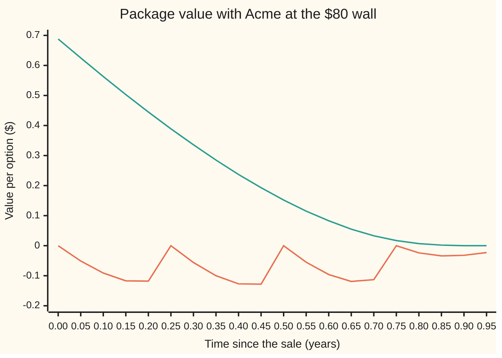

# Static barrier hedges: a fixed set of vanillas worth exactly nothing on the barrier, when rates and dividends differ

[Syllabus](../../../SYLLABUS.md) → [Financial mathematics](../README.md) → [Barriers, touches and lookbacks](../README.md#s16) → Static barrier hedges

---

## General Overview

A bank sells the house **down-and-out call** on Acme: strike $100, one year, and the call dies the moment Acme touches $80, the **barrier**. Acme trades at $100, the bank rate is 5%, the dividend yield 2%, the volatility 20%. The closed form prices it at **$9.133306** ([The eight barrier formulas](02-reiner-rubinstein-barrier-formulas.md)).

Hedging with shares is dangerous at the wall. Near $80 the bank holds a large share position and must sell all of it the instant $80 is touched ([Barrier Greeks](04-barrier-greeks-at-the-wall.md)). A **static hedge** avoids that. It is a package of plain options, bought once and never traded again, except to close it on the day Acme touches $80.

For the package to work, it must do two things:

- pay what the knock-out pays at expiry, if $80 is never touched;
- be worth exactly $0 whenever Acme sits at $80, so closing it costs nothing.

Barrier Greeks showed one package that does this when the bank rate equals the dividend yield: one call at $100 minus 1.25 puts struck at $64. In the house market, with 5% against 2%, that package is worth $0.69 at the wall today, not $0. This card builds two packages that do work:

- **The calendar strip** (Derman, Ergener and Kani). Keep the call. Sell puts struck at $80 that expire at 0.25, 0.5, 0.75 and 1 year. Size them so the package is worth $0 at $80 on four dates. It costs $9.115481, 1.8 cents under the closed form. The error shrinks as dates are added: with 52 weekly dates it is 0.04 cents.
- **The mirror claim** (the drift correction to Carr, Ellis and Gupta's hedge). Keep the call. Sell one European contract that pays only below $64, shaped by the drift. It is worth $0 at $80 at every moment, so it is exact: $9.133306.

**A static barrier hedge is a fixed set of plain options that pays the knock-out's payoff above the barrier and is worth nothing on the barrier; with unequal rates and dividends it needs either puts at several expiries, matched on chosen dates, or one curved claim below the barrier.**

**What kind of fact this is:** a theorem inside the Black-Scholes model (Acme's price is assumed to wander with one constant volatility, an assumption, not a law). The mirror claim is exact and is proved on this card. The calendar strip is an approximation; the card measures its error.

### The picture: what each package is worth on the wall



Orange line: the four-date calendar strip. It is exactly zero on its match dates, 0, 0.25, 0.5 and 0.75, and dips to about −13 cents between them. Green line: the call minus 1.25 puts at $64, the hedge that is exact only when rate and dividend yield are equal. It starts at 69 cents and stays above zero. The mirror claim (not drawn) sits on zero at every time; the checks confirm it at 0, 0.5 and 0.9 years.

---

## The formula

A package with value $`\Pi(S, t)`$, at Acme price $`S`$ and time $`t`$ in years since the sale, hedges the knock-out exactly when

```math
\Pi(B, t) = 0 \ \text{ for } 0 \le t \le T, \qquad \Pi(S, T) = (S - K)^{+} \ \text{ for } S > B.
```

**Read it aloud:** the package is worth nothing whenever Acme sits on the barrier, and at expiry it pays the call's payoff everywhere above the barrier.

**The calendar strip.** Hold one call $`C`$ (strike $`K`$, expiry $`T`$). Add $`n`$ puts struck at the barrier, put $`j`$ expiring at $`T_j = jT/n`$, in quantity $`w_j`$. Match the wall at $`\tau_j = T_{j-1}`$, one step of $`T/n`$ years before put $`j`$ expires. Solve from the last put backwards:

```math
w_j = -\,\frac{C(B,\ T - \tau_j) + \sum_{k > j} w_k\, P(B,\ T_k - \tau_j)}{P(B,\ T_j - \tau_j)}, \qquad \Pi_n(S, 0) = C(S, T) + \sum_{j=1}^{n} w_j\, P(S,\ T_j).
```

**Read it aloud:** each put is sized to cancel, on its match date, whatever the call and the later puts are worth on the wall; the strip's price is the call plus all the puts at today's price.

Here $`C`$ is the plain call and $`P`$ the plain put struck at $`B`$; the first argument is Acme's price, the second the years left.

**The mirror claim.** Hold the call and sell one European contract (one that pays only at expiry) whose payoff is $`g`$:

```math
V(S) = C(S) - M(S), \qquad g(x) = \left(\frac{B}{x}\right)^{a}\left(\frac{B^2}{x} - K\right)^{+}, \qquad a = \frac{2(r-q)}{\sigma^2} - 1.
```

**Read it aloud:** the knock-out equals the call minus a contract that pays, below $64, the mirrored call's payoff times a drift weight.

$`M(S)`$ is today's price of that contract. When $`r = q`$, $`a = -1`$ and the payoff straightens into $`(K/B)(B^2/K - x)^{+}`$: 1.25 puts struck at $64, the hedge on Barrier Greeks.

| Symbol | Plain meaning | In our example | Push it up and the answer… |
| --- | --- | --- | --- |
| $`S`$ | Acme's price | $100 today; $80 on the wall | the knock-out rises |
| $`K`$ | strike of the call | $100 | the call and the knock-out fall |
| $`B`$ | the barrier: touch it and the call dies (written $`H`$ on [The eight barrier formulas](02-reiner-rubinstein-barrier-formulas.md)) | $80 | the knock-out falls; the mirror strike $`B^2/K`$ rises |
| $`r`$, $`q`$ | bank rate and dividend yield, continuously compounded | 5%, 2% | they set $`a`$; equal values make one put enough |
| $`\sigma`$ | volatility: the yearly spread of Acme's log-price | 20% | more touches; the strip's gaps widen |
| $`T`$, $`t`$ | years to expiry; years since the sale | 1; 0 today | more $`T`$: more time for touches |
| $`a`$, $`p`$, $`y`$, $`U`$, $`W`$ | drift exponent of the mirror weight; in the proof only: $`p = -a`$, the mirror price $`y = B^2/S`$, any option price $`U`$, and $`W = S^{p}U`$ | 0.5; −0.5 | more $`a`$: the payoff $`g`$ bends more |
| $`V`$, $`\Pi`$ | the knock-out's price; a hedge package's value | $9.133306 | — |
| $`C`$, $`P`$ | plain Black-Scholes call at $100; put at $80 | $9.227006 today | — |
| $`w_j`$ | number of puts expiring at $`T_j`$ (negative: sold) | −0.134, −0.142, −0.112, −0.017 | — |
| $`n`$, $`T_j`$, $`\tau_j`$ | number of dates; put expiries; match dates | 4; 0.25 to 1; 0 to 0.75 | more dates, smaller error |
| $`g(x)`$, $`M`$, $`h`$ | mirror payoff at expiry price $`x`$; its price today; strike spacing of the put fan | $0.093699; spacing $4 | smaller spacing, smaller error |

### When it holds

- **One constant volatility, now and on every future date.** The strip's weights use Black-Scholes prices on the wall in the future. If volatility there differs, the package is not worth zero when the wall is touched. This is the main risk of a static hedge.
- **The barrier is watched continuously.** With daily checks the effective wall moves slightly away ([Daily monitoring](03-discrete-monitoring-correction.md)), and both packages need re-matching to the moved wall.
- **Acme moves without gaps.** The package is closed at exactly $80. A jump through the wall closes it lower, where the sold puts are worth more.
- **The package is closed at the touch.** Puts kept after the knock-out has died are a new bet, not a hedge.
- **Strike at or above the barrier.** Then the mirror payoff lives entirely below the wall. A strike under $80 needs a different mirror payoff.

---

## Why it works

### Step 0: zero on the wall plus the right payoff means the same price

Take any package that pays the knock-out's payoff at expiry if $80 is never touched, and is worth $0 whenever Acme is at $80. If the wall is touched, close the package for nothing; the knock-out also dies with nothing. If not, both pay the same at expiry. Two positions that pay the same in every future cost the same today, so the package costs exactly the knock-out's price. It also needs no trading in between: no shares to dump at the wall.

### Step 1: the call alone has the right payoff and the wrong wall value

One call at $100 pays $`(S - 100)^{+}`$ at expiry. Above $80 that is the knock-out's payoff. But at the wall today the call is still worth $1.530756, because Acme could recover above $100. The bank would sell it for that much at the touch, so the call alone is worth too much: $9.227006 against $9.133306.

### Step 2: puts struck at the barrier fix the wall without touching the payoff

A put struck at $80 pays only when Acme ends below $80. Above the wall it pays nothing at its expiry, so it leaves the payoff above $80 unchanged. Below $80 the knock-out has already died and the package has already been closed. So puts at $80 can be added and sold freely: they change only the wall value. Each one, sold, pulls the package's wall value down.

### Step 3: solve backwards, one put per date

Puts expire at 0.25, 0.5, 0.75 and 1 year. Match the wall at 0.75, 0.5, 0.25 and 0. At 0.75 only the call and the last put are alive, so one equation fixes the last put. At 0.5 the last put is known, so one equation fixes the third. Each step adds one unknown. This is a **triangular solve**: a system where each equation brings in just one new unknown, so it is solved by substitution from one end.

On the wall every put is struck exactly at Acme's price, so its value depends only on the time it has left. At each match date the put being sized has 0.25 years left and is worth $2.873934. The four weights are −0.017036, −0.111962, −0.142210 and −0.134139 puts: all sold.

### Step 4: between dates the strip is not zero, and the error is the price gap

The strip is zero on the wall only on its match dates. Between them it is negative, down to −13 cents with four dates. A bank holding it would pay up to 13 cents per option to close it at a touch on a bad day. That is why the strip is cheaper than the knock-out. Its price, $9.115481, is 1.8 cents short: the expected cost of those gaps, discounted. Add dates and the gaps close:

```
strip error against $9.133306, in cents (sign dropped)
 1 date      ████████████████████████████████████████  16.1004
 2 dates     █████████████                              5.3190
 4 dates     ████                                       1.7825
12 dates     █                                          0.3534
52 dates                                                0.0399
252 dates                                               0.0038
```

Each doubling of the dates cuts the error by roughly a factor of three. The worst wall value with 52 weekly dates is −0.3 cents. The price converges to the closed form, but never with a finite strip: a static hedge with finitely many dates always has gaps.

### Step 5: the mirror claim is zero on the wall at every moment

The closed form is $`V = C(S, T - t) - M(S, t)`$ with mirror term $`M(S, t) = (B/S)^{a}\,C(B^2/S,\ T - t)`$. Three facts make $`M`$ a tradable hedge:

1. **$`M`$ obeys the pricing equation.** The Black-Scholes equation is the rule every option price obeys between now and expiry. The fold below shows $`M`$ obeys it too. So $`M`$ is the price of some European contract.
2. **At expiry $`M`$ pays $`g(x)`$**, where $`x`$ is Acme's price on that day. That is $`(B/x)^{a}`$ times the payoff of a call on the mirror price $`B^2/x`$. It is positive only when $`B^2/x > 100`$, that is when $`x < 64`$: below the wall. So, like the puts of Step 2, it leaves the payoff above $80 alone.
3. **On the wall $`M`$ equals the call.** At $`S = B`$ the weight is 1 and the mirror price is $`B`$, so $`M(B, t) = C(B,\ T - t)`$ at every $`t`$.

So "one call minus one contract paying $`g`$" meets both conditions of Step 0 at every moment, not only on chosen dates. It is an exact static hedge with a single expiry.

<details>
<summary>Detailed proof: the mirror term obeys the pricing equation</summary>

Write $`p = -a = 1 - 2(r-q)/\sigma^2`$, $`y = B^2/S`$ (the mirror price), and $`W(S, t) = S^{p}\,U(y, t)`$, where $`U`$ is any option price, so it obeys $`U_t + \tfrac12\sigma^2 y^2 U_{yy} + (r-q)\,y\,U_y - rU = 0`$. Since $`dy/dS = -y/S`$:

$`\displaystyle W_S = S^{p-1}\big(pU - yU_y\big), \qquad W_{SS} = S^{p-2}\big(p(p-1)U - 2(p-1)\,yU_y + y^2U_{yy}\big).`$

Put these into the pricing equation for $`W`$:

$`\displaystyle \tfrac12\sigma^2S^2W_{SS} + (r-q)SW_S - rW = S^{p}\Big[\tfrac12\sigma^2y^2U_{yy} + \big(-\sigma^2(p-1) - (r-q)\big)yU_y + \big(\tfrac12\sigma^2p(p-1) + (r-q)p - r\big)U\Big].`$

With $`p - 1 = -2(r-q)/\sigma^2`$, the coefficient of $`yU_y`$ is $`2(r-q) - (r-q) = r - q`$. The coefficient of $`U`$ is $`-(r-q)p + (r-q)p - r = -r`$. So the bracket is $`-U_t`$, and $`W_t + \tfrac12\sigma^2S^2W_{SS} + (r-q)SW_S - rW = 0`$. The factor $`B^{a}`$ is a constant, so $`M = B^{a}W`$ with $`U(y, t) = C(y,\ T - t)`$ obeys the equation too.

</details>

### Step 6: building the curved payoff from puts

No exchange lists a contract paying $`g`$. But any payoff that is zero above $64 is close to a fan of puts:

- Mark strikes $64, $60, $56, … down to $4 ($4 apart: the **spacing** $`h`$).
- Join the payoff's values at those strikes with straight lines.
- A broken line is a sum of puts, one at each strike from $64 down to $8. The number of puts at $64 is the line's slope just below $64, sign changed. The number at each lower strike is how much the slope changes there.

When $`r = q`$, $`g`$ is already a straight line, so the fan is 1.25 puts at $64 and nothing else. The checks print every other weight as 0. In the house market $`g`$ curves upward below $64, so the fan needs 1.92 puts at $64 and smaller amounts below. Fifteen puts give $9.131742; 63 puts at $1 spacing give $9.133209. The remaining error comes from straight chords on a curve, not from gaps between dates.

---

## Worked numbers, by hand

House market: $`S = K = 100`$, $`B = 80`$, $`r = 5\%`$, $`q = 2\%`$, $`\sigma = 20\%`$, $`T = 1`$. Puts on the wall, struck at $80 with Acme at $80, are worth $2.873934, $3.866914, $4.546803 and $5.064065 with 0.25, 0.5, 0.75 and 1 year left.

| Step | Arithmetic | Value |
| --- | --- | --- |
| match at 0.75: call on wall | $`C(80,\ 0.25)`$ | 0.048959 |
| put expiring 1.00 | $`-0.048959 / 2.873934`$ | −0.017036 |
| match at 0.50 | $`0.387645 - 0.017036 \times 3.866914`$ | 0.321770 |
| put expiring 0.75 | $`-0.321770 / 2.873934`$ | −0.111962 |
| match at 0.25 | $`0.919104 - 0.111962 \times 3.866914 - 0.017036 \times 4.546803`$ | 0.408701 |
| put expiring 0.50 | $`-0.408701 / 2.873934`$ | −0.142210 |
| match at 0 | $`1.530756 - 0.142210 \times 3.866914 - 0.111962 \times 4.546803 - 0.017036 \times 5.064065`$ | 0.385508 |
| put expiring 0.25 | $`-0.385508 / 2.873934`$ | −0.134139 |
| puts struck at $80, Acme at $100 today | 0.031826, 0.235924, 0.530092, 0.842612 | |
| puts' cost | $`0.134139 \times 0.031826 + 0.142210 \times 0.235924 + 0.111962 \times 0.530092 + 0.017036 \times 0.842612`$ | 0.111524 |
| **strip price** | $`9.227006 - 0.111524`$ | **9.115481** |
| mirror claim, $`M`$ | $`0.894427 \times C(64) = 0.894427 \times 0.104759`$ | 0.093699 |
| **mirror hedge** | $`9.227006 - 0.093699`$ | **9.133306** |

The checks carry full precision. Hand arithmetic on these six-decimal values can land a few millionths away, because each rounded weight is multiplied by a put worth several dollars.

The four-date strip costs 1.8 cents less than the knock-out; the mirror hedge costs exactly the knock-out's price. The 1.8 cents is what the bank gives up for matching the wall only four times.

### What breaks if you drop a piece

| Mistake | Comes out at | What went wrong |
| --- | --- | --- |
| Hedge with the call alone | $9.227006 (right: $9.133306) | worth $1.530756 on the wall today, not zero |
| Use 1.25 puts at $64 when $`r \neq q`$ | $9.171681, and $0.688144 on the wall | the symmetry needs $`a = -1`$; here $`a = 0.5`$ |
| Strike the strip's puts at $100 | $8.856114 | puts at $100 also pay between $80 and $100, where the knock-out is alive |
| Match the wall on one date only | $8.972302 | 16 cents of gap cost between now and expiry |

---

## Code, from first principles, and it actually runs

The script prices the house knock-out and reaches it by four independent roads. Road 1 is the closed form. Road 2 is the calendar strip, solved backwards for 1 to 252 dates and valued on the wall at 400 times to find its worst gap. Road 3 prices the mirror claim by Simpson's rule (adding thin slices under the lognormal density curve) and never uses the closed form; it must land on 9.133306 and be worth exactly the call on the wall. Road 4 builds the mirror claim from a fan of puts. Asserts compare roads 3 and 4 with road 1 and check the strip error shrinks. With $`r = q`$ they check the fan collapses to 1.25 puts, and that the call minus those puts matches the closed form and is zero on the wall. Changing the exponent in the payoff, dropping a later put from the backward solve, flipping the fan's slope changes or removing the volatility term from the density each makes an assert fail.

### Python

```python
# Static barrier hedges -- the check behind the card.  Standard library only.
# House down-and-out call: S = K = 100, barrier B = 80, r = 5%, q = 2%, vol 20%, one year.
# Roads: (1) the closed form, call minus its mirror image; (2) a Derman-Ergener-Kani
# calendar strip of puts struck at 80, solved backwards so it is worth zero on the wall at
# each match date; (3) the mirror claim priced by Simpson's rule against the lognormal
# density, never using the closed form; (4) that claim built as a fan of plain puts.
from math import log, sqrt, exp, erf, pi

def N(x): return 0.5 * (1.0 + erf(x / sqrt(2.0)))
def bs(S, K, r, q, s, t, cp):                   # cp = +1 call, -1 put; t = years left
    if t <= 0: return max(cp * (S - K), 0.0)
    d1 = (log(S / K) + (r - q + 0.5 * s * s) * t) / (s * sqrt(t)); d2 = d1 - s * sqrt(t)
    return cp * (S * exp(-q * t) * N(cp * d1) - K * exp(-r * t) * N(cp * d2))

S0, K, B, s, T = 100.0, 100.0, 80.0, 0.20, 1.0
r, q = 0.05, 0.02
def expo(r, q): return 2 * (r - q) / (s * s) - 1   # the drift exponent a
def closed(S, r, q, t=T):                       # road 1: call minus mirror image
    return bs(S, K, r, q, s, t, 1) - (B / S) ** expo(r, q) * bs(B * B / S, K, r, q, s, t, 1)

def dek(n, r, q, strike=B):                     # road 2: the calendar strip
    Tj = [T * (j + 1) / n for j in range(n)]    # put j expires at Tj[j] ...
    tau = [T * j / n for j in range(n)]         # ... and is sized at the wall at tau[j]
    w, need = [0.0] * n, [0.0] * n             # need: wall value the put must cancel
    for j in range(n - 1, -1, -1):              # backwards: a triangular solve
        t = tau[j]
        v = bs(B, K, r, q, s, T - t, 1) + sum(w[k] * bs(B, strike, r, q, s, Tj[k] - t, -1)
                                               for k in range(j + 1, n))
        need[j], w[j] = v, -v / bs(B, strike, r, q, s, Tj[j] - t, -1)
    return w, Tj, tau, need
def strip(S, t, w, Tj, r, q, strike=B):        # the strip's value at price S, time t
    return bs(S, K, r, q, s, T - t, 1) + sum(wk * bs(S, strike, r, q, s, Tk - t, -1)
                                             for wk, Tk in zip(w, Tj) if Tk > t)

def g(x, r, q):                                 # the mirror claim's payoff at expiry
    return (B / x) ** expo(r, q) * max(B * B / x - K, 0.0)
def claim(S, t, r, q, m=4000):                  # road 3: Simpson against the density
    tau = T - t; mu = log(S) + (r - q - 0.5 * s * s) * tau; sd = s * sqrt(tau)
    lo, hi = mu - 10 * sd, log(B * B / K); h = (hi - lo) / m; tot = 0.0
    for i in range(m + 1):
        z = lo + i * h
        c = 1 if i in (0, m) else (4 if i % 2 else 2)
        tot += c * g(exp(z), r, q) * exp(-(z - mu) ** 2 / (2 * sd * sd)) / (sd * sqrt(2 * pi))
    return exp(-r * tau) * tot * h / 3

def fan(h, r, q):                               # road 4: puts at 64, 64-h, ..., h
    ks = [B * B / K - i * h for i in range(int(B * B / K / h))]
    sl = [(g(ks[i + 1], r, q) - g(ks[i], r, q)) / (ks[i + 1] - ks[i]) for i in range(len(ks) - 1)]
    return ks, [-sl[0]] + [sl[i - 1] - sl[i] for i in range(1, len(sl))]

z = lambda v: 0.0 if abs(v) < 1e-9 else v     # print rounding noise as a clean zero
out = lambda lab, v: print(f"{lab:<40}" + "".join(f"{z(x):>12.6f}" for x in v))
C0, V0 = bs(S0, K, r, q, s, T, 1), closed(S0, r, q)
out("call C(100), down-and-out closed form", [C0, V0])
out("a, mirror strike B^2/K, ratio K/B", [expo(r, q), B * B / K, K / B])
out("call alone: worth on the wall at t=0", [bs(B, K, r, q, s, T, 1)])
def naive(S, t, r=r, q=q):                      # the r = q hedge: call minus 1.25 puts at 64
    return bs(S, K, r, q, s, T - t, 1) - K / B * bs(S, B * B / K, r, q, s, T - t, -1)
out("1.25 puts at 64: price, wall at t=0", [naive(S0, 0.0), naive(B, 0.0)])
print("DEK strip, 4 dates, solved backwards from the last")
w4, T4, tau4, need4 = dek(4, r, q)
out("put at 80 on the wall, 0.25 .. 1 yr left", [bs(B, B, r, q, s, x, -1) for x in T4])
for j in range(3, -1, -1):
    out(f"match t={tau4[j]:.2f}: call, to cancel, weight", [bs(B, K, r, q, s, T - tau4[j], 1), need4[j], w4[j]])
pv = [bs(S0, B, r, q, s, Tk, -1) for Tk in T4]
out("puts at 80, Acme at 100: 0.25 .. 1 yr", pv)
out("puts' cost, strip price, its error", [-sum(a * b for a, b in zip(w4, pv)), strip(S0, 0.0, w4, T4, r, q),
                                          strip(S0, 0.0, w4, T4, r, q) - V0])
print("dates   strip price   error (cents)")
errs = []
for n in (1, 2, 4, 12, 52, 252):
    wn, Tn, _, _ = dek(n, r, q); p = strip(S0, 0.0, wn, Tn, r, q); errs.append(p - V0)
    print(f"{n:>5}{p:>14.6f}{100 * (p - V0):>14.4f}")
ts = [i / 20 for i in range(20)]
print("chart, t        " + "".join(f"{t:>7.2f}" for t in ts))
print("chart, strip    " + "".join(f"{z(strip(B, t, w4, T4, r, q)):>7.3f}" for t in ts))
print("chart, 1.25 put " + "".join(f"{naive(B, t):>7.3f}" for t in ts))
fine = [i / 400 for i in range(400)]
w52, T52, _, _ = dek(52, r, q)
out("worst wall value: 4 dates, 52 dates", [min(strip(B, t, w4, T4, r, q) for t in fine),
                                            min(strip(B, t, w52, T52, r, q) for t in fine)])
print("mirror claim: payoff (B/x)^a (B^2/x - K)+ below 64")
M0 = claim(S0, 0.0, r, q)
C64 = bs(B * B / S0, K, r, q, s, T, 1)
out("(B/S)^a, C(64), product, Simpson claim", [(B / S0) ** 0.5, C64, (B / S0) ** 0.5 * C64, M0])
out("hedge price C - claim", [C0 - M0])
wall = [(bs(B, K, r, q, s, T - t, 1), claim(B, t, r, q)) for t in (0.0, 0.5, 0.9)]
out("wall at t=0, 0.5, 0.9: call - claim", [c - m for c, m in wall])
print("fan of puts below 64   puts   weight at 64   hedge price")
fans = {}
for h in (16.0, 8.0, 4.0, 2.0, 1.0):
    ks, wf = fan(h, r, q)
    fans[h] = C0 - sum(wk * bs(S0, k, r, q, s, T, -1) for wk, k in zip(wf, ks))
    print(f"spacing {h:>4.0f}{len(wf):>15}{wf[0]:>15.6f}{fans[h]:>14.6f}")
print("r = q = 2%: the symmetry hedge is exact")
ksq, wq = fan(4.0, 0.02, 0.02); wq52, Tq52, _, _ = dek(52, 0.02, 0.02)
out("closed form, 1.25 puts at 64", [closed(S0, 0.02, 0.02), naive(S0, 0.0, 0.02, 0.02)])
out("fan weight at 64, largest other weight", [wq[0], max(abs(x) for x in wq[1:])])
out("DEK strip, 52 dates", [strip(S0, 0.0, wq52, Tq52, 0.02, 0.02)])
print("what breaks")
w100, T100, _, _ = dek(4, r, q, strike=K)
out("4 puts struck at 100 instead of 80", [strip(S0, 0.0, w100, T100, r, q, strike=K)])
w12, T12, _, _ = dek(12, r, q)
out("try: 12 monthly dates, worst wall value", [strip(S0, 0.0, w12, T12, r, q),
                                                min(strip(B, t, w12, T12, r, q) for t in fine)])

assert abs(V0 - 9.133306) < 1e-6, "house down-and-out price"
assert abs(C0 - M0 - V0) < 1e-8, "Simpson mirror claim matches the closed form"
assert all(abs(c - m) < 1e-8 for c, m in wall), "call minus claim is zero on the wall"
assert all(abs(errs[i + 1]) < abs(errs[i]) for i in range(5)), "strip error shrinks with dates"
assert abs(errs[-1]) < 1e-4, "252-date strip within a hundredth of a cent"
assert abs(fans[1.0] - V0) < 2e-4 and abs(fans[16.0] - V0) > abs(fans[1.0] - V0), "fan converges"
assert abs(wq[0] - 1.25) < 1e-9 and max(abs(x) for x in wq[1:]) < 1e-9, "r = q fan is 1.25 puts"
assert abs(naive(S0, 0.0, 0.02, 0.02) - closed(S0, 0.02, 0.02)) < 1e-9, "r = q: 1.25 puts at 64 is exact"
assert all(abs(naive(B, t, 0.02, 0.02)) < 1e-9 for t in (0.0, 0.5, 0.9)), "r = q: zero on the wall"
assert abs(strip(S0, 0.0, wq52, Tq52, 0.02, 0.02) - closed(S0, 0.02, 0.02)) < 1e-3, "r = q strip"
assert abs(naive(B, 0.0)) > 0.1, "symmetry hedge fails on the wall when r != q"
print("ALL CHECKS PASS")
```

**Ran 2026-11-23 on macOS, Python 3.14.10, standard library only. All checks passed. Output, pasted from the run:**

```
call C(100), down-and-out closed form       9.227006    9.133306
a, mirror strike B^2/K, ratio K/B           0.500000   64.000000    1.250000
call alone: worth on the wall at t=0        1.530756
1.25 puts at 64: price, wall at t=0         9.171681    0.688144
DEK strip, 4 dates, solved backwards from the last
put at 80 on the wall, 0.25 .. 1 yr left    2.873934    3.866914    4.546803    5.064065
match t=0.75: call, to cancel, weight       0.048959    0.048959   -0.017036
match t=0.50: call, to cancel, weight       0.387645    0.321770   -0.111962
match t=0.25: call, to cancel, weight       0.919104    0.408701   -0.142210
match t=0.00: call, to cancel, weight       1.530756    0.385508   -0.134139
puts at 80, Acme at 100: 0.25 .. 1 yr       0.031826    0.235924    0.530092    0.842612
puts' cost, strip price, its error          0.111524    9.115481   -0.017825
dates   strip price   error (cents)
    1      8.972302      -16.1004
    2      9.080116       -5.3190
    4      9.115481       -1.7825
   12      9.129772       -0.3534
   52      9.132907       -0.0399
  252      9.133269       -0.0038
chart, t           0.00   0.05   0.10   0.15   0.20   0.25   0.30   0.35   0.40   0.45   0.50   0.55   0.60   0.65   0.70   0.75   0.80   0.85   0.90   0.95
chart, strip      0.000 -0.051 -0.091 -0.117 -0.118  0.000 -0.056 -0.100 -0.127 -0.128  0.000 -0.055 -0.096 -0.119 -0.113  0.000 -0.024 -0.034 -0.032 -0.023
chart, 1.25 put   0.688  0.625  0.563  0.503  0.445  0.389  0.336  0.285  0.237  0.193  0.152  0.115  0.083  0.055  0.033  0.017  0.007  0.002  0.000  0.000
worst wall value: 4 dates, 52 dates        -0.132301   -0.003076
mirror claim: payoff (B/x)^a (B^2/x - K)+ below 64
(B/S)^a, C(64), product, Simpson claim      0.894427    0.104759    0.093699    0.093699
hedge price C - claim                       9.133306
wall at t=0, 0.5, 0.9: call - claim         0.000000    0.000000    0.000000
fan of puts below 64   puts   weight at 64   hedge price
spacing   16              3       2.689572      9.107028
spacing    8              7       2.134337      9.126989
spacing    4             15       1.924501      9.131742
spacing    2             31       1.832135      9.132916
spacing    1             63       1.788686      9.133209
r = q = 2%: the symmetry hedge is exact
closed form, 1.25 puts at 64                7.720620    7.720620
fan weight at 64, largest other weight      1.250000    0.000000
DEK strip, 52 dates                         7.720302
what breaks
4 puts struck at 100 instead of 80          8.856114
try: 12 monthly dates, worst wall value     9.129772   -0.027116
ALL CHECKS PASS
```

### Rust

Rust has no `erf`, so the bell-curve area comes from its power series, whose terms all share one sign, so nothing cancels. No crates.

```rust
// Static barrier hedges -- the same check as static_replication_of_barriers_check.py, in Rust.
// Standard library only, no crates.  Rust has no erf, so N(x) is built from its power
// series, N(x) = 1/2 + phi(x) (x + x^3/3 + x^5/15 + ...), whose terms all share one sign.
// Roads: the closed form; the Derman-Ergener-Kani calendar strip; the mirror claim by
// Simpson's rule against the lognormal density; the mirror claim as a fan of puts.
use std::f64::consts::PI;

const S0: f64 = 100.0; const K: f64 = 100.0; const B: f64 = 80.0; const S: f64 = 0.20; const T: f64 = 1.0;

fn phi(x: f64) -> f64 { (-0.5 * x * x).exp() / (2.0 * PI).sqrt() }
fn n_cdf(x: f64) -> f64 {
    if x.abs() > 9.0 { return if x > 0.0 { 1.0 } else { 0.0 }; }
    let (mut term, mut sum, mut k) = (x, x, 1.0);
    while term.abs() > 1e-17 * sum.abs().max(1e-300) { term *= x * x / (2.0 * k + 1.0); sum += term; k += 1.0; }
    0.5 + phi(x) * sum
}
fn bs(s: f64, k: f64, r: f64, q: f64, t: f64, cp: f64) -> f64 {
    if t <= 0.0 { return (cp * (s - k)).max(0.0); }
    let d1 = ((s / k).ln() + (r - q + 0.5 * S * S) * t) / (S * t.sqrt()); let d2 = d1 - S * t.sqrt();
    cp * (s * (-q * t).exp() * n_cdf(cp * d1) - k * (-r * t).exp() * n_cdf(cp * d2))
}
fn expo(r: f64, q: f64) -> f64 { 2.0 * (r - q) / (S * S) - 1.0 }
fn closed(s: f64, r: f64, q: f64) -> f64 { bs(s, K, r, q, T, 1.0) - (B / s).powf(expo(r, q)) * bs(B * B / s, K, r, q, T, 1.0) }
fn naive(s: f64, t: f64, r: f64, q: f64) -> f64 { bs(s, K, r, q, T - t, 1.0) - K / B * bs(s, B * B / K, r, q, T - t, -1.0) }

struct Strip { w: Vec<f64>, tj: Vec<f64>, tau: Vec<f64>, need: Vec<f64>, strike: f64 }
fn dek(n: usize, r: f64, q: f64, strike: f64) -> Strip {
    let tj: Vec<f64> = (0..n).map(|j| T * (j + 1) as f64 / n as f64).collect();
    let tau: Vec<f64> = (0..n).map(|j| T * j as f64 / n as f64).collect();
    let (mut w, mut need) = (vec![0.0; n], vec![0.0; n]);
    for j in (0..n).rev() {
        let t = tau[j];
        let mut v = bs(B, K, r, q, T - t, 1.0);
        for k in j + 1..n { v += w[k] * bs(B, strike, r, q, tj[k] - t, -1.0); }
        need[j] = v; w[j] = -v / bs(B, strike, r, q, tj[j] - t, -1.0);
    }
    Strip { w, tj, tau, need, strike }
}
fn strip(s: f64, t: f64, p: &Strip, r: f64, q: f64) -> f64 {
    let mut v = bs(s, K, r, q, T - t, 1.0);
    for (wk, tk) in p.w.iter().zip(&p.tj) { if *tk > t { v += wk * bs(s, p.strike, r, q, tk - t, -1.0); } }
    v
}
fn g(x: f64, r: f64, q: f64) -> f64 { (B / x).powf(expo(r, q)) * (B * B / x - K).max(0.0) }
fn claim(s: f64, t: f64, r: f64, q: f64) -> f64 {
    let m = 4000; let tau = T - t; let mu = s.ln() + (r - q - 0.5 * S * S) * tau; let sd = S * tau.sqrt();
    let (lo, hi) = (mu - 10.0 * sd, (B * B / K).ln()); let h = (hi - lo) / m as f64; let mut tot = 0.0;
    for i in 0..=m {
        let z = lo + i as f64 * h;
        let c = if i == 0 || i == m { 1.0 } else if i % 2 == 1 { 4.0 } else { 2.0 };
        tot += c * g(z.exp(), r, q) * (-(z - mu).powi(2) / (2.0 * sd * sd)).exp() / (sd * (2.0 * PI).sqrt());
    }
    (-r * tau).exp() * tot * h / 3.0
}
fn fan(h: f64, r: f64, q: f64) -> (Vec<f64>, Vec<f64>) {
    let top = B * B / K; let ks: Vec<f64> = (0..(top / h) as usize).map(|i| top - i as f64 * h).collect();
    let sl: Vec<f64> = (0..ks.len() - 1).map(|i| (g(ks[i + 1], r, q) - g(ks[i], r, q)) / (ks[i + 1] - ks[i])).collect();
    let mut w = vec![-sl[0]]; for i in 1..sl.len() { w.push(sl[i - 1] - sl[i]); }
    (ks, w)
}
fn z(v: f64) -> f64 { if v.abs() < 1e-9 { 0.0 } else { v } }
fn out(label: &str, v: &[f64]) { println!("{:<40}{}", label, v.iter().map(|x| format!("{:>12.6}", z(*x))).collect::<String>()); }

fn main() {
    let (r, q) = (0.05, 0.02);
    let (c0, v0) = (bs(S0, K, r, q, T, 1.0), closed(S0, r, q));
    out("call C(100), down-and-out closed form", &[c0, v0]);
    out("a, mirror strike B^2/K, ratio K/B", &[expo(r, q), B * B / K, K / B]);
    out("call alone: worth on the wall at t=0", &[bs(B, K, r, q, T, 1.0)]);
    out("1.25 puts at 64: price, wall at t=0", &[naive(S0, 0.0, r, q), naive(B, 0.0, r, q)]);
    println!("DEK strip, 4 dates, solved backwards from the last");
    let p4 = dek(4, r, q, B);
    out("put at 80 on the wall, 0.25 .. 1 yr left", &p4.tj.iter().map(|&x| bs(B, B, r, q, x, -1.0)).collect::<Vec<f64>>());
    for j in (0..4).rev() {
        out(&format!("match t={:.2}: call, to cancel, weight", p4.tau[j]), &[bs(B, K, r, q, T - p4.tau[j], 1.0), p4.need[j], p4.w[j]]);
    }
    let pv: Vec<f64> = p4.tj.iter().map(|&tk| bs(S0, B, r, q, tk, -1.0)).collect();
    out("puts at 80, Acme at 100: 0.25 .. 1 yr", &pv);
    let s4 = strip(S0, 0.0, &p4, r, q);
    out("puts' cost, strip price, its error", &[-p4.w.iter().zip(&pv).map(|(a, b)| a * b).sum::<f64>(), s4, s4 - v0]);
    println!("dates   strip price   error (cents)");
    let mut errs = Vec::new();
    for n in [1, 2, 4, 12, 52, 252] {
        let p = strip(S0, 0.0, &dek(n, r, q, B), r, q); errs.push(p - v0);
        println!("{:>5}{:>14.6}{:>14.4}", n, p, 100.0 * (p - v0));
    }
    let ts: Vec<f64> = (0..20).map(|i| i as f64 / 20.0).collect();
    println!("chart, t        {}", ts.iter().map(|t| format!("{:>7.2}", t)).collect::<String>());
    println!("chart, strip    {}", ts.iter().map(|&t| format!("{:>7.3}", z(strip(B, t, &p4, r, q)))).collect::<String>());
    println!("chart, 1.25 put {}", ts.iter().map(|&t| format!("{:>7.3}", naive(B, t, r, q))).collect::<String>());
    let fine: Vec<f64> = (0..400).map(|i| i as f64 / 400.0).collect();
    let worst = |p: &Strip| fine.iter().map(|&t| strip(B, t, p, r, q)).fold(f64::INFINITY, f64::min);
    out("worst wall value: 4 dates, 52 dates", &[worst(&p4), worst(&dek(52, r, q, B))]);
    println!("mirror claim: payoff (B/x)^a (B^2/x - K)+ below 64");
    let m0 = claim(S0, 0.0, r, q);
    let c64 = bs(B * B / S0, K, r, q, T, 1.0);
    out("(B/S)^a, C(64), product, Simpson claim", &[(B / S0).powf(0.5), c64, (B / S0).powf(0.5) * c64, m0]);
    out("hedge price C - claim", &[c0 - m0]);
    let wall: Vec<f64> = [0.0, 0.5, 0.9].iter().map(|&t| bs(B, K, r, q, T - t, 1.0) - claim(B, t, r, q)).collect();
    out("wall at t=0, 0.5, 0.9: call - claim", &wall);
    println!("fan of puts below 64   puts   weight at 64   hedge price");
    let mut fans = Vec::new();
    for h in [16.0, 8.0, 4.0, 2.0, 1.0] {
        let (ks, wf) = fan(h, r, q);
        let price = c0 - ks.iter().zip(&wf).map(|(k, wk)| wk * bs(S0, *k, r, q, T, -1.0)).sum::<f64>();
        println!("spacing {:>4.0}{:>15}{:>15.6}{:>14.6}", h, wf.len(), wf[0], price);
        fans.push(price);
    }
    println!("r = q = 2%: the symmetry hedge is exact");
    let (_, wq) = fan(4.0, 0.02, 0.02); let pq52 = dek(52, 0.02, 0.02, B);
    let wq_other = wq[1..].iter().fold(0.0f64, |m, x| m.max(x.abs()));
    out("closed form, 1.25 puts at 64", &[closed(S0, 0.02, 0.02), naive(S0, 0.0, 0.02, 0.02)]);
    out("fan weight at 64, largest other weight", &[wq[0], wq_other]);
    let sq52 = strip(S0, 0.0, &pq52, 0.02, 0.02);
    out("DEK strip, 52 dates", &[sq52]);
    println!("what breaks");
    out("4 puts struck at 100 instead of 80", &[strip(S0, 0.0, &dek(4, r, q, K), r, q)]);
    let p12 = dek(12, r, q, B);
    out("try: 12 monthly dates, worst wall value", &[strip(S0, 0.0, &p12, r, q), worst(&p12)]);

    assert!((v0 - 9.133306).abs() < 1e-6, "house down-and-out price");
    assert!((c0 - m0 - v0).abs() < 1e-8, "Simpson mirror claim matches the closed form");
    assert!(wall.iter().all(|d| d.abs() < 1e-8), "call minus claim is zero on the wall");
    assert!((0..5).all(|i| errs[i + 1].abs() < errs[i].abs()), "strip error shrinks with dates");
    assert!(errs[5].abs() < 1e-4, "252-date strip within a hundredth of a cent");
    assert!((fans[4] - v0).abs() < 2e-4 && (fans[0] - v0).abs() > (fans[4] - v0).abs(), "fan converges");
    assert!((wq[0] - 1.25).abs() < 1e-9 && wq_other < 1e-9, "r = q fan is 1.25 puts");
    assert!((naive(S0, 0.0, 0.02, 0.02) - closed(S0, 0.02, 0.02)).abs() < 1e-9, "r = q: 1.25 puts at 64 is exact");
    assert!([0.0, 0.5, 0.9].iter().all(|&t| naive(B, t, 0.02, 0.02).abs() < 1e-9), "r = q: zero on the wall");
    assert!((sq52 - closed(S0, 0.02, 0.02)).abs() < 1e-3, "r = q strip");
    assert!(naive(B, 0.0, r, q).abs() > 0.1, "symmetry hedge fails on the wall when r != q");
    println!("ALL CHECKS PASS");
}
```

**Ran 2026-11-23 on macOS, rustc 1.98.1, no crates. All checks passed. Output, pasted from the run:**

```
call C(100), down-and-out closed form       9.227006    9.133306
a, mirror strike B^2/K, ratio K/B           0.500000   64.000000    1.250000
call alone: worth on the wall at t=0        1.530756
1.25 puts at 64: price, wall at t=0         9.171681    0.688144
DEK strip, 4 dates, solved backwards from the last
put at 80 on the wall, 0.25 .. 1 yr left    2.873934    3.866914    4.546803    5.064065
match t=0.75: call, to cancel, weight       0.048959    0.048959   -0.017036
match t=0.50: call, to cancel, weight       0.387645    0.321770   -0.111962
match t=0.25: call, to cancel, weight       0.919104    0.408701   -0.142210
match t=0.00: call, to cancel, weight       1.530756    0.385508   -0.134139
puts at 80, Acme at 100: 0.25 .. 1 yr       0.031826    0.235924    0.530092    0.842612
puts' cost, strip price, its error          0.111524    9.115481   -0.017825
dates   strip price   error (cents)
    1      8.972302      -16.1004
    2      9.080116       -5.3190
    4      9.115481       -1.7825
   12      9.129772       -0.3534
   52      9.132907       -0.0399
  252      9.133269       -0.0038
chart, t           0.00   0.05   0.10   0.15   0.20   0.25   0.30   0.35   0.40   0.45   0.50   0.55   0.60   0.65   0.70   0.75   0.80   0.85   0.90   0.95
chart, strip      0.000 -0.051 -0.091 -0.117 -0.118  0.000 -0.056 -0.100 -0.127 -0.128  0.000 -0.055 -0.096 -0.119 -0.113  0.000 -0.024 -0.034 -0.032 -0.023
chart, 1.25 put   0.688  0.625  0.563  0.503  0.445  0.389  0.336  0.285  0.237  0.193  0.152  0.115  0.083  0.055  0.033  0.017  0.007  0.002  0.000  0.000
worst wall value: 4 dates, 52 dates        -0.132301   -0.003076
mirror claim: payoff (B/x)^a (B^2/x - K)+ below 64
(B/S)^a, C(64), product, Simpson claim      0.894427    0.104759    0.093699    0.093699
hedge price C - claim                       9.133306
wall at t=0, 0.5, 0.9: call - claim         0.000000    0.000000    0.000000
fan of puts below 64   puts   weight at 64   hedge price
spacing   16              3       2.689572      9.107028
spacing    8              7       2.134337      9.126989
spacing    4             15       1.924501      9.131742
spacing    2             31       1.832135      9.132916
spacing    1             63       1.788686      9.133209
r = q = 2%: the symmetry hedge is exact
closed form, 1.25 puts at 64                7.720620    7.720620
fan weight at 64, largest other weight      1.250000    0.000000
DEK strip, 52 dates                         7.720302
what breaks
4 puts struck at 100 instead of 80          8.856114
try: 12 monthly dates, worst wall value     9.129772   -0.027116
ALL CHECKS PASS
```

The two outputs are identical line for line, from two different normal CDFs.

### Lean

Lean proves the three facts of Step 5 behind the mirror claim, and its $`r = q`$ form, for any rates and barrier.

- **It obeys the pricing equation.** Suppose $`U`$ is any option price with smooth slopes, obeying the Black-Scholes equation before expiry. Then $`M(S, t) = (B/S)^{a}\,U(B^2/S,\ t)`$ obeys it too, at every price above zero.
- **It matches on the wall.** At $`S = B`$ the mirror term $`M`$ equals $`U`$ at every date.
- **Its payoff lives below the wall.** Suppose the strike $`K`$ is at or above the barrier $`B > 0`$. Then $`g(x) = 0`$ for every $`x \ge B^2/K`$, whatever $`a`$ is, and $`B^2/K \le B`$.
- **Equal rates give puts.** Suppose $`r = q`$, $`\sigma > 0`$, and $`B`$, $`K`$ and $`x`$ are above zero. Then $`a = -1`$ and $`g(x) = (K/B)(B^2/K - x)^{+}`$: $`K/B`$ puts struck at $`B^2/K`$.
- **The house numbers.** Lean checks $`a = 0.5`$ at 5%, 2% and 20%. With barrier 80 and strike 100, the mirror strike is 64 and $`K/B`$ is 1.25.

Left to the Python and Rust checks: that the call is such a price, the calendar strip, the fan of puts, and every price.

```lean
-- Static barrier hedges: the mirror term (B/S)^a U(B^2/S, t) of any option price U obeys the Black-Scholes equation and equals U on the barrier, its payoff lives below the barrier when the strike is at or above it, and at r = q it is (K/B) puts struck at B^2/K.
import Mathlib.Analysis.SpecialFunctions.Pow.Real
import Mathlib.Analysis.SpecialFunctions.Pow.Deriv
import Mathlib.Analysis.Calculus.ContDiff.Deriv
import Mathlib.Analysis.Calculus.ContDiff.Basic
import Mathlib.Analysis.Calculus.Deriv.Basic

/-- The Black-Scholes equation at share price `S` and date `t`, for a worth `V(S, t)`:
`∂V/∂t + (r - q) S ∂V/∂S + ½ σ² S² ∂²V/∂S² = r V`, each slope taken with the other variable
held still. -/
def ObeysBlackScholes (V : ℝ → ℝ → ℝ) (r q σ S t : ℝ) : Prop :=
  deriv (fun u => V S u) t
      + (r - q) * S * deriv (fun x => V x t) S
      + 1 / 2 * σ ^ 2 * S ^ 2 * deriv (fun x => deriv (fun y => V y t) x) S
    = r * V S t

/-- **The mirror claim is a tradable exact hedge** (Why it works, Step 5 and its detailed proof).
Volatility `σ > 0` and the barrier `B > 0` are fixed; `r` and `q` are any bank rate and dividend
yield. Let `U(y, t)` be any option price: smooth for share prices `y > 0` before expiry `T`, and
obeying the Black-Scholes equation there. Put `a = 2(r - q)/σ² - 1` and
`M(S, t) = (B/S)^a U(B²/S, t)`. Then `M` obeys the Black-Scholes equation at every share price
`S > 0` before expiry, so it is the price of a European contract; and on the barrier `S = B` it
equals `U` at every date. With `U` the plain call, the call minus `M` is worth zero on the wall at
every moment. -/
theorem mirror_term_obeys_black_scholes_and_matches_on_wall
    (U : ℝ → ℝ → ℝ) (r q σ B T : ℝ) (hσ : 0 < σ) (hB : 0 < B)
    (hU : ∀ y t, 0 < y → t < T → ContDiffAt ℝ 2 (fun p : ℝ × ℝ => U p.1 p.2) (y, t))
    (hpde : ∀ y t, 0 < y → t < T → ObeysBlackScholes U r q σ y t) :
    let a := 2 * (r - q) / σ ^ 2 - 1
    let M : ℝ → ℝ → ℝ := fun S t => (B / S) ^ a * U (B ^ 2 / S) t
    (∀ S t, 0 < S → t < T → ObeysBlackScholes M r q σ S t) ∧ (∀ t, M B t = U B t) := by
  intro a M
  have ha : (a + 1) * σ ^ 2 = 2 * (r - q) := by
    simp only [a]; field_simp; ring
  clear_value a
  refine ⟨?_, ?_⟩
  swap
  · intro t
    have h1 : B / B = 1 := div_self hB.ne'
    have h2 : B ^ 2 / B = B := by field_simp
    simp only [M, h1, h2, Real.one_rpow, one_mul]
  intro S t hS ht
  set V : ℝ → ℝ := fun y => U y t with hVdef
  have hVc : ContDiffOn ℝ 2 V (Set.Ioi 0) := by
    intro y hy
    have h := hU y t hy ht
    have : ContDiffAt ℝ 2 V y :=
      h.comp (f := fun y : ℝ => (y, t)) y (contDiffAt_id.prodMk contDiffAt_const)
    exact this.contDiffWithinAt
  have hD1c : ContDiffOn ℝ 1 (deriv V) (Set.Ioi 0) :=
    hVc.deriv_of_isOpen isOpen_Ioi (by norm_num)
  have hVd : ∀ x : ℝ, 0 < x → HasDerivAt V (deriv V x) x := fun x hx =>
    (((hVc.differentiableOn (by norm_num)) x hx).differentiableAt
      (isOpen_Ioi.mem_nhds hx)).hasDerivAt
  have hD1d : ∀ x : ℝ, 0 < x → HasDerivAt (deriv V) (deriv (deriv V) x) x := fun x hx =>
    (((hD1c.differentiableOn (by norm_num)) x hx).differentiableAt
      (isOpen_Ioi.mem_nhds hx)).hasDerivAt
  have hP : ∀ x : ℝ, 0 < x → HasDerivAt (fun x => (B / x) ^ a) (-a * (B / x) ^ a / x) x := by
    intro x hx
    have hBx : 0 < B / x := div_pos hB hx
    have hd : HasDerivAt (fun x : ℝ => B / x) (-B / x ^ 2) x :=
      ((hasDerivAt_const x B).div (hasDerivAt_id' x) hx.ne').congr_deriv (by ring)
    refine (hd.rpow_const (p := a) (Or.inl hBx.ne')).congr_deriv ?_
    rw [Real.rpow_sub_one hBx.ne']
    field_simp
  have hQ : ∀ x : ℝ, 0 < x → HasDerivAt (fun x => B ^ 2 / x) (-(B ^ 2) / x ^ 2) x := by
    intro x hx
    refine ((hasDerivAt_const x (B ^ 2)).div (hasDerivAt_id' x) hx.ne').congr_deriv ?_
    ring
  have hP' : ∀ x : ℝ, 0 < x → HasDerivAt (fun x => -a * (B / x) ^ a / x)
      ((((-a) * (-a * (B / x) ^ a / x)) * x - (-a * (B / x) ^ a) * 1) / x ^ 2) x := by
    intro x hx
    exact ((hP x hx).const_mul (-a)).div (hasDerivAt_id' x) hx.ne'
  have hF : ∀ x : ℝ, 0 < x → HasDerivAt (fun y => M y t)
      (-a * (B / x) ^ a / x * V (B ^ 2 / x)
        + (B / x) ^ a * (deriv V (B ^ 2 / x) * (-(B ^ 2) / x ^ 2))) x := by
    intro x hx
    exact (hP x hx).mul ((hVd (B ^ 2 / x) (by positivity)).comp x (hQ x hx))
  have hderivM : deriv (fun y => M y t) =ᶠ[nhds S] fun x =>
      -a * (B / x) ^ a / x * V (B ^ 2 / x)
        + (B / x) ^ a * (deriv V (B ^ 2 / x) * (-(B ^ 2) / x ^ 2)) := by
    filter_upwards [Ioi_mem_nhds hS] with x hx
    exact (hF x hx).deriv
  have hR : HasDerivAt (fun x : ℝ => -(B ^ 2) / x ^ 2)
      ((0 * S ^ 2 - (-(B ^ 2)) * (2 * S)) / (S ^ 2) ^ 2) S := by
    have := (hasDerivAt_const S (-(B ^ 2))).div (hasDerivAt_pow 2 S) (by positivity)
    exact this.congr_deriv (by simp)
  have hG := ((hP' S hS).mul ((hVd (B ^ 2 / S) (by positivity)).comp S (hQ S hS))).add
    ((hP S hS).mul (((hD1d (B ^ 2 / S) (by positivity)).comp S (hQ S hS)).mul hR))
  have htime : deriv (fun u => M S u) t = (B / S) ^ a * deriv (fun u => U (B ^ 2 / S) u) t := by
    simp only [M]
    exact congrFun (deriv_const_mul_field' _) t
  have hp := hpde (B ^ 2 / S) t (by positivity) ht
  unfold ObeysBlackScholes at hp ⊢
  rw [hderivM.deriv_eq, (hF S hS).deriv, htime]
  erw [hG.deriv]
  simp only [Function.comp_apply, Pi.mul_apply, M]
  change deriv (fun u => U (B ^ 2 / S) u) t + (r - q) * (B ^ 2 / S) * deriv V (B ^ 2 / S) +
      1 / 2 * σ ^ 2 * (B ^ 2 / S) ^ 2 * deriv (deriv V) (B ^ 2 / S) = r * V (B ^ 2 / S) at hp
  change _ = r * ((B / S) ^ a * V (B ^ 2 / S))
  linear_combination (norm := skip) (B / S) ^ a * hp
    + (B / S) ^ a * (a / 2 * V (B ^ 2 / S) + B ^ 2 / S * deriv V (B ^ 2 / S)) * ha
  field_simp
  ring

/-- **The mirror payoff lives below the wall** (When it holds, last point; Step 5, fact 2). With
barrier `B > 0` and strike `K` at or above it, the mirror strike `B²/K` is at or below the barrier,
and the mirror payoff `g(x) = (B/x)^a (B²/x - K)⁺` is zero at every expiry price `x ≥ B²/K`,
whatever the exponent `a`. So it leaves the knock-out's payoff above the barrier untouched. -/
theorem mirror_payoff_zero_at_or_above_mirror_strike
    (a B K : ℝ) (hB : 0 < B) (hBK : B ≤ K) :
    B ^ 2 / K ≤ B ∧
      ∀ x : ℝ, B ^ 2 / K ≤ x → (B / x) ^ a * max (B ^ 2 / x - K) 0 = 0 := by
  have hK : 0 < K := lt_of_lt_of_le hB hBK
  refine ⟨?_, ?_⟩
  · rw [div_le_iff₀ hK]
    nlinarith
  · intro x hx
    have hm : 0 < B ^ 2 / K := by positivity
    have hx0 : 0 < x := lt_of_lt_of_le hm hx
    have h1 : B ^ 2 / x ≤ K := by
      rw [div_le_iff₀ hx0]
      rw [div_le_iff₀ hK] at hx
      linarith
    rw [max_eq_right (by linarith), mul_zero]

/-- **At r = q the mirror payoff is K/B puts** (The formula, after the table). When the bank rate
equals the dividend yield and `σ > 0`, the exponent is `a = -1`, and for barrier `B > 0`, strike
`K > 0` and every expiry price `x > 0` the mirror payoff `(B/x)^a (B²/x - K)⁺` equals
`(K/B)(B²/K - x)⁺`: `K/B` puts struck at `B²/K`. -/
theorem mirror_payoff_at_equal_rates_is_puts
    (r q σ B K : ℝ) (hrq : r = q) (hσ : 0 < σ) (hB : 0 < B) (hK : 0 < K) :
    2 * (r - q) / σ ^ 2 - 1 = -1 ∧
      ∀ x : ℝ, 0 < x →
        (B / x) ^ (2 * (r - q) / σ ^ 2 - 1) * max (B ^ 2 / x - K) 0
          = K / B * max (B ^ 2 / K - x) 0 := by
  have ha : 2 * (r - q) / σ ^ 2 - 1 = -1 := by subst hrq; simp
  refine ⟨ha, ?_⟩
  intro x hx
  rw [ha, Real.rpow_neg_one, inv_div, mul_max_of_nonneg _ _ (by positivity),
    mul_max_of_nonneg _ _ (by positivity), mul_zero, mul_zero]
  congr 1
  field_simp

-- House market: r = 5%, q = 2%, σ = 20% give the mirror exponent a = 1/2.
example : (2 * (5 / 100 - 2 / 100) / (20 / 100) ^ 2 - 1 : ℝ) = 1 / 2 := by norm_num
-- Barrier 80, strike 100: the mirror strike B²/K is 64 and the put ratio K/B is 5/4 (1.25 puts).
example : ((80 : ℝ) ^ 2 / 100) = 64 := by norm_num
example : ((100 : ℝ) / 80) = 5 / 4 := by norm_num

#print axioms mirror_term_obeys_black_scholes_and_matches_on_wall
#print axioms mirror_payoff_zero_at_or_above_mirror_strike
#print axioms mirror_payoff_at_equal_rates_is_puts
```

**Checked 2026-11-23 on macOS, Lean 4.36.0-rc2, Mathlib v4.36.0-rc2. Every proof is complete and uses only Lean's standard axioms. Output, pasted from the run:**

```
'mirror_term_obeys_black_scholes_and_matches_on_wall' depends on axioms: [propext, Classical.choice, Quot.sound]
'mirror_payoff_zero_at_or_above_mirror_strike' depends on axioms: [propext, Classical.choice, Quot.sound]
'mirror_payoff_at_equal_rates_is_puts' depends on axioms: [propext, Classical.choice, Quot.sound]
```

> [!TIP]
> **Try changing**
> Guess the direction first. Then run it.
> - **Match monthly.** Use `dek(12, r, q)`. Guess: closer or further from $9.133306? The strip costs **$9.129772**, and its worst wall value improves from −13 cents to **−2.7 cents**.
> - **Make the rate equal the dividend yield.** Set both to 2%. The fan's weight at $64 becomes exactly **1.25** and every other weight **0**: the curved payoff straightens into the single-put hedge, worth **$7.720620**, equal to the closed form.
> - **Shrink the fan's spacing.** From $16 to $1 the fan's hedge price climbs from **$9.107028** to **$9.133209**, and the puts at $64 fall from **2.69** to **1.79**.

---

## The usual mistake

> [!warning]
> **Using the single-put symmetry hedge when rate and dividend yield differ.** One call minus 1.25 puts at $64 is exact only when $`r = q`$. In the house market it costs $9.171681 and is worth $0.688144 on the wall today. A bank that closes it at a touch is not flat: it holds 69 cents of value it never priced, and it paid $9.171681 for a hedge of a $9.133306 option. Currency markets almost never have equal rates on the two sides, so this trap is the normal case there.
>
> - **Hedging with the call alone.** Right payoff, wrong wall: $9.227006, with $1.530756 left on the wall today.
> - **Striking the strip's puts at the call's strike.** Puts at $100 pay where the knock-out is alive: $8.856114.
> - **Too few match dates.** One date leaves gaps worth 16 cents: $8.972302.
> - **Treating the strip as model-free.** Its weights come from Black-Scholes prices on future dates. A different volatility on the day of the touch leaves the package away from zero; no number on this card can show by how much.

---

## Where you meet it in real life

- **Equity derivatives desks.** A knock-out sold to a client is hedged with listed puts near the barrier, instead of a share position that must be dumped at the touch.
- **Currency option desks.** Two interest rates, one per currency, play the roles of $`r`$ and $`q`$, and they are rarely equal. The single-put symmetry hedge fails there, and the drift correction or a strip is needed.
- **Structured notes.** Notes with a capital-protection barrier embed a down-and-in put. By in-out parity it is a plain put minus a down-and-out put. A static hedge of that knock-out must meet the same two conditions as in Step 0.
- **Model checking.** A static hedge turns a barrier price into a list of plain options. Pricing that list off market quotes, instead of one volatility, shows how far the market's smile moves the barrier price.

> **Say it back**
> A static hedge is a package of plain options that pays the knock-out's payoff above the barrier and is worth nothing on the barrier. When rate and dividend yield are equal, one call minus 1.25 puts at $64 does it exactly. When they differ, a calendar strip of puts struck at $80 can be solved backwards to be worth zero on chosen dates; four dates cost $9.115481, 1.8 cents under the closed form, and the error shrinks as dates are added. Exactly zero on the wall at every moment needs one curved contract below $64, the mirror claim, which a fan of puts approximates. The whole construction rests on the volatility on the day of the touch being the one the model assumed.

---

## What this builds on

- [Barrier Greeks](04-barrier-greeks-at-the-wall.md): why the share hedge fails at the wall, and the single-put hedge when $`r = q`$ that this card extends.
- [The eight barrier formulas](02-reiner-rubinstein-barrier-formulas.md): the closed form, $9.133306, and its call-minus-mirror shape.
- [Black-Scholes put](../08-The%20Black-Scholes%20call%20and%20put/02-black-scholes-put.md): the put prices that every package on this card is built from.
- [Put-call parity](../08-The%20Black-Scholes%20call%20and%20put/03-put-call-parity.md): the argument "same payoff in every future, same price today", which Step 0 applies with a wall.

## Where this goes next

- [Barriers on a smile](../23-FX%20exotics%20as%20desks%20use%20them%20-%20digitals%2C%20touches%20and%20barriers/07-barriers-with-the-smile.md): pricing barriers when volatility differs by strike, the real-market version of the risk this card names in "When it holds".
- [Window and Parisian barriers](09-window-and-parisian-barriers.md): barriers watched only part of the time, or knocked out only after a stay below the wall, where the wall conditions of Step 0 change shape.

This card leaves one question open: when the market's volatility differs by strike and moves over time, how far from zero is a static package on the day of the touch, and which hedge stays closest?

---

## Sources

Verified 2026-11-23: every link below resolves to the publisher's page.

- Derman, Emanuel, Deniz Ergener, and Iraj Kani. "Static Options Replication." *Journal of Derivatives* 2, no. 4 (1995): 78–95. [doi:10.3905/jod.1995.407927](https://doi.org/10.3905/jod.1995.407927). The calendar strip: plain options sized backwards so the package is worth zero on the barrier on chosen dates.
- Carr, Peter, Katrina Ellis, and Vishal Gupta. "Static Hedging of Exotic Options." *Journal of Finance* 53, no. 3 (1998): 1165–1190. [doi:10.1111/0022-1082.00048](https://doi.org/10.1111/0022-1082.00048). Put-call symmetry and the single-expiry barrier hedge built on it.
- Merton, Robert C. "Theory of Rational Option Pricing." *Bell Journal of Economics and Management Science* 4, no. 1 (1973): 141–183. [doi:10.2307/3003143](https://doi.org/10.2307/3003143). The first price for the down-and-out call, as a call minus its mirror image.
