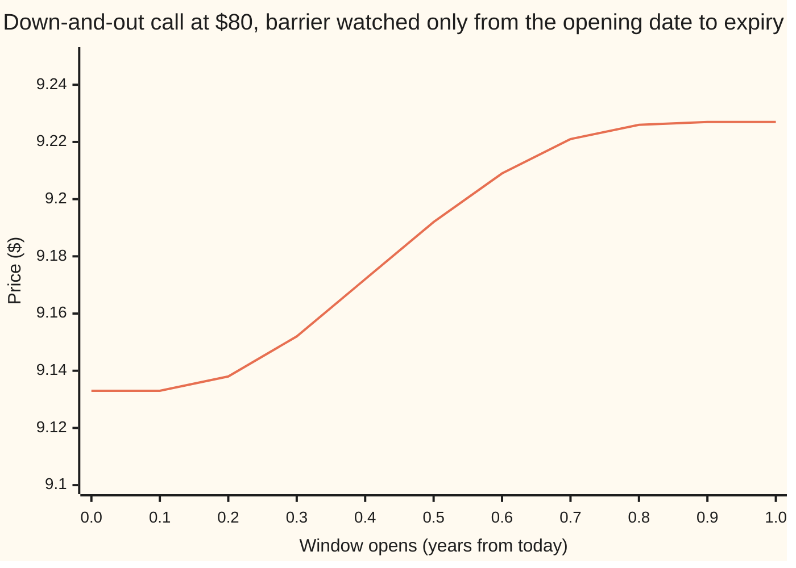

# Window and Parisian barriers: a knock-out that only watches part of the time, or only after enough days outside

[Syllabus](../../../SYLLABUS.md) → [Financial mathematics](../README.md) → [Barriers, touches and lookbacks](../README.md#s16) → Window and Parisian barriers

---

## General Overview

Acme shares trade at $100. A one-year call struck at $100 costs $9.23 in the house market. Add a floor at $80 that cancels the call the moment Acme touches it, and the price drops to $9.13. That is the down-and-out call of [The eight barrier formulas](02-reiner-rubinstein-barrier-formulas.md).

The buyer saves 9 cents but takes a real risk: one bad afternoon in March can wipe out a call that would have paid well in December. Two softer clauses sit in between: a smaller saving for a smaller risk. The window still saves the buyer about 3.5 cents, the Parisian clause about 4.4.

- **A window barrier** (also called a partial-time barrier) watches the floor only during part of the option's life. Here the window runs from month 6 to month 12. A crash in month 3 does nothing.
- **A Parisian barrier** forgives a short dip. It cancels the call only after Acme closes below $80 on **5 trading days in a row**. A one-day fall that bounces back does nothing.

Both are worth more than the whole-year knock-out and less than the plain call. The window version prices at **$9.19** (9.192126), exactly, by one integral. The Parisian version is simulated: 150,000 paths estimate it at about **$9.18** (9.1834), give or take 0.19 cents.

The window has an exact price because of one fact. Until month 6 nothing can cancel the call. So on the day the window opens, the holder owns an ordinary knock-out with six months left, and [The eight barrier formulas](02-reiner-rubinstein-barrier-formulas.md) prices it. Today's price is the average of those six-month prices over everywhere Acme might be in six months, discounted back to today.

**A window barrier is an ordinary knock-out that starts later, so its price is the formula's price at the window's opening, averaged over the share price on that day; a Parisian barrier has no such shortcut and is simulated; both kill fewer paths than a whole-life barrier and more than none, so both sit between the knock-out and the plain call.**

**What kind of fact this is:** the window price is a theorem inside the Black-Scholes model, proved on this card in Why it works; the Parisian price is a simulation estimate with its error stated; the two price bounds are a theorem that holds path by path, in any model.

### The picture: when the window opens



Orange: the window price. At 0 the window is the whole year, so the price is the knock-out's $9.133. At 1 the window is empty, so the price is the plain call's $9.227. The curve is flat at the start: a window that skips only the first month or two saves almost nothing, because Acme rarely falls 20% that fast.

---

## The formula

Notation first. $`t_0`$ is the date the window opens, in years from today: 0.5. $`\tau = T - t_0`$ is the time left when it opens: 0.5. The letter $`x`$ is Acme's log price on the opening date, $`x = \ln(S_{t_0}/S)`$, so $`S e^{x}`$ is the share price then.

```math
V_{\mathrm{win}} = e^{-r t_0} \int_{\ln(H/S)}^{\infty} f(x)\, \mathrm{DO}\big(S e^{x}, \tau\big)\, dx
```

**Read it aloud:** the window price is today's value of the down-and-out formula with $`\tau`$ years left, averaged over every share price above the barrier on the day the window opens.

Here $`f(x)`$ is the bell-curve density of the log price on that day. In the Black-Scholes pricing world it has centre $`\nu t_0`$ and spread $`\sigma\sqrt{t_0}`$, with $`\nu = r - q - \tfrac12\sigma^2`$, the drift of the log price. $`\mathrm{DO}(s, \tau)`$ is the down-and-out call of [The eight barrier formulas](02-reiner-rubinstein-barrier-formulas.md), from a share price $`s`$ with $`\tau`$ years left: block A minus block C, since the $100 strike sits above the $80 floor. Prices below the barrier on the opening day add nothing: the window opens with Acme under the line, and the call dies at once.

The Parisian price has no integral of this kind. It is defined as an average over paths, and the simulation computes exactly that:

```math
V_{\mathrm{Par}} = e^{-rT}\, \mathbb{E}\big[(S_T - K)^{+}\, \mathbf{1}\{\text{no run of } D \text{ closes below } H\}\big]
```

$`\mathbb{E}`$ is the average over pricing-world paths. $`(S_T - K)^{+}`$ is the call's payoff, the larger of $`S_T - K`$ and zero. $`\mathbf{1}\{\cdot\}`$ is 1 if the condition holds and 0 if not.

The bounds, path by path:

```math
\mathrm{DO}(S,T) \le V_{\mathrm{win}} \le C(S,T), \qquad V_{\mathrm{daily}} \le V_{\mathrm{Par}} \le C(S,T)
```

| Symbol | Plain meaning | In our example | Push it up and the answer… |
| --- | --- | --- | --- |
| $`S`$, $`K`$, $`H`$ | Acme today, the strike, the barrier | $100, $100, $80 | higher $`H`$: both prices fall |
| $`r`$, $`q`$, $`\sigma`$, $`T`$ | bank rate, dividend yield, volatility, years to expiry | 5%, 2%, 20%, 1 | more $`\sigma`$: more touches and longer runs below |
| $`t_0`$, $`\tau`$ | window opening date; time left at the opening, $`T - t_0`$ | 0.5, 0.5 | later $`t_0`$: window price rises toward the plain call |
| $`x`$, $`S_{t_0}`$ | log price on the opening date; the share price then, $`S e^{x}`$ | 0 at $100 | |
| $`f(x)`$, $`\nu`$ | bell-curve density of $`x`$; drift of the log price, $`r - q - \tfrac12\sigma^2`$ | centre 0.005, spread 0.141421; $`\nu = 0.01`$ | |
| $`\mathrm{DO}(s,\tau)`$, $`C(s,\tau)`$ | down-and-out call and plain call from price $`s`$ with $`\tau`$ years left | $6.304457 and $6.307635 at $`s = 100`$ | |
| $`D`$ | closes in a row below $`H`$ that cancel the Parisian call | 5 trading days | longer wait: Parisian price rises |
| $`V_{\mathrm{win}}`$, $`V_{\mathrm{Par}}`$, $`V_{\mathrm{daily}}`$ | window price; Parisian price; whole-year knock-out checked at each daily close | $9.192126, $9.1834 (simulated), about $9.151424 by the 16-03 shift | |
| $`\mathbb{E}`$, $`(\cdot)^{+}`$, $`\mathbf{1}\{\cdot\}`$ | pricing-world average; larger of the value and zero; 1 if true, 0 if not | | |
| $`\mu`$, $`b`$, $`y`$, $`g`$ | log drift over $`\sigma^2`$, 0.25; the barrier in log terms, $`\ln 0.8`$; log price at expiry; bell-curve density of a log move over $`\tau`$ (fold only) | | |
| $`a_0`$, $`a_1`$, $`\Delta t`$ | log-distances of two neighbouring closes above the barrier; one trading day (code only) | $`\Delta t = 1/252`$ | |

### When it holds

- **Continuous watching inside the window.** The integral uses the 16-02 formula, which counts a touch at any instant. A window checked at daily closes kills less; push the barrier out as in [Daily monitoring](03-discrete-monitoring-correction.md) before integrating.
- **The contract kills a call that opens the window under the line.** Most term sheets say so. Treat those paths as alive and the price comes out at $9.201616 instead of $9.192126.
- **A constant volatility.** The window price leans on where Acme is likely to be in six months and on the six-month knock-out. A volatility smile (a volatility that changes with the strike) moves both, as it moves every barrier price.
- **Strike above the barrier.** Then $`\mathrm{DO}`$ is block A minus block C. With the strike below the floor, use B minus D from the same table.
- **The Parisian count resets.** "5 days in a row" restarts at zero after any close back above $80. A clause that counts 5 days in total is a different contract, simulated at $9.1770.

---

## Why it works

### Step 0: until the window opens, nothing can happen

The barrier is asleep for the first six months. Whatever Acme does in that time, the call is still alive on the opening day, unless Acme is below $80 on that very day.

So on the opening day, the holder owns one of two things:

- Acme above $80: an ordinary down-and-out call with six months left. Its value is $`\mathrm{DO}(S_{t_0}, 0.5)`$.
- Acme at or below $80: nothing.

Today's price is the discounted average of that opening-day value. This is the **tower rule** of averages: averaging in two stages, first over what happens after the opening given the price on that day, then over that price, gives the same answer as averaging over whole paths at once.

### Step 1: the opening-day price is one bell curve

In the pricing world of the [Black–Scholes call](../08-The%20Black-Scholes%20call%20and%20put/01-black-scholes-call.md), Acme's log price after $`t_0`$ years sits on a bell curve. The log drift is $`\nu = 0.05 - 0.02 - 0.02 = 0.01`$, so the centre is $`\nu t_0 = 0.005`$. The spread is $`0.20\sqrt{0.5} = 0.141421`$.

The chance that Acme is below $80 on the opening day is the bell-curve area left of $`\ln 0.8`$: 0.053349. Those paths die at the opening.

### Step 2: average the six-month formula over that curve

Multiply each opening-day price's chance by the six-month knock-out value there, add them up, and discount by $`e^{-0.05 \times 0.5} = 0.975310`$. That is the integral in The formula. It has no closed form in one line, but a Simpson's rule (an area rule that fits small parabolas under a curve) with 2,000 slices computes it to well under a millionth of a dollar.

The six-month knock-out barely differs from the six-month plain call unless Acme starts near the floor:

| Acme on the opening day | 6-month plain call | 6-month knock-out | Lost to the barrier |
| --- | --- | --- | --- |
| $85 | $0.981073 | $0.852164 | $0.128909 |
| $90 | $2.083355 | $2.043529 | $0.039827 |
| $100 | $6.307635 | $6.304457 | $0.003178 |
| $110 | $13.186440 | $13.186228 | $0.000212 |

That table is the whole story of the window. Paths that touch $80 late in the year have little time to climb back above $100, so they were worth little anyway. Killing them costs the buyer little.

<details>
<summary>Detailed proof: the same price from the reflected path density, with no formula blocks</summary>

Write $`b = \ln(H/S) = \ln 0.8`$ and $`y`$ for the log price at expiry. Given the log price $`x > b`$ on the opening day, the chance of ending near $`y`$ without touching $`b`$ over the last $`\tau`$ years is the reflection principle's surviving density, exactly as in Step 1 of [The eight barrier formulas](02-reiner-rubinstein-barrier-formulas.md), restarted at $`x`$:

$`\displaystyle g(y - x) - e^{2\nu(b - x)/\sigma^2}\, g(y - 2b + x)`$

Here $`g`$ is the bell-curve density of a log move over $`\tau`$ years, centre $`\nu\tau`$, spread $`\sigma\sqrt\tau`$. The second term is the mirror image across $`b`$, with the drift tilt $`(H/S_{t_0})^{2\mu}`$ written in log form, where $`\mu = \nu/\sigma^2 = 0.25`$.

The window price is then a double average of the payoff:

$`\displaystyle V_{\mathrm{win}} = e^{-rT} \int_{b}^{\infty} f(x) \int_{\ln(K/S)}^{\infty} (S e^{y} - K)\left[g(y - x) - e^{2\nu(b - x)/\sigma^2} g(y - 2b + x)\right] dy\, dx`$

The inner integral, times $`e^{-r\tau}`$, is exactly $`\mathrm{DO}(S e^{x}, \tau)`$: that is what the 16-02 card proves. So the double integral equals the single one. The code computes both, the double one on a 400 by 400 Simpson grid with no formula blocks, and they agree to six decimals.

</details>

### Step 3: the bounds hold path by path

Take any path of Acme's price. Ask which contracts it kills.

- If the window barrier kills it, Acme touched $80 between months 6 and 12. Then the whole-year barrier kills it too.
- If the Parisian clause kills it, Acme closed below $80 on 5 days in a row. Then it closed below $80 at least once, so the daily-checked knock-out kills it. And a daily close below $80 is a touch, so the continuously watched knock-out kills it too.

The payoff $`(S_T - K)^{+}`$ is never negative. A contract killed only on paths where another is also killed pays at least as much on every path, so it is worth at least as much. Averaging keeps the order:

```math
9.133306 \le V_{\mathrm{daily}} \approx 9.151424 \le V_{\mathrm{Par}} \le 9.227006
```

and $`9.133306 \le V_{\mathrm{win}} \le 9.227006`$. The Parisian price has a tighter floor than the whole-life barrier: the daily-checked knock-out of [Daily monitoring](03-discrete-monitoring-correction.md), because the Parisian clause looks only at daily closes. Its $9.151424 is the 16-03 shifted-barrier estimate; the simulation gives $9.1474, give or take $0.0026.

### Step 4: the Parisian clause needs memory, so it is simulated

The window trick works because, on the opening day, the share price alone says what the holder owns. A Parisian call has no such day. Its fate depends on the price **and** on how many closes in a row have been below $80 so far. That count is extra state: one number is no longer enough to restart the contract.

A simulation carries the count along each path. Each day: draw the close, add 1 to the count if it is below $80, reset to 0 if not, and cancel the call when the count reaches 5. [Monte Carlo pricing](../06-Numerical%20Methods%20for%20Pricing/01-monte-carlo-pricing.md) then averages the discounted payoffs.

Chesney, Jeanblanc-Picqué and Yor found a semi-closed form for a continuously watched Parisian option: not the price itself, but its **Laplace transform**, a weighted sum of prices over all expiry dates that must then be turned back into a price numerically. It is named here, not derived.

### Step 5: simulate the lost value, not the price

The simulation does one thing to keep its noise small. It does not average the Parisian payoff itself. It averages the **lost value**: the discounted payoff on paths the clause cancels. Then the price is the exact plain call, $9.227006, minus that average.

Most paths lose nothing, so the lost value is small and its average is steady. Its **standard error** (the typical distance between a 150,000-path average and the number it estimates) is $0.0019. A direct average of the Parisian payoff on the same paths gives $9.1832 with a standard error of $0.0357, too loose to place the price between its bounds.

---

## Worked numbers, by hand

House market: $`S = K = 100`$, $`H = 80`$, $`r = 5\%`$, $`q = 2\%`$, $`\sigma = 20\%`$, $`T = 1`$, window from $`t_0 = 0.5`$.

| Step | Arithmetic | Value |
| --- | --- | --- |
| plain call, block A of 16-02 | from the Black–Scholes card | $9.227006 |
| whole-year knock-out | block A minus block C | $9.133306 |
| log-price spread at the opening | $`0.20 \times \sqrt{0.5}`$ | 0.141421 |
| chance Acme is under $80 at the opening | bell-curve area left of $`(\ln 0.8 - 0.005)/0.141421`$ | 0.053349 |
| lost on those paths | discounted plain call over them | $0.009490 |
| lost on paths that touch $80 later | discounted 6-month "lost" column, averaged | $0.025389 |
| total lost to the window | $`0.009490 + 0.025389`$ | $0.034879 |
| **window price** | $`9.227006 - 0.034879`$, from unrounded parts | **$9.192126** |

The window takes $0.034879 off the plain call. The whole-year barrier takes $0.093699. Yet the window catches nearly as many touches: the chance of touching $80 inside the window is 0.232644, against 0.250014 for the whole year. Late touches are cheap touches.

Now the Parisian call, from the simulation of 150,000 paths and 252 daily closes:

| Step | Arithmetic | Value |
| --- | --- | --- |
| paths with a run of 5 closes under $80 | count over 150,000 | 0.1947 of them |
| lost value, average over paths | discounted payoff on those paths | $0.0436 |
| **Parisian price, estimated** | $`9.227006 - 0.0436`$ | **$9.1834**, give or take $0.0019 |
| same paths, one close under $80 is enough | the daily knock-out | $9.1474, against $9.151424 from 16-03 |

Waiting for 5 closes in a row instead of one cuts the lost value from $0.0796 to $0.0436, and $9.1834 sits inside its bounds, $9.151424 and $9.227006.

### What breaks if you drop a piece

Correct window price $9.192126; simulated Parisian price $9.1834.

| Mistake | Comes out at | What went wrong |
| --- | --- | --- |
| Window priced with the whole-year formula | $9.133306 | The barrier sleeps for six months; this charges for touches that cannot kill. |
| Paths under $80 at the opening kept alive | $9.201616 | The call is already below the line when the window opens, so it dies at once. |
| Barrier in the first half instead of the second | $9.149206 | Early touches leave time to recover, so killing them costs more. Which six months matters. |
| Parisian count of 5 days in total, not in a row | $9.1770 | Scattered bad days add up, so more paths die. |

Each is printed by the code.

---

## Code, from first principles, and it actually runs

Three roads to the window price, and the third also prices the Parisian clause:

- **Road 1** conditions on the opening-day price and integrates the 16-02 down-and-out formula over it, with Simpson's rule.
- **Road 2** never calls the formula: a 400 by 400 Simpson grid integrates the payoff against the reflected path density of the fold.
- **Road 3** simulates 150,000 paths of 252 daily closes. For continuous watching it multiplies, step by step, the **Brownian-bridge** chance of no touch between two closes: $`1 - \exp(-2 a_0 a_1/(\sigma^2 \Delta t))`$ when both closes are above the barrier, and 0 otherwise. A Brownian bridge is a random path pinned at both ends; $`a_0`$ and $`a_1`$ are the two closes' log-distances above the barrier and $`\Delta t`$ is one day. The same paths count runs of closes below $80.

Two outside anchors test the simulation: the whole-year bridge price against 16-02's $9.133306, and the one-day Parisian price against 16-03's shifted-barrier $9.151424. The bell-curve area is built from its own series, and the random numbers from a 64-bit linear congruential generator, a multiply-and-add recipe that repeats exactly from its seed.

### Python

```python
# Window and Parisian barriers -- the check behind the card.  Standard library only.
# Road 1: condition on the price when the window opens and integrate the 16-02
# down-and-out formula over it (Simpson).  Road 2: a double integral of the payoff
# against the reflected transition density, no formula blocks.  Road 3: a 252-step
# simulation with the Brownian-bridge chance of a touch, which also prices the
# Parisian clause; it is checked against the 16-02 and 16-03 formulas.
from math import log, sqrt, exp, cos, sin, pi
S, K, H, r, q, sig, T, T0 = 100.0, 100.0, 80.0, 0.05, 0.02, 0.20, 1.0, 0.5
nu = r - q - 0.5 * sig * sig; mu = nu / (sig * sig); b = log(H / S)
def dens(x): return exp(-0.5 * x * x) / sqrt(2.0 * pi)
def N(x):                                            # bell-curve area left of x, by its series
    if x < -9.0: return 0.0
    if x > 9.0: return 1.0
    term = tot = x; n = 1
    while abs(term) > 1e-17 * abs(tot) + 1e-300:
        n += 2; term *= x * x / n; tot += term
    return 0.5 + dens(x) * tot
def call(s, tau):                                    # plain call, block A of 16-02
    v = sig * sqrt(tau); d1 = log(s / K) / v + (1 + mu) * v
    return s * exp(-q * tau) * N(d1) - K * exp(-r * tau) * N(d1 - v)
def doc(s, tau, h=H):                                # down-and-out call, strike above barrier: A - C
    if s <= h: return 0.0
    v = sig * sqrt(tau); y1 = log(h * h / (s * K)) / v + (1 + mu) * v
    C = s * exp(-q * tau) * (h / s) ** (2 * mu + 2) * N(y1) - K * exp(-r * tau) * (h / s) ** (2 * mu) * N(y1 - v)
    return call(s, tau) - C
def touch(s, tau):                                   # chance a down line at H is touched within tau
    v, c = sig * sqrt(tau), log(H / s)
    return N((c - nu * tau) / v) + (H / s) ** (2 * mu) * N((c + nu * tau) / v)
def simpson(f, a, c, n):
    h = (c - a) / n; tot = f(a) + f(c)
    for i in range(1, n): tot += (4 if i % 2 else 2) * f(a + i * h)
    return h / 3.0 * tot
def f_at(t): return lambda x: dens((x - nu * t) / (sig * sqrt(t))) / (sig * sqrt(t))
def avg_at(t0, g, lo, hi):                           # average of g(price at t0) over a log-price range
    f = f_at(t0); return simpson(lambda x: f(x) * g(S * exp(x)), lo, hi, 2000)
def window(t0, h=H):                                 # road 1: discounted average of the knock-out at t0
    if t0 <= 0: return doc(S, T, h)
    if t0 >= T: return call(S, T)
    return exp(-r * t0) * avg_at(t0, lambda s: doc(s, T - t0, h), log(h / S), nu * t0 + 10 * sig * sqrt(t0))
def window_2d(t0, n=400):                            # road 2: payoff against reflected density
    f, tau = f_at(t0), T - t0; sd = sig * sqrt(tau); g = lambda z: dens((z - nu * tau) / sd) / sd
    xh, yh = nu * t0 + 9 * sig * sqrt(t0), nu * T + 9 * sig * sqrt(T)
    def over_y(x):
        tilt = exp(2 * nu * (b - x) / (sig * sig))
        return f(x) * simpson(lambda y: (S * exp(y) - K) * (g(y - x) - tilt * g(y - 2 * b + x)), log(K / S), yh, n)
    return exp(-r * T) * simpson(over_y, b, xh, n)
VAN, DOC = call(S, T), doc(S, T)
W1, W2 = window(T0), window_2d(T0)
LO, HI = b - 10 * sig * sqrt(T0), nu * T0 + 10 * sig * sqrt(T0)
BELOW = exp(-r * T0) * avg_at(T0, lambda s: call(s, T - T0), LO, b)   # value of paths under 80 at 0.5
fr = f_at(T0); tl = exp(2 * nu * b / (sig * sig))                      # front window: barrier 0 to 0.5 only
FRONT = exp(-r * T0) * simpson(lambda x: (fr(x) - tl * fr(x - 2 * b)) * call(S * exp(x), T - T0), b, HI, 2000)
BGK = doc(S, T, H * exp(-0.5826 * sig * sqrt(T / 252)))   # 16-03: daily checks = barrier pushed out
P_BELOW = N((b - nu * T0) / (sig * sqrt(T0)))
P_WIN = P_BELOW + avg_at(T0, lambda s: touch(s, T - T0), b, HI)
# ---- road 3: simulation, 252 daily closes ----
state = 20261123
def uniform():
    global state
    state = (state * 6364136223846793005 + 1442695040888963407) % 2 ** 64
    return ((state >> 11) + 0.5) / 2 ** 53
PATHS, STEPS, OPEN = 150000, 252, 126
dt = T / STEPS; drift = nu * dt; vol = sig * sqrt(dt); v2 = vol * vol
DAYS = (1, 2, 3, 5, 10, 20)
acc = {k: [0.0, 0.0] for k in ("full", "win") + DAYS + ("cum5", "dir5")}; hits = {d: 0 for d in DAYS}
def add(k, x): a = acc[k]; a[0] += x; a[1] += x * x
for _ in range(PATHS):
    x, wf, ww, run, best, cum, zs = 0.0, 1.0, 1.0, 0, 0, 0, []
    for i in range(1, STEPS + 1):
        if not zs:
            u1, u2 = uniform(), uniform(); m = sqrt(-2 * log(u1))
            zs = [m * sin(2 * pi * u2), m * cos(2 * pi * u2)]
        y = x + drift + vol * zs.pop()
        keep = 0.0 if x <= b or y <= b else 1 - exp(-2 * (x - b) * (y - b) / v2)
        wf *= keep                                   # whole year, watched every instant
        if i == OPEN and y <= b: ww = 0.0            # window opens with the price under the line
        if i > OPEN: ww *= keep
        if y < b: run += 1; cum += 1; best = max(best, run)
        else: run = 0
        x = y
    p = exp(-r * T) * max(S * exp(x) - K, 0.0)      # lost value: what the knock-out takes away
    add("full", p * (1 - wf)); add("win", p * (1 - ww)); add("cum5", p * (cum >= 5)); add("dir5", p * (best < 5))
    for d in DAYS: add(d, p * (best >= d)); hits[d] += best >= d
def mc(k):
    s1, s2 = acc[k]; m = s1 / PATHS
    return VAN - m, sqrt(max(s2 / PATHS - m * m, 0.0) / PATHS)
print("house: S 100, K 100, barrier 80, r 5%, q 2%, sigma 20%, T 1; window opens at 0.5")
print(f"plain call                         {VAN:.6f}")
print(f"down-and-out, whole year (16-02)   {DOC:.6f}")
print(f"window 0.5 to 1, road 1 (1-D)      {W1:.6f}")
print(f"window 0.5 to 1, road 2 (2-D)      {W2:.6f}")
mw, sw = mc("win"); mf, sf = mc("full")
print(f"window 0.5 to 1, road 3 simulated  {mw:.4f} +/- {sw:.4f}")
print(f"whole year simulated, bridge       {mf:.4f} +/- {sf:.4f}")
print(f"daily-checked whole year (16-03)   {BGK:.6f}  lost {VAN - BGK:.6f}")
print("Parisian: knocked out after D consecutive daily closes below 80")
par = {}
for d in DAYS:
    par[d], se = mc(d)
    print(f"  D {d:2d} days  {par[d]:.4f} +/- {se:.4f}  lost {VAN - par[d]:.4f}  paths knocked out {hits[d] / PATHS:.4f}")
s1, s2 = acc["dir5"]; m5 = s1 / PATHS
print(f"direct average of the D 5 payoff {m5:.4f} +/- {sqrt((s2 / PATHS - m5 * m5) / PATHS):.4f}")
print(f"simulation gaps in standard errors: window {abs(mw - W1) / sw:.2f}, whole year {abs(mf - DOC) / sf:.2f}, D 1 {abs(par[1] - BGK) / mc(1)[1]:.2f}")
print(f"worked: log price at 0.5 centre {nu * T0:.6f} spread {sig * sqrt(T0):.6f}; discount {exp(-r * T0):.6f}")
print(f"worked: chance under 80 at 0.5 {P_BELOW:.6f}; chance of touching 80 in the window {P_WIN:.6f}; whole year {touch(S, T):.6f}")
for s6 in (80.0, 85.0, 90.0, 100.0, 110.0):
    print(f"worked: price at 0.5 {s6:5.1f}  6-month call {call(s6, 0.5):9.6f}  6-month knock-out {doc(s6, 0.5):9.6f}  lost {call(s6, 0.5) - doc(s6, 0.5):8.6f}")
print(f"worked: lost value {VAN - W1:.6f} = under 80 at the opening {BELOW:.6f} + touched later {VAN - W1 - BELOW:.6f}; whole year {VAN - DOC:.6f}")
print(f"wrong: whole-year formula for the window          {DOC:.6f}")
print(f"wrong: half the whole-year discount              {VAN - 0.5 * (VAN - DOC):.6f}")
print(f"wrong: paths under 80 at 0.5 kept alive           {W1 + BELOW:.6f}")
print(f"wrong: barrier in the first half instead (front)  {FRONT:.6f}")
c5, _ = mc("cum5")
print(f"wrong: Parisian counting 5 days in total, not in a row {c5:.4f}")
ts = [i / 10 for i in range(11)]
print("chart, window opens " + " ".join(f"{t:5.1f}" for t in ts))
print("chart, price        " + " ".join(f"{window(t):5.3f}" for t in ts))
print(f"try: window opens 0.25 {window(0.25):.6f}; window with barrier 85 {window(T0, 85.0):.6f}")
assert abs(DOC - 9.133306) < 1e-6 and abs(VAN - 9.227006) < 1e-6, "16-02 house numbers"
assert abs(W1 - W2) < 1e-6, "conditioning and the reflected double integral must agree"
assert abs(mw - W1) < 3 * sw and abs(mf - DOC) < 3 * sf, "simulation within three standard errors"
assert abs(par[1] - BGK) < 3 * mc(1)[1], "Parisian with D = 1 is the daily knock-out of 16-03"
assert DOC < W1 < VAN and BGK < par[5] < VAN, "bounds: full-life barrier <= window, Parisian <= plain call"
assert all(par[a] <= par[c] for a, c in zip(DAYS, DAYS[1:])), "a longer wait kills fewer paths"
assert c5 < par[5], "five days in total happens more often than five in a row"
print("ALL CHECKS PASS")
```

**Ran 2026-11-23 on macOS, Python 3.14.10, standard library only. All checks passed. Output, pasted from the run:**

```
house: S 100, K 100, barrier 80, r 5%, q 2%, sigma 20%, T 1; window opens at 0.5
plain call                         9.227006
down-and-out, whole year (16-02)   9.133306
window 0.5 to 1, road 1 (1-D)      9.192126
window 0.5 to 1, road 2 (2-D)      9.192126
window 0.5 to 1, road 3 simulated  9.1915 +/- 0.0015
whole year simulated, bridge       9.1296 +/- 0.0029
daily-checked whole year (16-03)   9.151424  lost 0.075582
Parisian: knocked out after D consecutive daily closes below 80
  D  1 days  9.1474 +/- 0.0026  lost 0.0796  paths knocked out 0.2335
  D  2 days  9.1623 +/- 0.0024  lost 0.0647  paths knocked out 0.2196
  D  3 days  9.1721 +/- 0.0021  lost 0.0549  paths knocked out 0.2095
  D  5 days  9.1834 +/- 0.0019  lost 0.0436  paths knocked out 0.1947
  D 10 days  9.2025 +/- 0.0014  lost 0.0245  paths knocked out 0.1680
  D 20 days  9.2153 +/- 0.0009  lost 0.0117  paths knocked out 0.1356
direct average of the D 5 payoff 9.1832 +/- 0.0357
simulation gaps in standard errors: window 0.44, whole year 1.27, D 1 1.54
worked: log price at 0.5 centre 0.005000 spread 0.141421; discount 0.975310
worked: chance under 80 at 0.5 0.053349; chance of touching 80 in the window 0.232644; whole year 0.250014
worked: price at 0.5  80.0  6-month call  0.387645  6-month knock-out  0.000000  lost 0.387645
worked: price at 0.5  85.0  6-month call  0.981073  6-month knock-out  0.852164  lost 0.128909
worked: price at 0.5  90.0  6-month call  2.083355  6-month knock-out  2.043529  lost 0.039827
worked: price at 0.5 100.0  6-month call  6.307635  6-month knock-out  6.304457  lost 0.003178
worked: price at 0.5 110.0  6-month call 13.186440  6-month knock-out 13.186228  lost 0.000212
worked: lost value 0.034879 = under 80 at the opening 0.009490 + touched later 0.025389; whole year 0.093699
wrong: whole-year formula for the window          9.133306
wrong: half the whole-year discount              9.180156
wrong: paths under 80 at 0.5 kept alive           9.201616
wrong: barrier in the first half instead (front)  9.149206
wrong: Parisian counting 5 days in total, not in a row 9.1770
chart, window opens   0.0   0.1   0.2   0.3   0.4   0.5   0.6   0.7   0.8   0.9   1.0
chart, price        9.133 9.133 9.138 9.152 9.172 9.192 9.209 9.221 9.226 9.227 9.227
try: window opens 0.25 9.143554; window with barrier 85 9.062559
ALL CHECKS PASS
```

Roads 1 and 2 agree to six decimals. The simulated window, $9.1915, lands 0.44 standard errors from the integral. The whole-year bridge price lands 1.27 standard errors from $9.133306, and the one-day Parisian price 1.54 from the 16-03 formula.

### Rust

Same roads, same labels, same random stream.

```rust
// Window and Parisian barriers -- the same check as the Python, in Rust.  No crates.
// Road 1: condition on the price when the window opens and integrate the 16-02
// down-and-out formula over it (Simpson).  Road 2: a double integral of the payoff
// against the reflected transition density, no formula blocks.  Road 3: a 252-step
// simulation with the Brownian-bridge chance of a touch, which also prices the
// Parisian clause; it is checked against the 16-02 and 16-03 formulas.
use std::f64::consts::PI;
const S: f64 = 100.0; const K: f64 = 100.0; const H: f64 = 80.0; const R: f64 = 0.05; const Q: f64 = 0.02;
const SIG: f64 = 0.20; const T: f64 = 1.0; const T0: f64 = 0.5;
fn nu() -> f64 { R - Q - 0.5 * SIG * SIG }
fn mu() -> f64 { nu() / (SIG * SIG) }
fn bl() -> f64 { (H / S).ln() }
fn dens(x: f64) -> f64 { (-0.5 * x * x).exp() / (2.0 * PI).sqrt() }
fn ncdf(x: f64) -> f64 {                                   // bell-curve area left of x, by its series
    if x < -9.0 { return 0.0; }
    if x > 9.0 { return 1.0; }
    let (mut term, mut tot, mut n) = (x, x, 1.0);
    while term.abs() > 1e-17 * tot.abs() + 1e-300 { n += 2.0; term *= x * x / n; tot += term; }
    0.5 + dens(x) * tot
}
fn call(s: f64, tau: f64) -> f64 {                         // plain call, block A of 16-02
    let v = SIG * tau.sqrt(); let d1 = (s / K).ln() / v + (1.0 + mu()) * v;
    s * (-Q * tau).exp() * ncdf(d1) - K * (-R * tau).exp() * ncdf(d1 - v)
}
fn doc(s: f64, tau: f64, h: f64) -> f64 {                  // down-and-out call, strike above barrier: A - C
    if s <= h { return 0.0; }
    let (v, m) = (SIG * tau.sqrt(), mu()); let y1 = (h * h / (s * K)).ln() / v + (1.0 + m) * v;
    let c = s * (-Q * tau).exp() * (h / s).powf(2.0 * m + 2.0) * ncdf(y1) - K * (-R * tau).exp() * (h / s).powf(2.0 * m) * ncdf(y1 - v);
    call(s, tau) - c
}
fn touch(s: f64, tau: f64) -> f64 {                        // chance a down line at H is touched within tau
    let (v, c) = (SIG * tau.sqrt(), (H / s).ln());
    ncdf((c - nu() * tau) / v) + (H / s).powf(2.0 * mu()) * ncdf((c + nu() * tau) / v)
}
fn simpson<F: Fn(f64) -> f64>(f: F, a: f64, c: f64, n: usize) -> f64 {
    let h = (c - a) / n as f64; let mut tot = f(a) + f(c);
    for i in 1..n { tot += if i % 2 == 1 { 4.0 } else { 2.0 } * f(a + i as f64 * h); }
    h / 3.0 * tot
}
fn f_at(t: f64, x: f64) -> f64 { dens((x - nu() * t) / (SIG * t.sqrt())) / (SIG * t.sqrt()) }
fn avg_at<G: Fn(f64) -> f64>(t0: f64, g: G, lo: f64, hi: f64) -> f64 {   // average of g(price at t0)
    simpson(|x| f_at(t0, x) * g(S * x.exp()), lo, hi, 2000)
}
fn window(t0: f64, h: f64) -> f64 {                        // road 1: discounted average of the knock-out at t0
    if t0 <= 0.0 { return doc(S, T, h); }
    if t0 >= T { return call(S, T); }
    (-R * t0).exp() * avg_at(t0, |s| doc(s, T - t0, h), (h / S).ln(), nu() * t0 + 10.0 * SIG * t0.sqrt())
}
fn window_2d(t0: f64, n: usize) -> f64 {                   // road 2: payoff against reflected density
    let (tau, b) = (T - t0, bl()); let sd = SIG * tau.sqrt(); let g = |z: f64| dens((z - nu() * tau) / sd) / sd;
    let (xh, yh) = (nu() * t0 + 9.0 * SIG * t0.sqrt(), nu() * T + 9.0 * SIG * T.sqrt());
    let over_y = |x: f64| {
        let tilt = (2.0 * nu() * (b - x) / (SIG * SIG)).exp();
        f_at(t0, x) * simpson(|y| (S * y.exp() - K) * (g(y - x) - tilt * g(y - 2.0 * b + x)), (K / S).ln(), yh, n)
    };
    (-R * T).exp() * simpson(over_y, b, xh, n)
}
fn main() {
    let (nu, b) = (nu(), bl());
    let (van, docv) = (call(S, T), doc(S, T, H));
    let (w1, w2) = (window(T0, H), window_2d(T0, 400));
    let (lo, hi) = (b - 10.0 * SIG * T0.sqrt(), nu * T0 + 10.0 * SIG * T0.sqrt());
    let below = (-R * T0).exp() * avg_at(T0, |s| call(s, T - T0), lo, b);   // value of paths under 80 at 0.5
    let tl = (2.0 * nu * b / (SIG * SIG)).exp();                              // front window: barrier 0 to 0.5 only
    let front = (-R * T0).exp() * simpson(|x| (f_at(T0, x) - tl * f_at(T0, x - 2.0 * b)) * call(S * x.exp(), T - T0), b, hi, 2000);
    let bgk = doc(S, T, H * (-0.5826 * SIG * (T / 252.0).sqrt()).exp());   // 16-03: daily checks = barrier pushed out
    let p_below = ncdf((b - nu * T0) / (SIG * T0.sqrt()));
    let p_win = p_below + avg_at(T0, |s| touch(s, T - T0), b, hi);
    // ---- road 3: simulation, 252 daily closes ----
    let mut state: u64 = 20261123;
    let mut uniform = || { state = state.wrapping_mul(6364136223846793005).wrapping_add(1442695040888963407);
        ((state >> 11) as f64 + 0.5) / 9007199254740992.0 };
    let (paths, steps, open) = (150000usize, 252usize, 126usize);
    let dt = T / steps as f64; let drift = nu * dt; let vol = SIG * dt.sqrt(); let v2 = vol * vol;
    let days = [1usize, 2, 3, 5, 10, 20];
    let mut acc = [[0.0f64; 2]; 10]; let mut hits = [0usize; 6];   // 0 full, 1 window, 2..8 the D's, 8 cumulative 5, 9 direct D 5
    let add = |acc: &mut [[f64; 2]; 10], k: usize, x: f64| { acc[k][0] += x; acc[k][1] += x * x; };
    for _ in 0..paths {
        let (mut x, mut wf, mut ww, mut run, mut best, mut cum) = (0.0f64, 1.0f64, 1.0f64, 0usize, 0usize, 0usize);
        let mut zs: Vec<f64> = Vec::new();
        for i in 1..=steps {
            if zs.is_empty() {
                let u1 = uniform(); let u2 = uniform(); let m = (-2.0 * u1.ln()).sqrt();
                zs = vec![m * (2.0 * PI * u2).sin(), m * (2.0 * PI * u2).cos()];
            }
            let y = x + drift + vol * zs.pop().unwrap();
            let keep = if x <= b || y <= b { 0.0 } else { 1.0 - (-2.0 * (x - b) * (y - b) / v2).exp() };
            wf *= keep;                                    // whole year, watched every instant
            if i == open && y <= b { ww = 0.0; }           // window opens with the price under the line
            if i > open { ww *= keep; }
            if y < b { run += 1; cum += 1; best = best.max(run); } else { run = 0; }
            x = y;
        }
        let p = (-R * T).exp() * (S * x.exp() - K).max(0.0);   // lost value: what the knock-out takes away
        add(&mut acc, 0, p * (1.0 - wf)); add(&mut acc, 1, p * (1.0 - ww));
        add(&mut acc, 8, if cum >= 5 { p } else { 0.0 }); add(&mut acc, 9, if best < 5 { p } else { 0.0 });
        for (j, &d) in days.iter().enumerate() {
            add(&mut acc, 2 + j, if best >= d { p } else { 0.0 }); if best >= d { hits[j] += 1; }
        }
    }
    let mc = |k: usize| { let m = acc[k][0] / paths as f64;
        (van - m, ((acc[k][1] / paths as f64 - m * m).max(0.0) / paths as f64).sqrt()) };
    println!("house: S 100, K 100, barrier 80, r 5%, q 2%, sigma 20%, T 1; window opens at 0.5");
    println!("plain call                         {:.6}", van);
    println!("down-and-out, whole year (16-02)   {:.6}", docv);
    println!("window 0.5 to 1, road 1 (1-D)      {:.6}", w1);
    println!("window 0.5 to 1, road 2 (2-D)      {:.6}", w2);
    let (mw, sw) = mc(1); let (mf, sf) = mc(0);
    println!("window 0.5 to 1, road 3 simulated  {:.4} +/- {:.4}", mw, sw);
    println!("whole year simulated, bridge       {:.4} +/- {:.4}", mf, sf);
    println!("daily-checked whole year (16-03)   {:.6}  lost {:.6}", bgk, van - bgk);
    println!("Parisian: knocked out after D consecutive daily closes below 80");
    let mut par = [0.0f64; 6];
    for (j, &d) in days.iter().enumerate() {
        let (pv, se) = mc(2 + j); par[j] = pv;
        println!("  D {:2} days  {:.4} +/- {:.4}  lost {:.4}  paths knocked out {:.4}", d, pv, se, van - pv, hits[j] as f64 / paths as f64);
    }
    let m5 = acc[9][0] / paths as f64;
    println!("direct average of the D 5 payoff {:.4} +/- {:.4}", m5, ((acc[9][1] / paths as f64 - m5 * m5) / paths as f64).sqrt());
    println!("simulation gaps in standard errors: window {:.2}, whole year {:.2}, D 1 {:.2}", (mw - w1).abs() / sw, (mf - docv).abs() / sf, (par[0] - bgk).abs() / mc(2).1);
    println!("worked: log price at 0.5 centre {:.6} spread {:.6}; discount {:.6}", nu * T0, SIG * T0.sqrt(), (-R * T0).exp());
    println!("worked: chance under 80 at 0.5 {:.6}; chance of touching 80 in the window {:.6}; whole year {:.6}", p_below, p_win, touch(S, T));
    for s6 in [80.0, 85.0, 90.0, 100.0, 110.0] {
        println!("worked: price at 0.5 {:5.1}  6-month call {:9.6}  6-month knock-out {:9.6}  lost {:8.6}", s6, call(s6, 0.5), doc(s6, 0.5, H), call(s6, 0.5) - doc(s6, 0.5, H));
    }
    println!("worked: lost value {:.6} = under 80 at the opening {:.6} + touched later {:.6}; whole year {:.6}", van - w1, below, van - w1 - below, van - docv);
    println!("wrong: whole-year formula for the window          {:.6}", docv);
    println!("wrong: half the whole-year discount              {:.6}", van - 0.5 * (van - docv));
    println!("wrong: paths under 80 at 0.5 kept alive           {:.6}", w1 + below);
    println!("wrong: barrier in the first half instead (front)  {:.6}", front);
    println!("wrong: Parisian counting 5 days in total, not in a row {:.4}", mc(8).0);
    let ts: Vec<f64> = (0..11).map(|i| i as f64 / 10.0).collect();
    println!("chart, window opens {}", ts.iter().map(|t| format!("{:5.1}", t)).collect::<Vec<_>>().join(" "));
    println!("chart, price        {}", ts.iter().map(|&t| format!("{:5.3}", window(t, H))).collect::<Vec<_>>().join(" "));
    println!("try: window opens 0.25 {:.6}; window with barrier 85 {:.6}", window(0.25, H), window(T0, 85.0));
    assert!((docv - 9.133306).abs() < 1e-6 && (van - 9.227006).abs() < 1e-6, "16-02 house numbers");
    assert!((w1 - w2).abs() < 1e-6, "conditioning and the reflected double integral must agree");
    assert!((mw - w1).abs() < 3.0 * sw && (mf - docv).abs() < 3.0 * sf, "simulation within three standard errors");
    assert!((par[0] - bgk).abs() < 3.0 * mc(2).1, "Parisian with D = 1 is the daily knock-out of 16-03");
    assert!(docv < w1 && w1 < van && bgk < par[3] && par[3] < van, "bounds: full-life barrier <= window, Parisian <= plain call");
    assert!(par.windows(2).all(|p| p[0] <= p[1]), "a longer wait kills fewer paths");
    assert!(mc(8).0 < par[3], "five days in total happens more often than five in a row");
    println!("ALL CHECKS PASS");
}
```

**Ran 2026-11-23 on macOS, rustc 1.98.1, no crates. All checks passed. Output, pasted from the run:**

```
house: S 100, K 100, barrier 80, r 5%, q 2%, sigma 20%, T 1; window opens at 0.5
plain call                         9.227006
down-and-out, whole year (16-02)   9.133306
window 0.5 to 1, road 1 (1-D)      9.192126
window 0.5 to 1, road 2 (2-D)      9.192126
window 0.5 to 1, road 3 simulated  9.1915 +/- 0.0015
whole year simulated, bridge       9.1296 +/- 0.0029
daily-checked whole year (16-03)   9.151424  lost 0.075582
Parisian: knocked out after D consecutive daily closes below 80
  D  1 days  9.1474 +/- 0.0026  lost 0.0796  paths knocked out 0.2335
  D  2 days  9.1623 +/- 0.0024  lost 0.0647  paths knocked out 0.2196
  D  3 days  9.1721 +/- 0.0021  lost 0.0549  paths knocked out 0.2095
  D  5 days  9.1834 +/- 0.0019  lost 0.0436  paths knocked out 0.1947
  D 10 days  9.2025 +/- 0.0014  lost 0.0245  paths knocked out 0.1680
  D 20 days  9.2153 +/- 0.0009  lost 0.0117  paths knocked out 0.1356
direct average of the D 5 payoff 9.1832 +/- 0.0357
simulation gaps in standard errors: window 0.44, whole year 1.27, D 1 1.54
worked: log price at 0.5 centre 0.005000 spread 0.141421; discount 0.975310
worked: chance under 80 at 0.5 0.053349; chance of touching 80 in the window 0.232644; whole year 0.250014
worked: price at 0.5  80.0  6-month call  0.387645  6-month knock-out  0.000000  lost 0.387645
worked: price at 0.5  85.0  6-month call  0.981073  6-month knock-out  0.852164  lost 0.128909
worked: price at 0.5  90.0  6-month call  2.083355  6-month knock-out  2.043529  lost 0.039827
worked: price at 0.5 100.0  6-month call  6.307635  6-month knock-out  6.304457  lost 0.003178
worked: price at 0.5 110.0  6-month call 13.186440  6-month knock-out 13.186228  lost 0.000212
worked: lost value 0.034879 = under 80 at the opening 0.009490 + touched later 0.025389; whole year 0.093699
wrong: whole-year formula for the window          9.133306
wrong: half the whole-year discount              9.180156
wrong: paths under 80 at 0.5 kept alive           9.201616
wrong: barrier in the first half instead (front)  9.149206
wrong: Parisian counting 5 days in total, not in a row 9.1770
chart, window opens   0.0   0.1   0.2   0.3   0.4   0.5   0.6   0.7   0.8   0.9   1.0
chart, price        9.133 9.133 9.138 9.152 9.172 9.192 9.209 9.221 9.226 9.227 9.227
try: window opens 0.25 9.143554; window with barrier 85 9.062559
ALL CHECKS PASS
```

The two outputs match line for line, simulation included.

### Lean

Lean proves the price bounds of Step 3, in any price model, with each price the discounted pricing-world average of its payoff.

- Take a window that opens at $`t_0 \ge 0`$ and runs to expiry. Then $`\mathrm{DO}(S,T) \le V_{\mathrm{win}} \le C(S,T)`$.
- Take any daily closes inside the year and any wait $`D \ge 1`$. Then $`\mathrm{DO}(S,T) \le V_{\mathrm{daily}} \le V_{\mathrm{Par}} \le C(S,T)`$.
- Suppose one Parisian call waits for more closes in a row than another. Then it is worth at least as much.
- Take the house market. Then $`\nu`$ = 0.01, $`\mu`$ = 0.25 and $`\tau`$ = 0.5, and the opening-day log price has centre 0.005 and spread $`\sqrt{0.02}`$.

The window integral, its value $9.192126, the simulated Parisian prices and the 16-03 shift are left to the Python and Rust checks.

```lean
-- Window and Parisian barriers: in any price model, a call knocked out only by touches inside a late window, or only by a run of D daily closes below the barrier, is worth at least the whole-life knock-out and at most the plain call.
import Mathlib.MeasureTheory.Integral.Lebesgue.Basic
import Mathlib.Analysis.SpecialFunctions.Exp

open MeasureTheory Set

/-- The discounted pricing-world average of the call payoff `(S_T - K)^+`, paid only on the
paths in `alive` (the paths the contract does not cancel):
`e^{-rT} E[(S_T - K)^+ 1{alive}]`. The average is a Lebesgue integral of a payoff that is never
negative, so it needs no integrability or measurability assumption. `alive = univ` is the plain
call `C(S,T)`. -/
noncomputable def alivePrice {Ω : Type*} [MeasurableSpace Ω] (P : Measure Ω)
    (S : ℝ → Ω → ℝ) (K r T : ℝ) (alive : Set Ω) : ENNReal :=
  ENNReal.ofReal (Real.exp (-(r * T))) *
    ∫⁻ ω, alive.indicator (fun ω => ENNReal.ofReal (max (S T ω - K) 0)) ω ∂P

/-- Helper: a contract that kills fewer paths is worth at least as much. -/
theorem alivePrice_mono_helper {Ω : Type*} [MeasurableSpace Ω] (P : Measure Ω)
    (S : ℝ → Ω → ℝ) (K r T : ℝ) {A B : Set Ω} (h : A ⊆ B) :
    alivePrice P S K r T A ≤ alivePrice P S K r T B := by
  unfold alivePrice
  gcongr

#print axioms alivePrice_mono_helper

/-- Window bounds, path by path, in any model. A down-and-out call with barrier `H` that watches
the price only on the window `[t₀, T]` (and so also dies if the price is at or under `H` on the
day the window opens) is worth at least the down-and-out call that watches the whole life
`[0, T]`, and at most the plain call: `DO(S,T) ≤ V_win ≤ C(S,T)`. Here `S t ω` is the share
price at time `t` on path `ω`, a touch is `S t ω ≤ H`, and `t₀ ≥ 0` is the opening date in
years from today. -/
theorem knockout_le_window_le_call
    {Ω : Type*} [MeasurableSpace Ω] (P : Measure Ω) (S : ℝ → Ω → ℝ)
    (K H r T t₀ : ℝ) (ht₀ : 0 ≤ t₀) :
    alivePrice P S K r T {ω | ∀ t ∈ Icc 0 T, H < S t ω}
        ≤ alivePrice P S K r T {ω | ∀ t ∈ Icc t₀ T, H < S t ω} ∧
      alivePrice P S K r T {ω | ∀ t ∈ Icc t₀ T, H < S t ω}
        ≤ alivePrice P S K r T univ := by
  refine ⟨alivePrice_mono_helper P S K r T ?_, alivePrice_mono_helper P S K r T (subset_univ _)⟩
  intro ω hω t ht
  exact hω t ⟨le_trans ht₀ ht.1, ht.2⟩

/-- Parisian bounds, path by path, in any model. Take `n` daily closes at dates `c 0, …, c (n-1)`
inside the life `[0, T]`. The daily-checked knock-out dies at the first close below `H`; the
Parisian call dies only after `D ≥ 1` closes in a row below `H` (closes `j, …, j + D - 1`).
Then the whole-life knock-out ≤ the daily-checked knock-out ≤ the Parisian call ≤ the plain call:
`DO(S,T) ≤ V_daily ≤ V_Par ≤ C(S,T)`. -/
theorem knockout_le_daily_le_parisian_le_call
    {Ω : Type*} [MeasurableSpace Ω] (P : Measure Ω) (S : ℝ → Ω → ℝ)
    (K H r T : ℝ) (n D : ℕ) (c : ℕ → ℝ) (hc : ∀ i < n, c i ∈ Icc 0 T) (hD : 0 < D) :
    alivePrice P S K r T {ω | ∀ t ∈ Icc 0 T, H < S t ω}
        ≤ alivePrice P S K r T {ω | ∀ i < n, H ≤ S (c i) ω} ∧
      alivePrice P S K r T {ω | ∀ i < n, H ≤ S (c i) ω}
        ≤ alivePrice P S K r T
            {ω | ¬ ∃ j, j + D ≤ n ∧ ∀ i, j ≤ i → i < j + D → S (c i) ω < H} ∧
      alivePrice P S K r T
            {ω | ¬ ∃ j, j + D ≤ n ∧ ∀ i, j ≤ i → i < j + D → S (c i) ω < H}
        ≤ alivePrice P S K r T univ := by
  refine ⟨alivePrice_mono_helper P S K r T ?_, alivePrice_mono_helper P S K r T ?_,
    alivePrice_mono_helper P S K r T (subset_univ _)⟩
  · intro ω hω i hi
    exact le_of_lt (hω (c i) (hc i hi))
  · intro ω hω ⟨j, hj, hall⟩
    have h1 : S (c j) ω < H := hall j le_rfl (by omega)
    have h2 : H ≤ S (c j) ω := hω j (by omega)
    exact absurd h2 (not_le.mpr h1)

/-- A longer wait kills fewer paths: if the Parisian call needs `D'` closes in a row below `H`
instead of `D ≤ D'`, it is worth at least as much. -/
theorem parisian_price_mono_in_wait
    {Ω : Type*} [MeasurableSpace Ω] (P : Measure Ω) (S : ℝ → Ω → ℝ)
    (K H r T : ℝ) (n D D' : ℕ) (c : ℕ → ℝ) (hDD' : D ≤ D') :
    alivePrice P S K r T
        {ω | ¬ ∃ j, j + D ≤ n ∧ ∀ i, j ≤ i → i < j + D → S (c i) ω < H}
      ≤ alivePrice P S K r T
        {ω | ¬ ∃ j, j + D' ≤ n ∧ ∀ i, j ≤ i → i < j + D' → S (c i) ω < H} := by
  apply alivePrice_mono_helper
  intro ω hω ⟨j, hj, hall⟩
  exact hω ⟨j, by omega, fun i hi1 hi2 => hall i hi1 (by omega)⟩

-- House market, exact fractions: r = 5/100, q = 2/100, σ = 20/100 give the log drift
-- ν = r - q - σ²/2 = 1/100.
example : (5 : ℚ) / 100 - 2 / 100 - (1 / 2) * (20 / 100) ^ 2 = 1 / 100 := by norm_num
-- Centre of the log price at the opening t₀ = 1/2: ν t₀ = 5/1000.
example : (1 : ℚ) / 100 * (1 / 2) = 5 / 1000 := by norm_num
-- μ = ν/σ² = 1/4.
example : ((1 : ℚ) / 100) / (20 / 100) ^ 2 = 1 / 4 := by norm_num
-- Variance of the log price at the opening: σ² t₀ = 2/100, so the spread is √0.02 = 0.141421….
example : ((20 : ℚ) / 100) ^ 2 * (1 / 2) = 2 / 100 := by norm_num
-- Time left at the opening: τ = T - t₀ = 1/2.
example : (1 : ℚ) - 1 / 2 = 1 / 2 := by norm_num

#print axioms knockout_le_window_le_call
#print axioms knockout_le_daily_le_parisian_le_call
#print axioms parisian_price_mono_in_wait
```

**Checked 2026-11-23 on macOS, Lean 4.36.0-rc2, Mathlib v4.36.0-rc2. Every proof is complete and uses only Lean's standard axioms. Output, pasted from the run:**

```
'alivePrice_mono_helper' depends on axioms: [propext, Classical.choice, Quot.sound]
'knockout_le_window_le_call' depends on axioms: [propext, Classical.choice, Quot.sound]
'knockout_le_daily_le_parisian_le_call' depends on axioms: [propext, Classical.choice, Quot.sound]
'parisian_price_mono_in_wait' depends on axioms: [propext, Classical.choice, Quot.sound]
```

> [!TIP]
> **Try changing**
> Guess first, then run it.
> - **Open the window at 0.25 years.** Guess between $9.13 and $9.19. It is **$9.143554**: nine months of watching costs almost as much as twelve.
> - **Raise the window's barrier to $85.** The `try:` line prints it. It is **$9.062559**, below the $80 whole-year knock-out: a closer floor watched for half the time kills more value than a further floor watched all year.
> - **Wait 20 days in a row.** Read the `D 20` row: **$9.2153**. Only 0.1356 of paths ever stay under $80 that long.
> - **Open the window at 0.1 years.** Guess first: does skipping one month help? The chart row says **$9.133**, the same as watching all year to three decimals.

---

## The usual mistake

> [!warning]
> **Pricing a window by the share of time it watches.** A window over half the life does not cost half the knock-out discount. Half of the whole-year discount gives $9.180156; the true window price is $9.192126. The second half of the year is cheap to watch, because late touches rarely leave time to finish above the strike. The first half is dear: a front window costs $9.149206.
>
> - **Forgetting the opening-day kill.** A call that opens the window under the line is dead. Keeping those paths alive gives $9.201616.
> - **Using the continuous formula inside a window watched at the close.** It undercharges; apply the 16-03 shift to the barrier first.
> - **Reading "5 days" as "5 days in total".** That kills more paths: $9.1770 instead of $9.1834.
> - **Expecting a Parisian clause to save most knocked-out paths.** It recovers value only on paths with short dips. Paths that dive and stay down die either way: 0.1947 of paths are still cancelled, against 0.2335 for one close.

---

## Where you meet it in real life

- **Currency options.** FX desks sell window knock-outs and knock-ins on exchange rates, often with the barrier watched only in the last weeks before expiry; the single-barrier conventions are on [The eight single barriers in one table](../23-FX%20exotics%20as%20desks%20use%20them%20-%20digitals%2C%20touches%20and%20barriers/03-the-eight-barrier-types.md).
- **Barriers checked only at expiry.** Some retail notes watch the barrier on the final day alone, the window shrunk to a point. On the chart that is the right end: a down-and-out call struck above its floor is then worth the plain call.
- **Convertible bonds.** The issuer's right to call the bond back usually needs the share above a trigger on, for example, 20 of 30 consecutive trading days. That is a cousin of the Parisian clause: it counts days inside a rolling 30-day window, not strictly in a row, and it stops one spike from triggering the call.
- **Executive pay.** Performance shares often vest only if the share price stays above a hurdle for a run of days, so one good day cannot be engineered into a payout.

> **Say it back**
> A window barrier watches the line only for part of the option's life; a Parisian barrier cancels only after a run of closes beyond the line. Before a window opens nothing can happen, so on the opening day the contract is an ordinary knock-out, and its price today is the 16-02 formula averaged over the opening-day share price. The house window from 6 to 12 months prices at $9.192126 because late touches leave little to lose. A Parisian clause needs the run count as extra state, so it is simulated, at an estimated $9.1834 for 5 days. Both kill fewer paths than the whole-life barrier and more than none, so both sit between it and the plain call.

---

## What this builds on

- [Knock-out and knock-in options](01-knock-out-and-knock-in-options.md): the contracts, and the path-by-path view that gives this card's bounds.
- [The eight barrier formulas](02-reiner-rubinstein-barrier-formulas.md): the six-month down-and-out price $`\mathrm{DO}`$ that the window integral averages, and the reflected density of the fold.
- [Daily monitoring](03-discrete-monitoring-correction.md): the shifted barrier for daily closes, which gives the Parisian price its tighter floor and checks the one-day simulation.
- [Monte Carlo pricing](../06-Numerical%20Methods%20for%20Pricing/01-monte-carlo-pricing.md): simulate, average, discount, and report the standard error.

## Where this goes next

- [The eight single barriers in one table](../23-FX%20exotics%20as%20desks%20use%20them%20-%20digitals%2C%20touches%20and%20barriers/03-the-eight-barrier-types.md): the same barrier contracts on exchange rates, where window clauses are most common.

This card prices a Parisian clause only by simulation; what it leaves open is a fast exact method, which needs the excursion theory behind the Chesney-Jeanblanc-Yor transform.

---

## Sources

Verified 2026-11-23: every link below resolves to the publisher's page.

- Chesney, Marc, Monique Jeanblanc-Picqué, and Marc Yor. "Brownian Excursions and Parisian Barrier Options." *Advances in Applied Probability* 29, no. 1 (1997): 165–184. [doi:10.2307/1427865](https://doi.org/10.2307/1427865). Defines Parisian options and prices them through the Laplace transform named in Step 4.
- Haug, Espen Gaarder. *The Complete Guide to Option Pricing Formulas*, 2nd ed. McGraw-Hill, 2007. [Publisher page](https://www.mheducation.com/highered/mhp/product/complete-guide-to-option-pricing-formulas-2e.html). Collects the closed forms for partial-time barrier options, an independent route to the window price through two-dimensional bell curves.
- Broadie, Mark, Paul Glasserman, and Steven Kou. "A Continuity Correction for Discrete Barrier Options." *Mathematical Finance* 7, no. 4 (1997): 325–349. [doi:10.1111/1467-9965.00035](https://doi.org/10.1111/1467-9965.00035). The shifted barrier that anchors the one-day Parisian price.
- Glasserman, Paul. *Monte Carlo Methods in Financial Engineering*. Springer, 2004. [doi:10.1007/978-0-387-21617-1](https://doi.org/10.1007/978-0-387-21617-1). The Brownian-bridge correction for barrier simulation used in road 3.
