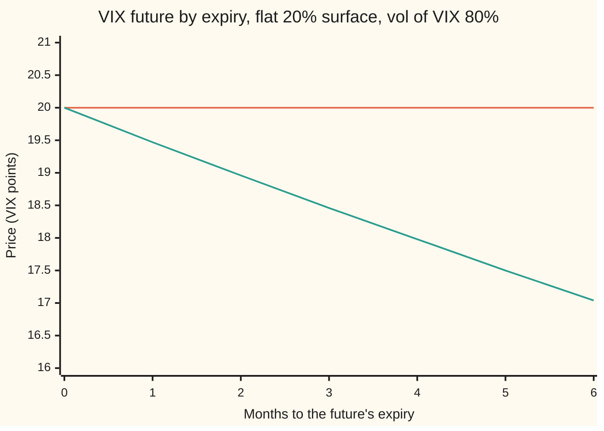

# VIX futures and options: a future on a square root, priced below the square root of forward variance

[Syllabus](../../../SYLLABUS.md) → [Financial mathematics](../README.md) → [Variance swaps, the log contract and VIX](../README.md#s19) → VIX futures and options

---

## General Overview

Take the house index, whose options are priced at 20% volatility at every strike and every expiry. Its VIX reads 20.00 today ([The VIX](06-vix-index.md)). Nobody can buy the VIX itself. What trades is a **VIX future**: a contract that settles, on a fixed morning, on whatever the VIX prints then. On the exchange each contract pays $1,000 per VIX point.

Take the future that settles in six months. The option market already prices the variance for the 30 days that start then: 0.04, a volatility of 20% ([Marking a variance swap](04-variance-swap-after-inception-and-forward-variance.md)). So the natural guess for the future is 20.00. It is wrong, and always too high.

The reason is a curve. In six months the VIX will be the square root of the variance priced then. That variance averages to 0.04 today, but it is uncertain. A square root of an average is larger than the average of the square roots, the same bend that makes a volatility swap cheaper than a variance swap ([The volatility swap and the jump bias](05-volatility-swap-and-jump-bias.md)). So 20.00 is a **ceiling**. How far below it the future sits depends on how much the VIX itself moves. With the VIX moving at 80% a year, a level often seen in VIX options, the future is worth **17.04**.

A **VIX option** pays on the VIX at the same expiry: a call pays the amount by which the VIX ends above the strike. Its forward is the future, 17.04, not today's VIX of 20.00. Black's formula for options on a forward prices the at-the-money call at **3.7018** VIX points ([Black-76](../05-Black-Scholes%20from%20the%20Ground%20Up/06-black-76-and-forward-level-pricing.md)). Run backward, that price returns the 80%. The exchange quotes the premium, in VIX points; traders compare and talk about these prices by their **implied volatility of VIX**.

**A VIX future pays the square root of a variance, so it is worth at most the square root of the forward variance the option market prices; a lognormal VIX sizes the shortfall as the factor $`e^{-\omega^2 T/2}`$, with $`\omega`$ the vol of VIX and $`T`$ the years to expiry ($`e^{-0.16}`$ here), and VIX options are priced by Black-76 on that future.**

**What kind of fact this is:** the ceiling is a theorem, Jensen's inequality, proved on this card in Why it works. The size of the gap and the option prices come from a model, a lognormal VIX with one volatility: an assumption that fits well enough to quote with, not a law.

### The picture: the futures curve on a flat surface



Orange: the ceiling, the square root of forward variance, 20.00 at every expiry because the surface is flat. Green: the future under a lognormal VIX at 80% volatility. A future expiring today is the VIX itself, 20.00. Each month further out gives the VIX more room to wander, and the bend takes more off: 17.04 at six months. The forward variance never changed; only the uncertainty around it grew.

---

## The formula

Notation first, in words. $`T`$ is the years to the future's expiry and $`\tau`$ ("tau") the VIX's 30-day window, 30/365 of a year. $`K_1`$ and $`K_2`$ are the fair variance-swap strikes (decimal variance per year) to $`T`$ and to $`T + \tau`$, read from option strips as in the VIX recipe. $`\mathrm{VIX}_T`$ is the VIX on the expiry morning, unknown today. $`E[\cdot]`$ is the average in the pricing world, where every traded asset grows at the riskless rate.

The ceiling:

```math
F_{\mathrm{VIX}}(T) = E[\mathrm{VIX}_T] \;\le\; 100\sqrt{\xi}, \qquad \xi = \frac{K_2\,(T+\tau) - K_1\,T}{\tau}
```

**Read it aloud:** the future is the average VIX at expiry, and that is at most 100 times the square root of the forward variance, the variance the market prices today for the 30 days after expiry.

The gap, with $`\ln \mathrm{VIX}_T`$ normal and spread $`\omega\sqrt{T}`$:

```math
F_{\mathrm{VIX}}(T) = 100\sqrt{\xi}\; e^{-\omega^2 T/2}
```

**Read it aloud:** the future is the ceiling shrunk by the factor e to the minus half the vol of VIX squared times the time.

The options, Black-76 on the future with volatility $`\omega`$:

```math
C = D\,\big[F\,N(d_1) - K\,N(d_2)\big], \qquad d_1 = \frac{\ln(F/K) + \tfrac12\omega^2 T}{\omega\sqrt{T}}, \qquad d_2 = d_1 - \omega\sqrt{T}
```

**Read it aloud:** the call is the discounted future times the chance-weight $`N(d_1)`$, minus the discounted strike times $`N(d_2)`$; the put follows from $`C - P = D(F - K)`$.

The inverse runs either way. Given a call price, solve the formula for $`\omega`$. Given a future and the ceiling, read $`\omega`$ off the gap:

```math
\omega = \sqrt{\frac{2}{T}\,\ln\frac{100\sqrt{\xi}}{F_{\mathrm{VIX}}}}
```

| Symbol | Plain meaning | In our example | Push it up and the answer… |
| --- | --- | --- | --- |
| $`F_{\mathrm{VIX}}(T)`$, $`F`$ | the VIX future for expiry $`T`$, in VIX points | 17.0429 | call price rises |
| $`\mathrm{VIX}_T`$, $`V`$, $`E`$ | the VIX on the expiry morning; its square, in points squared; the pricing-world average | random; average 17.0429; average of $`V`$ is 400.0000 | — |
| $`T`$ | years to the future's and the options' expiry | 0.5 | future falls: more room for the bend |
| $`\tau`$ | the VIX's window, in years | 30/365 | — |
| $`K_1`$, $`K_2`$ | variance-swap strikes to $`T`$ and to $`T+\tau`$, read from option strips | 0.04, 0.04 | $`K_2`$ up: forward variance and ceiling rise |
| $`\xi`$ | forward variance: the fair variance for the 30 days after $`T`$ | 0.040000 | ceiling rises |
| $`100\sqrt{\xi}`$, $`g`$ | the ceiling, in VIX points; $`g`$ is the square root, the downward-bending function in Jensen's inequality | 20.0000 | future rises in proportion |
| $`\omega`$, $`s`$ | vol of VIX: the yearly volatility of $`\ln \mathrm{VIX}`$; $`s = 2\omega\sqrt{T}`$, the spread of $`\ln V`$ | 0.80; $`2 \times 0.8 \times \sqrt{0.5}`$ | future falls; options rise |
| $`K`$ | the option's strike, in VIX points | 17.0429 at the money | call falls, put rises |
| $`D`$, $`r`$ | discount factor $`e^{-rT}`$ to the expiry; the riskless rate | 0.975310; 5% | both premiums fall slightly |
| $`N(x)`$, $`d_1`$, $`d_2`$, $`z`$, $`a`$ | bell-curve area left of $`x`$; Black-76's two distances; a standard normal draw; any fixed number in $`E[e^{a z}]`$ | 0.282843, −0.282843 | — |
| $`C`$, $`P`$ | call and put premiums today, in VIX points | 3.7018 each at the money | — |

### When it holds

- **Futures price equals the average settlement.** A future is marked to market daily and costs nothing to enter. With interest rates that do not move with the VIX, its price is the pricing-world average of what it settles on ([Futures](../03-Contracts%20and%20No-Arbitrage/05-futures-margining-and-the-forward-futures-difference.md)). Rates that move with the VIX add a correction, very small over six months.
- **VIX squared is the 30-day variance price.** The ceiling needs $`\mathrm{VIX}_T^2/10{,}000`$ to equal the fair 30-day variance strike at $`T`$. The exchange recipe misses that only by its strike spacing and cut-off tails. Jumps do not break it, as long as $`K_1`$ and $`K_2`$ are read from the option strips, as the VIX is, and not from traded variance-swap prices: then the jump bias of the volatility-swap card sits inside all three alike.
- **The VIX is lognormal with one volatility.** This sizes the gap and prices the options. Real VIX options show a smile that rises to the right: calls far out of the money carry higher implied vol. The ω read from the futures gap and the ω read from at-the-money options then disagree, and the lognormal model is only a quoting language.
- **One ω for every expiry.** Real vol of VIX falls with expiry. Holding 80% for a one-year future gives 14.5230, a gap far larger than markets show.
- **Exercise at expiry only.** VIX options are European: they can be exercised only on the expiry date, which is what Black-76 assumes.

---

## Why it works

### Step 0: the future settles on a square root of something whose average is known

On the expiry morning, the VIX squared is the market's price of the next 30 days of variance. Today the option market already fixes the average of that price: the forward variance. The future pays the square root of it. A square root bends downward, so the average of the square root falls short of the square root of the average. Everything below makes those three sentences exact.

### Step 1: a future's price is the average of what it settles on

A future costs nothing to enter. Each day the holder receives the change in the futures price, or pays it. A position that costs nothing must have zero average gain in the pricing world, or traders would take it for free. With rates that do not move with the VIX, the daily payments then add up to one statement: today's futures price is the pricing-world average of the final settlement ([Futures](../03-Contracts%20and%20No-Arbitrage/05-futures-margining-and-the-forward-futures-difference.md)). So $`F_{\mathrm{VIX}}(T) = E[\mathrm{VIX}_T]`$.

### Step 2: the average of VIX squared is the forward variance

Buy a variance swap to $`T + \tau`$ and sell one to $`T`$, each sized by its length. Up to $`T`$ the two legs cancel. What is left pays the realised variance of the 30 days after $`T`$. Struck at the forward variance $`\xi`$, that package costs nothing today ([Marking a variance swap](04-variance-swap-after-inception-and-forward-variance.md)):

```math
\xi = \frac{K_2\,(T+\tau) - K_1\,T}{\tau} = \frac{0.04 \times (0.5 + 30/365) - 0.04 \times 0.5}{30/365} = 0.04
```

At $`T`$ the package is a plain 30-day variance swap struck at $`\xi`$. Its value then is proportional to the fresh 30-day fair strike minus $`\xi`$, and the fresh fair strike is $`\mathrm{VIX}_T^2/10{,}000`$. A package that cost nothing has an average value of nothing, so

```math
E\big[\mathrm{VIX}_T^2\big] = 10{,}000\,\xi = 400
```

No model went in. The forward variance comes from two strips of options today.

### Step 3: Jensen turns the bend into the ceiling

For a downward-bending function $`g`$ and any uncertain $`V`$, $`E[g(V)] \le g(E[V])`$, with equality only when $`V`$ is certain ([Jensen's inequality](../../09-Probability%20and%20statistics/02-Random%20Variables/06-jensens-inequality.md)). Take $`g`$ as the square root and $`V = \mathrm{VIX}_T^2`$:

```math
F_{\mathrm{VIX}}(T) = E\big[\sqrt{V}\,\big] \;\le\; \sqrt{E[V]} = 100\sqrt{\xi} = 20.00
```

This is the volatility swap's argument run on a future ([The volatility swap and the jump bias](05-volatility-swap-and-jump-bias.md)). There the uncertain number was realised variance; here it is the variance price on the expiry morning.

### Step 4: a lognormal VIX sizes the gap exactly

Say $`\ln \mathrm{VIX}_T`$ is normal with spread $`\omega\sqrt{T}`$. Then $`V = \mathrm{VIX}_T^2`$ is lognormal too, with log spread $`s = 2\omega\sqrt{T}`$. Fix its level by Step 2, so that its average is 400:

```math
V = 400\, e^{\,s z - s^2/2}, \qquad \mathrm{VIX}_T = \sqrt{V} = 20\, e^{\,s z/2 - s^2/4}
```

Here $`z`$ is a standard normal draw. The one fact needed is the normal average $`E[e^{a z}] = e^{a^2/2}`$; with $`a = s`$ it confirms that $`V`$ averages to 400. With $`a = s/2`$:

```math
E[\mathrm{VIX}_T] = 20\, e^{s^2/8 - s^2/4} = 20\, e^{-s^2/8} = 20\, e^{-\omega^2 T/2}
```

With $`\omega`$ = 0.80 and $`T`$ = 0.5, the exponent is 0.16 and the future is 17.0429, a gap of 2.9571 points.

The volatility-swap card sized the same kind of gap by a Taylor rule: the variance of $`V`$ over eight times its mean to the power three halves. At a vol of VIX of 80% that rule says the gap is 6.4916 points, more than twice the truth. The rule keeps two terms of a series, and with $`V`$ this uncertain the dropped terms are large. The lognormal factor has no dropped terms inside its model.

| Vol of VIX ω | Future | Gap | Eighth-rule gap |
| --- | --- | --- | --- |
| 0.4 | 19.2158 | 0.7842 | 0.9428 |
| 0.6 | 18.2786 | 1.7214 | 2.6361 |
| 0.8 | 17.0429 | 2.9571 | 6.4916 |
| 1.0 | 15.5760 | 4.4240 | 15.9726 |
| 1.2 | 13.9535 | 6.0465 | 42.0357 |

### Step 5: VIX options are Black-76 on the future

A VIX option and the VIX future of the same month settle on the same number, on the same morning. On that morning the future equals the VIX. So an option on the VIX at expiry is an option on the future at expiry.

The future is the forward for the option. Its average is $`F`$ by Step 1, so it drifts nowhere. Step 4 made $`\mathrm{VIX}_T`$ lognormal with average $`F`$ and log spread $`\omega\sqrt{T}`$. That is exactly the assumption behind Black-76, which prices the call as the discounted average of $`(\mathrm{VIX}_T - K)^+`$ ([Black-76](../05-Black-Scholes%20from%20the%20Ground%20Up/06-black-76-and-forward-level-pricing.md)). Today's VIX of 20.00 plays no part. It cannot be bought and held, so no cost-of-carry argument links it to the future.

### Step 6: solving back for the implied volatility of VIX

The Black-76 price rises strictly with $`\omega`$, so each price inside the no-arbitrage band comes from exactly one $`\omega`$ ([Implied volatility](../11-Implied%20volatility%20and%20the%20vanilla%20inverses/01-implied-volatility.md)). Halving an interval that brackets it (bisection) finds it: the quoted 3.7018 returns 0.8000.

The futures curve gives a second reading of the same number. Solve the gap formula for $`\omega`$: $`\sqrt{2\ln(20/17.0429)/0.5}`$ = 0.800000. Inside the lognormal model the two readings must agree. In a real market they need not, and the difference measures how far the market is from the model.

<details>
<summary>Detailed proof: the normal average behind Step 4</summary>

For a standard normal $`z`$ and any number $`a`$,

$`\displaystyle E[e^{a z}] = \int_{-\infty}^{\infty} e^{a z}\,\frac{e^{-z^2/2}}{\sqrt{2\pi}}\,dz = e^{a^2/2}\int_{-\infty}^{\infty} \frac{e^{-(z-a)^2/2}}{\sqrt{2\pi}}\,dz = e^{a^2/2}.`$

The middle step completes the square, $`a z - z^2/2 = a^2/2 - (z - a)^2/2`$, and the last integral is the area under a shifted bell curve, which is 1.

So $`E[V] = 400\,e^{-s^2/2}\,E[e^{s z}] = 400`$, and $`E[\sqrt V] = 20\,e^{-s^2/4}\,E[e^{s z/2}] = 20\,e^{-s^2/4 + s^2/8} = 20\,e^{-s^2/8}`$. With $`s^2 = 4\omega^2 T`$ this is $`20\,e^{-\omega^2 T/2}`$. The same factor read the other way gives $`E[V] = E[\mathrm{VIX}_T]^2\,e^{\omega^2 T}`$: the square of the average falls short of the average of the square by the factor $`e^{\omega^2 T}`$, which is Jensen's gap in closed form.

</details>

---

## Worked numbers, by hand

House flat 20% surface, rate 5%, future and options expiring in six months, vol of VIX 80%.

| Step | Arithmetic | Value |
| --- | --- | --- |
| forward variance $`\xi`$ | $`(0.04 \times (0.5 + 30/365) - 0.04 \times 0.5)/(30/365)`$ | 0.040000 |
| ceiling | $`100\sqrt{0.04}`$ | 20.0000 |
| exponent | $`0.8^2 \times 0.5 / 2`$ | 0.160000 |
| shrink factor | $`e^{-0.16}`$ | 0.852144 |
| **future** | $`20 \times 0.852144`$ | **17.0429** |
| gap below the ceiling | $`20 - 17.0429`$ | 2.9571 |
| $`d_1`$, $`d_2`$ at the money | $`\pm\tfrac12 \times 0.8 \times \sqrt{0.5}`$ | 0.282843, −0.282843 |
| $`N(d_1)`$, $`N(d_2)`$ | bell-curve areas | 0.611351, 0.388649 |
| discount factor $`D`$ | $`e^{-0.05 \times 0.5}`$ | 0.975310 |
| **at-the-money call** | $`0.975310 \times 17.0429 \times (0.611351 - 0.388649)`$ | **3.7018** |
| at-the-money put | parity: $`C - P = D(F - K) = 0`$ | 3.7018 |
| implied vol of VIX from 3.7018 | bisection on Black-76 | 0.8000 |

The future is 17.04, almost three points under the 20.00 a naive reading gives, and the at-the-money call costs 3.70 points.

Other strikes on the same future, each pair obeying $`C - P = D(F - K)`$:

| Strike | Call | Put | Call − put | $`D(F - K)`$ |
| --- | --- | --- | --- | --- |
| 15 | 4.5619 | 2.5695 | 1.9924 | 1.9924 |
| 20 | 2.7361 | 5.6202 | −2.8841 | −2.8841 |
| 25 | 1.6533 | 9.4139 | −7.7607 | −7.7607 |

The call struck at today's VIX, 20, is a call almost three points out of the money, because the future is 17.04.

### What breaks if you drop a piece

| Mistake | Comes out at | What went wrong |
| --- | --- | --- |
| Price the future at the root of forward variance | 20.0000 (right: 17.0429) | ignored the bend: Jensen's gap is 2.9571 points |
| Size the gap by the eighth-rule | 13.5084 (right: 17.0429) | the Taylor rule's dropped terms are large at an 80% vol of VIX |
| Black-76 on today's VIX, 20, for the 17.04 call | 5.6202 (right: 3.7018) | today's VIX is not the forward; the future is |
| Rate inside $`d_1`$, as for a stock | 3.9626 (right: 3.7018) | a future already contains all carry; Black-76 uses the rate only in $`D`$ |

---

## Code, from first principles, and it actually runs

The code builds the forward variance from two variance-swap strikes and takes three independent roads to the future and to the at-the-money call. **1** The closed forms: the lognormal factor and Black-76. **2** Simpson's rule (a standard numerical integration method) over the normal density, with the VIX written as $`20\,e^{sz/2 - s^2/4}`$; it never uses the factor $`e^{-\omega^2T/2}`$, and it also confirms that VIX squared averages to 400. **3** A Monte Carlo average over 200,000 draws from a home-made generator (splitmix64 with the Box-Muller transform). It then solves back for the vol of VIX two ways, by bisection on the call price and from the futures gap, checks the Black-76 put and put-call parity against Simpson puts, and prints every number in the tables, the chart and the experiments below. The normal curve area is a series written out in both languages.

### Python

```python
# VIX futures and options on the house flat 20% surface, 6 months out, VIX lognormal at 80% vol.
# Roads: 1 closed forms (lognormal moments, Black-76), 2 Simpson integrals over the normal density,
# 3 Monte Carlo with a home-made generator. The implied vol of VIX is solved back by bisection.
from math import exp, log, sqrt, pi, cos

R, T, TAU, OMEGA = 0.05, 0.5, 30 / 365, 0.80   # rate, years to VIX expiry, VIX window, vol of VIX
D = exp(-R * T)                                 # discount factor to the expiry

def ncdf(x):                                    # normal CDF by Marsaglia's series, no library
    if x < -9.0: return 0.0
    if x > 9.0: return 1.0
    s, t, n = x, x, 1
    while abs(t) > 1e-17 * abs(s):
        n += 2; t *= x * x / n; s += t
    return 0.5 + s * exp(-0.5 * x * x) / sqrt(2 * pi)

def npdf(z): return exp(-0.5 * z * z) / sqrt(2 * pi)

def black76(F, K, vol, call=True, rate=R):      # Black-76 on a forward or future
    sd = vol * sqrt(T); d1 = (log(F / K) + 0.5 * sd * sd) / sd; d2 = d1 - sd
    if call: return exp(-rate * T) * (F * ncdf(d1) - K * ncdf(d2))
    return exp(-rate * T) * (K * ncdf(-d2) - F * ncdf(-d1))

def simpson(f, a, b, n):
    h, inner = (b - a) / n, 0.0
    for i in range(1, n): inner += (4 if i % 2 else 2) * f(a + i * h)
    return h / 3 * (f(a) + f(b) + inner)

# Forward variance for the 30 days after the expiry, from two variance-swap strikes (flat 20%)
K1, K2 = 0.04, 0.04                              # variance strikes to T and to T + 30 days
xi = (K2 * (T + TAU) - K1 * T) / TAU
cap = 100 * sqrt(xi)                             # the ceiling, in VIX points

def vix_at(z, om=OMEGA):                         # VIX at expiry: VIX^2 lognormal with mean cap^2
    s = 2 * om * sqrt(T)
    return sqrt(cap * cap * exp(s * z - 0.5 * s * s))

def fut_closed(om): return cap * exp(-om * om * T / 2)
def fut_simpson(om): return simpson(lambda z: vix_at(z, om) * npdf(z), -12.0, 12.0, 4000)

state = 0x9E3779B97F4A7C15                       # splitmix64, then Box-Muller: no library random
def u01():
    global state
    state = (state + 0x9E3779B97F4A7C15) & 0xFFFFFFFFFFFFFFFF
    z = state
    z = ((z ^ (z >> 30)) * 0xBF58476D1CE4E5B9) & 0xFFFFFFFFFFFFFFFF
    z = ((z ^ (z >> 27)) * 0x94D049BB133111EB) & 0xFFFFFFFFFFFFFFFF
    return ((z ^ (z >> 31)) >> 11) / 9007199254740992.0 + 0.5 / 9007199254740992.0

F1, F2 = fut_closed(OMEGA), fut_simpson(OMEGA)
EV2 = simpson(lambda z: vix_at(z) ** 2 * npdf(z), -12.0, 12.0, 4000)
NMC = 200000; sx = sxx = sc = scc = 0.0
for i in range(NMC // 2):
    a, b = u01(), u01()
    for z in (sqrt(-2 * log(a)) * cos(2 * pi * b), sqrt(-2 * log(a)) * cos(2 * pi * b + pi / 2)):
        x = vix_at(z); c = D * max(x - F1, 0.0)
        sx += x; sxx += x * x; sc += c; scc += c * c
F3, F3se = sx / NMC, sqrt((sxx / NMC - (sx / NMC) ** 2) / NMC)
C1 = black76(F1, F1, OMEGA)
def kink(K, om=OMEGA):                           # the z at which the VIX lands exactly on K
    s = 2 * om * sqrt(T); return (2 * log(K / cap) + 0.5 * s * s) / s
C2 = D * simpson(lambda z: (vix_at(z) - F1) * npdf(z), kink(F1), 12.0, 4000)
C3, C3se = sc / NMC, sqrt((scc / NMC - (sc / NMC) ** 2) / NMC)
P1 = black76(F1, F1, OMEGA, call=False)

def implied(price, F, K):                        # bisection: Black-76 price rises with vol
    lo, hi = 0.01, 5.0
    for _ in range(200):
        mid = 0.5 * (lo + hi)
        if black76(F, K, mid) < price: lo = mid
        else: hi = mid
    return 0.5 * (lo + hi)
iv = implied(round(C1, 4), F1, F1)
om_gap = sqrt(2 * log(cap / F2) / T)             # the vol of VIX the futures gap implies

print(f"forward variance, T to T+30d      {xi:.6f}")
print(f"ceiling 100 sqrt(xi)              {cap:.4f}")
print(f"average VIX^2 (Simpson)           {EV2:.4f}")
print(f"omega^2 T / 2                     {OMEGA * OMEGA * T / 2:.6f}")
print(f"exp(-omega^2 T / 2)               {exp(-OMEGA * OMEGA * T / 2):.6f}")
print(f"future 1 closed form              {F1:.4f}")
print(f"future 2 Simpson                  {F2:.4f}")
print(f"future 3 Monte Carlo              {F3:.4f}  (se {F3se:.4f}, {NMC} draws)")
print(f"gap below the ceiling             {cap - F1:.4f}")
sd = OMEGA * sqrt(T)
print(f"d1, d2                            {sd / 2:.6f}  {-sd / 2:.6f}")
print(f"N(d1), N(d2)                      {ncdf(sd / 2):.6f}  {ncdf(-sd / 2):.6f}")
print(f"discount factor D                 {D:.6f}")
print(f"ATM call 1 Black-76               {C1:.4f}")
print(f"ATM call 2 Simpson                {C2:.4f}")
print(f"ATM call 3 Monte Carlo            {C3:.4f}  (se {C3se:.4f})")
print(f"ATM put, Black-76                 {P1:.4f}")
print(f"implied vol of VIX from {round(C1, 4):.4f}    {iv:.4f}")
print(f"vol of VIX from the futures gap   {om_gap:.6f}")
print(f"vega of the ATM call, per point   {(black76(F1, F1, OMEGA + 0.005) - black76(F1, F1, OMEGA - 0.005)):.4f}")
print()
print("strike   call     put      call-put  D(F-K)")
for K in (15.0, 20.0, 25.0):
    c, p = black76(F1, K, OMEGA), black76(F1, K, OMEGA, call=False)
    print(f"{K:5.1f} {c:8.4f} {p:8.4f} {c - p:9.4f} {D * (F1 - K):8.4f}")
print()
print("omega  future   gap    eighth-rule gap")
grid = [0.4, 0.6, 0.8, 1.0, 1.2]
for om in grid:
    s2 = 4 * om * om * T
    print(f"{om:4.1f} {fut_closed(om):8.4f} {cap - fut_closed(om):6.4f} {cap ** 4 * (exp(s2) - 1) / (8 * cap ** 3):9.4f}")
print()
print("chart, months " + " ".join(f"{m:6d}" for m in range(7)))
print("chart, future " + " ".join(f"{cap * exp(-OMEGA ** 2 * m / 12 / 2):6.2f}" for m in range(7)))
print()
eighth = cap - cap ** 4 * (exp(4 * OMEGA * OMEGA * T) - 1) / (8 * cap ** 3)
print(f"wrong: future at the ceiling          {cap:.4f}")
print(f"wrong: eighth-rule future             {eighth:.4f}")
print(f"wrong: Black-76 on spot VIX 20        {black76(cap, F1, OMEGA):.4f}")
print(f"wrong: rate inside d1, as for a stock {F1 * ncdf((R * T + 0.5 * sd * sd) / sd) - F1 * D * ncdf((R * T - 0.5 * sd * sd) / sd):.4f}")
print(f"try: omega 1.0, ATM call              {black76(fut_closed(1.0), fut_closed(1.0), 1.0):.4f}")
print(f"try: one-year expiry, future          {cap * exp(-OMEGA * OMEGA * 1.0 / 2):.4f}")
cap2 = 100 * sqrt((0.041 * (T + TAU) - K1 * T) / TAU)   # 30 days later now struck at 0.041
print(f"try: K2 = 0.041, ceiling and future   {cap2:.4f}  {cap2 * exp(-OMEGA * OMEGA * T / 2):.4f}")

assert abs(F1 - F2) < 1e-9, "Simpson future must equal the lognormal closed form"
assert abs(F1 - F3) < 4 * F3se, "Monte Carlo future within four standard errors"
assert abs(EV2 - cap * cap) < 1e-8, "VIX^2 must average to the forward variance"
assert abs(C1 - C2) < 1e-6, "Simpson call must equal Black-76"
assert abs(C1 - C3) < 4 * C3se, "Monte Carlo call within four standard errors"
assert abs(iv - OMEGA) < 1e-4, "bisection must recover the 80% vol of VIX"
assert abs(om_gap - OMEGA) < 1e-8, "the futures gap must imply the same vol of VIX"
assert all(fut_simpson(om) < cap for om in grid), "Jensen: every future below the ceiling"
P2 = D * simpson(lambda z: (20.0 - vix_at(z)) * npdf(z), -12.0, kink(20.0), 4000)
assert abs((black76(F1, 20.0, OMEGA) - P2) - D * (F2 - 20.0)) < 1e-6, "parity: Black-76 call minus Simpson put"
assert abs(P1 - D * simpson(lambda z: (F1 - vix_at(z)) * npdf(z), -12.0, kink(F1), 4000)) < 1e-6, "Simpson put must equal the Black-76 put"
print("ALL CHECKS PASS")
```

**Ran 2026-11-23 on macOS, Python 3.14.10, standard library only. All checks passed. Output, pasted from the run:**

```
forward variance, T to T+30d      0.040000
ceiling 100 sqrt(xi)              20.0000
average VIX^2 (Simpson)           400.0000
omega^2 T / 2                     0.160000
exp(-omega^2 T / 2)               0.852144
future 1 closed form              17.0429
future 2 Simpson                  17.0429
future 3 Monte Carlo              17.0240  (se 0.0235, 200000 draws)
gap below the ceiling             2.9571
d1, d2                            0.282843  -0.282843
N(d1), N(d2)                      0.611351  0.388649
discount factor D                 0.975310
ATM call 1 Black-76               3.7018
ATM call 2 Simpson                3.7018
ATM call 3 Monte Carlo            3.6895  (se 0.0176)
ATM put, Black-76                 3.7018
implied vol of VIX from 3.7018    0.8000
vol of VIX from the futures gap   0.800000
vega of the ATM call, per point   0.0451

strike   call     put      call-put  D(F-K)
 15.0   4.5619   2.5695    1.9924   1.9924
 20.0   2.7361   5.6202   -2.8841  -2.8841
 25.0   1.6533   9.4139   -7.7607  -7.7607

omega  future   gap    eighth-rule gap
 0.4  19.2158 0.7842    0.9428
 0.6  18.2786 1.7214    2.6361
 0.8  17.0429 2.9571    6.4916
 1.0  15.5760 4.4240   15.9726
 1.2  13.9535 6.0465   42.0357

chart, months      0      1      2      3      4      5      6
chart, future  20.00  19.47  18.96  18.46  17.98  17.50  17.04

wrong: future at the ceiling          20.0000
wrong: eighth-rule future             13.5084
wrong: Black-76 on spot VIX 20        5.6202
wrong: rate inside d1, as for a stock 3.9626
try: omega 1.0, ATM call              4.1978
try: one-year expiry, future          14.5230
try: K2 = 0.041, ceiling and future   21.6987  18.4904
ALL CHECKS PASS
```

### Rust

```rust
// VIX futures and options on the house flat 20% surface, 6 months out, VIX lognormal at 80% vol.
// Roads: 1 closed forms (lognormal moments, Black-76), 2 Simpson integrals over the normal density,
// 3 Monte Carlo with a home-made generator. The implied vol of VIX is solved back by bisection.
const R: f64 = 0.05; const T: f64 = 0.5; const OMEGA: f64 = 0.80; // rate, years to expiry, vol of VIX
const PI: f64 = std::f64::consts::PI;
const K1: f64 = 0.04; const K2: f64 = 0.04; // variance strikes to T and to T + 30 days

fn tau() -> f64 { 30.0 / 365.0 }
fn disc() -> f64 { (-R * T).exp() }
fn ncdf(x: f64) -> f64 { // normal CDF by Marsaglia's series, no library
    if x < -9.0 { return 0.0; }
    if x > 9.0 { return 1.0; }
    let (mut s, mut t, mut n) = (x, x, 1.0);
    while t.abs() > 1e-17 * s.abs() { n += 2.0; t *= x * x / n; s += t; }
    0.5 + s * (-0.5 * x * x).exp() / (2.0 * PI).sqrt()
}
fn npdf(z: f64) -> f64 { (-0.5 * z * z).exp() / (2.0 * PI).sqrt() }
fn black76(f: f64, k: f64, vol: f64, call: bool) -> f64 { // Black-76 on a forward or future
    let sd = vol * T.sqrt(); let d1 = ((f / k).ln() + 0.5 * sd * sd) / sd; let d2 = d1 - sd;
    if call { disc() * (f * ncdf(d1) - k * ncdf(d2)) } else { disc() * (k * ncdf(-d2) - f * ncdf(-d1)) }
}
fn simpson(f: &dyn Fn(f64) -> f64, a: f64, b: f64, n: usize) -> f64 {
    let h = (b - a) / n as f64; let mut inner = 0.0;
    for i in 1..n { inner += (if i % 2 == 1 { 4.0 } else { 2.0 }) * f(a + i as f64 * h); }
    h / 3.0 * (f(a) + f(b) + inner)
}
fn cap() -> f64 { 100.0 * ((K2 * (T + tau()) - K1 * T) / tau()).sqrt() } // the ceiling, VIX points
fn vix_at(z: f64, om: f64) -> f64 { // VIX at expiry: VIX^2 lognormal with mean cap^2
    let s = 2.0 * om * T.sqrt();
    (cap() * cap() * (s * z - 0.5 * s * s).exp()).sqrt()
}
fn fut_closed(om: f64) -> f64 { cap() * (-om * om * T / 2.0).exp() }
fn fut_simpson(om: f64) -> f64 { simpson(&|z| vix_at(z, om) * npdf(z), -12.0, 12.0, 4000) }
fn kink(k: f64) -> f64 { // the z at which the VIX lands exactly on K
    let s = 2.0 * OMEGA * T.sqrt(); (2.0 * (k / cap()).ln() + 0.5 * s * s) / s
}
struct Rng(u64); // splitmix64, then Box-Muller: no library random
impl Rng {
    fn u01(&mut self) -> f64 {
        self.0 = self.0.wrapping_add(0x9E3779B97F4A7C15);
        let mut z = self.0;
        z = (z ^ (z >> 30)).wrapping_mul(0xBF58476D1CE4E5B9);
        z = (z ^ (z >> 27)).wrapping_mul(0x94D049BB133111EB);
        ((z ^ (z >> 31)) >> 11) as f64 / 9007199254740992.0 + 0.5 / 9007199254740992.0
    }
}
fn implied(price: f64, f: f64, k: f64) -> f64 { // bisection: Black-76 price rises with vol
    let (mut lo, mut hi) = (0.01, 5.0);
    for _ in 0..200 { let mid = 0.5 * (lo + hi); if black76(f, k, mid, true) < price { lo = mid; } else { hi = mid; } }
    0.5 * (lo + hi)
}
fn main() {
    let d = disc(); let cap = cap();
    let xi = (K2 * (T + tau()) - K1 * T) / tau();
    let (f1, f2) = (fut_closed(OMEGA), fut_simpson(OMEGA));
    let ev2 = simpson(&|z| vix_at(z, OMEGA).powi(2) * npdf(z), -12.0, 12.0, 4000);
    let nmc = 200000usize; let (mut sx, mut sxx, mut sc, mut scc) = (0.0, 0.0, 0.0, 0.0);
    let mut rng = Rng(0x9E3779B97F4A7C15);
    for _ in 0..nmc / 2 {
        let (a, b) = (rng.u01(), rng.u01());
        for z in [(-2.0 * a.ln()).sqrt() * (2.0 * PI * b).cos(), (-2.0 * a.ln()).sqrt() * (2.0 * PI * b + PI / 2.0).cos()] {
            let x = vix_at(z, OMEGA); let c = d * (x - f1).max(0.0);
            sx += x; sxx += x * x; sc += c; scc += c * c;
        }
    }
    let n = nmc as f64;
    let (f3, f3se) = (sx / n, ((sxx / n - (sx / n).powi(2)) / n).sqrt());
    let c1 = black76(f1, f1, OMEGA, true);
    let c2 = d * simpson(&|z| (vix_at(z, OMEGA) - f1) * npdf(z), kink(f1), 12.0, 4000);
    let (c3, c3se) = (sc / n, ((scc / n - (sc / n).powi(2)) / n).sqrt());
    let p1 = black76(f1, f1, OMEGA, false);
    let quoted = (c1 * 10000.0).round() / 10000.0;
    let iv = implied(quoted, f1, f1);
    let om_gap = (2.0 * (cap / f2).ln() / T).sqrt(); // the vol of VIX the futures gap implies
    println!("forward variance, T to T+30d      {:.6}", xi);
    println!("ceiling 100 sqrt(xi)              {:.4}", cap);
    println!("average VIX^2 (Simpson)           {:.4}", ev2);
    println!("omega^2 T / 2                     {:.6}", OMEGA * OMEGA * T / 2.0);
    println!("exp(-omega^2 T / 2)               {:.6}", (-OMEGA * OMEGA * T / 2.0).exp());
    println!("future 1 closed form              {:.4}", f1);
    println!("future 2 Simpson                  {:.4}", f2);
    println!("future 3 Monte Carlo              {:.4}  (se {:.4}, {} draws)", f3, f3se, nmc);
    println!("gap below the ceiling             {:.4}", cap - f1);
    let sd = OMEGA * T.sqrt();
    println!("d1, d2                            {:.6}  {:.6}", sd / 2.0, -sd / 2.0);
    println!("N(d1), N(d2)                      {:.6}  {:.6}", ncdf(sd / 2.0), ncdf(-sd / 2.0));
    println!("discount factor D                 {:.6}", d);
    println!("ATM call 1 Black-76               {:.4}", c1);
    println!("ATM call 2 Simpson                {:.4}", c2);
    println!("ATM call 3 Monte Carlo            {:.4}  (se {:.4})", c3, c3se);
    println!("ATM put, Black-76                 {:.4}", p1);
    println!("implied vol of VIX from {:.4}    {:.4}", quoted, iv);
    println!("vol of VIX from the futures gap   {:.6}", om_gap);
    println!("vega of the ATM call, per point   {:.4}", black76(f1, f1, OMEGA + 0.005, true) - black76(f1, f1, OMEGA - 0.005, true));
    println!();
    println!("strike   call     put      call-put  D(F-K)");
    for k in [15.0, 20.0, 25.0] {
        let (c, p) = (black76(f1, k, OMEGA, true), black76(f1, k, OMEGA, false));
        println!("{:5.1} {:8.4} {:8.4} {:9.4} {:8.4}", k, c, p, c - p, d * (f1 - k));
    }
    println!();
    println!("omega  future   gap    eighth-rule gap");
    let grid = [0.4, 0.6, 0.8, 1.0, 1.2];
    for om in grid {
        let s2 = 4.0 * om * om * T;
        println!("{:4.1} {:8.4} {:6.4} {:9.4}", om, fut_closed(om), cap - fut_closed(om), cap.powi(4) * (s2.exp() - 1.0) / (8.0 * cap.powi(3)));
    }
    println!();
    let months: Vec<String> = (0..7).map(|m| format!("{:6}", m)).collect();
    let futs: Vec<String> = (0..7).map(|m| format!("{:6.2}", cap * (-OMEGA.powi(2) * m as f64 / 12.0 / 2.0).exp())).collect();
    println!("chart, months {}", months.join(" "));
    println!("chart, future {}", futs.join(" "));
    println!();
    let eighth = cap - cap.powi(4) * ((4.0 * OMEGA * OMEGA * T).exp() - 1.0) / (8.0 * cap.powi(3));
    println!("wrong: future at the ceiling          {:.4}", cap);
    println!("wrong: eighth-rule future             {:.4}", eighth);
    println!("wrong: Black-76 on spot VIX 20        {:.4}", black76(cap, f1, OMEGA, true));
    println!("wrong: rate inside d1, as for a stock {:.4}",
        f1 * ncdf((R * T + 0.5 * sd * sd) / sd) - f1 * d * ncdf((R * T - 0.5 * sd * sd) / sd));
    println!("try: omega 1.0, ATM call              {:.4}", black76(fut_closed(1.0), fut_closed(1.0), 1.0, true));
    println!("try: one-year expiry, future          {:.4}", cap * (-OMEGA * OMEGA * 1.0 / 2.0).exp());
    let cap2 = 100.0 * ((0.041 * (T + tau()) - K1 * T) / tau()).sqrt(); // 30 days later now struck at 0.041
    println!("try: K2 = 0.041, ceiling and future   {:.4}  {:.4}", cap2, cap2 * (-OMEGA * OMEGA * T / 2.0).exp());

    assert!((f1 - f2).abs() < 1e-9, "Simpson future must equal the lognormal closed form");
    assert!((f1 - f3).abs() < 4.0 * f3se, "Monte Carlo future within four standard errors");
    assert!((ev2 - cap * cap).abs() < 1e-8, "VIX^2 must average to the forward variance");
    assert!((c1 - c2).abs() < 1e-6, "Simpson call must equal Black-76");
    assert!((c1 - c3).abs() < 4.0 * c3se, "Monte Carlo call within four standard errors");
    assert!((iv - OMEGA).abs() < 1e-4, "bisection must recover the 80% vol of VIX");
    assert!((om_gap - OMEGA).abs() < 1e-8, "the futures gap must imply the same vol of VIX");
    assert!(grid.iter().all(|&om| fut_simpson(om) < cap), "Jensen: every future below the ceiling");
    let p2 = d * simpson(&|z| (20.0 - vix_at(z, OMEGA)) * npdf(z), -12.0, kink(20.0), 4000);
    assert!(((black76(f1, 20.0, OMEGA, true) - p2) - d * (f2 - 20.0)).abs() < 1e-6, "parity: Black-76 call minus Simpson put");
    assert!((p1 - d * simpson(&|z| (f1 - vix_at(z, OMEGA)) * npdf(z), -12.0, kink(f1), 4000)).abs() < 1e-6, "Simpson put must equal the Black-76 put");
    println!("ALL CHECKS PASS");
}
```

**Ran 2026-11-23 on macOS, rustc 1.98.1, no crates. All checks passed. Output, pasted from the run:**

```
forward variance, T to T+30d      0.040000
ceiling 100 sqrt(xi)              20.0000
average VIX^2 (Simpson)           400.0000
omega^2 T / 2                     0.160000
exp(-omega^2 T / 2)               0.852144
future 1 closed form              17.0429
future 2 Simpson                  17.0429
future 3 Monte Carlo              17.0240  (se 0.0235, 200000 draws)
gap below the ceiling             2.9571
d1, d2                            0.282843  -0.282843
N(d1), N(d2)                      0.611351  0.388649
discount factor D                 0.975310
ATM call 1 Black-76               3.7018
ATM call 2 Simpson                3.7018
ATM call 3 Monte Carlo            3.6895  (se 0.0176)
ATM put, Black-76                 3.7018
implied vol of VIX from 3.7018    0.8000
vol of VIX from the futures gap   0.800000
vega of the ATM call, per point   0.0451

strike   call     put      call-put  D(F-K)
 15.0   4.5619   2.5695    1.9924   1.9924
 20.0   2.7361   5.6202   -2.8841  -2.8841
 25.0   1.6533   9.4139   -7.7607  -7.7607

omega  future   gap    eighth-rule gap
 0.4  19.2158 0.7842    0.9428
 0.6  18.2786 1.7214    2.6361
 0.8  17.0429 2.9571    6.4916
 1.0  15.5760 4.4240   15.9726
 1.2  13.9535 6.0465   42.0357

chart, months      0      1      2      3      4      5      6
chart, future  20.00  19.47  18.96  18.46  17.98  17.50  17.04

wrong: future at the ceiling          20.0000
wrong: eighth-rule future             13.5084
wrong: Black-76 on spot VIX 20        5.6202
wrong: rate inside d1, as for a stock 3.9626
try: omega 1.0, ATM call              4.1978
try: one-year expiry, future          14.5230
try: K2 = 0.041, ceiling and future   21.6987  18.4904
ALL CHECKS PASS
```

The two outputs are identical line for line.

### Lean

Lean proves the ceiling, the lognormal gap and the reading of $`\omega`$ off the gap, for every forward variance and expiry.

- Suppose the VIX at expiry is never negative, its square has an average, and that average is $`10{,}000\,\xi`$. Then the future, the average VIX at expiry, is at most $`100\sqrt{\xi}`$.
- Take $`\mathrm{VIX}_T = 100\sqrt{\xi}\,e^{\omega\sqrt{T}z - \omega^2 T}`$, with $`z`$ a standard normal draw. Then VIX squared averages to $`10{,}000\,\xi`$, and the future is $`100\sqrt{\xi}\,e^{-\omega^2 T/2}`$.
- Suppose $`F = 100\sqrt{\xi}\,e^{-\omega^2 T/2}`$, with $`\xi`$ and $`T`$ positive and $`\omega`$ not negative. Then $`\omega = \sqrt{(2/T)\ln(100\sqrt{\xi}/F)}`$.
- The hand numbers check exactly: the forward variance is 0.04, the ceiling is 20, and the exponent is 0.16.

Option prices, the implied vol of VIX from a call price and the 17.0429 future are left to the Python and Rust checks.

```lean
-- VIX futures and options: a VIX future is at most 100 times the square root of the forward variance, a lognormal VIX shrinks it by exp(-ω²T/2), and that gap gives back the vol of VIX.
import Mathlib.Analysis.Convex.Integral
import Mathlib.Analysis.Convex.SpecificFunctions.Pow
import Mathlib.Probability.Distributions.Gaussian.Real

open MeasureTheory ProbabilityTheory

lemma integral_exp_mul_std_gaussian (t : ℝ) :
    ∫ z, Real.exp (t * z) ∂(gaussianReal 0 1) = Real.exp (t ^ 2 / 2) := by
  have h := congrFun (mgf_id_gaussianReal (μ := 0) (v := 1)) t
  simp only [mgf, id] at h
  rw [h]; congr 1; push_cast; ring

/-- The ceiling (Jensen for the square root). In the pricing world `P`, let `VIX` be the VIX on the
expiry morning, never negative, with `VIX²` having an average. If the future's price `F` is the
average VIX at expiry, and the average of `VIX²` is `10,000 ξ`, where `ξ = (K₂ (T + τ) - K₁ T) / τ`
is the forward variance for the 30 days after expiry, then the future is at most `100 √ξ`. -/
theorem vix_future_le_sqrt_forward_variance {Ω : Type*} [MeasurableSpace Ω]
    (P : Measure Ω) [IsProbabilityMeasure P] (VIX : Ω → ℝ) (K₁ K₂ T τ F : ℝ)
    (hnonneg : ∀ x, 0 ≤ VIX x)
    (hsq : Integrable (fun x => VIX x ^ 2) P)
    (hF : F = ∫ x, VIX x ∂P)
    (hvar : ∫ x, VIX x ^ 2 ∂P = 10000 * ((K₂ * (T + τ) - K₁ * T) / τ)) :
    F ≤ 100 * Real.sqrt ((K₂ * (T + τ) - K₁ * T) / τ) := by
  set ξ := (K₂ * (T + τ) - K₁ * T) / τ
  have h100 : (100 : ℝ) * Real.sqrt ξ = Real.sqrt (10000 * ξ) := by
    rw [Real.sqrt_mul (by norm_num), show (10000 : ℝ) = 100 ^ 2 by norm_num,
      Real.sqrt_sq (by norm_num)]
  rw [h100]
  by_cases hi : Integrable VIX P
  · have hJ : (∫ x, VIX x ∂P) ^ 2 ≤ ∫ x, VIX x ^ 2 ∂P :=
      (convexOn_pow 2).map_integral_le (continuous_pow 2).continuousOn isClosed_Ici
        (Filter.Eventually.of_forall fun x => hnonneg x) hi hsq
    have hF0 : 0 ≤ F := hF ▸ integral_nonneg hnonneg
    apply Real.le_sqrt_of_sq_le
    rw [← hvar, hF]; exact hJ
  · rw [hF, integral_undef hi]; exact Real.sqrt_nonneg _

/-- The gap under a lognormal VIX. Let `z` be a standard normal draw and
`VIX_T = 100 √ξ · exp(ω √T z - ω² T)`, so that `ln VIX_T` is normal with spread `ω √T`.
Then the average of `VIX_T²` is the forward variance `10,000 ξ`, and the future, the average of
`VIX_T`, is the ceiling `100 √ξ` shrunk by the factor `exp(-ω² T / 2)`. -/
theorem vix_future_lognormal (ξ ω T : ℝ) (hξ : 0 ≤ ξ) (hT : 0 ≤ T) :
    (∫ z, (100 * Real.sqrt ξ * Real.exp (ω * Real.sqrt T * z - ω ^ 2 * T)) ^ 2
        ∂(gaussianReal 0 1) = 10000 * ξ) ∧
    ∫ z, 100 * Real.sqrt ξ * Real.exp (ω * Real.sqrt T * z - ω ^ 2 * T) ∂(gaussianReal 0 1)
      = 100 * Real.sqrt ξ * Real.exp (-(ω ^ 2 * T / 2)) := by
  have hsT : Real.sqrt T ^ 2 = T := Real.sq_sqrt hT
  have hsξ : Real.sqrt ξ ^ 2 = ξ := Real.sq_sqrt hξ
  constructor
  · have hfun : (fun z : ℝ => (100 * Real.sqrt ξ * Real.exp (ω * Real.sqrt T * z - ω ^ 2 * T)) ^ 2)
        = fun z => (10000 * ξ * Real.exp (-(2 * ω ^ 2 * T))) * Real.exp ((2 * ω * Real.sqrt T) * z) := by
      funext z
      rw [mul_pow, mul_pow, ← Real.exp_nat_mul, hsξ, mul_assoc (10000 * ξ), ← Real.exp_add]
      congr 1
      · ring
      · congr 1; push_cast; ring
    rw [hfun, integral_const_mul, integral_exp_mul_std_gaussian, mul_assoc, ← Real.exp_add]
    have : -(2 * ω ^ 2 * T) + (2 * ω * Real.sqrt T) ^ 2 / 2 = 0 := by
      rw [mul_pow, hsT]; ring
    rw [this, Real.exp_zero, mul_one]
  · have hfun : (fun z : ℝ => 100 * Real.sqrt ξ * Real.exp (ω * Real.sqrt T * z - ω ^ 2 * T))
        = fun z => (100 * Real.sqrt ξ * Real.exp (-(ω ^ 2 * T))) * Real.exp ((ω * Real.sqrt T) * z) := by
      funext z
      rw [mul_assoc (100 * Real.sqrt ξ), ← Real.exp_add]
      congr 2; ring
    rw [hfun, integral_const_mul, integral_exp_mul_std_gaussian, mul_assoc, ← Real.exp_add]
    congr 2
    rw [mul_pow, hsT]; ring

/-- The inverse: reading the vol of VIX off the futures gap. If the future is
`F = 100 √ξ · exp(-ω² T / 2)` with a positive forward variance, a positive time to expiry and a
vol of VIX that is not negative, then `ω = √((2 / T) ln(100 √ξ / F))`. -/
theorem vol_of_vix_from_futures_gap (ξ ω T F : ℝ) (hξ : 0 < ξ) (hT : 0 < T) (hω : 0 ≤ ω)
    (hF : F = 100 * Real.sqrt ξ * Real.exp (-(ω ^ 2 * T / 2))) :
    ω = Real.sqrt (2 / T * Real.log (100 * Real.sqrt ξ / F)) := by
  have hA : 0 < 100 * Real.sqrt ξ := by positivity
  have hdiv : 100 * Real.sqrt ξ / F = Real.exp (ω ^ 2 * T / 2) := by
    rw [hF, div_mul_cancel_left₀ hA.ne', Real.exp_neg, inv_inv]
  rw [hdiv, Real.log_exp]
  have : 2 / T * (ω ^ 2 * T / 2) = ω ^ 2 := by field_simp
  rw [this, Real.sqrt_sq hω]

-- Worked numbers: forward variance on the flat surface, K₁ = K₂ = 0.04, T = 1/2, τ = 30/365.
example : ((4 : ℚ) / 100 * (1 / 2 + 30 / 365) - 4 / 100 * (1 / 2)) / (30 / 365) = 4 / 100 := by
  norm_num

-- The ceiling: 100 √0.04 = 20.
example : (100 : ℝ) * Real.sqrt (4 / 100) = 20 := by
  rw [show (4 : ℝ) / 100 = (1 / 5) ^ 2 by norm_num, Real.sqrt_sq (by norm_num)]
  norm_num

-- The exponent: 0.8² × 0.5 / 2 = 0.16.
example : ((4 : ℚ) / 5) ^ 2 * (1 / 2) / 2 = 4 / 25 := by
  norm_num

#print axioms integral_exp_mul_std_gaussian
#print axioms vix_future_le_sqrt_forward_variance
#print axioms vix_future_lognormal
#print axioms vol_of_vix_from_futures_gap
```

**Checked 2026-11-23 on macOS, Lean 4.36.0-rc2, Mathlib v4.36.0-rc2. Every proof is complete and uses only Lean's standard axioms. Output, pasted from the run:**

```
'integral_exp_mul_std_gaussian' depends on axioms: [propext, Classical.choice, Quot.sound]
'vix_future_le_sqrt_forward_variance' depends on axioms: [propext, Classical.choice, Quot.sound]
'vix_future_lognormal' depends on axioms: [propext, Classical.choice, Quot.sound]
'vol_of_vix_from_futures_gap' depends on axioms: [propext, Classical.choice, Quot.sound]
```

> [!TIP]
> **Try changing**
> - **Shake the VIX harder.** Guess first: does the at-the-money call rise or fall when the future drops? Set `OMEGA = 1.0`. The future falls to 15.5760, yet the call rises to 4.1978: more spread outweighs the lower forward.
> - **Push the expiry out to a year.** Guess first: above or below 17.04? Set `T = 1.0`. Below: 14.5230, because the bend grows with time.
> - **Steepen the variance curve.** Guess first: how much does a 0.001 rise in $`K_2`$ move the ceiling? Set `K2 = 0.041`. The ceiling jumps to 21.6987 and the future to 18.4904: the forward variance is a small difference between two big total variances, so it moves fast.
> - **Bump the vol of VIX by one point.** Guess first: how many VIX points is that worth on the at-the-money call? The code prints the vega: 0.0451.

---

## The usual mistake

> [!warning]
> **Pricing the VIX future at today's VIX, or at the root of the forward variance.** The future pays a square root, and the square root of an uncertain variance averages below the root of its average. On a flat 20% surface with the VIX moving at 80% a year, the six-month future is 17.0429, not 20.0000. The gap is not a forecast that fear will fall. It is Jensen's inequality, and it grows with the vol of VIX and with time.
>
> Smaller traps:
> - **Pricing VIX options off today's VIX.** Today's VIX cannot be held, so it is not the options' forward. Black-76 on 20 gives 5.6202 for the 17.04 call; on the future it is 3.7018.
> - **Putting the rate inside $`d_1`$.** Treating the future like a stock gives 3.9626. A future already holds all carry.
> - **Sizing the gap by the volatility swap's eighth-rule.** At an 80% vol of VIX it gives a future of 13.5084: the Taylor rule fails when the variance is this uncertain.
> - **One vol of VIX for every expiry.** At 80% for a year the future is 14.5230. Market vol of VIX falls with expiry, so the real gap grows more slowly.

---

## Where you meet it in real life

- **VIX futures.** Cboe lists monthly and weekly VIX futures at $1,000 per point. Each settles on a Special Opening Quotation: the VIX recipe run on the opening prices of the options that expire 30 days later.
- **VIX options.** They are European and settle on the same Special Opening Quotation as the future of the same month. They trade as premiums in VIX points; traders compare them by implied vol of VIX. Cboe's VVIX index runs the VIX recipe on VIX options to give a 30-day vol of VIX.
- **The futures curve.** The curve of VIX futures by month mixes three things: the forward variance curve, the Jensen gap of this card, and a premium that buyers of protection pay. On a flat surface the gap alone makes the curve slope down, as in the chart.
- **Tail hedges.** A fund holding shares buys VIX calls struck well above the future, such as the 25 call here at 1.6533 points. The VIX tends to jump when the index falls, so the calls pay when the shares lose.
- **Joint calibration.** Desks look for one model of the index's variance that prices index options and VIX options together. Neither the lognormal VIX nor a simple variance model fits both at once; that search is open work.

> **Say it back**
> A VIX future settles on the VIX at expiry, and the VIX is the square root of the price of 30 days of variance then. Today's options fix the average of that variance price: the forward variance. A square root bends down, so by Jensen the future is at most the root of the forward variance, 20.00 on the flat 20% surface. With the VIX lognormal at 80% a year, the six-month future is 20 times $`e^{-0.16}`$, 17.04. VIX options are Black-76 on that future, 3.7018 at the money, and the price runs back to the 80% vol of VIX.

---

## What this builds on

- [The VIX](06-vix-index.md): the recipe whose square is the 30-day variance price that the future and options settle on.
- [Marking a variance swap](04-variance-swap-after-inception-and-forward-variance.md): the forward variance from two variance-swap strikes, the average of VIX squared.
- [Black-76](../05-Black-Scholes%20from%20the%20Ground%20Up/06-black-76-and-forward-level-pricing.md): the option formula on a forward that drifts nowhere, used here with the VIX future as the forward.
- [The volatility swap and the jump bias](05-volatility-swap-and-jump-bias.md): Jensen's gap between a square root and its average, here moved from realised variance to the variance price at expiry.

## Where this goes next

- [Capped and corridor variance](08-capped-and-corridor-variance-swaps.md): variance swaps that count only part of the variance, a cap on the total or only the days the index spends inside a band.
- [Dispersion](../19-Variance%20swaps%2C%20the%20log%20contract%20and%20VIX/09-dispersion-trades-and-correlation-swaps.md): variance on an index against variance on its members, and the correlation the difference prices.

The lognormal VIX prices one expiry's options with one number; the open question is which model of moving variance prices the whole VIX smile and the index options together.

---

## Sources

Verified 2026-11-23: every link below resolves to the publisher's page.

- Carr, Peter, and Roger Lee. "Volatility Derivatives." *Annual Review of Financial Economics* 1 (2009): 319–339. [doi:10.1146/annurev.financial.050808.114304](https://doi.org/10.1146/annurev.financial.050808.114304). A survey of variance, volatility and VIX derivatives, including VIX futures and options and their link to forward variance.
- Whaley, Robert E. "Derivatives on Market Volatility: Hedging Tools Long Overdue." *The Journal of Derivatives* 1, no. 1 (1993): 71–84. [doi:10.3905/jod.1993.407868](https://doi.org/10.3905/jod.1993.407868). The proposal for futures and options on a volatility index, and why they hedge equity portfolios.
- Grünbichler, Andreas, and Francis A. Longstaff. "Valuing Futures and Options on Volatility." *Journal of Banking & Finance* 20, no. 6 (1996): 985–1001. [doi:10.1016/0378-4266(95)00034-8](https://doi.org/10.1016/0378-4266(95)00034-8). An early model for futures and options on volatility, in which volatility reverts to a mean.
- Black, Fischer. "The Pricing of Commodity Contracts." *Journal of Financial Economics* 3, no. 1–2 (1976): 167–179. [doi:10.1016/0304-405X(76)90024-6](https://doi.org/10.1016/0304-405X(76)90024-6). The option formula on a forward, used here on the VIX future.
- Cboe. *VIX Futures Specifications* and *VIX Options Specifications*. [VIX futures](https://www.cboe.com/tradable-products/vix/vix-futures/specifications) and [VIX options](https://www.cboe.com/tradable-products/vix/vix-options/specifications). The $1,000 multiplier, European exercise and settlement on the Special Opening Quotation.
