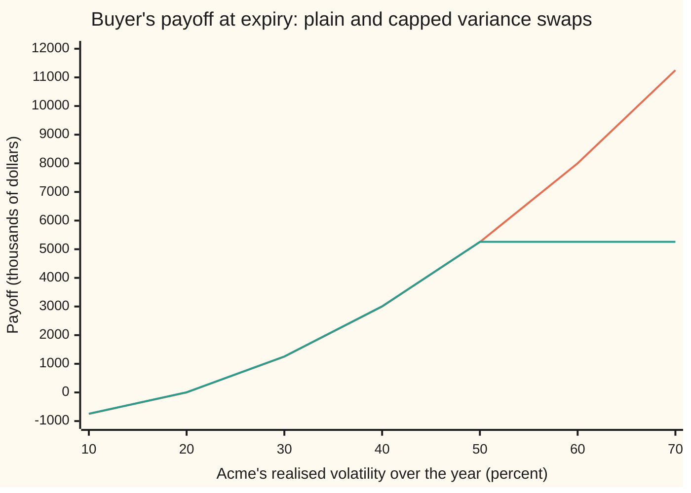
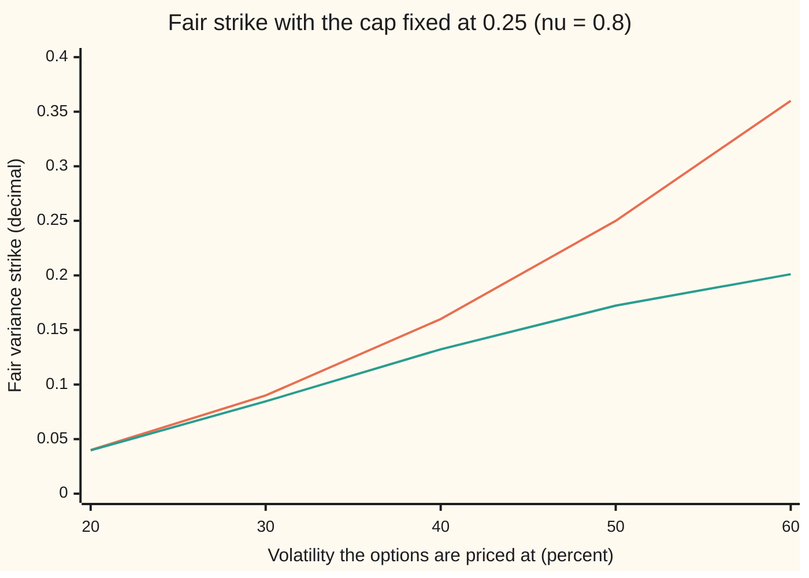

# Capped and corridor variance: the 2.5-times cap written into street variance swaps, and the strip that counts only days inside a corridor

[Syllabus](../../../SYLLABUS.md) → [Financial mathematics](../README.md) → [Variance swaps, the log contract and VIX](../README.md#s19) → Capped and corridor variance

---

## General Overview

Acme shares trade at $100, and every Acme option is priced at 20 percent volatility: the house market of this wing, with rates at 5 percent, dividends at 2 percent and one year to run. On [The variance swap](03-variance-swap-fair-strike.md), the fair strike of a one-year variance swap came out at **0.0400**, which is 20 percent squared. Sized at $100,000 per volatility point, that swap pays $100,000 ÷ (2 × 20) = $2,500 per variance point (a variance point is a volatility point squared: 20 vol is 400 variance points).

Now imagine the year turns into a crash and Acme's realised volatility comes in at 60 percent. The seller owes $2,500 × (3,600 − 400) = **$8.0 million**. Against losses like that, street variance swaps on single shares have long carried a **cap**: realised variance is counted up to 2.5 times the strike in volatility terms, at most. In variance terms that is 2.5² = 6.25 times: 6.25 × 0.04 = **0.25**, or 50 vol. The crash year then costs the seller $5.26 million instead. After the losses of 2008, index variance swaps took the same cap.

A second variation changes *which days count*. A **corridor variance swap** adds a day's squared move only if Acme closed the day before inside a price band, here **$80 to $120**. A **down variance swap** counts only days below a level. A fund that fears a slide but not a rally buys down variance. It pays only for the volatility it cares about.

Both get priced on this card:

- **The cap.** Its value needs one assumed number: how volatile realised variance itself is, here an assumed 0.8 (the $`\nu`$, "nu", of The formula). On Acme's market the cap is then worth 0.000282, so the capped swap's fair strike is 0.039718: the cap barely binds. In a market pricing Acme at 60 vol, with the cap still at 0.25, the capped contract is worth only 0.201142 of variance to its buyer, against 0.36 uncapped.
- **The corridor.** The 80-to-120 corridor's fair strike is 0.033645. It comes from the same option strip as the plain swap, cut off at the corridor's edges.

**A cap makes the swap the plain swap minus a call on realised variance, and that call needs a model of how much variance itself can move; a corridor stays model-free, because counting only the days inside a band is the same as holding only the options struck inside it.**

**What kind of fact this is:** the corridor price is a theorem, proved on this card in Why it works, for price paths without jumps watched continuously. The cap's split into "plain minus a call" is algebra. The call's dollar value is a model: realised variance is *assumed* lognormal (its log follows a bell curve), which fits well enough and is not a law. The 2.5 multiple is a market convention written into the term sheet.

### The picture: what the cap takes away

Realised volatility across, the buyer's payoff in thousands of dollars up, at $2,500 per variance point. The plain swap is struck at 0.04 and the capped swap at its own fair strike, 0.039718.



Orange: the plain swap. Green: the capped swap. Up to 50 vol the two lines sit $7,050 apart, the small discount the capped buyer gets for giving up the tail. Past 50 vol the green line goes flat at $5,257,050.

---

## The formula

Notation first, in words. $`V`$ is realised variance over the year as a decimal, measured as on [Realised variance](01-realised-variance-from-daily-prices.md): the sum of squared daily log returns $`x_i`$ (the natural log of each close over the one before), per year. $`\mathbb{E}`$ is the average in the pricing world, where every asset earns the bank rate. A superscript plus means "keep it if positive, otherwise zero". $`\mathbf{1}\{\cdot\}`$ is an **indicator**: 1 when the statement in the braces is true, 0 when it is false.

**The capped swap** pays $`N_{var}\,(\min(V, V_{cap}) - K_{cap})`$, and since $`\min(V, V_{cap}) = V - (V - V_{cap})^+`$, its fair strike is the plain one less a call on realised variance:

```math
K_{cap} = K_{var} - \mathbb{E}\bigl[(V - V_{cap})^+\bigr], \qquad \mathbb{E}\bigl[(V - V_{cap})^+\bigr] = K_{var}\,N(d_1) - V_{cap}\,N(d_2), \qquad d_1 = \frac{\ln(K_{var}/V_{cap}) + \tfrac12\nu^2}{\nu}, \quad d_2 = d_1 - \nu
```

**Read it aloud:** the capped strike is the plain strike minus the value at expiry of a call on realised variance struck at the cap; if variance is lognormal with volatility $`\nu`$, that call has a Black–Scholes-shaped formula.

**The corridor swap** counts a day only if yesterday's forward price $`F_{i-1}`$ was inside the band, and its fair strike is the plain strip with the strikes outside the band thrown away:

```math
V_{L,U} = \frac1T\sum_i x_i^2\,\mathbf{1}\{L \le F_{i-1} \le U\}, \qquad K_{L,U} = \frac{2\,e^{rT}}{T}\int_L^U \frac{Q(K)}{K^2}\,dK, \qquad Q(K) = \begin{cases} P(K) & K < F \\ C(K) & K \ge F \end{cases}
```

**Read it aloud:** corridor variance adds up only the squared moves made from inside the band; its fair strike is the cost of the out-of-the-money options struck inside the band, one over strike squared each, grown to expiry and scaled by two over T.

Down variance below a level $`H`$ is the corridor with $`L = 0`$ and $`U = H`$. Up variance above $`H`$ is the corridor from $`H`$ to infinity. Down and up together are the plain swap.

| Symbol | Plain meaning | In our example | Push it up and the answer… |
| --- | --- | --- | --- |
| $`V`$, $`V_{cap}`$ | realised variance over the year; the cap on it, $`2.5^2 K_{var}`$ | 0.04 on average, 0.36 in a crash; cap 0.25 | the capped buyer gains until $`V`$ reaches the cap, then nothing |
| $`K_{var}`$, $`K_{cap}`$ | fair strikes of the plain and the capped swap | 0.040000; 0.039718 | — |
| $`\nu`$ | volatility of realised variance: the standard deviation of $`\ln V`$ over the year, an assumed number | 0.8 | the call is worth more, so $`K_{cap}`$ falls |
| $`N(\cdot)`$, $`d_1`$, $`d_2`$ | the standard normal CDF (the chance a bell-curve draw lands below a number); the two arguments above | $`d_1 = -1.890727`$, $`d_2 = -2.690727`$ | — |
| $`N_{var}`$, $`x_i`$ | variance notional, dollars per variance point; the share's daily log return on day $`i`$ | $2,500; unknown today | every payoff scales with $`N_{var}`$ |
| $`L`$, $`U`$, $`H`$ | the corridor's lower and upper edges; the down-variance level | $80, $120; $`H = F`$ | a wider band counts more days, so $`K_{L,U}`$ rises |
| $`S`$, $`S_T`$, $`F`$, $`F_t`$, $`F_{i-1}`$, $`y`$ | Acme today and at expiry; the forward price $`S e^{(r-q)T}`$, the forward at time $`t`$, and at yesterday's close; any price, as the input of $`g`$ | $100, unknown; $103.05, then wanders | $`F`$ is where puts hand over to calls |
| $`\sigma`$, $`\sigma_t`$, $`dt`$ | the volatility the options are priced at; the volatility at moment $`t`$ along a path; a short time step | 20%; 20% in the corridor simulation | corridor and plain strikes rise as $`\sigma^2`$ |
| $`\mathbf{1}\{\cdot\}`$, $`\Pr`$, $`\mathbb{E}`$ | indicator; the chance of an event and the average, both in the pricing world | — | — |
| $`K_{L,U}`$, $`V_{L,U}`$ | the corridor's fair strike; the corridor variance actually counted | 0.033645; unknown today | — |
| $`K`$, $`Q(K)`$, $`P(K)`$, $`C(K)`$ | a strike; the out-of-the-money option there, a put below $`F`$ and a call above | put 95: $4.285456; call 105: $6.986920 | dearer options, higher strike |
| $`r`$, $`q`$, $`T`$; $`g`$, $`c`$, $`J`$ | bank rate, dividend yield, years to expiry; the corridor log payoff of Why it works and its two helpers | 5%, 2%, 1 | $`e^{rT}`$ grows the strip's cost to expiry |


### When it holds

- **No jumps, for the corridor.** The strip earns the corridor variance only along a continuous path. A jump across the edge, or inside the band, breaks the match in the way [The volatility swap and the jump bias](05-volatility-swap-and-jump-bias.md) measures for the plain swap.
- **The band is checked on the forward, continuously.** Term sheets check the closing *share* price, which sits below the forward by the carry still to come. Here that raises the fair strike by 0.000301, because the share starts nearer the middle of the band than the forward does; for other bands the shift can go either way. Checking once a day also leaks a little at every crossing of an edge: the worst of 4,000 simulated years was off by 0.004236.
- **Options at every strike inside the band.** Four options, one per $10 of the corridor, give 0.033942 against the full 0.033645.
- **A model for the cap.** The cap is a call on the whole year's variance, and no options at one expiry span it. With no volatility of variance at all (constant 20 vol), not one of 4,000 simulated years reached the cap, and the cap is worth zero. The value depends on $`\nu`$: at 1.2 instead of 0.8 the capped strike falls to 0.037099.
- **Cap fixed in advance.** A term sheet sets the cap at 6.25 times the capped swap's own strike, which is a loop: solving it gives 0.039711 instead of 0.039718.

---

## Why it works

### Step 0: curvature only inside the band

The plain swap works because the log contract has a flat **dollar gamma** (the share price squared times gamma, the rate at which a hedge must change). A flat dollar gamma earns every squared move equally, wherever the price is. On [Any payoff from a strip of options](02-carr-madan-spanning-and-the-log-contract.md), that curvature *is* the options: one over strike squared of each.

So cut the curvature off outside the band. Keep the one-over-strike-squared weights for strikes from $80 to $120, and hold nothing outside. The position's dollar gamma is flat inside the band and zero outside. It earns squared moves only while the price is inside. That is corridor variance.

The cap needs one line of algebra and then a model. Counting variance up to a ceiling is the same as counting all of it and selling back everything above the ceiling. That sold-back part is a call on realised variance.

### Step 1: the corridor log contract earns corridor variance, path by path

Define a payoff $`g`$ by three rules: its curvature is $`g''(y) = 2/y^2`$ inside $`[L, U]`$ and zero outside, and $`g(F) = g'(F) = 0`$. The forward is used rather than the share so that interest and dividends drop out. [Ito's lemma](../../11-Stochastic%20processes%20and%20calculus/06-Ito%20Calculus/02-itos-lemma.md) gives the change in $`g(F_t)`$ as a slope term plus half the curvature times the squared move, where the squared move of the forward over a short time $`dt`$ is $`F_t^2\sigma_t^2\,dt`$:

```math
g(F_T) = \int_0^T g'(F_t)\,dF_t + \tfrac12\int_0^T g''(F_t)\,F_t^2\,\sigma_t^2\,dt = \int_0^T g'(F_t)\,dF_t + \int_0^T \mathbf{1}\{L \le F_t \le U\}\,\sigma_t^2\,dt
```

The curvature $`2/F_t^2`$ cancels the $`F_t^2`$ exactly, leaving 1 inside the band and 0 outside. Rearranged, corridor variance is a trading strategy:

```math
\frac1T\int_0^T \mathbf{1}\{L \le F_t \le U\}\,\sigma_t^2\,dt = \frac1T\Bigl[g(F_T) - \int_0^T g'(F_t)\,dF_t\Bigr]
```

Hold the payoff $`g`$ to expiry, and each day short $`g'(F_t)`$ forward contracts. Nothing assumes what the volatility $`\sigma_t`$ is. The code runs this on 4,000 simulated years of daily prices. The hedge and the counted corridor variance differ by at most 0.004236 on any year, and by at most 0.003910 for down variance. Most of that comes from days that cross an edge: the daily count takes the whole move or none of it, while the curvature switches on or off partway through the move.

<details>
<summary>The corridor log payoff in closed form</summary>

Write $`c(y)`$ for a price $`y`$ clamped into the band: $`L`$ if $`y < L`$, $`U`$ if $`y > U`$, otherwise $`y`$. Integrating the curvature once from $`F`$ gives the slope:

$`\displaystyle g'(y) = 2\Bigl(\frac{1}{c(F)} - \frac{1}{c(y)}\Bigr)`$

Integrating again gives $`g(y) = 2\bigl[(y - F)/c(F) - (J(y) - J(F))\bigr]`$, where $`J(y)`$ is $`\ln(y/L)`$ inside the band, $`(y - L)/L`$ below it, and $`\ln(U/L) + (y - U)/U`$ above it. With $`L = 0`$ and $`U`$ infinite, $`c(y) = y`$ and $`g`$ becomes $`2[(y - F)/F - \ln(y/F)]`$, the plain swap's hedged log contract. The code uses these two formulas for the hedge.

</details>

### Step 2: price the strategy with the strip cut to the band

The forward contracts cost nothing and, in the pricing world, gain nothing on average. So the fair corridor strike is $`\tfrac1T\mathbb{E}[g(S_T)]`$, which is $`e^{rT}/T`$ times today's price of $`g`$.

The spanning formula prices $`g`$: its value at the forward, plus its slope there times a forward, plus each option weighted by the curvature at its strike. The first two are zero by construction. The curvature is $`2/K^2`$ inside the band and zero outside. So $`g`$ is exactly the out-of-the-money options struck from $`L`$ to $`U`$, each held $`2/K^2`$ times. That is the formula. The log-contract derivation of the earlier card is not repeated; only the range of strikes changes.

If the band lies wholly below the forward, as for down variance with $`H = F`$, only puts are left. Here down variance is 0.021063 and up variance 0.018937, and they add back to 0.040000. Down is the larger half because one over strike squared leans on low strikes.

The bars show where Acme's plain strike comes from: each $10 band of strikes and its share of the 0.04, in thousandths. The corridor keeps the four middle bands.

```
strikes    corridor   contribution to the fair variance (x 1000)
   50-60   outside                                0.03
   60-70   outside    █                           0.32
   70-80   outside    ███                         1.57
   80-90   inside     █████████                   4.72
  90-100   inside     ████████████████████       10.05
 100-110   inside     █████████████████████████  12.71
 110-120   inside     ████████████                6.17
 120-130   outside    █████                       2.65
 130-140   outside    ██                          1.09
 140-150   outside    █                           0.43
 150-160   outside                                0.17
```

The four inside bands add to 33.65 thousandths: the corridor strike, 0.033645.

### Step 3: a second road, time spent inside

When volatility is a constant 20 percent, the right side of Step 1 has a plain meaning. Corridor variance is $`\sigma^2`$ times the fraction of the year the forward spends inside the band. So its fair value is

```math
K_{L,U} = \sigma^2 \cdot \frac1T\int_0^T \Pr\bigl(L \le F_t \le U\bigr)\,dt
```

In the pricing world, $`\ln F_t`$ follows a bell curve with average $`\ln F - \tfrac12\sigma^2 t`$ and variance $`\sigma^2 t`$, so each chance is two normal CDF values. This road uses no options at all. It returns 0.033645, the strip's number. The forward spends 0.841125 of the year inside the band on average, and $`0.04 \times 0.841125`$ is the corridor strike. Down variance agrees the same way: 0.021063 both roads.

### Step 4: the cap is the plain swap minus a call

$`\min(V, V_{cap}) = V - (V - V_{cap})^+`$ holds for every number $`V`$: below the cap the call pays nothing, above it the call takes back the excess. Average both sides and the capped strike is $`K_{var}`$ minus the call's expiry value.

The call's value depends on how spread out $`V`$ is, and the option strip says nothing about that. On a perfectly flat surface, the consistent model is constant volatility. Then the year's realised variance stays near 0.04: none of 4,000 simulated years reached 0.25, and the cap is worth nothing. Desks don't believe that. They take realised variance to be lognormal around the plain strike, with a volatility of variance $`\nu`$ judged from history or from options on volatility. It is not the 80% vol of VIX of [VIX futures and options](07-vix-futures-and-vix-options.md) read straight across. That 80% moves the VIX, the square root of a 30-day variance price, so the log of that price moves twice as much; a year's realised variance is an average over 252 days and spreads less. Neither maps one-to-one onto $`\nu`$, so the 0.8 here is an assumption, not a market reading. The lognormal assumption gives the Black–Scholes shape in the formula, with $`K_{var}`$ in place of the forward and $`V_{cap}`$ in place of the strike.

With $`\nu = 0.8`$ the code prices the call three ways. The formula gives 0.000282. Integrating the payoff against the bell curve gives 0.000282. Simulating 4,000 years, each drawing its own variance and then 252 daily moves, gives 0.000405 with a standard error of 0.000158, within one standard error.

The same cap in a market at 60 vol tells the other half of the story. The call is worth 0.158858 (simulated 0.160801, standard error 0.004942). The capped strike is 0.201142: the cap has taken 0.158858 off the plain swap's 0.36. The chart shows the capped strike as the whole market's volatility rises with the cap fixed at 0.25.



Orange: the plain strike, the market's volatility squared. Green: the capped strike. At 20 vol the lines touch. By 50 vol, where the plain strike equals the cap, the capped swap is worth only 0.1723.

---

## Worked numbers, by hand

The corridor first, with one option for every $10 of the band. The cap second, at Acme's 20 vol with $`\nu = 0.8`$.

| Step | Arithmetic | Value |
| --- | --- | --- |
| put at 85, below the forward | Black–Scholes at 20% | $1.587157 |
| put at 95 | Black–Scholes at 20% | $4.285456 |
| call at 105, above the forward | Black–Scholes at 20% | $6.986920 |
| call at 115 | Black–Scholes at 20% | $3.783158 |
| weighted options | 10/85² × 1.587157, 10/95² × 4.285456, 10/105² × 6.986920, 10/115² × 3.783158 | 0.002197, 0.004748, 0.006337, 0.002861 |
| strip cost | sum of the four | 0.016143 |
| scale | 2 × e^0.05 / 1 | 2.102542 |
| four-option corridor strike | 2.102542 × 0.016143 | **0.033942** |
| the full strip, 80 to 120 | Simpson's rule over every strike | **0.033645** |
| d1 | (ln(0.04 / 0.25) + 0.32) / 0.8 | −1.890727 |
| d2 | −1.890727 − 0.8 | −2.690727 |
| N(d1), N(d2) | normal CDF | 0.029330, 0.003565 |
| call on variance | 0.04 × 0.029330 − 0.25 × 0.003565 | 0.000282 |
| capped fair strike | 0.04 − 0.000282 | **0.039718** |

Four options already land close to the full corridor strike, 0.033645, which is 18.34 vol, against 20 for the plain swap. The cap shaves 0.000282 off the strike, leaving 0.039718, which is 19.93 vol. At $2,500 per variance point that is the $7,050 gap between the two lines in the overview's chart.

### What breaks if you drop a piece

| Mistake | Comes out at | What went wrong |
| --- | --- | --- |
| Price the corridor with the whole strip | 0.040000 against 0.033645 | Options outside the band pay for days the contract does not count. |
| Use calls across the whole band, with no switch at the forward | 0.103494 | Calls struck from $80 to $103.05 are in the money; their intrinsic value is not variance. |
| Price the cap from the flat surface alone | 0.040000 against 0.039718 | Constant volatility leaves realised variance no room to reach the cap, so the call looks free. |
| Price a share-price corridor with the forward strip | 0.033645, short by 0.000301 | Here the share sits nearer the middle of the band than the forward does, so it spends a little longer inside; for other bands the shift can go either way. |

---

## Code, from first principles, and it actually runs

Both programs take three roads to each answer. For the corridor: Road 1 integrates the strip over the band's strikes only, by Simpson's rule in log-strike. Road 2 is the time-inside formula of Step 3, with no options. Road 3 simulates 4,000 years of daily prices and, on each, counts corridor and down variance and runs the hedge of Step 1. For the cap: the Black-shaped formula, a direct integral against the bell curve, and a simulation of 4,000 years in which each year draws its own variance. The programs also print the worked example, the what-breaks numbers, the bars and the chart points. The normal CDF is a written-out series; the random numbers come from a written-out generator (splitmix64 with the Box-Muller transform).

### Python

```python
from math import exp, log, sqrt, pi, cos
S, r, q, sig, T = 100.0, 0.05, 0.02, 0.20, 1.0            # the house market
F, G = S * exp((r - q) * T), exp(r * T)                    # forward; growth from today to expiry
M64 = (1 << 64) - 1
def N(x):                        # normal CDF from the erf series that converges everywhere
    z = abs(x) / sqrt(2.0)
    term, total, n = z, z, 0
    while z <= 9.0 and term > 1e-17 * total:
        n += 1
        term *= 2.0 * z * z / (2 * n + 1)
        total += term
    e = 1.0 if z > 9.0 else 2.0 / sqrt(pi) * exp(-z * z) * total
    return 0.5 * (1.0 + e) if x >= 0 else 0.5 * (1.0 - e)
def bs(K, v=sig):                # Black-Scholes call and put on Acme with the house r, q, T
    sd = v * sqrt(T)
    d1 = (log(S / K) + (r - q + 0.5 * v * v) * T) / sd
    return (S * exp(-q * T) * N(d1) - K * exp(-r * T) * N(d1 - sd),
            K * exp(-r * T) * N(sd - d1) - S * exp(-q * T) * N(-d1))
def simpson(f, a, b, n=2000):
    h = (b - a) / n
    return h / 3 * (f(a) + f(b) + sum((4 if i % 2 else 2) * f(a + i * h) for i in range(1, n)))
def strip(lo, hi, calls_only=False):   # road 1: 2e^{rT}/T times the 1/K^2 strip on strikes lo..hi only
    def g(k):                          # in log-strike k = ln K:  Q(K)/K^2 dK = Q(K)/K dk
        c, p = bs(exp(k))
        return (c if calls_only or k >= log(F) else p) / exp(k)
    cuts = [log(lo), log(F), log(hi)] if lo < F < hi and not calls_only else [log(lo), log(hi)]
    return 2.0 * G / T * sum(simpson(g, x, y) for x, y in zip(cuts, cuts[1:]))
def occupancy(lo, hi, on_share=False):   # road 2: sigma^2 times the year's average chance of being inside
    def p(u):                            # time t = u^2, which keeps Simpson smooth near t = 0
        t = u * u
        sd, mu = sig * sqrt(t), log(F) - 0.5 * sig * sig * t
        sh = (r - q) * (T - t) if on_share else 0.0     # share inside [lo, hi] = forward inside, grown
        return 2.0 * u * (N((log(hi) + sh - mu) / sd) - N((log(lo) + sh - mu) / sd))
    return sig * sig * simpson(p, 1e-9, sqrt(T), 400) / T
def black_var(m, C, w):          # call on realised variance: lognormal, mean m, volatility of variance w
    d1 = (log(m / C) + 0.5 * w * w) / w
    return m * N(d1) - C * N(d1 - w)
def simpson_var(m, C, w):        # the same call, integrating the payoff against the bell curve
    f = lambda z: (m * exp(w * z - 0.5 * w * w) - C) * exp(-0.5 * z * z) / sqrt(2 * pi)
    return simpson(f, (log(C / m) + 0.5 * w * w) / w, 12.0, 4000)
st = [0x2545F4914F6CDD1D]
def u01():                       # splitmix64, a written-out generator of uniform numbers
    st[0] = (st[0] + 0x9E3779B97F4A7C15) & M64
    z = ((st[0] ^ (st[0] >> 30)) * 0xBF58476D1CE4E5B9) & M64
    z = ((z ^ (z >> 27)) * 0x94D049BB133111EB) & M64
    return (((z ^ (z >> 31)) >> 11) + 0.5) / 2.0 ** 53
gauss = lambda: sqrt(-2.0 * log(u01())) * cos(2.0 * pi * u01())   # Box-Muller: two uniforms, one bell draw
def mean_se(a):
    m = sum(a) / len(a)
    return m, sqrt(sum((x - m) ** 2 for x in a) / (len(a) - 1) / len(a))
clamp = lambda x, lo, hi: min(max(x, lo), hi)
def gfun(x, lo, hi):             # corridor log contract: curvature 2/x^2 inside, none outside, flat at F
    J = lambda y: (y - lo) / lo if y < lo else (log(y / lo) if y <= hi else log(hi / lo) + (y - hi) / hi)
    return 2.0 * ((x - F) / clamp(F, lo, hi) - (J(x) - J(F)))
def gslope(x, lo, hi):
    return 2.0 * (1.0 / clamp(F, lo, hi) - 1.0 / clamp(x, lo, hi))
BOOKS = [(80.0, 120.0), (1e-9, F)]     # the corridor; down variance, below today's forward
def simulate(paths, days=252):   # road 3: daily paths at 20%, corridor variance and its hedge
    dt, out = T / days, [[] for _ in range(6)]
    for _ in range(paths):
        f, cv, pl, cs, rv = F, [0.0, 0.0], [0.0, 0.0], 0.0, 0.0
        for i in range(days):
            y = -0.5 * sig * sig * dt + sig * sqrt(dt) * gauss()   # the forward's daily log move
            x2 = (y + (r - q) * dt) ** 2 / T                        # the share's, squared, per year
            rv += x2
            for j, (lo, hi) in enumerate(BOOKS):
                cv[j] += x2 if lo <= f <= hi else 0.0               # counted if yesterday was inside
                pl[j] -= gslope(f, lo, hi) * (f * exp(y) - f)       # the daily forward hedge
            cs += x2 if 80.0 <= f * exp(-(r - q) * (T - i * dt)) <= 120.0 else 0.0
            f *= exp(y)
        for j, (lo, hi) in enumerate(BOOKS):
            out[2 * j].append(cv[j])
            out[2 * j + 1].append((gfun(f, lo, hi) + pl[j]) / T)
        out[4].append(cs - cv[0])
        out[5].append(rv)
    return out
def simulate_cap(paths, m, w, C, days=252):   # road 3 for the cap: each year draws its own variance
    dt, rvs = T / days, []
    for _ in range(paths):
        v = sqrt(m * exp(w * gauss() - 0.5 * w * w))
        rvs.append(sum((-0.5 * v * v * dt + v * sqrt(dt) * gauss() + (r - q) * dt) ** 2 for _ in range(days)) / T)
    return mean_se([min(x, C) for x in rvs]) + mean_se([max(x - C, 0.0) for x in rvs])
plain, L, U, W, CAP = strip(F * exp(-4.0), F * exp(4.0)), 80.0, 120.0, 0.8, 2.5 ** 2 * 0.04
corr, corr_occ, down, down_occ = strip(L, U), occupancy(L, U), strip(F * exp(-4.0), F), occupancy(1e-9, F)
up, shift = strip(F, F * exp(4.0)), occupancy(L, U, True) - occupancy(L, U)
sim = simulate(4000)
(c_m, c_se), (d_m, d_se), (sh_m, sh_se) = mean_se(sim[0]), mean_se(sim[2]), mean_se(sim[4])
gaps = [max(abs(a - b) for a, b in zip(sim[k], sim[k + 1])) for k in (0, 2)]
above = sum(1 for x in sim[5] if x > CAP)
c20, c20s, c60, c60s = black_var(0.04, CAP, W), simpson_var(0.04, CAP, W), black_var(0.36, CAP, W), simpson_var(0.36, CAP, W)
kc = 0.04
for _ in range(60):              # term sheet: the cap is 2.5^2 times the capped swap's own strike
    kc = 0.04 - black_var(0.04, 6.25 * kc, W)
s20, s20e, t20, t20e = simulate_cap(4000, 0.04, W, CAP)
s60, s60e, t60, t60e = simulate_cap(4000, 0.36, W, CAP)
hand = [10.0 / K ** 2 * (bs(K)[1] if K < F else bs(K)[0]) for K in (85.0, 95.0, 105.0, 115.0)]
def out(name, *vals):
    print(f"{name:<52}" + "".join(f"{v:>11.6f}" for v in vals))
out("forward F", F)
out("plain strip, fair variance", plain)
out("corridor 80-120: strip, occupation, sim, se", corr, corr_occ, c_m, c_se)
out("  worst path gap; as a vol, percent; share of plain", gaps[0], 100 * sqrt(corr), corr / plain)
out("down variance: strip, occupation, sim, se", down, down_occ, d_m, d_se)
out("  worst path gap; up variance; down + up", gaps[1], up, down + up)
out("cap; constant 20%: years above it", CAP, above)
out("at 20: call on variance, Simpson, sim, se", c20, c20s, t20, t20e)
out("  capped strike, sim, se; as a vol", 0.04 - c20, s20, s20e, 100 * sqrt(0.04 - c20))
d1 = (log(0.04 / CAP) + 0.5 * W * W) / W
out("  d1, d2, N(d1), N(d2)", d1, d1 - W, N(d1), N(d1 - W))
out("  cap set off the capped strike itself", kc)
out("at 60: call on variance, Simpson, sim, se", c60, c60s, t60, t60e)
out("  capped strike, sim, se", 0.36 - c60, s60, s60e)
out("by hand: P85, P95, C105, C115", *[(bs(K)[1] if K < F else bs(K)[0]) for K in (85.0, 95.0, 105.0, 115.0)])
out("  each times 10/K^2", *hand)
out("  sum; 2 e^rT / T; product", sum(hand), 2.0 * G / T, 2.0 * G / T * sum(hand))
out("wrong: calls across the corridor", strip(L, U, True))
out("share-price corridor less forward: formula, sim, se", shift, sh_m, sh_se)
out("try: corridor 90-110; w = 1.2 capped strike", strip(90.0, 110.0), 0.04 - black_var(0.04, CAP, 1.2))
print(f"{"strike band x1000":<18}" + "".join(f"{a:>4.0f}-{a + 10:<3.0f}" for a in range(50, 160, 10)))
print(f"{"  contribution":<18}" + "".join(f"{1000 * strip(a, a + 10.0):>8.2f}" for a in range(50, 160, 10)))
print(f"{"market vol, pct":<18}" + "".join(f"{v:>8.0f}" for v in (20, 30, 40, 50, 60)))
print(f"{"  plain strike":<18}" + "".join(f"{v * v / 1e4:>8.4f}" for v in (20, 30, 40, 50, 60)))
print(f"{"  capped strike":<18}" + "".join(f"{v * v / 1e4 - black_var(v * v / 1e4, CAP, W):>8.4f}" for v in (20, 30, 40, 50, 60)))
print(f"{"realised vol":<18}" + "".join(f"{v:>8.0f}" for v in (10, 20, 30, 40, 50, 60, 70)))
print(f"{"  plain, $000":<18}" + "".join(f"{2.5 * (v * v - 400):>8.1f}" for v in (10, 20, 30, 40, 50, 60, 70)))
print(f"{"  capped, $000":<18}" + "".join(f"{2.5 * (min(v * v, 2500) - 1e4 * (0.04 - c20)):>8.2f}" for v in (10, 20, 30, 40, 50, 60, 70)))
assert abs(plain - sig * sig) < 1e-9, "the full strip returns the flat surface's variance"
assert abs(corr - corr_occ) < 1e-6 and abs(down - down_occ) < 1e-6, "restricted strip = variance x time inside"
assert abs(c_m - corr) < 4 * c_se and abs(d_m - down) < 4 * d_se, "simulated corridor variance averages to the strip"
assert gaps[0] < 0.006 and gaps[1] < 0.006, "the corridor hedge tracks corridor variance path by path"
assert abs(sh_m - shift) < 4 * sh_se + 1e-5, "the share-price corridor shift matches its formula"
assert abs(c20 - c20s) < 1e-8 and abs(c60 - c60s) < 1e-8, "Black on variance = direct integral"
assert abs(t20 - c20) < 4 * t20e + 2e-5 and abs(t60 - c60) < 4 * t60e + 2e-3, "simulated cap value agrees"
assert abs(s60 - (0.36 - c60)) < 4 * s60e + 2e-3, "capped strike = plain minus the call"
assert above == 0, "with no volatility of variance the cap never binds"
print("ALL CHECKS PASS")
```

**Ran 2026-11-23 on macOS, Python 3.14.10, standard library only. All checks passed. Output, pasted from the run:**

```
forward F                                            103.045453
plain strip, fair variance                             0.040000
corridor 80-120: strip, occupation, sim, se            0.033645   0.033645   0.033498   0.000146
  worst path gap; as a vol, percent; share of plain    0.004236  18.342576   0.841125
down variance: strip, occupation, sim, se              0.021063   0.021063   0.021194   0.000226
  worst path gap; up variance; down + up               0.003910   0.018937   0.040000
cap; constant 20%: years above it                      0.250000   0.000000
at 20: call on variance, Simpson, sim, se              0.000282   0.000282   0.000405   0.000158
  capped strike, sim, se; as a vol                     0.039718   0.040810   0.000584  19.929373
  d1, d2, N(d1), N(d2)                                -1.890727  -2.690727   0.029330   0.003565
  cap set off the capped strike itself                 0.039711
at 60: call on variance, Simpson, sim, se              0.158858   0.158858   0.160801   0.004942
  capped strike, sim, se                               0.201142   0.201725   0.001012
by hand: P85, P95, C105, C115                          1.587157   4.285456   6.986920   3.783158
  each times 10/K^2                                    0.002197   0.004748   0.006337   0.002861
  sum; 2 e^rT / T; product                             0.016143   2.102542   0.033942
wrong: calls across the corridor                       0.103494
share-price corridor less forward: formula, sim, se    0.000301   0.000304   0.000021
try: corridor 90-110; w = 1.2 capped strike            0.022758   0.037099
strike band x1000   50-60   60-70   70-80   80-90   90-100 100-110 110-120 120-130 130-140 140-150 150-160
  contribution        0.03    0.32    1.57    4.72   10.05   12.71    6.17    2.65    1.09    0.43    0.17
market vol, pct         20      30      40      50      60
  plain strike      0.0400  0.0900  0.1600  0.2500  0.3600
  capped strike     0.0397  0.0846  0.1323  0.1723  0.2011
realised vol            10      20      30      40      50      60      70
  plain, $000       -750.0     0.0  1250.0  3000.0  5250.0  8000.0 11250.0
  capped, $000     -742.95    7.05 1257.05 3007.05 5257.05 5257.05 5257.05
ALL CHECKS PASS
```

### Rust

```rust
// Capped and corridor variance swaps -- the check behind the card. std only.
use std::f64::consts::PI;
const S: f64 = 100.0; const R: f64 = 0.05; const Q: f64 = 0.02; const SIG: f64 = 0.20; const T: f64 = 1.0;
fn fwd() -> f64 { S * ((R - Q) * T).exp() } fn growth() -> f64 { (R * T).exp() }
fn n(x: f64) -> f64 { // normal CDF from the erf series that converges everywhere
    let z = x.abs() / 2f64.sqrt();
    let (mut term, mut total, mut k) = (z, z, 0.0);
    while z <= 9.0 && term > 1e-17 * total {
        k += 1.0;
        term *= 2.0 * z * z / (2.0 * k + 1.0);
        total += term;
    }
    let e = if z > 9.0 { 1.0 } else { 2.0 / PI.sqrt() * (-z * z).exp() * total };
    if x >= 0.0 { 0.5 * (1.0 + e) } else { 0.5 * (1.0 - e) }
}
fn bs(k: f64) -> (f64, f64) { // Black-Scholes call and put on Acme with the house r, q, T
    let sd = SIG * T.sqrt();
    let d1 = ((S / k).ln() + (R - Q + 0.5 * SIG * SIG) * T) / sd;
    (S * (-Q * T).exp() * n(d1) - k * (-R * T).exp() * n(d1 - sd),
     k * (-R * T).exp() * n(sd - d1) - S * (-Q * T).exp() * n(-d1))
}
fn otm(k: f64) -> f64 { let (c, p) = bs(k); if k < fwd() { p } else { c } }
fn simpson(f: &dyn Fn(f64) -> f64, a: f64, b: f64, m: usize) -> f64 {
    let h = (b - a) / m as f64;
    h / 3.0 * (f(a) + f(b) + (1..m).map(|i| (if i % 2 == 1 { 4.0 } else { 2.0 }) * f(a + i as f64 * h)).sum::<f64>())
}
fn strip(lo: f64, hi: f64, calls_only: bool) -> f64 { // road 1: the 1/K^2 strip on strikes lo..hi only
    let lf = fwd().ln();
    let g = |k: f64| { let (c, p) = bs(k.exp()); (if calls_only || k >= lf { c } else { p }) / k.exp() };
    let cuts = if lo < fwd() && fwd() < hi && !calls_only { vec![lo.ln(), lf, hi.ln()] } else { vec![lo.ln(), hi.ln()] };
    2.0 * growth() / T * cuts.windows(2).map(|w| simpson(&g, w[0], w[1], 2000)).sum::<f64>()
}
fn occupancy(lo: f64, hi: f64, on_share: bool) -> f64 { // road 2: sigma^2 times average chance inside
    let p = |u: f64| { // time t = u^2
        let (t, sh) = (u * u, if on_share { (R - Q) * (T - u * u) } else { 0.0 });
        let (sd, mu) = (SIG * t.sqrt(), fwd().ln() - 0.5 * SIG * SIG * t);
        2.0 * u * (n((hi.ln() + sh - mu) / sd) - n((lo.ln() + sh - mu) / sd))
    };
    SIG * SIG * simpson(&p, 1e-9, T.sqrt(), 400) / T
}
fn black_var(m: f64, c: f64, w: f64) -> f64 { // call on lognormal realised variance
    let d1 = ((m / c).ln() + 0.5 * w * w) / w;
    m * n(d1) - c * n(d1 - w)
}
fn simpson_var(m: f64, c: f64, w: f64) -> f64 {
    let f = |z: f64| (m * (w * z - 0.5 * w * w).exp() - c) * (-0.5 * z * z).exp() / (2.0 * PI).sqrt();
    simpson(&f, ((c / m).ln() + 0.5 * w * w) / w, 12.0, 4000)
}
struct Rng(u64);
impl Rng {
    fn u01(&mut self) -> f64 { // splitmix64
        self.0 = self.0.wrapping_add(0x9E3779B97F4A7C15);
        let mut z = (self.0 ^ (self.0 >> 30)).wrapping_mul(0xBF58476D1CE4E5B9);
        z = (z ^ (z >> 27)).wrapping_mul(0x94D049BB133111EB);
        (((z ^ (z >> 31)) >> 11) as f64 + 0.5) / 2f64.powi(53)
    }
    fn gauss(&mut self) -> f64 { let a = self.u01(); let b = self.u01(); (-2.0 * a.ln()).sqrt() * (2.0 * PI * b).cos() }
}
fn mean_se(a: &[f64]) -> (f64, f64) {
    let m = a.iter().sum::<f64>() / a.len() as f64;
    (m, (a.iter().map(|x| (x - m).powi(2)).sum::<f64>() / (a.len() - 1) as f64 / a.len() as f64).sqrt())
}
fn clamp(x: f64, lo: f64, hi: f64) -> f64 { x.max(lo).min(hi) }
fn gfun(x: f64, lo: f64, hi: f64) -> f64 { // corridor log contract: curvature 2/x^2 inside, flat at F
    let j = |y: f64| if y < lo { (y - lo) / lo } else if y <= hi { (y / lo).ln() } else { (hi / lo).ln() + (y - hi) / hi };
    2.0 * ((x - fwd()) / clamp(fwd(), lo, hi) - (j(x) - j(fwd())))
}
fn gslope(x: f64, lo: f64, hi: f64) -> f64 { 2.0 * (1.0 / clamp(fwd(), lo, hi) - 1.0 / clamp(x, lo, hi)) }
fn simulate(rng: &mut Rng, paths: usize, days: usize) -> Vec<Vec<f64>> { // road 3: corridor variance and hedge
    let books = [(80.0, 120.0), (1e-9, fwd())];
    let dt = T / days as f64;
    let mut out = vec![Vec::new(); 6];
    for _ in 0..paths {
        let (mut f, mut cv, mut pl, mut cs, mut rv) = (fwd(), [0.0; 2], [0.0; 2], 0.0, 0.0);
        for i in 0..days {
            let y = -0.5 * SIG * SIG * dt + SIG * dt.sqrt() * rng.gauss();
            let x2 = (y + (R - Q) * dt).powi(2) / T;
            rv += x2;
            for (j, &(lo, hi)) in books.iter().enumerate() {
                cv[j] += if lo <= f && f <= hi { x2 } else { 0.0 };
                pl[j] -= gslope(f, lo, hi) * (f * y.exp() - f);
            }
            let s_prev = f * (-(R - Q) * (T - i as f64 * dt)).exp();
            cs += if 80.0 <= s_prev && s_prev <= 120.0 { x2 } else { 0.0 };
            f *= y.exp();
        }
        for (j, &(lo, hi)) in books.iter().enumerate() {
            out[2 * j].push(cv[j]);
            out[2 * j + 1].push((gfun(f, lo, hi) + pl[j]) / T);
        }
        out[4].push(cs - cv[0]);
        out[5].push(rv);
    }
    out
}
fn simulate_cap(rng: &mut Rng, paths: usize, m: f64, w: f64, c: f64, days: usize) -> (f64, f64, f64, f64) {
    let dt = T / days as f64;
    let mut rvs = Vec::new();
    for _ in 0..paths {
        let v = (m * (w * rng.gauss() - 0.5 * w * w).exp()).sqrt();
        rvs.push((0..days).map(|_| (-0.5 * v * v * dt + v * dt.sqrt() * rng.gauss() + (R - Q) * dt).powi(2)).sum::<f64>() / T);
    }
    let (a, b) = (mean_se(&rvs.iter().map(|&x| x.min(c)).collect::<Vec<_>>()), mean_se(&rvs.iter().map(|&x| (x - c).max(0.0)).collect::<Vec<_>>()));
    (a.0, a.1, b.0, b.1)
}
fn out(name: &str, v: &[f64]) { println!("{:<52}{}", name, v.iter().map(|x| format!("{:>11.6}", x)).collect::<String>()); }
fn row(name: &str, v: &[f64], p: usize) { println!("{:<18}{}", name, v.iter().map(|x| format!("{:>8.*}", p, x)).collect::<String>()); }
fn main() {
    let f = fwd();
    let (l, u, w, cap) = (80.0, 120.0, 0.8, 2.5f64.powi(2) * 0.04);
    let plain = strip(f * (-4.0f64).exp(), f * 4.0f64.exp(), false);
    let (corr, corr_occ) = (strip(l, u, false), occupancy(l, u, false));
    let (down, down_occ) = (strip(f * (-4.0f64).exp(), f, false), occupancy(1e-9, f, false));
    let (up, shift) = (strip(f, f * 4.0f64.exp(), false), occupancy(l, u, true) - occupancy(l, u, false));
    let mut rng = Rng(0x2545F4914F6CDD1D);
    let sim = simulate(&mut rng, 4000, 252);
    let ((c_m, c_se), (d_m, d_se), (sh_m, sh_se)) = (mean_se(&sim[0]), mean_se(&sim[2]), mean_se(&sim[4]));
    let gap = |k: usize| sim[k].iter().zip(&sim[k + 1]).map(|(a, b)| (a - b).abs()).fold(0.0, f64::max);
    let gaps = [gap(0), gap(2)];
    let above = sim[5].iter().filter(|&&x| x > cap).count() as f64;
    let (c20, c20s, c60, c60s) = (black_var(0.04, cap, w), simpson_var(0.04, cap, w), black_var(0.36, cap, w), simpson_var(0.36, cap, w));
    let mut kc = 0.04;
    for _ in 0..60 { kc = 0.04 - black_var(0.04, 6.25 * kc, w); } // cap = 2.5^2 times the capped strike itself
    let (s20, s20e, t20, t20e) = simulate_cap(&mut rng, 4000, 0.04, w, cap, 252);
    let (s60, s60e, t60, t60e) = simulate_cap(&mut rng, 4000, 0.36, w, cap, 252);
    let ks = [85.0, 95.0, 105.0, 115.0];
    let hand: Vec<f64> = ks.iter().map(|&k| 10.0 / (k * k) * otm(k)).collect();
    let hs: f64 = hand.iter().sum();
    out("forward F", &[f]);
    out("plain strip, fair variance", &[plain]);
    out("corridor 80-120: strip, occupation, sim, se", &[corr, corr_occ, c_m, c_se]);
    out("  worst path gap; as a vol, percent; share of plain", &[gaps[0], 100.0 * corr.sqrt(), corr / plain]);
    out("down variance: strip, occupation, sim, se", &[down, down_occ, d_m, d_se]);
    out("  worst path gap; up variance; down + up", &[gaps[1], up, down + up]);
    out("cap; constant 20%: years above it", &[cap, above]);
    out("at 20: call on variance, Simpson, sim, se", &[c20, c20s, t20, t20e]);
    out("  capped strike, sim, se; as a vol", &[0.04 - c20, s20, s20e, 100.0 * (0.04 - c20).sqrt()]);
    let d1 = ((0.04 / cap).ln() + 0.5 * w * w) / w;
    out("  d1, d2, N(d1), N(d2)", &[d1, d1 - w, n(d1), n(d1 - w)]);
    out("  cap set off the capped strike itself", &[kc]);
    out("at 60: call on variance, Simpson, sim, se", &[c60, c60s, t60, t60e]);
    out("  capped strike, sim, se", &[0.36 - c60, s60, s60e]);
    out("by hand: P85, P95, C105, C115", &ks.iter().map(|&k| otm(k)).collect::<Vec<_>>());
    out("  each times 10/K^2", &hand);
    out("  sum; 2 e^rT / T; product", &[hs, 2.0 * growth() / T, 2.0 * growth() / T * hs]);
    out("wrong: calls across the corridor", &[strip(l, u, true)]);
    out("share-price corridor less forward: formula, sim, se", &[shift, sh_m, sh_se]);
    out("try: corridor 90-110; w = 1.2 capped strike", &[strip(90.0, 110.0, false), 0.04 - black_var(0.04, cap, 1.2)]);
    let bands: Vec<f64> = (0..11).map(|i| 50.0 + 10.0 * i as f64).collect();
    println!("{:<18}{}", "strike band x1000", bands.iter().map(|a| format!("{:>4.0}-{:<3.0}", a, a + 10.0)).collect::<String>());
    row("  contribution", &bands.iter().map(|&a| 1000.0 * strip(a, a + 10.0, false)).collect::<Vec<_>>(), 2);
    let mv = [20.0, 30.0, 40.0, 50.0, 60.0];
    row("market vol, pct", &mv, 0);
    row("  plain strike", &mv.iter().map(|v| v * v / 1e4).collect::<Vec<_>>(), 4);
    row("  capped strike", &mv.iter().map(|v| v * v / 1e4 - black_var(v * v / 1e4, cap, w)).collect::<Vec<_>>(), 4);
    let rvol = [10.0, 20.0, 30.0, 40.0, 50.0, 60.0, 70.0];
    row("realised vol", &rvol, 0);
    row("  plain, $000", &rvol.iter().map(|v| 2.5 * (v * v - 400.0)).collect::<Vec<_>>(), 1);
    row("  capped, $000", &rvol.iter().map(|v| 2.5 * ((v * v).min(2500.0) - 1e4 * (0.04 - c20))).collect::<Vec<_>>(), 2);
    assert!((plain - SIG * SIG).abs() < 1e-9, "the full strip returns the flat surface's variance");
    assert!((corr - corr_occ).abs() < 1e-6 && (down - down_occ).abs() < 1e-6, "restricted strip = variance x time inside");
    assert!((c_m - corr).abs() < 4.0 * c_se && (d_m - down).abs() < 4.0 * d_se, "simulated corridor variance averages to the strip");
    assert!(gaps[0] < 0.006 && gaps[1] < 0.006, "the corridor hedge tracks corridor variance path by path");
    assert!((sh_m - shift).abs() < 4.0 * sh_se + 1e-5, "the share-price corridor shift matches its formula");
    assert!((c20 - c20s).abs() < 1e-8 && (c60 - c60s).abs() < 1e-8, "Black on variance = direct integral");
    assert!((t20 - c20).abs() < 4.0 * t20e + 2e-5 && (t60 - c60).abs() < 4.0 * t60e + 2e-3, "simulated cap value agrees");
    assert!((s60 - (0.36 - c60)).abs() < 4.0 * s60e + 2e-3, "capped strike = plain minus the call");
    assert!(above == 0.0, "with no volatility of variance the cap never binds");
    println!("ALL CHECKS PASS");
}
```

**Ran 2026-11-23 on macOS, rustc 1.98.1, no crates. All checks passed. Output, pasted from the run:**

```
forward F                                            103.045453
plain strip, fair variance                             0.040000
corridor 80-120: strip, occupation, sim, se            0.033645   0.033645   0.033498   0.000146
  worst path gap; as a vol, percent; share of plain    0.004236  18.342576   0.841125
down variance: strip, occupation, sim, se              0.021063   0.021063   0.021194   0.000226
  worst path gap; up variance; down + up               0.003910   0.018937   0.040000
cap; constant 20%: years above it                      0.250000   0.000000
at 20: call on variance, Simpson, sim, se              0.000282   0.000282   0.000405   0.000158
  capped strike, sim, se; as a vol                     0.039718   0.040810   0.000584  19.929373
  d1, d2, N(d1), N(d2)                                -1.890727  -2.690727   0.029330   0.003565
  cap set off the capped strike itself                 0.039711
at 60: call on variance, Simpson, sim, se              0.158858   0.158858   0.160801   0.004942
  capped strike, sim, se                               0.201142   0.201725   0.001012
by hand: P85, P95, C105, C115                          1.587157   4.285456   6.986920   3.783158
  each times 10/K^2                                    0.002197   0.004748   0.006337   0.002861
  sum; 2 e^rT / T; product                             0.016143   2.102542   0.033942
wrong: calls across the corridor                       0.103494
share-price corridor less forward: formula, sim, se    0.000301   0.000304   0.000021
try: corridor 90-110; w = 1.2 capped strike            0.022758   0.037099
strike band x1000   50-60   60-70   70-80   80-90   90-100 100-110 110-120 120-130 130-140 140-150 150-160
  contribution        0.03    0.32    1.57    4.72   10.05   12.71    6.17    2.65    1.09    0.43    0.17
market vol, pct         20      30      40      50      60
  plain strike      0.0400  0.0900  0.1600  0.2500  0.3600
  capped strike     0.0397  0.0846  0.1323  0.1723  0.2011
realised vol            10      20      30      40      50      60      70
  plain, $000       -750.0     0.0  1250.0  3000.0  5250.0  8000.0 11250.0
  capped, $000     -742.95    7.05 1257.05 3007.05 5257.05 5257.05 5257.05
ALL CHECKS PASS
```

### Lean

Lean proves Steps 0, 2 and 4 of Why it works, for any band with $`0 < L \le U`$.

- Take the corridor log payoff $`g`$ in its closed form. Then $`g(F) = 0`$ and $`g'(F) = 0`$.
- Take any price $`y`$ other than $`L`$ and $`U`$. Then the dollar gamma $`y^2 g''(y)`$ is 2 inside the band and 0 outside it.
- Suppose prices at expiry are positive and average $`F`$, and each option costs $`e^{-rT}`$ times its average payoff. Then the fair corridor strike $`\tfrac1T\,\mathbb{E}[g(S_T)]`$ equals the formula's $`K_{L,U}`$, the strip cut to the band.
- Suppose realised variance $`V`$ has a finite average, and take any cap $`V_{cap}`$. Then $`\mathbb{E}[\min(V, V_{cap})] = \mathbb{E}[V] - \mathbb{E}[(V - V_{cap})^+]`$: the plain strike less the call.
- Take the overview's swap. Then $2,500 per variance point, the $8.0 million crash loss and the 0.25 cap all check.
- Take the call values 0.000282 and 0.158858, and the down and up variances, as given. Then the capped strikes 0.039718 and 0.201142 follow, and down plus up is 0.040000.

Step 1 (Ito's lemma), down variance's $`L = 0`$, the call's lognormal value and every computed number are left to the Python and Rust checks.

```lean
-- Capped and corridor variance: the corridor swap's fair strike is the one-over-strike-squared option strip cut to the band's strikes, the capped swap's fair strike is the plain one less a call on realised variance, and the corridor log payoff has dollar gamma 2 inside the band and 0 outside.
import Mathlib.MeasureTheory.Integral.IntervalIntegral.Basic
import Mathlib.MeasureTheory.Measure.Typeclasses.Probability
import Mathlib.Analysis.SpecialFunctions.Log.Basic
import Mathlib.Analysis.SpecialFunctions.Exp
import Mathlib.Analysis.Calculus.Deriv.Basic
import Mathlib.Tactic.NormNum
import Mathlib.Analysis.SpecialFunctions.Log.Deriv
import Mathlib.Analysis.Calculus.Deriv.Inv
import Mathlib.MeasureTheory.Integral.IntervalIntegral.FundThmCalculus
import Mathlib.MeasureTheory.Integral.Prod

open MeasureTheory

/-- The card's `c(y)`: a price `y` clamped into the band `[L, U]`. -/
noncomputable def bandClamp (L U y : ℝ) : ℝ := max L (min y U)

/-- The card's helper `J(y)`: `(y - L)/L` below the band, `ln(y/L)` inside it,
and `ln(U/L) + (y - U)/U` above it. -/
noncomputable def corridorJ (L U y : ℝ) : ℝ :=
  if y < L then (y - L) / L
  else if y ≤ U then Real.log (y / L)
  else Real.log (U / L) + (y - U) / U

/-- The corridor log payoff of Why it works, in the card's closed form:
`g(y) = 2 [(y - F)/c(F) - (J(y) - J(F))]`, with `F` the forward. -/
noncomputable def corridorLogPayoff (L U F y : ℝ) : ℝ :=
  2 * ((y - F) / bandClamp L U F - (corridorJ L U y - corridorJ L U F))

lemma corridorJ_hasDerivWithinAt_Iic (L U y : ℝ) (hL : 0 < L) (hLU : L ≤ U) :
    HasDerivWithinAt (corridorJ L U) (1 / bandClamp L U y) (Set.Iic y) y := by
  rcases le_or_gt y L with h1 | h1
  · have hc : bandClamp L U y = L := by
      unfold bandClamp; exact max_eq_left ((min_le_left _ _).trans h1)
    rw [hc]
    have hd : HasDerivAt (fun z : ℝ => (z - L) / L) (1 / L) y := by
      simpa using (hasDerivAt_id y).sub_const L |>.div_const L
    refine hd.hasDerivWithinAt.congr_of_mem (fun z hz => ?_) (Set.mem_Iic.2 le_rfl)
    have hz' : z ≤ L := (Set.mem_Iic.1 hz).trans h1
    unfold corridorJ
    rcases lt_or_eq_of_le hz' with h | h
    · simp [h]
    · subst h; simp [hLU, hL.ne']
  rcases le_or_gt y U with h2 | h2
  · have hc : bandClamp L U y = y := by
      unfold bandClamp; rw [min_eq_left h2]; exact max_eq_right h1.le
    rw [hc]
    have hy0 : y ≠ 0 := (hL.trans h1).ne'
    have hd : HasDerivAt (fun z : ℝ => Real.log z - Real.log L) (1 / y) y := by
      simpa using (Real.hasDerivAt_log hy0).sub_const (Real.log L)
    refine hd.hasDerivWithinAt.congr_of_eventuallyEq ?_ ?_
    · filter_upwards [Ioc_mem_nhdsLE h1] with z hz
      have hz0 : z ≠ 0 := (hL.trans hz.1).ne'
      simp only [corridorJ, not_lt.2 hz.1.le, ite_false, hz.2.trans h2, ite_true]
      rw [Real.log_div hz0 hL.ne']
    · simp only [corridorJ, not_lt.2 h1.le, ite_false, h2, ite_true]
      rw [Real.log_div hy0 hL.ne']
  · have hc : bandClamp L U y = U := by
      unfold bandClamp; rw [min_eq_right h2.le]; exact max_eq_right hLU
    rw [hc]
    have hd : HasDerivAt (fun z : ℝ => Real.log (U / L) + (z - U) / U) (1 / U) y := by
      simpa using ((hasDerivAt_id y).sub_const U |>.div_const U).const_add (Real.log (U / L))
    refine hd.hasDerivWithinAt.congr_of_eventuallyEq ?_ ?_
    · filter_upwards [Ioc_mem_nhdsLE h2] with z hz
      simp only [corridorJ, not_lt.2 (hLU.trans hz.1.le), ite_false, not_le.2 hz.1]
    · simp only [corridorJ, not_lt.2 (hLU.trans h2.le), ite_false, not_le.2 h2]

#print axioms corridorJ_hasDerivWithinAt_Iic

lemma strip_ftc (y p q : ℝ) (hp : 0 < p) (hpq : p ≤ q) :
    ∫ K in p..q, (K - y) / K ^ 2 = (Real.log q + y / q) - (Real.log p + y / p) := by
  have hpos : ∀ x ∈ Set.uIcc p q, 0 < x := by
    intro x hx
    rw [Set.uIcc_of_le hpq] at hx
    exact hp.trans_le hx.1
  refine intervalIntegral.integral_eq_sub_of_hasDerivAt (f := fun K => Real.log K + y / K)
    (fun x hx => ?_) ?_
  · have hx0 := (hpos x hx).ne'
    have := (Real.hasDerivAt_log hx0).add ((hasDerivAt_inv hx0).const_mul y)
    convert this using 1
    · funext K; simp [div_eq_mul_inv]
    · field_simp
      ring
  · refine ContinuousOn.intervalIntegrable ?_
    refine ContinuousOn.div (by fun_prop) (by fun_prop) (fun x hx => ?_)
    exact pow_ne_zero 2 (hpos x hx).ne'

#print axioms strip_ftc

lemma strip_intervalIntegrable (g : ℝ → ℝ) (hg : Continuous g) (p q : ℝ) (hp : 0 < p)
    (hpq : p ≤ q) : IntervalIntegrable (fun K => g K / K ^ 2) volume p q := by
  refine ContinuousOn.intervalIntegrable ?_
  refine ContinuousOn.div hg.continuousOn (by fun_prop) (fun x hx => ?_)
  rw [Set.uIcc_of_le hpq] at hx
  exact pow_ne_zero 2 (hp.trans_le hx.1).ne'

#print axioms strip_intervalIntegrable

lemma put_strip (a b y : ℝ) (ha : 0 < a) (hab : a ≤ b) :
    ∫ K in a..b, max (K - y) 0 / K ^ 2 =
      (Real.log b + y / b) - (Real.log (max a (min y b)) + y / max a (min y b)) := by
  rcases le_or_gt y a with h1 | h1
  · have hc : max a (min y b) = a := max_eq_left ((min_le_left _ _).trans h1)
    rw [hc, ← strip_ftc y a b ha hab]
    refine intervalIntegral.integral_congr (fun K hK => ?_)
    rw [Set.uIcc_of_le hab] at hK
    rw [max_eq_left (by linarith [hK.1])]
  rcases le_or_gt y b with h2 | h2
  · have hc : max a (min y b) = y := by rw [min_eq_left h2]; exact max_eq_right h1.le
    rw [hc, ← intervalIntegral.integral_add_adjacent_intervals
      (strip_intervalIntegrable _ (by fun_prop) a y ha h1.le)
      (strip_intervalIntegrable _ (by fun_prop) y b (ha.trans h1) h2)]
    have e1 : ∫ K in a..y, max (K - y) 0 / K ^ 2 = 0 := by
      have : Set.EqOn (fun K => max (K - y) 0 / K ^ 2) (fun _ => (0 : ℝ)) (Set.uIcc a y) := by
        intro K hK
        rw [Set.uIcc_of_le h1.le] at hK
        simp only
        rw [max_eq_right (by linarith [hK.2])]; simp
      rw [intervalIntegral.integral_congr this]
      simp
    rw [e1, zero_add, ← strip_ftc y y b (ha.trans h1) h2]
    refine intervalIntegral.integral_congr (fun K hK => ?_)
    rw [Set.uIcc_of_le h2] at hK
    rw [max_eq_left (by linarith [hK.1])]
  · have hc : max a (min y b) = b := by rw [min_eq_right h2.le]; exact max_eq_right hab
    rw [hc, sub_self]
    have : Set.EqOn (fun K => max (K - y) 0 / K ^ 2) (fun _ => (0 : ℝ)) (Set.uIcc a b) := by
      intro K hK
      rw [Set.uIcc_of_le hab] at hK
      simp only
      rw [max_eq_right (by linarith [hK.2])]; simp
    rw [intervalIntegral.integral_congr this]
    simp

#print axioms put_strip

lemma call_strip (a b y : ℝ) (ha : 0 < a) (hab : a ≤ b) :
    ∫ K in a..b, max (y - K) 0 / K ^ 2 =
      (Real.log a + y / a) - (Real.log (max a (min y b)) + y / max a (min y b)) := by
  have e : ∫ K in a..b, max (y - K) 0 / K ^ 2 =
      ∫ K in a..b, (max (K - y) 0 / K ^ 2 - (K - y) / K ^ 2) := by
    refine intervalIntegral.integral_congr (fun K _ => ?_)
    rw [← sub_div]
    congr 1
    rcases le_total K y with h | h
    · rw [max_eq_left (by linarith), max_eq_right (by linarith)]; ring
    · rw [max_eq_right (by linarith), max_eq_left (by linarith)]; ring
  rw [e, intervalIntegral.integral_sub
    (strip_intervalIntegrable _ (by fun_prop) a b ha hab)
    (strip_intervalIntegrable _ (by fun_prop) a b ha hab), put_strip a b y ha hab,
    strip_ftc y a b ha hab]
  ring

#print axioms call_strip

lemma corridorJ_eq (L U y : ℝ) (hL : 0 < L) (hLU : L ≤ U) :
    corridorJ L U y =
      Real.log (bandClamp L U y) - Real.log L + y / bandClamp L U y - 1 := by
  unfold corridorJ bandClamp
  split_ifs with h1 h2
  · rw [max_eq_left ((min_le_left _ _).trans h1.le)]
    field_simp
    ring
  · rw [min_eq_left h2, max_eq_right (not_lt.1 h1)]
    have hy : 0 < y := hL.trans_le (not_lt.1 h1)
    rw [Real.log_div hy.ne' hL.ne', div_self hy.ne']
    ring
  · rw [min_eq_right (not_le.1 h2).le, max_eq_right hLU]
    have hU : 0 < U := hL.trans_le hLU
    rw [Real.log_div hU.ne' hL.ne']
    field_simp
    ring

#print axioms corridorJ_eq

lemma payoff_eq_strip (L U F y : ℝ) (hL : 0 < L) (hLU : L ≤ U) :
    corridorLogPayoff L U F y =
      2 * ∫ K in L..U, (if K < F then max (K - y) 0 else max (y - K) 0) / K ^ 2 := by
  set m := bandClamp L U F with hm
  have hLm : L ≤ m := le_max_left _ _
  have hmU : m ≤ U := max_le hLU (min_le_right _ _)
  have hm0 : 0 < m := hL.trans_le hLm
  have eq1 : Set.EqOn (fun K => (if K < F then max (K - y) 0 else max (y - K) 0) / K ^ 2)
      (fun K => max (K - y) 0 / K ^ 2) (Set.Ioo L m) := by
    intro K hK
    have : K < F := by
      rcases lt_max_iff.1 hK.2 with h | h
      · exact absurd hK.1 (not_lt.2 h.le)
      · exact h.trans_le (min_le_left _ _)
    simp [this]
  have eq2 : Set.EqOn (fun K => (if K < F then max (K - y) 0 else max (y - K) 0) / K ^ 2)
      (fun K => max (y - K) 0 / K ^ 2) (Set.Ioo m U) := by
    intro K hK
    have : ¬ K < F := by
      have h3 : min F U < K := (le_max_right _ _).trans_lt hK.1
      rcases min_lt_iff.1 h3 with h | h
      · exact not_lt.2 h.le
      · exact absurd hK.2 (not_lt.2 h.le)
    simp [this]
  have i1 := (strip_intervalIntegrable (fun K => max (K - y) 0) (by fun_prop) L m hL hLm).congr_uIoo
    (by rw [Set.uIoo_of_le hLm]; exact eq1.symm)
  have i2 := (strip_intervalIntegrable (fun K => max (y - K) 0) (by fun_prop) m U hm0 hmU).congr_uIoo
    (by rw [Set.uIoo_of_le hmU]; exact eq2.symm)
  rw [← intervalIntegral.integral_add_adjacent_intervals i1 i2,
    intervalIntegral.integral_congr_Ioo_of_le hLm eq1,
    intervalIntegral.integral_congr_Ioo_of_le hmU eq2, put_strip L m y hL hLm,
    call_strip m U y hm0 hmU]
  unfold corridorLogPayoff
  rw [corridorJ_eq L U y hL hLU, corridorJ_eq L U F hL hLU, ← hm]
  have hc0 : 0 < bandClamp L U y := hL.trans_le (le_max_left _ _)
  rcases le_total y m with h | h
  · have ha : max L (min y m) = bandClamp L U y := by
      unfold bandClamp
      rw [min_eq_left h, min_eq_left (h.trans hmU)]
    have hb : max m (min y U) = m := max_eq_left ((min_le_left _ _).trans h)
    rw [ha, hb]
    field_simp
    ring
  · have ha : max L (min y m) = m := by rw [min_eq_right h]; exact max_eq_right hLm
    have hb : max m (min y U) = bandClamp L U y := by
      unfold bandClamp
      rw [max_eq_right (le_min h hmU), max_eq_right (hLm.trans (le_min h hmU))]
    rw [ha, hb]
    field_simp
    ring

#print axioms payoff_eq_strip

/-- The card's main claim, the corridor fair strike (Step 2). Take any pricing-world
distribution `μ` of the final price `S_T` (positive prices, a finite average equal to the
forward `F`), a band `[L, U]` with `0 < L ≤ U`, a rate `r` and `T > 0` years, and options at
every strike inside the band, priced as discounted average payoffs: the put
`P(K) = e^{-rT} E[(K - S_T)^+]` and the call `C(K) = e^{-rT} E[(S_T - K)^+]`. Let `Q(K)` be the
out-of-the-money one, the put below the forward and the call at or above it. Then the fair
corridor strike `(1/T) E[g(S_T)]`, the average of the corridor log payoff, equals
`(2 e^{rT} / T) ∫_L^U Q(K)/K^2 dK`: the plain swap's strip with the strikes outside the band
thrown away. (Step 1, that the hedged corridor log payoff earns corridor variance along a
continuous path, is Ito calculus, which Mathlib does not have; this theorem is Step 2.) -/
theorem corridor_fair_strike_eq_strip_inside_band
    (μ : Measure ℝ) [IsProbabilityMeasure μ] (r T F L U : ℝ) (hT : 0 < T) (hF : 0 < F)
    (hL : 0 < L) (hLU : L ≤ U) (hpos : ∀ᵐ s ∂μ, 0 < s)
    (hint : Integrable (fun s : ℝ => s) μ) (hmean : ∫ s, s ∂μ = F) :
    (1 / T) * ∫ s, corridorLogPayoff L U F s ∂μ =
      2 * Real.exp (r * T) / T *
        ∫ K in L..U,
          (if K < F then Real.exp (-(r * T)) * ∫ s, max (K - s) 0 ∂μ
           else Real.exp (-(r * T)) * ∫ s, max (s - K) 0 ∂μ) / K ^ 2 := by
  set f : ℝ → ℝ → ℝ := fun s K => (if K < F then max (K - s) 0 else max (s - K) 0) / K ^ 2
    with hf
  have hpt : ∀ s, corridorLogPayoff L U F s = 2 * ∫ K in L..U, f s K :=
    fun s => payoff_eq_strip L U F s hL hLU
  have hmeas : Measurable (Function.uncurry f) := by
    refine Measurable.div ?_ (by fun_prop)
    exact Measurable.ite (measurableSet_lt measurable_snd measurable_const) (by fun_prop)
      (by fun_prop)
  have hprod : Integrable (Function.uncurry f) (μ.prod (volume.restrict (Set.Ioc L U))) := by
    refine Integrable.mono' (g := fun p : ℝ × ℝ => (|p.1| + U) / L ^ 2)
      (((hint.abs.add (integrable_const U)).div_const (L ^ 2)).comp_fst _)
      hmeas.aestronglyMeasurable ?_
    have hmem : ∀ᵐ p ∂(μ.prod (volume.restrict (Set.Ioc L U))), p.2 ∈ Set.Ioc L U :=
      (Measure.ae_prod_iff_ae_ae (measurable_snd measurableSet_Ioc)).2
        (Filter.Eventually.of_forall fun _ => ae_restrict_mem measurableSet_Ioc)
    filter_upwards [hmem] with p hp
    obtain ⟨s, K⟩ := p
    have hK : L < K ∧ K ≤ U := hp
    have hK0 : 0 < K := hL.trans hK.1
    have hnum : |(if K < F then max (K - s) 0 else max (s - K) 0)| ≤ |s| + U := by
      split_ifs
      · rw [abs_of_nonneg (le_max_right _ _)]
        exact max_le (by linarith [neg_abs_le s]) (by linarith [abs_nonneg s, hL, hK.1, hK.2])
      · rw [abs_of_nonneg (le_max_right _ _)]
        exact max_le (by linarith [le_abs_self s]) (by linarith [abs_nonneg s])
    simp only [Function.uncurry_apply_pair, hf, Real.norm_eq_abs, abs_div,
      abs_of_pos (pow_pos hK0 2)]
    have hLK : L ^ 2 ≤ K ^ 2 := pow_le_pow_left₀ hL.le hK.1.le 2
    calc |(if K < F then max (K - s) 0 else max (s - K) 0)| / K ^ 2
        ≤ (|s| + U) / K ^ 2 := by gcongr
      _ ≤ (|s| + U) / L ^ 2 := by
        apply div_le_div_of_nonneg_left (by linarith [abs_nonneg s, hL, hK.1, hK.2]) (by positivity) hLK
  simp only [hpt]
  simp only [intervalIntegral.integral_of_le hLU]
  rw [integral_const_mul]
  rw [integral_integral_swap hprod]
  have hinner : ∀ K, (if K < F then Real.exp (-(r * T)) * ∫ s, max (K - s) 0 ∂μ
           else Real.exp (-(r * T)) * ∫ s, max (s - K) 0 ∂μ) / K ^ 2 =
      Real.exp (-(r * T)) * ∫ s, f s K ∂μ := by
    intro K
    by_cases hK : K < F
    · simp only [hf, hK, ite_true, integral_div]; ring
    · simp only [hf, hK, ite_false, integral_div]; ring
  simp only [hinner]
  rw [integral_const_mul, Real.exp_neg]
  have := Real.exp_pos (r * T)
  field_simp

/-- Step 4, the cap: for any distribution `ν` of the year's realised variance `V` with a finite
average, and any cap `V_cap`, the capped swap's fair strike `E[min(V, V_cap)]` equals the plain
fair strike `E[V]` minus the value at expiry of a call on realised variance struck at the cap,
`E[(V - V_cap)^+]`. No model is needed for this split; only the call's value needs one. -/
theorem capped_fair_strike_eq_plain_sub_call_on_variance
    (ν : Measure ℝ) [IsProbabilityMeasure ν] (Vcap : ℝ)
    (hint : Integrable (fun v : ℝ => v) ν) :
    ∫ v, min v Vcap ∂ν = (∫ v, v ∂ν) - ∫ v, max (v - Vcap) 0 ∂ν := by
  have h2 : Integrable (fun v : ℝ => max (v - Vcap) 0) ν :=
    (hint.sub (integrable_const Vcap)).pos_part
  rw [← integral_sub hint h2]
  congr 1
  funext v
  rcases le_total v Vcap with h | h
  · rw [min_eq_left h, max_eq_right (by linarith)]; ring
  · rw [min_eq_right h, max_eq_left (by linarith)]; ring

/-- Steps 0 and 1: the corridor log payoff is zero and flat at the forward, and its dollar
gamma (price squared times curvature) is exactly 2 at every price strictly inside the band and
0 at every price outside it, away from the two edges. So it earns squared moves only while the
price is inside the band. -/
theorem corridor_log_payoff_flat_at_forward_and_dollar_gamma
    (L U F : ℝ) (hL : 0 < L) (hLU : L ≤ U) (hF : 0 < F) :
    corridorLogPayoff L U F F = 0 ∧
      deriv (corridorLogPayoff L U F) F = 0 ∧
      ∀ y : ℝ, y ≠ L → y ≠ U →
        y ^ 2 * deriv (deriv (corridorLogPayoff L U F)) y = if L < y ∧ y < U then 2 else 0 := by
  set m := bandClamp L U F with hm
  set JF := corridorJ L U F with hJF
  refine ⟨by simp [corridorLogPayoff], ?_, ?_⟩
  · by_cases hd : DifferentiableAt ℝ (corridorLogPayoff L U F) F
    · have h1 : HasDerivWithinAt (corridorLogPayoff L U F) 0 (Set.Iic F) F := by
        have := ((((hasDerivAt_id F).sub_const F).div_const m).hasDerivWithinAt.sub
          ((corridorJ_hasDerivWithinAt_Iic L U F hL hLU).sub_const JF)).const_mul 2
        convert this using 1
        · rfl
        · simp [hm]
      exact (uniqueDiffWithinAt_Iic F).eq_deriv _ hd.hasDerivAt.hasDerivWithinAt h1
    · exact deriv_zero_of_not_differentiableAt hd
  · intro y hyL hyU
    rcases lt_or_gt_of_ne hyL with h1 | h1
    · have heq : corridorLogPayoff L U F =ᶠ[nhds y]
          fun z => 2 * ((z - F) / m - ((z - L) / L - JF)) := by
        filter_upwards [Iio_mem_nhds h1] with z hz
        simp [corridorLogPayoff, corridorJ, Set.mem_Iio.1 hz, hm, hJF]
      have hd : deriv (fun z => 2 * ((z - F) / m - ((z - L) / L - JF))) =
          fun _ => 2 * (1 / m - 1 / L) := by
        funext z
        refine HasDerivAt.deriv ?_
        have := ((((hasDerivAt_id z).sub_const F).div_const m).sub
          ((((hasDerivAt_id z).sub_const L).div_const L).sub_const JF)).const_mul 2
        simpa using this
      rw [heq.deriv.deriv_eq, hd, deriv_const]
      simp [not_lt.2 h1.le]
    rcases lt_or_gt_of_ne hyU with h2 | h2
    · have hy0 : 0 < y := hL.trans h1
      have heq : corridorLogPayoff L U F =ᶠ[nhds y]
          fun z => 2 * ((z - F) / m - ((Real.log z - Real.log L) - JF)) := by
        filter_upwards [Ioo_mem_nhds h1 h2] with z hz
        simp only [corridorLogPayoff, corridorJ, not_lt.2 hz.1.le, ite_false, hz.2.le, ite_true, hm, hJF]
        rw [Real.log_div (hL.trans hz.1).ne' hL.ne']
      have hd : deriv (fun z => 2 * ((z - F) / m - ((Real.log z - Real.log L) - JF))) =ᶠ[nhds y]
          fun z => 2 * (1 / m - z⁻¹) := by
        filter_upwards [Ioi_mem_nhds hy0] with z hz
        refine HasDerivAt.deriv ?_
        have := ((((hasDerivAt_id z).sub_const F).div_const m).sub
          (((Real.hasDerivAt_log (ne_of_gt hz)).sub_const (Real.log L)).sub_const JF)).const_mul 2
        simpa using this
      rw [heq.deriv.deriv_eq, hd.deriv_eq]
      have h3 : HasDerivAt (fun z : ℝ => 2 * (1 / m - z⁻¹)) (2 * (0 - -(y ^ 2)⁻¹)) y :=
        ((hasDerivAt_const y (1 / m)).sub (hasDerivAt_inv hy0.ne')).const_mul 2
      rw [h3.deriv]
      simp only [h1, h2, and_self, ite_true]
      field_simp
      ring
    · have heq : corridorLogPayoff L U F =ᶠ[nhds y]
          fun z => 2 * ((z - F) / m - ((Real.log (U / L) + (z - U) / U) - JF)) := by
        filter_upwards [Ioi_mem_nhds h2] with z hz
        have hz' : U < z := hz
        simp only [corridorLogPayoff, corridorJ, not_lt.2 (hLU.trans hz'.le), ite_false,
          not_le.2 hz', hm, hJF]
      have hd : deriv (fun z => 2 * ((z - F) / m - ((Real.log (U / L) + (z - U) / U) - JF))) =
          fun _ => 2 * (1 / m - 1 / U) := by
        funext z
        refine HasDerivAt.deriv ?_
        have := ((((hasDerivAt_id z).sub_const F).div_const m).sub
          (((((hasDerivAt_id z).sub_const U).div_const U).const_add (Real.log (U / L))).sub_const JF)).const_mul 2
        simpa using this
      rw [heq.deriv.deriv_eq, hd, deriv_const]
      simp [not_lt.2 h2.le]

-- Overview: $100,000 per volatility point is $100,000 ÷ (2 × 20) = $2,500 per variance point.
example : (100000 : ℚ) / (2 * 20) = 2500 := by norm_num
-- A crash year at 60 vol against a 20-vol strike: $2,500 × (3,600 − 400) = $8.0 million.
example : (2500 : ℤ) * (3600 - 400) = 8000000 := by decide
-- The cap: 2.5 times the strike in volatility is 2.5² = 6.25 times in variance; 6.25 × 0.04 = 0.25.
example : ((5 : ℚ) / 2) ^ 2 * (4 / 100) = 1 / 4 := by norm_num
-- Applied to variance by mistake, the 2.5 gives 2.5 × 0.04 = 0.10 instead.
example : ((5 : ℚ) / 2) * (4 / 100) = 1 / 10 := by norm_num
-- Plain payoff chart, in $000: at 10 vol 2.5 × (100 − 400) = −750; at 70 vol 2.5 × (4,900 − 400) = 11,250.
example : (5 : ℚ) / 2 * (100 - 400) = -750 ∧ (5 : ℚ) / 2 * (4900 - 400) = 11250 := by norm_num
-- Capped fair strike, in millionths: 0.04 − 0.000282 = 0.039718.
example : (40000 : ℤ) - 282 = 39718 := by decide
-- At 60 vol, in millionths: 0.36 − 0.158858 = 0.201142.
example : (360000 : ℤ) - 158858 = 201142 := by decide
-- Down variance plus up variance, in millionths: 0.021063 + 0.018937 = 0.040000.
example : (21063 : ℤ) + 18937 = 40000 := by decide
-- The four inside strike bands, in hundredths of a thousandth: 4.72 + 10.05 + 12.71 + 6.17 = 33.65.
example : (472 : ℤ) + 1005 + 1271 + 617 = 3365 := by decide

#print axioms corridor_fair_strike_eq_strip_inside_band
#print axioms capped_fair_strike_eq_plain_sub_call_on_variance
#print axioms corridor_log_payoff_flat_at_forward_and_dollar_gamma
```

**Checked 2026-11-23 on macOS, Lean 4.36.0-rc2, Mathlib v4.36.0-rc2. Every proof is complete and uses only Lean's standard axioms. Output, pasted from the run:**

```
'corridorJ_hasDerivWithinAt_Iic' depends on axioms: [propext, Classical.choice, Quot.sound]
'strip_ftc' depends on axioms: [propext, Classical.choice, Quot.sound]
'strip_intervalIntegrable' depends on axioms: [propext, Classical.choice, Quot.sound]
'put_strip' depends on axioms: [propext, Classical.choice, Quot.sound]
'call_strip' depends on axioms: [propext, Classical.choice, Quot.sound]
'corridorJ_eq' depends on axioms: [propext, Classical.choice, Quot.sound]
'payoff_eq_strip' depends on axioms: [propext, Classical.choice, Quot.sound]
'corridor_fair_strike_eq_strip_inside_band' depends on axioms: [propext, Classical.choice, Quot.sound]
'capped_fair_strike_eq_plain_sub_call_on_variance' depends on axioms: [propext, Classical.choice, Quot.sound]
'corridor_log_payoff_flat_at_forward_and_dollar_gamma' depends on axioms: [propext, Classical.choice, Quot.sound]
```

> [!TIP]
> **Try changing**
> - Guess first: halve the corridor to 90 to 110. Does the strike halve? Change `strip(L, U)` to `strip(90.0, 110.0)`. It falls to **0.022758**, about two thirds of 0.033645: the middle of the band is where the price spends most of its time.
> - Guess first: make variance more volatile. Set `W = 1.2`. The capped strike at 20 vol drops to **0.037099**. The cap is now a real discount.
> - Guess first: price a fresh swap in a 50-vol market with the cap still at 0.25. The plain strike is 0.2500; the capped strike is **0.1723**, from the chart's points.
> - Guess first: does checking the band on the share price instead of the forward matter? The formula says it adds **0.000301**, and the paired simulation finds 0.000304 with a standard error of 0.000021.

---

## The usual mistake

> [!warning]
> **Treating the cap as free because the plain strike is model-free.** The strip prices the plain swap from option prices alone, and it is tempting to think the capped swap comes with it. It doesn't. The cap is a call on the whole year's realised variance, and options at one expiry say nothing about how spread out that variance is. Priced off a flat surface the cap looks worthless, 0.040000 against 0.039718. When the market reprices to 60 vol, that "free" cap takes 0.158858 of variance off the buyer.
>
> Smaller traps:
> - **Reading the corridor strike as the volatility inside the band.** 0.033645 is 18.34 vol, but Acme's volatility inside the band is still 20. Corridor variance divides by every day of the year, counted or not, so the strike is 0.841125 of the plain one: the share of the year spent inside. A contract that divides by the days inside instead, a conditional variance swap, is a different product.
> - **Calls across the band.** No switch from puts to calls at the forward gives 0.103494, about three times the right answer.
> - **The 2.5 applied to variance.** The multiple is in volatility terms. In variance it is 2.5² = 6.25, so a 0.04 strike is capped at 0.25, not 0.10.
> - **Forward versus share price.** Pricing the 80-to-120 share-price corridor with the forward strip leaves the strike 0.000301 too low.

---

## Where you meet it in real life

- **Single-stock variance swaps.** A cap of 2.5 times the strike has long been standard on single-stock variance swaps; after 2008 it became standard on index variance swaps as well. It limits the seller's loss when a company collapses and its realised volatility runs into the hundreds.
- **Down variance as crash protection.** A fund that is long shares fears a fall with high volatility. Down variance pays only for that, and costs 0.021063 against 0.04 for the plain swap.
- **Corridor variance on a range view.** A desk that expects Acme to stay between $80 and $120 can sell volatility only for the days it is there, and avoid paying for a crash outside the band.
- **Dispersion trades.** These sell index variance and buy single-stock variance, usually capped; the cap limits how much a single-name blow-up can pay the trade: [Dispersion](09-dispersion-trades-and-correlation-swaps.md).

> **Say it back**
> A capped variance swap counts realised variance only up to 2.5 squared times the strike, so on a 0.04 strike the cap is 0.25. Since the minimum of two numbers is the first less the excess over the second, the capped strike is the plain strike minus a call on realised variance; that call needs a model of variance's own volatility, and with 0.8 it is worth 0.000282 at 20 vol and 0.158858 at 60. A corridor swap counts only days spent inside a price band, and its fair strike is the plain one-over-strike-squared strip cut to the band's strikes, 0.033645 for $80 to $120. The same number is the volatility squared times the expected fraction of the year inside. Down and up variance are the two halves of the strip on either side of a level, and add back to the plain swap.

---

## What this builds on

- [The variance swap](03-variance-swap-fair-strike.md): the plain swap, its 0.04 strike and the hedged log contract that this card cuts to a band.
- [Any payoff from a strip of options](02-carr-madan-spanning-and-the-log-contract.md): any payoff as options weighted by its curvature, used here on a payoff whose curvature stops at the corridor's edges.
- [Realised variance](01-realised-variance-from-daily-prices.md): the daily sum of squared log returns that both contracts count.

## Where this goes next

- Gamma swaps (planned): weight each day's squared move by the share price that day, so the strip's weights become one over strike instead of one over strike squared, and a crash counts for less because the price is low when it happens.
- [Dispersion](09-dispersion-trades-and-correlation-swaps.md): capped single-stock variance swaps set against index variance, which trades correlation.

The corridor strip changes how much each day's move counts by where the price is; the open question is which weighting makes a variance contract cheap to hedge even when the price jumps.

---

## Sources

Verified 2026-11-23: every link below resolves to the publisher's page.

- Carr, Peter, and Dilip Madan. "Towards a Theory of Volatility Trading." In *Option Pricing, Interest Rates and Risk Management*, Cambridge University Press, 2001. [doi:10.1017/CBO9780511569708.013](https://doi.org/10.1017/CBO9780511569708.013). Spanning any payoff with options, and contracts that pay variance only while the price stays in a corridor.
- Demeterfi, Kresimir, Emanuel Derman, Michael Kamal, and Joseph Zou. "A Guide to Volatility and Variance Swaps." *Journal of Derivatives* 6, no. 4 (1999): 9–32. [doi:10.3905/jod.1999.319129](https://doi.org/10.3905/jod.1999.319129). The variance strip, its hedge and its discrete-strike version.
- Carr, Peter, and Roger Lee. "Volatility Derivatives." *Annual Review of Financial Economics* 1 (2009): 319–339. [doi:10.1146/annurev.financial.050808.114304](https://doi.org/10.1146/annurev.financial.050808.114304). An overview of the market for variance swaps and related contracts, with short proofs of the variance-swap results used here.
