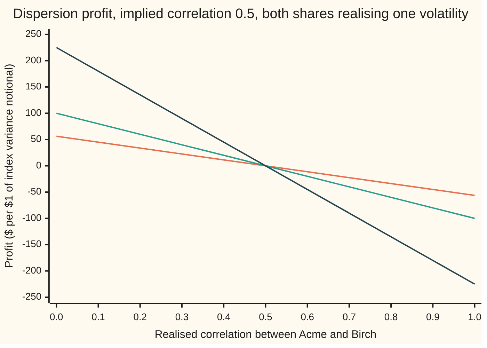

# Dispersion: selling index variance against member variance, and the correlation swap it approximates

[Syllabus](../../../SYLLABUS.md) → [Financial mathematics](../README.md) → [Variance swaps, the log contract and VIX](../README.md#s19) → Dispersion

---

## General Overview

Two house shares, Acme and Birch, each make up half of a small index. Options on each share are priced at 20 percent volatility (the yearly spread of its returns). Options on the index are priced as if the two shares had **correlation** 0.5: a score from −1 to 1 for how closely their daily moves line up.

At correlation 0.5 the index's variance (volatility squared) is 0.03, a volatility of 17.32 percent. So a one-year variance swap on the index is struck at 0.03, and one on each share at 0.04. A **variance swap** pays realised variance minus a fixed strike, as on [The variance swap](03-variance-swap-fair-strike.md).

A desk sells the index variance swap and buys the two share swaps, 0.375 of the index notional on each. That package is a **dispersion trade**: it profits when the members move apart more than the index price assumed. Over the year both shares realise 20 percent, as priced, but their correlation turns out to be 0.3. The index realises only 0.026. The share legs pay nothing; the index leg earns the 0.004 gap.

On $100,000 of index vega notional (dollars per volatility point), that is $115,470. Nobody bet on either share's volatility. The members were sized so their volatility washes out, and the profit is a bet on one number: **realised correlation against implied correlation**.

A **correlation swap** pays that number directly: realised correlation minus a fixed strike. Few trade it. The dispersion trade is the usual stand-in, and the variance strikes give the first estimate of the correlation swap's fair strike, here 0.5.

**Sell the index variance swap and buy each member's in the amount that cancels its volatility: what is left pays implied minus realised correlation, scaled by the realised cross term.**

**What kind of fact this is:** an identity about the payoffs, proved on this card in Why it works. The sizing rule is exact to first order in each share's volatility. The correlation swap strike read from variance strikes is an estimate, with its bias shown in Step 4.

### The picture: profit against realised correlation



Each line is one year in which both shares realise the same volatility: orange 15 percent, green 20 percent, dark blue 30 percent. Profit is in dollars for $1 of index notional per variance point. All three lines cross zero at 0.5, the implied correlation: the trade is a correlation bet. Their slopes differ: the same correlation miss pays more in a wild year. That is the main way the trade differs from a correlation swap; the other is a bet on the two shares' volatilities spreading apart (When it holds).

---

## The formula

Notation first, in words. Shares are numbered $`i`$ (or $`j`$) from 1 to $`n`$. $`w_i`$ is share $`i`$'s weight in the index. $`\sigma_i`$ is its implied volatility, so $`K_i = \sigma_i^2`$ is its variance swap strike. $`s_i`$ is the volatility it actually realises, so its realised variance is $`s_i^2`$. The subscript $`I`$ means the index. A sum over $`i \ne j`$ runs over every ordered pair of different shares.

The strikes define one implied correlation, as on [Correlation Greeks and implied correlation](../18-Many%20underlyings%20-%20exchange%2C%20spread%2C%20basket%20and%20rainbow/05-correlation-greeks-and-implied-correlation.md):

```math
K_I = \sum_i w_i^2 K_i + \rho_{\mathrm{impl}} \sum_{i\ne j} w_i w_j \sqrt{K_i K_j}
```

The trade sells $`N_I`$ of index variance and buys $`N_i`$ of each member's variance, with

```math
N_i = N_I\Bigl(w_i^2 + \rho_{\mathrm{impl}}\, w_i \sum_{j\ne i} w_j\,\frac{\sigma_j}{\sigma_i}\Bigr)
```

Its profit at expiry, in decimal variance, is

```math
\Pi = N_I\,(K_I - s_I^2) + \sum_i N_i\,(s_i^2 - K_i) = N_I\Bigl[\rho_{\mathrm{impl}}\sum_{i\ne j} w_i w_j\,\frac{\sigma_j}{\sigma_i}\,s_i^2 \;-\; \rho_{\mathrm{real}}\sum_{i\ne j} w_i w_j\, s_i s_j\Bigr]
```

With two shares, $`\rho_{\mathrm{real}}`$ is their realised correlation. With more, it is the one number that makes the index's realised variance add up, $`\rho_{\mathrm{real}} = (s_I^2 - \sum_i w_i^2 s_i^2)/\sum_{i\ne j} w_i w_j s_i s_j`$: an average of the pair correlations, each weighted by $`w_i w_j s_i s_j`$. A correlation swap's term sheet fixes its own pair weights.

When every share's realised volatility is the same multiple of its implied volatility, the two sums share a size, $`C = \sum_{i\ne j} w_i w_j s_i s_j`$, and the profit is

```math
\Pi = N_I\,(\rho_{\mathrm{impl}} - \rho_{\mathrm{real}})\, C
```

**Read it aloud:** the trade earns the gap between implied and realised correlation, times the realised cross term, the part of the index's variance that correlation controls.

A correlation swap with notional $`N_\rho`$ pays $`N_\rho(\rho_{\mathrm{real}} - K_\rho)`$ to its buyer. Its strike is estimated from the variance strikes:

```math
K_\rho \approx \rho_{\mathrm{impl}} = \frac{K_I - \sum_i w_i^2 K_i}{\sum_{i\ne j} w_i w_j \sqrt{K_i K_j}}
```

| Symbol | Plain meaning | In our example | Push it up and the answer… |
| --- | --- | --- | --- |
| $`w_i`$, $`i`$, $`j`$, $`n`$ | weight of share $`i`$ (or $`j`$) in the index; $`n`$ shares | 0.5 each; 2 shares | a bigger weight needs a bigger member leg |
| $`\sigma_i`$, $`K_i`$ | implied volatility of share $`i`$; its variance strike $`\sigma_i^2`$ | 20 percent; 0.04 | index strike rises |
| $`K_I`$ | index variance strike | 0.03 (17.32 percent) | short index leg collects more |
| $`\rho_{\mathrm{impl}}`$ | the correlation the strikes imply | 0.5 | the trade earns more at any outcome |
| $`s_i`$, $`s_I`$ | realised volatility of share $`i`$, and of the index | 20 percent each; index $`s_I^2 = 0.026`$ | member legs gain; index leg loses |
| $`\rho_{\mathrm{real}}`$ | realised correlation, from daily returns over the year; with more than two shares, the weighted average of the pairs | 0.3 | profit falls, one for one with $`C`$ |
| $`N_I`$, $`N_i`$ | variance notionals: index (sold) and member $`i`$ (bought) | 1 and 0.375 per unit | profit scales with $`N_I`$ |
| $`\Pi`$ | profit of the whole trade at expiry, decimal variance | 0.004 per unit | — |
| $`C`$ | realised cross term, $`\sum_{i\ne j} w_i w_j s_i s_j`$ | 0.02 | the correlation bet gets bigger |
| $`N_\rho`$, $`K_\rho`$ | correlation swap notional and strike | 0.02 per unit; 0.5 | — |
| $`\lambda`$ | one common ratio of realised to implied volatility, in the proof | 1 | profit grows as $`\lambda^2`$ |
| $`p`$, $`v`$, $`\rho`$ | in the two-state world: a state's probability, its volatility and its correlation | 0.5; 15 or 30 percent; 0.3 or 0.8 | more weight on the stressed state raises implied correlation |

Units follow the variance swap card: decimal variance 0.0001 is one **variance point**, so 0.004 is 40 variance points.

### When it holds

- **Volatilities move in proportion.** The clean profit $`(\rho_{\mathrm{impl}} - \rho_{\mathrm{real}})C`$ needs every share's realised volatility to be the same multiple of its implied volatility. If Acme realises 25 and Birch 15 at correlation 0.5, the trade still earns 0.00125: a second bet, on the shares' volatilities spreading apart.
- **Continuous paths and one index basket.** Each variance swap is replicated by its own option strip, so jumps bias each leg as on [The volatility swap and the jump bias](05-volatility-swap-and-jump-bias.md). The weights must be the index's true value weights.
- **Fixed weights, small steps.** The variance identity is exact for weights fixed over each day and returns measured in tiny steps. With daily log returns and the index reset to 50/50 each day, one simulated year's legs paid 0.002776 and the formula 0.002772. A real index also lets its weights drift with prices, a further small error.
- **The correlation swap estimate.** Reading $`\rho_{\mathrm{impl}}`$ as the correlation swap strike assumes volatility and correlation do not rise together. In a market where they do, the estimate is too high (Step 4).
- **Uncapped legs.** Every leg here is priced uncapped. Street single-stock variance swaps usually carry the 2.5-times cap of [Capped and corridor variance](08-capped-and-corridor-variance-swaps.md). In a single-name blow-up a capped member leg stops paying at its cap, so the long legs gain less than this sizing assumes.

---

## Why it works

### Step 0: the members' swaps price everything except the cross term

The index's variance is its members' own variances, weighted, plus a cross term that correlation controls. Each member's variance swap prices that member's own variance. So selling the index swap and buying the right amount of member swaps cancels the own parts. Only the cross term is left, and correlation sits in it alone.

### Step 1: size each member leg to cancel its volatility

A small rise in share $`i`$'s volatility changes the index's variance by its slope in $`\sigma_i`$:

```math
\frac{\partial K_I}{\partial \sigma_i} = 2 w_i^2 \sigma_i + 2\rho_{\mathrm{impl}}\, w_i \sum_{j\ne i} w_j \sigma_j
```

For Acme: $`2(0.25)(0.2) + 2(0.5)(0.5)(0.5)(0.2) = 0.15`$. A member variance swap gains $`2\sigma_i = 0.4`$ per unit of volatility. Divide: 0.15 / 0.4 = 0.375. That is the formula for $`N_i`$, and the check finds the same 0.375 by bumping Acme's volatility and dividing.

The legs also balance in strike. The index variance is a sum of products of two volatilities, so doubling every volatility quadruples it. For such a function, the slopes times the volatilities add up to twice the value (Euler's rule for homogeneous functions). That gives $`\sum_i N_i K_i = N_I K_I`$: here 2 × 0.375 × 0.04 = 0.03. The bought legs carry exactly the index's strike.

### Step 2: the profit is the correlation gap

Because the strikes balance, the profit is the members' realised variance, weighted by $`N_i`$, minus the index's. Expand the index's realised variance with the realised correlation and the $`s_i`$. The own terms cancel against part of the member legs; what is left is the formula for $`\Pi`$.

<details>
<summary>Detailed proof: from the legs to the correlation gap</summary>

Take $`N_I = 1`$. By Step 1, $`\sum_i N_i K_i = K_I`$, so

$`\displaystyle \Pi = \sum_i N_i s_i^2 - s_I^2.`$

The index's realised variance, with value weights fixed over each day, is

$`\displaystyle s_I^2 = \sum_i w_i^2 s_i^2 + \rho_{\mathrm{real}} \sum_{i\ne j} w_i w_j s_i s_j.`$

Insert $`N_i = w_i^2 + \rho_{\mathrm{impl}} w_i \sum_{j\ne i} w_j \sigma_j/\sigma_i`$. The $`w_i^2 s_i^2`$ terms cancel, leaving

$`\displaystyle \Pi = \rho_{\mathrm{impl}} \sum_{i\ne j} w_i w_j \frac{\sigma_j}{\sigma_i} s_i^2 - \rho_{\mathrm{real}} \sum_{i\ne j} w_i w_j s_i s_j.`$

If $`s_i = \lambda \sigma_i`$ for one multiple $`\lambda`$, then $`(\sigma_j/\sigma_i)s_i^2 = \lambda^2\sigma_i\sigma_j = s_i s_j`$, both sums equal $`C`$, and $`\Pi = (\rho_{\mathrm{impl}} - \rho_{\mathrm{real}})C`$.

For two shares with equal implied volatility the first sum is $`w_1w_2(s_1^2 + s_2^2)`$, so

$`\displaystyle \Pi = 2w_1w_2\Bigl[(\rho_{\mathrm{impl}} - \rho_{\mathrm{real}})s_1s_2 + \tfrac12\rho_{\mathrm{impl}}(s_1 - s_2)^2\Bigr].`$

The last term is the volatility-gap bet. At 25 and 15 percent with correlation 0.5 it is $`0.5 \times 0.25 \times 0.01 = 0.00125`$.

</details>

The house year: $`C = 2 \times 0.5 \times 0.5 \times 0.2 \times 0.2 = 0.02`$, so $`\Pi = (0.5 - 0.3) \times 0.02 = 0.004`$, the same as the three legs settled one by one.

A third road simulates the year. The check draws 252 daily returns for each share at 20 percent volatility and correlation 0.3, builds the index rebalanced daily to 50/50, and settles each variance swap from the daily log returns. On the first simulated year Acme realised 17.53 percent, Birch 19.53 and the correlation 0.341. The three legs paid 0.002776 and the formula gives 0.002772. Over 1,000 simulated years the average profit was 0.004003, with standard error 0.000034.

### Step 3: why the trade only approximates a correlation swap

The trade pays $`(\rho_{\mathrm{impl}} - \rho_{\mathrm{real}})C`$, and $`C`$ is realised, not fixed. A seller of a correlation swap with notional 0.02 earns $`0.02 \times (0.5 - 0.3) = 0.004`$ in every year that correlation realises 0.3. The dispersion trade earns 0.004 only if the shares realise 20 percent. In a 30 percent year it earns 0.009; in a 15 percent year, 0.00225.

So the dispersion trade is a correlation swap whose notional grows with realised variance. Desks call its exposure "dirty" correlation. The difference hurts in the year that matters most: in a crash, correlation and volatility rise together, and the loss is scaled up by the higher volatility.

### Step 4: the correlation swap strike from variance strikes

The variance strikes give one implied correlation, 0.5 for the house pair, and that is the first estimate of $`K_\rho`$. It is biased when volatility and correlation move together.

Take a world with two equally likely years. A calm year: both shares at 15 percent, correlation 0.3. A stressed year: both at 30 percent, correlation 0.8. Fair variance strikes are averages of variance over the two years:

- each member: 0.5 × 0.0225 + 0.5 × 0.09 = 0.05625;
- the index: 0.047812;
- implied correlation from these strikes: 0.7.

The fair correlation swap strike is the plain average, 0.5 × 0.3 + 0.5 × 0.8 = 0.55. The variance strikes say 0.7. They weight each year's correlation by that year's variance, and the stressed year has four times the variance. Desks therefore set correlation swap strikes below variance-implied correlation. How far below depends on how strongly correlation and volatility rise together, which the variance strikes cannot reveal.

<details>
<summary>Why variance strikes weight correlation by variance</summary>

With equal implied volatilities $`v`$ in each state and probability $`p`$ of each state, the member strike is $`K = \sum p\, v^2`$ and the index strike is $`\sum p\, v^2 (\sum_i w_i^2 + \rho \sum_{i\ne j} w_iw_j)`$. Subtract $`\sum_i w_i^2 K`$ and divide by $`\sum_{i\ne j}w_iw_j K`$:

$`\displaystyle \rho_{\mathrm{impl}} = \frac{\sum p\, \rho\, v^2}{\sum p\, v^2}.`$

That is a variance-weighted average of correlation: $`(0.5 \times 0.3 \times 0.0225 + 0.5 \times 0.8 \times 0.09)/0.05625 = 0.7`$. The check computes it both ways.

</details>

A common shortcut for large indices drops the own terms: $`\rho \approx K_I / (\sum_i w_i \sqrt{K_i})^2`$. With 50 equal names at 20 percent and correlation 0.5 it gives 0.51 against the exact 0.5. With the house pair it gives 0.75: with two names the own terms are half of the fully correlated variance $`(\sum_i w_i \sqrt{K_i})^2`$, far too big to drop.

---

## Worked numbers, by hand

The house pair: weights 0.5, implied volatility 20 percent each, implied correlation 0.5, realised volatility 20 percent each, realised correlation 0.3.

| Step | Arithmetic | Value |
| --- | --- | --- |
| member strikes | $`0.2^2`$ | 0.04 |
| index strike | $`0.25 \times 0.04 \times 2 + 0.5 \times 2 \times 0.25 \times 0.04`$ | 0.03 |
| implied correlation | $`(0.03 - 0.02)/0.02`$ | 0.5 |
| member notional | $`0.25 + 0.5 \times 0.5 \times 0.5`$ | 0.375 |
| strikes balance | $`2 \times 0.375 \times 0.04`$ | 0.03 |
| index realised variance | $`0.02 + 0.3 \times 0.02`$ | 0.026 |
| index leg | $`0.03 - 0.026`$ | 0.004 |
| member legs | $`0.375 \times (0.04 - 0.04) \times 2`$ | 0 |
| **profit per unit** | $`(0.5 - 0.3) \times 0.02`$ | **0.004** |
| index variance notional | $`100{,}000 / (2 \times 17.320508)`$ | $2,886.75 per variance point |
| each member | $`0.375 \times 2{,}886.75`$; vega $`\times\, 2 \times 20`$ | $1,082.53; vega $43,301.27 |
| **profit in dollars** | $`2{,}886.75 \times 40`$ | **$115,470.05** |

The desk sold index variance at 17.32 percent and bought each share's at 20, and earned $115,470 because the shares moved together less than the index price assumed. The two member vegas, $43,301.27 each, add up to less than the index's $100,000: the members' legs are smaller because each share's swings are partly cancelled in the index.

### What breaks if you drop a piece

| Mistake | Comes out at | What went wrong |
| --- | --- | --- |
| Buy each member in its index weight, 0.5 | +0.005625 when both shares realise 25 percent at correlation 0.5 (right: 0) | Too many member legs: the trade is long volatility, not just short correlation. |
| Buy each member in its weight squared, 0.25 | −0.005625 in the same year | Only the own terms are covered: the trade is short volatility. |
| Treat the profit as a fixed correlation bet | 0.009 in a 30 percent year at correlation 0.3, not 0.004 | The cross term is realised; it grows with realised variance. |
| Use the large-index shortcut on two names | correlation swap strike 0.75, not 0.5 | With two names the own terms are half the fully correlated variance, too big to drop. |

---

## Code, from first principles, and it actually runs

The script prices the strikes, sizes the trade and settles it, by three independent roads: the closed form, a bumped slope for the sizing, and a simulation of daily prices whose legs are settled from the path. It also runs the wrong sizings, the two-state world and the large-index shortcut. Both programs print the same lines.

### Python

```python
from math import sqrt, log, exp, cos, pi
W, VOL, RHO = [0.5, 0.5], [0.20, 0.20], 0.5         # house: weights, implied vols, implied correlation
M64 = (1 << 64) - 1

def show(label, x):                                  # tiny float noise prints as 0, not -0
    print(f"{label:<50}{x if abs(x) > 1e-12 else 0.0:.6f}")

def index_var(w, v, rho):                            # variance of a weighted sum, one correlation
    n = len(w)
    return sum(w[i] * w[j] * v[i] * v[j] * (1.0 if i == j else rho) for i in range(n) for j in range(n))

def cross(w, v):                                     # sum over pairs i != j of w_i w_j v_i v_j
    return sum(w[i] * w[j] * v[i] * v[j] for i in range(len(w)) for j in range(len(w)) if i != j)

def implied_corr(KI, w, K):                          # the correlation the variance strikes imply
    own = sum(wi * wi * k for wi, k in zip(w, K))
    return (KI - own) / cross(w, [sqrt(k) for k in K])

def notionals(w, v, rho):                            # vega-neutral member notionals, closed form
    n = len(w)
    return [w[i] * w[i] + rho * w[i] * sum(w[j] * v[j] for j in range(n) if j != i) / v[i] for i in range(n)]

def pnl(N, KI, K, rvI, rv):                          # short 1 unit of index variance, long members
    return (KI - rvI) + sum(n * (r - k) for n, r, k in zip(N, rv, K))

def scenario(N, vols, rho_r):                        # realised vols and correlation -> trade profit
    return pnl(N, KI, K, index_var(W, vols, rho_r), [s * s for s in vols])

# ---- strikes and sizing ----
K = [s * s for s in VOL]
KI = index_var(W, VOL, RHO)
show("index variance strike K_I", KI)
show("index volatility, percent", 100 * sqrt(KI))
show("implied correlation from the strikes", implied_corr(KI, W, K))
N = notionals(W, VOL, RHO)
h = 1e-4                                             # road 2: bump share 1's vol in the index variance
bumped = (index_var(W, [VOL[0] + h, VOL[1]], RHO) - index_var(W, [VOL[0] - h, VOL[1]], RHO)) / (2 * h)
show("index variance slope in share 1 vol", bumped)
show("member notional, closed form", N[0])
show("member notional, bump / (2 sigma_1)", bumped / (2 * VOL[0]))
assert abs(N[0] - bumped / (2 * VOL[0])) < 1e-9
show("members' total notional x strike", sum(n * k for n, k in zip(N, K)))
assert abs(sum(n * k for n, k in zip(N, K)) - KI) < 1e-12   # Euler: matches the index leg
# ---- the trade, settled ----
rvI = index_var(W, VOL, 0.3)
show("index realised variance at correlation 0.3", rvI)
show("profit: index leg", KI - rvI)
show("profit: member legs", sum(n * (r - k) for n, r, k in zip(N, K, K)))
p = scenario(N, VOL, 0.3)
show("profit: whole trade", p)
show("profit at correlation 0.8, both 20%", scenario(N, VOL, 0.8))
cx = cross(W, VOL)
show("cross term sum w_i w_j sigma_i sigma_j", cx)
show("profit: (rho_impl - rho_real) x cross term", (RHO - 0.3) * cx)
assert abs(p - (RHO - 0.3) * cx) < 1e-12
show("correlation swap notional per unit", cx)
NI = 100000 / (2 * 100 * sqrt(KI))                  # dollars per variance point, from $100,000 vega
show("index variance notional, $ per var point", NI)
show("member variance notional, $ each", N[0] * NI)
show("member vega notional, $ each", N[0] * NI * 2 * 100 * VOL[0])
show("profit in dollars at correlation 0.3", NI * 10000 * p)
# ---- flat in single-name vol, and what breaks ----
wt, sq = [w for w in W], [w * w for w in W]
for name, M in (("vega-neutral", N), ("by weight", wt), ("by weight squared", sq)):
    slope = (scenario(M, [0.21, 0.20], RHO) - scenario(M, [0.19, 0.20], RHO)) / 2
    show(f"{name}: slope per vol point of share 1", slope)
    show(f"{name}: both 25%, correlation 0.5", scenario(M, [0.25, 0.25], RHO))
    show(f"{name}: both 30%, correlation 0.3", scenario(M, [0.30, 0.30], 0.3))
assert abs(scenario(N, [0.25, 0.25], RHO)) < 1e-12 and abs(scenario(wt, [0.25, 0.25], RHO) - 0.005625) < 1e-12
show("vega-neutral: 25% and 15%, correlation 0.5", scenario(N, [0.25, 0.15], RHO))
show("vol gap term rho w1 w2 (sigma1 - sigma2)^2", RHO * W[0] * W[1] * (0.25 - 0.15) ** 2)
assert abs(scenario(N, [0.25, 0.15], RHO) - RHO * W[0] * W[1] * 0.01) < 1e-12
for v in (0.15, 0.20, 0.30):                         # chart: profit against realised correlation
    pts = [10000 * scenario(N, [v, v], c / 10) for c in range(11)]
    print(f"chart vol {v:.2f}," + ",".join(f"{x if abs(x) > 1e-9 else 0.0:.2f}" for x in pts))
# ---- correlation swap strike from variance strikes ----
show("proxy K_I / (sum w_i sqrt K_i)^2, two names", KI / sum(w * sqrt(k) for w, k in zip(W, K)) ** 2)
w50 = [1 / 50] * 50
K50 = index_var(w50, [0.2] * 50, RHO)
show("50 names: index variance strike", K50)
show("50 names: exact implied correlation", implied_corr(K50, w50, [0.04] * 50))
show("50 names: proxy", K50 / sum(w * 0.2 for w in w50) ** 2)
states = [(0.5, 0.15, 0.3), (0.5, 0.30, 0.8)]        # calm and stressed: (probability, vol, correlation)
Ks = sum(pr * v * v for pr, v, c in states)
KIs = sum(pr * index_var(W, [v, v], c) for pr, v, c in states)
ri = implied_corr(KIs, W, [Ks, Ks])
show("two states: member variance strike", Ks)
show("two states: index variance strike", KIs)
show("two states: implied correlation", ri)
show("two states: variance-weighted correlation", sum(pr * c * v * v for pr, v, c in states) / Ks)
show("two states: correlation swap fair strike", sum(pr * c for pr, v, c in states))
assert abs(ri - sum(pr * c * v * v for pr, v, c in states) / Ks) < 1e-12
# ---- road 3: simulate daily prices, settle the legs from the path ----
state = 20261123
def normal():
    global state
    u = []
    for _ in range(2):
        state = (state + 0x9E3779B97F4A7C15) & M64
        z = state
        z = ((z ^ (z >> 30)) * 0xBF58476D1CE4E5B9) & M64
        z = ((z ^ (z >> 27)) * 0x94D049BB133111EB) & M64
        u.append(((z ^ (z >> 31)) >> 11) * 2.0 ** -53 + 2.0 ** -54)
    return sqrt(-2 * log(u[0])) * cos(2 * pi * u[1])

def year(rho):                                       # 252 days; index rebalanced daily to 50/50
    a, b, xy, ii = 0.0, 0.0, 0.0, 0.0
    for _ in range(252):
        z1 = normal(); z2 = rho * z1 + sqrt(1 - rho * rho) * normal()
        x1 = -0.5 * 0.04 / 252 + 0.2 * z1 / sqrt(252); x2 = -0.5 * 0.04 / 252 + 0.2 * z2 / sqrt(252)
        xi = log(1 + W[0] * (exp(x1) - 1) + W[1] * (exp(x2) - 1))
        a += x1 * x1; b += x2 * x2; xy += x1 * x2; ii += xi * xi
    return a, b, xy / sqrt(a * b), ii

a, b, rr, ii = year(0.3)
legs = pnl(N, KI, K, ii, [a, b])
formula = RHO * W[0] * W[1] * (a + b) - rr * 2 * W[0] * W[1] * sqrt(a * b)
show("sim year 1: share 1 realised vol, percent", 100 * sqrt(a))
show("sim year 1: share 2 realised vol, percent", 100 * sqrt(b))
show("sim year 1: realised correlation", rr)
show("sim year 1: index realised variance", ii)
show("sim year 1: profit from the three legs", legs)
show("sim year 1: profit from the formula", formula)
assert abs(legs - formula) < 2e-5
ps = [pnl(N, KI, K, i, [x, y]) for x, y, _, i in (year(0.3) for _ in range(1000))]
m = sum(ps) / len(ps); se = sqrt(sum((x - m) ** 2 for x in ps) / (len(ps) - 1) / len(ps))
show("1000 sim years: average profit", m)
show("1000 sim years: standard error", se)
assert abs(m - 0.004) < 4 * se
print("ALL CHECKS PASS")
```

**Ran 2026-11-23 on macOS, Python 3.14.10, standard library only. All checks passed. Output, pasted from the run:**

```
index variance strike K_I                         0.030000
index volatility, percent                         17.320508
implied correlation from the strikes              0.500000
index variance slope in share 1 vol               0.150000
member notional, closed form                      0.375000
member notional, bump / (2 sigma_1)               0.375000
members' total notional x strike                  0.030000
index realised variance at correlation 0.3        0.026000
profit: index leg                                 0.004000
profit: member legs                               0.000000
profit: whole trade                               0.004000
profit at correlation 0.8, both 20%               -0.006000
cross term sum w_i w_j sigma_i sigma_j            0.020000
profit: (rho_impl - rho_real) x cross term        0.004000
correlation swap notional per unit                0.020000
index variance notional, $ per var point          2886.751346
member variance notional, $ each                  1082.531755
member vega notional, $ each                      43301.270189
profit in dollars at correlation 0.3              115470.053838
vega-neutral: slope per vol point of share 1      0.000000
vega-neutral: both 25%, correlation 0.5           0.000000
vega-neutral: both 30%, correlation 0.3           0.009000
by weight: slope per vol point of share 1         0.000500
by weight: both 25%, correlation 0.5              0.005625
by weight: both 30%, correlation 0.3              0.021500
by weight squared: slope per vol point of share 1 -0.000500
by weight squared: both 25%, correlation 0.5      -0.005625
by weight squared: both 30%, correlation 0.3      -0.003500
vega-neutral: 25% and 15%, correlation 0.5        0.001250
vol gap term rho w1 w2 (sigma1 - sigma2)^2        0.001250
chart vol 0.15,56.25,45.00,33.75,22.50,11.25,0.00,-11.25,-22.50,-33.75,-45.00,-56.25
chart vol 0.20,100.00,80.00,60.00,40.00,20.00,0.00,-20.00,-40.00,-60.00,-80.00,-100.00
chart vol 0.30,225.00,180.00,135.00,90.00,45.00,0.00,-45.00,-90.00,-135.00,-180.00,-225.00
proxy K_I / (sum w_i sqrt K_i)^2, two names       0.750000
50 names: index variance strike                   0.020400
50 names: exact implied correlation               0.500000
50 names: proxy                                   0.510000
two states: member variance strike                0.056250
two states: index variance strike                 0.047812
two states: implied correlation                   0.700000
two states: variance-weighted correlation         0.700000
two states: correlation swap fair strike          0.550000
sim year 1: share 1 realised vol, percent         17.532852
sim year 1: share 2 realised vol, percent         19.534118
sim year 1: realised correlation                  0.341060
sim year 1: index realised variance               0.023061
sim year 1: profit from the three legs            0.002776
sim year 1: profit from the formula               0.002772
1000 sim years: average profit                    0.004003
1000 sim years: standard error                    0.000034
ALL CHECKS PASS
```

### Rust

```rust
// Dispersion trade and correlation swap -- the check behind the card. std only.
const W: [f64; 2] = [0.5, 0.5]; // house: weights, implied vols, implied correlation
const VOL: [f64; 2] = [0.20, 0.20]; const RHO: f64 = 0.5;

fn show(label: &str, x: f64) { // tiny float noise prints as 0, not -0
    println!("{:<50}{:.6}", label, if x.abs() > 1e-12 { x } else { 0.0 });
}

fn index_var(w: &[f64], v: &[f64], rho: f64) -> f64 {
    let n = w.len();
    let mut s = 0.0;
    for i in 0..n { for j in 0..n { s += w[i] * w[j] * v[i] * v[j] * (if i == j { 1.0 } else { rho }); } }
    s
}

fn cross(w: &[f64], v: &[f64]) -> f64 {
    let n = w.len();
    let mut s = 0.0;
    for i in 0..n { for j in 0..n { if i != j { s += w[i] * w[j] * v[i] * v[j]; } } }
    s
}

fn implied_corr(ki: f64, w: &[f64], k: &[f64]) -> f64 {
    let own: f64 = w.iter().zip(k).map(|(wi, kk)| wi * wi * kk).sum();
    let roots: Vec<f64> = k.iter().map(|x| x.sqrt()).collect();
    (ki - own) / cross(w, &roots)
}

fn notionals(w: &[f64], v: &[f64], rho: f64) -> Vec<f64> {
    let n = w.len();
    (0..n).map(|i| {
        let o: f64 = (0..n).filter(|&j| j != i).map(|j| w[j] * v[j]).sum();
        w[i] * w[i] + rho * w[i] * o / v[i]
    }).collect()
}

fn pnl(nn: &[f64], ki: f64, k: &[f64], rvi: f64, rv: &[f64]) -> f64 {
    let m: f64 = nn.iter().zip(rv).zip(k).map(|((n, r), kk)| n * (r - kk)).sum();
    (ki - rvi) + m
}

struct Rng(u64);
impl Rng {
    fn uniform(&mut self) -> f64 {
        self.0 = self.0.wrapping_add(0x9E3779B97F4A7C15);
        let mut z = self.0;
        z = (z ^ (z >> 30)).wrapping_mul(0xBF58476D1CE4E5B9);
        z = (z ^ (z >> 27)).wrapping_mul(0x94D049BB133111EB);
        ((z ^ (z >> 31)) >> 11) as f64 * 2f64.powi(-53) + 2f64.powi(-54)
    }
    fn normal(&mut self) -> f64 {
        let (u0, u1) = (self.uniform(), self.uniform());
        (-2.0 * u0.ln()).sqrt() * (2.0 * std::f64::consts::PI * u1).cos()
    }
}

fn year(g: &mut Rng, rho: f64) -> (f64, f64, f64, f64) { // 252 days; index rebalanced daily to 50/50
    let (mut a, mut b, mut xy, mut ii) = (0.0, 0.0, 0.0, 0.0);
    for _ in 0..252 {
        let z1 = g.normal();
        let z2 = rho * z1 + (1.0 - rho * rho).sqrt() * g.normal();
        let x1 = -0.5 * 0.04 / 252.0 + 0.2 * z1 / 252f64.sqrt();
        let x2 = -0.5 * 0.04 / 252.0 + 0.2 * z2 / 252f64.sqrt();
        let xi = (1.0 + W[0] * (x1.exp() - 1.0) + W[1] * (x2.exp() - 1.0)).ln();
        a += x1 * x1; b += x2 * x2; xy += x1 * x2; ii += xi * xi;
    }
    (a, b, xy / (a * b).sqrt(), ii)
}

fn main() {
    // ---- strikes and sizing ----
    let k: Vec<f64> = VOL.iter().map(|s| s * s).collect();
    let ki = index_var(&W, &VOL, RHO);
    let scenario = |nn: &[f64], vols: &[f64], rho_r: f64| -> f64 {
        let rv: Vec<f64> = vols.iter().map(|s| s * s).collect();
        pnl(nn, ki, &k, index_var(&W, vols, rho_r), &rv)
    };
    show("index variance strike K_I", ki);
    show("index volatility, percent", 100.0 * ki.sqrt());
    show("implied correlation from the strikes", implied_corr(ki, &W, &k));
    let nn = notionals(&W, &VOL, RHO);
    let h = 1e-4;
    let bumped = (index_var(&W, &[VOL[0] + h, VOL[1]], RHO) - index_var(&W, &[VOL[0] - h, VOL[1]], RHO)) / (2.0 * h);
    show("index variance slope in share 1 vol", bumped);
    show("member notional, closed form", nn[0]);
    show("member notional, bump / (2 sigma_1)", bumped / (2.0 * VOL[0]));
    assert!((nn[0] - bumped / (2.0 * VOL[0])).abs() < 1e-9);
    let tot: f64 = nn.iter().zip(&k).map(|(n, kk)| n * kk).sum();
    show("members' total notional x strike", tot);
    assert!((tot - ki).abs() < 1e-12);
    // ---- the trade, settled ----
    let rvi = index_var(&W, &VOL, 0.3);
    show("index realised variance at correlation 0.3", rvi);
    show("profit: index leg", ki - rvi);
    show("profit: member legs", nn.iter().zip(&k).zip(&k).map(|((n, r), kk)| n * (r - kk)).sum::<f64>());
    let p = scenario(&nn, &VOL, 0.3);
    show("profit: whole trade", p);
    show("profit at correlation 0.8, both 20%", scenario(&nn, &VOL, 0.8));
    let cx = cross(&W, &VOL);
    show("cross term sum w_i w_j sigma_i sigma_j", cx);
    show("profit: (rho_impl - rho_real) x cross term", (RHO - 0.3) * cx);
    assert!((p - (RHO - 0.3) * cx).abs() < 1e-12);
    show("correlation swap notional per unit", cx);
    let ni = 100000.0 / (2.0 * 100.0 * ki.sqrt());
    show("index variance notional, $ per var point", ni);
    show("member variance notional, $ each", nn[0] * ni);
    show("member vega notional, $ each", nn[0] * ni * 2.0 * 100.0 * VOL[0]);
    show("profit in dollars at correlation 0.3", ni * 10000.0 * p);
    // ---- flat in single-name vol, and what breaks ----
    let (wt, sq): (Vec<f64>, Vec<f64>) = (W.to_vec(), W.iter().map(|w| w * w).collect());
    for (name, m) in [("vega-neutral", &nn), ("by weight", &wt), ("by weight squared", &sq)] {
        let slope = (scenario(m, &[0.21, 0.20], RHO) - scenario(m, &[0.19, 0.20], RHO)) / 2.0;
        show(&format!("{}: slope per vol point of share 1", name), slope);
        show(&format!("{}: both 25%, correlation 0.5", name), scenario(m, &[0.25, 0.25], RHO));
        show(&format!("{}: both 30%, correlation 0.3", name), scenario(m, &[0.30, 0.30], 0.3));
    }
    assert!(scenario(&nn, &[0.25, 0.25], RHO).abs() < 1e-12 && (scenario(&wt, &[0.25, 0.25], RHO) - 0.005625).abs() < 1e-12);
    show("vega-neutral: 25% and 15%, correlation 0.5", scenario(&nn, &[0.25, 0.15], RHO));
    show("vol gap term rho w1 w2 (sigma1 - sigma2)^2", RHO * W[0] * W[1] * (0.25f64 - 0.15).powi(2));
    assert!((scenario(&nn, &[0.25, 0.15], RHO) - RHO * W[0] * W[1] * 0.01).abs() < 1e-12);
    for v in [0.15, 0.20, 0.30] { // chart: profit against realised correlation
        let pts: Vec<String> = (0..11).map(|c| {
            let x = 10000.0 * scenario(&nn, &[v, v], c as f64 / 10.0);
            format!("{:.2}", if x.abs() > 1e-9 { x } else { 0.0 })
        }).collect();
        println!("chart vol {:.2},{}", v, pts.join(","));
    }
    // ---- correlation swap strike from variance strikes ----
    let sw: f64 = W.iter().zip(&k).map(|(w, kk)| w * kk.sqrt()).sum();
    show("proxy K_I / (sum w_i sqrt K_i)^2, two names", ki / sw.powi(2));
    let w50 = vec![1.0 / 50.0; 50];
    let k50 = index_var(&w50, &vec![0.2; 50], RHO);
    show("50 names: index variance strike", k50);
    show("50 names: exact implied correlation", implied_corr(k50, &w50, &vec![0.04; 50]));
    let s50: f64 = w50.iter().map(|w| w * 0.2).sum();
    show("50 names: proxy", k50 / s50.powi(2));
    let states = [(0.5, 0.15, 0.3), (0.5, 0.30, 0.8)]; // (probability, vol, correlation)
    let ks: f64 = states.iter().map(|&(pr, v, _)| pr * v * v).sum();
    let kis: f64 = states.iter().map(|&(pr, v, c)| pr * index_var(&W, &[v, v], c)).sum();
    let ri = implied_corr(kis, &W, &[ks, ks]);
    let vw: f64 = states.iter().map(|&(pr, v, c)| pr * c * v * v).sum::<f64>() / ks;
    show("two states: member variance strike", ks);
    show("two states: index variance strike", kis);
    show("two states: implied correlation", ri);
    show("two states: variance-weighted correlation", vw);
    show("two states: correlation swap fair strike", states.iter().map(|&(pr, _, c)| pr * c).sum::<f64>());
    assert!((ri - vw).abs() < 1e-12);
    // ---- road 3: simulate daily prices, settle the legs from the path ----
    let mut g = Rng(20261123);
    let (a, b, rr, ii) = year(&mut g, 0.3);
    let legs = pnl(&nn, ki, &k, ii, &[a, b]);
    let formula = RHO * W[0] * W[1] * (a + b) - rr * 2.0 * W[0] * W[1] * (a * b).sqrt();
    show("sim year 1: share 1 realised vol, percent", 100.0 * a.sqrt());
    show("sim year 1: share 2 realised vol, percent", 100.0 * b.sqrt());
    show("sim year 1: realised correlation", rr);
    show("sim year 1: index realised variance", ii);
    show("sim year 1: profit from the three legs", legs);
    show("sim year 1: profit from the formula", formula);
    assert!((legs - formula).abs() < 2e-5);
    let ps: Vec<f64> = (0..1000).map(|_| {
        let (x, y, _, i) = year(&mut g, 0.3);
        pnl(&nn, ki, &k, i, &[x, y])
    }).collect();
    let m = ps.iter().sum::<f64>() / ps.len() as f64;
    let se = (ps.iter().map(|x| (x - m).powi(2)).sum::<f64>() / (ps.len() as f64 - 1.0) / ps.len() as f64).sqrt();
    show("1000 sim years: average profit", m);
    show("1000 sim years: standard error", se);
    assert!((m - 0.004).abs() < 4.0 * se);
    println!("ALL CHECKS PASS");
}
```

**Ran 2026-11-23 on macOS, rustc 1.98.1, no crates. All checks passed. Output, pasted from the run:**

```
index variance strike K_I                         0.030000
index volatility, percent                         17.320508
implied correlation from the strikes              0.500000
index variance slope in share 1 vol               0.150000
member notional, closed form                      0.375000
member notional, bump / (2 sigma_1)               0.375000
members' total notional x strike                  0.030000
index realised variance at correlation 0.3        0.026000
profit: index leg                                 0.004000
profit: member legs                               0.000000
profit: whole trade                               0.004000
profit at correlation 0.8, both 20%               -0.006000
cross term sum w_i w_j sigma_i sigma_j            0.020000
profit: (rho_impl - rho_real) x cross term        0.004000
correlation swap notional per unit                0.020000
index variance notional, $ per var point          2886.751346
member variance notional, $ each                  1082.531755
member vega notional, $ each                      43301.270189
profit in dollars at correlation 0.3              115470.053838
vega-neutral: slope per vol point of share 1      0.000000
vega-neutral: both 25%, correlation 0.5           0.000000
vega-neutral: both 30%, correlation 0.3           0.009000
by weight: slope per vol point of share 1         0.000500
by weight: both 25%, correlation 0.5              0.005625
by weight: both 30%, correlation 0.3              0.021500
by weight squared: slope per vol point of share 1 -0.000500
by weight squared: both 25%, correlation 0.5      -0.005625
by weight squared: both 30%, correlation 0.3      -0.003500
vega-neutral: 25% and 15%, correlation 0.5        0.001250
vol gap term rho w1 w2 (sigma1 - sigma2)^2        0.001250
chart vol 0.15,56.25,45.00,33.75,22.50,11.25,0.00,-11.25,-22.50,-33.75,-45.00,-56.25
chart vol 0.20,100.00,80.00,60.00,40.00,20.00,0.00,-20.00,-40.00,-60.00,-80.00,-100.00
chart vol 0.30,225.00,180.00,135.00,90.00,45.00,0.00,-45.00,-90.00,-135.00,-180.00,-225.00
proxy K_I / (sum w_i sqrt K_i)^2, two names       0.750000
50 names: index variance strike                   0.020400
50 names: exact implied correlation               0.500000
50 names: proxy                                   0.510000
two states: member variance strike                0.056250
two states: index variance strike                 0.047812
two states: implied correlation                   0.700000
two states: variance-weighted correlation         0.700000
two states: correlation swap fair strike          0.550000
sim year 1: share 1 realised vol, percent         17.532852
sim year 1: share 2 realised vol, percent         19.534118
sim year 1: realised correlation                  0.341060
sim year 1: index realised variance               0.023061
sim year 1: profit from the three legs            0.002776
sim year 1: profit from the formula               0.002772
1000 sim years: average profit                    0.004003
1000 sim years: standard error                    0.000034
ALL CHECKS PASS
```

### Lean

Lean proves the card's three payoff facts, for any finite set of shares and any weights.

- Suppose every $`\sigma_i`$ is above zero, $`K_I`$ is set by $`\rho_{\mathrm{impl}}`$, and each $`N_i`$ follows its formula. Then the bought legs carry exactly the index's strike: $`\sum_i N_i K_i = N_I K_I`$.
- Suppose also the index's realised variance $`s_I^2`$ is its own terms plus $`\rho_{\mathrm{real}}`$ times $`C`$, as in Step 2. Then the profit $`\Pi`$ equals the formula's two-sum expression, whatever volatilities the shares realise.
- Suppose further $`s_i = \lambda \sigma_i`$ for every share, with one multiple $`\lambda`$. Then $`\Pi = N_I(\rho_{\mathrm{impl}} - \rho_{\mathrm{real}})\,C`$.
- The house numbers check out as exact fractions: strikes 0.04 and 0.03, notional 0.375, profit 0.004, and the two-state 0.7 against 0.55.

The slope behind the sizing, the general correlation swap bias, the simulation and the dollar figures are left to the Python and Rust checks.

```lean
-- Dispersion: a short index variance swap against long member variance swaps sized to cancel each share's volatility carries exactly the index strike and pays implied minus realised correlation times the realised cross term.
import Mathlib.Analysis.Real.Sqrt
import Mathlib.Algebra.BigOperators.Field

open Finset

/-- Each member leg's notional times a variance splits into an own term and an implied-correlation
cross term. -/
theorem disp_member_term
    {ι : Type*} [Fintype ι] [DecidableEq ι]
    (w σ s N : ι → ℝ) (ρimpl NI : ℝ)
    (hN : ∀ i, N i = NI * (w i ^ 2 + ρimpl * w i * ∑ j ∈ univ.erase i, w j * σ j / σ i))
    (i : ι) :
    N i * s i ^ 2 = NI * (w i ^ 2 * s i ^ 2
      + ρimpl * ∑ j ∈ univ.erase i, w i * w j * (σ j / σ i) * s i ^ 2) := by
  rw [hN i]
  have h1 : ∑ j ∈ univ.erase i, w i * w j * (σ j / σ i) * s i ^ 2
      = w i * (∑ j ∈ univ.erase i, w j * σ j / σ i) * s i ^ 2 := by
    rw [mul_sum, sum_mul]
    refine sum_congr rfl ?_
    intro j _
    ring
  rw [h1]
  ring

/-- With positive volatilities the square root of the product of variances is the product of
volatilities. -/
theorem disp_sqrt_eq
    {ι : Type*} (σ : ι → ℝ) (hσ : ∀ i, 0 < σ i) (i j : ι) :
    Real.sqrt (σ i ^ 2 * σ j ^ 2) = σ i * σ j := by
  rw [show σ i ^ 2 * σ j ^ 2 = (σ i * σ j) ^ 2 by ring]
  exact Real.sqrt_sq (mul_pos (hσ i) (hσ j)).le

/-- Strike balance, proved before the main theorems so they can use it. -/
theorem disp_balance_aux
    {ι : Type*} [Fintype ι] [DecidableEq ι]
    (w σ N : ι → ℝ) (ρimpl NI KI : ℝ)
    (hσ : ∀ i, 0 < σ i)
    (hKI : KI = ∑ i, w i ^ 2 * σ i ^ 2
      + ρimpl * ∑ i, ∑ j ∈ univ.erase i, w i * w j * Real.sqrt (σ i ^ 2 * σ j ^ 2))
    (hN : ∀ i, N i = NI * (w i ^ 2 + ρimpl * w i * ∑ j ∈ univ.erase i, w j * σ j / σ i)) :
    ∑ i, N i * σ i ^ 2 = NI * KI := by
  have key : ∀ i, N i * σ i ^ 2 = NI * (w i ^ 2 * σ i ^ 2
      + ρimpl * ∑ j ∈ univ.erase i, w i * w j * Real.sqrt (σ i ^ 2 * σ j ^ 2)) := by
    intro i
    rw [disp_member_term w σ σ N ρimpl NI hN i]
    congr 3
    refine sum_congr rfl ?_
    intro j _
    rw [disp_sqrt_eq σ hσ i j]
    have := (hσ i).ne'
    field_simp
  simp_rw [key]
  rw [hKI, ← mul_sum, sum_add_distrib, ← mul_sum]

/-- The general profit identity, proved before the main theorems so they can use it. -/
theorem disp_general_aux
    {ι : Type*} [Fintype ι] [DecidableEq ι]
    (w σ s N : ι → ℝ) (ρimpl ρreal NI KI sI : ℝ)
    (hσ : ∀ i, 0 < σ i)
    (hKI : KI = ∑ i, w i ^ 2 * σ i ^ 2
      + ρimpl * ∑ i, ∑ j ∈ univ.erase i, w i * w j * Real.sqrt (σ i ^ 2 * σ j ^ 2))
    (hsI : sI ^ 2 = ∑ i, w i ^ 2 * s i ^ 2
      + ρreal * ∑ i, ∑ j ∈ univ.erase i, w i * w j * s i * s j)
    (hN : ∀ i, N i = NI * (w i ^ 2 + ρimpl * w i * ∑ j ∈ univ.erase i, w j * σ j / σ i)) :
    NI * (KI - sI ^ 2) + ∑ i, N i * (s i ^ 2 - σ i ^ 2)
      = NI * (ρimpl * ∑ i, ∑ j ∈ univ.erase i, w i * w j * (σ j / σ i) * s i ^ 2
          - ρreal * ∑ i, ∑ j ∈ univ.erase i, w i * w j * s i * s j) := by
  have hbal := disp_balance_aux w σ N ρimpl NI KI hσ hKI hN
  have hs : ∑ i, N i * s i ^ 2 = NI * (∑ i, w i ^ 2 * s i ^ 2
      + ρimpl * ∑ i, ∑ j ∈ univ.erase i, w i * w j * (σ j / σ i) * s i ^ 2) := by
    simp_rw [disp_member_term w σ s N ρimpl NI hN]
    rw [← mul_sum, sum_add_distrib, ← mul_sum]
  simp_rw [mul_sub]
  rw [sum_sub_distrib, hs, hbal, hsI]
  ring

#print axioms disp_member_term
#print axioms disp_sqrt_eq
#print axioms disp_balance_aux
#print axioms disp_general_aux

/-- The dispersion trade pays the correlation gap. Shares numbered by a finite set have index
weights `w i`, implied volatilities `σ i > 0` (variance strikes `σ i ^ 2`) and realised
volatilities `s i`. The index variance strike `KI` is the members' own terms plus implied
correlation `ρimpl` times the cross sum of `w i * w j * √(K i * K j)` over ordered pairs `i ≠ j`.
The index's realised variance `sI ^ 2` is the members' own realised terms plus realised
correlation `ρreal` times the realised cross term `C = ∑_{i ≠ j} w i * w j * s i * s j`
(value weights fixed over each day). Sell `NI` of index variance and buy
`N i = NI * (w i ^ 2 + ρimpl * w i * ∑_{j ≠ i} w j * σ j / σ i)` of each member's.
If every share realises the same multiple `lam` of its implied volatility, the profit at expiry
`NI * (KI - sI ^ 2) + ∑ i, N i * (s i ^ 2 - σ i ^ 2)` equals `NI * (ρimpl - ρreal) * C`. -/
theorem dispersion_profit_eq_correlation_gap_times_cross_term
    {ι : Type*} [Fintype ι] [DecidableEq ι]
    (w σ s N : ι → ℝ) (ρimpl ρreal lam NI KI sI : ℝ)
    (hσ : ∀ i, 0 < σ i)
    (hKI : KI = ∑ i, w i ^ 2 * σ i ^ 2
      + ρimpl * ∑ i, ∑ j ∈ univ.erase i, w i * w j * Real.sqrt (σ i ^ 2 * σ j ^ 2))
    (hsI : sI ^ 2 = ∑ i, w i ^ 2 * s i ^ 2
      + ρreal * ∑ i, ∑ j ∈ univ.erase i, w i * w j * s i * s j)
    (hN : ∀ i, N i = NI * (w i ^ 2 + ρimpl * w i * ∑ j ∈ univ.erase i, w j * σ j / σ i))
    (hprop : ∀ i, s i = lam * σ i) :
    NI * (KI - sI ^ 2) + ∑ i, N i * (s i ^ 2 - σ i ^ 2)
      = NI * (ρimpl - ρreal) * ∑ i, ∑ j ∈ univ.erase i, w i * w j * s i * s j := by
  rw [disp_general_aux w σ s N ρimpl ρreal NI KI sI hσ hKI hsI hN]
  have hA : ∑ i, ∑ j ∈ univ.erase i, w i * w j * (σ j / σ i) * s i ^ 2
      = ∑ i, ∑ j ∈ univ.erase i, w i * w j * s i * s j := by
    refine sum_congr rfl ?_
    intro i _
    refine sum_congr rfl ?_
    intro j _
    rw [hprop i, hprop j]
    have := (hσ i).ne'
    field_simp
  rw [hA]
  ring

/-- The profit identity without proportional volatilities. With the same strikes, realised index
variance and member notionals as above, but any realised volatilities, the profit is
`NI * (ρimpl * ∑_{i ≠ j} w i * w j * (σ j / σ i) * s i ^ 2 - ρreal * ∑_{i ≠ j} w i * w j * s i * s j)`.
The first sum is where the second bet, on the shares' volatilities spreading apart, lives. -/
theorem dispersion_profit_general
    {ι : Type*} [Fintype ι] [DecidableEq ι]
    (w σ s N : ι → ℝ) (ρimpl ρreal NI KI sI : ℝ)
    (hσ : ∀ i, 0 < σ i)
    (hKI : KI = ∑ i, w i ^ 2 * σ i ^ 2
      + ρimpl * ∑ i, ∑ j ∈ univ.erase i, w i * w j * Real.sqrt (σ i ^ 2 * σ j ^ 2))
    (hsI : sI ^ 2 = ∑ i, w i ^ 2 * s i ^ 2
      + ρreal * ∑ i, ∑ j ∈ univ.erase i, w i * w j * s i * s j)
    (hN : ∀ i, N i = NI * (w i ^ 2 + ρimpl * w i * ∑ j ∈ univ.erase i, w j * σ j / σ i)) :
    NI * (KI - sI ^ 2) + ∑ i, N i * (s i ^ 2 - σ i ^ 2)
      = NI * (ρimpl * ∑ i, ∑ j ∈ univ.erase i, w i * w j * (σ j / σ i) * s i ^ 2
          - ρreal * ∑ i, ∑ j ∈ univ.erase i, w i * w j * s i * s j) := by
  exact disp_general_aux w σ s N ρimpl ρreal NI KI sI hσ hKI hsI hN

/-- The legs balance in strike. With the index strike and the volatility-neutral member
notionals above, the bought member legs carry exactly the index's strike:
`∑ i, N i * σ i ^ 2 = NI * KI`. -/
theorem member_strikes_balance_index_strike
    {ι : Type*} [Fintype ι] [DecidableEq ι]
    (w σ N : ι → ℝ) (ρimpl NI KI : ℝ)
    (hσ : ∀ i, 0 < σ i)
    (hKI : KI = ∑ i, w i ^ 2 * σ i ^ 2
      + ρimpl * ∑ i, ∑ j ∈ univ.erase i, w i * w j * Real.sqrt (σ i ^ 2 * σ j ^ 2))
    (hN : ∀ i, N i = NI * (w i ^ 2 + ρimpl * w i * ∑ j ∈ univ.erase i, w j * σ j / σ i)) :
    ∑ i, N i * σ i ^ 2 = NI * KI := by
  exact disp_balance_aux w σ N ρimpl NI KI hσ hKI hN

-- House pair: weights 1/2, implied volatilities 1/5, implied correlation 1/2.
-- Member strikes 1/25; index strike 3/100; implied correlation back from the strikes 1/2.
example : ((1 : ℚ) / 5) ^ 2 = 1 / 25 := by norm_num
example : 2 * ((1 : ℚ) / 2) ^ 2 * (1 / 25) + 1 / 2 * (2 * (1 / 2) * (1 / 2) * (1 / 25)) = 3 / 100 := by
  norm_num
example : ((3 : ℚ) / 100 - 2 / 100) / (2 / 100) = 1 / 2 := by norm_num
-- Member notional 3/8 per unit of index notional; the members' strikes add to the index's.
example : ((1 : ℚ) / 2) ^ 2 + 1 / 2 * (1 / 2) * (1 / 2) = 3 / 8 := by norm_num
example : 2 * ((3 : ℚ) / 8) * (1 / 25) = 3 / 100 := by norm_num
-- Realised correlation 3/10: index realises 26/1000; the trade earns 4/1000 = (1/2 - 3/10) * 2/100.
example : (2 : ℚ) / 100 + 3 / 10 * (2 / 100) = 26 / 1000 := by norm_num
example : (3 : ℚ) / 100 - 26 / 1000 = 4 / 1000 := by norm_num
example : ((1 : ℚ) / 2 - 3 / 10) * (2 * (1 / 2) * (1 / 2) * (1 / 5) * (1 / 5)) = 4 / 1000 := by
  norm_num
-- At correlation 4/5 the trade loses 6/1000; in a 30 percent year at 3/10 it earns 9/1000.
example : ((1 : ℚ) / 2 - 4 / 5) * (2 / 100) = -6 / 1000 := by norm_num
example : ((1 : ℚ) / 2 - 3 / 10) * (2 * (1 / 2) * (1 / 2) * (3 / 10) * (3 / 10)) = 9 / 1000 := by
  norm_num
-- Volatility-gap bet: shares realise 1/4 and 3/20 at correlation 1/2, the trade earns 1/800.
example : 2 * ((1 : ℚ) / 2) * (1 / 2) * ((1 / 2 - 1 / 2) * (1 / 4) * (3 / 20)
    + 1 / 2 * (1 / 2) * (1 / 4 - 3 / 20) ^ 2) = 1 / 800 := by norm_num
-- Two-state world: member strike 9/160, variance-weighted correlation 7/10, fair strike 11/20.
example : (1 : ℚ) / 2 * (3 / 20) ^ 2 + 1 / 2 * (3 / 10) ^ 2 = 9 / 160 := by norm_num
example : ((1 : ℚ) / 2 * (3 / 10) * (3 / 20) ^ 2 + 1 / 2 * (4 / 5) * (3 / 10) ^ 2) / (9 / 160)
    = 7 / 10 := by norm_num
example : (1 : ℚ) / 2 * (3 / 10) + 1 / 2 * (4 / 5) = 11 / 20 := by norm_num
-- Large-index shortcut on two names: 3/100 / (1/5)^2 = 3/4, not 1/2.
example : ((3 : ℚ) / 100) / (1 / 2 * (1 / 5) + 1 / 2 * (1 / 5)) ^ 2 = 3 / 4 := by norm_num

#print axioms dispersion_profit_eq_correlation_gap_times_cross_term
#print axioms dispersion_profit_general
#print axioms member_strikes_balance_index_strike
```

**Checked 2026-11-23 on macOS, Lean 4.36.0-rc2, Mathlib v4.36.0-rc2. Every proof is complete and uses only Lean's standard axioms. Output, pasted from the run:**

```
'disp_member_term' depends on axioms: [propext, Classical.choice, Quot.sound]
'disp_sqrt_eq' depends on axioms: [propext, Classical.choice, Quot.sound]
'disp_balance_aux' depends on axioms: [propext, Classical.choice, Quot.sound]
'disp_general_aux' depends on axioms: [propext, Classical.choice, Quot.sound]
'dispersion_profit_eq_correlation_gap_times_cross_term' depends on axioms: [propext, Classical.choice, Quot.sound]
'dispersion_profit_general' depends on axioms: [propext, Classical.choice, Quot.sound]
'member_strikes_balance_index_strike' depends on axioms: [propext, Classical.choice, Quot.sound]
```

> [!TIP]
> **Try changing**
> - Guess first: realised correlation 0.5 instead of 0.3, both shares at 20 percent. Change `0.3` in `scenario(N, VOL, 0.3)` to `0.5`. The profit is 0: the chart's green line crosses zero there.
> - Guess first: correlation jumps to 0.8 in a calm-volatility year. Use `0.8` there. The profit is −0.006, a loss of 60 variance points per unit.
> - Guess first: size the members by weight and live through a 30 percent year at correlation 0.3. The output line `by weight: both 30%, correlation 0.3` shows 0.0215, more than twice the vega-neutral 0.009: most of it is a volatility bet.
> - Guess first: give the stressed state the calm correlation, `(0.5, 0.30, 0.3)`. Implied correlation and the plain average are then both 0.3: the bias in Step 4 needs correlation to move with volatility.

---

## The usual mistake

> [!warning]
> **Quoting variance-implied correlation as the correlation swap's fair strike.** The variance strikes average correlation weighted by variance. When correlation rises in stressed, high-volatility years, that weighting overstates the plain average. In the two-state world the variance strikes say 0.7 and the fair correlation swap strike is 0.55.
>
> Smaller traps:
> - **Sizing by index weight.** Members at 0.5 each leave a long volatility position: +0.005625 in a 25 percent year with correlation unchanged.
> - **Expecting a fixed payout per correlation point.** The same 0.2 correlation miss pays 0.00225 at 15 percent volatility and 0.009 at 30.
> - **Ignoring the spread between the shares.** At 25 and 15 percent with correlation exactly as implied, the trade still pays 0.00125.
> - **Units.** 0.004 is decimal variance: 40 variance points. On $2,886.75 per variance point that is $115,470: multiply by 40, not by 0.004.

---

## Where you meet it in real life

- **Dispersion books at equity derivatives desks.** Sell variance or options on an index, buy them on its members, sized as on this card. The book is short implied correlation and earns when the members move apart.
- **The correlation risk premium.** Index options have tended to price more correlation than the members later realised. Driessen, Maenhout and Vilkov measure that gap for the S&P 100 and its members.
- **Published implied correlation.** Cboe publishes implied correlation indices such as the 3-Month Implied Correlation Index (ticker COR3M), read off the same gap between index and member prices. Checked 2026-11-23.
- **Correlation swaps.** Traded over the counter, mainly between banks. A bank that has sold worst-of notes holds correlation risk and can trade it away here. The term sheet fixes the pair weights and how realised correlation is measured.
- **Volatility-weighted dispersion with options.** Desks also run the trade with straddles (a call plus a put at the same strike). Those legs measure volatility only near their strikes, so the sizing drifts as prices move; variance swaps avoid that.

> **Say it back**
> An index's variance is its members' own variances plus a cross term that correlation controls. Selling the index variance swap and buying each member's, sized by the slope of the index variance in that member's volatility, cancels the own parts. What is left pays implied minus realised correlation, times the realised cross term, so the payout per correlation point grows with realised volatility. A correlation swap pays the correlation gap with a fixed notional. The variance strikes estimate its strike, but they weight correlation by variance, so the estimate is too high when correlation and volatility rise together.

---

## What this builds on

- [Correlation Greeks and implied correlation](../18-Many%20underlyings%20-%20exchange%2C%20spread%2C%20basket%20and%20rainbow/05-correlation-greeks-and-implied-correlation.md): the variance of a weighted sum and the implied correlation it inverts to; this card trades that number.
- [The variance swap](03-variance-swap-fair-strike.md): the contract each leg is made of, its model-free strike, and variance and vega notional.
- [Basket options](../18-Many%20underlyings%20-%20exchange%2C%20spread%2C%20basket%20and%20rainbow/03-basket-options.md): the index as a weighted basket of the two house shares, and why correlation moves its price.

The shelf's other cards supply the pieces each leg settles on: [Realised variance](01-realised-variance-from-daily-prices.md) measures each leg; [Any payoff from a strip of options](02-carr-madan-spanning-and-the-log-contract.md) replicates it; [Marking a variance swap](04-variance-swap-after-inception-and-forward-variance.md) values the legs mid-life; [The volatility swap and the jump bias](05-volatility-swap-and-jump-bias.md), [The VIX](06-vix-index.md), [VIX futures and options](07-vix-futures-and-vix-options.md) and [Capped and corridor variance](08-capped-and-corridor-variance-swaps.md) cover the other volatility contracts.

---

## Where this goes next

This is the last card on the shelf.

The question it leaves open: how strongly do correlation and volatility rise together, and therefore how far below variance-implied correlation should a correlation swap be struck?

---

## Sources

Verified 2026-11-23: every link below resolves to the publisher's page.

- Bossu, Sébastien. *Advanced Equity Derivatives: Volatility and Correlation*. Wiley, 2014. [doi:10.1002/9781118835364](https://doi.org/10.1002/9781118835364). The chapters on correlation and correlation trading: implied correlation from variance strikes, dispersion and correlation swaps.
- Driessen, Joost, Pascal J. Maenhout, and Grigory Vilkov. "The Price of Correlation Risk: Evidence from Equity Options." *Journal of Finance* 64, no. 3 (2009): 1377–1406. [doi:10.1111/j.1540-6261.2009.01467.x](https://doi.org/10.1111/j.1540-6261.2009.01467.x). Implied against realised correlation for an index and its members, and the premium for correlation risk.
- Demeterfi, Kresimir, Emanuel Derman, Michael Kamal, and Joseph Zou. "A Guide to Volatility and Variance Swaps." *Journal of Derivatives* 6, no. 4 (1999): 9–32. [doi:10.3905/jod.1999.319129](https://doi.org/10.3905/jod.1999.319129). The variance swap legs the trade is built from.
- Cboe. *Cboe 3-Month Implied Correlation Index (COR3M) dashboard*. [Index page](https://www.cboe.com/us/indices/dashboard/cor3m/). A published implied correlation index.
