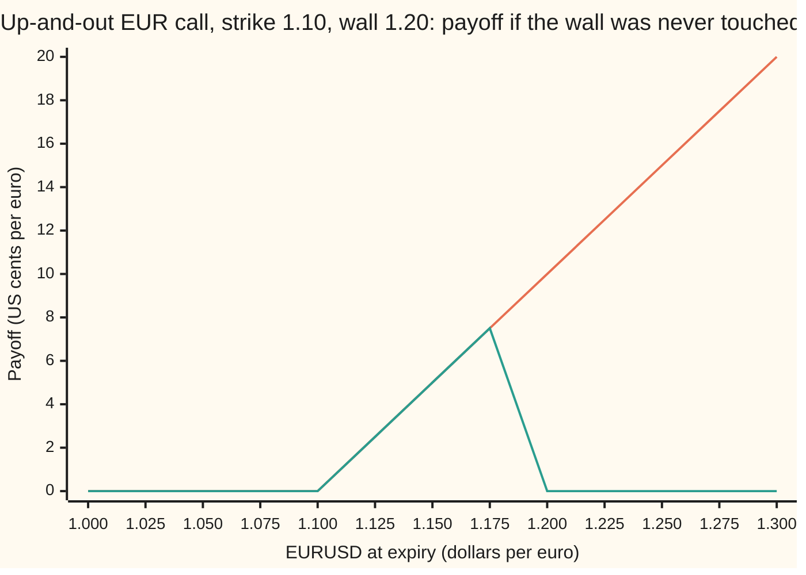
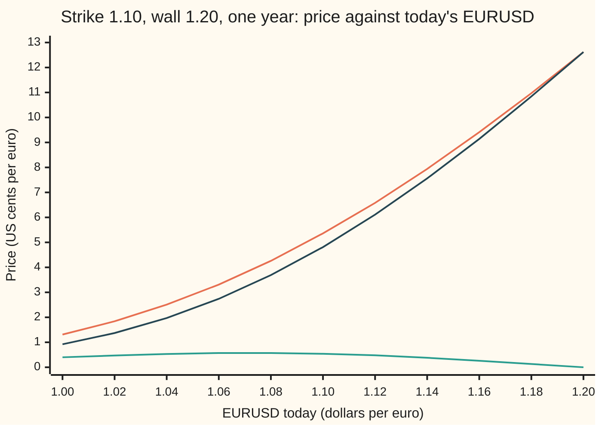

# The eight single barriers in one table: up or down, in or out, call or put, with rebates, from six building blocks

[Syllabus](../../../SYLLABUS.md) → [Financial mathematics](../README.md) → [FX exotics as desks use them - digitals, touches and barriers](../README.md#s23) → The eight single barriers in one table

---

## General Overview

An American importer must pay euros in a year. Today one euro costs 1.10 dollars, written EURUSD 1.10. A plain one-year call on the euro struck at 1.10 caps the cost of those euros. It costs 0.053556 dollars per euro of notional (the amount of euros the contract covers).

The desk offers a cheaper version. The same call, but it dies if EURUSD ever trades at 1.20 during the year. That wall sits above the strike, inside the region where the call pays. It is called a **reverse knock-out**, because the wall kills the option exactly when it is worth most. It costs 0.005440 dollars: about a tenth of the plain call. Its twin, which comes alive only on a touch of 1.20, costs 0.048115. The two add back to the plain call.

A single barrier has three switches. The wall is above or below today's rate (**up** or **down**). A touch kills the option or brings it to life (**out** or **in**). The option underneath is a **call** or a **put**. Two times two times two gives eight types. A **rebate** (a fixed cash sum paid to compensate for a knock-out, or for a knock-in that never came alive) can be added to any of them. Eight types, each with the strike on either side of the wall, is sixteen cases. They all come from six pieces of algebra, first tabulated by Mark Rubinstein and Eric Reiner in 1991, and called blocks A to F here.

**Every single-barrier option is a plain option cut to the paths and expiry rates that survive, minus the mirror image of that cut; the six blocks A to F are the pieces, and one table says which to add.**

**What kind of fact this is:** a theorem inside the Garman–Kohlhagen model (the Black–Scholes model for currencies), proved on this card in Why it works from the mirror density; the in-plus-out identity, without rebates, holds in every model.

### The picture: what the reverse knock-out pays



Orange: the plain call's payoff. Green: the reverse knock-out's payoff. It follows the plain call up to 7.50 cents at 1.175, then drops to zero at 1.20, because any path that ends at or above 1.20 touched 1.20 on the way. The most it can ever pay is the gap between strike and wall. A path that touches 1.20 in June and ends at 1.15 also pays zero.

---

## The formula

Notation first. $S$ is EURUSD today, $K$ the strike, $H$ the wall, $R$ the rebate, $r_d$ and $r_f$ the dollar and euro rates, $\sigma$ the volatility, $T$ the years to expiry, and $N$ the normal CDF (cumulative distribution function: the area under the bell curve to the left of a point). Two switches turn one set of formulas into all eight types. The **call-put switch** $\phi$ (phi) is +1 for a call and −1 for a put. The **wall switch** $\eta$ (eta) is +1 for a wall below today's rate and −1 for a wall above. Write $s = \sigma\sqrt{T}$ for the spread of log moves up to expiry. Each block is a dollar value today per euro of notional; $x_1$ to $z$, $\mu$ and $\lambda$ are defined just below.

$$A = \phi\,S e^{-r_f T} N(\phi x_1) - \phi\,K e^{-r_d T} N(\phi(x_1 - s))$$
$$B = \phi\,S e^{-r_f T} N(\phi x_2) - \phi\,K e^{-r_d T} N(\phi(x_2 - s))$$
$$C = \phi\,S e^{-r_f T} (H/S)^{2\mu+2} N(\eta y_1) - \phi\,K e^{-r_d T} (H/S)^{2\mu} N(\eta(y_1 - s))$$
$$D = \phi\,S e^{-r_f T} (H/S)^{2\mu+2} N(\eta y_2) - \phi\,K e^{-r_d T} (H/S)^{2\mu} N(\eta(y_2 - s))$$
$$E = R\,e^{-r_d T}\Big[N(\eta(x_2 - s)) - (H/S)^{2\mu} N(\eta(y_2 - s))\Big]$$
$$F = R\Big[(H/S)^{\mu+\lambda} N(\eta z) + (H/S)^{\mu-\lambda} N(\eta(z - 2\lambda s))\Big]$$

**Read it aloud:** A is the plain option; B is the plain option counted only where the rate ends beyond the wall; C and D are A and B seen in the mirror of the wall and weighted; E is the rebate paid at expiry if the wall was never touched; F is the rebate paid the moment it is.

The distances and exponents:

$$x_1 = \frac{\ln(S/K)}{s} + (1+\mu)s,\quad x_2 = \frac{\ln(S/H)}{s} + (1+\mu)s,\quad y_1 = \frac{\ln\!\big(H^2/(SK)\big)}{s} + (1+\mu)s,\quad y_2 = \frac{\ln(H/S)}{s} + (1+\mu)s$$

$$z = \frac{\ln(H/S)}{s} + \lambda s,\qquad \mu = \frac{r_d - r_f - \tfrac12\sigma^2}{\sigma^2},\qquad \lambda = \sqrt{\mu^2 + \frac{2r_d}{\sigma^2}}$$

In words: $x_1$ is the Garman–Kohlhagen d1; $x_2$ is the same with the wall in place of the strike; $y_1$ and $y_2$ are those two measured from the mirror spot $H^2/S$. The exponent $\mu$ is the drift of log EURUSD in units of its variance, the number that [Knock-out and knock-in](02-barrier-options-by-reflection.md) calls lambda. The exponent $\lambda$ here is the one that discounts money paid at a random touch date.

| Symbol | Plain meaning | In our example | Push it up and the answer… |
| --- | --- | --- | --- |
| $S$, $S_T$ | EURUSD today, and at expiry, dollars per euro | 1.10 | up-and-out call falls: the wall comes closer |
| $K$ | the strike | 1.10 | reverse knock-out falls fast: the slice between strike and wall narrows |
| $H$, $b$ | the barrier (the wall); $b = \ln(H/S)$, its log distance from spot | 1.05 below, 1.20 above | up-and-out call rises: more room before the wall |
| $R$ | the rebate, dollars per euro | 0.005 | rebate blocks rise in proportion |
| $r_d$, $r_f$ | the dollar and euro interest rates, continuously compounded | 5%, 3% | drift of EURUSD rises with the dollar rate, falls with the euro rate |
| $\sigma$, $T$, $s$ | volatility; years to expiry; $s = \sigma\sqrt{T}$ | 10%, 1, 0.10 | knock-outs can fall: more touches |
| $\phi$, $\eta$ | call-put switch (+1 call, −1 put); wall switch (+1 below, −1 above) | $\phi = 1$, $\eta = -1$ for the up-and-out call | |
| $\mu$, $\lambda$ | drift of log EURUSD over its variance; the pay-at-touch exponent | 1.5, 3.5 | |
| $x_1$, $x_2$, $y_1$, $y_2$, $z$ | distances in units of $s$, as defined above | wall 1.20: 0.25, −0.620114, 1.990228, 1.120114, 1.220114 | |
| $N$, $\varphi$, $(H/S)^{2\mu}$ | bell-curve area to the left; bell-curve height; the mirror weight | wall 1.20: weight 1.298272 | |
| $A$, $B$, $C$, $D$ | plain; plain beyond the wall; the mirror images of A and B | wall 1.20, call: 0.053556, 0.038997, −0.001488, 0.007630 | |
| $E$, $F$, $t$ | rebate at expiry if never touched; rebate at the touch; $t$ a time before expiry | per dollar, wall 1.20: 0.537017, 0.425164 | |

### The table of recipes

The strike sits on one side of the wall or the other. Knock-outs take block F if they carry a rebate paid at the touch; knock-ins take block E if they carry a rebate paid at expiry when they never came alive.

| Type | $\eta$ | $\phi$ | Strike at or above the wall | Strike below the wall |
| --- | --- | --- | --- | --- |
| down-and-out call | +1 | +1 | A − C | B − D |
| down-and-in call | +1 | +1 | C | A − B + D |
| down-and-out put | +1 | −1 | A − B + C − D | 0 |
| down-and-in put | +1 | −1 | B − C + D | A |
| up-and-out call | −1 | +1 | 0 | A − B + C − D |
| up-and-in call | −1 | +1 | A | B − C + D |
| up-and-out put | −1 | −1 | B − D | A − C |
| up-and-in put | −1 | −1 | A − B + D | C |

Each row pair adds to A, the plain option. That is in-plus-out parity, built into the table.

### When it holds

- **Continuous monitoring.** Every touch counts, however brief. A contract fixed once a day is worth a different amount; [Knock-out and knock-in](02-barrier-options-by-reflection.md) measures the gap and the shift that repairs it.
- **Constant volatility and rates, no jumps.** Real FX volatility varies with strike, and the reverse knock-out is the type most exposed to it, because its value sits in a narrow band just under the wall. [Barriers on a smile](07-barriers-with-the-smile.md) measures that error.
- **Spot on the live side of the wall.** With EURUSD already at or past the wall, a knock-out is dead (worth its rebate paid now) and a knock-in is the plain option.
- **Rebates as stated.** F pays at the touch; E pays at expiry. A rebate paid at expiry after a touch is a one-touch, not block F, and in-plus-out parity then needs the rebates added on both sides.

**Conventions verified 2026-09-27 (house terms; a term sheet overrides them):** notional in euros; premium and rebates in dollars per euro; the wall is watched continuously against the reference EURUSD rate, and a trade exactly at the wall is a touch; a pip is 0.0001.

---

## Why it works

### Step 0: every barrier is a cut of the plain payoff, minus its mirror

A knock-out pays the plain payoff on the paths that never touch the wall. [Knock-out and knock-in](02-barrier-options-by-reflection.md) proved that the density of those paths, on the side of the wall where the option is still alive, is the ordinary bell curve minus a weighted bell curve started from the mirror spot. So any knock-out is an integral of its payoff against two curves over one stretch of expiry rates. The eight types differ only in which stretch.

### Step 1: in plus out is the plain option

Hold a knock-in and a knock-out with the same wall, strike and type. On a path that touches, one died and one came alive. On a path that does not, the reverse. Either way the holder has the plain option. So each knock-in is the plain option minus its knock-out, with no model needed. Only four knock-outs need real work.

### Step 2: the plain density over a stretch gives A, B, or A − B

Integrate the payoff against the ordinary bell curve. Over every expiry rate where it pays, the answer is the plain option, block A. Over only the rates beyond the wall (above it for a call, below it for a put), the answer is B: the same formula with the wall in place of the strike inside the bell-curve areas. Over the rates between strike and wall, it is A − B. This is the "cut".

### Step 3: the mirror term over the same stretch gives C, D, or their difference

The mirror term is the same integral, for a rate that starts at $H^2/S$, times the mirror weight. Over the same stretches it produces the mirror copies of A, B and A − B. These are blocks C and D. The switch $\eta$ reads the mirror's bell curve from the correct side of the wall: for a wall above, it replaces each area $N(u)$ by $N(-u) = 1 - N(u)$. That flip changes the sign of a difference such as C − D, which is why the reverse knock-out ends in + C − D and not − C + D.

### Step 4: the four knock-outs, read off

- **Down-and-out call, strike at or above the wall.** The call pays only above the strike, and all of that lies on the live side. The stretch is the whole payoff: A − C. This is the regular knock-out of [Knock-out and knock-in](02-barrier-options-by-reflection.md).
- **Down-and-out call, strike below the wall.** Expiry rates between strike and wall can only be reached by paths that touched, so they are dead. The stretch is the rates above the wall: B − D.
- **Up-and-out call, strike below the wall.** The call pays above the strike, but only rates below the wall are alive. The stretch is strike to wall: the cut A − B, minus its mirror, which after the $\eta$ flip is A − B + C − D. This is the reverse knock-out.
- **Up-and-out call, strike at or above the wall.** Every paying rate lies at or past the wall. Nothing survives: 0.

The puts are the same four cases seen upside down, and Step 1 hands over the four knock-ins.

### Step 5: the two rebates

A rebate paid at expiry when a knock-in never came alive is the rebate times the chance of no touch, discounted from expiry: the no-touch of [One-touch and no-touch](04-fx-one-touch-and-no-touch.md). Integrating the survival density over the whole live side gives exactly block E. A rebate paid at the touch is the pay-at-hit one-touch of the same card: each touching path is discounted from its own touch date. Discounting at rate $r_d$ is the same as raising the drift from $\mu$ to $\lambda$ in variance units, which is where $\lambda = \sqrt{\mu^2 + 2r_d/\sigma^2}$ comes from; the proof is on that card. Block F is that price times the rebate.

<details>
<summary>Detailed proof</summary>

Let $u = \ln(S_T/S)$ and $b = \ln(H/S)$. Under the pricing measure $u$ is normal with mean $\mu\sigma^2 T$ and variance $s^2$; write $\varphi$ for its density. On paths that never touched the wall, and on the live side ($u > b$ for $\eta = 1$, $u < b$ for $\eta = -1$), the density of $u$ is
$$\varphi(u) - (H/S)^{2\mu}\,\varphi(u - 2b)$$
([Knock-out and knock-in](02-barrier-options-by-reflection.md), Detailed proof, where $e^{2\mu b} = (H/S)^{2\mu}$). A knock-out paying $\phi(Se^u - K)$ is worth $e^{-r_d T}$ times the integral of that payoff against this density over the live stretch of $u$ where the payoff is positive.

**Plain term.** Over the stretch "u beyond a cut point", completing the square as on the Black–Scholes card gives $\phi[S e^{-r_f T}N(\cdot) - K e^{-r_d T} N(\cdot)]$, with arguments $x_1, x_1 - s$ when the cut is the strike and $x_2, x_2 - s$ when it is the wall; $\phi$ turns "above the cut" into "below it" for puts. These are A and B, and a stretch between strike and wall gives A − B.

**Mirror term.** Substitute $u = x + 2b$. The density becomes $(H/S)^{2\mu}\varphi(x)$ and the payoff $\phi((H^2/S)e^x - K)$: the plain term for spot $H^2/S$. Its share leg gains a further $(H^2/S)/S = (H/S)^2$, which is why the share part of C and D carries $(H/S)^{2\mu+2}$. Shifting the cut by $2b$ turns $x_1$ into $y_1$ and $x_2$ into $y_2$ up to sign. For $\eta = 1$ the mirrored stretch lies above its cut and reads $N(y)$; for $\eta = -1$ the live side is $u < b$, the stretch reverses, and the areas become $N(-y)$. These are C and D.

**Assembly.** For $\eta = -1$, $\phi = 1$, strike below the wall, the stretch is strike to wall. The plain term gives A − B. The mirror term over the same stretch is a difference of two reversed areas; since $N(-y) = 1 - N(y)$, the constant parts cancel in the difference and it equals $-(C - D)$ in the table's sign convention. So the value is $(A - B) + (C - D)$. The other fifteen cells follow the same way; each is checked below against a direct numerical integral.

**Rebates.** $E$ is $R e^{-r_d T}$ times the survival density integrated over the whole live side, which is the bracket in E. For F, the first-touch density with drift $\mu\sigma^2$, multiplied by $e^{-r_d t}$, equals $(H/S)^{\mu-\lambda}$ times the first-touch density with drift $\lambda\sigma^2$ (Girsanov's change of drift, as on [One-touch and no-touch](04-fx-one-touch-and-no-touch.md)). The chance of a touch by $T$ at the new drift is $N(\eta(z - 2\lambda s)) + (H/S)^{2\lambda}N(\eta z)$; multiplying through gives the two terms of F.

</details>

### Another road

The same numbers come from brute force. One road multiplies the payoff by the chance that a path pinned at both ends never touched the wall, and integrates over the end point with Simpson's rule: no blocks. Another simulates 200,000 paths.

---

## Worked numbers, by hand

House market: EURUSD 1.10, strike 1.10, dollar rate 5%, euro rate 3%, volatility 10%, one year. The reverse knock-out: up-and-out call, wall 1.20, so $\eta = -1$, $\phi = +1$, strike below the wall.

| Step | Arithmetic | Value |
| --- | --- | --- |
| $\mu$ | $(0.05 - 0.03 - 0.005)/0.01$ | 1.5 |
| $\lambda$ | $\sqrt{2.25 + 0.10/0.01}$ | 3.5 |
| $x_1$ | $\ln(1.10/1.10)/0.1 + 2.5 \times 0.1$ | 0.25 |
| $x_2$ | $\ln(1.10/1.20)/0.1 + 0.25$ | −0.620114 |
| $y_1$, $y_2$ | $\ln(1.44/1.21)/0.1 + 0.25$; $\ln(1.20/1.10)/0.1 + 0.25$ | 1.990228; 1.120114 |
| mirror weights | $(1.20/1.10)^{3}$ and $(1.20/1.10)^{5}$ | 1.298272 and 1.545051 |
| A, the plain call | Garman–Kohlhagen | 0.053556 |
| B, the call beyond 1.20 | the payoff counted above 1.20 only | 0.038997 |
| C, D | the mirror copies, read from above the wall | −0.001488, 0.007630 |
| **up-and-out call** | $A - B + C - D$ with $C = -0.001488$: $0.053556 - 0.038997 - 0.001488 - 0.007630$ | **0.005440** |
| up-and-in call | $B - C + D = 0.038997 + 0.001488 + 0.007630$ | 0.048115 |
| check, full precision | up-and-out plus up-and-in | 0.053555771, the plain call |

A hand sum of six-decimal blocks can miss the last digit; the checks carry full precision. C is negative: with $\eta = -1$ the blocks are signed pieces, not prices.

The reverse knock-out is 0.1016 of the plain call; the knock-in takes 0.8984. B is the reason. Of the plain call's 0.053556, 0.038997 comes from expiry rates above 1.20, and those are all dead for the knock-out. The mirror term removes the rest: paths that end below 1.20 after visiting it.

### All eight at once

The house table, strike 1.10 for every type, wall 1.05 for the down types and 1.20 for the up types:

```
price, US dollars per euro     (each █ = 0.001 dollars)
down-and-out call  A-C       ██████████████████████████████████████████        0.041661
down-and-in call   C         ████████████                                      0.011895
down-and-out put   A-B+C-D   █                                                 0.000536
down-and-in put    B-C+D     ████████████████████████████████                  0.031882
up-and-out call    A-B+C-D   █████                                             0.005440
up-and-in call     B-C+D     ████████████████████████████████████████████████  0.048115
up-and-out put     A-C       ███████████████████████████████                   0.030930
up-and-in put      C         █                                                 0.001488
```

Down-and-out call plus down-and-in call is 0.053556, the plain call. Down-and-out put plus down-and-in put is 0.032418, the plain put. The two reverse knock-outs, the down-and-out put and the up-and-out call, are the two cheapest knock-outs: 0.000536 and 0.005440. The down-and-out put is almost worthless because a put struck at 1.10 with a wall at 1.05 can pay at most the gap between strike and wall, and dies on the way to paying it.

With the strike on the other side of each wall (1.00 for the down types, 1.25 for the up types), the other eight recipes give: down-and-out call 0.079507 (B − D), down-and-in call 0.042967, down-and-out put 0, down-and-in put 0.006214, up-and-out call 0, up-and-in call 0.008061, up-and-out put 0.106042 (B − D), up-and-in put 0.023566.

### Rebates

Add a rebate of 0.005 dollars per euro to the reverse knock-out.

| Rebate | Block | Price with rebate |
| --- | --- | --- |
| none | A − B + C − D | 0.005440 |
| 0.005 paid at the touch | + 0.005 × 0.425164 | 0.007566 |
| 0.005 paid at expiry after a touch | + 0.005 × 0.414213 | 0.007511 |

Paying at the touch is worth more, because the money arrives earlier. For the knock-in, a rebate of 0.005 paid at expiry if it never came alive adds 0.005 × E; on the down-and-in call that gives 0.013814 (E per dollar is 0.383822 for the wall at 1.05).

### What breaks if you drop a piece

Right answers: reverse knock-out 0.005440; down-and-out call 0.041661.

| Mistake | Comes out at | What went wrong |
| --- | --- | --- |
| Use the regular recipe A − C for the up-and-out call | 0.055044 | Priced the whole plain payoff as if it survived; the answer exceeds the plain call, 0.053556, which no knock-out can. |
| Leave the euro rate out of $\mu$ (down-and-out call) | 0.043844 against 0.041661 | Gave EURUSD the drift of a share with no dividend; the mirror weight and every distance shift. |
| Up-and-in from parity when the knock-out carries a touch rebate | 0.045990 against 0.050801 | In-plus-out equals the plain option only without rebates; with them, each side's rebate must be added back. |

---

## How the reverse knock-out moves with EURUSD

The mystery: a call that loses value when the euro rises. Keep one year to expiry and slide today's rate.



Orange: the plain call. Green: the up-and-out call, a low hump that peaks near 1.06 to 1.08 at 0.57 cents and falls to zero at the wall. Dark: the up-and-in call, which meets the plain call at 1.20, where it has come alive. The orange line is the sum of the other two at every point.

Delta (price change per unit move in EURUSD, by a one-pip bump) and vega (price change per volatility point, dollars) for all eight at the house rate:

| Type | Delta | Vega per point |
| --- | --- | --- |
| down-and-out call | 0.8043 | 0.001007 |
| down-and-in call | −0.2233 | 0.003120 |
| down-and-out put | 0.0075 | −0.000139 |
| down-and-in put | −0.3970 | 0.004267 |
| up-and-out call | −0.0242 | −0.001241 |
| up-and-in call | 0.6052 | 0.005369 |
| up-and-out put | −0.4203 | 0.003323 |
| up-and-in put | 0.0309 | 0.000804 |

Two signs surprise. The up-and-out call has negative delta: a higher euro brings the wall closer. Both reverse knock-outs have negative vega: more volatility means more touches, which outweighs the extra upside. How these behave right at the wall is [Greeks at the wall](06-barrier-and-touch-greeks.md).

---

## Code, from first principles, and it actually runs

The code prices all eight house types by the blocks, then by two roads that never use a block: a Simpson integral of the payoff times the chance that a path pinned at both ends never touched the wall, and a Monte Carlo of 200,000 paths with its own random numbers. It checks the other eight recipes against the integral, in-plus-out against a separately written Garman–Kohlhagen price, and block F against the first-touch density integrated over the year. The Monte Carlo dates a touch at the middle of its step, a small bias inside its standard error.

### Python

```python
# The eight single barriers -- the check behind the card.  Standard library only.  House FX market:
# EURUSD 1.10, strike 1.10, USD 5%, EUR 3%, vol 10%, 1 year, walls 1.05 and 1.20; USD per 1 EUR.
# Roads: (1) blocks A-F; (2) in + out = vanilla; (3) Simpson integral of payoff times bridge survival;
# (4) Monte Carlo with its own random numbers; (5) rebate at hit from the first-hitting-time density.
from math import log, exp, sqrt, cos, pi

def N(x):                                   # normal CDF, own series: 0.5 + phi(x)(x + x^3/3 + x^5/15 + ...)
    if abs(x) > 9.0: return 0.0 if x < 0 else 1.0
    term, total, k = x, x, 1
    while abs(term) > 1e-17 * abs(total) or k < 5:
        term *= x * x / (2 * k + 1); total += term; k += 1
    return 0.5 + total * exp(-0.5 * x * x) / sqrt(2 * pi)

S0, K, rd, rf, VOL, T, LO, HI, R = 1.10, 1.10, 0.05, 0.03, 0.10, 1.0, 1.05, 1.20, 0.005
# name, barrier, eta, phi, coefficients on A B C D, blocks in words, [strike if not K]
TYPES = [("DOC", LO, 1, 1, (1, 0, -1, 0), "A-C"), ("DIC", LO, 1, 1, (0, 0, 1, 0), "C"),
         ("DOP", LO, 1, -1, (1, -1, 1, -1), "A-B+C-D"), ("DIP", LO, 1, -1, (0, 1, -1, 1), "B-C+D"),
         ("UOC", HI, -1, 1, (1, -1, 1, -1), "A-B+C-D"), ("UIC", HI, -1, 1, (0, 1, -1, 1), "B-C+D"),
         ("UOP", HI, -1, -1, (1, 0, -1, 0), "A-C"), ("UIP", HI, -1, -1, (0, 0, 1, 0), "C")]
OTHER = [("DOC", LO, 1, 1, (0, 1, 0, -1), "B-D", 1.0), ("DIC", LO, 1, 1, (1, -1, 0, 1), "A-B+D", 1.0),   # strike under
         ("DOP", LO, 1, -1, (0, 0, 0, 0), "0", 1.0), ("DIP", LO, 1, -1, (1, 0, 0, 0), "A", 1.0),          # the low wall,
         ("UOC", HI, -1, 1, (0, 0, 0, 0), "0", 1.25), ("UIC", HI, -1, 1, (1, 0, 0, 0), "A", 1.25),        # strike over
         ("UOP", HI, -1, -1, (0, 1, 0, -1), "B-D", 1.25), ("UIP", HI, -1, -1, (1, -1, 0, 1), "A-B+D", 1.25)]  # the high
def blocks(S, v, H, eta, phi, b=rd - rf, K=K):
    s = v * sqrt(T); mu = (b - 0.5 * v * v) / (v * v); lam = sqrt(mu * mu + 2 * rd / (v * v))
    x1 = log(S / K) / s + (1 + mu) * s; x2 = log(S / H) / s + (1 + mu) * s
    y1 = log(H * H / (S * K)) / s + (1 + mu) * s; y2 = log(H / S) / s + (1 + mu) * s
    z = log(H / S) / s + lam * s
    fS, fK, hp, hm = S * exp(-rf * T), K * exp(-rd * T), (H / S) ** (2 * mu + 2), (H / S) ** (2 * mu)
    A = phi * fS * N(phi * x1) - phi * fK * N(phi * x1 - phi * s)
    B = phi * fS * N(phi * x2) - phi * fK * N(phi * x2 - phi * s)
    C = phi * fS * hp * N(eta * y1) - phi * fK * hm * N(eta * y1 - eta * s)
    D = phi * fS * hp * N(eta * y2) - phi * fK * hm * N(eta * y2 - eta * s)
    E = exp(-rd * T) * (N(eta * x2 - eta * s) - hm * N(eta * y2 - eta * s))     # 1 USD at expiry if never hit
    F = (H / S) ** (mu + lam) * N(eta * z) + (H / S) ** (mu - lam) * N(eta * z - 2 * eta * lam * s)  # 1 USD at hit
    return A, B, C, D, E, F, (mu, lam, x1, x2, y1, y2, z, hp, hm)

def price(t, S=S0, v=VOL, b=rd - rf):
    bl = blocks(S, v, t[1], t[2], t[3], b, *t[6:])
    return sum(c * x for c, x in zip(t[4], bl[:4]))

def simpson(f, a, b, n):
    h = (b - a) / n; tot = f(a) + f(b)
    for i in range(1, n):
        tot += (4 if i % 2 else 2) * f(a + i * h)
    return tot * h / 3

def by_integral(t):                         # road 3: survival chance of a bridge pinned at both ends
    H, eta, phi, out, k = t[1], t[2], t[3], t[0][1] == "O", (t[6:] or [K])[0]
    a, m, s = log(H / S0), (rd - rf - 0.5 * VOL * VOL) * T, VOL * sqrt(T)
    def f(z):
        x = m + s * z
        pay = max(phi * (S0 * exp(x) - k), 0.0)
        live = x > a if eta == 1 else x < a
        surv = 1 - exp(-2 * a * (a - x) / (s * s)) if live else 0.0
        return pay * (surv if out else 1 - surv) * exp(-0.5 * z * z) / sqrt(2 * pi)
    return exp(-rd * T) * simpson(f, -9.0, 9.0, 20000)

def hit_integral(H):                        # road 5: first-hitting-time density, discounted
    a, nu = log(H / S0), rd - rf - 0.5 * VOL * VOL
    f = lambda t: 0.0 if t == 0 else exp(-rd * t) * abs(a) / (VOL * sqrt(2 * pi * t ** 3)) * exp(-(a - nu * t) ** 2 / (2 * VOL * VOL * t))
    return simpson(f, 0.0, T, 20000)

state = [20260927]
def unif():                                 # splitmix64, then 53 bits into (0, 1)
    state[0] = (state[0] + 0x9E3779B97F4A7C15) & 0xFFFFFFFFFFFFFFFF
    z = state[0]
    z = ((z ^ (z >> 30)) * 0xBF58476D1CE4E5B9) & 0xFFFFFFFFFFFFFFFF
    z = ((z ^ (z >> 27)) * 0x94D049BB133111EB) & 0xFFFFFFFFFFFFFFFF
    return ((z ^ (z >> 31)) >> 11) * 2.0 ** -53 + 2.0 ** -54

def monte_carlo(paths=200000, steps=20):     # road 4: 12 payoffs per path, bridge test each step
    dt = T / steps; drift, sd = (rd - rf - 0.5 * VOL * VOL) * dt, VOL * sqrt(dt)
    aL, aH, disc = log(LO / S0), log(HI / S0), exp(-rd * T)
    sm, sq = [0.0] * 12, [0.0] * 12
    for _ in range(paths):
        x, tL, tH = 0.0, -1.0, -1.0
        for i in range(steps):
            z = sqrt(-2 * log(unif())) * cos(2 * pi * unif()); u3, u4 = unif(), unif()
            y = x + drift + sd * z
            if tL < 0 and (y <= aL or u3 < exp(-2 * (x - aL) * (y - aL) / (sd * sd))): tL = (i + 0.5) * dt
            if tH < 0 and (y >= aH or u4 < exp(-2 * (aH - x) * (aH - y) / (sd * sd))): tH = (i + 0.5) * dt
            x = y
        c, p = max(S0 * exp(x) - K, 0.0) * disc, max(K - S0 * exp(x), 0.0) * disc
        hL, hH = tL >= 0, tH >= 0
        v = [c * (not hL), c * hL, p * (not hL), p * hL, c * (not hH), c * hH, p * (not hH), p * hH,
             exp(-rd * tL) if hL else 0.0, exp(-rd * tH) if hH else 0.0, disc * (not hL), disc * (not hH)]
        for k in range(12):
            sm[k] += v[k]; sq[k] += v[k] * v[k]
    mean = [s / paths for s in sm]
    return mean, [sqrt(max(sq[k] / paths - mean[k] ** 2, 0.0) / paths) for k in range(12)]

def gk(phi, S=S0, K=K):                     # Garman-Kohlhagen vanilla, written the usual way
    d1 = (log(S / K) + (rd - rf + 0.5 * VOL * VOL) * T) / (VOL * sqrt(T)); d2 = d1 - VOL * sqrt(T)
    return phi * (S * exp(-rf * T) * N(phi * d1) - K * exp(-rd * T) * N(phi * d2))

van, (mc, se) = {1: gk(1), -1: gk(-1)}, monte_carlo()
print(f"vanilla EUR call {van[1]:.6f}   vanilla EUR put {van[-1]:.6f}")
for H, eta in ((LO, 1), (HI, -1)):
    print(f"blocks, call, H={H:.2f}   " + "  ".join(f"{x:.6f}" for x in blocks(S0, VOL, H, eta, 1)[:6]))
    print(f"pieces, H={H:.2f} mu lam x1 x2 y1 y2 z hp hm " + " ".join(f"{x:.6f}" for x in blocks(S0, VOL, H, eta, 1)[6]))
print("type blocks      formula  integral  monte-carlo   se      delta    vega/pt")
P = {}
for k, t in enumerate(TYPES):
    P[t[0]] = price(t); I = by_integral(t)
    dl = (price(t, S0 + 1e-4) - price(t, S0 - 1e-4)) / 2e-4
    vg = (price(t, v=VOL + 1e-4) - price(t, v=VOL - 1e-4)) / 2e-4 * 0.01
    print(f"{t[0]}  {t[5]:<9} {P[t[0]]:9.6f} {I:9.6f} {mc[k]:9.6f} {se[k]:9.6f} {dl:8.4f} {vg:9.6f}")
    assert abs(I - P[t[0]]) < 1e-7, t[0]
    assert abs(mc[k] - P[t[0]]) < 4 * se[k], t[0]
for o, i, ph in (("DOC", "DIC", 1), ("DOP", "DIP", -1), ("UOC", "UIC", 1), ("UOP", "UIP", -1)):
    print(f"parity {o}+{i} {P[o] + P[i]:.9f}  vanilla {van[ph]:.9f}")
    assert abs(P[o] + P[i] - van[ph]) < 1e-12
for k, t in enumerate(OTHER):               # the barrier on the other side of the strike
    P[k], I = price(t), by_integral(t)
    print(f"other side, {t[0]} K={t[6]:.2f} {t[5]:<6} formula {P[k]:.6f}  integral {I:.6f}")
    assert abs(I - P[k]) < 1e-7 and (k % 2 == 0 or abs(P[k] + P[k - 1] - gk(t[3], S0, t[6])) < 1e-12)
for j, (H, eta) in enumerate(((LO, 1), (HI, -1))):
    (E, F), Fi = blocks(S0, VOL, H, eta, 1)[4:6], hit_integral(H)
    print(f"1 USD at hit, H={H:.2f}: F {F:.6f}  density {Fi:.6f}  mc {mc[8 + j]:.6f}")
    print(f"1 USD at expiry if untouched, H={H:.2f}: E {E:.6f}  mc {mc[10 + j]:.6f}")
    assert abs(Fi - F) < 1e-7 and abs(mc[8 + j] - F) < 4 * se[8 + j] and abs(mc[10 + j] - E) < 4 * se[10 + j]
EU, FU, ED = blocks(S0, VOL, HI, -1, 1)[4], blocks(S0, VOL, HI, -1, 1)[5], blocks(S0, VOL, LO, 1, 1)[4]
print(f"one-touch 1.20, 1 USD at expiry = e^-rT - E {exp(-rd * T) - EU:.6f}")
print(f"UOC share of vanilla {P['UOC'] / van[1]:.4f}   UIC share {P['UIC'] / van[1]:.4f}")
print(f"UOC + 0.005 rebate at hit {P['UOC'] + R * FU:.6f}   at expiry {P['UOC'] + R * (exp(-rd * T) - EU):.6f}")
print(f"DIC + 0.005 rebate at expiry if never in {P['DIC'] + R * ED:.6f}")
print(f"wrong: UOC by the regular pair A-C {blocks(S0, VOL, HI, -1, 1)[0] - blocks(S0, VOL, HI, -1, 1)[2]:.6f}")
print(f"wrong: DOC with the EUR rate left out of mu {price(TYPES[0], b=rd):.6f}")
print(f"wrong: UIC+rebate as vanilla - (UOC+rebate at hit) {van[1] - P['UOC'] - R * FU:.6f}  right {P['UIC'] + R * EU:.6f}")
xs = [1.00 + 0.02 * i for i in range(11)]
print("chart, spot today    " + " ".join(f"{x:6.2f}" for x in xs))
print("chart, vanilla cents " + " ".join(f"{100 * gk(1, x):6.2f}" for x in xs))
for t in TYPES[4:6]:
    print(f"chart, {t[0]}     cents " + " ".join(f"{100 * (price(t, x) if abs(price(t, x)) > 1e-12 else 0.0):6.2f}" for x in xs))
xs = [1.00 + 0.025 * i for i in range(13)]
print("payoff, EURUSD at expiry " + " ".join(f"{x:5.3f}" for x in xs))
print("payoff, vanilla   cents  " + " ".join(f"{100 * max(x - K, 0):5.2f}" for x in xs))
print("payoff, UOC       cents  " + " ".join(f"{100 * max(x - K, 0) * (x < HI - 1e-9):5.2f}" for x in xs))
print("ALL CHECKS PASS")
```

**Ran 2026-09-27 on macOS, Python 3.14.6, standard library only. All checks passed. Output, pasted from the run:**

```
vanilla EUR call 0.053556   vanilla EUR put 0.032418
blocks, call, H=1.05   0.053556  0.049573  0.011895  0.008448  0.383822  0.587604
pieces, H=1.05 mu lam x1 x2 y1 y2 z hp hm 1.500000 3.500000 0.250000 0.715200 -0.680400 -0.215200 -0.115200 0.792470 0.869741
blocks, call, H=1.20   0.053556  0.038997  -0.001488  0.007630  0.537017  0.425164
pieces, H=1.20 mu lam x1 x2 y1 y2 z hp hm 1.500000 3.500000 0.250000 -0.620114 1.990228 1.120114 1.220114 1.545051 1.298272
type blocks      formula  integral  monte-carlo   se      delta    vega/pt
DOC  A-C        0.041661  0.041661  0.041548  0.000160   0.8043  0.001007
DIC  C          0.011895  0.011895  0.011935  0.000076  -0.2233  0.003120
DOP  A-B+C-D    0.000536  0.000536  0.000534  0.000008   0.0075 -0.000139
DIP  B-C+D      0.031882  0.031882  0.031839  0.000115  -0.3970  0.004267
UOC  A-B+C-D    0.005440  0.005440  0.005460  0.000034  -0.0242 -0.001241
UIC  B-C+D      0.048115  0.048115  0.048024  0.000168   0.6052  0.005369
UOP  A-C        0.030930  0.030930  0.030894  0.000114  -0.4203  0.003323
UIP  C          0.001488  0.001488  0.001479  0.000022   0.0309  0.000804
parity DOC+DIC 0.053555771  vanilla 0.053555771
parity DOP+DIP 0.032418051  vanilla 0.032418051
parity UOC+UIC 0.053555771  vanilla 0.053555771
parity UOP+UIP 0.032418051  vanilla 0.032418051
other side, DOC K=1.00 B-D    formula 0.079507  integral 0.079507
other side, DIC K=1.00 A-B+D  formula 0.042967  integral 0.042967
other side, DOP K=1.00 0      formula 0.000000  integral 0.000000
other side, DIP K=1.00 A      formula 0.006214  integral 0.006214
other side, UOC K=1.25 0      formula 0.000000  integral 0.000000
other side, UIC K=1.25 A      formula 0.008061  integral 0.008061
other side, UOP K=1.25 B-D    formula 0.106042  integral 0.106042
other side, UIP K=1.25 A-B+D  formula 0.023566  integral 0.023566
1 USD at hit, H=1.05: F 0.587604  density 0.587604  mc 0.588664
1 USD at expiry if untouched, H=1.05: E 0.383822  mc 0.382832
1 USD at hit, H=1.20: F 0.425164  density 0.425164  mc 0.424481
1 USD at expiry if untouched, H=1.20: E 0.537017  mc 0.537687
one-touch 1.20, 1 USD at expiry = e^-rT - E 0.414213
UOC share of vanilla 0.1016   UIC share 0.8984
UOC + 0.005 rebate at hit 0.007566   at expiry 0.007511
DIC + 0.005 rebate at expiry if never in 0.013814
wrong: UOC by the regular pair A-C 0.055044
wrong: DOC with the EUR rate left out of mu 0.043844
wrong: UIC+rebate as vanilla - (UOC+rebate at hit) 0.045990  right 0.050801
chart, spot today      1.00   1.02   1.04   1.06   1.08   1.10   1.12   1.14   1.16   1.18   1.20
chart, vanilla cents   1.31   1.84   2.51   3.31   4.26   5.36   6.58   7.94   9.41  10.97  12.62
chart, UOC     cents   0.40   0.47   0.53   0.57   0.57   0.54   0.48   0.38   0.26   0.13   0.00
chart, UIC     cents   0.92   1.37   1.97   2.74   3.69   4.81   6.11   7.56   9.14  10.84  12.62
payoff, EURUSD at expiry 1.000 1.025 1.050 1.075 1.100 1.125 1.150 1.175 1.200 1.225 1.250 1.275 1.300
payoff, vanilla   cents   0.00  0.00  0.00  0.00  0.00  2.50  5.00  7.50 10.00 12.50 15.00 17.50 20.00
payoff, UOC       cents   0.00  0.00  0.00  0.00  0.00  2.50  5.00  7.50  0.00  0.00  0.00  0.00  0.00
ALL CHECKS PASS
```

### Rust

```rust
// The eight single barriers -- the check behind the card.  Rust std only, no crates.  House FX market:
// EURUSD 1.10, strike 1.10, USD 5%, EUR 3%, vol 10%, 1 year, walls 1.05 and 1.20; USD per 1 EUR.
// Roads: (1) blocks A-F; (2) in + out = vanilla; (3) Simpson integral of payoff times bridge survival;
// (4) Monte Carlo with its own random numbers; (5) rebate at hit from the first-hitting-time density.
use std::f64::consts::PI;
const S0: f64 = 1.10; const K: f64 = 1.10; const RD: f64 = 0.05; const RF: f64 = 0.03;
const VOL: f64 = 0.10; const T: f64 = 1.0; const LO: f64 = 1.05; const HI: f64 = 1.20; const R: f64 = 0.005;

fn n(x: f64) -> f64 { // normal CDF, own series: 0.5 + phi(x)(x + x^3/3 + x^5/15 + ...)
    if x.abs() > 9.0 { return if x < 0.0 { 0.0 } else { 1.0 }; }
    let (mut term, mut total, mut k) = (x, x, 1.0);
    while term.abs() > 1e-17 * total.abs() || k < 5.0 {
        term *= x * x / (2.0 * k + 1.0); total += term; k += 1.0;
    }
    0.5 + total * (-0.5 * x * x).exp() / (2.0 * PI).sqrt()
}

// name, barrier, eta, phi, coefficients on A B C D, blocks in words, strike
struct Ty(&'static str, f64, f64, f64, [f64; 4], &'static str, f64);
const TYPES: [Ty; 8] = [Ty("DOC", LO, 1.0, 1.0, [1.0, 0.0, -1.0, 0.0], "A-C", K), Ty("DIC", LO, 1.0, 1.0, [0.0, 0.0, 1.0, 0.0], "C", K),
    Ty("DOP", LO, 1.0, -1.0, [1.0, -1.0, 1.0, -1.0], "A-B+C-D", K), Ty("DIP", LO, 1.0, -1.0, [0.0, 1.0, -1.0, 1.0], "B-C+D", K),
    Ty("UOC", HI, -1.0, 1.0, [1.0, -1.0, 1.0, -1.0], "A-B+C-D", K), Ty("UIC", HI, -1.0, 1.0, [0.0, 1.0, -1.0, 1.0], "B-C+D", K),
    Ty("UOP", HI, -1.0, -1.0, [1.0, 0.0, -1.0, 0.0], "A-C", K), Ty("UIP", HI, -1.0, -1.0, [0.0, 0.0, 1.0, 0.0], "C", K)];
const OTHER: [Ty; 8] = [Ty("DOC", LO, 1.0, 1.0, [0.0, 1.0, 0.0, -1.0], "B-D", 1.0), Ty("DIC", LO, 1.0, 1.0, [1.0, -1.0, 0.0, 1.0], "A-B+D", 1.0),
    Ty("DOP", LO, 1.0, -1.0, [0.0; 4], "0", 1.0), Ty("DIP", LO, 1.0, -1.0, [1.0, 0.0, 0.0, 0.0], "A", 1.0),
    Ty("UOC", HI, -1.0, 1.0, [0.0; 4], "0", 1.25), Ty("UIC", HI, -1.0, 1.0, [1.0, 0.0, 0.0, 0.0], "A", 1.25),
    Ty("UOP", HI, -1.0, -1.0, [0.0, 1.0, 0.0, -1.0], "B-D", 1.25), Ty("UIP", HI, -1.0, -1.0, [1.0, -1.0, 0.0, 1.0], "A-B+D", 1.25)];

fn blocks(s0: f64, v: f64, h: f64, eta: f64, phi: f64, b: f64, k: f64) -> [f64; 15] {
    let s = v * T.sqrt(); let mu = (b - 0.5 * v * v) / (v * v); let lam = (mu * mu + 2.0 * RD / (v * v)).sqrt();
    let x1 = (s0 / k).ln() / s + (1.0 + mu) * s; let x2 = (s0 / h).ln() / s + (1.0 + mu) * s;
    let y1 = (h * h / (s0 * k)).ln() / s + (1.0 + mu) * s; let y2 = (h / s0).ln() / s + (1.0 + mu) * s;
    let z = (h / s0).ln() / s + lam * s;
    let (fs, fk) = (s0 * (-RF * T).exp(), k * (-RD * T).exp());
    let (hp, hm) = ((h / s0).powf(2.0 * mu + 2.0), (h / s0).powf(2.0 * mu));
    let a = phi * fs * n(phi * x1) - phi * fk * n(phi * x1 - phi * s);
    let bb = phi * fs * n(phi * x2) - phi * fk * n(phi * x2 - phi * s);
    let c = phi * fs * hp * n(eta * y1) - phi * fk * hm * n(eta * y1 - eta * s);
    let d = phi * fs * hp * n(eta * y2) - phi * fk * hm * n(eta * y2 - eta * s);
    let e = (-RD * T).exp() * (n(eta * x2 - eta * s) - hm * n(eta * y2 - eta * s)); // 1 USD at expiry if never hit
    let f = (h / s0).powf(mu + lam) * n(eta * z) + (h / s0).powf(mu - lam) * n(eta * z - 2.0 * eta * lam * s); // 1 USD at hit
    [a, bb, c, d, e, f, mu, lam, x1, x2, y1, y2, z, hp, hm]
}
fn price(t: &Ty, s0: f64, v: f64, b: f64) -> f64 {
    let bl = blocks(s0, v, t.1, t.2, t.3, b, t.6);
    (0..4).fold(0.0, |acc, i| acc + t.4[i] * bl[i])
}
fn simpson(f: &dyn Fn(f64) -> f64, a: f64, b: f64, m: usize) -> f64 {
    let h = (b - a) / m as f64; let mut tot = f(a) + f(b);
    for i in 1..m { tot += (if i % 2 == 1 { 4.0 } else { 2.0 }) * f(a + i as f64 * h); }
    tot * h / 3.0
}
fn by_integral(t: &Ty) -> f64 { // road 3: survival chance of a bridge pinned at both ends
    let out = t.0.as_bytes()[1] == b'O';
    let (a, m, s) = ((t.1 / S0).ln(), (RD - RF - 0.5 * VOL * VOL) * T, VOL * T.sqrt());
    let f = |z: f64| {
        let x = m + s * z; let pay = (t.3 * (S0 * x.exp() - t.6)).max(0.0);
        let live = if t.2 == 1.0 { x > a } else { x < a };
        let surv = if live { 1.0 - (-2.0 * a * (a - x) / (s * s)).exp() } else { 0.0 };
        pay * (if out { surv } else { 1.0 - surv }) * (-0.5 * z * z).exp() / (2.0 * PI).sqrt()
    };
    (-RD * T).exp() * simpson(&f, -9.0, 9.0, 20000)
}
fn hit_integral(h: f64) -> f64 { // road 5: first-hitting-time density, discounted
    let (a, nu) = ((h / S0).ln(), RD - RF - 0.5 * VOL * VOL);
    let f = |t: f64| if t == 0.0 { 0.0 } else {
        (-RD * t).exp() * a.abs() / (VOL * (2.0 * PI * t.powf(3.0)).sqrt()) * (-(a - nu * t).powf(2.0) / (2.0 * VOL * VOL * t)).exp()
    };
    simpson(&f, 0.0, T, 20000)
}
struct Rng(u64);
impl Rng { // splitmix64, then 53 bits into (0, 1)
    fn unif(&mut self) -> f64 {
        self.0 = self.0.wrapping_add(0x9E3779B97F4A7C15); let mut z = self.0;
        z = (z ^ (z >> 30)).wrapping_mul(0xBF58476D1CE4E5B9);
        z = (z ^ (z >> 27)).wrapping_mul(0x94D049BB133111EB);
        ((z ^ (z >> 31)) >> 11) as f64 * 2f64.powi(-53) + 2f64.powi(-54)
    }
}
fn monte_carlo(paths: usize, steps: usize) -> ([f64; 12], [f64; 12]) { // road 4: bridge test each step
    let mut g = Rng(20260927);
    let dt = T / steps as f64; let (drift, sd) = ((RD - RF - 0.5 * VOL * VOL) * dt, VOL * dt.sqrt());
    let (al, ah, disc) = ((LO / S0).ln(), (HI / S0).ln(), (-RD * T).exp());
    let (mut sm, mut sq) = ([0.0f64; 12], [0.0f64; 12]);
    for _ in 0..paths {
        let (mut x, mut tl, mut th) = (0.0f64, -1.0f64, -1.0f64);
        for i in 0..steps {
            let u1 = g.unif(); let u2 = g.unif();
            let z = (-2.0 * u1.ln()).sqrt() * (2.0 * PI * u2).cos(); let (u3, u4) = (g.unif(), g.unif());
            let y = x + drift + sd * z;
            if tl < 0.0 && (y <= al || u3 < (-2.0 * (x - al) * (y - al) / (sd * sd)).exp()) { tl = (i as f64 + 0.5) * dt; }
            if th < 0.0 && (y >= ah || u4 < (-2.0 * (ah - x) * (ah - y) / (sd * sd)).exp()) { th = (i as f64 + 0.5) * dt; }
            x = y;
        }
        let (c, p) = ((S0 * x.exp() - K).max(0.0) * disc, (K - S0 * x.exp()).max(0.0) * disc);
        let (hl, hh) = (tl >= 0.0, th >= 0.0);
        let (o, i_) = (|hit: bool, val: f64| if hit { 0.0 } else { val }, |hit: bool, val: f64| if hit { val } else { 0.0 });
        let v = [o(hl, c), i_(hl, c), o(hl, p), i_(hl, p), o(hh, c), i_(hh, c), o(hh, p), i_(hh, p),
                 if hl { (-RD * tl).exp() } else { 0.0 }, if hh { (-RD * th).exp() } else { 0.0 }, o(hl, disc), o(hh, disc)];
        for k in 0..12 { sm[k] += v[k]; sq[k] += v[k] * v[k]; }
    }
    let (mut mean, mut se) = ([0.0f64; 12], [0.0f64; 12]);
    for k in 0..12 {
        mean[k] = sm[k] / paths as f64; se[k] = ((sq[k] / paths as f64 - mean[k].powf(2.0)).max(0.0) / paths as f64).sqrt();
    }
    (mean, se)
}
fn gk(phi: f64, s: f64, k: f64) -> f64 { // Garman-Kohlhagen vanilla, written the usual way
    let d1 = ((s / k).ln() + (RD - RF + 0.5 * VOL * VOL) * T) / (VOL * T.sqrt()); let d2 = d1 - VOL * T.sqrt();
    phi * (s * (-RF * T).exp() * n(phi * d1) - k * (-RD * T).exp() * n(phi * d2))
}
fn row(xs: &[f64], w: usize, p: usize, f: &dyn Fn(f64) -> f64) -> String {
    xs.iter().map(|&x| format!("{:w$.p$}", f(x), w = w, p = p)).collect::<Vec<_>>().join(" ")
}
fn main() {
    let b0 = RD - RF; let van = [gk(1.0, S0, K), gk(-1.0, S0, K)];
    let (mc, se) = monte_carlo(200000, 20);
    println!("vanilla EUR call {:.6}   vanilla EUR put {:.6}", van[0], van[1]);
    for (h, eta) in [(LO, 1.0), (HI, -1.0)] {
        let bl = blocks(S0, VOL, h, eta, 1.0, b0, K);
        println!("blocks, call, H={:.2}   {}", h, bl[..6].iter().map(|x| format!("{:.6}", x)).collect::<Vec<_>>().join("  "));
        println!("pieces, H={:.2} mu lam x1 x2 y1 y2 z hp hm {}", h, bl[6..].iter().map(|x| format!("{:.6}", x)).collect::<Vec<_>>().join(" "));
    }
    println!("type blocks      formula  integral  monte-carlo   se      delta    vega/pt");
    let mut p = [0.0f64; 8];
    for (k, t) in TYPES.iter().enumerate() {
        p[k] = price(t, S0, VOL, b0); let i = by_integral(t);
        let dl = (price(t, S0 + 1e-4, VOL, b0) - price(t, S0 - 1e-4, VOL, b0)) / 2e-4;
        let vg = (price(t, S0, VOL + 1e-4, b0) - price(t, S0, VOL - 1e-4, b0)) / 2e-4 * 0.01;
        println!("{}  {:<9} {:9.6} {:9.6} {:9.6} {:9.6} {:8.4} {:9.6}", t.0, t.5, p[k], i, mc[k], se[k], dl, vg);
        assert!((i - p[k]).abs() < 1e-7, "{}", t.0);
        assert!((mc[k] - p[k]).abs() < 4.0 * se[k], "{}", t.0);
    }
    for (o, ph) in [(0usize, 0usize), (2, 1), (4, 0), (6, 1)] {
        println!("parity {}+{} {:.9}  vanilla {:.9}", TYPES[o].0, TYPES[o + 1].0, p[o] + p[o + 1], van[ph]);
        assert!((p[o] + p[o + 1] - van[ph]).abs() < 1e-12);
    }
    let mut q = [0.0f64; 8];
    for (k, t) in OTHER.iter().enumerate() { // the barrier on the other side of the strike
        q[k] = price(t, S0, VOL, b0); let i = by_integral(t);
        println!("other side, {} K={:.2} {:<6} formula {:.6}  integral {:.6}", t.0, t.6, t.5, q[k], i);
        assert!((i - q[k]).abs() < 1e-7 && (k % 2 == 0 || (q[k] + q[k - 1] - gk(t.3, S0, t.6)).abs() < 1e-12));
    }
    for (j, (h, eta)) in [(LO, 1.0), (HI, -1.0)].iter().enumerate() {
        let bl = blocks(S0, VOL, *h, *eta, 1.0, b0, K); let fi = hit_integral(*h);
        println!("1 USD at hit, H={:.2}: F {:.6}  density {:.6}  mc {:.6}", h, bl[5], fi, mc[8 + j]);
        println!("1 USD at expiry if untouched, H={:.2}: E {:.6}  mc {:.6}", h, bl[4], mc[10 + j]);
        assert!((fi - bl[5]).abs() < 1e-7 && (mc[8 + j] - bl[5]).abs() < 4.0 * se[8 + j] && (mc[10 + j] - bl[4]).abs() < 4.0 * se[10 + j]);
    }
    let (bu, bd) = (blocks(S0, VOL, HI, -1.0, 1.0, b0, K), blocks(S0, VOL, LO, 1.0, 1.0, b0, K));
    let (eu, fu, ed) = (bu[4], bu[5], bd[4]);
    println!("one-touch 1.20, 1 USD at expiry = e^-rT - E {:.6}", (-RD * T).exp() - eu);
    println!("UOC share of vanilla {:.4}   UIC share {:.4}", p[4] / van[0], p[5] / van[0]);
    println!("UOC + 0.005 rebate at hit {:.6}   at expiry {:.6}", p[4] + R * fu, p[4] + R * ((-RD * T).exp() - eu));
    println!("DIC + 0.005 rebate at expiry if never in {:.6}", p[1] + R * ed);
    println!("wrong: UOC by the regular pair A-C {:.6}", bu[0] - bu[2]);
    println!("wrong: DOC with the EUR rate left out of mu {:.6}", price(&TYPES[0], S0, VOL, RD));
    println!("wrong: UIC+rebate as vanilla - (UOC+rebate at hit) {:.6}  right {:.6}", van[0] - p[4] - R * fu, p[5] + R * eu);
    let xs: Vec<f64> = (0..11).map(|i| 1.00 + 0.02 * i as f64).collect();
    println!("chart, spot today    {}", row(&xs, 6, 2, &|x| x));
    println!("chart, vanilla cents {}", row(&xs, 6, 2, &|x| 100.0 * gk(1.0, x, K)));
    for t in &TYPES[4..6] {
        println!("chart, {}     cents {}", t.0, row(&xs, 6, 2, &|x| { let v = price(t, x, VOL, b0); 100.0 * (if v.abs() > 1e-12 { v } else { 0.0 }) }));
    }
    let xs: Vec<f64> = (0..13).map(|i| 1.00 + 0.025 * i as f64).collect();
    println!("payoff, EURUSD at expiry {}", row(&xs, 5, 3, &|x| x));
    println!("payoff, vanilla   cents  {}", row(&xs, 5, 2, &|x| 100.0 * (x - K).max(0.0)));
    println!("payoff, UOC       cents  {}", row(&xs, 5, 2, &|x| 100.0 * (x - K).max(0.0) * (if x < HI - 1e-9 { 1.0 } else { 0.0 })));
    println!("ALL CHECKS PASS");
}
```

**Ran 2026-09-27 on macOS, rustc 1.98.1, no crates. All checks passed. Output, pasted from the run:**

```
vanilla EUR call 0.053556   vanilla EUR put 0.032418
blocks, call, H=1.05   0.053556  0.049573  0.011895  0.008448  0.383822  0.587604
pieces, H=1.05 mu lam x1 x2 y1 y2 z hp hm 1.500000 3.500000 0.250000 0.715200 -0.680400 -0.215200 -0.115200 0.792470 0.869741
blocks, call, H=1.20   0.053556  0.038997  -0.001488  0.007630  0.537017  0.425164
pieces, H=1.20 mu lam x1 x2 y1 y2 z hp hm 1.500000 3.500000 0.250000 -0.620114 1.990228 1.120114 1.220114 1.545051 1.298272
type blocks      formula  integral  monte-carlo   se      delta    vega/pt
DOC  A-C        0.041661  0.041661  0.041548  0.000160   0.8043  0.001007
DIC  C          0.011895  0.011895  0.011935  0.000076  -0.2233  0.003120
DOP  A-B+C-D    0.000536  0.000536  0.000534  0.000008   0.0075 -0.000139
DIP  B-C+D      0.031882  0.031882  0.031839  0.000115  -0.3970  0.004267
UOC  A-B+C-D    0.005440  0.005440  0.005460  0.000034  -0.0242 -0.001241
UIC  B-C+D      0.048115  0.048115  0.048024  0.000168   0.6052  0.005369
UOP  A-C        0.030930  0.030930  0.030894  0.000114  -0.4203  0.003323
UIP  C          0.001488  0.001488  0.001479  0.000022   0.0309  0.000804
parity DOC+DIC 0.053555771  vanilla 0.053555771
parity DOP+DIP 0.032418051  vanilla 0.032418051
parity UOC+UIC 0.053555771  vanilla 0.053555771
parity UOP+UIP 0.032418051  vanilla 0.032418051
other side, DOC K=1.00 B-D    formula 0.079507  integral 0.079507
other side, DIC K=1.00 A-B+D  formula 0.042967  integral 0.042967
other side, DOP K=1.00 0      formula 0.000000  integral 0.000000
other side, DIP K=1.00 A      formula 0.006214  integral 0.006214
other side, UOC K=1.25 0      formula 0.000000  integral 0.000000
other side, UIC K=1.25 A      formula 0.008061  integral 0.008061
other side, UOP K=1.25 B-D    formula 0.106042  integral 0.106042
other side, UIP K=1.25 A-B+D  formula 0.023566  integral 0.023566
1 USD at hit, H=1.05: F 0.587604  density 0.587604  mc 0.588664
1 USD at expiry if untouched, H=1.05: E 0.383822  mc 0.382832
1 USD at hit, H=1.20: F 0.425164  density 0.425164  mc 0.424481
1 USD at expiry if untouched, H=1.20: E 0.537017  mc 0.537687
one-touch 1.20, 1 USD at expiry = e^-rT - E 0.414213
UOC share of vanilla 0.1016   UIC share 0.8984
UOC + 0.005 rebate at hit 0.007566   at expiry 0.007511
DIC + 0.005 rebate at expiry if never in 0.013814
wrong: UOC by the regular pair A-C 0.055044
wrong: DOC with the EUR rate left out of mu 0.043844
wrong: UIC+rebate as vanilla - (UOC+rebate at hit) 0.045990  right 0.050801
chart, spot today      1.00   1.02   1.04   1.06   1.08   1.10   1.12   1.14   1.16   1.18   1.20
chart, vanilla cents   1.31   1.84   2.51   3.31   4.26   5.36   6.58   7.94   9.41  10.97  12.62
chart, UOC     cents   0.40   0.47   0.53   0.57   0.57   0.54   0.48   0.38   0.26   0.13   0.00
chart, UIC     cents   0.92   1.37   1.97   2.74   3.69   4.81   6.11   7.56   9.14  10.84  12.62
payoff, EURUSD at expiry 1.000 1.025 1.050 1.075 1.100 1.125 1.150 1.175 1.200 1.225 1.250 1.275 1.300
payoff, vanilla   cents   0.00  0.00  0.00  0.00  0.00  2.50  5.00  7.50 10.00 12.50 15.00 17.50 20.00
payoff, UOC       cents   0.00  0.00  0.00  0.00  0.00  2.50  5.00  7.50  0.00  0.00  0.00  0.00  0.00
ALL CHECKS PASS
```

The two outputs are identical, byte for byte, including the Monte Carlo rows: both use the same splitmix64 generator and the same arithmetic order.

### Lean

Lean proves the table for all sixteen cases, in-plus-out parity in every model, and block F.

- Take any of the sixteen cases, with today's rate on the live side of the wall. Then the knock-out, priced from the mirror density of Step 0, equals its table entry.
- In the same cases, each knock-in, priced as the plain option minus its knock-out, equals its table entry.
- In any model where "the wall was touched" has a probability, knock-in plus knock-out is the plain option, with no rebates.
- Take a rebate $R$ paid at the touch, discounted at $r_d$ from the touch date, up to expiry, with $\lambda$ real. Then its value, from the first-touch density, is block F.
- It also checks the house numbers. These are $\mu = 1.5$, $\lambda = 3.5$, the mirror exponents, the reverse knock-out's 10-cent cap, and the counts 8 and 16.

Block E, the block values, the Monte Carlo and the Greeks are left to the Python and Rust checks.

```lean
-- The eight single barriers in one table: in the Garman-Kohlhagen model every knock-out is its payoff integrated against the plain-minus-mirror density on the live side of the wall, which equals the table's sum of blocks A to D for all sixteen cases, every knock-in is the plain option minus its knock-out in any model, and the rebate paid at the touch is block F.
import Mathlib.Probability.Distributions.Gaussian.Real
import Mathlib.Probability.CDF
import Mathlib.MeasureTheory.Integral.Lebesgue.Basic
import Mathlib.Analysis.SpecialFunctions.Pow.Real
import Mathlib.MeasureTheory.Integral.IntervalIntegral.FundThmCalculus
import Mathlib.Analysis.SpecialFunctions.Sqrt
import Mathlib.Topology.Algebra.Order.Field

open Real MeasureTheory ProbabilityTheory Set

namespace EightBarriers

/-- `N(x)`: the bell-curve area to the left of `x` (the standard normal CDF). -/
noncomputable def N (x : ℝ) : ℝ := cdf (gaussianReal 0 1) x

/-- `μ = (r_d - r_f - σ²/2) / σ²`: the drift of log EURUSD in units of its variance. -/
noncomputable def mu (rd rf σ : ℝ) : ℝ := (rd - rf - σ ^ 2 / 2) / σ ^ 2

/-- `λ = √(μ² + 2 r_d / σ²)`: the exponent that discounts money paid at the touch. -/
noncomputable def lam (rd rf σ : ℝ) : ℝ := √(mu rd rf σ ^ 2 + 2 * rd / σ ^ 2)

/-- `x₁ = ln(S/K)/s + (1 + μ)s` with `s = σ√T`: the Garman-Kohlhagen `d₁`. -/
noncomputable def x1 (S K rd rf σ T : ℝ) : ℝ :=
  log (S / K) / (σ * √T) + (1 + mu rd rf σ) * (σ * √T)

/-- `x₂ = ln(S/H)/s + (1 + μ)s`: `x₁` with the wall in place of the strike. -/
noncomputable def x2 (S H rd rf σ T : ℝ) : ℝ :=
  log (S / H) / (σ * √T) + (1 + mu rd rf σ) * (σ * √T)

/-- `y₁ = ln(H²/(SK))/s + (1 + μ)s`: `x₁` measured from the mirror spot `H²/S`. -/
noncomputable def y1 (S K H rd rf σ T : ℝ) : ℝ :=
  log (H ^ 2 / (S * K)) / (σ * √T) + (1 + mu rd rf σ) * (σ * √T)

/-- `y₂ = ln(H/S)/s + (1 + μ)s`: `x₂` measured from the mirror spot. -/
noncomputable def y2 (S H rd rf σ T : ℝ) : ℝ :=
  log (H / S) / (σ * √T) + (1 + mu rd rf σ) * (σ * √T)

/-- `z = ln(H/S)/s + λs`. -/
noncomputable def z (S H rd rf σ T : ℝ) : ℝ :=
  log (H / S) / (σ * √T) + lam rd rf σ * (σ * √T)

/-- Block `A = φ S e^{-r_f T} N(φx₁) - φ K e^{-r_d T} N(φ(x₁ - s))`: the plain option. -/
noncomputable def blockA (φ S K rd rf σ T : ℝ) : ℝ :=
  φ * S * exp (-(rf * T)) * N (φ * x1 S K rd rf σ T)
    - φ * K * exp (-(rd * T)) * N (φ * (x1 S K rd rf σ T - σ * √T))

/-- Block `B = φ S e^{-r_f T} N(φx₂) - φ K e^{-r_d T} N(φ(x₂ - s))`:
the plain option counted only beyond the wall. -/
noncomputable def blockB (φ S K H rd rf σ T : ℝ) : ℝ :=
  φ * S * exp (-(rf * T)) * N (φ * x2 S H rd rf σ T)
    - φ * K * exp (-(rd * T)) * N (φ * (x2 S H rd rf σ T - σ * √T))

/-- Block `C = φ S e^{-r_f T} (H/S)^{2μ+2} N(ηy₁) - φ K e^{-r_d T} (H/S)^{2μ} N(η(y₁ - s))`:
the mirror copy of `A`. -/
noncomputable def blockC (φ η S K H rd rf σ T : ℝ) : ℝ :=
  φ * S * exp (-(rf * T)) * (H / S) ^ (2 * mu rd rf σ + 2) * N (η * y1 S K H rd rf σ T)
    - φ * K * exp (-(rd * T)) * (H / S) ^ (2 * mu rd rf σ)
        * N (η * (y1 S K H rd rf σ T - σ * √T))

/-- Block `D = φ S e^{-r_f T} (H/S)^{2μ+2} N(ηy₂) - φ K e^{-r_d T} (H/S)^{2μ} N(η(y₂ - s))`:
the mirror copy of `B`. -/
noncomputable def blockD (φ η S K H rd rf σ T : ℝ) : ℝ :=
  φ * S * exp (-(rf * T)) * (H / S) ^ (2 * mu rd rf σ + 2) * N (η * y2 S H rd rf σ T)
    - φ * K * exp (-(rd * T)) * (H / S) ^ (2 * mu rd rf σ)
        * N (η * (y2 S H rd rf σ T - σ * √T))

/-- Block `F = R [(H/S)^{μ+λ} N(ηz) + (H/S)^{μ-λ} N(η(z - 2λs))]`:
the rebate `R` paid the moment the wall is touched. -/
noncomputable def blockF (η R S H rd rf σ T : ℝ) : ℝ :=
  R * ((H / S) ^ (mu rd rf σ + lam rd rf σ) * N (η * z S H rd rf σ T)
    + (H / S) ^ (mu rd rf σ - lam rd rf σ)
        * N (η * (z S H rd rf σ T - 2 * lam rd rf σ * (σ * √T))))

/-- The card's knock-out column. `φ` is the call-put switch (`+1` call, `-1` put), `η` the wall
switch (`+1` wall below today's rate, `-1` above); the inner `if` picks the column
"strike at or above the wall" (`H ≤ K`) or "strike below the wall". -/
noncomputable def knockOutRecipe (φ η K H A B C D : ℝ) : ℝ :=
  if η = 1 then
    (if φ = 1 then (if H ≤ K then A - C else B - D)          -- down-and-out call
     else (if H ≤ K then A - B + C - D else 0))              -- down-and-out put
  else
    (if φ = 1 then (if H ≤ K then 0 else A - B + C - D)      -- up-and-out call
     else (if H ≤ K then B - D else A - C))                  -- up-and-out put

/-- The card's knock-in column, row by row. -/
noncomputable def knockInRecipe (φ η K H A B C D : ℝ) : ℝ :=
  if η = 1 then
    (if φ = 1 then (if H ≤ K then C else A - B + D)          -- down-and-in call
     else (if H ≤ K then B - C + D else A))                  -- down-and-in put
  else
    (if φ = 1 then (if H ≤ K then A else B - C + D)          -- up-and-in call
     else (if H ≤ K then A - B + D else C))                  -- up-and-in put

/-- The bell curve of the log move `u = ln(S_T/S)` under the pricing measure:
centre `(r_d - r_f - σ²/2)T`, variance `σ²T`. -/
noncomputable def f (rd rf σ T u : ℝ) : ℝ :=
  gaussianPDFReal ((rd - rf - σ ^ 2 / 2) * T) (σ ^ 2 * T).toNNReal u

lemma gauss_set_eq (m c : ℝ) (v : NNReal) (hv : (v : ℝ) = c ^ 2) (hc : c ≠ 0) {A : Set ℝ}
    (hA : MeasurableSet A) :
    ∫ u in A, gaussianPDFReal m v u = (gaussianReal 0 1).real ((fun x => c * x + m) ⁻¹' A) := by
  have hv0 : v ≠ 0 := by
    intro h; rw [h] at hv; simp at hv; exact hc (pow_eq_zero_iff two_ne_zero |>.1 hv.symm)
  have hmap : (gaussianReal 0 1).map (fun x => c * x + m) = gaussianReal m v := by
    have : (fun x : ℝ => c * x + m) = (· + m) ∘ (c * ·) := rfl
    rw [this, ← Measure.map_map (measurable_add_const m) (measurable_const_mul c),
      gaussianReal_map_const_mul, gaussianReal_map_add_const]
    congr 1
    · simp
    · ext; simp [hv]
  have h1 : (gaussianReal m v).real A = ∫ u in A, gaussianPDFReal m v u := by
    rw [measureReal_def, gaussianReal_apply_eq_integral _ hv0, ENNReal.toReal_ofReal
      (setIntegral_nonneg hA (fun x _ => gaussianPDFReal_nonneg _ _ _))]
  rw [← h1, ← hmap, measureReal_def, measureReal_def, Measure.map_apply (by fun_prop) hA]

lemma half_int (η a m s : ℝ) (v : NNReal) (hv : (v : ℝ) = s ^ 2) (hs : 0 < s)
    (hη : η = 1 ∨ η = -1) :
    ∫ u in {u : ℝ | η * a < η * u}, gaussianPDFReal m v u = N (η * ((m - a) / s)) := by
  have := nullSingletonClass_gaussianReal (μ := (0 : ℝ)) (v := 1) one_ne_zero
  have hmeas : MeasurableSet {u : ℝ | η * a < η * u} := measurableSet_lt (by fun_prop) (by fun_prop)
  rcases hη with rfl | rfl
  · rw [gauss_set_eq m (-s) v (by rw [hv]; ring) (neg_ne_zero.2 hs.ne') hmeas]
    have : (fun x => -s * x + m) ⁻¹' {u : ℝ | 1 * a < 1 * u} = Iio ((m - a) / s) := by
      ext x
      simp only [mem_preimage, mem_ofPred_eq, mem_Iio, one_mul]
      rw [lt_div_iff₀ hs]
      constructor <;> intro h <;> linarith
    rw [this, N, cdf_eq_real, one_mul]
    exact measureReal_congr Iio_ae_eq_Iic
  · rw [gauss_set_eq m s v hv hs.ne' hmeas]
    have : (fun x => s * x + m) ⁻¹' {u : ℝ | -1 * a < -1 * u} = Iio ((a - m) / s) := by
      ext x
      simp only [mem_preimage, mem_ofPred_eq, mem_Iio]
      rw [lt_div_iff₀ hs]
      constructor <;> intro h <;> linarith
    rw [this, N, cdf_eq_real, show -1 * ((m - a) / s) = (a - m) / s by ring]
    exact measureReal_congr Iio_ae_eq_Iic

lemma exp_mul_pdf (m u s : ℝ) (v : NNReal) (hv : (v : ℝ) = s ^ 2) (hs : 0 < s) :
    exp u * gaussianPDFReal m v u = exp (m + s ^ 2 / 2) * gaussianPDFReal (m + s ^ 2) v u := by
  simp only [gaussianPDFReal, hv]
  rw [mul_left_comm, ← exp_add, mul_left_comm (exp _), ← exp_add]
  congr 2
  field_simp
  ring

lemma payoff_fun (φ c m S K s : ℝ) (v : NNReal) (hv : (v : ℝ) = s ^ 2) (hs : 0 < s) :
    (fun u => φ * (S * exp u - K) * (c * gaussianPDFReal m v u))
      = fun u => (c * φ * S * exp (m + s ^ 2 / 2)) * gaussianPDFReal (m + s ^ 2) v u
          - (c * φ * K) * gaussianPDFReal m v u := by
  funext u
  rw [mul_assoc (c * φ * S), ← exp_mul_pdf m u s v hv hs]
  ring

lemma payoff_integrable (φ c m S K s : ℝ) (v : NNReal) (hv : (v : ℝ) = s ^ 2) (hs : 0 < s) :
    Integrable (fun u => φ * (S * exp u - K) * (c * gaussianPDFReal m v u)) := by
  rw [payoff_fun φ c m S K s v hv hs]
  exact ((integrable_gaussianPDFReal _ _).const_mul _).sub
    ((integrable_gaussianPDFReal _ _).const_mul _)

lemma payoff_int (φ η a m c S K s : ℝ) (v : NNReal) (hv : (v : ℝ) = s ^ 2) (hs : 0 < s)
    (hη : η = 1 ∨ η = -1) :
    ∫ u in {u : ℝ | η * a < η * u}, φ * (S * exp u - K) * (c * gaussianPDFReal m v u)
      = c * (φ * S * exp (m + s ^ 2 / 2) * N (η * ((m + s ^ 2 - a) / s))
          - φ * K * N (η * ((m - a) / s))) := by
  rw [payoff_fun φ c m S K s v hv hs,
    integral_sub ((integrable_gaussianPDFReal _ _).restrict.const_mul _)
      ((integrable_gaussianPDFReal _ _).restrict.const_mul _),
    integral_const_mul, integral_const_mul, half_int η a _ s v hv hs hη,
    half_int η a _ s v hv hs hη]
  ring

lemma payoff_int1 (φ η a m S K s : ℝ) (v : NNReal) (hv : (v : ℝ) = s ^ 2) (hs : 0 < s)
    (hη : η = 1 ∨ η = -1) :
    ∫ u in {u : ℝ | η * a < η * u}, φ * (S * exp u - K) * gaussianPDFReal m v u
      = φ * S * exp (m + s ^ 2 / 2) * N (η * ((m + s ^ 2 - a) / s))
          - φ * K * N (η * ((m - a) / s)) := by
  simpa only [one_mul] using payoff_int φ η a m 1 S K s v hv hs hη

lemma max_payoff (φ S K u : ℝ) (hφ : φ = 1 ∨ φ = -1) (hS : 0 < S) (hK : 0 < K) :
    max (φ * (S * exp u - K)) 0
      = {u : ℝ | φ * log (K / S) < φ * u}.indicator (fun u => φ * (S * exp u - K)) u := by
  have h1 : S * exp u - K = S * (exp u - exp (log (K / S))) := by
    rw [exp_log (div_pos hK hS)]; field_simp
  have key : 0 < φ * (S * exp u - K) ↔ φ * log (K / S) < φ * u := by
    rw [h1]
    rcases hφ with rfl | rfl
    · simp only [one_mul]
      constructor
      · intro h
        have : exp (log (K / S)) < exp u := by nlinarith
        exact exp_lt_exp.1 this
      · intro h
        have := exp_lt_exp.2 h
        nlinarith
    · constructor
      · intro h
        have : exp u < exp (log (K / S)) := by nlinarith
        have := exp_lt_exp.1 this
        linarith
      · intro h
        have := exp_lt_exp.2 (show u < log (K / S) by linarith)
        nlinarith
  by_cases h : φ * log (K / S) < φ * u
  · rw [indicator_of_mem (show u ∈ {u : ℝ | φ * log (K / S) < φ * u} from h)]
    exact max_eq_left (key.2 h).le
  · rw [indicator_of_notMem (show u ∉ {u : ℝ | φ * log (K / S) < φ * u} from h)]
    exact max_eq_right (not_lt.1 (mt key.1 h))

lemma int_Ioo_Ioi {g : ℝ → ℝ} (hg : Integrable g) {a c : ℝ} (h : a ≤ c) :
    ∫ u in Ioo a c, g u = (∫ u in Ioi a, g u) - ∫ u in Ioi c, g u := by
  rw [← Ioc_union_Ioi_eq_Ioi h, setIntegral_union
    (Set.disjoint_left.2 fun x (hx : x ∈ Ioc a c) (hx' : x ∈ Ioi c) => absurd hx.2 (not_le.2 hx')) measurableSet_Ioi
    hg.integrableOn hg.integrableOn, integral_Ioc_eq_integral_Ioo]
  ring

lemma int_Ioo_Iio {g : ℝ → ℝ} (hg : Integrable g) {a c : ℝ} (h : a ≤ c) :
    ∫ u in Ioo a c, g u = (∫ u in Iio c, g u) - ∫ u in Iio a, g u := by
  rw [← Iio_union_Ico_eq_Iio h, setIntegral_union
    (Set.disjoint_left.2 fun x (hx : x ∈ Iio a) (hx' : x ∈ Ico a c) => absurd hx'.1 (not_le.2 hx)) measurableSet_Ico
    hg.integrableOn hg.integrableOn, integral_Ico_eq_integral_Ioo]
  ring

lemma region_int (p q : ℝ → ℝ) (hp : Integrable p) (hq : Integrable q) (φ η b k : ℝ)
    (hφ : φ = 1 ∨ φ = -1) (hη : η = 1 ∨ η = -1) :
    ∫ u in {u : ℝ | η * b < η * u} ∩ {u : ℝ | φ * k < φ * u}, (p u - q u)
      = knockOutRecipe φ η k b
          (∫ u in {u : ℝ | φ * k < φ * u}, p u) (∫ u in {u : ℝ | φ * b < φ * u}, p u)
          (∫ u in {u : ℝ | η * k < η * u}, q u) (∫ u in {u : ℝ | η * b < η * u}, q u) := by
  have e1 : ∀ a : ℝ, {u : ℝ | 1 * a < 1 * u} = Ioi a := fun a => by ext u; simp
  have e2 : ∀ a : ℝ, {u : ℝ | -1 * a < -1 * u} = Iio a := fun a => by ext u; simp
  have hm : (-1 : ℝ) ≠ 1 := by norm_num
  have hsub : ∀ s : Set ℝ, ∫ u in s, (p u - q u) = (∫ u in s, p u) - ∫ u in s, q u :=
    fun s => integral_sub hp.integrableOn hq.integrableOn
  rcases hφ with rfl | rfl <;> rcases hη with rfl | rfl <;> simp only [e1, e2] <;>
    unfold knockOutRecipe <;> by_cases hbk : b ≤ k
  · rw [if_pos rfl, if_pos rfl, if_pos hbk, Ioi_inter_Ioi, max_eq_right hbk, hsub]
  · rw [if_pos rfl, if_pos rfl, if_neg hbk, Ioi_inter_Ioi, max_eq_left ((not_le.1 hbk).le), hsub]
  · rw [if_neg hm, if_pos rfl, if_pos hbk, Iio_inter_Ioi, Ioo_eq_empty (not_lt.2 hbk),
      setIntegral_empty]
  · rw [if_neg hm, if_pos rfl, if_neg hbk, Iio_inter_Ioi, hsub,
      int_Ioo_Ioi hp (not_le.1 hbk).le, int_Ioo_Iio hq (not_le.1 hbk).le]
    ring
  · rw [if_pos rfl, if_neg hm, if_pos hbk, Ioi_inter_Iio, hsub, int_Ioo_Iio hp hbk,
      int_Ioo_Ioi hq hbk]
    ring
  · rw [if_pos rfl, if_neg hm, if_neg hbk, Ioi_inter_Iio,
      Ioo_eq_empty (not_lt.2 (not_le.1 hbk).le), setIntegral_empty]
  · rw [if_neg hm, if_neg hm, if_pos hbk, Iio_inter_Iio, min_eq_left hbk, hsub]
  · rw [if_neg hm, if_neg hm, if_neg hbk, Iio_inter_Iio, min_eq_right (not_le.1 hbk).le,
      hsub]

lemma recipe_mul (c φ η K H K' H' A B C D : ℝ) (h : H ≤ K ↔ H' ≤ K') :
    c * knockOutRecipe φ η K H A B C D
      = knockOutRecipe φ η K' H' (c * A) (c * B) (c * C) (c * D) := by
  unfold knockOutRecipe
  simp only [h]
  split_ifs <;> ring

lemma in_add_out (φ η K H A B C D : ℝ) :
    knockInRecipe φ η K H A B C D + knockOutRecipe φ η K H A B C D = A := by
  unfold knockInRecipe knockOutRecipe
  split_ifs <;> ring

#print axioms gauss_set_eq
#print axioms half_int
#print axioms exp_mul_pdf
#print axioms payoff_fun
#print axioms payoff_integrable
#print axioms payoff_int
#print axioms payoff_int1
#print axioms max_payoff
#print axioms int_Ioo_Ioi
#print axioms int_Ioo_Iio
#print axioms region_int
#print axioms recipe_mul
#print axioms in_add_out

lemma blocks_as_integrals
    (φ η S K H rd rf σ T : ℝ) (hφ : φ = 1 ∨ φ = -1) (hη : η = 1 ∨ η = -1)
    (hS : 0 < S) (hK : 0 < K) (hH : 0 < H) (hσ : 0 < σ) (hT : 0 < T) :
    blockA φ S K rd rf σ T
        = exp (-(rd * T)) * ∫ u in {u : ℝ | φ * log (K / S) < φ * u},
            φ * (S * exp u - K) * f rd rf σ T u ∧
    blockB φ S K H rd rf σ T
        = exp (-(rd * T)) * ∫ u in {u : ℝ | φ * log (H / S) < φ * u},
            φ * (S * exp u - K) * f rd rf σ T u ∧
    blockC φ η S K H rd rf σ T
        = exp (-(rd * T)) * ∫ u in {u : ℝ | η * log (K / S) < η * u},
            φ * (S * exp u - K) * ((H / S) ^ (2 * mu rd rf σ) * f rd rf σ T (u - 2 * log (H / S))) ∧
    blockD φ η S K H rd rf σ T
        = exp (-(rd * T)) * ∫ u in {u : ℝ | η * log (H / S) < η * u},
            φ * (S * exp u - K) * ((H / S) ^ (2 * mu rd rf σ) * f rd rf σ T (u - 2 * log (H / S))) := by
  obtain ⟨t, ht0, rfl⟩ : ∃ t, 0 < t ∧ T = t ^ 2 :=
    ⟨√T, Real.sqrt_pos.2 hT, (Real.sq_sqrt hT.le).symm⟩
  have hsq : √(t ^ 2) = t := Real.sqrt_sq ht0.le
  have hs : 0 < σ * t := mul_pos hσ ht0
  have hv : ((σ ^ 2 * t ^ 2).toNNReal : ℝ) = (σ * t) ^ 2 := by
    rw [Real.coe_toNNReal _ (by positivity)]; ring
  have hHS : 0 < H / S := div_pos hH hS
  have lKS : log (K / S) = log K - log S := Real.log_div hK.ne' hS.ne'
  have lSK : log (S / K) = log S - log K := Real.log_div hS.ne' hK.ne'
  have lHS : log (H / S) = log H - log S := Real.log_div hH.ne' hS.ne'
  have lSH : log (S / H) = log S - log H := Real.log_div hS.ne' hH.ne'
  have lHH : log (H ^ 2 / (S * K)) = 2 * log H - log S - log K := by
    rw [Real.log_div (by positivity) (by positivity), Real.log_mul hS.ne' hK.ne', Real.log_pow]
    push_cast; ring
  have hσ0 : σ ≠ 0 := hσ.ne'
  have ht00 : t ≠ 0 := ht0.ne'
  simp only [f, gaussianPDFReal_sub]
  refine ⟨?_, ?_, ?_, ?_⟩
  · rw [payoff_int1 φ φ (log (K / S)) ((rd - rf - σ ^ 2 / 2) * t ^ 2) S K (σ * t) _ hv hs hφ]
    unfold blockA
    have hx' : x1 S K rd rf σ (t ^ 2)
        = ((rd - rf - σ ^ 2 / 2) * t ^ 2 + (σ * t) ^ 2 - log (K / S)) / (σ * t) := by
      unfold x1 mu; rw [hsq, lSK, lKS]; field_simp; ring
    have hy : φ * (x1 S K rd rf σ (t ^ 2) - σ * √(t ^ 2))
        = φ * (((rd - rf - σ ^ 2 / 2) * t ^ 2 - log (K / S)) / (σ * t)) := by
      rw [hsq, hx']; field_simp; ring
    have he : exp (-(rd * t ^ 2)) * exp ((rd - rf - σ ^ 2 / 2) * t ^ 2 + (σ * t) ^ 2 / 2)
        = exp (-(rf * t ^ 2)) := by rw [← exp_add]; congr 1; ring
    rw [hy, hx', ← he]; ring
  · rw [payoff_int1 φ φ (log (H / S)) ((rd - rf - σ ^ 2 / 2) * t ^ 2) S K (σ * t) _ hv hs hφ]
    unfold blockB
    have hx' : x2 S H rd rf σ (t ^ 2)
        = ((rd - rf - σ ^ 2 / 2) * t ^ 2 + (σ * t) ^ 2 - log (H / S)) / (σ * t) := by
      unfold x2 mu; rw [hsq, lSH, lHS]; field_simp; ring
    have hy : φ * (x2 S H rd rf σ (t ^ 2) - σ * √(t ^ 2))
        = φ * (((rd - rf - σ ^ 2 / 2) * t ^ 2 - log (H / S)) / (σ * t)) := by
      rw [hsq, hx']; field_simp; ring
    have he : exp (-(rd * t ^ 2)) * exp ((rd - rf - σ ^ 2 / 2) * t ^ 2 + (σ * t) ^ 2 / 2)
        = exp (-(rf * t ^ 2)) := by rw [← exp_add]; congr 1; ring
    rw [hy, hx', ← he]; ring
  · rw [payoff_int φ η (log (K / S)) ((rd - rf - σ ^ 2 / 2) * t ^ 2 + 2 * log (H / S))
      ((H / S) ^ (2 * mu rd rf σ)) S K (σ * t) _ hv hs hη]
    unfold blockC
    have hx' : y1 S K H rd rf σ (t ^ 2)
        = ((rd - rf - σ ^ 2 / 2) * t ^ 2 + 2 * log (H / S) + (σ * t) ^ 2 - log (K / S))
          / (σ * t) := by
      unfold y1 mu; rw [hsq, lHH, lHS, lKS]; field_simp; ring
    have hy : η * (y1 S K H rd rf σ (t ^ 2) - σ * √(t ^ 2))
        = η * (((rd - rf - σ ^ 2 / 2) * t ^ 2 + 2 * log (H / S) - log (K / S)) / (σ * t)) := by
      rw [hsq, hx']; field_simp; ring
    have he : exp (-(rd * t ^ 2)) * (H / S) ^ (2 * mu rd rf σ)
          * exp ((rd - rf - σ ^ 2 / 2) * t ^ 2 + 2 * log (H / S) + (σ * t) ^ 2 / 2)
        = exp (-(rf * t ^ 2)) * (H / S) ^ (2 * mu rd rf σ + 2) := by
      simp only [rpow_def_of_pos hHS]
      rw [← exp_add, ← exp_add, ← exp_add]; congr 1; ring
    rw [hy, hx']
    linear_combination (-(φ * S * N (η * (((rd - rf - σ ^ 2 / 2) * t ^ 2 + 2 * log (H / S)
      + (σ * t) ^ 2 - log (K / S)) / (σ * t))))) * he
  · rw [payoff_int φ η (log (H / S)) ((rd - rf - σ ^ 2 / 2) * t ^ 2 + 2 * log (H / S))
      ((H / S) ^ (2 * mu rd rf σ)) S K (σ * t) _ hv hs hη]
    unfold blockD
    have hx' : y2 S H rd rf σ (t ^ 2)
        = ((rd - rf - σ ^ 2 / 2) * t ^ 2 + 2 * log (H / S) + (σ * t) ^ 2 - log (H / S))
          / (σ * t) := by
      unfold y2 mu; rw [hsq]; field_simp; ring
    have hy : η * (y2 S H rd rf σ (t ^ 2) - σ * √(t ^ 2))
        = η * (((rd - rf - σ ^ 2 / 2) * t ^ 2 + 2 * log (H / S) - log (H / S)) / (σ * t)) := by
      rw [hsq, hx']; field_simp; ring
    have he : exp (-(rd * t ^ 2)) * (H / S) ^ (2 * mu rd rf σ)
          * exp ((rd - rf - σ ^ 2 / 2) * t ^ 2 + 2 * log (H / S) + (σ * t) ^ 2 / 2)
        = exp (-(rf * t ^ 2)) * (H / S) ^ (2 * mu rd rf σ + 2) := by
      simp only [rpow_def_of_pos hHS]
      rw [← exp_add, ← exp_add, ← exp_add]; congr 1; ring
    rw [hy, hx']
    linear_combination (-(φ * S * N (η * (((rd - rf - σ ^ 2 / 2) * t ^ 2 + 2 * log (H / S)
      + (σ * t) ^ 2 - log (H / S)) / (σ * t))))) * he

lemma f_integrable_parts (φ c S K rd rf σ T sh : ℝ) (hσ : 0 < σ) (hT : 0 < T) :
    Integrable (fun u => φ * (S * exp u - K) * (c * f rd rf σ T (u - sh))) := by
  have hs : 0 < σ * √T := mul_pos hσ (Real.sqrt_pos.2 hT)
  have hv : ((σ ^ 2 * T).toNNReal : ℝ) = (σ * √T) ^ 2 := by
    rw [Real.coe_toNNReal _ (by positivity), mul_pow, Real.sq_sqrt hT.le]
  simp only [f, gaussianPDFReal_sub]
  exact payoff_integrable φ c _ S K _ _ hv hs

#print axioms blocks_as_integrals
#print axioms f_integrable_parts

lemma pdf_eq (x : ℝ) : gaussianPDFReal 0 1 x = (√(2 * π))⁻¹ * exp (-x ^ 2 / 2) := by
  simp [gaussianPDFReal]

lemma pdf_continuous : Continuous (gaussianPDFReal 0 1) := by
  rw [gaussianPDFReal_def]; fun_prop

lemma N_eq_integral (x : ℝ) : N x = ∫ t in Set.Iic x, gaussianPDFReal 0 1 t := by
  unfold N
  rw [cdf_eq_real, measureReal_def, gaussianReal_apply_eq_integral _ one_ne_zero,
    ENNReal.toReal_ofReal]
  exact setIntegral_nonneg measurableSet_Iic (fun t _ => gaussianPDFReal_nonneg _ _ _)

lemma N_sub (a b : ℝ) : N b - N a = ∫ t in a..b, gaussianPDFReal 0 1 t := by
  rw [N_eq_integral, N_eq_integral]
  exact intervalIntegral.integral_Iic_sub_Iic (integrable_gaussianPDFReal 0 1).integrableOn
    (integrable_gaussianPDFReal 0 1).integrableOn

lemma N_hasDerivAt (x : ℝ) : HasDerivAt N (gaussianPDFReal 0 1 x) x := by
  have h : N = fun y => N 0 + ∫ t in (0:ℝ)..y, gaussianPDFReal 0 1 t := by
    funext y; rw [← N_sub]; ring
  rw [h]
  exact (intervalIntegral.integral_hasDerivAt_right (pdf_continuous.intervalIntegrable _ _)
    (pdf_continuous.stronglyMeasurableAtFilter _ _) pdf_continuous.continuousAt).const_add _

lemma lin_hasDerivAt (c d σ t : ℝ) (hσ : 0 < σ) (ht : 0 < t) :
    HasDerivAt (fun t => c / (σ * √t) + d * (σ * √t))
      ((d * (σ * √t) - c / (σ * √t)) / (2 * t)) t := by
  have hs : HasDerivAt (fun t => σ * √t) (σ * (1 / (2 * √t))) t :=
    (Real.hasDerivAt_sqrt ht.ne').const_mul σ
  have hpos : σ * √t ≠ 0 := (mul_pos hσ (Real.sqrt_pos.2 ht)).ne'
  have h := ((hasDerivAt_const t c).div hs hpos).add (hs.const_mul d)
  convert h using 1
  obtain ⟨u, hu, rfl⟩ : ∃ u, 0 < u ∧ t = u ^ 2 :=
    ⟨√t, Real.sqrt_pos.2 ht, (Real.sq_sqrt ht.le).symm⟩
  rw [Real.sqrt_sq hu.le]
  have := hu.ne'
  have := hσ.ne'
  field_simp
  ring

open Filter Topology in
lemma tendsto_lin (c d σ : ℝ) (hc : c < 0) (hσ : 0 < σ) :
    Tendsto (fun t => c / (σ * √t) + d * (σ * √t)) (𝓝[>] 0) atBot := by
  have h0 : Tendsto (fun t : ℝ => σ * √t) (𝓝[>] 0) (𝓝 0) := by
    have : Tendsto (fun t : ℝ => σ * √t) (𝓝 0) (𝓝 (σ * √0)) :=
      (continuous_const.mul Real.continuous_sqrt).tendsto 0
    rw [Real.sqrt_zero, mul_zero] at this
    exact this.mono_left nhdsWithin_le_nhds
  have h1 : Tendsto (fun t : ℝ => σ * √t) (𝓝[>] 0) (𝓝[>] 0) := by
    apply tendsto_nhdsWithin_of_tendsto_nhds_of_eventually_within _ h0
    filter_upwards [self_mem_nhdsWithin] with t ht
    exact mul_pos hσ (Real.sqrt_pos.2 ht)
  have h2 : Tendsto (fun t : ℝ => (σ * √t)⁻¹) (𝓝[>] 0) atTop := tendsto_inv_nhdsGT_zero.comp h1
  have h3 : Tendsto (fun t : ℝ => c * (σ * √t)⁻¹) (𝓝[>] 0) atBot :=
    h2.const_mul_atTop_of_neg hc
  have h4 : Tendsto (fun t : ℝ => d * (σ * √t)) (𝓝[>] 0) (𝓝 (d * 0)) := h0.const_mul d
  exact (h3.atBot_add h4).congr fun t => by rw [div_eq_mul_inv]

lemma expo_id (η b μ l ν σ rd u : ℝ) (hη : η ^ 2 = 1) (hσ : σ ≠ 0) (hu : u ≠ 0)
    (hrd : rd = (l ^ 2 - μ ^ 2) * σ ^ 2 / 2) (hν : ν = μ * σ ^ 2) (e : ℝ) (he : e = 1 ∨ e = -1) :
    b * (μ + e * l) + -(η * b / (σ * u) + e * (η * l) * (σ * u)) ^ 2 / 2
      = -(rd * u ^ 2) + -(b - ν * u ^ 2) ^ 2 / (2 * σ ^ 2 * u ^ 2) := by
  have he2 : e ^ 2 = 1 := by rcases he with rfl | rfl <;> norm_num
  have : (η * b / (σ * u) + e * (η * l) * (σ * u)) ^ 2
      = η ^ 2 * (b / (σ * u)) ^ 2 + 2 * η ^ 2 * e * b * l + η ^ 2 * e ^ 2 * l ^ 2 * (σ * u) ^ 2 := by
    field_simp
    ring
  rw [this, hη, he2, hrd, hν]
  field_simp
  ring

lemma deriv_alg (η b μ l ν σ rd x : ℝ) (hη : η = 1 ∨ η = -1) (hb : η * b < 0) (hσ : 0 < σ)
    (hx : 0 < x) (hrd : rd = (l ^ 2 - μ ^ 2) * σ ^ 2 / 2) (hν : ν = μ * σ ^ 2) :
    exp (b * (μ + l)) * (gaussianPDFReal 0 1 (η * b / (σ * √x) + η * l * (σ * √x))
        * ((η * l * (σ * √x) - η * b / (σ * √x)) / (2 * x)))
      + exp (b * (μ - l)) * (gaussianPDFReal 0 1 (η * b / (σ * √x) + -(η * l) * (σ * √x))
        * ((-(η * l) * (σ * √x) - η * b / (σ * √x)) / (2 * x)))
      = exp (-(rd * x)) * (|b| / (σ * √(2 * π * x ^ 3)) * exp (-(b - ν * x) ^ 2 / (2 * σ ^ 2 * x))) := by
  obtain ⟨u, hu, rfl⟩ : ∃ u, 0 < u ∧ x = u ^ 2 :=
    ⟨√x, Real.sqrt_pos.2 hx, (Real.sq_sqrt hx.le).symm⟩
  have hη2 : η ^ 2 = 1 := by rcases hη with rfl | rfl <;> norm_num
  have habs : |b| = -(η * b) := by
    rcases hη with rfl | rfl
    · rw [abs_of_neg (by linarith)]; ring
    · rw [abs_of_pos (by linarith)]; ring
  have hsq : √(2 * π * (u ^ 2) ^ 3) = √(2 * π) * u ^ 3 := by
    rw [show (u ^ 2) ^ 3 = (u ^ 3) ^ 2 by ring, Real.sqrt_mul (by positivity),
      Real.sqrt_sq (by positivity)]
  rw [Real.sqrt_sq hu.le, hsq, habs, pdf_eq, pdf_eq]
  have e1 : exp (b * (μ + l)) * exp (-(η * b / (σ * u) + η * l * (σ * u)) ^ 2 / 2)
      = exp (-(rd * u ^ 2)) * exp (-(b - ν * u ^ 2) ^ 2 / (2 * σ ^ 2 * u ^ 2)) := by
    rw [← exp_add, ← exp_add]
    congr 1
    have := expo_id η b μ l ν σ rd u hη2 hσ.ne' hu.ne' hrd hν 1 (Or.inl rfl)
    simpa only [one_mul] using this
  have e2 : exp (b * (μ - l)) * exp (-(η * b / (σ * u) + -(η * l) * (σ * u)) ^ 2 / 2)
      = exp (-(rd * u ^ 2)) * exp (-(b - ν * u ^ 2) ^ 2 / (2 * σ ^ 2 * u ^ 2)) := by
    rw [← exp_add, ← exp_add]
    congr 1
    have := expo_id η b μ l ν σ rd u hη2 hσ.ne' hu.ne' hrd hν (-1) (Or.inr rfl)
    simpa only [neg_one_mul, neg_mul, one_mul, ← sub_eq_add_neg] using this
  have hu0 := hu.ne'
  have hσ0 := hσ.ne'
  have hpi : √(2 * π) ≠ 0 := (Real.sqrt_pos.2 (by positivity)).ne'
  linear_combination ((√(2 * π))⁻¹ * ((η * l * (σ * u) - η * b / (σ * u)) / (2 * u ^ 2)))
      * e1 + ((√(2 * π))⁻¹ * ((-(η * l) * (σ * u) - η * b / (σ * u)) / (2 * u ^ 2))) * e2

open Filter Topology in
lemma rebate_core (η b μ l ν σ rd T : ℝ) (hη : η = 1 ∨ η = -1) (hb : η * b < 0)
    (hσ : 0 < σ) (hT : 0 < T) (hrd : rd = (l ^ 2 - μ ^ 2) * σ ^ 2 / 2) (hν : ν = μ * σ ^ 2) :
    ∫ t in Ioc (0 : ℝ) T, exp (-(rd * t))
        * (|b| / (σ * √(2 * π * t ^ 3)) * exp (-(b - ν * t) ^ 2 / (2 * σ ^ 2 * t)))
      = exp (b * (μ + l)) * N (η * b / (σ * √T) + η * l * (σ * √T))
        + exp (b * (μ - l)) * N (η * b / (σ * √T) + -(η * l) * (σ * √T)) := by
  set g : ℝ → ℝ := fun t => exp (-(rd * t))
        * (|b| / (σ * √(2 * π * t ^ 3)) * exp (-(b - ν * t) ^ 2 / (2 * σ ^ 2 * t))) with hg
  set G : ℝ → ℝ := fun t => exp (b * (μ + l)) * N (η * b / (σ * √t) + η * l * (σ * √t))
        + exp (b * (μ - l)) * N (η * b / (σ * √t) + -(η * l) * (σ * √t)) with hG
  have hderiv : ∀ x, 0 < x → HasDerivAt G (g x) x := by
    intro x hx
    have hd1 := (N_hasDerivAt (η * b / (σ * √x) + η * l * (σ * √x))).comp x
      (lin_hasDerivAt (η * b) (η * l) σ x hσ hx)
    have hd2 := (N_hasDerivAt (η * b / (σ * √x) + -(η * l) * (σ * √x))).comp x
      (lin_hasDerivAt (η * b) (-(η * l)) σ x hσ hx)
    exact ((hd1.const_mul (exp (b * (μ + l)))).add (hd2.const_mul (exp (b * (μ - l))))).congr_deriv
      (deriv_alg η b μ l ν σ rd x hη hb hσ hx hrd hν)
  have hG0 : Tendsto G (𝓝[>] 0) (𝓝 0) := by
    have t1 := (tendsto_cdf_atBot (μ := gaussianReal 0 1)).comp (tendsto_lin (η * b) (η * l) σ hb hσ)
    have t2 := (tendsto_cdf_atBot (μ := gaussianReal 0 1)).comp
      (tendsto_lin (η * b) (-(η * l)) σ hb hσ)
    have := (t1.const_mul (exp (b * (μ + l)))).add (t2.const_mul (exp (b * (μ - l))))
    simp only [mul_zero, add_zero] at this
    exact this
  classical
  set F : ℝ → ℝ := Function.update G 0 0 with hF
  have hcont : ContinuousOn F (Icc 0 T) := by
    intro t ht
    rcases eq_or_lt_of_le ht.1 with h0 | hpos
    · subst h0
      rw [hF, continuousWithinAt_update_same]
      exact hG0.mono_left (nhdsWithin_mono _
        (fun x hx => lt_of_le_of_ne hx.1.1 (fun h => hx.2 h.symm)))
    · rw [hF, continuousWithinAt_update_of_ne hpos.ne']
      exact (hderiv t hpos).continuousAt.continuousWithinAt
  have hderivF : ∀ x ∈ Ioo 0 T, HasDerivAt F (g x) x := by
    intro x hx
    refine (hderiv x hx.1).congr_of_eventuallyEq ?_
    filter_upwards [lt_mem_nhds hx.1] with y hy
    rw [hF, Function.update_of_ne hy.ne']
  have hnn : ∀ x ∈ Ioo 0 T, 0 ≤ g x := by
    intro x _
    exact mul_nonneg (exp_pos _).le (mul_nonneg (div_nonneg (abs_nonneg _)
      (mul_nonneg hσ.le (Real.sqrt_nonneg _))) (exp_pos _).le)
  have hint : IntervalIntegrable g volume 0 T :=
    (intervalIntegrable_iff_integrableOn_Ioc_of_le hT.le).2
      (intervalIntegral.integrableOn_deriv_of_nonneg hcont hderivF hnn)
  rw [← intervalIntegral.integral_of_le hT.le,
    intervalIntegral.integral_eq_sub_of_hasDerivAt_of_le hT.le hcont hderivF hint, hF,
    Function.update_self, Function.update_of_ne hT.ne', sub_zero]

#print axioms pdf_eq
#print axioms pdf_continuous
#print axioms N_eq_integral
#print axioms N_sub
#print axioms N_hasDerivAt
#print axioms lin_hasDerivAt
#print axioms tendsto_lin
#print axioms expo_id
#print axioms deriv_alg
#print axioms rebate_core

/-- **The eight single barriers in one table** (the boxed claim; Why it works, Steps 0 to 4).
In the Garman-Kohlhagen model, take today's rate `S > 0`, strike `K > 0`, wall `H > 0`, any
dollar and euro rates `r_d`, `r_f`, volatility `σ > 0` and `T > 0` years. Take the call-put
switch `φ = ±1` and the wall switch `η = ±1`, with today's rate on the live side of the wall
(`S > H` for a wall below, `S < H` for a wall above). Write `b = ln(H/S)`.
A knock-out is worth `e^{-r_d T}` times its payoff `max(φ(S e^u - K), 0)` integrated, over the
live side `ηu > ηb` of the wall, against the density of paths that never touched: the plain bell
curve minus the mirror weight `(H/S)^{2μ}` times the bell curve shifted by `2b`. Then:
* every knock-out equals its entry in the table, a sum of blocks A to D; and
* every knock-in, priced as the plain option minus its knock-out, equals its entry in the
  table, where the plain option is its payoff integrated against the plain bell curve. -/
theorem eight_barriers_from_blocks
    (φ η S K H rd rf σ T : ℝ) (hφ : φ = 1 ∨ φ = -1) (hη : η = 1 ∨ η = -1)
    (hS : 0 < S) (hK : 0 < K) (hH : 0 < H) (hσ : 0 < σ) (hT : 0 < T)
    (hlive : 0 < η * (S - H)) :
    let b : ℝ := log (H / S)
    let payoff : ℝ → ℝ := fun u => max (φ * (S * exp u - K)) 0
    let plain : ℝ := exp (-(rd * T)) * ∫ u, payoff u * f rd rf σ T u
    let knockOut : ℝ := exp (-(rd * T)) * ∫ u in {u : ℝ | η * b < η * u},
        payoff u * (f rd rf σ T u - (H / S) ^ (2 * mu rd rf σ) * f rd rf σ T (u - 2 * b))
    let A := blockA φ S K rd rf σ T
    let B := blockB φ S K H rd rf σ T
    let C := blockC φ η S K H rd rf σ T
    let D := blockD φ η S K H rd rf σ T
    knockOut = knockOutRecipe φ η K H A B C D ∧
    plain - knockOut = knockInRecipe φ η K H A B C D := by
  intro b payoff plain knockOut A B C D
  obtain ⟨hA, hB, hC, hD⟩ := blocks_as_integrals φ η S K H rd rf σ T hφ hη hS hK hH hσ hT
  set c : ℝ := (H / S) ^ (2 * mu rd rf σ) with hc
  set k : ℝ := log (K / S) with hk
  set p : ℝ → ℝ := fun u => φ * (S * exp u - K) * f rd rf σ T u with hp
  set q : ℝ → ℝ := fun u => φ * (S * exp u - K) * (c * f rd rf σ T (u - 2 * b)) with hq
  have hpi : Integrable p := by
    have := f_integrable_parts φ 1 S K rd rf σ T 0 hσ hT
    simpa only [sub_zero, one_mul] using this
  have hqi : Integrable q := f_integrable_parts φ c S K rd rf σ T (2 * b) hσ hT
  have hmeas : MeasurableSet {u : ℝ | φ * k < φ * u} :=
    measurableSet_lt (by fun_prop) (by fun_prop)
  have hbk : (b ≤ k ↔ H ≤ K) := by
    rw [Real.log_le_log_iff (div_pos hH hS) (div_pos hK hS), div_le_div_iff_of_pos_right hS]
  have hout : knockOut = knockOutRecipe φ η K H A B C D := by
    have hfun : (fun u => payoff u * (f rd rf σ T u - c * f rd rf σ T (u - 2 * b)))
        = {u : ℝ | φ * k < φ * u}.indicator (fun u => p u - q u) := by
      funext u
      simp only [payoff, hp, hq]
      rw [max_payoff φ S K u hφ hS hK]
      by_cases h : u ∈ {u : ℝ | φ * k < φ * u}
      · rw [indicator_of_mem h, indicator_of_mem h]; ring
      · rw [indicator_of_notMem h, indicator_of_notMem h]; ring
    simp only [knockOut]
    rw [hfun, setIntegral_indicator hmeas, region_int p q hpi hqi φ η b k hφ hη,
      recipe_mul _ φ η k b K H _ _ _ _ hbk]
    simp only [A, B, C, D]
    rw [hA, hB, hC, hD]
  have hplain : plain = A := by
    have hfun : (fun u => payoff u * f rd rf σ T u) = {u : ℝ | φ * k < φ * u}.indicator p := by
      funext u
      simp only [payoff, hp]
      rw [max_payoff φ S K u hφ hS hK]
      by_cases h : u ∈ {u : ℝ | φ * k < φ * u}
      · rw [indicator_of_mem h, indicator_of_mem h]
      · rw [indicator_of_notMem h, indicator_of_notMem h]; ring
    simp only [plain]
    rw [hfun, integral_indicator hmeas]
    simp only [A]
    rw [hA]
  refine ⟨hout, ?_⟩
  rw [hout, hplain]
  linarith [in_add_out φ η K H A B C D]

/-- **In plus out is the plain option, in every model** (Step 1). Take any pricing world: paths
`Ω` with a pricing measure `Q`, the rate `X t ω` at each time `t` on each path `ω`, a strike `K`,
a wall `H`, an expiry `T`, a dollar rate `r_d`, the call-put switch `φ` and the wall switch `η`.
A path touches the wall when `η X_t ≤ η H` at some time `t` in `[0, T]` (a trade exactly at the
wall is a touch). The knock-in pays `max(φ(X_T - K), 0)` on touched paths, the knock-out pays it
on the others, and each is priced as its discounted average payoff. Then knock-in plus
knock-out is the plain option. The only requirement is that "touched" is an event of the
model (a measurable set); rebates are left out, as the card says. -/
theorem knock_in_add_knock_out_eq_plain
    {Ω : Type*} [MeasurableSpace Ω] (Q : Measure Ω) (X : ℝ → Ω → ℝ) (φ η K H T rd : ℝ)
    (h_event : MeasurableSet {ω | ∃ t ∈ Icc (0 : ℝ) T, η * X t ω ≤ η * H}) :
    let touched : Set Ω := {ω | ∃ t ∈ Icc (0 : ℝ) T, η * X t ω ≤ η * H}
    let payoff : Ω → ENNReal := fun ω => ENNReal.ofReal (max (φ * (X T ω - K)) 0)
    let disc : ENNReal := ENNReal.ofReal (exp (-(rd * T)))
    disc * ∫⁻ ω, touched.indicator payoff ω ∂Q
      + disc * ∫⁻ ω, touchedᶜ.indicator payoff ω ∂Q
      = disc * ∫⁻ ω, payoff ω ∂Q := by
  intro touched payoff disc
  rw [← mul_add, lintegral_indicator h_event, lintegral_indicator h_event.compl,
    lintegral_add_compl _ h_event]

/-- **The rebate paid at the touch is block F** (Step 5). Let log EURUSD drift at
`ν = r_d - r_f - σ²/2` with volatility `σ > 0`, and let the wall sit at `b = ln(H/S) ≠ 0` on the
`η` side (`η = 1` with `H < S`, or `η = -1` with `S < H`). The first time the log rate touches
`b` has density `|b| / (σ √(2π t³)) · exp(-(b - νt)² / (2σ²t))` at `t > 0`. A rebate `R` paid at
the touch, discounted at `r_d` from its own touch date, up to expiry `T > 0`, is worth block F.
The exponent `λ = √(μ² + 2r_d/σ²)` must be a real number, so its radicand is not negative. -/
theorem rebate_at_touch_eq_blockF
    (η R S H rd rf σ T : ℝ) (hη : η = 1 ∨ η = -1)
    (hS : 0 < S) (hH : 0 < H) (hσ : 0 < σ) (hT : 0 < T) (hlive : 0 < η * (S - H))
    (hlam : 0 ≤ mu rd rf σ ^ 2 + 2 * rd / σ ^ 2) :
    let b : ℝ := log (H / S)
    let ν : ℝ := rd - rf - σ ^ 2 / 2
    R * ∫ t in Ioc (0 : ℝ) T, exp (-(rd * t))
        * (|b| / (σ * √(2 * π * t ^ 3)) * exp (-(b - ν * t) ^ 2 / (2 * σ ^ 2 * t)))
      = blockF η R S H rd rf σ T := by
  dsimp only
  have hHS : 0 < H / S := div_pos hH hS
  have hb : η * log (H / S) < 0 := by
    rcases hη with rfl | rfl
    · rw [one_mul]
      exact Real.log_neg hHS ((div_lt_one hS).2 (by linarith))
    · have : 0 < log (H / S) := Real.log_pos ((one_lt_div hS).2 (by linarith))
      linarith
  have hl2 : lam rd rf σ ^ 2 = mu rd rf σ ^ 2 + 2 * rd / σ ^ 2 := Real.sq_sqrt hlam
  have hrd : rd = (lam rd rf σ ^ 2 - mu rd rf σ ^ 2) * σ ^ 2 / 2 := by
    rw [hl2]; field_simp; ring
  have hν : rd - rf - σ ^ 2 / 2 = mu rd rf σ * σ ^ 2 := by
    unfold mu; field_simp
  rw [rebate_core η (log (H / S)) (mu rd rf σ) (lam rd rf σ) (rd - rf - σ ^ 2 / 2) σ rd T hη hb
    hσ hT hrd hν]
  unfold blockF z
  rw [rpow_def_of_pos hHS, rpow_def_of_pos hHS,
    show ∀ X Y Z : ℝ, η * (X / Y + Z * Y) = η * X / Y + η * Z * Y by intros; ring,
    show ∀ X Y Z : ℝ, η * (X / Y + Z * Y - 2 * Z * Y) = η * X / Y + -(η * Z) * Y by intros; ring]

-- House market: r_d = 5%, r_f = 3%, σ = 10%, so μ = (0.05 - 0.03 - 0.005) / 0.01 = 3/2.
example : mu (5 / 100) (3 / 100) (1 / 10) = 3 / 2 := by
  unfold mu; norm_num
-- λ = √(2.25 + 0.10/0.01) = √(49/4) = 7/2.
example : mu (5 / 100) (3 / 100) (1 / 10) ^ 2 + 2 * (5 / 100) / (1 / 10) ^ 2 = 49 / 4 := by
  unfold mu; norm_num
example : lam (5 / 100) (3 / 100) (1 / 10) = 7 / 2 := by
  unfold lam mu
  rw [show (((5 : ℝ) / 100 - 3 / 100 - (1 / 10) ^ 2 / 2) / (1 / 10) ^ 2) ^ 2
      + 2 * (5 / 100) / (1 / 10) ^ 2 = (7 / 2) ^ 2 by norm_num]
  exact Real.sqrt_sq (by norm_num)
-- Mirror exponents: 2μ = 3, 2μ + 2 = 5, μ + λ = 5, μ - λ = -2.
example : 2 * ((3 : ℚ) / 2) = 3 ∧ 2 * ((3 : ℚ) / 2) + 2 = 5 ∧
    (3 : ℚ) / 2 + 7 / 2 = 5 ∧ (3 : ℚ) / 2 - 7 / 2 = -2 := by norm_num
-- Wall 1.20, spot 1.10: mirror weights (12/11)^3 and (12/11)^5, and H²/(SK) = 1.44/1.21.
example : ((6 : ℚ) / 5 / (11 / 10)) ^ 3 = 1728 / 1331 := by norm_num
example : ((6 : ℚ) / 5 / (11 / 10)) ^ 5 = 248832 / 161051 := by norm_num
example : ((6 : ℚ) / 5) ^ 2 / (11 / 10 * (11 / 10)) = 144 / 121 := by norm_num
-- The reverse knock-out pays at most the gap 1.20 - 1.10 = 10 cents; at 1.175 it pays 7.50 cents.
example : 100 * ((6 : ℚ) / 5 - 11 / 10) = 10 := by norm_num
example : 100 * ((47 : ℚ) / 40 - 11 / 10) = 15 / 2 := by norm_num
-- Three switches give 2 × 2 × 2 = 8 types; each with the strike on either side is 16 cases.
example : Fintype.card (Bool × Bool × Bool) = 8 := by decide
example : Fintype.card (Bool × Bool × Bool × Bool) = 16 := by decide
-- In-plus-out parity is built into the table: in every row pair, in plus out is A.
example (φ η K H A B C D : ℝ) :
    knockInRecipe φ η K H A B C D + knockOutRecipe φ η K H A B C D = A := by
  unfold knockInRecipe knockOutRecipe
  split_ifs <;> ring

#print axioms eight_barriers_from_blocks
#print axioms knock_in_add_knock_out_eq_plain
#print axioms rebate_at_touch_eq_blockF

end EightBarriers
```

**Checked 2026-11-13 on macOS, Lean 4.36.0-rc2, Mathlib v4.36.0-rc2. Every proof is complete and uses only Lean's standard axioms. Output, pasted from the run:**

```
'EightBarriers.gauss_set_eq' depends on axioms: [propext, Classical.choice, Quot.sound]
'EightBarriers.half_int' depends on axioms: [propext, Classical.choice, Quot.sound]
'EightBarriers.exp_mul_pdf' depends on axioms: [propext, Classical.choice, Quot.sound]
'EightBarriers.payoff_fun' depends on axioms: [propext, Classical.choice, Quot.sound]
'EightBarriers.payoff_integrable' depends on axioms: [propext, Classical.choice, Quot.sound]
'EightBarriers.payoff_int' depends on axioms: [propext, Classical.choice, Quot.sound]
'EightBarriers.payoff_int1' depends on axioms: [propext, Classical.choice, Quot.sound]
'EightBarriers.max_payoff' depends on axioms: [propext, Classical.choice, Quot.sound]
'EightBarriers.int_Ioo_Ioi' depends on axioms: [propext, Classical.choice, Quot.sound]
'EightBarriers.int_Ioo_Iio' depends on axioms: [propext, Classical.choice, Quot.sound]
'EightBarriers.region_int' depends on axioms: [propext, Classical.choice, Quot.sound]
'EightBarriers.recipe_mul' depends on axioms: [propext, Classical.choice, Quot.sound]
'EightBarriers.in_add_out' depends on axioms: [propext, Classical.choice, Quot.sound]
'EightBarriers.blocks_as_integrals' depends on axioms: [propext, Classical.choice, Quot.sound]
'EightBarriers.f_integrable_parts' depends on axioms: [propext, Classical.choice, Quot.sound]
'EightBarriers.pdf_eq' depends on axioms: [propext, Classical.choice, Quot.sound]
'EightBarriers.pdf_continuous' depends on axioms: [propext, Classical.choice, Quot.sound]
'EightBarriers.N_eq_integral' depends on axioms: [propext, Classical.choice, Quot.sound]
'EightBarriers.N_sub' depends on axioms: [propext, Classical.choice, Quot.sound]
'EightBarriers.N_hasDerivAt' depends on axioms: [propext, Classical.choice, Quot.sound]
'EightBarriers.lin_hasDerivAt' depends on axioms: [propext, Classical.choice, Quot.sound]
'EightBarriers.tendsto_lin' depends on axioms: [propext, Classical.choice, Quot.sound]
'EightBarriers.expo_id' depends on axioms: [propext, Classical.choice, Quot.sound]
'EightBarriers.deriv_alg' depends on axioms: [propext, Classical.choice, Quot.sound]
'EightBarriers.rebate_core' depends on axioms: [propext, Classical.choice, Quot.sound]
'EightBarriers.eight_barriers_from_blocks' depends on axioms: [propext, Classical.choice, Quot.sound]
'EightBarriers.knock_in_add_knock_out_eq_plain' depends on axioms: [propext, Classical.choice, Quot.sound]
'EightBarriers.rebate_at_touch_eq_blockF' depends on axioms: [propext, Classical.choice, Quot.sound]
```

> [!TIP]
> **Try changing**
> - **Today's rate to 1.14.** Guess first: the plain call gains, so does the reverse knock-out? No. The chart rows show the up-and-out call falling from 0.54 cents to 0.38, while the plain call rises from 5.36 to 7.94.
> - **Strike on the far side of the wall.** Guess first: what is an up-and-out call struck at 1.25 with a wall at 1.20 worth? Zero: every paying path touched. The "other side" rows print 0.000000, and the up-and-in call equals the plain call at that strike, 0.008061.
> - **A down-and-out call struck below its wall.** Set the strike to 1.00 with the wall at 1.05. Guess first: A − C or B − D? B − D, 0.079507, because rates between 1.00 and 1.05 are dead.
> - **The rebate from 0.005 to 0.** Guess first: the up-and-out call falls back to 0.005440, and in-plus-out parity holds again exactly: 0.005440 + 0.048115 = 0.053556 (the parity row).

---

## The usual mistake

> [!warning]
> **Buying a reverse knock-out as a cheap hedge.** The importer's plain call protects against a rising euro. The up-and-out call at 1.20 costs a tenth as much, 0.005440 against 0.053556, and it disappears exactly when the euro rises far enough to hurt. The importer is protected against small moves and left naked against large ones. Its delta is −0.0242: as the euro climbs, this "hedge" loses value.
>
> - **Copying the regular recipe to the reverse case.** A − C for the up-and-out call gives 0.055044, more than the plain call. Any knock-out priced above its plain option is a sign that the wrong row of the table was used.
> - **Treating C as a price.** Blocks are signed pieces. C is −0.001488 for the up call; only the sums in the table are prices.

---

## Where you meet it in real life

- **Corporate hedging desks.** Reverse knock-outs and knock-ins are sold to importers and exporters as cheaper forms of protection. The up-and-in call is the protection that arrives only after a big move; the up-and-out call the protection that leaves before one.
- **Structured products.** A barrier with a rebate is a building block of accumulators and target-redemption forwards; the rebate is a one-touch or no-touch folded inside ([One-touch and no-touch](04-fx-one-touch-and-no-touch.md)).
- **Quoting in the other currency.** The same table prices the euro-premium version after the change of numeraire (the currency that prices are counted in) on [One option, two currencies](../21-FX%20vanilla%20options%20-%20Garman-Kohlhagen%20and%20the%20desk%20conventions/02-premium-currency-and-foreign-domestic-symmetry.md): a EUR call with a wall above becomes a USD put with a wall below.
- **Choosing the wall.** Desks invert this table to find the barrier that hits a target premium: [Solving for the barrier](08-barrier-level-from-a-target-premium.md). The payout at the wall itself is the digital of [Currency digitals](01-fx-digitals.md).

> **Say it back**
> A single barrier has three switches: up or down, in or out, call or put. Every knock-out is the plain payoff over the stretch of expiry rates that can survive, minus the mirror image of that stretch. Blocks A and B cut the plain payoff; C and D are their mirrors; E and F are the two rebates. Each knock-in is the plain option minus its knock-out. The reverse knock-out, with its wall inside the paying region, is cheap because it dies when it would pay most.

---

## What this builds on

- [Knock-out and knock-in](02-barrier-options-by-reflection.md): the mirror density, the in-plus-out argument, and the regular down-and-out call this card generalises.
- [One option, two currencies](../21-FX%20vanilla%20options%20-%20Garman-Kohlhagen%20and%20the%20desk%20conventions/02-premium-currency-and-foreign-domestic-symmetry.md): which currency the premium is paid in, and why a call on one currency is a put on the other.
- [Reflection principle](../../11-Stochastic%20processes%20and%20calculus/05-Brownian%20Motion/04-reflection-principle-and-running-maximum.md): the flip at the first touch that makes the mirror density exact.

---

## Where this goes next

- [Two walls](05-double-barriers-and-double-no-touch.md): two walls at once, where one mirror becomes an infinite row of them.
- [Greeks at the wall](06-barrier-and-touch-greeks.md): delta and gamma as the rate approaches the wall, where the reverse knock-out's hedge flips sign and blows up.

The table prices each option with one wall; the open question is what happens when a contract has a wall on each side, and a touch of either one decides it.

---

## Sources

Verified 2026-09-27: every link below resolves to the publisher's page.

- Rubinstein, Mark, and Eric Reiner. "Breaking Down the Barriers." *Risk* 4, September 1991. No DOI; listed in the author's [publication record at UC Berkeley Haas](https://haas.berkeley.edu/wp-content/uploads/rubinstein_mark.pdf). The original table of eight barrier types with rebates.
- Haug, Espen Gaarder. *The Complete Guide to Option Pricing Formulas*, 2nd ed. McGraw-Hill, 2007. [Publisher page](https://www.mheducation.com/highered/mhp/product/complete-guide-to-option-pricing-formulas-2e.html). Blocks A to F in the $\phi$, $\eta$ notation used on this card.
- Wystup, Uwe. *FX Options and Structured Products*, 2nd ed. Wiley, 2017. [Publisher page](https://www.wiley.com/en-us/FX+Options+and+Structured+Products%2C+2nd+Edition-p-9781118471067). Reverse knock-outs and rebates as FX desks sell them.
- Merton, Robert C. "Theory of Rational Option Pricing." *Bell Journal of Economics and Management Science* 4, no. 1 (1973): 141–183. [doi:10.2307/3003143](https://doi.org/10.2307/3003143). The first down-and-out call formula.
- Garman, Mark B., and Steven W. Kohlhagen. "Foreign Currency Option Values." *Journal of International Money and Finance* 2, no. 3 (1983): 231–237. [doi:10.1016/S0261-5606(83)80001-1](https://doi.org/10.1016/S0261-5606(83)80001-1). Block A, the plain currency option.
