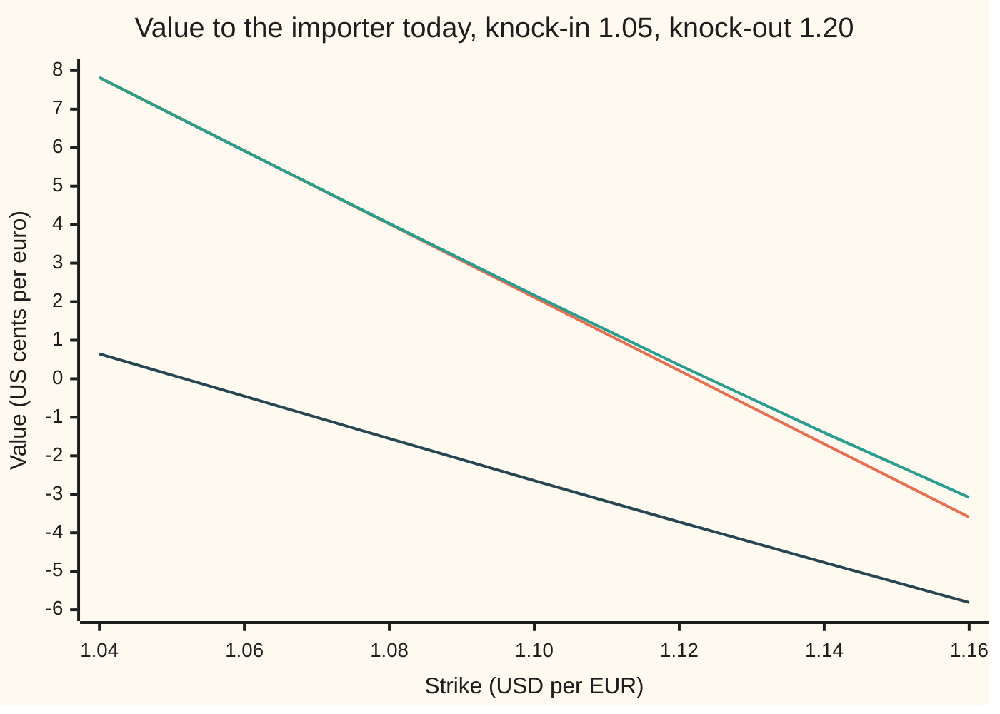

# Knock-in and knock-out forwards: the corporate hedge that costs nothing upfront, and the strike that makes it free

[Syllabus](../../../SYLLABUS.md) → [Financial mathematics](../README.md) → [FX exotics as desks use them - digitals, touches and barriers](../README.md#s23) → Knock-in and knock-out forwards

---

## General Overview

An American importer must pay for euros in one year. One euro costs 1.10 dollars today, written EURUSD 1.10. The dollar rate is 5%, the euro rate 3%, and the market's volatility (the yearly size of the rate's swings) is 10%. The treasurer wants a hedge that costs nothing today.

The plain answer is an FX forward: a contract to buy euros in a year at a rate fixed now. The only rate that costs nothing is 1.122221 dollars per euro ([Covered interest parity](../20-FX%20spot%2C%20forwards%20and%20interest%20parity/02-covered-interest-parity.md)). The importer pays 1.122221 whatever happens, even if the euro falls to 1.02.

Banks sell two changes to this contract. Each one is a barrier (a rate level that switches part of the contract on or off when EURUSD trades there):

- **Knock-in forward.** The importer's obligation to buy at the strike only starts if EURUSD trades at 1.05 during the year. If 1.05 never trades and the euro ends below the strike, the importer buys at the market rate instead. The zero-cost strike rises to 1.123984.
- **KIKO** (knock-in, knock-out). The same, and the importer's protection also dies if EURUSD trades at 1.20. The zero-cost strike falls to 1.051768: 0.070453 dollars better than the forward.

The strike (the fixed rate the importer pays) is the one number the bank can move. It moves until the parts the importer receives are worth exactly the parts it gives away. Each strike here is found by bisection: halving an interval of strikes until the value is zero.

**A zero-cost structure is an option bought minus an option sold at one strike, and the strike is set where the two are worth the same; every clause that takes protection away from the client lowers that strike, and every clause that takes an obligation away raises it.**

**What kind of fact this is:** a method resting on a theorem proved in Why it works: the package's value falls strictly as the strike rises, so exactly one strike costs nothing. The prices come from the Garman–Kohlhagen model (the Black–Scholes model for currencies), so the strikes are model numbers, not laws.

### The picture: the value of each package against its strike



Orange: the plain forward. Green: the knock-in forward, just above orange from 1.08 up. Dark: the KIKO, far below both. Each line falls as the strike rises, and each crosses zero once. That crossing is the zero-cost strike: just above 1.12 for the first two, just above 1.05 for the KIKO.

---

## The formula

Notation first. $`S`$ is EURUSD today, in dollars per euro. $`K`$ is the strike. $`L`$ is the knock-in level below spot, 1.05, and $`U`$ the knock-out level above spot, 1.20. $`r_d`$ and $`r_f`$ are the dollar and euro rates, $`\sigma`$ the volatility, $`T`$ the years to expiry. Every price is in dollars today per euro of notional (the amount of euros the contract covers), and every option pays at expiry.

The importer's packages are built from four options on [The eight single barriers in one table](03-the-eight-barrier-types.md):

- $`C(K)`$: a plain EUR call (the right to buy a euro at $`K`$).
- $`P(K)`$: a plain EUR put (the right to sell a euro at $`K`$). Selling it creates the obligation to buy at $`K`$.
- $`\mathrm{UOC}(K)`$: an up-and-out call. It is $`C`$, but it dies if EURUSD ever trades at $`U`$.
- $`\mathrm{DIP}(K)`$: a down-and-in put. It is $`P`$, but it only comes alive if EURUSD ever trades at $`L`$.

The zero-cost strike $`K^*`$ solves one equation in one unknown. For the KIKO:

```math
V(K) \;=\; \mathrm{UOC}(K;\,U) \;-\; \mathrm{DIP}(K;\,L) \;=\; 0
```

**Read it aloud:** the strike that makes the call the importer buys worth exactly the put the importer sells.

The other packages swap the legs. The plain forward is $`C - P`$. The knock-in forward is $`C - \mathrm{DIP}`$. A participating forward is $`C - pP`$: the importer sells the put on only a fraction $`p`$ of the notional.

The key identity says what each clause costs. Write $`\mathrm{UIC}`$ for the up-and-in call (alive only after a touch of $`U`$) and $`\mathrm{DOP}`$ for the down-and-out put (dead after a touch of $`L`$). A knock-in plus the matching knock-out is the plain option, so $`\mathrm{UOC} = C - \mathrm{UIC}`$ and $`\mathrm{DIP} = P - \mathrm{DOP}`$. With put–call parity, $`C - P = Se^{-r_f T} - Ke^{-r_d T}`$:

```math
V_{\mathrm{KIKO}}(K) \;=\; \underbrace{\big(S e^{-r_f T} - K e^{-r_d T}\big)}_{\text{plain forward}} \;-\; \underbrace{\mathrm{UIC}(K;\,U)}_{\text{protection given up}} \;+\; \underbrace{\mathrm{DOP}(K;\,L)}_{\text{obligation waived}}
```

**Read it aloud:** a KIKO is a plain forward, minus the protection the importer loses above 1.20, plus the obligation the importer escapes if 1.05 is never touched.

| Symbol | Plain meaning | In our example | Push it up and the answer… |
| --- | --- | --- | --- |
| $`S`$, $`S_T`$ | EURUSD today; EURUSD at expiry, in dollars per euro | 1.10; unknown today | $`S`$ up: every zero-cost strike rises |
| $`K`$, $`K^*`$ | the strike; the strike that makes the package cost nothing | KIKO: 1.051768 | package value falls |
| $`L`$ | knock-in level below spot | 1.05 | knock-in more likely: knock-in forward strike falls toward the forward |
| $`U`$ | knock-out level above spot | 1.20 | protection lasts longer: KIKO strike rises (1.078292 at 1.25) |
| $`F`$ | the one-year forward rate, $`Se^{(r_d - r_f)T}`$ | 1.122221 | plain-forward strike rises with it |
| $`r_d`$, $`r_f`$ | dollar and euro interest rates, continuously compounded | 5%, 3% | $`r_d`$ up: forward up; $`r_f`$ up: forward down |
| $`\sigma`$, $`T`$ | volatility; years to expiry | 10%, 1 | both barriers touched more often; knock-in forward strike falls (1.123280 at 12%) |
| $`C`$, $`P`$ | plain EUR call and put at $`K`$ | at the forward: 0.042569 each | |
| $`\mathrm{UOC}`$, $`\mathrm{UIC}`$ | call that dies at $`U`$; call born at $`U`$ | at 1.051768: 0.016089; 0.067017 | |
| $`\mathrm{DIP}`$, $`\mathrm{DOP}`$ | put born at $`L`$; put that dies at $`L`$ | at the forward: 0.041005; 0.001564 | |
| $`V`$ | value of the package to the importer today | 0 at $`K^*`$ | |
| $`p`$ | participating forward: fraction of notional on the sold put | 50% gives 1.153616 | strike falls toward the forward |

### When it holds

- **Continuous monitoring of both barriers.** A touch at any instant counts. A contract that checks only a daily fixing sees fewer touches, so both clauses are worth less and the strike moves.
- **One flat volatility.** A real FX market has a smile (volatility that differs by strike). The KIKO's knock-out sits deep in the region where its call pays, and [Barriers on a smile](07-barriers-with-the-smile.md) shows that this kind of barrier is the most exposed to the smile.
- **Equal notionals on both legs.** Many real KIKOs sell the put on twice the notional (leverage). That pushes the strike lower still and doubles the importer's loss after a knock-in.
- **Zero cost means zero at mid-market.** A bank builds its margin into the strike. A quoted strike worse than $`K^*`$ is the bank's fee, hidden in the rate.
- **Strike inside the bracket.** Bisection needs a strike where the value is positive and one where it is negative. Here 1.00 and 1.20 bracket every package.

**Conventions verified 2026-11-23 (house terms; a term sheet overrides them):** notional in euros, premium in dollars per euro, both barriers watched continuously against the reference EURUSD rate, a trade exactly at a barrier is a touch, settlement at expiry, a pip is 0.0001.

---

## Why it works

### Step 0: a package that falls with its strike has one zero

Follow one path of EURUSD through the year. On that path the importer's package pays the call's payoff if the call is alive and EURUSD ends above $`K`$, and loses the put's payoff if the put is alive and EURUSD ends below $`K`$. Raise $`K`$ and the first shrinks while the second grows. No path gains. So the value today, an average over paths, falls as $`K`$ rises. That one-way motion is what lets the barrier inverse on [Solving for the barrier](08-barrier-level-from-a-target-premium.md) work, and the same argument works here with the strike in place of the barrier.

<details>
<summary>Detailed proof: the slope of the package value in the strike</summary>

Write $`a`$ for the event "the call is alive at expiry" and $`b`$ for "the put is alive at expiry". For the KIKO, $`a`$ is "no touch of $`U`$" and $`b`$ is "a touch of $`L`$". The payoff at expiry is $`1_a (S_T - K)^+ - 1_b (K - S_T)^+`$, where $`S_T`$ is EURUSD at expiry and $`x^+ = \max(x, 0)`$. $`1_a`$ is 1 if $`a`$ happens and 0 if not, and the same for $`1_b`$ and for $`1_{S_T > K}`$ (EURUSD ends above $`K`$). Its slope in $`K`$, path by path, is

$`\displaystyle -\,1_a\,1_{S_T > K} \;-\; 1_b\,1_{S_T < K}`$

which is never positive. Averaging under the pricing measure (the risk-neutral probabilities used for prices) and discounting gives

$`\displaystyle \frac{dV}{dK} = -\,e^{-r_d T}\Big[\Pr(a,\ S_T > K) + \Pr(b,\ S_T < K)\Big]`$

For every $`K`$ strictly between $`L`$ and $`U`$, paths that never touch either barrier and end above $`K`$ have positive probability, so the bracket is positive and $`V`$ falls strictly. The price is continuous in $`K`$, because the payoff is. At $`K = 1.04`$ the KIKO is worth +0.644 US cents per euro, and at $`K = 1.20`$ the call is dead and the value is minus a put, below zero. The intermediate value theorem gives a zero, and strict fall makes it the only one. For the plain forward, $`a`$ and $`b`$ are certain and the slope is exactly $`-e^{-r_d T}`$.

</details>

### Step 1: the plain forward is a call bought and a put sold

Buy $`C(K)`$ and sell $`P(K)`$. If EURUSD ends above $`K`$, the call pays and the importer buys at $`K`$. If it ends below, the put is used against the importer, who still buys at $`K`$. Either way the importer buys at $`K`$: this is a forward. Put–call parity prices it at $`Se^{-r_f T} - Ke^{-r_d T}`$, which is zero at $`K = Se^{(r_d - r_f)T} = F`$. At that strike the call and put are worth the same, 0.042569 each.

### Step 2: a knock-in on the sold put waives part of the obligation, so the strike rises

In the knock-in forward the sold put is a $`\mathrm{DIP}`$, worth less than the plain put. The importer gives away less, so it must give away more somewhere else: in a higher strike. The identity says exactly how much more. The knock-in forward is $`C - P + \mathrm{DOP}`$, a plain forward plus a down-and-out put. That put is the importer's **participation**: the right to buy at the market rate if the euro falls but never touches 1.05.

At $`K = F`$ the down-and-out put is worth 0.001564. The plain forward's value falls by $`e^{-r_d T} = 0.951229`$ per unit of strike (Step 0). So the strike must rise by about 0.001564 / 0.951229 = 0.001644. The true shift is 0.001762. It is larger because the slope is gentler than the plain forward's: on paths that end below the strike without a knock-in, raising the strike costs the importer nothing.

### Step 3: a knock-out on the bought call removes protection, so the strike falls

Now kill the call at 1.20. The importer gives up $`\mathrm{UIC}`$: all the call's value on paths that touch 1.20. At low strikes that is most of the call. The package becomes much less valuable, and the strike falls until the forward part is worth enough to pay for it.

At the KIKO strike 1.051768 the plain forward part is worth 0.067017. The up-and-in call is worth 0.067017 too, and the down-and-out put is worth 0.000000. **The whole strike improvement, 0.070453 below the forward, is paid for by the knock-out**: the protection that disappears if the euro rallies through 1.20.

### Step 4: why the knock-in is worth nothing at the KIKO strike

The KIKO strike lands just above the knock-in level, 1.051768 against 1.05. A path that ends below 1.051768 without ever touching 1.05 would have to finish within 0.001768 of the wall and never reach it. Such paths almost never happen. So the down-in put is the plain put to six decimals: both are 0.016089. Solving the KIKO with a plain sold put gives the same strike, 1.051768.

This is a general pattern, not a coincidence of the numbers. As the knock-out pushes the strike down toward $`L`$, the knock-in clause loses its value. The importer then holds what is in effect a knock-out forward: a forward with a better rate that can vanish. A KIKO meant to give the importer participation needs its knock-in well below the solved strike, so that falls which stop short of the knock-in are bought at the market rate. Here the gap is too narrow for that.

### Step 5: bisection finds each strike

Bracket the strike between 1.00 and 1.20, where the value is positive and negative. Price the middle. Keep the half where the sign changes. Each step halves the bracket, so 80 steps shrink 0.20 far below any rounding error. Bisection cannot miss, because Step 0 guarantees exactly one sign change.

### Another road

The same strikes come out without any barrier formula. The check integrates each leg's payoff against the density of EURUSD at expiry, times the chance that a path pinned at both ends touched or missed the barrier, by Simpson's rule (a weighted sum of the integrand at evenly spaced points), and runs bisection on that. A Monte Carlo simulation of 100,000 paths then prices each package at its solved strike and finds zero within sampling error.

---

## Worked numbers, by hand

House market: EURUSD 1.10, dollar rate 5%, euro rate 3%, volatility 10%, one year, knock-in 1.05, knock-out 1.20. The leg prices come from the blocks on [The eight single barriers in one table](03-the-eight-barrier-types.md); this table shows how the strikes follow.

| Step | Arithmetic | Value |
| --- | --- | --- |
| forward rate | $`1.10 \times e^{0.05 - 0.03}`$ | 1.122221 |
| legs at the forward | call = put; down-in put; down-out put = put − down-in | 0.042569; 0.041005; 0.001564 |
| one unit of strike, today | $`e^{-0.05}`$ | 0.951229 |
| knock-in forward, first guess | $`1.122221 + 0.001564 / 0.951229`$ | 1.123866 |
| knock-in forward, solved | bisection on $`C - \mathrm{DIP}`$ | 1.123984 |
| check at 1.123984 | call against down-in put | 0.041769 = 0.041769 |
| KIKO, bisection step 1 | value at 1.10 | −0.026442, keep the low half |
| KIKO, step 2 | value at 1.05 | +0.000970, keep the high half |
| KIKO, steps 3 to 7 | values at 1.075, 1.0625, 1.05625, 1.053125, 1.0515625 | −0.012782, −0.005902, −0.002463, −0.000745, +0.000113 |
| **KIKO, solved** | after 80 halvings | **1.051768** |
| check at 1.051768 | up-out call against down-in put | 0.016089 = 0.016089 |
| what pays for it | forward value $`1.10e^{-0.03} - 1.051768e^{-0.05}`$ against up-in call | 0.067017 = 0.067017 |

The answer means: by giving up protection above 1.20, the importer locks in 1.051768 instead of 1.122221 on every euro, as long as the euro never touches 1.20.

### What the importer pays on five paths

The value is an average. Five single paths show what each contract does to the rate the importer actually pays per euro.

| Path of EURUSD | Forward | Knock-in forward | KIKO |
| --- | --- | --- | --- |
| ends 1.15, no touch of either level | 1.122221 | 1.123984 | 1.051768 |
| ends 1.08, no touch of either level | 1.122221 | 1.080000 | 1.051768 |
| touches 1.05, ends 1.08 | 1.122221 | 1.123984 | 1.051768 |
| touches 1.20, ends 1.25 | 1.122221 | 1.123984 | **1.250000** |
| touches 1.05, ends 1.02 | 1.122221 | 1.123984 | 1.051768 |

Against the plain forward, the knock-in forward wins only on the second path, by buying at the market. The KIKO wins on four paths out of five and loses badly on one. Under the pricing model, a touch of 1.20 within the year has chance 0.435450 and a touch of 1.05 has chance 0.596499.

### What breaks if you drop a piece

Right answers: knock-in forward 1.123984; KIKO 1.051768.

| Mistake | Comes out at | What went wrong |
| --- | --- | --- |
| Sell a plain put in the knock-in forward | 1.122221 | The importer then has no participation; this is the plain forward, not the structure sold. |
| Stop at the first-order guess | 1.123866 against 1.123984 | Used the plain forward's slope; the true slope is gentler, because paths with no knock-in do not lose as the strike rises. |
| Quote the KIKO at today's rate, 1.10, without solving | value −0.026442 per euro | The importer gives the bank 2.644 US cents per euro on day one, a cost hidden in a "free" hedge. |

---

## Code, from first principles, and it actually runs

The code solves for four zero-cost strikes (plain forward, 50% participating forward, knock-in forward, KIKO) by bisection on two roads: the barrier blocks with a home-made bell-curve area, and a Simpson integral against the bridge survival chance, which uses no blocks. A third road, a Monte Carlo simulation (an average over 100,000 random paths, stepped monthly, with its own random numbers) that uses the Brownian-bridge test (the chance a path crossed a barrier between two monthly points), prices both barrier packages at their solved strikes and checks the touch chances. Two identity checks come on top: the plain-forward strike equals the parity forward, and the KIKO equals forward minus up-in call plus down-out put. Both hold by construction once in-plus-out parity is coded, so they guard the code's bookkeeping, not the prices, and are not a fourth road. The other asserts compare roads, never a number with itself.

### Python

```python
# Knock-in and knock-out forwards -- the check behind the card.  Standard library only.
# House FX market: EURUSD 1.10, USD 5%, EUR 3%, vol 10%, 1 year; knock-in 1.05, knock-out 1.20; USD per 1 EUR.
# Roads: (1) barrier blocks A-D + bisection; (2) Simpson integral of payoff times bridge survival + bisection;
# (3) Monte Carlo with its own random numbers. Identity checks, not a road: forward = call - put, KIKO = forward - UIC + DOP.
from math import log, exp, sqrt, cos, pi

def N(x):                                   # normal CDF, own series: 0.5 + phi(x)(x + x^3/3 + x^5/15 + ...)
    if abs(x) > 9.0: return 0.0 if x < 0 else 1.0
    term, total, k = x, x, 1
    while abs(term) > 1e-17 * abs(total) or k < 5:
        term *= x * x / (2 * k + 1); total += term; k += 1
    return 0.5 + total * exp(-0.5 * x * x) / sqrt(2 * pi)

S0, rd, rf, T, VOL, LO, HI = 1.10, 0.05, 0.03, 1.0, 0.10, 1.05, 1.20
FWD = S0 * exp((rd - rf) * T)               # covered interest parity

def blocks(K, H, eta, phi, v):              # Rubinstein-Reiner blocks, as on the eight-barrier card
    s = v * sqrt(T); mu = (rd - rf - 0.5 * v * v) / (v * v)
    x1 = log(S0 / K) / s + (1 + mu) * s; x2 = log(S0 / H) / s + (1 + mu) * s
    y1 = log(H * H / (S0 * K)) / s + (1 + mu) * s; y2 = log(H / S0) / s + (1 + mu) * s
    fS, fK, hp, hm = S0 * exp(-rf * T), K * exp(-rd * T), (H / S0) ** (2 * mu + 2), (H / S0) ** (2 * mu)
    A = phi * (fS * N(phi * x1) - fK * N(phi * (x1 - s))); B = phi * (fS * N(phi * x2) - fK * N(phi * (x2 - s)))
    C = phi * (fS * hp * N(eta * y1) - fK * hm * N(eta * (y1 - s)))
    D = phi * (fS * hp * N(eta * y2) - fK * hm * N(eta * (y2 - s)))
    return A, B, C, D

def legs(K, v=VOL, lo=LO, hi=HI):           # call, put, down-and-in put, up-and-out call, up-and-in call, down-and-out put
    A, B, C, D = blocks(K, hi, -1, 1, v); a, b, c, d = blocks(K, lo, 1, -1, v)
    uoc, uic = (A - B + C - D, B - C + D) if K < hi else (0.0, A)
    dip, dop = (b - c + d, a - b + c - d) if K > lo else (a, 0.0)
    return A, a, dip, uoc, uic, dop

STRUCT = {"plain forward": lambda L, p: L[0] - L[1], "participating 50%": lambda L, p: L[0] - p * L[1],
          "knock-in forward": lambda L, p: L[0] - L[2], "KIKO": lambda L, p: L[3] - L[2]}
def value(name, K, v=VOL, lo=LO, hi=HI, p=0.5): return STRUCT[name](legs(K, v, lo, hi), p)

def bisect(f, a, b, trace=None):            # f falls in K: keep the half where the sign changes
    for i in range(80):
        m = 0.5 * (a + b); fm = f(m)
        if trace is not None and i < 7: trace.append((i + 1, a, b, m, fm))
        a, b = (m, b) if fm > 0 else (a, m)
    return 0.5 * (a + b)

def simpson(f, a, b, n=400):
    h = (b - a) / n; tot = f(a) + f(b)
    for i in range(1, n): tot += (4 if i % 2 else 2) * f(a + i * h)
    return tot * h / 3

def by_integral(name, K, p=0.5):            # road 2: no blocks, no N; survival of a bridge pinned at both ends
    m, s, k, aL, aH = (rd - rf - 0.5 * VOL * VOL) * T, VOL * sqrt(T), log(K / S0), log(LO / S0), log(HI / S0)
    dens = lambda x: exp(-(x - m) ** 2 / (2 * s * s)) / (s * sqrt(2 * pi))
    survL = lambda x: 1 - exp(-2 * aL * (aL - x) / (s * s)) if x > aL else 0.0
    survH = lambda x: 1 - exp(-2 * aH * (aH - x) / (s * s)) if x < aH else 0.0
    call = lambda x: (S0 * exp(x) - K) * dens(x); put = lambda x: (K - S0 * exp(x)) * dens(x)
    def over(f, a, b):                      # integrate between kinks so Simpson sees smooth pieces only
        cuts = sorted({a, b} | {c for c in (k, aL, aH) if a < c < b})
        return sum(simpson(f, cuts[i], cuts[i + 1]) for i in range(len(cuts) - 1))
    lo_x, hi_x = m - 10 * s, m + 10 * s
    C = over(call, k, hi_x); P = over(put, lo_x, k)
    UOC = over(lambda x: call(x) * survH(x), k, aH) if k < aH else 0.0
    DIP = over(lambda x: put(x) * (1 - survL(x)), lo_x, k)
    L = [x * exp(-rd * T) for x in (C, P, DIP, UOC)]
    return STRUCT[name](L, p)

state = [20261123]
def unif():                                 # splitmix64, then 53 bits into (0, 1)
    state[0] = (state[0] + 0x9E3779B97F4A7C15) & 0xFFFFFFFFFFFFFFFF
    z = state[0]
    z = ((z ^ (z >> 30)) * 0xBF58476D1CE4E5B9) & 0xFFFFFFFFFFFFFFFF
    z = ((z ^ (z >> 27)) * 0x94D049BB133111EB) & 0xFFFFFFFFFFFFFFFF
    return ((z ^ (z >> 31)) >> 11) * 2.0 ** -53 + 2.0 ** -54

def monte_carlo(K1, K2, paths=100000, steps=12):   # road 3: both structures, bridge test for each wall each month
    dt = T / steps; drift, sd = (rd - rf - 0.5 * VOL * VOL) * dt, VOL * sqrt(dt)
    aL, aH, disc = log(LO / S0), log(HI / S0), exp(-rd * T)
    sm, sq = [0.0] * 4, [0.0] * 4
    for _ in range(paths):
        x, hL, hH = 0.0, False, False
        for i in range(steps):
            z = sqrt(-2 * log(unif())) * cos(2 * pi * unif()); u3, u4 = unif(), unif()
            y = x + drift + sd * z
            hL = hL or y <= aL or u3 < exp(-2 * (x - aL) * (y - aL) / (sd * sd))
            hH = hH or y >= aH or u4 < exp(-2 * (aH - x) * (aH - y) / (sd * sd))
            x = y
        ST = S0 * exp(x)
        v = [disc * (max(ST - K1, 0) - hL * max(K1 - ST, 0)), disc * ((not hH) * max(ST - K2, 0) - hL * max(K2 - ST, 0)),
             float(hL), float(hH)]
        for j in range(4): sm[j] += v[j]; sq[j] += v[j] * v[j]
    mean = [t / paths for t in sm]
    return mean, [sqrt(max(sq[j] / paths - mean[j] ** 2, 0.0) / paths) for j in range(4)]

print("house: EURUSD 1.10, USD 5%, EUR 3%, vol 10%, 1 year, knock-in 1.05, knock-out 1.20")
K, trace = {}, []
for name in STRUCT:
    K[name] = bisect(lambda k: value(name, k), 1.00, 1.20, trace if name == "KIKO" else None)
    Ki = bisect(lambda k: by_integral(name, k), 1.00, 1.20)
    print(f"zero-cost strike  {name:<18} blocks {K[name]:.6f}  integral {Ki:.6f}")
    assert abs(Ki - K[name]) < 1e-8, name
print(f"forward by parity {FWD:.6f}, so the plain-forward strike is the parity forward")
assert abs(K["plain forward"] - FWD) < 1e-10
for name in ("knock-in forward", "KIKO"):
    L = legs(K[name])
    print(f"legs at {name} strike {K[name]:.6f}: call {L[0]:.6f} put {L[1]:.6f} DIP {L[2]:.6f} UOC {L[3]:.6f}")
Lf = legs(FWD); dfd = exp(-rd * T)
print(f"at K = forward: call {Lf[0]:.6f} = put {Lf[1]:.6f}; DIP {Lf[2]:.6f}; DOP = put - DIP {Lf[5]:.6f}")
print(f"first-order strike shift DOP/e^(-rd T) = {Lf[5]:.6f}/{dfd:.6f} = {Lf[5] / dfd:.6f}; guess {FWD + Lf[5] / dfd:.6f}"
      f"\nactual shift {K['knock-in forward'] - FWD:.6f}")
print("KIKO bisection: step, low, high, mid, value at mid")
for st in trace: print("  %d  %.6f  %.6f  %.6f  %+.6f" % st)
print("value to the importer (US cents per euro) against strike\n  strike  forward  knock-in fwd  KIKO")
for k in (1.04, 1.06, 1.08, 1.10, 1.12, 1.14, 1.16):
    print(f"  {k:.2f}  {100 * value('plain forward', k):7.3f}  {100 * value('knock-in forward', k):7.3f}  "
          f"{100 * value('KIKO', k):7.3f}")
Kk, Kf = K["KIKO"], K["knock-in forward"]; L = legs(Kk); fv = S0 * exp(-rf * T) - Kk * dfd
print(f"KIKO strike {FWD - Kk:.6f} below forward: forward value {fv:.6f} = UIC {L[4]:.6f} - DOP {L[5]:.6f} = {L[4] - L[5]:.6f}")
assert abs(fv - (L[4] - L[5])) < 1e-12 and abs(L[0] - L[1] - fv) < 1e-12
print("rate paid per euro: path / forward / knock-in fwd / KIKO")
for desc, ST, hL, hH in (("ends 1.15, no touch", 1.15, 0, 0), ("ends 1.08, no touch", 1.08, 0, 0),
                         ("touches 1.05, ends 1.08", 1.08, 1, 0), ("touches 1.20, ends 1.25", 1.25, 0, 1),
                         ("touches 1.05, ends 1.02", 1.02, 1, 0)):
    kif = Kf if ST > Kf or hL else ST
    kiko = Kk if (ST > Kk and not hH) or (ST < Kk and hL) else ST
    print(f"  {desc:<24} {FWD:.6f}  {kif:.6f}  {kiko:.6f}")
(mc, se) = monte_carlo(Kf, Kk)
for j, (lab, Kx) in enumerate((("knock-in forward", Kf), ("KIKO", Kk))):
    print(f"Monte Carlo value of {lab} at {Kx:.6f}: {mc[j]:+.6f}  (se {se[j]:.6f})")
    assert abs(mc[j]) < 4 * se[j], lab
for j, (H, eta) in enumerate(((LO, 1), (HI, -1))):   # chance of a touch from the no-touch dollar
    s = VOL * sqrt(T); mu = (rd - rf - 0.5 * VOL ** 2) / VOL ** 2
    x2 = log(S0 / H) / s + (1 + mu) * s; y2 = log(H / S0) / s + (1 + mu) * s
    p = 1 - (N(eta * (x2 - s)) - (H / S0) ** (2 * mu) * N(eta * (y2 - s)))
    print(f"chance of touching {H:.2f} in the year: formula {p:.6f}  Monte Carlo {mc[2 + j]:.6f}")
    assert abs(mc[2 + j] - p) < 4 * se[2 + j]
tries = (("KIKO, knock-out 1.25", lambda k: value("KIKO", k, hi=1.25)),
         ("knock-in forward, knock-in 1.00", lambda k: value("knock-in forward", k, lo=1.00)),
         ("knock-in forward, vol 12%", lambda k: value("knock-in forward", k, v=0.12)),
         ("participating 75%", lambda k: value("participating 50%", k, p=0.75)),
         ("KIKO without the knock-in", lambda k: legs(k)[3] - legs(k)[1]))
for lab, f in tries: print(f"try: {lab:<33} strike {bisect(f, 1.00, 1.20):.6f}")
print("ALL CHECKS PASS")
```

**Ran 2026-11-23 on macOS, Python 3.14.10, standard library only. All checks passed. Output, pasted from the run:**

```
house: EURUSD 1.10, USD 5%, EUR 3%, vol 10%, 1 year, knock-in 1.05, knock-out 1.20
zero-cost strike  plain forward      blocks 1.122221  integral 1.122221
zero-cost strike  participating 50%  blocks 1.153616  integral 1.153616
zero-cost strike  knock-in forward   blocks 1.123984  integral 1.123984
zero-cost strike  KIKO               blocks 1.051768  integral 1.051768
forward by parity 1.122221, so the plain-forward strike is the parity forward
legs at knock-in forward strike 1.123984: call 0.041769 put 0.043446 DIP 0.041769 UOC 0.002473
legs at KIKO strike 1.051768: call 0.083106 put 0.016089 DIP 0.016089 UOC 0.016089
at K = forward: call 0.042569 = put 0.042569; DIP 0.041005; DOP = put - DIP 0.001564
first-order strike shift DOP/e^(-rd T) = 0.001564/0.951229 = 0.001644; guess 1.123866
actual shift 0.001762
KIKO bisection: step, low, high, mid, value at mid
  1  1.000000  1.200000  1.100000  -0.026442
  2  1.000000  1.100000  1.050000  +0.000970
  3  1.050000  1.100000  1.075000  -0.012782
  4  1.050000  1.075000  1.062500  -0.005902
  5  1.050000  1.062500  1.056250  -0.002463
  6  1.050000  1.056250  1.053125  -0.000745
  7  1.050000  1.053125  1.051563  +0.000113
value to the importer (US cents per euro) against strike
  strike  forward  knock-in fwd  KIKO
  1.04    7.821    7.821    0.644
  1.06    5.919    5.919   -0.453
  1.08    4.016    4.028   -1.553
  1.10    2.114    2.167   -2.644
  1.12    0.211    0.354   -3.718
  1.14   -1.691   -1.398   -4.772
  1.16   -3.594   -3.081   -5.810
KIKO strike 0.070453 below forward: forward value 0.067017 = UIC 0.067017 - DOP 0.000000 = 0.067017
rate paid per euro: path / forward / knock-in fwd / KIKO
  ends 1.15, no touch      1.122221  1.123984  1.051768
  ends 1.08, no touch      1.122221  1.080000  1.051768
  touches 1.05, ends 1.08  1.122221  1.123984  1.051768
  touches 1.20, ends 1.25  1.122221  1.123984  1.250000
  touches 1.05, ends 1.02  1.122221  1.123984  1.051768
Monte Carlo value of knock-in forward at 1.123984: -0.000009  (se 0.000337)
Monte Carlo value of KIKO at 1.051768: +0.000113  (se 0.000165)
chance of touching 1.05 in the year: formula 0.596499  Monte Carlo 0.596890
chance of touching 1.20 in the year: formula 0.435450  Monte Carlo 0.433700
try: KIKO, knock-out 1.25              strike 1.078292
try: knock-in forward, knock-in 1.00   strike 1.137201
try: knock-in forward, vol 12%         strike 1.123280
try: participating 75%                 strike 1.135166
try: KIKO without the knock-in         strike 1.051768
ALL CHECKS PASS
```

### Rust

```rust
// Knock-in and knock-out forwards -- the check behind the card.  Rust std only, no crates.
// House FX market: EURUSD 1.10, USD 5%, EUR 3%, vol 10%, 1 year; knock-in 1.05, knock-out 1.20; USD per 1 EUR.
// Roads: (1) barrier blocks A-D + bisection; (2) Simpson integral of payoff times bridge survival + bisection;
// (3) Monte Carlo with its own random numbers. Identity checks, not a road: forward = call - put, KIKO = forward - UIC + DOP.
use std::f64::consts::PI;
const S0: f64 = 1.10; const RD: f64 = 0.05; const RF: f64 = 0.03; const T: f64 = 1.0;
const VOL: f64 = 0.10; const LO: f64 = 1.05; const HI: f64 = 1.20;
const NAMES: [&str; 4] = ["plain forward", "participating 50%", "knock-in forward", "KIKO"];

fn n(x: f64) -> f64 { // normal CDF, own series: 0.5 + phi(x)(x + x^3/3 + x^5/15 + ...)
    if x.abs() > 9.0 { return if x < 0.0 { 0.0 } else { 1.0 }; }
    let (mut term, mut total, mut k) = (x, x, 1.0);
    while term.abs() > 1e-17 * total.abs() || k < 5.0 { term *= x * x / (2.0 * k + 1.0); total += term; k += 1.0; }
    0.5 + total * (-0.5 * x * x).exp() / (2.0 * PI).sqrt()
}
fn blocks(k: f64, h: f64, eta: f64, phi: f64, v: f64) -> [f64; 4] {
    let s = v * T.sqrt(); let mu = (RD - RF - 0.5 * v * v) / (v * v);
    let x1 = (S0 / k).ln() / s + (1.0 + mu) * s; let x2 = (S0 / h).ln() / s + (1.0 + mu) * s;
    let y1 = (h * h / (S0 * k)).ln() / s + (1.0 + mu) * s; let y2 = (h / S0).ln() / s + (1.0 + mu) * s;
    let (fs, fk) = (S0 * (-RF * T).exp(), k * (-RD * T).exp());
    let (hp, hm) = ((h / S0).powf(2.0 * mu + 2.0), (h / S0).powf(2.0 * mu));
    [phi * (fs * n(phi * x1) - fk * n(phi * (x1 - s))), phi * (fs * n(phi * x2) - fk * n(phi * (x2 - s))),
     phi * (fs * hp * n(eta * y1) - fk * hm * n(eta * (y1 - s))), phi * (fs * hp * n(eta * y2) - fk * hm * n(eta * (y2 - s)))]
}
// call, put, down-and-in put, up-and-out call, up-and-in call, down-and-out put
fn legs(k: f64, v: f64, lo: f64, hi: f64) -> [f64; 6] {
    let [a1, b1, c1, d1] = blocks(k, hi, -1.0, 1.0, v); let [a, b, c, d] = blocks(k, lo, 1.0, -1.0, v);
    let (uoc, uic) = if k < hi { (a1 - b1 + c1 - d1, b1 - c1 + d1) } else { (0.0, a1) };
    let (dip, dop) = if k > lo { (b - c + d, a - b + c - d) } else { (a, 0.0) };
    [a1, a, dip, uoc, uic, dop]
}
fn structure(i: usize, l: &[f64], p: f64) -> f64 {
    match i { 0 => l[0] - l[1], 1 => l[0] - p * l[1], 2 => l[0] - l[2], _ => l[3] - l[2] }
}
fn value(i: usize, k: f64, v: f64, lo: f64, hi: f64, p: f64) -> f64 { structure(i, &legs(k, v, lo, hi), p) }
fn bisect(f: &dyn Fn(f64) -> f64, mut a: f64, mut b: f64, trace: &mut Vec<(usize, f64, f64, f64, f64)>) -> f64 {
    for i in 0..80 {
        let m = 0.5 * (a + b); let fm = f(m);
        if i < 7 { trace.push((i + 1, a, b, m, fm)); }
        if fm > 0.0 { a = m; } else { b = m; }
    }
    0.5 * (a + b)
}
fn simpson(f: &dyn Fn(f64) -> f64, a: f64, b: f64) -> f64 {
    let n = 400; let h = (b - a) / n as f64; let mut tot = f(a) + f(b);
    for i in 1..n { tot += if i % 2 == 1 { 4.0 } else { 2.0 } * f(a + i as f64 * h); }
    tot * h / 3.0
}
fn by_integral(i: usize, k: f64) -> f64 { // road 2: no blocks, no N; survival of a bridge pinned at both ends
    let (m, s, kx) = ((RD - RF - 0.5 * VOL * VOL) * T, VOL * T.sqrt(), (k / S0).ln());
    let (al, ah) = ((LO / S0).ln(), (HI / S0).ln());
    let dens = move |x: f64| (-(x - m).powi(2) / (2.0 * s * s)).exp() / (s * (2.0 * PI).sqrt());
    let surv_l = move |x: f64| if x > al { 1.0 - (-2.0 * al * (al - x) / (s * s)).exp() } else { 0.0 };
    let surv_h = move |x: f64| if x < ah { 1.0 - (-2.0 * ah * (ah - x) / (s * s)).exp() } else { 0.0 };
    let call = move |x: f64| (S0 * x.exp() - k) * dens(x); let put = move |x: f64| (k - S0 * x.exp()) * dens(x);
    let over = |f: &dyn Fn(f64) -> f64, a: f64, b: f64| -> f64 { // integrate between kinks only
        let mut cuts = vec![a, b];
        for c in [kx, al, ah] { if a < c && c < b && !cuts.contains(&c) { cuts.push(c); } }
        cuts.sort_by(|p, q| p.partial_cmp(q).unwrap());
        (0..cuts.len() - 1).map(|j| simpson(f, cuts[j], cuts[j + 1])).sum()
    };
    let (lo_x, hi_x) = (m - 10.0 * s, m + 10.0 * s);
    let c = over(&call, kx, hi_x); let p = over(&put, lo_x, kx);
    let uoc = if kx < ah { over(&|x: f64| call(x) * surv_h(x), kx, ah) } else { 0.0 };
    let dip = over(&|x: f64| put(x) * (1.0 - surv_l(x)), lo_x, kx);
    let d = (-RD * T).exp();
    structure(i, &[c * d, p * d, dip * d, uoc * d], 0.5)
}
fn unif(st: &mut u64) -> f64 { // splitmix64, then 53 bits into (0, 1)
    *st = st.wrapping_add(0x9E3779B97F4A7C15); let mut z = *st;
    z = (z ^ (z >> 30)).wrapping_mul(0xBF58476D1CE4E5B9);
    z = (z ^ (z >> 27)).wrapping_mul(0x94D049BB133111EB);
    ((z ^ (z >> 31)) >> 11) as f64 * 2f64.powi(-53) + 2f64.powi(-54)
}
fn monte_carlo(k1: f64, k2: f64) -> ([f64; 4], [f64; 4]) { // road 3: bridge test for each wall each month
    let (paths, steps) = (100000, 12); let dt = T / steps as f64;
    let (drift, sd) = ((RD - RF - 0.5 * VOL * VOL) * dt, VOL * dt.sqrt());
    let (al, ah, disc) = ((LO / S0).ln(), (HI / S0).ln(), (-RD * T).exp());
    let (mut sm, mut sq, mut st) = ([0.0; 4], [0.0; 4], 20261123u64);
    for _ in 0..paths {
        let (mut x, mut hl, mut hh) = (0.0f64, false, false);
        for _ in 0..steps {
            let z = (-2.0 * unif(&mut st).ln()).sqrt() * (2.0 * PI * unif(&mut st)).cos();
            let (u3, u4) = (unif(&mut st), unif(&mut st));
            let y = x + drift + sd * z;
            hl = hl || y <= al || u3 < (-2.0 * (x - al) * (y - al) / (sd * sd)).exp();
            hh = hh || y >= ah || u4 < (-2.0 * (ah - x) * (ah - y) / (sd * sd)).exp();
            x = y;
        }
        let stt = S0 * x.exp(); let (fl, fh) = (hl as i32 as f64, hh as i32 as f64);
        let v = [disc * ((stt - k1).max(0.0) - fl * (k1 - stt).max(0.0)),
                 disc * ((1.0 - fh) * (stt - k2).max(0.0) - fl * (k2 - stt).max(0.0)), fl, fh];
        for j in 0..4 { sm[j] += v[j]; sq[j] += v[j] * v[j]; }
    }
    let mean = sm.map(|t| t / paths as f64);
    let mut se = [0.0; 4];
    for j in 0..4 { se[j] = ((sq[j] / paths as f64 - mean[j] * mean[j]).max(0.0) / paths as f64).sqrt(); }
    (mean, se)
}
fn main() {
    let fwd = S0 * ((RD - RF) * T).exp(); // covered interest parity
    println!("house: EURUSD 1.10, USD 5%, EUR 3%, vol 10%, 1 year, knock-in 1.05, knock-out 1.20");
    let (mut ks, mut trace, mut junk) = ([0.0; 4], Vec::new(), Vec::new());
    for i in 0..4 {
        let tr = if i == 3 { &mut trace } else { &mut junk };
        ks[i] = bisect(&|k| value(i, k, VOL, LO, HI, 0.5), 1.00, 1.20, tr);
        let ki = bisect(&|k| by_integral(i, k), 1.00, 1.20, &mut junk);
        println!("zero-cost strike  {:<18} blocks {:.6}  integral {:.6}", NAMES[i], ks[i], ki);
        assert!((ki - ks[i]).abs() < 1e-8, "{}", NAMES[i]);
    }
    println!("forward by parity {:.6}, so the plain-forward strike is the parity forward", fwd);
    assert!((ks[0] - fwd).abs() < 1e-10);
    for i in [2, 3] {
        let l = legs(ks[i], VOL, LO, HI);
        println!("legs at {} strike {:.6}: call {:.6} put {:.6} DIP {:.6} UOC {:.6}", NAMES[i], ks[i], l[0], l[1], l[2], l[3]);
    }
    let lf = legs(fwd, VOL, LO, HI); let dfd = (-RD * T).exp();
    println!("at K = forward: call {:.6} = put {:.6}; DIP {:.6}; DOP = put - DIP {:.6}", lf[0], lf[1], lf[2], lf[5]);
    println!("first-order strike shift DOP/e^(-rd T) = {:.6}/{:.6} = {:.6}; guess {:.6}", lf[5], dfd, lf[5] / dfd, fwd + lf[5] / dfd);
    println!("actual shift {:.6}", ks[2] - fwd);
    println!("KIKO bisection: step, low, high, mid, value at mid");
    for (i, a, b, m, fm) in &trace { println!("  {}  {:.6}  {:.6}  {:.6}  {:+.6}", i, a, b, m, fm); }
    println!("value to the importer (US cents per euro) against strike");
    println!("  strike  forward  knock-in fwd  KIKO");
    for k in [1.04, 1.06, 1.08, 1.10, 1.12, 1.14, 1.16] {
        let v = |i| 100.0 * value(i, k, VOL, LO, HI, 0.5);
        println!("  {:.2}  {:7.3}  {:7.3}  {:7.3}", k, v(0), v(2), v(3));
    }
    let (kk, kf) = (ks[3], ks[2]);
    let l = legs(kk, VOL, LO, HI); let fv = S0 * (-RF * T).exp() - kk * dfd;
    println!("KIKO strike {:.6} below forward: forward value {:.6} = UIC {:.6} - DOP {:.6} = {:.6}", fwd - kk, fv, l[4], l[5], l[4] - l[5]);
    assert!((fv - (l[4] - l[5])).abs() < 1e-12 && (l[0] - l[1] - fv).abs() < 1e-12);
    println!("rate paid per euro: path / forward / knock-in fwd / KIKO");
    for (desc, stt, hl, hh) in [("ends 1.15, no touch", 1.15, false, false), ("ends 1.08, no touch", 1.08, false, false),
                                ("touches 1.05, ends 1.08", 1.08, true, false), ("touches 1.20, ends 1.25", 1.25, false, true),
                                ("touches 1.05, ends 1.02", 1.02, true, false)] {
        let kif = if stt > kf || hl { kf } else { stt };
        let kiko = if (stt > kk && !hh) || (stt < kk && hl) { kk } else { stt };
        println!("  {:<24} {:.6}  {:.6}  {:.6}", desc, fwd, kif, kiko);
    }
    let (mc, se) = monte_carlo(kf, kk);
    for (j, (lab, kx)) in [("knock-in forward", kf), ("KIKO", kk)].iter().enumerate() {
        println!("Monte Carlo value of {} at {:.6}: {:+.6}  (se {:.6})", lab, kx, mc[j], se[j]);
        assert!(mc[j].abs() < 4.0 * se[j], "{}", lab);
    }
    for (j, (h, eta)) in [(LO, 1.0), (HI, -1.0)].iter().enumerate() { // chance of a touch from the no-touch dollar
        let s = VOL * T.sqrt(); let mu = (RD - RF - 0.5 * VOL * VOL) / (VOL * VOL);
        let x2 = (S0 / h).ln() / s + (1.0 + mu) * s; let y2 = (h / S0).ln() / s + (1.0 + mu) * s;
        let p = 1.0 - (n(eta * (x2 - s)) - (h / S0).powf(2.0 * mu) * n(eta * (y2 - s)));
        println!("chance of touching {:.2} in the year: formula {:.6}  Monte Carlo {:.6}", h, p, mc[2 + j]);
        assert!((mc[2 + j] - p).abs() < 4.0 * se[2 + j]);
    }
    let tries: [(&str, Box<dyn Fn(f64) -> f64>); 5] = [
        ("KIKO, knock-out 1.25", Box::new(|k| value(3, k, VOL, LO, 1.25, 0.5))),
        ("knock-in forward, knock-in 1.00", Box::new(|k| value(2, k, VOL, 1.00, HI, 0.5))),
        ("knock-in forward, vol 12%", Box::new(|k| value(2, k, 0.12, LO, HI, 0.5))),
        ("participating 75%", Box::new(|k| value(1, k, VOL, LO, HI, 0.75))),
        ("KIKO without the knock-in", Box::new(|k| { let l = legs(k, VOL, LO, HI); l[3] - l[1] }))];
    for (lab, f) in tries.iter() { println!("try: {:<33} strike {:.6}", lab, bisect(f.as_ref(), 1.00, 1.20, &mut junk)); }
    println!("ALL CHECKS PASS");
}
```

**Ran 2026-11-23 on macOS, rustc 1.98.1, no crates. All checks passed. Output, pasted from the run:**

```
house: EURUSD 1.10, USD 5%, EUR 3%, vol 10%, 1 year, knock-in 1.05, knock-out 1.20
zero-cost strike  plain forward      blocks 1.122221  integral 1.122221
zero-cost strike  participating 50%  blocks 1.153616  integral 1.153616
zero-cost strike  knock-in forward   blocks 1.123984  integral 1.123984
zero-cost strike  KIKO               blocks 1.051768  integral 1.051768
forward by parity 1.122221, so the plain-forward strike is the parity forward
legs at knock-in forward strike 1.123984: call 0.041769 put 0.043446 DIP 0.041769 UOC 0.002473
legs at KIKO strike 1.051768: call 0.083106 put 0.016089 DIP 0.016089 UOC 0.016089
at K = forward: call 0.042569 = put 0.042569; DIP 0.041005; DOP = put - DIP 0.001564
first-order strike shift DOP/e^(-rd T) = 0.001564/0.951229 = 0.001644; guess 1.123866
actual shift 0.001762
KIKO bisection: step, low, high, mid, value at mid
  1  1.000000  1.200000  1.100000  -0.026442
  2  1.000000  1.100000  1.050000  +0.000970
  3  1.050000  1.100000  1.075000  -0.012782
  4  1.050000  1.075000  1.062500  -0.005902
  5  1.050000  1.062500  1.056250  -0.002463
  6  1.050000  1.056250  1.053125  -0.000745
  7  1.050000  1.053125  1.051563  +0.000113
value to the importer (US cents per euro) against strike
  strike  forward  knock-in fwd  KIKO
  1.04    7.821    7.821    0.644
  1.06    5.919    5.919   -0.453
  1.08    4.016    4.028   -1.553
  1.10    2.114    2.167   -2.644
  1.12    0.211    0.354   -3.718
  1.14   -1.691   -1.398   -4.772
  1.16   -3.594   -3.081   -5.810
KIKO strike 0.070453 below forward: forward value 0.067017 = UIC 0.067017 - DOP 0.000000 = 0.067017
rate paid per euro: path / forward / knock-in fwd / KIKO
  ends 1.15, no touch      1.122221  1.123984  1.051768
  ends 1.08, no touch      1.122221  1.080000  1.051768
  touches 1.05, ends 1.08  1.122221  1.123984  1.051768
  touches 1.20, ends 1.25  1.122221  1.123984  1.250000
  touches 1.05, ends 1.02  1.122221  1.123984  1.051768
Monte Carlo value of knock-in forward at 1.123984: -0.000009  (se 0.000337)
Monte Carlo value of KIKO at 1.051768: +0.000113  (se 0.000165)
chance of touching 1.05 in the year: formula 0.596499  Monte Carlo 0.596890
chance of touching 1.20 in the year: formula 0.435450  Monte Carlo 0.433700
try: KIKO, knock-out 1.25              strike 1.078292
try: knock-in forward, knock-in 1.00   strike 1.137201
try: knock-in forward, vol 12%         strike 1.123280
try: participating 75%                 strike 1.135166
try: KIKO without the knock-in         strike 1.051768
ALL CHECKS PASS
```

> [!TIP]
> **Try changing**
> - Guess first: move the KIKO's knock-out from 1.20 to 1.25. Does the strike rise or fall? Set `hi=1.25`. It rises to 1.078292: protection that lasts longer costs more strike.
> - Guess first: move the knock-in from 1.05 down to 1.00. Set `lo=1.00`. The knock-in forward strike rises to 1.137201: the obligation starts less often, so the waived part is worth more.
> - Guess first: raise volatility to 12%. Set `v=0.12`. The knock-in forward strike falls slightly, to 1.123280: more paths touch 1.05, so the participation is worth less.
> - Guess first: a participating forward that sells the put on 75% of the notional instead of 50%. Set `p=0.75`. The strike falls from 1.153616 to 1.135166, toward the forward.

---

## The usual mistake

> [!warning]
> **Believing the knock-in pays for the better strike.** The knock-in on the sold put helps the importer: it waives the obligation on paths that never touch 1.05. Adding it raises the strike, from 1.122221 to 1.123984. The KIKO's strike of 1.051768 is paid for by the knock-out: protection that vanishes if the euro rises through 1.20, worth 0.067017 per euro. The importer is protected against small rises and exposed to large ones, the moves a hedge exists for.
>
> - **Reading "zero cost" as "no cost".** Nothing changes hands today, but at a strike other than $`K^*`$ value has moved. A KIKO struck at 1.10 is worth −0.026442 to the importer.
> - **Comparing strikes without the barriers.** 1.051768 looks 0.070453 better than 1.122221. On a path through 1.20 ending at 1.25, the KIKO importer pays 1.250000.
> - **Treating the participating forward as free participation.** Selling the put on half the notional costs strike: 1.153616 against 1.122221.

---

## Where you meet it in real life

- **Corporate treasury.** Importers and exporters hedge a year of currency flows with zero-cost structures, because a premium paid upfront needs budget approval and a strike does not.
- **Bank sales desks.** The desk prices the legs, solves for the strike, then quotes a slightly worse strike. The gap is its margin; the bisection on this card is the step that sets the fair strike.
- **The 2008 KIKO losses.** Many Korean exporters held KIKO contracts on the dollar–won rate, often with the sold option on twice the notional. When the won fell sharply in 2008, the sold options knocked in and the exporters had to sell dollars far below the market rate.
- **Hedge reviews.** Auditors and risk teams value a structure at its strike against today's market. A "free" hedge with negative value at inception is a fee paid to the bank.

> **Say it back**
> A zero-cost structure is an option bought and an option sold at one strike. The strike is set where the two are worth the same, found by bisection because the package's value falls as the strike rises. A plain forward costs nothing at 1.122221. A knock-in on the sold put waives part of the obligation, so the strike rises to 1.123984. A knock-out on the bought call removes protection after 1.20, and that pays for the KIKO's strike of 1.051768.

---

## What this builds on

- [The eight single barriers in one table](03-the-eight-barrier-types.md): the down-and-in put and up-and-out call, priced from blocks A to D, and in-plus-out parity.
- [Solving for the barrier](08-barrier-level-from-a-target-premium.md): inverting a one-way price by bisection; here the unknown is the strike instead of the barrier.
- [Covered interest parity](../20-FX%20spot%2C%20forwards%20and%20interest%20parity/02-covered-interest-parity.md): the forward rate 1.122221, the zero-cost strike before any barrier.
- [Garman-Kohlhagen](../21-FX%20vanilla%20options%20-%20Garman-Kohlhagen%20and%20the%20desk%20conventions/01-garman-kohlhagen.md): the plain EUR call and put, and put–call parity for currencies.

---

## Where this goes next

- [TARFs and accumulators](10-target-redemption-forwards-and-accumulators.md): zero-cost structures whose life depends on the whole path of fixings, not only on a barrier touch, and which stop once a profit target is reached.

Every structure here settles once, at expiry; the open question is how to price a hedge that settles every month and ends early when the client's gains reach a target.

---

## Sources

Verified 2026-11-23: every link below resolves to the publisher's page.

- Wystup, Uwe. *FX Options and Structured Products*, 2nd ed. Wiley, 2017. [Publisher page](https://www.wiley.com/en-us/FX+Options+and+Structured+Products%2C+2nd+Edition-p-9781118471067). FX forward structures, KIKOs and how desks sell them.
- Haug, Espen Gaarder. *The Complete Guide to Option Pricing Formulas*, 2nd ed. McGraw-Hill, 2007. [Publisher page](https://www.mheducation.com/highered/mhp/product/complete-guide-to-option-pricing-formulas-2e.html). The single-barrier formulas used for each leg.
- Garman, Mark B., and Steven W. Kohlhagen. "Foreign Currency Option Values." *Journal of International Money and Finance* 2, no. 3 (1983): 231–237. [doi:10.1016/S0261-5606(83)80001-1](https://doi.org/10.1016/S0261-5606(83)80001-1). The plain currency call and put.
- Glasserman, Paul. *Monte Carlo Methods in Financial Engineering*. Springer, 2003. [doi:10.1007/978-0-387-21617-1](https://doi.org/10.1007/978-0-387-21617-1). The Brownian-bridge touch probability used by the simulation.
