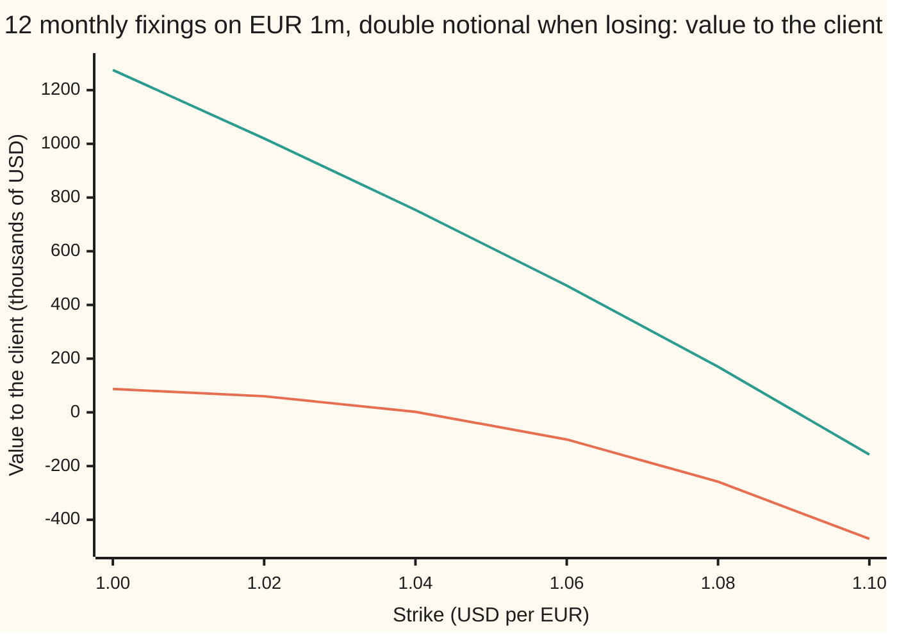
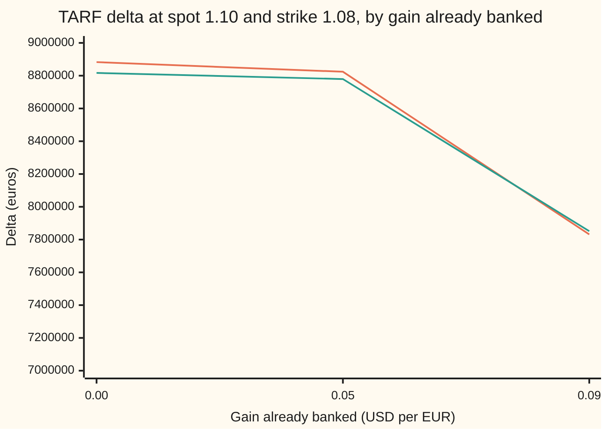

# TARFs and accumulators: forwards that stop once the client has gained enough, and the leverage that pays for it

[Syllabus](../../../SYLLABUS.md) → [Financial mathematics](../README.md) → [FX exotics as desks use them - digitals, touches and barriers](../README.md#s23) → TARFs and accumulators

---

## General Overview

A US importer pays a German supplier 1 million euros every month for a year. One euro costs 1.10 dollars today. Plain forwards (contracts fixing today the rate for a later delivery) would lock in an average rate of 1.111908 dollars per euro across the twelve months, in the shelf's house market: dollar rate 5 percent, euro rate 3 percent, volatility (the yearly size of the rate's swings) 10 percent.

The bank offers something that looks far better: a **target redemption forward**, or **TARF**. Each month the importer buys its million euros at **1.040481**, which is 0.071426 dollars per euro better than the forwards. Two clauses pay for that rate.

- **Leverage.** In any month the euro fixes below the strike, the importer must buy **2 million** euros at 1.040481, at a loss on each one.
- **The target.** The importer's gains are added up month by month: how far each fixing sat above the strike, in dollars per euro. When the total reaches **0.10**, the contract ends. So the most the importer can ever gain is 100,000 dollars. Its losses have no cap.

At that strike the TARF costs nothing to enter: that is why 1.040481 is called the **zero-cost strike**. At the round strike of 1.08 the same contract is worth **−258,829 dollars** to the importer, measured on a grid and confirmed by simulation. An **accumulator** is its cousin: the same leveraged monthly forward, but it stops when the euro trades above a fixed level, not when the gains add up.

**A TARF is a strip of monthly forwards in which the client sells extra euro puts through the doubled losing fixings, and then gives away every gain beyond the target; the strike that makes it free is far better than the forward because the client has sold its upside and doubled its downside.**

**What kind of fact this is:** a model price: the euro's rate is assumed to wander as in the shelf's earlier cards, lognormally (its logarithm moves by bell-curve steps) with one flat volatility, which is an assumption, not a law. Inside the model, the strip decomposition, the cap on gains and the sign of the delta are theorems proved on this card in Why it works. The price itself is computed, by two methods that agree.

### The picture: what the target takes away, strike by strike



Orange: the TARF with its 0.10 target, by simulation. Green: the same leveraged strip with no target, by formula. At a strike of 1.00 the strip is worth 1,275 thousand dollars to the client and the TARF only 87 thousand, because the target stops the gains at 100,000 dollars. The orange line crosses zero just above 1.04: the zero-cost strike.

---

## The formula

Notation first, in words. Fixing $`i`$ happens at $`t_i = i/12`$ years, for $`i`$ = 1 to 12. On that day the euro fixes at $`S_i`$ dollars. The **gain** $`g_i = \max(S_i - K, 0)`$ is how far it fixed above the strike $`K`$; the **loss** $`\ell_i = \max(K - S_i, 0)`$ is how far below. The **banked gain** $`B_i = g_1 + \dots + g_i`$ is the running total, and $`\tau`$ (say "tau") is the first fixing at which it reaches the target $`G`$. $`A`$ is the number of euros bought on a winning fixing, $`\lambda`$ (say "lambda") is the leverage, the multiple of $`A`$ bought on a losing one, and $`D_i`$ is the dollar discount factor for fixing $`i`$: what one dollar paid that day is worth today. $`\mathbb{E}`$ is the average over the pricing world, the pretend world of [Monte Carlo pricing](../06-Numerical%20Methods%20for%20Pricing/01-monte-carlo-pricing.md) in which a euro deposit, counted in dollars, earns the dollar rate. $`\mathbf{1}\{\text{event}\}`$ is 1 when the event happens and 0 when it does not.

```math
V = A\sum_{i=1}^{12} D_i\,\mathbb{E}\Big[\mathbf{1}\{i \le \tau\}\,\big(\min(g_i,\;G - B_{i-1}) - \lambda\,\ell_i\big)\Big]
```

**Read it aloud:** at each fixing the contract is still alive, the client collects the gain (but never more than what is left of the target) and pays the loss times the leverage; average that over the pricing world, discount it at the dollar rate, and add up the twelve months.

Drop the target and the formula has a closed form, a strip of forwards minus extra puts. Here $`F_i`$ is the forward rate for fixing $`i`$, and $`P_i(K)`$ is today's price of a euro put struck at $`K`$ that expires on that fixing:

```math
V_\infty = A\sum_{i=1}^{12} D_i\,(F_i - K) \;-\; (\lambda - 1)\,A\sum_{i=1}^{12} P_i(K)
```

**Read it aloud:** without the target, the contract is twelve plain forwards at the strike, less one euro put per euro of extra notional at every fixing.

| Symbol | Plain meaning | In our example | Push it up and the client's value… |
| --- | --- | --- | --- |
| $`A`$ | euros bought per fixing on a winning month | 1,000,000 | scales up, same sign |
| $`K`$ | strike: the rate the client buys at, dollars per euro | 1.08; zero-cost 1.040481 | falls |
| $`\lambda`$ | leverage: the multiple of $`A`$ bought on a losing fixing | 2 | falls |
| $`G`$ | target: total gain, dollars per euro, at which the contract ends | 0.10 | rises near 0.10, toward the strip's value; a much lower target raises it too (Step 5) |
| $`S_0`$, $`S_i`$, $`t_i`$ | spot today; spot at fixing $`i`$; the fixing's date in years | 1.10; random; $`i/12`$ | rises with $`S_0`$: that slope is the delta |
| $`r_d`$, $`r_f`$, $`\sigma`$ | dollar rate, euro rate (both continuously compounded), volatility | 5%, 3%, 10% | $`r_d`$ up lifts forwards; $`\sigma`$ up makes the sold puts dearer |
| $`F_i`$, $`D_i`$ | forward rate for fixing $`i`$, $`S_0 e^{(r_d - r_f)t_i}`$; dollar discount factor $`e^{-r_d t_i}`$ | 1.101835 to 1.122221 | — |
| $`g_i`$, $`\ell_i`$, $`B_i`$, $`C_i`$, $`\tau`$ | gain and loss at fixing $`i`$, dollars per euro; gain banked through fixing $`i`$; that banked gain capped at $`G`$ (used in the proof); the fixing at which the banked gain reaches $`G`$ | $`B`$ is 0 at the start | (state, not an input) |
| $`\mathbb{E}`$, $`\mathbf{1}\{\cdot\}`$, $`N`$ | average over the pricing world; 1 if the event happens, else 0; area under the standard bell curve left of a point | — | — |
| $`P_i(K)`$ | today's price of a euro put struck at $`K`$ expiring at $`t_i`$ | twelve of them cost 202,714 dollars on 1 million euros at 1.08 | — |
| $`H`$ | accumulator wall: the level that ends an accumulator | 1.13 | rises near 1.13; a lower wall raises it too (Step 5) |
| $`V`$, $`V_\infty`$, $`\Delta`$ | TARF value in dollars; value with no target; delta, dollars of value per dollar of spot, in euros | −258,829; 169,988; 8,882,795 euros | (the answers) |

The puts $`P_i(K)`$ are priced by the [Garman-Kohlhagen](../21-FX%20vanilla%20options%20-%20Garman-Kohlhagen%20and%20the%20desk%20conventions/01-garman-kohlhagen.md) formula: the Black–Scholes price of a currency option, with the euro rate in place of a dividend yield. [Currency digitals](01-fx-digitals.md) uses the same formula.

### When it holds

- **One flat volatility, no jumps.** A real euro has a smile: volatility that differs by strike. The client has sold puts below spot; if the market charges more volatility there, the TARF is worth less to the client than −258,829. Pricing on a smile needs a local or stochastic volatility model, as in [Barriers on a smile](07-barriers-with-the-smile.md).
- **The exact-target convention.** On the fixing that reaches the target, the client is paid only what is left of it. Term sheets also use **full pay** (the whole last gain is paid) and **no pay** (the last fixing settles nothing). On the same draws, full pay is worth −231,395 to the client at 1.08 against −257,524 for the exact target: the convention is part of the price, not a detail.
- **Monthly fixings only.** The target and the accumulator's wall are checked at the twelve fixings, never between them. A wall watched every instant would end the accumulator more often.
- **No default.** A client that loses on a doubled TARF may not pay. Banks charge for that separately; this card's price assumes both sides pay.
- **Accrued gains known.** A TARF that has already run some months carries its banked gain $`B`$ as a second state alongside spot. Its value depends on both, which is why the grid below has two dimensions.

---

## Why it works

### Step 0: a strip of forwards with two edits, each paid for by the client

A plain forward at each fixing would cost nothing at the forward rate. The TARF changes two things. Doubling the losing fixings makes the client sell something, which buys a lower strike. The target takes away every gain beyond 0.10, which buys a lower strike again. Each edit, measured against the contract without it, is value handed from the client to the bank, paid back as a better-looking rate.

The first edit has a formula. The second does not, because the cash at each fixing depends on every fixing before it: whether the contract is still alive, and how much of the target is left. A payoff like that is called **path-dependent**. It is priced by simulating paths and averaging, and checked here on a grid that carries the banked gain along with spot.

### Step 1: the doubled losses are extra puts

At any fixing, gain minus loss is just $`S_i - K`$: one of them is always zero. So the leveraged cash flow splits as

```math
g_i - \lambda\,\ell_i \;=\; (S_i - K) \;-\; (\lambda - 1)\,\ell_i .
```

The first part is a forward at $`K`$. The second is $`\lambda - 1`$ euro puts struck at $`K`$, sold by the client. With no target, each fixing is valued on its own, which gives $`V_\infty`$. At a strike of 1.08 the twelve forwards are worth 372,702 dollars to the client and the twelve puts it sells cost 202,714, leaving **169,988**. The simulation, with the target switched off, gives 173,886 with a standard error (the simulation's own uncertainty) of 3,360: inside two errors. With no leverage the strip of forwards has no volatility in it at all, so a wrong volatility would show only in the puts.

### Step 2: the target caps the client's total gain

At every fixing the client is paid $`\min(g_i, G - B_{i-1})`$, never more than what is left of the target. Those payments add up to $`\min(B_{12}, G)`$: the sum of all gains, cut off at 0.10. So **no path pays the client more than 0.10 dollars per euro**, or 100,000 dollars on the trade. The largest total gain paid on any of the 100,000 simulated paths is exactly 0.100000. The losses have no such cap.

That one-sided cap is the price. At a strike of 1.00 the uncapped strip would be worth 1,275 thousand dollars to the client; the TARF, 87 thousand. At 1.08 the target takes away 428,817 dollars: the gap between 169,988 and −258,829. It is hit on 75.31 percent of paths.

<details>
<summary>Detailed proof: the cap, and why the value falls as the strike rises and climbs with spot</summary>

Write $`C_i = \min(B_i, G)`$, with $`C_0 = \min(B_0, G)`$ for the gain banked before the first fixing. The payment at fixing $`i`$ is $`\min(g_i, G - B_{i-1})`$ while $`B_{i-1} < G`$, and 0 after, and in every case it equals $`C_i - C_{i-1}`$. The payments telescope: their total is $`C_{12} - C_0 \le G - B_0`$, the target that was left.

Discounted, the gains are worth $`\sum_i D_i (C_i - C_{i-1})`$. Regroup by each $`C_i`$ (summation by parts):

$`\displaystyle \sum_{i=1}^{12} D_i\,(C_i - C_{i-1}) = \sum_{i=1}^{11} (D_i - D_{i+1})\,C_i \;+\; D_{12}\,C_{12} \;-\; D_1\,C_0 .`$

The dollar rate is positive, so $`D_i > D_{i+1}`$: every coefficient on $`C_1`$ to $`C_{12}`$ is positive, and $`C_0`$, banked before the first fixing, cannot move. The discounted gain therefore rises whenever $`C_1`$ to $`C_{12}`$ rise.

Now raise today's spot $`S_0`$, keeping the random draws. Every $`S_i`$ rises in proportion. Every $`g_i`$ rises, so every $`B_i`$ and $`C_i`$ rises: the discounted gain rises. Every $`\ell_i`$ falls, and $`\tau`$, the fixing at which $`B`$ reaches $`G`$, comes no later, so fewer losing fixings are counted: the discounted loss falls. Each path's value rises with $`S_0`$, and so does their average. **The delta is never negative**, whatever has been banked.

Raise the strike instead and every step reverses: gains shrink, losses grow, the contract lives longer and counts more losses. Each path's value falls with $`K`$, so the average over a fixed set of paths falls too. That is what makes bisection on the simulated price safe in Step 4.

Under full pay or no pay the regrouping fails. A higher path can end the contract one fixing earlier with a different last payment, so a single path's value can fall as spot rises. The proof then gives no sign for the delta, and each convention's delta has to be computed.

</details>

### Step 3: two roads to the price

**Simulation.** Draw 100,000 paths of twelve monthly fixings in the pricing world: each month the log of spot moves by $`(r_d - r_f - \tfrac12\sigma^2)/12`$ plus a bell-curve draw of size $`\sigma/\sqrt{12}`$. Run each path through the contract and average the discounted cash. At 1.08: **−257,524**, standard error 2,085 ([Monte Carlo pricing](../06-Numerical%20Methods%20for%20Pricing/01-monte-carlo-pricing.md)).

**Grid.** Work backwards in time instead. After the last fixing the contract is worth nothing. One fixing earlier, its value at each spot level and each amount of target left is the average, over next month's moves, of that fixing's cash plus the value after it. The grid holds 335 spot levels, an eighth of a month's swing apart, and 161 levels of target left, from 0 to 0.10. The chance of moving from one spot level to each nearby one over a month is 97 fixed weights taken from the bell curve. Stepping back twelve times gives **−258,829**.

The roads share only the contract's terms and the market inputs, down to the discount factors, and they land within one standard error of each other.

### Step 4: the zero-cost strike, by bisection on the same draws

The client's value falls as the strike rises (the fold above). At 1.00 it is positive, at 1.10 negative, so one strike in between makes it zero. Bisection finds it: price the midpoint, keep the half whose ends still straddle zero, repeat.

The simulation must use **the same 100,000 paths at every trial strike**, a practice called **common random numbers** ([Bump and revalue](../07-Greeks%20by%20Numbers%20and%20Calibration/01-bump-and-revalue-and-common-random-numbers.md)). Then the simulated price is itself a falling function of the strike, and bisection cannot be fooled. Fresh paths at each trial would add a wobble of about one standard error, and near the root that wobble decides which half is kept.

Forty rounds give **1.040481**. The grid, run at that strike, prices the TARF at −126 dollars: zero, well inside the simulation's standard error of 1,119 there. Divide that error by how fast the value falls as the strike rises, and it gives the strike's own sampling error: about 0.0003. The six decimals pin down the root on these 100,000 paths, not the contract's exact strike.

### Step 5: the accumulator, the same machine with a different stop

A **knock-out accumulator** has the same monthly cash: buy 1 million euros at the strike when the euro fixes above it, 2 million when below. It ends at the first fixing at or above a wall $`H`$, here 1.13, and that fixing does not trade. Its stop depends on spot alone, so the grid needs only one dimension. At a strike of 1.08 the simulation gives **−295,816**, standard error 2,021; the grid gives −297,411.

The wall caps each month's gain below 0.05 and ends the contract exactly when the remaining months were worth most to the client. Move the wall to infinity and the accumulator becomes the uncapped strip of Step 1. The target and the wall are two ways to cut off the same upside.

Neither cut moves the client's value one way, though. Ending the contract early also ends the client's remaining doubled-loss months. So at the strike 1.08, a much lower target or a lower wall leaves the client better off, and 0.10 and 1.13 sit close to the levels that are worst for the client. What does move one way is the zero-cost strike: a lower target buys a lower strike.

---

## Worked numbers, by hand

House FX market: $`S_0`$ = 1.10, $`r_d`$ = 5%, $`r_f`$ = 3%, $`\sigma`$ = 10%, twelve monthly fixings, $`A`$ = 1,000,000 euros, $`\lambda`$ = 2, $`G`$ = 0.10. Dollar values to the client.

| Step | Arithmetic | Value |
| --- | --- | --- |
| forwards $`F_1`$ and $`F_{12}`$ | $`1.10\,e^{0.02\,t_i}`$ | 1.101835 and 1.122221 |
| strip of forwards at 1.08 | $`A\sum D_i (F_i - 1.08)`$ | 372,702 |
| the extra puts sold | twelve puts at 1.08, times $`A`$ | 202,714 |
| no-target value $`V_\infty`$ | 372,702 − 202,714 | 169,988 |
| TARF on the grid | backward induction, twelve steps | −258,829 |
| TARF by simulation | 100,000 paths | −257,524, standard error 2,085 |
| what the target takes away | 169,988 − (−258,829) | 428,817 |
| bisection, round 1 | strike 1.050000 | −43,340: too dear, go down |
| round 2 | strike 1.025000 | 48,889: go up |
| round 3 | strike 1.037500 | 11,466: go up |
| round 4 | strike 1.043750 | −13,273: go down |
| round 5 | strike 1.040625 | −545: go down |
| … 40 rounds | | 1.040481 |
| check on the grid | value at 1.040481 | −126 |
| plain forwards' break-even | $`\sum D_i F_i / \sum D_i`$ | 1.111908 |
| **zero-cost strike** | | **1.040481** |

The importer buys at 1.040481 where plain forwards would cost 1.111908, 0.071426 better. It pays for that by giving up every gain beyond 100,000 dollars and buying twice as many euros on every losing month.

### What breaks if you drop a piece

| Mistake | Comes out at | What went wrong |
| --- | --- | --- |
| Ignore the target | 169,988 (right: −258,829) | The capped upside is the largest single item in the price |
| Ignore the doubling | −87,768 | The extra puts the client sells on losing months are missing: 202,714 for all twelve, less the puts in months after the target has ended the contract |
| Pay the full last gain | −231,395 (same draws, exact: −257,524) | A different contract: the final fixing pays its whole gain, overshooting the target |
| Fresh draws for the delta bump | delta 10,889,013 (right: 8,816,696) | The noise between two sets of paths swamps a 0.001 bump |

Every number in both tables is printed by both checks below.

---

## How the delta moves as the target nears

The puzzle: a TARF's gains bank month by month, and the contract nears its end. What does the hedge do? Take the same twelve fixings at spot 1.10 and strike 1.08, but suppose earlier fixings have already banked 0, 0.05 or 0.09 of the target.

| Banked | Value, simulation | Value, grid | Delta, simulation (euros) | Delta, grid (euros) |
| --- | --- | --- | --- | --- |
| 0.00 | −257,524 | −258,829 | 8,816,696 | 8,882,795 |
| 0.05 | −247,602 | −248,546 | 8,779,422 | 8,824,074 |
| 0.09 | −178,219 | −179,595 | 7,851,162 | 7,831,650 |

```
Delta on the grid, euros
banked 0.00  ████████████████████████████████████  8,882,795
banked 0.05  ████████████████████████████████████  8,824,074
banked 0.09  ████████████████████████████████      7,831,650
```



Orange: the delta read off the grid. Green: the delta bumped on the simulation, with the same paths on both sides of the bump. The two roads agree, and both stay positive while falling faster as the target nears.

The delta (the client's value change per dollar move in spot, which reads as euros) shrinks only a little and keeps its sign, as the fold in Step 2 proves it must. The client still looks long nearly 8 million euros with 0.09 banked. The danger is not a change of sign. It is a **cliff**.

With 0.09 banked, only 0.01 of target is left, so the next fixing ends the contract if the euro fixes at 1.09 or higher. The chance is **0.6404** by formula, $`N\big((\ln(F_1/1.09) - \tfrac12\sigma^2/12)/(\sigma/\sqrt{12})\big)`$ with $`N`$ the bell-curve area, and 0.6382 counted on the simulated paths. The bank, on the other side, has bought 7,851,162 euros to hedge. If the euro fixes at or above 1.09, the contract is gone and the bank must sell the whole hedge at once. If it fixes below, the contract runs on with its doubled losses intact, which is why the value with 0.09 banked is still −178,219 even though at most 10,000 dollars of gain is left.

---

## Code, from first principles, and it actually runs

Both programs build 100,000 twelve-fixing paths from their own random-number generator, so the two outputs match to the digit. They reach the price by independent roads. Road 1 simulates the TARF and the accumulator on those paths. Road 2 runs the same contracts backwards on a grid of spot and remaining target, sharing nothing with road 1 but the contract's terms and the discount factors. Road 3 is the closed-form strip of forwards and puts, which uses the same bell-curve function as the grid's weights and which the simulation must reproduce with the target switched off; the chance that the first fixing ends a nearly finished TARF is also computed by formula and counted on the paths. The zero-cost strike is found by bisection on the simulation and checked on the grid, and each delta is bumped on the simulation and read off the grid. Six asserts compare one road against another. A seventh adds up the gain each path is actually paid and checks that none is paid more than the target.

### Python

```python
# TARF and knock-out accumulator on the house FX market: Monte Carlo against a grid.
# Standard library only. Every number on the card is printed here.
import math
S0, RD, RF, SIG, N, DT = 1.10, 0.05, 0.03, 0.10, 12, 1 / 12
K0, LEV, TGT, H, NOT = 1.08, 2.0, 0.10, 1.13, 1_000_000   # strike, leverage, target, wall, euros
MU, SD = (RD - RF - 0.5 * SIG * SIG) * DT, SIG * math.sqrt(DT)
DF = [math.exp(-RD * DT * (i + 1)) for i in range(N)]
FWD = [S0 * math.exp((RD - RF) * DT * (i + 1)) for i in range(N)]
def ncdf(x):                                  # bell-curve area left of x (erfc, 1.2e-7)
    z = abs(x) / math.sqrt(2); t = 1 / (1 + 0.5 * z)
    p = t * math.exp(-z * z - 1.26551223 + t * (1.00002368 + t * (0.37409196 + t * (0.09678418
        + t * (-0.18628806 + t * (0.27886807 + t * (-1.13520398 + t * (1.48851587
        + t * (-0.82215223 + t * 0.17087277)))))))))
    return 1 - 0.5 * p if x >= 0 else 0.5 * p
st = 0x2545F4914F6CDD1D                       # xorshift64 random bits, same in Rust
def unif():
    global st
    st ^= (st << 13) & 0xFFFFFFFFFFFFFFFF; st ^= st >> 7; st ^= (st << 17) & 0xFFFFFFFFFFFFFFFF
    return ((st >> 11) + 0.5) / 9007199254740992.0
PATHS, GROW = 100000, []                      # each path: spot / today's spot at the 12 fixings
for p in range(PATHS):
    g, row = 1.0, []
    for i in range(0, N, 2):
        u1, u2 = unif(), unif(); r = math.sqrt(-2 * math.log(u1))
        for z in (r * math.cos(2 * math.pi * u2), r * math.sin(2 * math.pi * u2)):
            g *= math.exp(MU + SD * z); row.append(g)
    GROW.append(row)
def tarf_path(row, S, K, rem, lev, full):     # client's dollars per euro, and gain actually paid
    v, paid = 0.0, 0.0
    for i in range(N):
        s = S * row[i]
        if s > K:
            g = s - K
            if g >= rem: pay = g if full else rem; return v + DF[i] * pay, paid + pay
            v += DF[i] * g; rem -= g; paid += g
        else: v -= lev * DF[i] * (K - s)
    return v, paid
def accum_path(row, S, K):
    v = 0.0
    for i in range(N):
        s = S * row[i]
        if s >= H: return v                   # knocked out: this fixing does not trade
        v += DF[i] * ((s - K) if s > K else -LEV * (K - s))
    return v
def mc(fn, rows):
    m = 0.0; q = 0.0
    for r in rows: x = fn(r); m += x; q += x * x
    m /= len(rows); return m, math.sqrt((q / len(rows) - m * m) / (len(rows) - 1))
def tarf(S=S0, K=K0, rem=TGT, lev=LEV, rows=GROW, full=False):
    return mc(lambda r: tarf_path(r, S, K, rem, lev, full)[0], rows)
def strip(K, lev):                            # no target: 12 forwards minus (lev-1) x 12 puts
    out = 0.0
    for i in range(N):
        t = DT * (i + 1); d1 = (math.log(FWD[i] / K) + 0.5 * SIG * SIG * t) / (SIG * math.sqrt(t))
        put = DF[i] * (K * ncdf(-(d1 - SIG * math.sqrt(t))) - FWD[i] * ncdf(-d1))
        out += DF[i] * (FWD[i] - K) - (lev - 1) * put
    return out
# ---- road 2: backward induction on a grid of log-spot and remaining target ----
HX, M, L, DR = SD / 8, 167, 48, 0.000625
NR = round(TGT / DR) + 1
W = [ncdf(((o + 0.5) * HX - MU) / SD) - ncdf(((o - 0.5) * HX - MU) / SD) for o in range(-L, L + 1)]
SP = [S0 * math.exp(j * HX) for j in range(-M, M + 1)]
def grid(K, acc):
    n, nr = len(SP), (1 if acc else NR); V = [[0.0] * nr for _ in SP]
    for i in reversed(range(N)):
        C = [[0.0] * nr for _ in SP]
        for k, s in enumerate(SP):
            for m in range(nr):
                if acc: C[k][m] = 0.0 if s >= H else DF[i] * ((s - K) if s > K else -LEV * (K - s)) + V[k][m]
                elif m == 0: C[k][m] = 0.0
                elif s <= K: C[k][m] = -LEV * DF[i] * (K - s) + V[k][m]
                elif s - K >= m * DR: C[k][m] = DF[i] * m * DR
                else:
                    q = (m * DR - (s - K)) / DR; a = int(q); f = q - a
                    C[k][m] = DF[i] * (s - K) + (1 - f) * V[k][a] + f * V[k][min(a + 1, nr - 1)]
        V = [[0.0] * nr for _ in SP]
        for j in range(n):
            for m in range(nr):
                acc_v = 0.0
                for o in range(2 * L + 1): acc_v += W[o] * C[min(max(j + o - L, 0), n - 1)][m]
                V[j][m] = acc_v
    return V
def d(x): return f"{x * NOT:.0f}"
print(f"house: spot {S0:.2f}, rates {RD:.2f}/{RF:.2f}, vol {SIG:.2f}, {N} fixings, strike {K0:.2f}, "
      f"leverage {LEV:.0f}x, target {TGT:.2f}, {PATHS} paths")
print(f"forwards: first fixing {FWD[0]:.6f}, last {FWD[-1]:.6f}; most the client can gain: {d(TGT)}")
print(f"grid: {len(SP)} spot levels, {NR} remaining-target levels, {len(W)} weights per step")
fw1, fw2 = strip(K0, 1.0), strip(K0, 2.0)
s1, s2 = tarf(rem=1e9, lev=1.0), tarf(rem=1e9)
print(f"no target, 1x: strip of forwards {d(fw1)}  MC {d(s1[0])} +- {d(s1[1])}")
print(f"no target, 2x: {d(fw1)} - 12 puts {d(fw1 - fw2)} = {d(fw2)}  MC {d(s2[0])} +- {d(s2[1])}")
t0 = tarf(); V = grid(K0, False); i5, i1 = round(0.05 / DR), round(0.01 / DR)
print(f"TARF, client view: MC {d(t0[0])} +- {d(t0[1])}  grid {d(V[M][NR - 1])}")
print(f"what the target takes away: {d(fw2)} - ({d(V[M][NR - 1])}) = {d(fw2 - V[M][NR - 1])}")
runs = [tarf_path(r, S0, K0, TGT, LEV, False) for r in GROW]
hit = sum(1 for v, p in runs if p >= TGT - 1e-12) / PATHS; top = max(p for v, p in runs)
print(f"chance the target is hit: {hit:.4f}  largest total gain paid on a path: {top:.6f}")
lo, hi, mids = 1.00, 1.10, []
for it in range(40):                          # bisection on the same draws every time
    mid = 0.5 * (lo + hi); v = tarf(K=mid)[0]
    if it < 5: mids.append(f"{mid:.6f} -> {d(v)}")
    lo, hi = (mid, hi) if v > 0 else (lo, mid)
Kz = 0.5 * (lo + hi); Vz = grid(Kz, False)[M][NR - 1]; sez = tarf(K=Kz)[1]
slope = (tarf(K=Kz + 0.001)[0] - tarf(K=Kz - 0.001)[0]) / 0.002   # value per unit of strike, same draws
print("bisection:", "; ".join(mids))
print(f"zero-cost strike {Kz:.6f}  grid value there {d(Vz)}  MC SE {d(sez)}, so strike SE {sez / -slope:.4f}")
kfwd = sum(DF[i] * FWD[i] for i in range(N)) / sum(DF)
print(f"zero-cost strike of the plain strip of forwards: {kfwd:.6f}  gap {kfwd - Kz:.6f}")
h, deltas, vals = 0.001, [], []
for name, m, rem in (("0.00", NR - 1, TGT), ("0.05", i5, 0.05), ("0.09", i1, 0.01)):
    dm = (tarf(S0 + h, rem=rem)[0] - tarf(S0 - h, rem=rem)[0]) / (2 * h)
    dg = (V[M + 1][m] - V[M - 1][m]) / (SP[M + 1] - SP[M - 1]); deltas.append((dm, dg))
    vm = tarf(rem=rem); vals.append((vm, V[M][m]))
    print(f"accrued {name}: value MC {d(vm[0])} grid {d(V[M][m])}  delta EUR MC {d(dm)} grid {d(dg)}")
pend = ncdf((math.log(FWD[0] / (K0 + 0.01)) - 0.5 * SD * SD) / SD)
mend = sum(1 for r in GROW if S0 * r[0] >= K0 + 0.01) / PATHS
print(f"accrued 0.09: chance the first fixing ends the trade: formula {pend:.4f}  MC {mend:.4f}")
a0 = mc(lambda r: accum_path(r, S0, K0), GROW); va = grid(K0, True)[M][0]
print(f"accumulator, wall {H:.2f}: MC {d(a0[0])} +- {d(a0[1])}  grid {d(va)}")
half = PATHS // 2
dfresh = (tarf(S0 + h, rows=GROW[:half])[0] - tarf(S0 - h, rows=GROW[half:])[0]) / (2 * h)
print(f"mistake, ignore the target: {d(fw2)}")
print(f"mistake, ignore the doubling: {d(tarf(lev=1.0)[0])}")
print(f"mistake, pay the full last gain: {d(tarf(full=True)[0])}")
print(f"mistake, fresh draws for the bump: delta {d(dfresh)}")
xs = [1.00, 1.02, 1.04, 1.06, 1.08, 1.10]
print("chart, thousands of dollars, strikes 1.00 to 1.10:")
print("  TARF ", " ".join(f"{tarf(K=x)[0] * 1000:.0f}" for x in xs))
print("  strip", " ".join(f"{strip(x, 2.0) * 1000:.0f}" for x in xs))
assert abs(s1[0] - fw1) < 4 * s1[1] and abs(s2[0] - fw2) < 4 * s2[1]
assert all(abs(vm[0] - vg) < 4 * vm[1] for vm, vg in vals)
assert abs(Vz) < 4 * sez
assert all(abs(dm - dg) < 0.03 * dg for dm, dg in deltas)
assert abs(a0[0] - va) < 4 * a0[1]
assert top <= TGT + 1e-12
assert abs(pend - mend) < 0.005
print("ALL CHECKS PASS")
```

**Ran 2026-11-23 on macOS, Python 3.14.10, standard library only. All checks passed. Output, pasted from the run:**

```
house: spot 1.10, rates 0.05/0.03, vol 0.10, 12 fixings, strike 1.08, leverage 2x, target 0.10, 100000 paths
forwards: first fixing 1.101835, last 1.122221; most the client can gain: 100000
grid: 335 spot levels, 161 remaining-target levels, 97 weights per step
no target, 1x: strip of forwards 372702  MC 375616 +- 2513
no target, 2x: 372702 - 12 puts 202714 = 169988  MC 173886 +- 3360
TARF, client view: MC -257524 +- 2085  grid -258829
what the target takes away: 169988 - (-258829) = 428817
chance the target is hit: 0.7531  largest total gain paid on a path: 0.100000
bisection: 1.050000 -> -43340; 1.025000 -> 48889; 1.037500 -> 11466; 1.043750 -> -13273; 1.040625 -> -545
zero-cost strike 1.040481  grid value there -126  MC SE 1119, so strike SE 0.0003
zero-cost strike of the plain strip of forwards: 1.111908  gap 0.071426
accrued 0.00: value MC -257524 grid -258829  delta EUR MC 8816696 grid 8882795
accrued 0.05: value MC -247602 grid -248546  delta EUR MC 8779422 grid 8824074
accrued 0.09: value MC -178219 grid -179595  delta EUR MC 7851162 grid 7831650
accrued 0.09: chance the first fixing ends the trade: formula 0.6404  MC 0.6382
accumulator, wall 1.13: MC -295816 +- 2021  grid -297411
mistake, ignore the target: 169988
mistake, ignore the doubling: -87768
mistake, pay the full last gain: -231395
mistake, fresh draws for the bump: delta 10889013
chart, thousands of dollars, strikes 1.00 to 1.10:
  TARF  87 60 2 -101 -258 -471
  strip 1275 1020 754 472 170 -157
ALL CHECKS PASS
```

### Rust

```rust
// TARF and knock-out accumulator on the house FX market: Monte Carlo against a grid.
// No crates. Every number on the card is printed here.
const S0: f64 = 1.10; const RD: f64 = 0.05; const RF: f64 = 0.03; const SIG: f64 = 0.10;
const N: usize = 12; const K0: f64 = 1.08; const LEV: f64 = 2.0; const TGT: f64 = 0.10;
const H: f64 = 1.13; const NOT: f64 = 1_000_000.0; const PATHS: usize = 100000;
const M: usize = 167; const L: usize = 48; const DR: f64 = 0.000625;
type Row = [f64; N];
fn ncdf(x: f64) -> f64 { // bell-curve area left of x (erfc, 1.2e-7)
    let z = x.abs() / 2f64.sqrt(); let t = 1.0 / (1.0 + 0.5 * z);
    let p = t * (-z * z - 1.26551223 + t * (1.00002368 + t * (0.37409196 + t * (0.09678418
        + t * (-0.18628806 + t * (0.27886807 + t * (-1.13520398 + t * (1.48851587
        + t * (-0.82215223 + t * 0.17087277))))))))).exp();
    if x >= 0.0 { 1.0 - 0.5 * p } else { 0.5 * p }
}
struct Mk { dt: f64, df: Vec<f64>, fwd: Vec<f64>, grow: Vec<Row> }
impl Mk {
    fn tarf_path(&self, row: &Row, s0: f64, k: f64, mut rem: f64, lev: f64, full: bool) -> (f64, f64) {
        let (mut v, mut paid) = (0.0, 0.0);
        for i in 0..N {
            let s = s0 * row[i];
            if s > k {
                let g = s - k;
                if g >= rem { let pay = if full { g } else { rem }; return (v + self.df[i] * pay, paid + pay); }
                v += self.df[i] * g; rem -= g; paid += g;
            } else { v -= lev * self.df[i] * (k - s); }
        }
        (v, paid)
    }
    fn accum_path(&self, row: &Row, s0: f64, k: f64) -> f64 {
        let mut v = 0.0;
        for i in 0..N {
            let s = s0 * row[i];
            if s >= H { return v; } // knocked out: this fixing does not trade
            v += self.df[i] * (if s > k { s - k } else { -LEV * (k - s) });
        }
        v
    }
    fn tarf(&self, s0: f64, k: f64, rem: f64, lev: f64, rows: &[Row], full: bool) -> (f64, f64) {
        mc(rows, |r| self.tarf_path(r, s0, k, rem, lev, full).0)
    }
    fn strip(&self, k: f64, lev: f64) -> f64 { // no target: 12 forwards minus (lev-1) x 12 puts
        let mut out = 0.0;
        for i in 0..N {
            let t = self.dt * (i + 1) as f64;
            let d1 = ((self.fwd[i] / k).ln() + 0.5 * SIG * SIG * t) / (SIG * t.sqrt());
            let put = self.df[i] * (k * ncdf(-(d1 - SIG * t.sqrt())) - self.fwd[i] * ncdf(-d1));
            out += self.df[i] * (self.fwd[i] - k) - (lev - 1.0) * put;
        }
        out
    }
    // ---- road 2: backward induction on a grid of log-spot and remaining target ----
    fn grid(&self, k: f64, acc: bool, w: &[f64], sp: &[f64]) -> Vec<Vec<f64>> {
        let n = sp.len(); let nrt = (TGT / DR).round() as usize + 1; let nr = if acc { 1 } else { nrt };
        let mut v = vec![vec![0.0; nr]; n];
        for i in (0..N).rev() {
            let df = self.df[i]; let mut c = vec![vec![0.0; nr]; n];
            for (kk, &s) in sp.iter().enumerate() {
                for m in 0..nr {
                    c[kk][m] = if acc { if s >= H { 0.0 } else { df * (if s > k { s - k } else { -LEV * (k - s) }) + v[kk][m] } }
                    else if m == 0 { 0.0 }
                    else if s <= k { -LEV * df * (k - s) + v[kk][m] }
                    else if s - k >= m as f64 * DR { df * m as f64 * DR }
                    else {
                        let q = (m as f64 * DR - (s - k)) / DR; let a = q as usize; let f = q - a as f64;
                        df * (s - k) + (1.0 - f) * v[kk][a] + f * v[kk][(a + 1).min(nr - 1)]
                    };
                }
            }
            let mut nv = vec![vec![0.0; nr]; n];
            for j in 0..n { for m in 0..nr {
                let mut acc_v = 0.0;
                for o in 0..(2 * L + 1) {
                    let idx = (j as i64 + o as i64 - L as i64).max(0).min(n as i64 - 1) as usize;
                    acc_v += w[o] * c[idx][m];
                }
                nv[j][m] = acc_v;
            } }
            v = nv;
        }
        v
    }
}
fn mc<F: Fn(&Row) -> f64>(rows: &[Row], f: F) -> (f64, f64) {
    let (mut m, mut q) = (0.0, 0.0);
    for r in rows { let x = f(r); m += x; q += x * x; }
    let n = rows.len() as f64; m /= n; (m, ((q / n - m * m) / (n - 1.0)).sqrt())
}
fn d(x: f64) -> String { format!("{:.0}", x * NOT) }
fn main() {
    let dt = 1.0 / 12.0; let mu = (RD - RF - 0.5 * SIG * SIG) * dt; let sd = SIG * dt.sqrt();
    let df: Vec<f64> = (0..N).map(|i| (-RD * dt * (i + 1) as f64).exp()).collect();
    let fwd: Vec<f64> = (0..N).map(|i| S0 * ((RD - RF) * dt * (i + 1) as f64).exp()).collect();
    let mut st: u64 = 0x2545F4914F6CDD1D; // xorshift64 random bits, same in Python
    let mut unif = || { st ^= st << 13; st ^= st >> 7; st ^= st << 17; ((st >> 11) as f64 + 0.5) / 9007199254740992.0 };
    let mut grow: Vec<Row> = Vec::with_capacity(PATHS);
    for _ in 0..PATHS {
        let (mut g, mut row, mut c) = (1.0, [0.0; N], 0);
        for _ in 0..N / 2 {
            let u1 = unif(); let u2 = unif(); let r = (-2.0 * u1.ln()).sqrt();
            for z in [r * (2.0 * std::f64::consts::PI * u2).cos(), r * (2.0 * std::f64::consts::PI * u2).sin()] {
                g *= (mu + sd * z).exp(); row[c] = g; c += 1;
            }
        }
        grow.push(row);
    }
    let mk = Mk { dt, df, fwd, grow };
    let hx = sd / 8.0; let nr = (TGT / DR).round() as usize + 1;
    let w: Vec<f64> = (0..2 * L + 1).map(|o| { let o = o as f64 - L as f64;
        ncdf(((o + 0.5) * hx - mu) / sd) - ncdf(((o - 0.5) * hx - mu) / sd) }).collect();
    let sp: Vec<f64> = (0..2 * M + 1).map(|j| S0 * ((j as f64 - M as f64) * hx).exp()).collect();
    let all = &mk.grow[..];
    println!("house: spot {:.2}, rates {:.2}/{:.2}, vol {:.2}, {} fixings, strike {:.2}, leverage {:.0}x, target {:.2}, {} paths",
        S0, RD, RF, SIG, N, K0, LEV, TGT, PATHS);
    println!("forwards: first fixing {:.6}, last {:.6}; most the client can gain: {}", mk.fwd[0], mk.fwd[N - 1], d(TGT));
    println!("grid: {} spot levels, {} remaining-target levels, {} weights per step", sp.len(), nr, w.len());
    let (fw1, fw2) = (mk.strip(K0, 1.0), mk.strip(K0, 2.0));
    let s1 = mk.tarf(S0, K0, 1e9, 1.0, all, false); let s2 = mk.tarf(S0, K0, 1e9, LEV, all, false);
    println!("no target, 1x: strip of forwards {}  MC {} +- {}", d(fw1), d(s1.0), d(s1.1));
    println!("no target, 2x: {} - 12 puts {} = {}  MC {} +- {}", d(fw1), d(fw1 - fw2), d(fw2), d(s2.0), d(s2.1));
    let t0 = mk.tarf(S0, K0, TGT, LEV, all, false); let v = mk.grid(K0, false, &w, &sp);
    let (i5, i1) = ((0.05 / DR).round() as usize, (0.01 / DR).round() as usize);
    println!("TARF, client view: MC {} +- {}  grid {}", d(t0.0), d(t0.1), d(v[M][nr - 1]));
    println!("what the target takes away: {} - ({}) = {}", d(fw2), d(v[M][nr - 1]), d(fw2 - v[M][nr - 1]));
    let runs: Vec<(f64, f64)> = all.iter().map(|r| mk.tarf_path(r, S0, K0, TGT, LEV, false)).collect();
    let hit = runs.iter().filter(|x| x.1 >= TGT - 1e-12).count() as f64 / PATHS as f64; let top = runs.iter().map(|x| x.1).fold(f64::MIN, f64::max);
    println!("chance the target is hit: {:.4}  largest total gain paid on a path: {:.6}", hit, top);
    let (mut lo, mut hi, mut mids) = (1.00f64, 1.10f64, Vec::new());
    for it in 0..40 { // bisection on the same draws every time
        let mid = 0.5 * (lo + hi); let vv = mk.tarf(S0, mid, TGT, LEV, all, false).0;
        if it < 5 { mids.push(format!("{:.6} -> {}", mid, d(vv))); }
        if vv > 0.0 { lo = mid; } else { hi = mid; }
    }
    let kz = 0.5 * (lo + hi); let vz = mk.grid(kz, false, &w, &sp)[M][nr - 1];
    let sez = mk.tarf(S0, kz, TGT, LEV, all, false).1; let slope = (mk.tarf(S0, kz + 0.001, TGT, LEV, all, false).0 - mk.tarf(S0, kz - 0.001, TGT, LEV, all, false).0) / 0.002;
    println!("bisection: {}", mids.join("; "));
    println!("zero-cost strike {:.6}  grid value there {}  MC SE {}, so strike SE {:.4}", kz, d(vz), d(sez), sez / -slope);
    let kfwd = (0..N).map(|i| mk.df[i] * mk.fwd[i]).sum::<f64>() / mk.df.iter().sum::<f64>();
    println!("zero-cost strike of the plain strip of forwards: {:.6}  gap {:.6}", kfwd, kfwd - kz);
    let h = 0.001; let mut deltas = Vec::new(); let mut vals = Vec::new();
    for (name, m, rem) in [("0.00", nr - 1, TGT), ("0.05", i5, 0.05), ("0.09", i1, 0.01)] {
        let dm = (mk.tarf(S0 + h, K0, rem, LEV, all, false).0 - mk.tarf(S0 - h, K0, rem, LEV, all, false).0) / (2.0 * h);
        let dg = (v[M + 1][m] - v[M - 1][m]) / (sp[M + 1] - sp[M - 1]); deltas.push((dm, dg));
        let vm = mk.tarf(S0, K0, rem, LEV, all, false); vals.push((vm, v[M][m]));
        println!("accrued {}: value MC {} grid {}  delta EUR MC {} grid {}", name, d(vm.0), d(v[M][m]), d(dm), d(dg));
    }
    let pend = ncdf(((mk.fwd[0] / (K0 + 0.01)).ln() - 0.5 * sd * sd) / sd);
    let mend = all.iter().filter(|r| S0 * r[0] >= K0 + 0.01).count() as f64 / PATHS as f64;
    println!("accrued 0.09: chance the first fixing ends the trade: formula {:.4}  MC {:.4}", pend, mend);
    let a0 = mc(all, |r| mk.accum_path(r, S0, K0)); let va = mk.grid(K0, true, &w, &sp)[M][0];
    println!("accumulator, wall {:.2}: MC {} +- {}  grid {}", H, d(a0.0), d(a0.1), d(va));
    let half = PATHS / 2;
    let dfresh = (mk.tarf(S0 + h, K0, TGT, LEV, &all[..half], false).0 - mk.tarf(S0 - h, K0, TGT, LEV, &all[half..], false).0) / (2.0 * h);
    println!("mistake, ignore the target: {}", d(fw2));
    println!("mistake, ignore the doubling: {}", d(mk.tarf(S0, K0, TGT, 1.0, all, false).0));
    println!("mistake, pay the full last gain: {}", d(mk.tarf(S0, K0, TGT, LEV, all, true).0));
    println!("mistake, fresh draws for the bump: delta {}", d(dfresh));
    let xs = [1.00, 1.02, 1.04, 1.06, 1.08, 1.10];
    println!("chart, thousands of dollars, strikes 1.00 to 1.10:");
    let ct: Vec<String> = xs.iter().map(|&x| format!("{:.0}", mk.tarf(S0, x, TGT, LEV, all, false).0 * 1000.0)).collect();
    let cs: Vec<String> = xs.iter().map(|&x| format!("{:.0}", mk.strip(x, 2.0) * 1000.0)).collect();
    println!("  TARF  {}\n  strip {}", ct.join(" "), cs.join(" "));
    assert!((s1.0 - fw1).abs() < 4.0 * s1.1 && (s2.0 - fw2).abs() < 4.0 * s2.1);
    assert!(vals.iter().all(|(vm, vg)| (vm.0 - vg).abs() < 4.0 * vm.1));
    assert!(vz.abs() < 4.0 * sez);
    assert!(deltas.iter().all(|(dm, dg)| (dm - dg).abs() < 0.03 * dg));
    assert!((a0.0 - va).abs() < 4.0 * a0.1);
    assert!(top <= TGT + 1e-12);
    assert!((pend - mend).abs() < 0.005);
    println!("ALL CHECKS PASS");
}
```

**Ran 2026-11-23 on macOS, rustc 1.98.1, no crates. All checks passed. Output, pasted from the run:**

```
house: spot 1.10, rates 0.05/0.03, vol 0.10, 12 fixings, strike 1.08, leverage 2x, target 0.10, 100000 paths
forwards: first fixing 1.101835, last 1.122221; most the client can gain: 100000
grid: 335 spot levels, 161 remaining-target levels, 97 weights per step
no target, 1x: strip of forwards 372702  MC 375616 +- 2513
no target, 2x: 372702 - 12 puts 202714 = 169988  MC 173886 +- 3360
TARF, client view: MC -257524 +- 2085  grid -258829
what the target takes away: 169988 - (-258829) = 428817
chance the target is hit: 0.7531  largest total gain paid on a path: 0.100000
bisection: 1.050000 -> -43340; 1.025000 -> 48889; 1.037500 -> 11466; 1.043750 -> -13273; 1.040625 -> -545
zero-cost strike 1.040481  grid value there -126  MC SE 1119, so strike SE 0.0003
zero-cost strike of the plain strip of forwards: 1.111908  gap 0.071426
accrued 0.00: value MC -257524 grid -258829  delta EUR MC 8816696 grid 8882795
accrued 0.05: value MC -247602 grid -248546  delta EUR MC 8779422 grid 8824074
accrued 0.09: value MC -178219 grid -179595  delta EUR MC 7851162 grid 7831650
accrued 0.09: chance the first fixing ends the trade: formula 0.6404  MC 0.6382
accumulator, wall 1.13: MC -295816 +- 2021  grid -297411
mistake, ignore the target: 169988
mistake, ignore the doubling: -87768
mistake, pay the full last gain: -231395
mistake, fresh draws for the bump: delta 10889013
chart, thousands of dollars, strikes 1.00 to 1.10:
  TARF  87 60 2 -101 -258 -471
  strip 1275 1020 754 472 170 -157
ALL CHECKS PASS
```

### Lean

Lean proves the three facts in Why it works, for any strike, target, leverage and banked gain, on one fixed path.

- Take any fixing, strike and leverage. Then $`g_i - \lambda \ell_i = (S_i - K) - (\lambda - 1) \ell_i`$: a forward at $`K`$ minus $`\lambda - 1`$ sold puts.
- Take any path and any gain $`B_0`$ banked before the first fixing. Then the payments add up to $`C_{12} - C_0`$, with $`C_i = \min(B_i, G)`$.
- Suppose also $`B_0 \le G`$, so the contract is alive at the start. Then no path pays the client more than $`G - B_0`$, the target that was left.
- Suppose the draws are fixed, $`D_i`$ is positive and falling, and $`\lambda \ge 0`$. Then each path's value never falls as $`S_0`$ rises, whatever has been banked.
- The hand arithmetic comes out exact: the 100,000 cap, 169,988, 428,817, the 1.09 cliff and the forty bisection rounds.

The prices, the zero-cost strike and the deltas come from simulation and the grid, so they are left to the Python and Rust checks.

```lean
-- TARFs and accumulators: under the exact-target rule the gains a target redemption forward pays add up to the banked total cut off at the target, the doubled losing fixings are extra sold puts, and on a fixed path the client's value never falls as spot rises.
import Mathlib.Algebra.BigOperators.Group.Finset.Basic
import Mathlib.Algebra.Order.BigOperators.Group.Finset
import Mathlib.Data.Real.Basic
import Mathlib.Order.Monotone.Basic
import Mathlib.Tactic.Linarith
import Mathlib.Tactic.NormNum
import Mathlib.Tactic.Ring

open Finset

noncomputable section

namespace TARF

/-- The gain at a fixing: how far the fixing `s` sat above the strike `K`, `max (s - K) 0`. -/
def gain (s K : ℝ) : ℝ := max (s - K) 0

/-- The loss at a fixing: how far the fixing `s` sat below the strike `K`, `max (K - s) 0`. -/
def loss (s K : ℝ) : ℝ := max (K - s) 0

/-- The gain banked before fixing `i` (fixings counted from 0): the gain `B₀` banked before
the first fixing plus the gains of fixings `0, …, i - 1` on the path of fixings `S`. -/
def banked (S : ℕ → ℝ) (K B₀ : ℝ) (i : ℕ) : ℝ :=
  B₀ + ∑ j ∈ range i, gain (S j) K

/-- The gain paid at fixing `i` under the exact-target rule: while the banked gain is still
below the target `G`, the client is paid the gain but never more than what is left of the
target; once the target has been reached, the contract is over and pays nothing. -/
def paid (S : ℕ → ℝ) (K B₀ G : ℝ) (i : ℕ) : ℝ :=
  if banked S K B₀ i < G then min (gain (S i) K) (G - banked S K B₀ i) else 0

/-- The client's value on one path, per euro: at each live fixing, the capped gain paid minus
the leverage `lev` times the loss, discounted by `D i`. Today's spot is `S₀` and the path's
fixings are `S₀ * R i`, where `R i` is the path's growth up to fixing `i`. -/
def pathValue (D R : ℕ → ℝ) (K B₀ G lev S₀ : ℝ) (n : ℕ) : ℝ :=
  ∑ i ∈ range n, D i * (paid (fun j => S₀ * R j) K B₀ G i
    - (if banked (fun j => S₀ * R j) K B₀ i < G then lev * loss (S₀ * R i) K else 0))

theorem gain_nonneg (s K : ℝ) : 0 ≤ gain s K := le_max_right _ _

theorem loss_nonneg (s K : ℝ) : 0 ≤ loss s K := le_max_right _ _

theorem banked_zero (S : ℕ → ℝ) (K B₀ : ℝ) : banked S K B₀ 0 = B₀ := by
  simp [banked]

theorem banked_succ (S : ℕ → ℝ) (K B₀ : ℝ) (i : ℕ) :
    banked S K B₀ (i + 1) = banked S K B₀ i + gain (S i) K := by
  simp only [banked, sum_range_succ]
  ring

theorem paid_eq_capped_diff (S : ℕ → ℝ) (K B₀ G : ℝ) (i : ℕ) :
    paid S K B₀ G i = min (banked S K B₀ (i + 1)) G - min (banked S K B₀ i) G := by
  have hg := gain_nonneg (S i) K
  unfold paid
  rw [banked_succ]
  split_ifs with h
  · simp only [min_def]
    split_ifs <;> linarith
  · simp only [min_def]
    split_ifs <;> linarith

theorem banked_mono_spot (R : ℕ → ℝ) (K B₀ : ℝ) (hR : ∀ i, 0 < R i) {x y : ℝ} (hxy : x ≤ y)
    (i : ℕ) : banked (fun j => x * R j) K B₀ i ≤ banked (fun j => y * R j) K B₀ i := by
  unfold banked
  gcongr with j _
  unfold gain
  have := mul_le_mul_of_nonneg_right hxy (hR j).le
  exact max_le_max (by linarith) le_rfl

theorem summation_by_parts_mono (d c c' : ℕ → ℝ) (hd : Antitone d) (h0 : c 0 = c' 0)
    (hc : ∀ i, c i ≤ c' i) (n : ℕ) :
    d n * (c' n - c n) ≤
      ∑ i ∈ range n, d i * (c' (i + 1) - c' i) - ∑ i ∈ range n, d i * (c (i + 1) - c i) := by
  induction n with
  | zero => simp [h0]
  | succ n ih =>
    rw [sum_range_succ, sum_range_succ]
    have hdn : d (n + 1) ≤ d n := hd (Nat.le_succ n)
    have := mul_le_mul_of_nonneg_right hdn (sub_nonneg.2 (hc (n + 1)))
    nlinarith

/-- The target caps the client's total gain. On any path of fixings, the gains paid under the
exact-target rule add up to the banked total cut off at the target, minus what was banked
before the first fixing (also cut off): `min (B_n, G) - min (B₀, G)`. So on a contract still
alive at the start (`B₀ ≤ G`) no path pays the client more than the target that was left,
`G - B₀`; with nothing banked, no more than `G`. -/
theorem total_paid_gain_eq_banked_capped_at_target (S : ℕ → ℝ) (K B₀ G : ℝ) (n : ℕ) :
    ∑ i ∈ range n, paid S K B₀ G i = min (banked S K B₀ n) G - min B₀ G ∧
      (B₀ ≤ G → ∑ i ∈ range n, paid S K B₀ G i ≤ G - B₀) := by
  have htel : ∑ i ∈ range n, paid S K B₀ G i = min (banked S K B₀ n) G - min B₀ G := by
    simp only [paid_eq_capped_diff]
    rw [sum_range_sub (fun i => min (banked S K B₀ i) G), banked_zero]
  refine ⟨htel, fun h => ?_⟩
  rw [htel, min_eq_left h]
  have := min_le_right (banked S K B₀ n) G
  linarith

/-- The doubled losses are extra puts: at any fixing, the leveraged cash flow
`gain - lev * loss` is a forward at the strike, `s - K`, minus `lev - 1` puts struck at `K`. -/
theorem leveraged_cash_eq_forward_minus_puts (s K lev : ℝ) :
    gain s K - lev * loss s K = (s - K) - (lev - 1) * loss s K := by
  unfold gain loss
  rcases le_total s K with h | h
  · rw [max_eq_right (by linarith : s - K ≤ 0), max_eq_left (by linarith : 0 ≤ K - s)]
    ring
  · rw [max_eq_left (by linarith : 0 ≤ s - K), max_eq_right (by linarith : K - s ≤ 0)]
    ring

/-- The delta is never negative. Keep the random path fixed (each fixing is today's spot times a
positive growth `R i`), let the dollar rate be positive so the discount factors are positive and
fall from one fixing to the next, and let the leverage be nonnegative. Then under the exact-target
rule the client's value on the path never falls as today's spot rises, whatever has been banked. -/
theorem path_value_monotone_in_spot (D R : ℕ → ℝ) (K B₀ G lev : ℝ) (n : ℕ)
    (hR : ∀ i, 0 < R i) (hD : ∀ i, 0 < D i) (hDdec : StrictAnti D) (hlev : 0 ≤ lev) :
    Monotone (fun S₀ => pathValue D R K B₀ G lev S₀ n) := by
  intro x y hxy
  have hB := banked_mono_spot R K B₀ hR hxy
  have split : ∀ S₀, pathValue D R K B₀ G lev S₀ n =
      ∑ i ∈ range n, D i * paid (fun j => S₀ * R j) K B₀ G i
        - ∑ i ∈ range n, D i * (if banked (fun j => S₀ * R j) K B₀ i < G then
            lev * loss (S₀ * R i) K else 0) := by
    intro S₀
    unfold pathValue
    rw [← sum_sub_distrib]
    refine sum_congr rfl fun i _ => ?_
    ring
  show pathValue D R K B₀ G lev x n ≤ pathValue D R K B₀ G lev y n
  rw [split x, split y]
  have h1 : ∑ i ∈ range n, D i * paid (fun j => x * R j) K B₀ G i ≤
      ∑ i ∈ range n, D i * paid (fun j => y * R j) K B₀ G i := by
    simp only [paid_eq_capped_diff]
    have key := summation_by_parts_mono D
      (fun i => min (banked (fun j => x * R j) K B₀ i) G)
      (fun i => min (banked (fun j => y * R j) K B₀ i) G) hDdec.antitone
      (by simp [banked_zero]) (fun i => min_le_min_right G (hB i)) n
    have hpos : 0 ≤ D n * (min (banked (fun j => y * R j) K B₀ n) G
        - min (banked (fun j => x * R j) K B₀ n) G) :=
      mul_nonneg (hD n).le (sub_nonneg.2 (min_le_min_right G (hB n)))
    linarith
  have h2 : ∑ i ∈ range n, D i * (if banked (fun j => y * R j) K B₀ i < G then
        lev * loss (y * R i) K else 0) ≤
      ∑ i ∈ range n, D i * (if banked (fun j => x * R j) K B₀ i < G then
        lev * loss (x * R i) K else 0) := by
    refine sum_le_sum fun i _ => ?_
    refine mul_le_mul_of_nonneg_left ?_ (hD i).le
    have hl : loss (y * R i) K ≤ loss (x * R i) K := by
      unfold loss
      have := mul_le_mul_of_nonneg_right hxy (hR i).le
      exact max_le_max (by linarith) le_rfl
    have hBi := hB i
    split_ifs with hy hx hx
    · exact mul_le_mul_of_nonneg_left hl hlev
    · exact absurd (lt_of_le_of_lt hBi hy) hx
    · exact mul_nonneg hlev (loss_nonneg _ _)
    · exact le_rfl
  linarith

-- The most the client can gain: a target of 0.10 dollars per euro on 1,000,000 euros.
example : (1 / 10 : ℚ) * 1000000 = 100000 := by norm_num

-- No-target value at 1.08: the strip of forwards 372,702 less the twelve puts 202,714.
example : (372702 : ℤ) - 202714 = 169988 := by norm_num

-- What the target takes away at 1.08: 169,988 - (-258,829).
example : (169988 : ℤ) - (-258829) = 428817 := by norm_num

-- With 0.09 banked, 0.01 of target is left, so a fixing at 1.08 + 0.01 = 1.09 or higher ends it.
example : (108 / 100 : ℚ) + (1 / 10 - 9 / 100) = 109 / 100 := by norm_num

-- Forty bisection rounds on [1.00, 1.10] leave a bracket narrower than half a unit in the sixth decimal.
example : (1 / 10 : ℚ) / 2 ^ 40 < 1 / (2 * 10 ^ 6) := by norm_num

#print axioms gain_nonneg
#print axioms loss_nonneg
#print axioms banked_zero
#print axioms banked_succ
#print axioms paid_eq_capped_diff
#print axioms banked_mono_spot
#print axioms summation_by_parts_mono
#print axioms total_paid_gain_eq_banked_capped_at_target
#print axioms leveraged_cash_eq_forward_minus_puts
#print axioms path_value_monotone_in_spot

end TARF

end
```

**Checked 2026-11-23 on macOS, Lean 4.36.0-rc2, Mathlib v4.36.0-rc2. Every proof is complete and uses only Lean's standard axioms. Output, pasted from the run:**

```
'TARF.gain_nonneg' depends on axioms: [propext, Classical.choice, Quot.sound]
'TARF.loss_nonneg' depends on axioms: [propext, Classical.choice, Quot.sound]
'TARF.banked_zero' depends on axioms: [propext, Classical.choice, Quot.sound]
'TARF.banked_succ' depends on axioms: [propext, Classical.choice, Quot.sound]
'TARF.paid_eq_capped_diff' depends on axioms: [propext, Classical.choice, Quot.sound]
'TARF.banked_mono_spot' depends on axioms: [propext, Classical.choice, Quot.sound]
'TARF.summation_by_parts_mono' depends on axioms: [propext, Classical.choice, Quot.sound]
'TARF.total_paid_gain_eq_banked_capped_at_target' depends on axioms: [propext, Classical.choice, Quot.sound]
'TARF.leveraged_cash_eq_forward_minus_puts' depends on axioms: [propext, Classical.choice, Quot.sound]
'TARF.path_value_monotone_in_spot' depends on axioms: [propext, Classical.choice, Quot.sound]
```

> [!TIP]
> **Try changing**
> Guess the direction first. Then run it.
> - **Lower the strike to 1.00.** Guess first: how much does the client gain from a much lower strike? The uncapped strip is worth 1,275 thousand dollars to the client; the TARF only 87 thousand, because the target stops the gains at 100,000. (Read off the chart line of the output.)
> - **Remove the leverage.** Set `lev=1.0` in the call to `tarf`. Guess first: better or worse for the client? Better: −87,768 instead of −257,524, because the client no longer sells the extra puts.
> - **Pay the full last gain.** Call `tarf(full=True)`. Guess first: a few dollars or tens of thousands? The value moves from −257,524 to −231,395.
> - **Bump on fresh paths.** Price the up-bump on one half of the paths and the down-bump on the other. Guess first: how far off is the delta? It comes out at 10,889,013 euros against 8,816,696: wrong by more than a fifth, from noise alone.

---

## The usual mistake

> [!warning]
> **Reading the zero-cost strike as a better forward rate.** "Zero cost" means the contract's value is zero on the day it is signed, not that the client is protected. At 1.040481 the client has sold every gain beyond 100,000 dollars and agreed to buy twice as many euros on every month the euro fixes below the strike. A strip of plain forwards would lock 1.111908 on every month's million euros whatever happens. The TARF locks nothing: if the euro falls hard, the client buys twice its euros every month at a rate far above the market, and the target, which only ever ends the contract on gains, never comes to the rescue.
>
> Smaller traps:
> - **Pricing the strip and forgetting the stop.** Without the target, the leveraged strip at 1.08 is worth +169,988 to the client; with it, −258,829.
> - **Calling the delta a hedge that unwinds smoothly.** With 0.09 banked the delta is still 7,851,162 euros, and there is a 0.6404 chance it drops to zero at the very next fixing.
> - **Mixing up target conventions.** Full pay at 1.08 is worth −231,395 against −257,524 for the exact target on the same paths. Read the term sheet before the model.
> - **Bumping or bisecting on fresh random numbers.** A bumped delta on separate paths comes out at 10,889,013 euros, not 8,816,696.

---

## Where you meet it in real life

- **Corporate FX hedging desks.** Importers and exporters are offered TARFs as "enhanced forwards" for the strike. The desk solves for the zero-cost strike exactly as on this card, on its own volatility surface.
- **Renminbi TARFs in Asia.** Target redemption forwards on the offshore renminbi were sold in volume to companies in Taiwan and Hong Kong. When the renminbi weakened in 2015 and 2016, the doubled losing fixings produced large losses and complaints about how the products were sold.
- **Accumulators in private banking.** Share and FX accumulators were sold widely to wealthy clients in Hong Kong before 2008. When markets fell, holders were forced to buy twice the amount at strikes far above the market. The product earned the nickname "I kill you later".
- **Hedging the bank's side.** The bank's hedge is the delta in this card's table, and it can vanish in one fixing. Traders watch the banked gain as closely as spot.
- **Target notes on interest rates.** The same "stop once enough has been paid" rule appears on rate products, where the target caps the coupons an issuer pays.

> **Say it back**
> A TARF is a strip of monthly forwards with two edits. The client buys double on losing months, which is selling extra puts, and the contract ends once the client's gains add up to the target, which caps the client's total gain. Without the target it has a formula; with it, the cash at each fixing depends on the path so far, and it is priced by simulation and checked on a grid that carries the gain banked. The strike that makes it free is found by bisection on the same random paths. The client's delta never turns negative on this contract, but it can vanish in one fixing as the target nears.

---

## What this builds on

- [Knock-in and knock-out forwards](09-kiko-forwards-and-zero-cost-structures.md): the zero-cost structure built from barrier options with one expiry, and the bisection for its strike; this card adds twelve fixings and a stop that remembers the path.
- [Valuing an old currency forward](../20-FX%20spot%2C%20forwards%20and%20interest%20parity/04-fx-forward-value-after-inception.md): a currency forward is worth the gap to today's forward, discounted at the dollar rate; the strip in Step 1 is twelve of them.
- [Monte Carlo pricing](../06-Numerical%20Methods%20for%20Pricing/01-monte-carlo-pricing.md): price as the average discounted payoff over simulated paths, with a standard error that shrinks like one over the square root of the path count.
- [Bump and revalue](../07-Greeks%20by%20Numbers%20and%20Calibration/01-bump-and-revalue-and-common-random-numbers.md): the bumped delta and the common random numbers that make both the delta and the bisection on the simulation work.

---

## Where this goes next

- [Structured rate notes](../32-Convexity%20and%20Exotics/06-structured-notes-in-outline.md): target redemption on interest-rate coupons, priced on a tree that remembers what has been paid.

The price on this card uses one flat volatility; what it leaves open is how far the zero-cost strike moves once the euro's smile, and its changes over the year, are priced in.

---

## Sources

Verified 2026-11-23: every link below resolves to the publisher's page.

- Wystup, Uwe. *FX Options and Structured Products*, 2nd ed. Wiley, 2017. [Publisher page](https://www.wiley.com/en-us/FX+Options+and+Structured+Products%2C+2nd+Edition-p-9781118471067). How FX desks build and quote accumulators, KIKOs and target forwards.
- Glasserman, Paul. *Monte Carlo Methods in Financial Engineering*. Springer, 2003. [doi:10.1007/978-0-387-21617-1](https://doi.org/10.1007/978-0-387-21617-1). Path simulation, standard errors and common random numbers for sensitivities.
- Garman, Mark B., and Steven W. Kohlhagen. "Foreign Currency Option Values." *Journal of International Money and Finance* 2, no. 3 (1983): 231–237. [doi:10.1016/S0261-5606(83)80001-1](https://doi.org/10.1016/S0261-5606(83)80001-1). The euro puts in the no-target strip.
